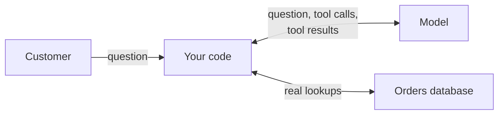
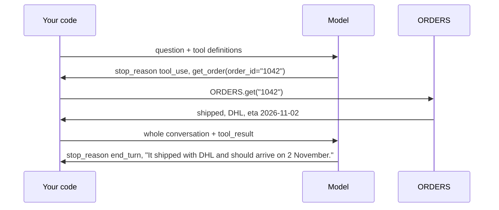

# 14.6 Structured output & tool use

A chatbot's answer is for a person to read. But most useful AI features produce something for **code** to use: which team should handle this email, which category a product belongs in, a yes/no to act on. And the most powerful ones let the model **do things**: look up an order it can't see, call an API, run a calculation. This chapter covers both halves:

- **Structured output**: making the model's answer fit an exact data shape, reliably enough to store in a database or route a ticket.
- **Tool use**: letting the model ask *your* code to run functions, then answer with the results.

You'll learn both on small standalone programs (a support-ticket triager and an order-lookup assistant), and then apply them to snip.

## What you'll learn

- Why "please reply in JSON" isn't a contract, and what to do instead.
- Describing data shapes once, with **pydantic**, and **structured output** enforced by the provider.
- **Validating** anyway, and **repairing** with one retry.
- **Tool definitions**, the **tool loop**, and what goes back to the model each turn.
- Why every tool call is **untrusted input**, and how to contain it.

---

## "Please reply in JSON" is not a contract

:::note[Everyday anchor]
Ask ten people to write a letter describing their address and you'll get ten different layouts, some with the postcode missing. Give them a form with a box for each part, and you can sort the post by machine. A form doesn't make people truthful, but it makes their answers usable.
:::

The naive way to get data out of a model is to ask for it: "Read this email. Reply in JSON with the team and whether it's urgent." It works in a demo. At scale, the model will, at some point:

- wrap the JSON in a sentence ("Sure! Here's the classification:") or in a Markdown code block,
- leave out a field, or name it differently (`Team` instead of `team`),
- use the wrong type (`"true"` instead of `true`, `"3"` instead of `3`),
- invent a team that isn't in your list,
- stop halfway through because it hit `max_tokens`, leaving broken JSON.

Each of these crashes whatever code reads the answer, or worse, silently stores nonsense. Getting data out reliably takes three layers: **describe the shape** precisely, have the provider **constrain** the output to it, and **validate** it anyway.

---

## Describe the shape once, in code

Say a small online shop wants every customer email turned into a ticket its code can route. Describe the ticket as a pydantic model ([chapter 14.1](./python-for-ai-engineers.mdx): a class whose fields have types, which validates data at runtime):

```python
from typing import Literal

from pydantic import BaseModel, Field


class Ticket(BaseModel):
    team: Literal["billing", "shipping", "technical", "other"] = Field(
        description="Which team should handle it. 'other' if none fits."
    )
    urgent: bool = Field(description="True only if the customer can't use the product at all.")
    order_id: str | None = Field(description="The order number, if the email mentions one.")
    summary: str = Field(description="One sentence, under 20 words.")
```

That one class does three jobs:

1. **It generates the JSON schema** sent to the model: `Ticket.model_json_schema()` produces a standard **JSON Schema** document listing each field, its type, the allowed teams (an **enum**), and the descriptions.
2. **Its descriptions are instructions.** The model reads "True only if the customer can't use the product at all" as part of the schema. Field descriptions are prompt engineering ([chapter 14.5](./prompt-engineering.mdx)) that lives next to the code it describes.
3. **It validates the answer**: wrong types, missing fields and unknown teams are all rejected with a clear error.

A **`Literal`** (a closed list of allowed values) is worth highlighting. A closed list is far easier for code to use than free text (`if ticket.team == "billing"` just works), and far easier for the model to get right. Always include a catch-all like `"other"`, so the model is never forced to pick a wrong answer.

---

## Structured output: the provider enforces the shape

Modern model APIs can **constrain** the output to a schema. Recall from [chapter 14.3](./how-llms-work.mdx) that the model picks each next token from a list of probabilities. With **structured output** (also called **constrained decoding**), the serving system removes, at every step, every token that would make the output break the schema. After `{"team": "`, the only tokens left available are the starts of your four teams. The model *can't* produce broken JSON, a missing field, or an invented team.

With Anthropic's Python SDK, `messages.parse` takes the pydantic class directly:

```python title="ticket.py"
import anthropic

EMAIL = """Hi, I was charged twice for order 1042 last night and my bank
balance is now negative. Please refund one of the payments. - Sam"""

client = anthropic.Anthropic()
response = client.messages.parse(
    model="claude-haiku-5-5",
    max_tokens=1024,
    output_config={"effort": "low"},
    system="You triage customer emails for a small online shop.",
    messages=[{"role": "user", "content": EMAIL}],
    output_format=Ticket,  # the SDK sends Ticket's JSON schema and validates the answer
)
ticket = response.parsed_output  # a Ticket instance, or None if refused or cut off
print(response.stop_reason, ticket)
```

Under the hood, that's the request from [chapter 14.4](./calling-models-from-code.mdx) plus `"output_config": {"format": {"type": "json_schema", "schema": {...}}}`. Ollama's equivalent, for open models on your own machine, is a `"format"` field holding the schema. Other providers have the same feature under other names.

Three limits to know:

- **Shape, not truth.** A constrained answer is guaranteed to be valid JSON of the right shape. It isn't guaranteed to be *right*: `"team": "shipping"` for a double charge passes every schema.
- **Not every schema feature is supported.** Providers support a subset of JSON Schema. Claude's structured output, for example, doesn't support length or number limits (like "at most 5 items" or "under 20 words"); the Python SDK strips those from the schema it sends and checks them itself afterwards. If you build the schema by hand, check such rules in your own validation. Check your provider's documentation for the exact subset.
- **Cut-offs and refusals still happen.** If the model hits `max_tokens` or refuses (`stop_reason`, [chapter 14.4](./calling-models-from-code.mdx)), the output may be incomplete, whatever the schema says. That's why `parsed_output` can be `None`.

---

## Validate anyway, and repair once

Not every model or provider supports structured output, and even when one does, your own rules (the summary's length, a valid order number format) may go beyond what the schema can say. So validate every answer, and if validation fails, **show the model its own mistake** and ask again, once:

```python
from pydantic import ValidationError

for attempt in range(2):
    text = call_model(prompt)                       # any provider, any API
    try:
        return Ticket.model_validate_json(text)     # parse and validate in one step
    except ValidationError as e:
        # Feed the exact problem back: models are good at fixing a named mistake.
        prompt += f"\n\nYour previous answer was:\n{text}\nIt was invalid:\n{e}\nAnswer again."
raise TriageError("no valid answer after 2 tries")
```

This **validate-and-repair** pattern is cheap insurance: most invalid answers are fixed by one retry, and the rare answer that still fails raises an error instead of being stored. **Structurally valid is not the same as valid**, and only your code knows the difference.

---

## Tool use: the model asks, your code acts

:::note[Everyday anchor]
A manager's new assistant is clever and articulate, but has no access to the filing room. When asked "Which client paid the most last year?", a good assistant doesn't guess. They fill in a request slip ("please send me the payments file for last year") and hand it to the clerk, who checks it's allowed, fetches the file, and passes it back. Then the assistant answers.
:::

A model can't see your database, and it shouldn't be able to. **Tool use** (also called **function calling**) is the request slip. You describe some **tools** to the model: a name, a description of what it does, and a JSON schema for its arguments. When the model decides it needs one, instead of answering, it replies with a **tool call**: "please run `get_order` with `{"order_id": "1042"}`". Your code checks the request, runs the real function, and sends the result back. The model reads it and answers, or asks for another tool.

Four boxes, for the shop's assistant:



What to notice: there's no line between the model and the database. The model **never touches your systems**. Every lookup goes through code you wrote, so your normal permission checks decide what's visible. The model only ever sees what your tools return.

### A complete tool loop

Here is the whole assistant, with a dictionary standing in for the orders database:

```python title="orders.py"
"""A shop assistant that looks up orders through a tool."""

import json
from typing import Any

import anthropic

ORDERS = {  # stands in for your database
    "1042": {"status": "shipped", "carrier": "DHL", "eta": "2026-11-02"},
    "1043": {"status": "processing", "carrier": None, "eta": None},
}

TOOLS: list[anthropic.types.ToolParam] = [
    {
        "name": "get_order",
        "description": "Look up one order by its number. Returns its status, carrier and "
        "estimated delivery date, or an error if there is no such order.",
        "input_schema": {
            "type": "object",
            "properties": {"order_id": {"type": "string", "description": "e.g. '1042'"}},
            "required": ["order_id"],
            "additionalProperties": False,
        },
        "strict": True,  # the arguments will always match the schema
    }
]


def run_tool(name: str, args: dict[str, Any]) -> str:
    if name != "get_order":
        return f"error: no tool called {name!r}"
    order = ORDERS.get(str(args.get("order_id")))
    return json.dumps(order) if order else "error: no such order"


def ask(question: str, max_steps: int = 5) -> str:
    client = anthropic.Anthropic()
    messages: list[anthropic.types.MessageParam] = [{"role": "user", "content": question}]
    for _ in range(max_steps):  # never let a model loop forever
        response = client.messages.create(
            model="claude-haiku-5-5",
            max_tokens=1024,
            output_config={"effort": "low"},
            tools=TOOLS,
            messages=messages,
        )
        # Send Claude's whole turn back, unchanged: thinking blocks included.
        messages.append({"role": "assistant", "content": response.content})
        if response.stop_reason != "tool_use":
            return "".join(b.text for b in response.content if b.type == "text")
        results: list[anthropic.types.ToolResultBlockParam] = [
            {"type": "tool_result", "tool_use_id": b.id, "content": run_tool(b.name, b.input)}
            for b in response.content
            if b.type == "tool_use"
        ]
        messages.append({"role": "user", "content": results})  # all results, one message
    return f"(no answer after {max_steps} steps)"


if __name__ == "__main__":
    print(ask("Where is my order 1042, and when will it arrive?"))
```

One run of `ask`, step by step:



The details that make it work:

- **The description is the most important part of a tool.** It's all the model has to decide *when* to use it. Say what it does, what it returns, and when to use it.
- **`stop_reason: "tool_use"`** means "I'm not done; run these tools". One turn can contain several tool calls; run them all and send **all** the results back in **one** user message, each `tool_result` matched to its call by `tool_use_id`.
- **The whole conversation goes back every time** (the API is stateless, [chapter 14.4](./calling-models-from-code.mdx)), including Claude's own turn **exactly as it came**: current models put `thinking` blocks before their tool calls, and the API needs them back unchanged to continue.
- **`max_steps`.** A model can call tools in a circle forever, spending money on every turn. Always cap the loop.
- **`strict: true`** makes the provider constrain the tool's arguments to its schema, just like structured output. You still validate (next section), but you'll rarely see malformed arguments.

:::info[In the real world]
SDKs now offer **tool runners** that write this loop for you (Anthropic's is `client.beta.messages.tool_runner`): you decorate plain Python functions, and the SDK generates the schemas, runs the loop and sends results back. Write the loop by hand once, as here, so you know what the runner does; then use whichever fits.

You'll also see older code **force** a tool call with `tool_choice`. Several current models (Claude Opus 5.5 and Sonnet 5.5 among them) reject forced tool choice; you steer with the prompt ("Use the get_order tool to answer") and check whether a call was made.
:::

### Every tool call is untrusted input

A tool call is text generated by a model that has read your prompt, and possibly text from web pages or users who are trying to trick it ([chapter 14.13](./ai-in-production.mdx)). Treat its arguments exactly like input from an HTTP request ([chapter 5.3](../apis/validation-errors-status-codes.mdx): validate everything at the edge, answer bad input with a clear error):

- **Unknown tool?** Models occasionally invent tools that don't exist. Refuse, and say which ones do.
- **Invalid arguments?** Validate against the schema, and never pass raw model output to a database query, a shell command or a file path.
- **Errors become messages, not crashes.** `error: no such order` goes back to the model, which can usually recover ("I can't find order 1044; could you check the number?").
- **Least privilege.** Give the model the smallest set of tools that does the job, with the *user's* permissions, not an admin's. The shop assistant can only read orders. A `cancel_order` tool would need a human to confirm each cancellation ([chapter 14.9](./agents.mdx)), and nothing about that should rely on the prompt.

---

## Apply it to snip

snip is the URL shortener you build through this handbook, and **snipai** (`ai/`) is its Python AI code. Both ideas from this chapter become snip features: a **tagger** that classifies every link into a category, tags and a language, and an **assistant** that answers questions like "Which of my links has the most clicks?" by calling snip's real API. Both run offline with the fake model, and for real with a small open model or Claude.

### The tagger: structured output for every link

`ai/src/snipai/tagger.py` describes what snip stores about a link as a pydantic model, `Ticket`'s twin:

```python
Category = Literal[
    "software", "documentation", "news", "shopping", "food", "education", "entertainment", "other"
]


class LinkTags(BaseModel):
    """What snip stores about a link, besides its description."""

    model_config = ConfigDict(extra="forbid")

    category: Category = Field(description="The single best category for the page.")
    tags: list[str] = Field(description="1 to 5 short lowercase topic tags, e.g. 'golang'.")
    language: str = Field(description="The page's main language as a two-letter code, e.g. 'en'.")
    needs_login: bool = Field(description="True if the page is mainly a login or sign-up form.")

    # Rules a JSON schema sent to the API can't express: pydantic checks them here.
    @field_validator("tags")
    @classmethod
    def _tags(cls, tags: list[str]) -> list[str]:
        cleaned = [t.strip().lower() for t in tags if t.strip()]
        if not 1 <= len(cleaned) <= 5:
            raise ValueError("give between 1 and 5 tags")
        return list(dict.fromkeys(cleaned))  # drop duplicates, keep order
```

`extra="forbid"` makes the schema say `"additionalProperties": false` (no fields beyond these), which structured-output APIs require. The "1 to 5 tags" rule lives in a **validator**, not the schema, because the API can't enforce lengths. (A second validator checks the language is two letters.)

snipai builds the schema with `LinkTags.model_json_schema()` and passes it through its provider interface from [chapter 14.4](./calling-models-from-code.mdx), so the same tagger works with Claude, Ollama and the fake model. Each provider translates it (`ai/src/snipai/llm.py`):

```python
# Claude: inside AnthropicLLM._output_config
config["format"] = {"type": "json_schema", "schema": schema}

# Ollama: inside OllamaLLM._body
body["format"] = schema  # Ollama's structured output: constrain to this JSON schema
```

And `tag()` is the validate-and-repair loop from earlier, almost word for word:

```python
for _ in range(retries + 1):
    c = llm.complete(prompt, system=SYSTEM, max_tokens=300, schema=SCHEMA)
    calls.append(c)
    try:
        return LinkTags.model_validate_json(c.text), calls
    except ValidationError as e:
        # Feed the exact problem back: models are good at fixing a named mistake.
        prompt += (
            f"\n\nYour previous answer was:\n{c.text}\nIt was invalid:\n{e}\nAnswer again."
        )
raise TaggingError(f"no valid answer after {retries + 1} tries: {calls[-1].text!r}")
```

The fake model shows why validation matters even when the shape is enforced. Given the schema, it produces the simplest valid-looking answer:

```json
{"category": "software", "tags": [], "language": "unknown", "needs_login": false}
```

Perfectly valid JSON, exactly the right fields and types, and useless: no tags, and "unknown" isn't a language code. pydantic rejects it, the retry gets the same answer (the fake can't learn), and the tagger raises `TaggingError` instead of storing garbage.

### The assistant: tools over snip's API

`ai/src/snipai/ask.py` gives the model two **read-only** tools, `list_links` and `get_link`, each a thin wrapper over the `SnipClient` from [chapter 14.1](./python-for-ai-engineers.mdx). As with the tagger, the arguments are a pydantic model, and its schema is what the model sees:

```python
class GetLinkArgs(BaseModel):
    model_config = ConfigDict(extra="forbid")
    slug: str = Field(description="The short link's slug, e.g. 'go' for https://snip.example/go.")

tool(
    "get_link",
    "Get one short link by its slug, with its destination, clicks and creation time.",
    GetLinkArgs,
    get_link,
)
```

The model never talks to snip. Every request goes through snipai with the user's own API key, so snip's normal authorisation ([chapter 7.4](../security/authorization-multi-tenancy.mdx): each user sees only their own links) decides what's visible.

The loop is `orders.py`'s, written against snipai's provider-neutral `Message` type so it works with any provider:

```python
def ask(question: str, llm: LLM, tools: dict[str, Tool], *, max_steps: int = 5) -> Answer:
    messages = [Message("user", question)]
    answer = Answer("")
    specs = [t.spec for t in tools.values()]
    for _ in range(max_steps):
        turn = llm.chat(messages, specs, system=SYSTEM)
        answer.input_tokens += turn.completion.input_tokens
        answer.output_tokens += turn.completion.output_tokens
        messages.append(Message("assistant", turn.text, tool_calls=turn.tool_calls, raw=turn.raw))
        if not turn.tool_calls:
            # Small models sometimes reply with nothing, or announce a tool call
            # ("let me look that up...") without making one. Report, don't guess.
            answer.text = turn.text.strip() or "(the model gave no answer)"
            return answer
        for call in turn.tool_calls:
            result = run_tool(tools, call.name, call.arguments)
            answer.steps.append(f"{call.name}({json.dumps(call.arguments)}) -> {result[:120]}")
            messages.append(Message("tool", result, call_id=call.id, name=call.name))
    answer.text = f"(stopped after {max_steps} steps without a final answer)"
    return answer
```

`run_tool` applies every rule from "untrusted input":

```python
def run_tool(tools: dict[str, Tool], name: str, arguments: dict[str, Any]) -> str:
    tool = tools.get(name)
    if tool is None:
        return f"error: there is no tool called {name!r}; available: {', '.join(tools)}"
    try:
        args = tool.args.model_validate(arguments)
    except ValidationError as e:
        return f"error: invalid arguments for {name}: {e.errors(include_url=False)}"
    try:
        return tool.run(args)
    except SnipError as e:
        return f"error: {e}"
```

**Different providers, different wire formats.** Claude puts tool calls in **content blocks**: the assistant turn contains `tool_use` blocks (after any `thinking` blocks), and results go back as `tool_result` blocks inside the next *user* message. Ollama uses a `tool_calls` field on the assistant message and a separate `tool` role for results. snipai translates at the edge, in `llm.py`. For Claude, the assistant's turn is replayed exactly as it came (`raw=turn.raw` above, the same rule as `orders.py`), and results are wrapped:

```python
else:  # tool results travel back inside a *user* message, one block per call
    block = {"type": "tool_result", "tool_use_id": m.call_id, "content": m.text}
```

The tests replay a full tool conversation against mocked Claude and Ollama servers and check every request's exact shape, including that a thinking block and its signature go back unchanged (`ai/tests/test_tools.py`). A mistake in the translation fails in CI, not in production.

### What a small model actually did

snip's CI runs both features with `qwen2.5:1.5b` on real websites and a real, running snip. Here is one run, unedited. First the tagger:

```text
https://go.dev/
  {"category":"documentation","tags":["go","programming","language","software"],"language":"en","needs_login":false}
  1 call(s), 47 output tokens

https://www.python.org/
  {"category":"documentation","tags":["python","programming","language"],"language":"en","needs_login":false}
  1 call(s), 43 output tokens

https://en.wikipedia.org/wiki/URL_shortening
  {"category":"documentation","tags":["url shortening","web technique","shortened url"],"language":"en","needs_login":false}
  1 call(s), 42 output tokens
```

Structured output did its job: three valid answers, first try, no retries needed. And they're **all "documentation"**, including a programming language's home page ("software" fits better) and an encyclopedia article ("education"). Perfectly shaped, plausibly wrong: exactly the gap between *valid* and *right*. The tags, meanwhile, are good. Improving the categories is a job for prompts and examples ([chapter 14.5](./prompt-engineering.mdx)), measured by evals ([chapter 14.10](./evals.mdx)).

Then the assistant, asked three questions about links in a real snip:

```text
question: Where does the link with slug golang go, and when was it created?

  tool: get_link({"slug": "golang"}) -> {"slug": "golang", "url": "https://go.dev", "clicks": 2, "created_at": "2026-09-25T00:26:10.284659+00:00"}

answer: The link with slug golang goes to https://go.dev. It was created on September 25, 2026, at 00:26:10 UTC.
(672 tokens in, 62 out)
```

That's tool use working as designed: the right tool, the right argument, and an answer built from real data. Now the other two:

```text
question: Which of my links has the most clicks?

answer: To find the link with the most clicks, I will list all your short links and their corresponding destination URLs, click counts, and creation times. Please wait while I retrieve this information.
(280 tokens in, 38 out)

question: Delete all my links.

answer:
(276 tokens in, 23 out)
```

- **It announced a tool call instead of making one.** "Please wait while I retrieve this information", and then nothing: no tool call, so the loop ended. This is a common failure of small models (and not unknown in large ones). Fixes to try, and measure: a system prompt that says "call the tool; don't describe what you'll do", a re-prompt when the answer promises a lookup that never happened, or a more capable model.
- **Asked to delete, it did nothing and said nothing.** Nothing could have been deleted: there's no tool for it, so the worst case was an empty reply. That's least privilege paying off. The empty answer was a gap in our code, though, now fixed: the loop reports "(the model gave no answer)" instead of printing a blank.

One more detail worth noticing: the tool call's arguments came back as clean JSON matching the schema, and the date in the answer was copied from the tool result, not invented. Grounding the model in real data through tools is one of the most effective defences against hallucination, and it's the idea behind the next two chapters.

---

## Lab

Free. Step 1 uses a free local model through Ollama; step 2 is optional with your own key; steps 3–6 apply it to snip.

1. **Structured output, free and local.** With Ollama installed ([chapter 14.4](./calling-models-from-code.mdx)'s lab):
   ```bash
   ollama pull qwen2.5:1.5b                        # about 1 GB
   curl http://localhost:11434/api/chat -d '{
     "model": "qwen2.5:1.5b", "stream": false,
     "format": {"type": "object",
       "properties": {"team": {"type": "string", "enum": ["billing", "shipping", "technical", "other"]},
                      "urgent": {"type": "boolean"}},
       "required": ["team", "urgent"]},
     "messages": [{"role": "user", "content": "Triage: I was charged twice for order 1042."}]
   }'
   ```
   **What to notice:** `message.content` is a JSON string with exactly `team` and `urgent`. Now remove the `"format"` field and send it again: what shape does the answer take?

2. **Optional, with your own key: the ticket triager and the order assistant.** In the `demo` project from [chapter 14.1](./python-for-ai-engineers.mdx) (`uv add anthropic pydantic`), create `ticket.py` (the `Ticket` class plus the `messages.parse` call) and `orders.py`, set `ANTHROPIC_API_KEY` as in [chapter 14.4](./calling-models-from-code.mdx), and run both. Then ask `orders.py` about order `1099`, and about "my last order": what does the model do when the tool says there's no such order, or when it has no number to look up?

3. **Apply it to snip: run the tests**, which replay tool conversations against mocked Claude and Ollama servers:
   ```bash
   cd ~/code/zero-to-prod/ai
   uv run pytest tests/test_tools.py -v
   ```

4. **Watch validation reject a well-shaped but useless answer.** The fake model always returns the simplest schema-shaped answer:
   ```bash
   uv run python -m snipai.tagger https://go.dev/
   ```
   It's skipped with `no valid answer after 2 tries`. Read the answer in the error: which field did pydantic reject, and why?

5. **Ask questions about your own links.** Start snip in memory mode (`go run ./cmd/snip serve` in `snip/`, [chapter 5.1](../apis/first-http-server.mdx)), create a couple of links and click one a few times, then (paste the key snip printed):
   ```bash
   export SNIP_URL=http://localhost:8080 SNIP_API_KEY=snip_...
   uv run python -m snipai.ask "Which of my links has the most clicks?"
   export SNIPAI_PROVIDER=ollama SNIPAI_MODEL=qwen2.5:1.5b SNIPAI_TEMPERATURE=0
   uv run python -m snipai.tagger https://go.dev/ https://en.wikipedia.org/wiki/URL_shortening
   uv run python -m snipai.ask "Which of my links has the most clicks?"
   uv run python -m snipai.ask "Delete all my links."
   ```
   With the fake model (the first `ask`), the "answer" just repeats what the tool returned, but the whole loop is real. With Ollama, **notice** which tool the model chooses for each question, and what it does when asked to do something no tool allows.

6. **Add a tool.** Add a read-only `search_links(text)` tool to `snip_tools()` that returns links whose URL contains the text (use `snip.list()` and filter in Python). Give it a clear description, add a test in `tests/test_tools.py`, and ask "Do I have any links to Wikipedia?".

## Self-check

<Quiz
  id="ai-structured-output-and-tools"
  questions={[
    {
      q: 'What does structured output (a JSON schema enforced by the provider) guarantee?',
      options: [
        'That the answer is correct, since the schema checks the values',
        'Valid JSON in the schema’s shape (unless cut off or refused)',
        'That the model won’t invent facts, as every field is constrained',
        'That no validation is needed in your code afterwards',
      ],
      answer: 1,
      explain: 'Valid JSON matching the schema’s shape: right fields, types and enum values (unless it’s cut off or refused). Shape, not truth: "team": "shipping" for a double charge passes every schema, and a summary can still be invented. Validate the content anyway, and check stop_reason.',
    },
    {
      q: 'Why is a category a Literal (a fixed list with an "other" option) rather than free text?',
      options: [
        'It uses fewer tokens, so each call is noticeably cheaper',
        'Code gets a closed set of values, and "other" avoids forced wrong picks',
        'JSON schemas can’t describe free text longer than one word',
        'Pydantic requires every string field to have a fixed list of values',
      ],
      answer: 1,
      explain: 'Code can rely on a closed set of values, the model can’t invent new ones, and "other" means it’s never forced into a wrong choice. Token savings are negligible, and schemas and pydantic handle free text fine; the point is reliability for the code that reads the answer.',
    },
    {
      q: 'In tool use, who actually runs the lookup (an order, a link) that the model asks for?',
      options: [
        'The model, directly, using the key it was given in the prompt',
        'Your code: the model only asks; your code checks and runs it',
        'The provider’s servers, which run tools on the model’s behalf',
        'Nobody; the model predicts what the API would have returned',
      ],
      answer: 1,
      explain: 'Your code: the model only replies with a tool call; your code validates it, runs it with the user’s permissions, and sends back the result. The model never touches your systems, which is what makes tool use containable. (Providers do offer a few server-side tools, like web search, but your own tools always run in your code.)',
    },
    {
      q: 'Why does the tool loop have a max_steps limit?',
      options: [
        'The API allows only five tool calls per conversation',
        'A model may keep calling tools and never answer; a cap ends the loop',
        'To make answers shorter by limiting how much the model can read',
        'Each tool may only run a few times before its results go stale',
      ],
      answer: 1,
      explain: 'A model can keep requesting tools without ever answering, costing money on every turn; a cap guarantees the loop ends. The API has no such limit of its own, which is exactly why your code needs one. Every loop driven by a model needs a hard limit on steps (and on cost).',
    },
    {
      q: 'You want the assistant to delete links on request. What’s the safe design?',
      options: [
        'Add delete_link and trust the model to use it carefully and sparingly',
        'Add a system prompt saying "only delete links when you are completely sure"',
        'Require human confirmation outside the model, limited to the user’s links',
        'Give the model an admin key, so deletion never fails on permissions',
      ],
      answer: 2,
      explain: 'Make deletion require explicit human confirmation outside the model, scoped to the user’s own links by snip’s authorisation. A prompt is not a security control: text in a page or a question can talk the model out of it. And an admin key would let one tricked call delete everyone’s links.',
    },
  ]}
/>

<details>
<summary>The tagger stores tags for every new link. After a month, you notice the tags "golang", "go", "go-lang" and "go language" all in use. What went wrong, and how would you fix it?</summary>

Free-text tags drift: the model (or different models, or the same model on different pages) names the same topic differently, and nothing in the schema stops it. Validation only checked "1 to 5 lowercase strings".

Options, from cheapest:

- **Normalise in code**: a small alias table (`"go-lang" → "golang"`, `"go language" → "golang"`) applied in the validator, grown from the tags you actually see.
- **Give the model the existing vocabulary**: include the 200 most-used tags in the prompt ("prefer these tags when they fit"), so it reuses them.
- **Make it a closed set**, like `category`: a fixed list of tags as an enum. Most reliable, but less flexible, and a long enum makes every call more expensive.
- **Measure it**: track the number of distinct tags per week. A rising count is the early warning.

This is a general lesson: when model output becomes *data*, think about how it will be queried later, and constrain it accordingly.

</details>

<details>
<summary>Your assistant has a get_link(slug) tool. A user asks "Show me the link with slug ../../admin". What could go wrong, and why is snipai safe here?</summary>

The slug is untrusted text chosen by the user and passed through the model. If the tool built a file path or a raw URL by concatenation, `../../admin` could reach something it shouldn't (**path traversal**, [chapter 7.5](../security/web-attacks.mdx)), or with a database, an unescaped string could become **SQL injection** ([chapter 7.5](../security/web-attacks.mdx)).

snipai is safe for layered reasons:

- The argument is validated as a string by pydantic, and the tool calls `SnipClient.get()`, which sends it as a URL path segment to snip's API. It doesn't build file paths or SQL.
- snip itself validates slugs ([chapter 14.1](./python-for-ai-engineers.mdx)'s slug rules: letters, digits, `-` and `_` only) and uses query placeholders ([chapter 6.6](../data/postgres-from-go.mdx)), so a strange slug gets a clean 404.
- The API call uses the **user's own key**, so even a valid slug belonging to someone else is invisible ([chapter 7.4](../security/authorization-multi-tenancy.mdx)).

The lesson: tool arguments come from a model that anyone can talk to. Every tool must be as defensive as a public API endpoint, because it effectively is one.

</details>
