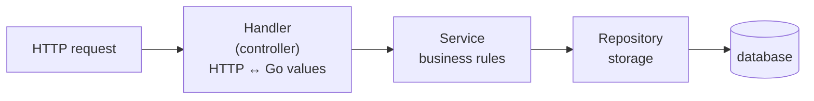
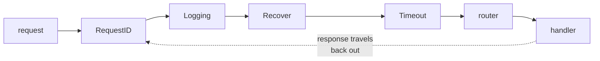
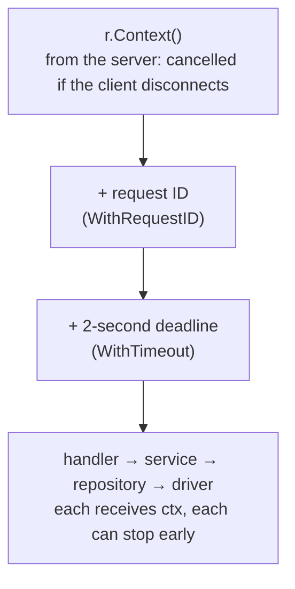
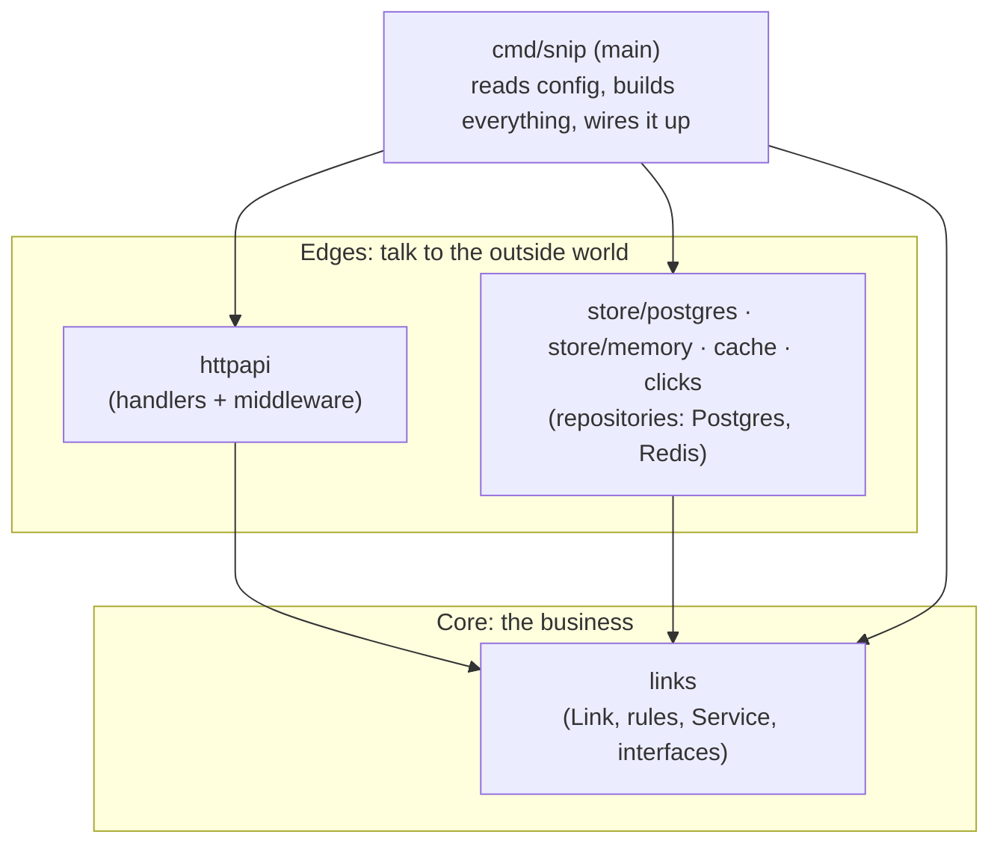

# 5.4 Structuring a real service

A one-file server works in a demo. A production service has to **run for months, be changed by people who didn't write it, and fail in ways you can diagnose at 3 a.m.** The difference isn't cleverness; it's a set of well-worn habits that nearly every production service shares, whatever the language. This chapter teaches them on a small, runnable to-do API — how its code is split into layers, what wraps every request, how a request carries its deadline and ID through the code, how it's configured, how it logs, how it protects itself and how it stops — and then finds every one of them in the link shortener you're building.

## What you'll learn

- **Layers**: the **handler** ("controller") speaks HTTP, the **service** holds the business rules, the **repository** talks to storage — and why dependencies point inward.
- **Middleware chains**: wrapping every request with request IDs, logging, panic recovery and deadlines — and why the order matters.
- **Request-scoped context**: one `context.Context` per request carrying its **deadline**, its **cancellation** and its **request ID** through every layer.
- **Configuration from environment variables**, validated at startup so mistakes fail *fast*; **structured logs** you can search.
- **Timeouts**, **health vs readiness checks**, and **graceful shutdown**: the operational trio every service needs.

---

## Layers: handler, service, repository

Put every line of a service in its HTTP handlers and you get a familiar mess: SQL next to JSON parsing next to business rules, copied between endpoints, impossible to test without a database and a web server. Almost every backend codebase — in Go, Java (Spring), C# (ASP.NET), Python (Django, FastAPI) or Node (Nest) — splits the work into the same three layers instead:



| Layer | Its one job | Knows about | Never knows about |
|---|---|---|---|
| **Handler** (a.k.a. controller) | decode the request, call the service, encode the response, pick the status code | HTTP, JSON | SQL, business rules |
| **Service** | the rules: what's valid, what happens, in what order | the domain (tasks, orders, links) | HTTP, SQL |
| **Repository** | store and fetch data | the database | HTTP, business rules |

:::note[Everyday anchor]
A restaurant. The **waiter** (handler) takes orders in whatever language customers speak and writes kitchen tickets. The **chef** (service) knows the recipes and the rules — no peanuts in dish 12. The **pantry** (repository) stores and hands over ingredients. The chef never talks to customers, and the waiter never cooks. You can replace the pantry's supplier, or take orders by phone instead of in person, without retraining the chef.
:::

The handbook's to-do API, `snip/examples/tasks`, has one file per layer. The **repository** is an interface ([chapter 4.3](../go/packages-modules-interfaces.mdx)) plus an in-memory implementation (`repository.go`):

```go
type Repository interface {
	Create(ctx context.Context, t Task) (Task, error)
	Get(ctx context.Context, id int64) (Task, error)
	List(ctx context.Context, limit int) ([]Task, error)
}
```

The **service** holds the rules and is handed a repository (`service.go`):

```go
func (s *Service) Create(ctx context.Context, title string) (Task, error) {
	title = strings.TrimSpace(title)
	if title == "" || utf8.RuneCountInString(title) > 200 {
		return Task{}, ErrInvalidTitle // a business rule — no HTTP in sight
	}
	return s.repo.Create(ctx, Task{Title: title, CreatedAt: s.now().UTC()})
}
```

The **handler** translates between HTTP and the service (`handler.go`, trimmed):

```go
func (h *Handler) get(w http.ResponseWriter, r *http.Request) {
	id, err := strconv.ParseInt(r.PathValue("id"), 10, 64) // HTTP in
	if err != nil || id < 1 {
		writeError(w, http.StatusBadRequest, "invalid_id", "id must be a positive whole number")
		return
	}
	t, err := h.svc.Get(r.Context(), id) // call the service
	if err != nil {
		h.writeDomainError(w, r, err) // service errors → status codes, in one place
		return
	}
	writeJSON(w, http.StatusOK, t) // HTTP out
}
```

And **`main`** is the only place that knows every concrete type. It builds each layer and hands it to the next ([chapter 4.3](../go/packages-modules-interfaces.mdx)'s dependency injection):

```go
repo := NewMemoryRepo()
svc := NewService(repo)
h := &Handler{svc: svc, log: log}
```

The key rule: **dependencies point inward.** The handler imports the service; the service never imports the handler, and only knows the repository as an interface. The payoffs:

- **Swap storage** — Postgres instead of a map — by writing a new repository. The service and handlers don't change.
- **Add another way in** — a command-line tool, a queue consumer — that calls the same service. The rules aren't copied.
- **Test each layer alone.** `examples/tasks/tasks_test.go` tests the service with the in-memory repository (no HTTP), and the whole stack with a fake repository that always fails, to check a `500` leaks nothing ([chapter 4.4](../go/testing.mdx)).

:::info[In the real world]
You'll hear this idea called **layered architecture**, **clean architecture**, **hexagonal architecture** or **ports and adapters**. The names differ; the core idea — business rules in the middle, depending on interfaces, with HTTP and databases at the edges — is the same. Don't over-apply it: a 200-line service doesn't need twelve layers and an interface for every struct.
:::

---

## Middleware: wrapping every request

Some jobs apply to **every** request: give it an ID, time it, log it, recover if it panics, check its credentials, give it a deadline. Writing that in every handler would be repetitive, and the one handler someone forgets becomes the blind spot during an incident. Instead, you wrap handlers in **middleware**: a function that takes a handler and returns a new handler that does something before and/or after calling it.

```go
// Middleware takes a handler and returns a new one that wraps it.
type Middleware func(http.Handler) http.Handler
```

The simplest useful one, from `examples/tasks/middleware.go`, times and logs each request:

```go
func WithLogging(log *slog.Logger) Middleware {
	return func(next http.Handler) http.Handler {
		return http.HandlerFunc(func(w http.ResponseWriter, r *http.Request) {
			start := time.Now()                                 // BEFORE the handler
			rec := &statusRecorder{ResponseWriter: w, status: http.StatusOK}
			next.ServeHTTP(rec, r)                              // the rest of the chain runs here
			log.InfoContext(r.Context(), "request",             // AFTER the handler
				"request_id", RequestID(r.Context()), "method", r.Method, "path", r.URL.Path,
				"status", rec.status, "duration_ms", time.Since(start).Milliseconds())
		})
	}
}
```

The `statusRecorder` wraps the `ResponseWriter` so the middleware can learn which status code the handler wrote.

### Chains, and why order matters

Several middleware wrap each other like layers of an onion. The to-do API builds its chain in `main.go`:

```go
handler := Chain(h.Routes(),
	WithRequestID,     // 1. outermost: every request gets an ID first
	WithLogging(log),  // 2. logs every request, with that ID
	WithRecover(log),  // 3. turns a panic below into a clean 500 — which the logger then sees
	WithTimeout(*timeout), // 4. gives the request a deadline
)
```



A request passes through them **in the order listed**, and the response travels back out in **reverse** (`TestChainOrder` in `tasks_test.go` proves it: `A before, B before, handler, B after, A after`). So order is a design decision:

- **Request ID first**, so everything after it — including the log line — can use the ID.
- **Logging outside recovery**, so a panic that recovery turns into a `500` is still logged as a `500`. Swap them and a crashing request's log line would say `200`.
- **Authentication** (checking an API key, [chapter 7.2](../security/authentication.mdx)) usually wraps only the routes that need it, not health checks.

:::info[If you've written code]
Express's `app.use(...)`, Django's `MIDDLEWARE` list and ASP.NET's pipeline are the same idea, and order matters in all of them. In Go, middleware is a plain function `func(http.Handler) http.Handler` — no framework needed.
:::

---

## Request-scoped context: deadline, cancellation, request ID

A request isn't handled by one function. It flows handler → service → repository → database driver. Three facts belong to *that request* and every function on its path needs them:

- **Its deadline.** "Give up after 2 seconds" must reach the database query, not just the handler.
- **Its cancellation.** If the client disconnects, every layer should stop working for it.
- **Its identity.** The request ID, so any layer's log line can be tied back to it.

Go carries all three in one value: the request's **`context.Context`** ([chapter 4.5](../go/concurrency.mdx)). The HTTP server creates it (`r.Context()`, already cancelled when the client goes away); middleware enriches it; every layer passes it down as its first argument.

**A deadline**, added by middleware (`examples/tasks/middleware.go`):

```go
func WithTimeout(d time.Duration) Middleware {
	return func(next http.Handler) http.Handler {
		return http.HandlerFunc(func(w http.ResponseWriter, r *http.Request) {
			ctx, cancel := context.WithTimeout(r.Context(), d) // a child context with a deadline
			defer cancel()
			next.ServeHTTP(w, r.WithContext(ctx))              // everything below sees the deadline
		})
	}
}
```

**Honouring it** is the job of whatever waits. The example's repository pretends to be a slow database, and gives up the moment the context says so:

```go
select {
case <-time.After(m.Delay): // the "query" finished
	return nil
case <-ctx.Done(): // deadline passed or client left: stop now
	return ctx.Err() // context.DeadlineExceeded or context.Canceled
}
```

Real database drivers (pgx, `database/sql`) do exactly this with the context you pass them. The error travels back up, and the handler's `writeDomainError` turns `context.DeadlineExceeded` into `503 timeout`.

**A request ID**, stored *in* the context with `context.WithValue`:

```go
type ctxKey struct{} // a private key type: no other package can collide with it

func WithRequestID(next http.Handler) http.Handler {
	return http.HandlerFunc(func(w http.ResponseWriter, r *http.Request) {
		id := rand.Text()[:12]
		w.Header().Set("X-Request-ID", id) // the client can quote it
		ctx := context.WithValue(r.Context(), ctxKey{}, id)
		next.ServeHTTP(w, r.WithContext(ctx))
	})
}

func RequestID(ctx context.Context) string { // any layer can read it back
	id, _ := ctx.Value(ctxKey{}).(string)
	return id
}
```



Each middleware makes a **child** context that adds one thing and keeps everything from its parent.

:::warning[What can go wrong]
- **Dropping the context.** Calling `repo.Get(context.Background(), id)` deep in the service cuts the chain: that query ignores the deadline and keeps running after the client has gone. Always pass the `ctx` you were given.
- **Using context values for real parameters.** `context.WithValue` is for request-scoped *metadata* — IDs, the authenticated user, trace data. A function's real inputs (the title, the limit) go in its parameters, where the compiler checks them.
- **Plain string keys.** `context.WithValue(ctx, "id", …)` can collide with another package's `"id"`. Use an unexported key type, as above.
:::

---

## Configuration from the environment

A service runs in many places — your laptop, CI, staging, production — each with different database addresses, log levels and secrets. The **same built program** must run in all of them ([chapter 2.2](../linux/users-permissions-processes.mdx)), so settings come from **environment variables**, never from code. A minimal version:

```go
port := os.Getenv("PORT")
if port == "" {
	port = "8080" // a sensible default for development
}
limit, err := strconv.Atoi(os.Getenv("MAX_TASKS"))
if err != nil || limit < 1 {
	log.Fatal("MAX_TASKS must be a positive whole number") // refuse to start
}
```

Three habits:

- **One place** defines every setting, its variable name, its default and its meaning.
- **Sensible defaults** for development, so `go run .` works with nothing set.
- **Fail fast.** `MAX_TASKS=ten` stops the service **at startup** with a clear message. The alternative — silently using a default — means you discover the typo weeks later, in production, as mysteriously wrong behaviour.

This follows the **Twelve-Factor App** guidelines (12factor.net), a widely used checklist for services that run well on modern platforms. Two of its factors show up constantly in this handbook: *store config in the environment*, and *treat logs as event streams*.

:::danger
Secrets such as a database password come from the environment too — but never from a file committed to Git. [Chapter 7.6](../security/secrets-management.mdx) covers where secrets should actually live.
:::

---

## Structured logs

A log line like `user 42 created task 7 in 12ms` is easy for a human to read and hard for a computer to search. "Show me every request slower than 500 ms" means writing fragile text-matching. **Structured logging** writes each event as **named fields** — usually as JSON ([chapter 1.3](../foundations/bits-bytes-text-formats.mdx)):

```json
{"time":"2026-10-29T09:15:02Z","level":"INFO","msg":"request","request_id":"3f9a2c71d0b4","method":"POST","path":"/tasks","status":201,"duration_ms":12}
```

Now "slow requests" is `jq 'select(.duration_ms > 500)'` ([chapter 2.3](../linux/pipes-and-text-tools.mdx)), and log platforms ([chapter 13.1](../observability/logs.mdx)) can filter, count and graph any field. Go has this built in, in the **`log/slog`** package:

```go
log := slog.New(slog.NewJSONHandler(os.Stdout, nil))   // JSON for machines (production)
// log := slog.New(slog.NewTextHandler(os.Stdout, nil)) // key=value for humans (development)

log.Info("tasks API listening", "addr", ":8081")
log.Warn("cache unavailable", "err", err)
```

Notice the logger writes to **stdout** and never manages log files. Whatever runs the service — your terminal, systemd's journal ([chapter 2.5](../linux/running-a-linux-server.mdx)), Docker, Kubernetes — collects stdout. The service does one job; the platform handles the logs.

**Log levels** control the volume: `DEBUG` (very detailed, off in production), `INFO` (normal events), `WARN` (something odd, but handled), `ERROR` (something failed and needs attention).

:::warning
Never log secrets: passwords, full API keys, tokens, or personal data you don't need. Logs are copied, shipped and kept far longer than you expect, and are read by many people ([chapter 13.1](../observability/logs.mdx)).
:::

---

## Timeouts: protecting yourself from slow clients

`http.ListenAndServe(":8080", nil)` has **no timeouts**. A client can open a connection and send one byte every minute, forever, holding a goroutine and a file descriptor ([chapter 2.2](../linux/users-permissions-processes.mdx)) the whole time. A few thousand of those — an attack called **Slowloris** — can exhaust a server without much traffic at all. A production server sets every timeout (`examples/tasks/main.go`):

```go
srv := &http.Server{
	Addr:              *addr,
	Handler:           handler,
	ReadHeaderTimeout: 5 * time.Second,  // headers must arrive within 5s
	ReadTimeout:       10 * time.Second, // the whole request within 10s
	WriteTimeout:      15 * time.Second, // the response must be written within 15s
	IdleTimeout:       60 * time.Second, // idle keep-alive connections closed after 60s
}
```

Every wait needs a limit — inbound (these), and outbound: the request's context deadline bounds every database call below it. **A service with no timeouts has no upper bound on how long it can hang.**

---

## Health vs readiness

Platforms that run services (load balancers, systemd, Kubernetes) keep asking two different questions, and a good service answers each on its own endpoint:

| | **Liveness** (often `/healthz`) | **Readiness** (often `/readyz`) |
|---|---|---|
| Question | "Is the process alive and not stuck?" | "Can it serve real traffic right now?" |
| Checks | nothing — if it can answer, it's alive | its hard dependencies (the database), with a short timeout |
| On failure, the platform… | **restarts** the process | **stops sending it traffic** until ready again |

Why keep them separate? Imagine the database has a 30-second blip. If the liveness check tested the database, every copy of the service would fail it at once, and the platform would **restart all of them** — making the outage worse and slower to recover. Instead, readiness fails, traffic pauses, and when the database returns, the service is ready instantly. Liveness should only fail when *restarting would actually help*.

---

## Graceful shutdown

Services are stopped **all the time**: every deployment, every scale-down, every machine maintenance. If stopping means killing the process mid-request, every deploy drops some users' requests. A graceful service instead:

1. Receives **SIGTERM** ([chapter 1.2](../foundations/programs-processes-threads.mdx)) from systemd, Docker or Kubernetes.
2. Stops accepting new connections (the platform is also moving traffic elsewhere).
3. Lets in-flight requests finish — up to a deadline.
4. Exits cleanly with code 0.

In Go that's `signal.NotifyContext` plus `srv.Shutdown` — [chapter 4.5](../go/concurrency.mdx) walks through the code, and `examples/tasks/main.go` uses it. The result: deploying many times a day ([Part 11](../shipping/how-software-ships.mdx)) causes **zero** failed requests.

:::warning[What can go wrong]
- **Business rules in handlers.** The same rule copied into three endpoints drifts apart; one copy gets the fix, two don't.
- **Config in code.** A database address hard-coded "for now" ends up in production — pointing at the wrong database, or leaking a password into Git.
- **Silent config fallbacks.** A misspelled variable quietly replaced by a default leads to baffling behaviour much later. Fail fast at startup.
- **Unstructured, noisy logs.** Multi-line prose logs with no request ID can't be searched when it matters.
- **No timeouts.** The service hangs forever on a slow client, a stuck database, or a dead downstream service — and so does everything waiting on it.
- **Liveness checks that test dependencies.** One database blip triggers mass restarts — a self-inflicted outage.
:::

---

## Apply it to snip

**snip**, the link shortener you build in this handbook, is the same shape at full size. Its reference implementation lives in `snip/cmd/snip` and `snip/internal/`.

### snip's layers



- **Handlers**: `internal/httpapi` turns HTTP requests into calls on `links.Service` ([chapter 5.3](./validation-errors-status-codes.mdx) walked through `createLink`).
- **Service**: `internal/links` knows what a link *is* and the rules for it, and declares the **interfaces** it needs (`Store`, `Cache`, `ClickRecorder`). It knows nothing about HTTP, JSON, SQL or Redis.
- **Repositories**: `store/postgres` and `store/memory` both implement `links.Store`; `cache` implements `links.Cache`.
- **`main`** (`cmd/snip/main.go`) reads config, builds the concrete pieces, and injects them.

`httpapi` imports `links`; `links` never imports `httpapi`. That's why snip's business rules are tested in microseconds with fakes (`internal/links/service_test.go`).

### snip's middleware and context

snip folds request ID, panic recovery, logging and metrics into one middleware, `observe` (`internal/httpapi/middleware.go`, trimmed):

```go
func (s *Server) observe(next http.Handler) http.Handler {
	return http.HandlerFunc(func(w http.ResponseWriter, r *http.Request) {
		start := time.Now()
		id := r.Header.Get("X-Request-ID")
		if !validRequestID(id) {                       // reuse a proxy's ID only if it's short and plain
			id = newRequestID()
		}
		w.Header().Set("X-Request-ID", id)
		ctx := context.WithValue(r.Context(), requestIDKey, id)
		r = r.WithContext(ctx)
		rec := &statusRecorder{ResponseWriter: w, status: http.StatusOK}

		defer func() {                                 // runs AFTER the handler, even if it panics
			if p := recover(); p != nil {
				s.log.ErrorContext(ctx, "panic", "panic", p, "request_id", id)
				// … a clean 500, unless the response had already started
			}
			route := r.Pattern                         // e.g. "GET /{slug}"
			// … record metrics, then one log line:
			s.log.InfoContext(ctx, "request", "request_id", id, "method", r.Method, "route", route,
				"status", rec.status, "duration_ms", time.Since(start).Milliseconds())
		}()
		next.ServeHTTP(rec, r)
	})
}
```

It logs the **route pattern** (`GET /{slug}`), not just the path (`/k7Qz2a`): patterns are few, so they make good metric labels ([chapter 13.2](../observability/metrics.mdx)). A second middleware, `requireKey`, checks the API key and puts the key's owner into the request context — applied only to the `/api/…` routes:

```go
mux.HandleFunc("POST /api/links", s.requireKey(s.createLink))
```

The context then flows handler → `links.Service` → `postgres.Store` → pgx, so a query for a client who has disconnected is abandoned.

### snip's configuration and logs

Every setting lives in `internal/config/config.go`, with its `SNIP_*` variable, default and meaning:

```go
// Config holds every setting snip reads at startup.
type Config struct {
	HTTPAddr      string        // SNIP_HTTP_ADDR, default ":8080"
	DatabaseURL   string        // SNIP_DATABASE_URL; empty = in-memory store (data lost on restart)
	RedisAddr     string        // SNIP_REDIS_ADDR (host:port); empty = no cache/queue
	RedisPassword string        // SNIP_REDIS_PASSWORD; empty = connect without a password (never logged)
	RateLimit     int           // SNIP_RATE_LIMIT: link creations per key per minute, default 60
	LogLevel      slog.Level    // SNIP_LOG_LEVEL: debug|info|warn|error, default info
	LogFormat     string        // SNIP_LOG_FORMAT: json|text, default json
	// …
}

func Load() (Config, error) {
	// … read each SNIP_* variable, apply defaults …
	if c.RateLimit, err = strconv.Atoi(env("SNIP_RATE_LIMIT", "60")); err != nil || c.RateLimit < 1 {
		return c, fmt.Errorf("SNIP_RATE_LIMIT: must be a positive integer")
	}
	// …
}
```

`Config.Logger()` in the same file returns a JSON `slog` logger by default, or a text one with `SNIP_LOG_FORMAT=text`.

### snip's timeouts, health and shutdown

`cmd/snip/main.go` sets the same four `http.Server` timeouts as the to-do API. `GET /healthz` checks nothing; `GET /readyz` pings Postgres with a 2-second timeout and answers `503` if it's down — while Redis, which snip can work without, is reported as `"degraded"` but never fails readiness:

```json
GET /readyz → 503
{"ready": false, "degraded": false, "checks": {"postgres": "unavailable", "redis": "ok"}}
```

You'll wire these into Kubernetes' liveness and readiness probes in [chapter 10.2](../kubernetes/core-objects.mdx). And on SIGTERM, snip stops accepting connections and gives in-flight requests up to 10 seconds to finish.

---

## Lab

Free, on your own computer, in `~/code/zero-to-prod/snip`.

1. **Read the layers.** Open the five files in `examples/tasks/`. For each, say which layer it is and what it *doesn't* know about. (Can you find any SQL or HTTP in `service.go`? Any business rule in `handler.go`?)

2. **Watch a request deadline work.** Start the to-do API with a "slow database":
   ```bash
   go run ./examples/tasks -delay 3s            # every storage call takes 3s; requests get 2s
   ```
   In a second terminal:
   ```bash
   time curl -si localhost:8081/tasks           # 503 {"error":{"code":"timeout",…}} after ~2s
   ```
   Notice it took 2 seconds, not 3: the deadline set in middleware reached the repository through the context, and the repository gave up. Find the log line with the same `request_id` as the response's `X-Request-Id` header, and its `duration_ms=2000`.

3. **See middleware order matter.** Run `go test -v -run TestChainOrder ./examples/tasks/`. Then open `examples/tasks/main.go`, swap `WithLogging(log)` and `WithRecover(log)` in the chain, and think through it: if a handler panicked, which status would the log line show now, and why?

4. **Watch a timeout defend the server.** With the to-do API running (no `-delay`), open a raw connection and send nothing ([chapter 1.4](../foundations/networks-from-zero.mdx)):
   ```bash
   time nc localhost 8081 < /dev/null   # connect, send nothing, wait for the server to hang up
   ```
   After about 5 seconds the connection closes by itself: `ReadHeaderTimeout` refused to let a silent client hold it open. Try the same against snip v0 (`go run ./examples/v0`, port 8080), which has no timeouts: it waits forever — press <kbd>Ctrl</kbd>+<kbd>C</kbd>.

5. **Apply it to snip: fail fast and read structured logs.**
   ```bash
   SNIP_RATE_LIMIT=sixty go run ./cmd/snip        # snip: SNIP_RATE_LIMIT: must be a positive integer
   go run ./cmd/snip 2>&1 | jq -c 'select(.msg == "request") | {route, status, duration_ms, request_id}'
   ```
   In another terminal, make a few requests (`curl localhost:8080/healthz`, `curl localhost:8080/nope123`, `curl localhost:8080/readyz`). Notice `/healthz` isn't logged — snip skips it on purpose so health checks don't drown real traffic — and the `route` field shows patterns like `GET /{slug}`. Once you run snip with Postgres ([chapter 6.6](../data/postgres-from-go.mdx)), stop Postgres and compare `/healthz` (still `ok`) with `/readyz` (`503`).

## Self-check

<Quiz
  id="apis-structuring-a-real-service"
  questions={[
    {
      q: 'In snip’s layers, which statement is true?',
      options: [
        'links imports httpapi, so it can write HTTP responses itself',
        'httpapi and store/postgres depend on links; links on neither',
        'Every package imports every other, so no one owns a rule',
        'main contains the business rules, so they are easy to find',
      ],
      answer: 1,
      explain: 'Dependencies point inward: the edges (HTTP, database) depend on the core, which only declares interfaces. That keeps the business rules independent of technology and easy to test.',
    },
    {
      q: 'Why does snip refuse to start when SNIP_RATE_LIMIT=sixty?',
      options: [
        'Because rate limits must be above 100 to protect the database',
        'Failing fast makes a config typo an obvious startup error, not a mystery later',
        'Because environment variables cannot contain letters, only digits',
        'To fall back to no limit at all, which would be unsafe in production',
      ],
      answer: 1,
      explain: 'Silently falling back to a default hides mistakes until they cause trouble in production. A clear refusal at startup is found and fixed immediately.',
    },
    {
      q: 'Postgres is unreachable for 30 seconds. What should snip’s /healthz and /readyz report?',
      options: [
        'Both fail, so the platform restarts snip and reconnects',
        '/healthz stays OK; /readyz fails, pausing traffic until Postgres is back',
        'Both stay OK, because snip can serve from Redis in the meantime',
        '/healthz fails and /readyz stays OK, so it restarts but keeps traffic',
      ],
      answer: 1,
      explain: 'Restarting snip would not fix Postgres and would slow recovery. Readiness pauses traffic; liveness only fails when a restart would actually help.',
    },
    {
      q: 'What problem do the http.Server timeouts in snip solve?',
      options: [
        'They make responses faster by closing idle connections early',
        'Slow or silent clients can’t hold connections open and exhaust it',
        'They limit how many links a single client can create per minute',
        'They force slow clients onto an encrypted connection',
      ],
      answer: 1,
      explain: 'Without timeouts, a client can trickle data (Slowloris) and tie up resources indefinitely. Every wait in a service needs an upper bound.',
    },
    {
      q: 'Middleware gives every request a 2-second deadline, yet slow requests still run for 30 seconds. In the service you find repo.Get(context.Background(), id). What is wrong?',
      options: [
        'Nothing: context.Background() inherits the request’s deadline automatically',
        'The service started a fresh context, so the database call never sees the request’s deadline',
        'The deadline only applies to the handler, so the repository needs its own middleware',
        'context.Background() is slower than r.Context(), so the query takes longer',
      ],
      answer: 1,
      explain: 'context.Background() is an empty root with no deadline and no cancellation, so it breaks the chain. Contexts are passed explicitly: each layer must hand on the ctx it was given. Then the deadline, the cancellation when a client leaves, and the request ID all reach the database driver.',
    },
  ]}
/>

<details>
<summary>What is middleware, and why is it better than putting logging and request IDs in every handler?</summary>

Middleware is a function that **wraps a handler**, running code before and after it — for every request that passes through. snip's `observe` middleware gives each request an ID, recovers panics, and records one log line and metrics. Putting that in every handler would mean repeating it in each one, and the one handler someone forgets becomes the blind spot during an incident. Middleware makes cross-cutting behaviour **automatic and consistent**, and keeps handlers focused on their actual job.

</details>

<details>
<summary>Name four things snip does that snip v0 doesn't, and the problem each one prevents.</summary>

Any four of:
- **Config from the environment, validated at startup** → typos become immediate errors, and one build runs everywhere.
- **Structured JSON logs with request IDs** → incidents can be searched and traced.
- **Middleware with panic recovery** → a bug returns a clean `500` instead of a dropped connection.
- **Server timeouts** → slow or malicious clients can't exhaust the server.
- **`/healthz` and `/readyz`** → platforms can restart or route around problems correctly.
- **Graceful shutdown** → deploys don't drop in-flight requests.
- **Layers and interfaces** → storage can be swapped and logic tested without a database.

</details>
