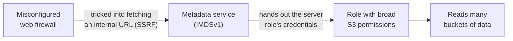
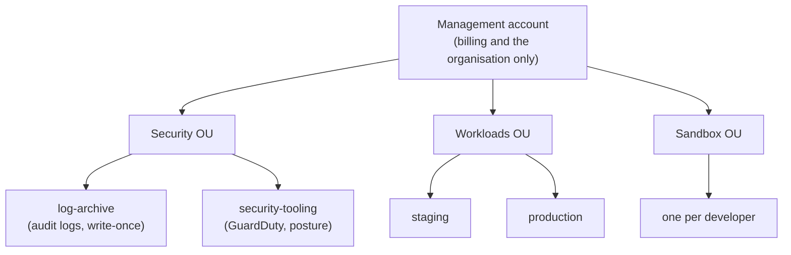
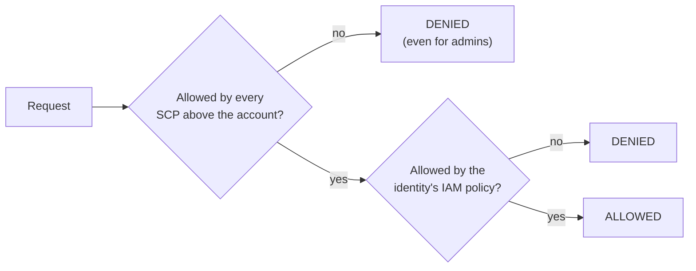
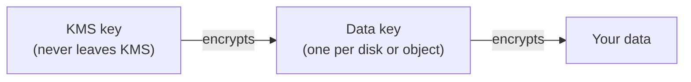

# 12.8 Cloud security: misconfigurations, guardrails and audit logs

When a cloud breach makes the news, the story is rarely a genius exploit. More often it's a storage bucket someone set to public, a server role that could read every bucket in the account, or a login with no second factor. Each one is a **setting**, changed in seconds by someone with good intentions, and found within hours by someone without them. This chapter is about those settings: why they cause most cloud breaches, how mature teams arrange their accounts so one mistake can't sink everything, which rules can be made impossible to break, and which logs tell you when something slipped through anyway. It uses AWS names (Azure and Google Cloud have the same ideas under other names), and the lab needs **no cloud account**. At the end you'll audit a real, production-shaped Terraform configuration against everything here, including the parts it gets wrong.

## What you'll learn

- The **shared responsibility model** again, and why customers' **misconfigurations**, not zero-days, cause most cloud breaches.
- **Account foundations**: the root user locked away, **one account per environment**, people signing in through SSO.
- **Guardrails** that nobody inside an account can bypass: **service control policies**, **permission boundaries**, account-wide **block public access**.
- **Detective controls**: **CloudTrail** as the audit log, **GuardDuty** as the alarm, **posture management** as the inspector.
- **Encryption with KMS** in plain words, and what it does and doesn't protect against.
- Network exposure: why nothing private should ever have a public address.

---

## Your side of the line is where breaches happen

:::note[Everyday anchor]
You rent a flat in a well-run building. The landlord pays for a guard in the lobby, strong main doors and a fire alarm. None of that helps if you leave your own front door open, or give a copy of your key to the plumber and never ask for it back. The building's security is the landlord's job. Your flat's is yours.
:::

[Chapter 12.1](./cloud-from-zero.mdx) introduced the **shared responsibility model**: the provider secures the cloud itself (buildings, hardware, the virtualisation layer, the managed services' internals), and you secure what you put *in* it: your data, who can reach it, your network rules, your settings. The line moves with the service (on a VM you patch the operating system; on a managed database you don't), but your **data and your access controls** always stay on your side.

A **misconfiguration** is a setting on your side that allows more than you meant to allow: a bucket readable by anyone, a firewall rule open to the internet, a role with permission to do everything, an account with no second login factor. Three real cases show how ordinary these are.

**A public bucket (2017).** A data firm working for a US political party stored about 198 million voter records in an S3 bucket configured for public access. A researcher found it by browsing; anyone who knew the bucket's address could have downloaded 1.1 terabytes without a password ([UpGuard's report](https://www.upguard.com/breaches/the-rnc-files)). No attacker skill was involved. Public buckets were common enough that AWS later turned **Block Public Access** on by default for every new bucket (April 2023).

**Capital One (2019).** An attacker reached data on about 100 million people in the US and 6 million in Canada ([Capital One's account](https://www.capitalone.com/digital/facts2019/)). The bank calls the cause a "configuration vulnerability". The criminal complaint ([US Department of Justice](https://www.justice.gov/usao-wdwa/pr/seattle-tech-worker-arrested-data-theft-involving-large-financial-services-company)) and later analyses describe a chain of three settings:



[Chapter 7.5](../security/web-attacks.mdx) explains the first link, **server-side request forgery (SSRF)**: making a server fetch a URL of the attacker's choosing. The second link is the **instance metadata service**, an address inside every cloud server that hands out that server's temporary credentials. Its original version (IMDSv1) answered any request it received, including a forged one. The third link is the role: it could list and read far more storage than a firewall needed. The data was encrypted, but Capital One's own account says the access "also enabled the decrypting of data", because the role was allowed to decrypt it. The bank's US regulator fined it $80 million in 2020 for weak risk management of its move to the cloud ([OCC](https://www.occ.gov/news-issuances/news-releases/2020/nr-occ-2020-101.html)). AWS released **IMDSv2**, which requires a session token that a forged request can't easily get, in November 2019 ([AWS](https://aws.amazon.com/blogs/security/defense-in-depth-open-firewalls-reverse-proxies-ssrf-vulnerabilities-ec2-instance-metadata-service/)).

The lesson is in the shape of the diagram: **fix any one link and the chain breaks**. A firewall that refused internal addresses, metadata that required IMDSv2, or a role that could read only what the firewall needed: each alone would have stopped it. That's **defence in depth**, several independent layers, so that one mistake isn't enough.

**Snowflake customers (2024).** Around 165 organisations using the Snowflake data platform were notified that their data might have been stolen. Mandiant's investigation found that Snowflake itself wasn't breached: the attacker logged in to customer accounts with passwords stolen by malware on employees' computers, some stolen years earlier, and the accounts had **no multi-factor authentication** ([Mandiant](https://cloud.google.com/blog/topics/threat-intelligence/unc5537-snowflake-data-theft-extortion)). The same setting, MFA, would have stopped every one of those logins.

Why are settings, not exotic hacks, the usual story? Because the cloud is configured entirely through APIs, with thousands of options. Anyone with permission can change any of them in seconds, from anywhere. Defaults change over the years, so old resources keep old defaults. And automated scanners sweep the whole internet continuously, so an exposed bucket or database is often found within hours. The rest of this chapter is about controlling those settings: arrange accounts so mistakes stay small, make the worst mistakes impossible, and notice the rest quickly.

---

## Foundations: arrange accounts so a mistake stays small

:::note[Everyday anchor]
An open-plan office versus a building of separate flats. In the open-plan office, one person who props the door open exposes everyone. In the building, a flood in flat 3 stays in flat 3, and the building manager's master key lives in a safe, not on a hook by the door.
:::

Three habits form the foundation, and each one limits the **blast radius**: how much one leaked credential or one bad command can reach.

**1. Lock the root user away.** Every AWS account has a **root user**: the email address that created it, with unlimited power that no policy can restrict. It's needed for a handful of tasks (closing the account, changing some billing settings). Give it a long unique password and MFA, create **no access keys** for it, and don't use it day to day ([chapter 12.1](./cloud-from-zero.mdx)'s first rule). AWS now enforces MFA on root users for every account type, a rollout that began in 2024. In an organisation (next paragraph), the security team can go further and **remove the root password from member accounts entirely**, keeping only the ability to perform root-only tasks centrally.

**2. One account per environment and purpose.** An AWS **account** is the strongest boundary the cloud offers: by default, nothing in one account can touch another. So mature teams don't put everything in one account. They create many, grouped in an **organisation** (AWS Organizations), and sort them into **organisational units** (OUs, folders of accounts):



What matters in this picture:

- **Production is its own account.** A developer experimenting in a sandbox, or a staging credential that leaks, can't reach production's data at all.
- **Audit logs go to a separate account** that the people being audited can't modify. An attacker who takes over production can't erase the record of how.
- **The management account holds nothing else.** It controls the whole organisation (and, as you'll see, the guardrails don't apply to it), so it runs no workloads.

AWS calls a ready-made version of this layout a **landing zone** (AWS Control Tower builds one). Azure uses management groups and subscriptions, Google Cloud folders and projects: same idea.

**3. People sign in through SSO; machines use roles.** Instead of an IAM user with a password and access keys per person per account, people sign in once with their company identity and MFA through **single sign-on** (IAM Identity Center on AWS), pick an account and a role, and receive temporary credentials ([chapter 12.4](./iam.mdx)). Workloads get roles from where they run; CI gets them through OIDC. When someone leaves, disabling one company identity removes their access to every account.

---

## Guardrails: rules nobody inside the account can break

:::note[Everyday anchor]
A tenant can set house rules for their flat: no shoes indoors, the cat stays out of the bedroom. But no tenant can decide to brick up the fire exit, however much they own the place. The fire code is set above them, by someone else, and applies to every flat.
:::

[Chapter 12.4](./iam.mdx) showed that IAM policies decide what each identity may do, and that an **explicit deny** beats any allow. The weakness: an administrator *inside* the account can change IAM policies, including their own. A **guardrail** is a rule set *above* the account, so that nobody inside it, not even its administrators, can change or get around it. These are **preventive controls**: they stop the mistake from happening at all.

### Service control policies: the ceiling for a whole account

A **service control policy** (SCP) is attached in AWS Organizations to an OU or an account. It doesn't give anyone permission. It sets the **maximum** that any identity in those accounts can ever have, including the account's root user. A request is allowed only if the identity's own IAM policy allows it *and* every SCP above it allows it:



Here's a realistic SCP for the Workloads OU. Read each statement as a sentence:

```json
{
  "Version": "2012-10-17",
  "Statement": [
    {
      "Sid": "ProtectTheAuditLog",
      "Effect": "Deny",
      "Action": ["cloudtrail:StopLogging", "cloudtrail:DeleteTrail", "cloudtrail:UpdateTrail", "cloudtrail:PutEventSelectors"],
      "Resource": "*",
      "Condition": {"ArnNotLike": {"aws:PrincipalArn": "arn:aws:iam::*:role/security-admin"}}
    },
    {
      "Sid": "KeepPublicAccessBlocked",
      "Effect": "Deny",
      "Action": "s3:PutAccountPublicAccessBlock",
      "Resource": "*"
    },
    {
      "Sid": "StayInTheOrganisation",
      "Effect": "Deny",
      "Action": "organizations:LeaveOrganization",
      "Resource": "*"
    },
    {
      "Sid": "OnlyOurRegions",
      "Effect": "Deny",
      "NotAction": ["iam:*", "organizations:*", "sts:*", "support:*", "budgets:*", "cloudfront:*", "route53:*"],
      "Resource": "*",
      "Condition": {"StringNotEquals": {"aws:RequestedRegion": ["eu-west-1", "eu-central-1"]}}
    }
  ]
}
```

- **ProtectTheAuditLog**: nobody may stop, delete or reconfigure the audit trail, *except* the `security-admin` role. Attackers try to turn off logging early; this makes that attempt fail, and the failed attempt is itself logged.
- **KeepPublicAccessBlocked**: nobody may change the account-wide "block public access" setting for S3 (that one permission covers turning it off, too).
- **StayInTheOrganisation**: an account can't leave and escape every guardrail at once.
- **OnlyOurRegions**: denies every action in any region except the two the company uses. `NotAction` means "every action *except* these": global services such as IAM and CloudFront are handled in one region, so they must be exempt or they'd break. (AWS's published example exempts more global services; this one is trimmed.) Attackers with stolen keys love launching crypto-miners in a region nobody watches.

Three things about SCPs that trip people up:

- **They never grant anything.** Accounts keep an allow-everything SCP (`FullAWSAccess`) attached by default, and these deny statements carve pieces out of it. Remove that default without a replacement, and everything in the account is denied.
- **They don't apply to the management account.** One more reason it runs nothing.
- **They don't apply to service-linked roles** (roles AWS services use on your behalf), so a few AWS-internal actions pass through.

Since late 2024 AWS also has **resource control policies** (RCPs), the same idea attached to resources instead of identities: for example, "no S3 bucket in these accounts may be read by anyone outside our organisation", whatever a bucket's own policy says.

### Permission boundaries: letting teams create roles safely

A team that ships services needs to create IAM roles for them. But permission to create roles is dangerous: a developer could create a role with `AdministratorAccess` and assume it, an escalation like `iam:PassRole` on `*` in [chapter 12.4](./iam.mdx). A **permission boundary** is a policy attached to a role that caps what that role can ever do, whatever policies are attached to it later. The platform team then allows developers to create roles *only if* those roles carry the approved boundary:

```json
{
  "Effect": "Allow",
  "Action": ["iam:CreateRole", "iam:PutRolePolicy", "iam:AttachRolePolicy"],
  "Resource": "arn:aws:iam::*:role/app-*",
  "Condition": {"StringEquals": {"iam:PermissionsBoundary": "arn:aws:iam::111122223333:policy/app-boundary"}}
}
```

The developer gets autonomy; the boundary guarantees no role they create can exceed it. SCPs cap whole accounts; boundaries cap individual roles.

### Settings that apply to the whole account

Some of the most valuable guardrails are single switches:

- **S3 Block Public Access, account-wide.** New buckets have it on by default, but the **account-level** setting covers every bucket, old and new, and overrides any bucket that tries to go public. With the SCP above, nobody can turn it off. Websites that must be public go behind a CDN that reads the bucket privately instead.
- **IMDSv2 by default.** An account-level default makes every new server require IMDSv2, the fix for Capital One's middle link, and an SCP condition (`ec2:MetadataHttpTokens`) can refuse to launch any server without it.
- **Default encryption** for new disks (EBS encryption by default), so nobody has to remember it per disk.

:::warning[What can go wrong]
- **An SCP that locks everyone out.** A typo in a deny, or a region list missing the region your identity provider lives in, and nobody can work. Test SCPs on a sandbox OU first, and keep a break-glass path (an exempt role, as in the first statement).
- **Guardrails that block legitimate work get disabled.** If the SCP denies something a team truly needs, the pressure to remove it grows until someone does. Design exceptions deliberately, in code, reviewed.
- **Assuming guardrails cover the management account.** They don't.
:::

---

## Detective controls: the audit log and the alarms

:::note[Everyday anchor]
Locks keep people out. Cameras record who came in anyway, and a guard watching the screens notices when someone tries every door handle on the corridor at 3 a.m. You need all three, because some locks will be left open.
:::

Preventive controls stop known mistakes. **Detective controls** notice what slipped through: an unexpected change, a credential used from an odd place, a resource drifting away from the rules. They don't stop anything on their own, so they must reach a person (or an automated response) quickly.

### CloudTrail: every API call, written down

Everything in AWS is an API call, so the most important log in the cloud is the record of API calls: **CloudTrail** on AWS (**Activity Log** on Azure, **Cloud Audit Logs** on Google Cloud), introduced in [chapter 12.4](./iam.mdx). Each **event** answers who, what, when, from where, and whether it worked. Here's a trimmed real-format event of a role turning off a bucket's public access block:

```json
{
  "eventTime": "2026-10-28T23:43:30Z",
  "eventSource": "s3.amazonaws.com",
  "eventName": "DeleteBucketPublicAccessBlock",
  "awsRegion": "eu-west-1",
  "userIdentity": {
    "type": "AssumedRole",
    "arn": "arn:aws:sts::111122223333:assumed-role/shop-app/i-0abc123def4567890",
    "sessionContext": {"sessionIssuer": {"userName": "shop-app"}, "attributes": {"mfaAuthenticated": "false"}}
  },
  "sourceIPAddress": "198.51.100.77",
  "userAgent": "python-requests/2.32",
  "requestParameters": {"bucketName": "shop-invoices"},
  "readOnly": false
}
```

Read it field by field. `eventName` and `requestParameters`: what was done, to which bucket. `userIdentity.arn`: the `shop-app` role, in a session named after a server (`i-0abc…` is an EC2 instance ID), so these were that server's credentials. `sourceIPAddress`: where the call came from. A server's credentials used from an address that isn't that server is exactly the Capital One pattern, and the lab asks you to spot it. A failed call adds `errorCode` (often `AccessDenied`), which is worth watching too: someone probing what a stolen credential can do produces a burst of denials.

What you need to know to use it well:

- **Event history** keeps the last 90 days of **management events** (creating, changing and deleting resources) in each region, free and on by default.
- For anything longer, create a **trail**: a copy of every event delivered to an S3 bucket. An **organisation trail**, created once in the management account, covers every account and region, and delivers to the log-archive account.
- **Data events** (reading or writing individual S3 objects, invoking functions) are **off by default**, because they're high-volume and billed. Turn them on for the buckets that hold sensitive data, or you'll know the bucket policy changed but not which files were read.
- **Log file integrity validation** makes CloudTrail write signed digest files, so you can later prove the logs weren't altered: useful evidence after an incident ([chapter 13.7](../observability/security-incident-response.mdx)).

### GuardDuty: the alarm that reads the logs for you

Nobody reads millions of events by eye. **GuardDuty** (Microsoft Defender for Cloud and Google's Security Command Center are the equivalents) analyses CloudTrail, VPC flow logs and DNS queries continuously and raises **findings**: a known-malicious IP calling your APIs, a server talking to a crypto-mining pool, root credentials being used. One finding type describes the Capital One chain directly: `UnauthorizedAccess:IAMUser/InstanceCredentialExfiltration.OutsideAWS`, meaning credentials that belong to one of your servers are being used from outside AWS ([AWS finding types](https://docs.aws.amazon.com/guardduty/latest/ug/guardduty_finding-types-iam.html)). GuardDuty is enabled per account and region, usually for the whole organisation from the security-tooling account, and billed by the volume of events it analyses.

### Posture management: the inspector who checks every setting

The third kind of detective control compares how everything is **actually configured** against a list of rules, continuously. That's **cloud security posture management** (CSPM):

- **AWS Config** records the configuration of each resource over time ("this security group allowed `0.0.0.0/0` on port 5432 from 14:02 to 14:40 on Tuesday") and evaluates **rules** against it.
- **AWS Security Hub CSPM** runs standard rule sets (AWS Foundational Security Best Practices, the **CIS** benchmarks, a widely used checklist from the Center for Internet Security) across every account and gives a score and a list of failing resources. In 2025 AWS also launched a broader **Security Hub** that gathers findings from GuardDuty, posture checks and vulnerability scanning in one place.
- **Prowler** is a popular open-source tool that runs similar checks against a real account from your laptop.

[Chapter 12.6](./terraform-in-real-life.mdx) scanned Terraform code with Trivy *before* anything existed. Posture management checks what *does* exist. You need both, because not everything goes through Terraform: a console click at 2 a.m. during an outage, a resource created by a tool, a setting that drifted.

Put together:

| Control | Kind | Stops or notices | Example |
|---|---|---|---|
| Separate accounts | Preventive | Limits what any mistake can reach | Staging credentials can't touch production |
| SCPs, RCPs, permission boundaries | Preventive | Makes forbidden actions impossible | Nobody can stop the audit trail |
| IaC scanning (Trivy, Checkov) | Preventive, before deploy | Risky settings in code | A database marked publicly accessible |
| CloudTrail | Detective (record) | Who did what, when, from where | The evidence after any incident |
| GuardDuty | Detective (alarm) | Suspicious behaviour | Server credentials used from outside AWS |
| Config, Security Hub CSPM | Detective (inspection) | Settings that break the rules, wherever they came from | A bucket made public in the console |

:::tip[Send findings where people already look]
A finding that lands in a console nobody opens is a finding nobody sees. Route high-severity findings (through EventBridge on AWS) to the same on-call alerting as outages ([chapter 13.4](../observability/slos-alerting-on-call.mdx)), and the rest to a ticket queue that someone owns.
:::

---

## Encryption and KMS: who holds the key matters more than the lock

:::note[Everyday anchor]
A bank's safe-deposit boxes. Your box is locked, but the important part is the key cabinet: the bank keeps the keys in a vault, writes down every time one is taken out, and can refuse to hand one over. Stealing a box is useless without the cabinet's cooperation.
:::

You met encryption in [chapter 7.1](../security/security-literacy.mdx). In the cloud, **encryption at rest** (data on disks and in storage) is now usually on by default, and the interesting question is **who controls the keys**. AWS's answer is **KMS** (Key Management Service). A **KMS key** lives inside KMS's hardware and never leaves it; you can only ask KMS to use it for you, and every request is an API call that IAM authorises and CloudTrail records.

Encrypting a 50 GB disk by sending it all to KMS would be slow, so services use **envelope encryption**:



The service asks KMS for a fresh **data key**, encrypts your data with it locally, and stores the data key next to the data, *encrypted* by the KMS key. To read the data later, the service asks KMS to decrypt the data key, which KMS does only if the caller is allowed.

Two kinds of KMS key matter:

| | AWS-managed key | Customer-managed key |
|---|---|---|
| Who controls it | AWS, per service (`aws/rds`, `aws/secretsmanager`) | You |
| Who may use it | Anyone allowed to use the service in the account | Only who its **key policy** names, a second permission check on top of IAM |
| Can you disable it? | No | Yes: disable the key and every piece of data under it becomes unreadable at once |
| Cost | Free | About $1 per key per month, plus requests |

What encryption at rest **does** protect against: someone getting the physical disks, a snapshot copied to another account without the key, a backup leaking. What it **doesn't** protect against: someone who has permission to read the data through the service. The service decrypts for any caller it authorises. That's why Capital One's encrypted data was readable: the role that could read the buckets could also use the key. With a customer-managed key, you could make decryption a separate, narrower permission than reading, so a role that can list a bucket still can't read what's in it.

**Encryption in transit** is TLS ([chapter 7.1](../security/security-literacy.mdx)): HTTPS for users, and TLS between services and databases (`sslmode=require` for Postgres), so nobody on the network path can read or alter traffic.

---

## Network exposure: nothing private gets a public address

[Chapter 12.2](./cloud-networking.mdx) built the network: public subnets for the load balancer only, private subnets for applications and databases, and **security groups** (a firewall around each resource) that allow each hop only from the one before it. From a security point of view, the rules that matter most are:

- **Databases, caches and queues are never public.** Private subnet, `publicly_accessible = false`, and a security group that admits only the application's group. Internet-wide scanners find open database ports quickly, and a weak password is then all that stands between them and the data.
- **No administrative ports open to the internet.** No SSH (22) or RDP (3389) from `0.0.0.0/0` (meaning "any address"). Reach servers through the provider's session manager (AWS Systems Manager Session Manager), which needs no open port and logs every session.
- **Egress matters too.** Tight outbound rules make it harder for a compromised server to send data out or download tools. VPC endpoints let private servers reach AWS services without the internet.
- **Flow logs** record every connection's source, destination, port and verdict (accepted or rejected), never the contents. They're what you search during an investigation ("did anything in this subnet talk to that IP?").

---

## Apply it to snip: auditing a real configuration

snip, the URL shortener this handbook builds, has a production-shaped AWS configuration in `snip/infra/aws/`: a VPC, a load balancer, containers on ECS Fargate, RDS Postgres and ElastiCache Redis ([chapters 12.2](./cloud-networking.mdx)–[12.6](./terraform-in-real-life.mdx) build it). Here it is, audited against this chapter.

### What it already does well

| Practice | Where |
|---|---|
| Database in private subnets, `publicly_accessible = false`, storage encrypted | `main.tf`, `aws_db_instance.postgres` |
| Security groups reference each other: internet → load balancer → app → data, nothing else | `main.tf`, the `aws_vpc_security_group_*_rule` resources |
| Database password generated at apply time, never stored in Terraform state, delivered through Secrets Manager | `main.tf`, `ephemeral "random_password"` and `password_wo` |
| The execution role may read exactly snip's two secrets (database URL, Redis token) | `compute.tf`, `read_secrets` |
| Redis accepts only TLS connections that present an AUTH token; the token is generated like the database password and delivered through Secrets Manager | `main.tf`, `aws_elasticache_replication_group.redis` |
| CI deploys through OIDC with no stored keys, only from `main`, only to two services | `iam-github.tf` |
| Containers run with read-only root filesystems | `compute.tf`, `readonlyRootFilesystem = true` |
| Malformed HTTP headers dropped at the load balancer | `compute.tf`, `drop_invalid_header_fields` |
| Remote state encrypted in S3 with locking | `envs/*.backend.hcl` |
| Every resource tagged with project, environment and `managed-by` | `versions.tf`, `default_tags` |

### What this chapter added: flow logs

The audit's first finding was that nothing recorded network connections. The network module now turns on **VPC flow logs** for every connection, accepted or rejected, into a log group kept for 30 days (`snip/infra/aws/modules/network/main.tf`):

```hcl
resource "aws_flow_log" "this" {
  vpc_id               = aws_vpc.this.id
  traffic_type         = "ALL" # accepted and rejected connections
  log_destination_type = "cloud-watch-logs"
  log_destination      = aws_cloudwatch_log_group.flow.arn
  iam_role_arn         = aws_iam_role.flow.arn
}
```

The flow-logs service gets its own role, allowed to write to that one log group and nothing else, the same least-privilege pattern as snip's other roles. It costs money in proportion to traffic (CloudWatch bills per GB ingested), small for a quiet staging environment.

### What's still missing, honestly

Running Trivy with **all** severities (CI blocks only on high and critical, [chapter 12.6](./terraform-in-real-life.mdx)) lists the rest:

```text
AWS-0017 (LOW): Log group is not encrypted.                 compute.tf, modules/network/main.tf
AWS-0034 (LOW): Cluster does not have container insights enabled.
AWS-0078 (LOW): Performance Insights encryption does not use a customer-managed KMS key.
AWS-0098 (LOW): Secret explicitly uses the default key.               (2 secrets)
AWS-0124 (LOW): Security group rule does not have a description.      (8 rules)
AWS-0176 (MEDIUM): Instance does not have IAM Authentication enabled   (Postgres)
AWS-0177 (MEDIUM): Instance does not have Deletion Protection enabled  (staging only)
```

With the chapter's decisions:

- **AWS-managed keys, not customer-managed ones** (AWS-0017, 0078, 0098). A deliberate choice for an example: the data is still encrypted, and the only role that reads the secret is the execution role. A company handling payment or health data would add a customer-managed key per environment, with a key policy naming that role.
- **Deletion protection is off in staging** (AWS-0177), on purpose: staging is torn down and rebuilt. Production has it (`deletion_protection = var.environment == "production"`).
- **Postgres uses a password, not IAM authentication** (AWS-0176). The password never touches state or Git; IAM authentication would remove it entirely, but needs code in snip to fetch short-lived tokens. A reasonable next step.
- **Redis now has TLS and a password; the scanner never asked for them.** An earlier version used a bare `aws_elasticache_cluster`, and Trivy's in-transit encryption check doesn't cover that resource type, so the scan was clean while anything that reached the security group could read and rewrite the cache. That is the lesson: a clean scan means "no rule fired", not "safe". snip's threat model ranked it, and the fix took three parts: a replication group with `transit_encryption_enabled` and an AUTH token, the token in Secrets Manager, and a small code change so snip can speak TLS (`SNIP_REDIS_TLS`, with the server's certificate verified). What remains: rotating the token is a manual `auth_token_wo_version` bump, and snip uses one token for everything rather than a Redis user per service with only the commands it needs (Redis **ACLs**).
- **No account foundation.** No organisation, no SCPs, no CloudTrail trail, no GuardDuty. That's correct for this directory, which describes one application: those belong in a separate landing-zone configuration owned by a platform team, applied once per organisation, not once per app. But a reader who applies snip to a fresh personal account gets none of them unless they turn them on.
- **Staging and production share an account.** The example backend files put both states in one bucket, implying one account. In a real company they'd be separate accounts, as in the diagram above, with separate state buckets.
- **HTTP only** and **HTTPS egress to anywhere** remain accepted in writing, with reasons, as [chapter 12.6](./terraform-in-real-life.mdx) described.

No configuration passes every check, and that isn't the goal. The goal is that every finding has a **decision**, written down, that a reviewer can read and disagree with.

---

## Cheat sheet

| Term | What it is | Reach for it when |
|---|---|---|
| **Shared responsibility** | Provider secures the cloud; you secure your data, access and settings | Deciding whose problem a risk is |
| **Misconfiguration** | A setting that allows more than intended | Reading almost any cloud breach report |
| **Landing zone** | A standard multi-account layout with guardrails and central logs | Starting a company's cloud setup |
| **SCP** | An organisation-level ceiling on what any identity in an account can do | Making an action impossible, even for admins |
| **Permission boundary** | A ceiling on one role's permissions | Letting teams create roles without escalation |
| **CloudTrail** | The log of every API call | "Who did this, and from where?" |
| **GuardDuty** | Threat detection over CloudTrail, flow and DNS logs | Being told about suspicious activity |
| **CSPM** (Config, Security Hub CSPM, Prowler) | Continuous checks of real settings against rules | Catching changes made outside Terraform |
| **KMS key** | A key that never leaves KMS; every use is authorised and logged | Controlling who can decrypt, separately from who can read |
| **Flow logs** | Connection metadata for a network | Investigating "who talked to what" |

---

## Lab

Free, on your computer with Docker and `jq`. **No cloud account needed.** Steps 1–4 are standalone; step 5 audits snip; step 6 is optional and uses a real AWS account.

1. **Scan a deliberately bad configuration with two scanners.** Make a folder and save this as `main.tf`. It has three mistakes from this chapter:
   ```bash
   mkdir -p ~/cloud-sec-lab && cd ~/cloud-sec-lab
   cat > main.tf <<'EOF'
   # A bucket for customer uploads, with public access switched off "to debug".
   resource "aws_s3_bucket" "uploads" {
     bucket = "example-shop-uploads"
   }

   resource "aws_s3_bucket_public_access_block" "uploads" {
     bucket                  = aws_s3_bucket.uploads.id
     block_public_acls       = false
     block_public_policy     = false
     ignore_public_acls      = false
     restrict_public_buckets = false
   }

   # A database anyone on the internet can try to log in to.
   resource "aws_security_group" "db" {
     name        = "shop-db"
     description = "Postgres"
     ingress {
       from_port   = 5432
       to_port     = 5432
       protocol    = "tcp"
       cidr_blocks = ["0.0.0.0/0"]
     }
   }

   resource "aws_db_instance" "shop" {
     identifier                  = "shop"
     engine                      = "postgres"
     instance_class              = "db.t4g.micro"
     allocated_storage           = 20
     username                    = "shop"
     manage_master_user_password = true
     publicly_accessible         = true
     storage_encrypted           = false
     vpc_security_group_ids      = [aws_security_group.db.id]
     skip_final_snapshot         = true
   }
   EOF
   docker run --rm -v "$PWD:/src:ro" aquasec/trivy:0.76.1 config -q --severity HIGH,CRITICAL /src   # Trivy
   docker run --rm -v "$PWD:/src:ro" bridgecrew/checkov:3.4.0 -d /src --compact --quiet              # Checkov
   ```
   Trivy reports 7 high findings: the four public-access switches, the public database (AWS-0180), the unencrypted database (AWS-0080) and a bucket without a customer-managed key (AWS-0132). Checkov reports 23 failed checks, many of them lower-stakes (versioning, logging, multi-AZ). **Now look for what neither reported:** the security group opening port 5432 to `0.0.0.0/0`. At these versions, both scanners check that rule for SSH and RDP ports but not for Postgres. Scanners compare code against a fixed list of known rules, so they're a floor, not a ceiling, and a reviewer who knows *why* the rules exist still matters.

2. **Fix it and scan again.** Set the four `block_*`/`ignore_*`/`restrict_*` values to `true`, `publicly_accessible = false`, `storage_encrypted = true`, and the security group's `cidr_blocks` to `["10.0.0.0/16"]` (a private range). Run Trivy again: only AWS-0132 remains, the customer-managed-key finding. Decide, as in snip's audit, whether you'd fix it or accept it, and write the sentence you'd put in the `#trivy:ignore` comment.

3. **Read an audit log like an investigator.** Save these four CloudTrail events (trimmed to the fields that matter) as `events.json`:
   ```bash
   cat > events.json <<'EOF'
   {"Records": [
     {"eventTime": "2026-10-28T09:12:44Z", "eventSource": "ecs.amazonaws.com", "eventName": "UpdateService",
      "userIdentity": {"type": "AssumedRole", "arn": "arn:aws:sts::111122223333:assumed-role/shop-github-deploy/GitHubActions",
        "sessionContext": {"sessionIssuer": {"userName": "shop-github-deploy"}}},
      "sourceIPAddress": "192.0.2.15", "userAgent": "aws-cli/2.31.0", "readOnly": false},
     {"eventTime": "2026-10-28T23:41:07Z", "eventSource": "s3.amazonaws.com", "eventName": "ListBuckets",
      "userIdentity": {"type": "AssumedRole", "arn": "arn:aws:sts::111122223333:assumed-role/shop-app/i-0abc123def4567890",
        "sessionContext": {"sessionIssuer": {"userName": "shop-app"}}},
      "sourceIPAddress": "198.51.100.77", "userAgent": "python-requests/2.32", "errorCode": "AccessDenied", "readOnly": true},
     {"eventTime": "2026-10-28T23:43:30Z", "eventSource": "s3.amazonaws.com", "eventName": "DeleteBucketPublicAccessBlock",
      "userIdentity": {"type": "AssumedRole", "arn": "arn:aws:sts::111122223333:assumed-role/shop-app/i-0abc123def4567890",
        "sessionContext": {"sessionIssuer": {"userName": "shop-app"}}},
      "sourceIPAddress": "198.51.100.77", "userAgent": "python-requests/2.32", "requestParameters": {"bucketName": "shop-invoices"}, "readOnly": false},
     {"eventTime": "2026-10-28T23:44:02Z", "eventSource": "cloudtrail.amazonaws.com", "eventName": "StopLogging",
      "userIdentity": {"type": "AssumedRole", "arn": "arn:aws:sts::111122223333:assumed-role/shop-app/i-0abc123def4567890",
        "sessionContext": {"sessionIssuer": {"userName": "shop-app"}}},
      "sourceIPAddress": "198.51.100.77", "userAgent": "python-requests/2.32", "errorCode": "AccessDenied",
      "errorMessage": "User: arn:aws:sts::111122223333:assumed-role/shop-app/i-0abc123def4567890 is not authorized to perform: cloudtrail:StopLogging with an explicit deny in a service control policy", "readOnly": false}
   ]}
   EOF
   jq -r '.Records[] | [.eventTime, .userIdentity.sessionContext.sessionIssuer.userName, .eventName, .sourceIPAddress, (.errorCode // "ok")] | @tsv' events.json
   jq -c '.Records[] | select(.readOnly == false and .errorCode == null) | {eventTime, eventName, ip: .sourceIPAddress}' events.json   # changes that succeeded
   ```
   The first line is a normal deploy. Then answer: whose credentials made the other three calls? (The `shop-app` role, in a session named after an EC2 instance.) From where? (`198.51.100.77`, a script's user agent, at 23:41: not the server, which would call from inside AWS.) What did the attacker try, and what worked? (Listing buckets was denied, so least privilege helped; removing one bucket's public access block **succeeded**, so the role had a permission it shouldn't; stopping the trail was denied **by an SCP**.) If the account-level Block Public Access were on, would `shop-invoices` now be public? (No: the account setting overrides the bucket's.) Which GuardDuty finding would you expect? (`InstanceCredentialExfiltration.OutsideAWS`.)

4. **Write an SCP and evaluate it on paper.** Take the SCP from the "Guardrails" section and decide, for each request, *denied by the SCP* or *up to IAM*:
   - A developer with `AdministratorAccess` in the production account calls `cloudtrail:StopLogging`. (Denied by the SCP: admin rights don't matter.)
   - The `security-admin` role calls `cloudtrail:UpdateTrail`. (Not denied by the SCP thanks to the exception; allowed if its IAM policy allows it.)
   - Anyone calls `ec2:RunInstances` in `us-east-1`. (Denied: region not in the list.)
   - Anyone calls `iam:CreateRole`. (Not denied by the region statement, since `iam:*` is in `NotAction`. Up to IAM.)
   - A role with no IAM policies calls `s3:GetObject` in `eu-west-1`. (The SCP doesn't deny it, but nothing allows it either: denied. SCPs never grant.)
   - Someone in the **management** account calls `cloudtrail:StopLogging`. (SCPs don't apply there: up to IAM. Who should have access to the management account?)

   Then add a fifth statement of your own: deny `ec2:RunInstances` unless `ec2:MetadataHttpTokens` equals `required`. Which link of the Capital One chain does it break?

5. **Audit snip yourself.** From your clone of this handbook's repository:
   ```bash
   cd ~/code/zero-to-prod/snip
   docker run --rm -v "$PWD:/src:ro" aquasec/trivy:0.76.1 config -q /src/infra/aws   # all severities
   grep -n 'publicly_accessible\|storage_encrypted\|0.0.0.0/0' infra/aws/*.tf      # the exposure-related lines
   ```
   Match each finding to a decision in "What's still missing, honestly" above. Pick one you'd fix next and say why.

:::danger[This costs money]
Step 6 uses a real AWS account. Parts (a) and (b) are free. GuardDuty in part (c) is free for a 30-day trial per account and region, then billed: delete the detector the same day. Use a personal sandbox account, never a company one.
:::

6. **Optional, with a real AWS account.**
   ```bash
   ACCOUNT_ID=$(aws sts get-caller-identity --query Account --output text)
   # (a) Block public access for every bucket in the account:
   aws s3control put-public-access-block --account-id "$ACCOUNT_ID" \
     --public-access-block-configuration BlockPublicAcls=true,IgnorePublicAcls=true,BlockPublicPolicy=true,RestrictPublicBuckets=true
   # (b) Find that change in the free 90-day event history (it can take a few minutes to appear):
   aws cloudtrail lookup-events --lookup-attributes AttributeKey=EventName,AttributeValue=PutAccountPublicAccessBlock --max-results 1
   # (c) Turn on GuardDuty, generate sample findings, and read them:
   DETECTOR=$(aws guardduty create-detector --enable --query DetectorId --output text)
   aws guardduty create-sample-findings --detector-id "$DETECTOR"
   aws guardduty list-findings --detector-id "$DETECTOR" --max-results 5
   # Teardown: GuardDuty bills after the trial, so delete it now.
   aws guardduty delete-detector --detector-id "$DETECTOR"
   ```
   Leave (a) on: it costs nothing and closes the most common leak for good.

## Self-check

<Quiz
  id="cloud-cloud-security"
  questions={[
    {
      q: 'In the Capital One breach, which change alone would have broken the chain?',
      options: [
        'Switching the S3 buckets from AWS-managed keys to customer-managed keys',
        'Requiring IMDSv2, so a forged request couldn’t obtain the server role’s credentials',
        'Moving the web application firewall into a private subnet behind the load balancer',
        'Turning on CloudTrail data events for the buckets that held customer data',
      ],
      answer: 1,
      explain: 'The chain was SSRF → metadata service → over-broad role. IMDSv2 requires a session token that a forged GET can’t obtain, so the credentials would never have left the server. A customer-managed key helps only if the role isn’t also allowed to use it, and Capital One says its access “also enabled the decrypting of data”. Data events would have recorded the reads, not prevented them. A firewall exists to receive internet traffic, so hiding it doesn’t fit.',
    },
    {
      q: 'An administrator in a member account has AdministratorAccess. An SCP on their OU denies cloudtrail:StopLogging. They call it. What happens?',
      options: [
        'Allowed, because AdministratorAccess explicitly allows every action',
        'Denied: the SCP sets a ceiling that no identity in the account can exceed',
        'Allowed if they signed in with MFA, since SCPs exempt MFA sessions',
        'Denied only if a permission boundary on their role also denies it',
      ],
      answer: 1,
      explain: 'A request must be allowed by every SCP above the account and by the identity’s own policies. The SCP’s deny wins over any allow inside the account, including the root user’s. That’s what makes it a guardrail rather than a policy the admin could edit. (The management account is the exception: SCPs don’t apply to it.)',
    },
    {
      q: 'CloudTrail shows a role normally used by one EC2 server making calls from an IP address outside AWS at night. What is the most likely explanation to check first?',
      options: [
        'The server was moved to another region, which changes its public IP address',
        'The server’s role credentials were stolen (for example through SSRF) and are used elsewhere',
        'CloudTrail records the caller’s DNS resolver as the source address, not the server',
        'AWS rotates instance credentials nightly and logs the rotation from an external IP',
      ],
      answer: 1,
      explain: 'Instance credentials are meant to be used by that instance, from inside AWS. Use from an outside address is the signature of exfiltrated credentials, which is why GuardDuty has a dedicated finding for it (InstanceCredentialExfiltration.OutsideAWS). Treat it as a security incident: the source address in CloudTrail is the caller’s, not a resolver’s, and credential rotation isn’t logged that way.',
    },
    {
      q: 'Why do mature teams put production in its own AWS account instead of separating environments with tags and IAM policies?',
      options: [
        'AWS charges less per resource when each environment has its own account',
        'An account is the strongest boundary: a mistake or leak elsewhere can’t reach it',
        'Terraform can’t manage two environments that live in the same account',
        'CloudTrail can only record events for one environment per account',
      ],
      answer: 1,
      explain: 'By default nothing in one account can touch another, so a sandbox experiment or a leaked staging credential can’t reach production data. Tag-based IAM separation works until one policy has a gap. Terraform and CloudTrail handle many environments in one account fine, and separate accounts don’t lower prices; they limit blast radius.',
    },
    {
      q: 'Trivy and Checkov both passed a Terraform change. What does that tell you?',
      options: [
        'The change is secure, because both scanners cover every AWS setting',
        'None of their known rules matched; risks outside their rule lists can remain',
        'The resources will also pass AWS Config and Security Hub CSPM checks',
        'The change can’t have opened a port to the internet',
      ],
      answer: 1,
      explain: 'Scanners compare code with a fixed list of rules. The lab’s Postgres port open to 0.0.0.0/0 passed both, because neither checks that port. They also only see code, not console changes, which is why runtime posture checks and human review still matter.',
    },
  ]}
/>

<details>
<summary>You join a startup with one AWS account that holds production, staging and everyone's experiments, and five IAM users with access keys. In what order would you fix things, and why?</summary>

Order by blast radius reduced per hour of work:

1. **Root user**: MFA on, no access keys, password in a safe. Cheap, and it removes the account-ending risk.
2. **MFA for every human, and find the access keys.** Check each key's last use (IAM's credential report). Replace keys used by CI with OIDC roles ([chapter 12.4](./iam.mdx)), deactivate the rest, then delete.
3. **Turn on the free detective basics**: an organisation-wide CloudTrail trail to a separate bucket, account-level S3 Block Public Access, a budget alert. Now you can see what happens next, and the commonest leak is closed.
4. **Create an organisation and move production out.** New accounts for production and staging, the existing account becomes a sandbox (or is retired once empty). This is the most work, so it comes after the quick wins, but it's the change that makes later mistakes small.
5. **SSO for people** (IAM Identity Center), and delete the IAM users.
6. **Guardrails**: an SCP protecting CloudTrail and limiting regions, IMDSv2 by default, then GuardDuty and a posture tool, with findings routed to whoever is on call.

The rule underneath: first stop the account-ending risks, then gain visibility, then restructure so that future mistakes are contained.

</details>

<details>
<summary>"All our data is encrypted at rest, so a leaked credential can't expose it." What's wrong with this claim?</summary>

Encryption at rest protects data from someone who gets the **storage itself**: the disks, a copied snapshot, a stolen backup. It doesn't protect against someone who asks the **service** for the data with valid credentials, because the service decrypts for any caller it authorises. A leaked credential that may read a bucket or query a database gets plaintext.

What helps is making decryption a **separate permission**: a customer-managed KMS key whose key policy names only the roles that truly need to decrypt, so a credential that can list a bucket still can't read what's in it. Add CloudTrail (every use of the key is logged), and least privilege on who may read at all. Encryption is one layer; access control decides what it's worth.

</details>
