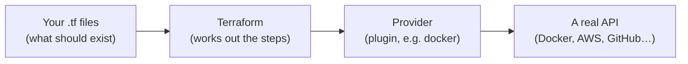
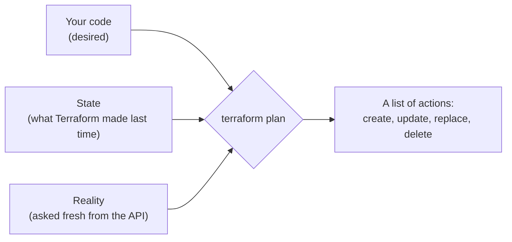
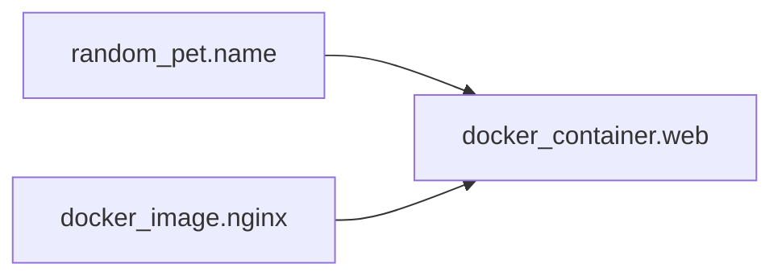
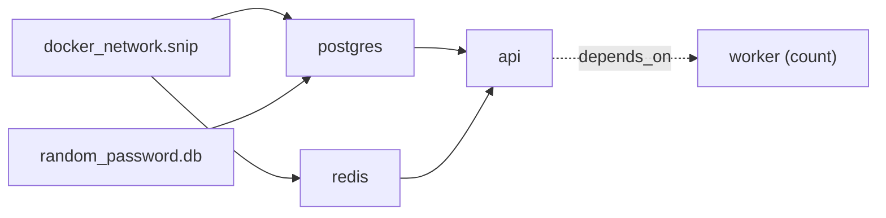

# 12.5 Terraform from zero

Think of the last time you set something up by clicking: a new laptop, a Wi-Fi router, a website's hosting dashboard. It worked. Now imagine doing it again, identically, for a second office. Then a third. Then imagine that six months later someone asks "what exactly did we change on the router?", and nobody remembers. Companies hit this with their servers, networks and databases every day, and the fix is **infrastructure as code**: write down what should exist in text files, keep them in Git, and let a tool make reality match. **Terraform** is the most widely used tool for this. In this chapter you write a 50-line Terraform file that runs a real web server on your own computer, watch Terraform plan, create, repair and delete it, and learn to read the plan that stands between you and every change. It's free and needs only Docker.

## What you'll learn

- Why **infrastructure as code** (IaC) beats clicking: the files are the documentation, the history and the undo button.
- The building blocks: a **provider** is a plugin that talks to one API; a **resource** is one thing to create; **variables** and **outputs** are the inputs and results.
- The workflow: **init → plan → apply → destroy**, and how to read a plan, especially the dangerous `-/+`.
- **State**: Terraform's record of what it created, and the two properties it gives you, **idempotency** and **drift detection**.
- Making many things from one block with **count** and **for_each**, and finally a real multi-service stack written the same way.

---

## Why code, not clicks

| Clicking in a console | Infrastructure as code |
|---|---|
| Undocumented: "what did we set?" | The files *are* the documentation |
| Hard to repeat exactly (staging ≠ production) | Same code, different variables, same result |
| No review | Changes go through pull requests like application code |
| No history | `git log` shows who changed what, when and why |
| Hard to tear down (forgotten resources cost money) | `terraform destroy` removes everything it created |
| Recovery from disaster means remembering | Recovery means running the code again |

:::note[Everyday anchor]
A recipe versus cooking from memory. From memory, each attempt comes out a little different, and when you're ill nobody else can make the dish. A written recipe (in version control, with notes on every change) lets anyone produce the same dish, in any kitchen, and lets you see exactly when "a pinch more salt" was added.
:::

**Terraform** reads files ending in `.tf`, written in **HCL** (HashiCorp Configuration Language, a small language of blocks and `key = value` lines). It doesn't know how to create anything itself. It hands the work to **providers**: plugins that each speak one API. There are providers for AWS, Azure, Google Cloud, Kubernetes, GitHub, Cloudflare, Docker and thousands more, all listed in the public [Terraform Registry](https://registry.terraform.io/).

Four boxes are the whole idea:



You describe the destination; Terraform works out the route. That style is called **declarative** ("here is what I want"), as opposed to a script, which is **imperative** ("do this, then this").

**OpenTofu** is an open-source fork of Terraform, created in 2023 after HashiCorp changed Terraform's licence, and now hosted by the CNCF (Cloud Native Computing Foundation). It has the same language and commands (`tofu plan` instead of `terraform plan`). Everything in this chapter works with either.

---

## Your first configuration: one web server

The smallest useful thing Terraform can build on your laptop is a **container** ([chapter 9.1](../containers/what-a-container-is.mdx)): a program packaged with everything it needs, running isolated on your machine. You'll run **nginx**, a popular web server, and make it show a page whose text you choose.

Make an empty folder and put this in a file called `main.tf`. It's the whole configuration; the sections below take it apart block by block.

```hcl title="hello-terraform/main.tf"
terraform {
  required_version = ">= 1.9"
  required_providers {
    docker = {
      source  = "kreuzwerker/docker" # the Docker provider, from the Registry
      version = "~> 4.6"
    }
    random = {
      source  = "hashicorp/random" # generates random values
      version = "~> 3.7"
    }
  }
}

provider "docker" {} # talks to the Docker on your machine

variable "port" {
  description = "Port on your machine where the page is served."
  type        = number
  default     = 8081

  validation {
    condition     = var.port >= 1024 && var.port <= 65535
    error_message = "Use an unprivileged port between 1024 and 65535."
  }
}

variable "message" {
  description = "Text the page shows."
  type        = string
  default     = "Hello from Terraform"
}

resource "random_pet" "name" {
  length = 2 # two random words, like "gentle-drum"
}

resource "docker_image" "nginx" {
  name         = "nginx:1.30-alpine"
  keep_locally = true # don't delete the image on destroy
}

resource "docker_container" "web" {
  name  = "hello-${random_pet.name.id}"
  image = docker_image.nginx.image_id

  ports {
    internal = 80       # nginx listens on 80 inside the container
    external = var.port # published on your machine
  }

  upload {
    file    = "/usr/share/nginx/html/index.html"
    content = "<h1>${var.message}</h1>\n"
  }
}

output "url" {
  value = "http://localhost:${var.port}"
}

output "container_name" {
  value = docker_container.web.name
}
```

### Providers: who Terraform talks to

The `terraform` block says which providers this configuration needs and where to download them. `kreuzwerker/docker` means "the `docker` provider published by `kreuzwerker` on the Registry". The `provider "docker" {}` block configures it; empty means "use the Docker on this machine".

`version = "~> 4.6"` is a **version constraint**: it allows 4.6, 4.7 and so on, but not 5.0, because a new major version may change behaviour ([chapter 11.1](../shipping/how-software-ships.mdx) explains semantic versioning). The first `terraform init` downloads the providers and records the exact versions and their checksums in a file called **`.terraform.lock.hcl`**. You commit that file, so everyone on the team, and CI, gets byte-for-byte identical providers.

### Resources: the things to create

A **resource** block describes one thing that should exist. It has three parts:

```text
resource "docker_container" "web" { … }
          └──── type ──────┘ └name┘ └ arguments ┘
```

- The **type** (`docker_container`) comes from a provider. The prefix tells you which one: `docker_…` from docker, `random_…` from random, `aws_…` from AWS.
- The **local name** (`web`) is how *you* refer to it in the code. Together they form its **address**: `docker_container.web`.
- The **arguments** inside the braces are its settings: name, image, ports.

The file has three resources. `random_pet.name` invents a name, `docker_image.nginx` downloads the nginx image, and `docker_container.web` runs it.

Not every resource lives in a cloud. `random_pet` exists only inside Terraform: it's a value generated once and then remembered. That's useful for unique names and, in its cousin `random_password`, for passwords nobody has to type.

### References: how resources connect

Look at two arguments of the container:

```hcl
name  = "hello-${random_pet.name.id}"   # use the pet's generated name
image = docker_image.nginx.image_id      # use the image's ID once it's downloaded
```

`random_pet.name.id` is a **reference** to an **attribute** (a value a resource has after it exists). `${ … }` inside a string drops a value in, so the container ends up named something like `hello-gentle-drum`. References are how resources pass values to each other, and, as you'll see below, how Terraform learns what order to build things in.

### Variables and outputs: the inputs and results

- A **variable** is an input: `var.port`, `var.message`. Each has a type, a description and usually a default. You override it on the command line (`-var port=9090`), in a `.tfvars` file, or with an environment variable (`TF_VAR_port=9090`). The `validation` block rejects a bad value (port 80, say) before anything is touched.
- An **output** is a result printed after a run, and readable later with `terraform output`. Here: the URL to open, and the generated container name.

Two more block types you'll meet in every real configuration:

- A **local** (`locals { … }`) is a named expression, so you write a long value once and reuse it as `local.something`.
- A **data source** (`data "…" "…" { … }`) *reads* something that already exists without managing it, for example "the latest Ubuntu image ID" or "the availability zones in this region".

:::info[If you've written code]
Variables are function parameters, outputs are return values, locals are local variables, and a resource is a call that creates an object. A whole folder of `.tf` files is called a **module**, and modules can call other modules like functions call functions ([chapter 12.6](./terraform-in-real-life.mdx)). Terraform reads every `.tf` file in the folder as one configuration, so splitting into `versions.tf`, `variables.tf`, `main.tf` and `outputs.tf` is only for humans.
:::

---

## The workflow: init, plan, apply, destroy

Four commands do almost everything:

```bash
terraform init       # download providers into .terraform/ and write the lock file
terraform plan       # show what would change, without changing anything
terraform apply      # show the plan again, ask for "yes", then make the changes
terraform destroy    # plan and apply the removal of everything Terraform created
```

**`plan` is the heart of Terraform.** It compares three things:



On the first run there's no state and nothing real, so everything is new. The plan for the web server ends:

```text
Plan: 3 to add, 0 to change, 0 to destroy.

Changes to Outputs:
  + container_name = (known after apply)
  + url            = "http://localhost:8081"
```

`(known after apply)` means "this value doesn't exist yet": the pet name is only invented during `apply`. `terraform apply` shows the same plan, waits for you to type `yes`, then creates the three resources and prints the outputs. `curl localhost:8081` answers `<h1>Hello from Terraform</h1>`.

### Reading a plan: the four symbols

Each resource in a plan is marked with what will happen to it:

| Symbol | Meaning | How worried to be |
|---|---|---|
| `+` | create | Fine |
| `~` | update in place | Read what changes |
| `-` | destroy | Make sure you meant it |
| `-/+` | **destroy, then create a replacement** | Stop and read: whatever was in the old one is gone |

Change the message and you'll see the fourth one. A container's files are set when it's created, so the provider can't edit the page inside a running one. It must replace the container:

```bash
terraform plan -var 'message=Hello again'
```

```text
  # docker_container.web must be replaced
-/+ resource "docker_container" "web" {
      - upload { # forces replacement
          - content = <<-EOT
                <h1>Hello from Terraform</h1>
            EOT -> null
        }
      + upload { # forces replacement
          + content = <<-EOT
                <h1>Hello again</h1>
            EOT
        }
    }

Plan: 1 to add, 0 to change, 1 to destroy.
```

(Trimmed: the real output also lists every other attribute.) `# forces replacement` points at the exact argument that caused it. For a web server that's harmless. For a database, a `-/+` means **the old database and every row in it are deleted**. Some changes can't be made in place (a database's engine, a disk's type, sometimes even a name), and the plan is where you find out *before* it happens. That is the whole reason the plan exists.

### The dependency graph: Terraform works out the order

You never told Terraform what to create first. It reads the references: the container uses `random_pet.name.id` and `docker_image.nginx.image_id`, so both must exist before the container. The pet and the image don't refer to each other, so Terraform creates them **at the same time**.



That structure is the **dependency graph**, and `terraform graph` prints it. `destroy` walks it backwards: container first, then the image and the pet. When one thing must wait for another but doesn't refer to it (a program that needs a database to be migrated first, say), you add the edge yourself with `depends_on = [ … ]`. You'll see one in the real stack below.

---

## State: Terraform's memory

After `apply`, a new file appears: **`terraform.tfstate`**. That's the **state**: a JSON record linking each address in your code (`docker_container.web`) to the real object it created (container ID `408c607c…`), plus every attribute Terraform knows about it, including the generated pet name. `terraform state list` shows what's in it:

```text
docker_container.web
docker_image.nginx
random_pet.name
```

State is how Terraform knows which real things are *its* things, what to change, and what `destroy` should remove. Two properties follow from it.

**Idempotency.** Run `terraform plan` again with no code changes and it says:

```text
No changes. Your infrastructure matches the configuration.
```

Applying twice is the same as applying once. That's what makes Terraform safe to run from a script or a CI pipeline as often as you like: it only acts on differences.

**Drift detection.** If someone changes reality behind Terraform's back, the next plan notices. Delete the container by hand:

```bash
docker rm -f "$(terraform output -raw container_name)"   # change reality behind Terraform's back
terraform plan
```

```text
  # docker_container.web will be created
Plan: 1 to add, 0 to change, 0 to destroy.
```

The difference between the code and reality is called **drift**, and `apply` repairs it. If you've met Kubernetes ([chapter 10.1](../kubernetes/why-orchestration.mdx)), it's the same reconciliation idea, with one difference: Kubernetes reconciles continuously, Terraform only when you run it.

:::warning[What can go wrong]
- **Applying without reading the plan.** The classic Terraform disaster is a `-/+` on a database or a `-` on something important, approved on autopilot. In teams, CI posts the plan on the pull request so reviewers read it too.
- **Changing things by hand after Terraform created them.** The next plan "fixes" your change back, or fails in confusing ways. Change the code instead.
- **Losing or committing the state.** Lose it and Terraform forgets what it manages (it would try to create everything again, colliding with the real things). Commit it to Git and you publish every secret in it: state stores generated passwords in plain text. Real teams keep it in shared, encrypted, locked storage ([chapter 12.6](./terraform-in-real-life.mdx)).
- **Treating `destroy` casually.** It does exactly what it says, to everything in the state. For production, protect critical resources with `lifecycle { prevent_destroy = true }` and the cloud's own deletion protection.
:::

---

## Many things from one block: count and for_each

Often you want several copies of something. **`count`** makes N of them:

```hcl
resource "docker_container" "web" {
  count = 3                              # three containers from one block
  name  = "hello-${count.index}"         # hello-0, hello-1, hello-2
  image = docker_image.nginx.image_id
  ports {
    internal = 80
    external = 8081 + count.index        # 8081, 8082, 8083
  }
}
```

They're addressed `docker_container.web[0]`, `[1]`, `[2]`. Make `count` a variable, change it from 3 to 4, and the plan adds one; change it back and the plan destroys one.

**`for_each`** makes one per item of a **set** or **map**, addressed by key instead of position:

```hcl
resource "docker_volume" "backups" {
  for_each = toset(["daily", "weekly"])  # one volume per name
  name     = "backups-${each.key}"       # backups-daily, backups-weekly
}
```

These are `docker_volume.backups["daily"]` and `docker_volume.backups["weekly"]`. Prefer `for_each` whenever the items have natural names. With `count` over a list, removing an item from the *middle* shifts every later item down one position, and Terraform sees each shifted one as changed and wants to replace them all. With `for_each`, removing `"daily"` touches only `"daily"`.

---

## Apply it to snip: a whole stack, the same way

Everything above scales to real systems without new ideas, only more resources. The project this handbook builds, **snip** (a URL shortener written in Go, [chapter 0.3](../start/meet-snip.mdx)), needs four running programs: Postgres (its database), Redis (a cache and queue), the snip API and a background worker. `snip/infra/local/` runs all four as Docker containers with Terraform, in four files: `versions.tf`, `variables.tf`, `main.tf` and `outputs.tf`.



The providers are the same two you used, plus a **network** so the containers can reach each other by name (as Docker Compose does, [chapter 9.3](../containers/docker-compose.mdx)):

```hcl title="snip/infra/local/main.tf (excerpt)"
resource "docker_network" "snip" {
  name = "snip-tf"
}

# A generated database password: never typed, never committed.
# (It is stored in the Terraform state, which must be protected — chapter 12.6.)
resource "random_password" "db" {
  length  = 24
  special = false
}

resource "docker_container" "postgres" {
  name  = "snip-tf-postgres"
  image = docker_image.postgres.image_id
  env = [
    "POSTGRES_USER=snip",
    "POSTGRES_PASSWORD=${random_password.db.result}",
    "POSTGRES_DB=snip",
  ]
  networks_advanced {
    name = docker_network.snip.id
  }
  # … a volume for the data, and a healthcheck (pg_isready)
  wait = true # don't report success until the healthcheck passes
}
```

`random_password` is `random_pet`'s cousin. The password is generated once, kept in state, and handed to Postgres through a reference. `wait = true` makes Terraform hold the containers that depend on Postgres until it's actually accepting connections.

The API and the worker need the same settings, so they're written once as a **local**:

```hcl title="snip/infra/local/main.tf (excerpt)"
locals {
  snip_env = [
    "SNIP_DATABASE_URL=postgres://snip:${random_password.db.result}@${docker_container.postgres.name}:5432/snip?sslmode=disable",
    "SNIP_REDIS_ADDR=${docker_container.redis.name}:6379",
    "SNIP_BASE_URL=http://localhost:${var.api_port}",
    "SNIP_LOG_LEVEL=${var.log_level}",
  ]
}

resource "docker_container" "worker" {
  count      = var.workers # one resource block, N containers
  name       = "snip-tf-worker-${count.index}"
  image      = docker_image.snip.image_id
  entrypoint = ["/usr/local/bin/snip-worker"]
  env        = local.snip_env
  networks_advanced {
    name = docker_network.snip.id
  }
  depends_on = [docker_container.api] # the API runs the migrations first
}
```

Every idea from the web server is here. `local.snip_env` refers to the Postgres and Redis containers, so the graph builds both before the API and the worker. `count = var.workers` scales the workers. And `depends_on` adds the one edge no reference shows: the API creates the database tables when it starts, so the worker must not start before it.

The inputs and results look like yours, with one new flag:

```hcl title="snip/infra/local/outputs.tf (excerpt)"
output "url" {
  description = "Where snip is listening."
  value       = "http://localhost:${var.api_port}"
}

output "database_password" {
  description = "The generated Postgres password."
  value       = random_password.db.result
  sensitive   = true # hidden in plan/apply output; still stored in the state file
}
```

`sensitive = true` hides the value on screen, and that's all it does: the password is still in `terraform.tfstate` in plain text. [Chapter 12.6](./terraform-in-real-life.mdx) shows how production keeps secrets out of state entirely.

On a fresh machine, the plan is `Plan: 10 to add, 0 to change, 0 to destroy.`: a network, a volume, a password, three images and four containers.

### Proving it in CI

This repository's CI (`.github/workflows/ci.yml`, job `terraform`) runs the lab below on every push: it applies the stack, runs a smoke test through it, checks a second plan finds **no changes**, deletes `snip-tf-worker-0` by hand, requires the next plan to report `1 to add`, applies again, scales to two workers, and destroys everything.

The check uses `terraform plan -detailed-exitcode`, which exits **0** for no changes, **2** for changes and **1** for errors, so a script can test for drift. The first version of that check had a classic shell bug: `terraform plan … | tee plan.txt; CODE=$?` stored the exit code of **`tee`** (always 0), not Terraform's, because a pipeline's status is its *last* command's. The fix is `${PIPESTATUS[0]}` (or `set -o pipefail`), a reminder that pipes hide failures ([chapter 2.3](../linux/pipes-and-text-tools.mdx)). Teams run the same `-detailed-exitcode` check nightly against production to catch drift.

---

## Cheat sheet

| Command | What it does | When you reach for it |
|---|---|---|
| `terraform init` | Downloads providers and modules, sets up state storage | First time in a folder, or after changing providers |
| `terraform fmt` | Rewrites files in the standard layout (`-check` only reports) | Before every commit |
| `terraform validate` | Checks the code is well-formed, without touching anything | Before plan; in CI |
| `terraform plan` | Shows what would change | Before every apply |
| `terraform apply` | Makes the changes (after `yes`) | When the plan is what you want |
| `terraform output` | Prints the outputs (`-raw name` for one, unquoted) | To use a result in a script |
| `terraform state list` | Lists everything Terraform manages here | "What does this folder own?" |
| `terraform destroy` | Removes everything in the state | Tearing down a lab or a test environment |

---

## Lab

Free, on your computer with Docker running. Steps 1–5 need nothing from this handbook; step 6 runs snip's stack.

:::danger
`terraform destroy` deletes **everything this configuration manages**. Here that's only containers on your laptop, but on a real cloud account it deletes real infrastructure. Always read the plan it prints before typing `yes`, and check which folder (and which account) you're in.
:::

1. **Install Terraform** (or OpenTofu).

   <Tabs>
   <TabItem value="mac" label="macOS">

   ```bash
   brew tap hashicorp/tap                      # HashiCorp's own Homebrew repository
   brew install hashicorp/tap/terraform        # (or: brew install opentofu)
   terraform version
   ```

   </TabItem>
   <TabItem value="linux" label="Linux / Windows (WSL)">

   Follow [developer.hashicorp.com/terraform/install](https://developer.hashicorp.com/terraform/install): add HashiCorp's package repository and `apt install terraform`, or download the single binary. Then check with `terraform version`.

   </TabItem>
   </Tabs>

   Homebrew's default `brew install terraform` is stuck on an old release (1.5.7, the last one before the licence change), which is why the commands above use HashiCorp's tap.

2. **Write the configuration and initialise.**
   ```bash
   mkdir hello-terraform && cd hello-terraform
   # paste the main.tf from "Your first configuration" into ./main.tf
   terraform init           # downloads the docker and random providers
   terraform fmt -check     # is it formatted? (fmt without -check fixes it)
   terraform validate       # Success! The configuration is valid.
   ```
   Notice the two new things in the folder: `.terraform/` (the downloaded providers, never committed) and `.terraform.lock.hcl` (the pinned versions, committed).

3. **Plan, apply and use it.**
   ```bash
   terraform plan                 # 3 to add
   terraform apply                # type "yes"
   curl localhost:8081            # <h1>Hello from Terraform</h1>
   terraform state list           # the three resources Terraform now owns
   terraform plan                 # No changes. (idempotency)
   ```
   If port 8081 is taken, add `-var port=9090` to every `plan` and `apply`. Try `-var port=80` once to watch the validation refuse it.

4. **Cause drift, then a replacement.**
   ```bash
   docker rm -f "$(terraform output -raw container_name)"   # delete it behind Terraform's back
   terraform plan                                           # 1 to add: drift detected
   terraform apply                                          # repairs it
   terraform plan -var 'message=Hello again'                # -/+ … # forces replacement
   terraform apply -var 'message=Hello again'               # read the plan before "yes"
   curl localhost:8081                                      # <h1>Hello again</h1>
   ```
   Notice the two different plans for the same container: `+` when it had vanished, `-/+` when an argument that can't change in place changed. Find the `# forces replacement` line.

5. **Destroy, and check nothing is left.**
   ```bash
   terraform destroy -var 'message=Hello again'   # read the list of what it removes, then "yes"
   docker ps -a --filter name=hello-              # empty
   ```
   `terraform state list` is now empty too. The nginx image is still on your machine (`docker images nginx`), because `keep_locally = true` tells the provider to forget it without deleting the file.

6. **Apply it to snip.** Clone this handbook's repository if you haven't (`git clone https://github.com/jawwadzafar/zero-to-prod ~/code/zero-to-prod`), then:
   ```bash
   cd ~/code/zero-to-prod/snip/infra/local
   terraform init && terraform plan          # 10 to add
   terraform apply                           # type "yes"; the first run downloads three images
   curl localhost:8080/healthz               # {"status":"ok"}
   terraform apply -var workers=2            # one more worker: 1 to add
   terraform output -raw database_password; echo   # "sensitive", yet readable by anyone with the state
   terraform destroy
   ```
   If something else already uses port 8080 (a Compose stack from [chapter 9.3](../containers/docker-compose.mdx), say), stop it or add `-var api_port=9090`.

## Self-check

<Quiz
  id="cloud-terraform-from-zero"
  questions={[
    {
      q: 'What does terraform plan compare to decide what to do?',
      options: [
        'Only your code and the last successful plan',
        'Your code, the state, and reality refreshed from the provider',
        'Only the cloud console, which it reads through the provider’s API',
        'Your code on this branch and your code on main',
      ],
      answer: 1,
      explain: 'Your code (desired), the state (what Terraform created last time) and reality (asked fresh from the provider’s API). The plan is the difference, computed before anything changes. Comparing only code with an old plan would miss drift: someone deleting a container by hand.',
    },
    {
      q: 'A plan shows -/+ for your database. What does that mean?',
      options: [
        'A small in-place update to one setting of the database',
        'Destroy and recreate: the data is lost unless you step in',
        'It will be backed up, then updated, then the backup removed',
        'Nothing will change; -/+ marks a resource that is already correct',
      ],
      answer: 1,
      explain: 'The old database is destroyed and a new, empty one created. An in-place update is ~, not -/+. Look for "# forces replacement" to find which argument caused it, and change course (or plan a migration) before approving.',
    },
    {
      q: 'You run terraform apply twice with no code changes. What does the second one do?',
      options: [
        'Creates a second copy of everything, with new names',
        'Nothing: state and reality already match the code',
        'Destroys everything and recreates it from scratch to be safe',
        'Fails, because the resources already exist',
      ],
      answer: 1,
      explain: 'Nothing: the plan says "No changes", because state and reality already match the code. That property, idempotency, is what makes Terraform safe to run from CI as often as you like. It doesn’t fail on existing resources because state tells it they are its own.',
    },
    {
      q: 'In the web server example, how does Terraform know to download the nginx image before creating the container?',
      options: [
        'Resources are created in the order they appear in the file',
        'The container references docker_image.nginx.image_id, so the graph orders them',
        'Alphabetical order of the resource types',
        'It retries anything that fails until everything succeeds',
      ],
      answer: 1,
      explain: 'References build the dependency graph: the container needs the image’s ID, so the image comes first. File order means nothing (Terraform reads all .tf files as one). Resources with no references between them, like the image and the random pet, are created in parallel. depends_on adds an edge when there is no reference.',
    },
    {
      q: 'Why commit .terraform.lock.hcl?',
      options: [
        'It contains the state, so the team shares one copy of it',
        'It pins exact provider versions and checksums for everyone',
        'It holds the provider credentials, encrypted for the team',
        'It stops two people running apply at the same time',
      ],
      answer: 1,
      explain: 'It records the exact provider versions and their checksums, so everyone and CI get identical, verified providers, like go.sum or package-lock.json. It is not the state (terraform.tfstate, never committed) and holds no credentials; stopping concurrent applies is state locking, a different mechanism.',
    },
    {
      q: 'Why can for_each be safer than count for a list of named things?',
      options: [
        'It’s faster, since Terraform can create keyed items in parallel',
        'Items have keys, so removing one doesn’t renumber the rest',
        'count is deprecated and will be removed in the next version',
        'for_each keeps a copy of removed items until the next apply',
      ],
      answer: 1,
      explain: 'Items are addressed by key, so removing one touches only that one. With count, deleting item 1 of 3 shifts item 2 into slot 1, and Terraform sees a changed slot 1 and replaces it. count is not deprecated; it is the right tool for “N identical copies”.',
    },
  ]}
/>

<details>
<summary>A teammate deleted your container by hand and now `terraform apply` "brought it back". Another changed a security group rule in the AWS console "just for a test". What happens next with Terraform, and what should the team do?</summary>

Both are **drift**: reality differs from the code. The next `terraform plan` notices and proposes to put reality back the way the code describes: recreate the container, revert the rule. If someone applies without reading carefully, the "test" change silently vanishes, possibly breaking whatever the teammate was testing. And if Terraform doesn't manage that rule at all, it isn't detected and stays forever outside the code, which is worse.

What to do: decide whether the change should exist. If yes, **put it in the code**, through a pull request, reviewed, applied through the normal pipeline. If no, let Terraform revert it. To prevent a repeat, make production read-only for humans (changes go through CI), and run a scheduled `terraform plan -detailed-exitcode` that alerts when it exits 2.

</details>

<details>
<summary>Compare Terraform with Kubernetes manifests and GitOps. Aren't they the same idea?</summary>

The same **idea**, applied differently:
- All three are **declarative**: describe the desired state, and a tool works out the steps.
- **Kubernetes** (and GitOps controllers) reconcile **continuously**, inside a running system, and only for Kubernetes objects.
- **Terraform** reconciles **on demand** (`plan`/`apply`), from outside, for almost anything with an API: cloud networks, databases, DNS, IAM, even Kubernetes clusters themselves. It keeps an explicit **state** file, because most cloud APIs have no built-in "desired state" like Kubernetes' `spec`.

In practice they're layered: Terraform creates the cloud foundation (network, cluster, database, IAM roles), and Kubernetes plus GitOps run the applications on top. Some teams also run Terraform continuously (with tools like Atlantis or HCP Terraform, or operators that manage cloud resources from inside Kubernetes), blurring the line.

</details>
