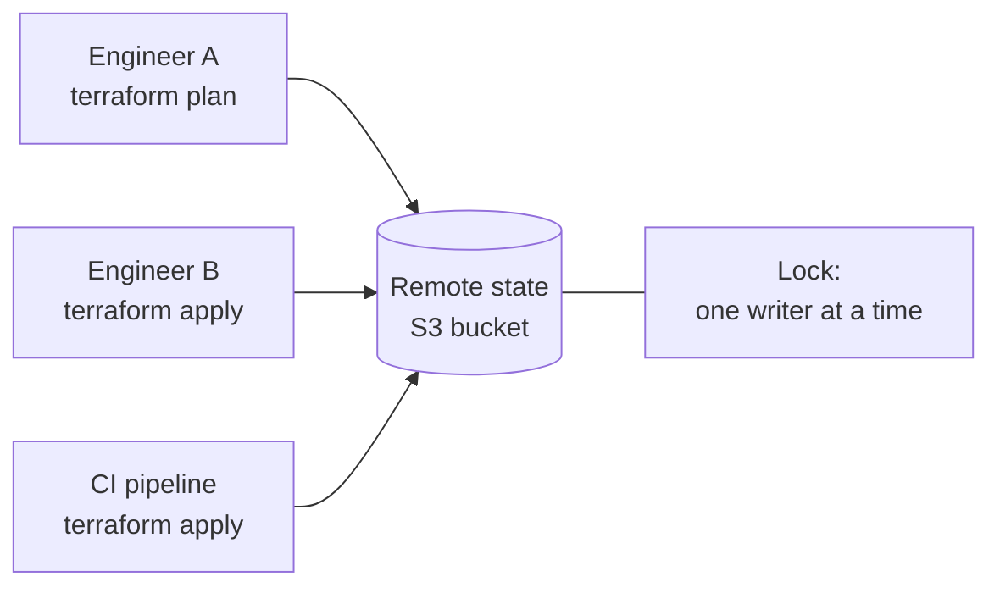
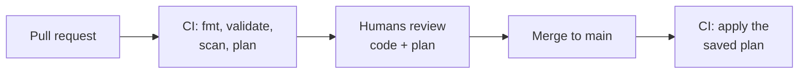

# 12.6 Terraform in real life: state, modules, environments

Terraform on one laptop is calm: one state file on your disk, one person typing `apply`, nothing at stake. Real infrastructure is different. Five engineers share it. Staging and production must stay in step. The state file turns out to contain the database password. And one careless `apply` can delete a company's data. This chapter covers the practices that make Terraform safe at that scale: where the state lives and who may touch it, how to keep secrets out of it, how to package and reuse code, how one codebase serves several environments, and how a team reviews and ships changes. You'll practise the parts that run locally for free, then read a production-shaped AWS configuration that uses all of them.

If Terraform is new to you, start with [chapter 12.5](./terraform-from-zero.mdx). The one thing this chapter assumes: Terraform compares your `.tf` files with its **state** (a record of what it created) and with reality, shows a **plan**, and `apply` makes the changes.

## What you'll learn

- **Remote state** with **locking**: one shared, encrypted copy, and one writer at a time.
- Why state is **sensitive**, and how **ephemeral values** and **write-only arguments** keep secrets out of it.
- **Modules**: a folder of Terraform used like a function, with inputs and outputs.
- **Environments**: staging and production from the same code, differing only in inputs.
- A team workflow: **plan on pull request, apply on merge**, with OIDC; **scanning**; and refactoring with **moved** and **import**.

---

## State, shared and locked

By default Terraform writes `terraform.tfstate` next to your code. That breaks the moment two people are involved: each has their own copy, neither knows what the other applied, and a lost laptop means Terraform forgets everything it manages.

So teams use a **remote backend**: the state lives in shared storage (an S3 bucket on AWS, a Cloud Storage bucket on Google Cloud, Azure Blob storage, or a service such as HCP Terraform), and every run reads and writes it there.



The backend is declared in the `terraform` block:

```hcl title="versions.tf"
terraform {
  backend "s3" {
    bucket       = "example-company-tfstate"      # created once, by hand or a bootstrap config
    key          = "billing/terraform.tfstate"    # the path of this configuration's state
    region       = "eu-west-1"
    encrypt      = true
    use_lockfile = true                           # S3-native state locking
  }
}
```

**Locking** means only one run can hold the state at a time. A second `apply` waits, or fails with `Error acquiring the state lock`, instead of both overwriting each other's changes and corrupting the state. With `use_lockfile`, Terraform writes a small `.tflock` file next to the state in S3 while it works (S3's conditional writes make that safe). Older setups, and many blog posts, use a separate DynamoDB table for the lock; that method is now deprecated.

:::note[Everyday anchor]
The state file is the **land registry** for your infrastructure: the official record of what's yours. Keep one copy in a secure, shared registry office (the remote backend), let only one clerk update it at a time (locking), keep old versions (bucket versioning), and never leave it lying around, because it lists everything valuable and sometimes the keys to it.
:::

### State is sensitive

State holds **every attribute** of every resource, and some of those are secrets: generated passwords, connection strings, private keys, tokens. Marking an output `sensitive = true` only hides it on screen. The value is still written, in plain text, into the state. So:

- Store state **encrypted**, with **versioning** turned on (to recover from a bad write), and **access restricted** to the pipeline and a few administrators.
- **Never commit state to Git.** A `.gitignore` with `*.tfstate` and `*.tfstate.*` is the first file in any Terraform repository.
- Better still: **don't put secrets in state at all.**

### Secrets that never reach state: ephemeral and write-only

Since Terraform 1.11 (and OpenTofu 1.11), a secret can pass *through* a run without being saved. Two features work together:

- An **ephemeral resource** produces a value that exists only while the run is happening. It's never written to the plan or the state.
- A **write-only argument** (by convention ending in `_wo`) is sent to the provider's API but never recorded. Because Terraform can't remember what it sent, it can't tell when the value has changed, so each write-only argument has a companion **version** number. Bump the number and Terraform sends a new value.

The pattern for a database password on AWS looks like this:

```hcl
ephemeral "random_password" "db" {   # generated during apply, then forgotten
  length  = 32
  special = false
}

resource "aws_db_instance" "main" {
  # … engine, size, network …
  username            = "app"
  password_wo         = ephemeral.random_password.db.result   # sent to AWS, never saved
  password_wo_version = 1                                     # bump to rotate
}
```

The application can't read the password from Terraform's outputs either (outputs are saved in state), so the same ephemeral value is usually written, also write-only, into a secrets store such as AWS Secrets Manager, where the application reads it at start-up. Not every resource offers `_wo` arguments yet; check the provider's documentation for the resource you're using.

---

## Modules: reusable infrastructure

A **module** is a folder of `.tf` files with **variables** as its inputs and **outputs** as its results. Any configuration can call it, like calling a function. In fact every configuration is already a module: the folder you run `terraform` in is the **root module**, and the folders it calls are **child modules**.

Here is a small one you can run with Docker. It wraps "one nginx container showing one message" so you can stamp out several sites:

```hcl title="modules/site/main.tf"
terraform {
  required_providers {
    docker = { source = "kreuzwerker/docker" } # every module names its non-HashiCorp providers
  }
}

variable "name" {
  description = "Container name."
  type        = string
}

variable "port" {
  description = "Port on your machine."
  type        = number
}

variable "message" {
  description = "Text the page shows."
  type        = string
}

variable "image_id" {
  description = "The nginx image to run."
  type        = string
}

resource "docker_container" "web" {
  name  = var.name
  image = var.image_id
  ports {
    internal = 80
    external = var.port
  }
  upload {
    file    = "/usr/share/nginx/html/index.html"
    content = "<h1>${var.message}</h1>\n"
  }
}

output "url" {
  value = "http://localhost:${var.port}"
}
```

```hcl title="main.tf (the root module)"
terraform {
  required_providers {
    docker = {
      source  = "kreuzwerker/docker"
      version = "~> 4.6"
    }
  }
}

provider "docker" {}

resource "docker_image" "nginx" {
  name         = "nginx:1.30-alpine"
  keep_locally = true
}

module "blog" {
  source   = "./modules/site"
  name     = "site-blog"
  port     = 8091
  message  = "The blog"
  image_id = docker_image.nginx.image_id
}

module "docs" {
  source   = "./modules/site"
  name     = "site-docs"
  port     = 8092
  message  = "The docs"
  image_id = docker_image.nginx.image_id
}

output "urls" {
  value = [module.blog.url, module.docs.url]
}
```

Things to notice:

- The caller sees only the module's **interface**: four inputs and one output (`module.blog.url`). How the module builds the site is its own business.
- Resources inside a module get longer addresses: `module.blog.docker_container.web`.
- After adding or changing a `module` block, run `terraform init` again so Terraform can find it.
- The `required_providers` line inside the module matters. Without it, Terraform assumes `docker` means `hashicorp/docker`, which doesn't exist, and `init` fails.

Modules come from local folders (as here), Git repositories, or registries. The public **Terraform Registry** has widely used community modules, such as `terraform-aws-modules/vpc/aws`, a complete AWS network in one block. When you use someone else's module, **pin its version** (`version = "~> 6.0"`), or an upstream change can silently alter your infrastructure on the next `init`.

Good modules follow the advice for good functions: a small, clear interface; safe defaults; one job. A module with 80 variables has become a configuration language of its own.

---

## Environments: one codebase, several deployments

Staging and production should be built from **the same code**, differing only in **inputs**. Otherwise "it worked in staging" means nothing. The common layout is one configuration plus a variables file and a backend file per environment:

```text
infra/
├── main.tf, variables.tf, outputs.tf, versions.tf
└── envs/
    ├── staging.tfvars            instance_count = 1, multi_az = false
    ├── staging.backend.hcl       key = "app/staging/terraform.tfstate"
    ├── production.tfvars         instance_count = 3, multi_az = true
    └── production.backend.hcl    key = "app/production/terraform.tfstate"
```

The `backend "s3" {}` block in the code is left empty, and `init` fills it in from the file (a **partial backend configuration**):

```bash
terraform init -backend-config=envs/production.backend.hcl -reconfigure   # point at production's state
terraform plan -var-file=envs/production.tfvars                          # with production's inputs
```

Where environments must *behave* differently, the code expresses it as logic on an input, so the difference is visible and reviewed:

```hcl
deletion_protection = var.environment == "production"   # only production refuses to be deleted
```

Each environment has **its own state file**, so a mistake while working on staging can't touch production's state.

Two other layouts are common. **One folder per environment**, each calling shared modules, is more explicit, at the cost of some repetition. **Terraform workspaces** keep several states for one configuration; they're convenient, but it's easy to apply to the wrong one, so many teams avoid them for environments. Whatever the layout, the strongest isolation is **separate cloud accounts** per environment ([chapter 12.4](./iam.mdx)), each with its own state and credentials.

---

## Lock files across platforms

`terraform init` records each provider's exact version and checksums in `.terraform.lock.hcl`, which you commit so everyone gets identical providers. There's a trap. Provider packages are different files for each operating system and CPU, so a lock created on a Linux machine may hold only Linux checksums. A colleague on a Mac then gets an error at `init` saying the provider doesn't match any of the checksums recorded in the lock file.

The fix is to record checksums for every platform your team and CI use:

```bash
terraform providers lock \
  -platform=linux_amd64 -platform=linux_arm64 \
  -platform=darwin_amd64 -platform=darwin_arm64 -platform=windows_amd64
```

Each provider in the lock file then has one `h1:` hash per platform.

---

## A team workflow

Nobody runs `terraform apply` against production from a laptop. The common pattern:



1. A change is proposed in a **pull request**.
2. CI runs `fmt -check`, `validate`, **security scanning**, and `terraform plan` against the real environment, and posts the plan on the pull request.
3. Reviewers read the **code and the plan**: every `-/+` (replace) and `-` (destroy).
4. After approval and merge, CI applies **exactly the reviewed plan** (`terraform plan -out=tfplan`, then `terraform apply tfplan`), so nothing that changed in between sneaks in.
5. CI authenticates to the cloud with **OIDC** ([chapter 12.4](./iam.mdx)): short-lived credentials, issued only to a pipeline running on the `main` branch, so no long-lived cloud keys sit in CI's secrets. Pull-request plans use a separate, read-only role.

Tools such as **Atlantis**, **HCP Terraform** and **Spacelift** implement this workflow; plain GitHub Actions can too. A scheduled `terraform plan -detailed-exitcode` (exit code 2 means "changes") catches **drift**: someone changing reality by hand.

### Scanning infrastructure code

Scanners such as **Trivy** and **Checkov** read Terraform (and Kubernetes manifests, Dockerfiles, Helm charts) and flag risky configurations **before** they exist: storage buckets open to the public, unencrypted disks, firewall rules open to the whole internet, missing logs. Each finding needs a decision, the same triage you'd do for vulnerable packages ([chapter 9.4](../containers/images-in-production.mdx)):

- **Fix it**, if the scanner is right.
- **Accept it, in writing**, if it's deliberate: a comment next to the resource saying why, so the next reader (and the scanner) knows it was a choice, not an accident.

Then make the scan **blocking** in CI, so any *new* finding fails the build until it gets one of those two decisions.

### Refactoring without destroying: moved and import

Terraform identifies everything by its **address**. Rename `aws_db_instance.postgres` to `aws_db_instance.main` in the code and Terraform sees one address disappear and a new one appear: "destroy the old database, create a new one". For a database, that's a disaster. A **`moved`** block says they're the same object:

```hcl
moved {
  from = aws_db_instance.postgres
  to   = aws_db_instance.main
}
```

The plan then says `has moved to` instead of `must be replaced`, with **0 to destroy**. The same works for whole modules, which you'll do in the lab.

The reverse problem, resources someone built by hand that Terraform doesn't know about yet, is solved by an **`import`** block:

```hcl
import {
  to = aws_s3_bucket.legacy_uploads
  id = "example-legacy-uploads"     # the real bucket's name
}
```

`terraform plan -generate-config-out=generated.tf` can even write the matching resource block for you to review. This is how teams move a console-built account into code piece by piece, without recreating anything.

:::warning[What can go wrong]
- **State in Git, or in an unencrypted bucket**: every secret in it is exposed. Encrypt, version, restrict, and prefer write-only arguments.
- **No locking**: two concurrent applies corrupt the state.
- **Applying a different plan than the one reviewed**: always apply the saved plan file in CI.
- **Renames without `moved`**: a tidy-up that destroys production resources.
- **One giant configuration** holding everything: slow plans, a huge blast radius, and one team's mistake blocking everyone. Split by lifecycle and ownership (network, data, application), each with its own state, passing values between them through outputs.
- **Unpinned module versions**: an upstream change quietly alters your infrastructure on the next `init`.
:::

:::info[In the real world]
Mature teams treat infrastructure changes exactly like application changes: small pull requests, automated plans and scans, reviews, applied by a pipeline with short-lived credentials, and drift checked nightly. The foundations (accounts, networks, identity) are managed by a platform team in separate states, and application teams consume them through modules and outputs. Nobody has permanent admin rights to production; emergency "break-glass" access exists, but it's logged and alerts someone.
:::

---

## Apply it to snip: a production-shaped AWS configuration

The project this handbook builds, **snip** (a URL shortener, [chapter 0.3](../start/meet-snip.mdx)), has an AWS configuration in `snip/infra/aws/`: a network module, security groups, a managed Postgres (RDS) and Redis (ElastiCache), the API and worker on ECS Fargate (AWS's serverless containers), a load balancer, and the IAM roles to tie them together. This repository's CI validates and scans it on every push. It's never applied there, because applying it costs real money. Every practice above appears in it.

**Remote state per environment.** `versions.tf` has an empty `backend "s3" {}`, filled in from `envs/staging.backend.hcl` or `envs/production.backend.hcl`:

```hcl title="snip/infra/aws/envs/staging.backend.hcl"
bucket       = "YOUR-UNIQUE-BUCKET-snip-tfstate"
key          = "snip/staging/terraform.tfstate"
region       = "eu-west-1"
encrypt      = true
use_lockfile = true # S3-native state locking
```

**No password in state.** snip uses two database logins ([chapter 7.4](../security/authorization-multi-tenancy.mdx)): RDS's master user, which owns the tables and runs migrations, and `snip_app`, which the API and worker sign in as. Both passwords are ephemeral and reach AWS only through write-only arguments: the master's once for RDS and once for its connection string, the app's once, in its connection string, in Secrets Manager:

```hcl title="snip/infra/aws/main.tf (excerpt)"
ephemeral "random_password" "db" {
  length  = 32
  special = false
}

resource "aws_db_instance" "postgres" {
  # …
  password_wo         = ephemeral.random_password.db.result
  password_wo_version = 1 # bump to rotate
  # …
  deletion_protection = var.environment == "production"
  skip_final_snapshot = var.environment != "production"
}

resource "aws_secretsmanager_secret_version" "db_owner_url" {
  secret_id                = aws_secretsmanager_secret.db_owner_url.id
  secret_string_wo         = "postgres://snip:${ephemeral.random_password.db.result}@${aws_db_instance.postgres.endpoint}/snip?sslmode=require"
  secret_string_wo_version = 1 # bump together with password_wo_version
}

ephemeral "random_password" "db_app" {
  length  = 32
  special = false
}

resource "aws_secretsmanager_secret_version" "db_url" {
  secret_id                = aws_secretsmanager_secret.db_url.id
  secret_string_wo         = "postgres://snip_app:${ephemeral.random_password.db_app.result}@${aws_db_instance.postgres.endpoint}/snip?sslmode=require"
  secret_string_wo_version = 1 # bump to rotate; the next migrate container applies it
}
```

snip's containers read the connection strings from Secrets Manager at start-up, using the execution role from [chapter 12.4](./iam.mdx). Notice what Terraform *doesn't* do: create the `snip_app` login. That would mean connecting to the database, which sits in private subnets your laptop and CI can't reach, on purpose. Terraform only generates the password; a `migrate` container that runs first in each API task signs in as the master user and creates or updates the login from that secret (`snip/infra/aws/compute.tf`). Compare the local stack in `snip/infra/local/` ([chapter 12.5](./terraform-from-zero.mdx)): it uses an ordinary `random_password`, so its state *does* hold the password. Fine on a laptop, not in production.

**A module for the network.** `main.tf` calls `module "network" { source = "./modules/network" … }`. Inside are the VPC, subnets, gateways and route tables from [chapter 12.2](./cloud-networking.mdx), behind three inputs (`name`, `cidr`, `az_count`) and three outputs (`vpc_id`, `public_subnet_ids`, `private_subnet_ids`). The database, for example, uses `module.network.private_subnet_ids` and knows nothing else about how the network is built.

**Two environments, one codebase.** `envs/staging.tfvars` sets `api_count = 1`, `db_instance_class = "db.t4g.micro"`, `multi_az = false`; `envs/production.tfvars` sets `3`, `"db.t4g.small"` and `true`. Production alone gets deletion protection and a final snapshot.

**Lock files for every platform.** `snip/infra/aws/.terraform.lock.hcl` holds five `h1:` hashes per provider, so `init` works on Linux, macOS (Intel and Apple Silicon) and Windows.

### What the scanner found

CI runs Trivy in configuration mode over `snip/infra` and `snip/deploy`. The first time it read the AWS configuration, it reported four findings:

```text
aws/compute.tf (terraform)
AWS-0052 (HIGH): Application load balancer is not set to drop invalid headers.
AWS-0053 (HIGH): Load balancer is exposed publicly.
AWS-0054 (CRITICAL): Listener for application load balancer does not use HTTPS.
aws/main.tf (terraform)
AWS-0104 (CRITICAL): Security group rule allows unrestricted egress to any IP address.
```

Each got a decision:

| Finding | Decision |
|---|---|
| **AWS-0052**: invalid headers not dropped | **Fixed**: `drop_invalid_header_fields = true` (malformed headers are a request-smuggling tool) |
| **AWS-0104**: tasks may send anything anywhere | **Narrowed**: HTTPS out (image pulls, AWS APIs), plus Postgres and Redis only to the data security group. The remaining HTTPS rule is **accepted**, with a reason: VPC endpoints ([chapter 12.2](./cloud-networking.mdx)) would remove it |
| **AWS-0053**: load balancer is public | **Accepted**: it's snip's front door, public on purpose |
| **AWS-0054**: no HTTPS listener | **Accepted for the example** (no domain to get a certificate for), with a note that production must add HTTPS |

Accepted findings are recorded in the code, next to the resource:

```hcl title="snip/infra/aws/compute.tf (excerpt)"
#trivy:ignore:AWS-0053 snip's load balancer is its public front door: internet-facing on purpose
resource "aws_lb" "this" {
```

The same scan found that the Postgres and Redis **Kubernetes** manifests ([chapter 10.2](../kubernetes/core-objects.mdx)) ran with default security settings, which allow running as root. snip's own Pods were already locked down; these two, adapted from the Compose stack, weren't. They now run as the images' non-root users with read-only root filesystems. With zero HIGH or CRITICAL findings left, CI switched the scan from *report only* to **blocking**.

---

## Lab

Free, on your computer with Docker; **no cloud account needed**. Steps 1–3 are a standalone module exercise; steps 4–6 read snip's AWS configuration without applying it.

1. **Build a module and call it twice.** In a new folder, create `modules/site/main.tf` and `main.tf` from the "Modules" section, then:
   ```bash
   terraform init                      # finds the module and the provider
   terraform apply                     # 3 to add: one image, two containers
   curl localhost:8091; curl localhost:8092
   terraform state list                # module.blog.docker_container.web, …
   ```
   Notice the addresses: each module call gets its own copy of the module's resources.

2. **Refactor without destroying.** Replace the two `module` blocks and the output with one `for_each` call plus two `moved` blocks:
   ```hcl
   locals {
     sites = {
       blog = { port = 8091, message = "The blog" }
       docs = { port = 8092, message = "The docs" }
     }
   }

   module "site" {
     source   = "./modules/site"
     for_each = local.sites
     name     = "site-${each.key}"
     port     = each.value.port
     message  = each.value.message
     image_id = docker_image.nginx.image_id
   }

   moved {
     from = module.blog
     to   = module.site["blog"]
   }

   moved {
     from = module.docs
     to   = module.site["docs"]
   }

   output "urls" {
     value = [for s in module.site : s.url]
   }
   ```
   ```bash
   terraform init && terraform plan    # "has moved to" … Plan: 0 to add, 0 to change, 0 to destroy.
   ```
   Now delete the two `moved` blocks and plan again: `2 to add, 0 to change, 2 to destroy`. That's what an innocent-looking rename does without them. Put them back, `terraform apply`, and the containers are never touched.

3. **Clean up.** `terraform destroy`, then `docker ps -a --filter name=site-` shows nothing.

4. **Validate a real cloud configuration without a cloud account.** Clone this handbook's repository if you haven't (`git clone https://github.com/jawwadzafar/zero-to-prod ~/code/zero-to-prod`):
   ```bash
   cd ~/code/zero-to-prod/snip/infra/aws
   terraform init -backend=false        # skip the S3 backend: no AWS account needed
   terraform validate                   # Success! The configuration is valid.
   grep -c h1: .terraform.lock.hcl      # 10: five platforms × two providers
   ```

5. **Find the secret handling and the environment differences.**
   ```bash
   grep -n 'ephemeral\|_wo' *.tf                     # the password's whole journey
   diff envs/staging.tfvars envs/production.tfvars   # what differs between environments
   grep -n 'environment ==\|environment !=' *.tf     # where the code behaves differently for production
   ```
   Then open `../local/main.tf`: which of the two configurations stores its database password in state, and why? (The local one: a regular `random_password` resource's `result` is an attribute, and attributes are saved.)

6. **Scan it yourself** (optional):
   ```bash
   docker run --rm -v "$PWD/..:/src:ro" aquasec/trivy:0.76.1 config --severity HIGH,CRITICAL /src/aws
   ```
   You should see no failures: the remaining findings are accepted with `#trivy:ignore` comments. Delete the `drop_invalid_header_fields` line from `compute.tf`, scan again, and watch AWS-0052 come back. (Then `git checkout compute.tf`.)

## Self-check

<Quiz
  id="cloud-terraform-in-real-life"
  questions={[
    {
      q: 'Why does a team need remote state with locking?',
      options: [
        'It makes plans faster, since state is downloaded once and cached for all',
        'Everyone shares one state; locking stops two applies corrupting it',
        'Terraform refuses to apply to a cloud account from a local state file',
        'To keep the code private, since state holds a copy of it',
      ],
      answer: 1,
      explain: 'Everyone must work from the same record of what exists, and locking stops two concurrent runs overwriting each other. Terraform happily applies from local state (that is the problem: each person has a different copy), and state holds resource attributes, not your code.',
    },
    {
      q: 'Does sensitive = true on an output keep the value out of the state file?',
      options: [
        'Yes; it is encrypted in state with the backend’s key',
        'No: it only hides it on screen; state still has it in plain text',
        'Only on AWS, where the provider encrypts marked values',
        'Only with remote state, which drops sensitive values when saving',
      ],
      answer: 1,
      explain: 'sensitive only hides the value in terminal output. State still stores it in plain text; backend encryption protects the whole file at rest, not that value from anyone who can read the state. To keep a secret out of state, use an ephemeral value and write-only arguments.',
    },
    {
      q: 'How do ephemeral values and write-only arguments keep a database password out of state?',
      options: [
        'Terraform asks for the password at apply time, then deletes it from state afterwards',
        'The value exists only during the run and is sent to the API without being recorded',
        'They mark the password sensitive, which keeps it out of state',
        'They encrypt the password inside the state file',
      ],
      answer: 1,
      explain: 'An ephemeral resource’s value is never written to plan or state, and a write-only (_wo) argument sends it to the provider without recording it. Because Terraform can’t compare a value it never saved, a companion _version number tells it when to send a new one.',
    },
    {
      q: 'You rename a resource in code. What prevents Terraform from destroying and recreating it?',
      options: [
        'Nothing can; renaming always recreates the resource',
        'A moved block from the old address to the new one',
        'terraform fmt, which updates the addresses in state',
        'terraform refresh, which rewrites the old address in the state file to match',
      ],
      answer: 1,
      explain: 'moved tells Terraform the old and new addresses are the same object, so the plan shows "has moved to" and 0 to destroy. fmt only reformats files, and refresh only re-reads attributes from the real world; neither renames anything.',
    },
    {
      q: 'Why apply the exact saved plan file in CI instead of running apply fresh?',
      options: [
        'AWS requires every change to arrive as a signed plan file',
        'So exactly what reviewers approved is what runs, even if things moved',
        'A fresh apply would skip the lock and could clash with another run',
        'It skips validation and refresh, so the apply finishes much sooner',
      ],
      answer: 1,
      explain: 'A fresh apply computes a new plan, which may differ from the reviewed one if reality or the code changed in between. Applying the saved file guarantees the reviewed actions, and Terraform refuses it if the state has moved on. Both kinds of apply take the lock.',
    },
    {
      q: 'A colleague on a Mac gets a checksum error at terraform init, but it works on your Linux laptop and in CI. What is the likely cause?',
      options: [
        'The Mac has an older Terraform, which can’t read the lock file',
        'The lock file only has Linux checksums; run terraform providers lock for every platform',
        'The state file is corrupted and must be restored from a backup',
        'macOS blocks providers that aren’t signed by HashiCorp',
      ],
      answer: 1,
      explain: 'Provider packages differ per OS and CPU, and the lock records checksums of the packages it saw. A lock written on Linux may hold only Linux hashes. terraform providers lock -platform=… records all of them. The state has nothing to do with init’s provider checks.',
    },
  ]}
/>

<details>
<summary>Design the Terraform setup for a service like snip across staging and production accounts, including who can apply what.</summary>

- **Accounts**: separate cloud accounts for staging and production (and a third for shared state and logs), in one organisation with guardrail policies.
- **State**: a versioned, encrypted, locked bucket per environment. Only the pipeline roles can write to it.
- **Code**: one configuration plus per-environment `tfvars` and backend files. Shared building blocks (the network) as pinned modules.
- **Pipeline**: on a pull request, CI assumes a **read-only plan role** in each account via OIDC, runs fmt, validate, scan and plan, and posts the plans. On merge to `main`, CI assumes the **apply role** (trusted only for `main`, [chapter 12.4](./iam.mdx)), applies the saved plan to staging, runs smoke tests, then waits for a human approval before production.
- **Secrets**: ephemeral values and write-only arguments for generated passwords; everything else in a secrets manager, never in `tfvars` or state.
- **Humans**: read-only console access by default; a logged, time-limited break-glass role for emergencies.
- **Drift**: a nightly `plan -detailed-exitcode` per environment, alerting on exit code 2.

</details>

<details>
<summary>An apply failed halfway: some resources were created, others weren't. What state are you in, and what do you do?</summary>

Terraform records each resource in state **as soon as it's created**, so the state reflects exactly what exists: the created resources are in it, the failed and uncreated ones aren't. It's not corrupted, just partially applied. A resource whose creation failed partway may be marked **tainted**, meaning "replace this next time".

What to do: read the error (often a permission, a quota, a name conflict or a transient API failure), fix the cause, and run `plan` again. It shows only what's still missing, plus replacements for anything tainted. Then `apply`. Don't delete or hand-edit the state file. If the crashed run left its lock behind, `terraform force-unlock <ID>` releases it, once you're sure no other run is active.

</details>
