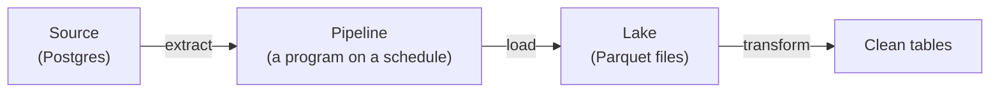
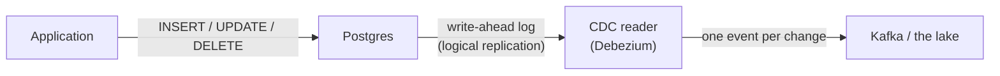

# 17.2 Batch pipelines: extract, load, transform

You've copied photos from a phone to a laptop and had the copy stop half-way. Which photos made it? If you run it again, do you get two of each? Now imagine that copy runs every night, unattended, on a database of customer orders, and that the finance team's numbers depend on it. A **batch pipeline** is exactly that copy job, built so that a failure in the middle of the night is boring: you run it again, and the result is right. This chapter builds one from scratch on a small shop database you start on your laptop, then shows the same patterns in `snipdata`, the pipeline for snip's data.

## What you'll learn

- **Extract, load, transform**: the three steps of every pipeline, and where each one breaks.
- **Idempotency**: why "run it twice, get the same result as once" is the property everything else rests on, and the three habits that give it to you.
- **Partitioning by date**: one folder per day, so a day can be rebuilt, deleted or skipped on its own.
- **Full snapshots versus incremental loads** with a **watermark**, and the late-commit trap that silently loses rows.
- **Schema changes** that break pipelines quietly, and **change data capture** (CDC), the alternative to querying the source at all.

---

## Three verbs, three places to break

:::note[Everyday anchor]
Moving house has three steps: pack the boxes (extract), carry them to the new place (load), unpack and arrange the rooms (transform). If the van breaks down on the way, you want to know exactly which boxes arrived, and you never want to unpack the same box twice.
:::

Every pipeline does the same three things:

1. **Extract**: read data from where it lives (a database, an API, files). This touches a system someone else depends on, so it must be gentle and consistent.
2. **Load**: write it to the analytics store, usually unchanged. This is where failures leave half-written files and duplicates.
3. **Transform**: turn raw copies into clean tables ([chapter 17.4](./modeling-for-analytics.mdx)). Because the raw data stays, this step can always be redone.



**Batch** means the pipeline runs on a schedule (every night, every hour) and processes a chunk of data each time, as opposed to streaming, which handles each event as it arrives. Most business reporting is batch, because "yesterday's numbers" are what people ask for and batch is far easier to get right.

---

## A shop to copy from

To learn the patterns without anything else in the way, you'll copy a shop's `orders` table. You need Docker (for a throwaway Postgres) and **DuckDB**, a small analytical database that runs as a single program, with no server. Here DuckDB is a convenient tool: it can read from Postgres and write **Parquet** files (a file format for tables, compressed and stored column by column). [Chapter 17.3](./columnar-storage-and-duckdb.mdx) explains both properly.

<Tabs>
<TabItem value="mac" label="macOS">

```bash
brew install duckdb                       # the DuckDB command-line tool
duckdb --version                          # v2.0.0 or newer
```

</TabItem>
<TabItem value="linux" label="Linux / WSL">

```bash
curl https://install.duckdb.org | sh      # installs to ~/.duckdb/cli/latest/duckdb
export PATH="$HOME/.duckdb/cli/latest:$PATH"   # add this line to ~/.bashrc to keep it
duckdb --version                          # v2.0.0 or newer
```

</TabItem>
<TabItem value="win" label="Windows (PowerShell)">

```powershell
winget install DuckDB.cli                 # then open a new terminal
duckdb --version                          # v2.0.0 or newer
```

</TabItem>
</Tabs>

Start Postgres and give it 4,000 orders spread over three days:

```bash
docker run -d --name pg-shop -p 5433:5432 -e POSTGRES_PASSWORD=learn postgres:18-alpine   # port 5433 on your laptop
sleep 3
docker exec -i pg-shop psql -U postgres <<'SQL'
CREATE TABLE orders (
  id           bigserial   PRIMARY KEY,          -- 1, 2, 3, … handed out by a sequence
  customer     text        NOT NULL,
  amount_cents int         NOT NULL,
  created_at   timestamptz NOT NULL DEFAULT now()
);
INSERT INTO orders (customer, amount_cents, created_at)
SELECT 'customer-' || (i % 50), 100 + (i * 37) % 9900,
       timestamptz '2026-10-27 00:00+00' + i * interval '1 minute'   -- one order a minute
FROM generate_series(1, 4000) AS i;
SQL
```

Then make a folder for the lab and open DuckDB there. Every DuckDB snippet in this chapter starts by connecting to the shop. DuckDB downloads its Postgres extension the first time (a few MB):

```bash
mkdir -p ~/pipeline-lab && cd ~/pipeline-lab
duckdb
```

```sql
INSTALL postgres; LOAD postgres;                     -- once per session: DuckDB's Postgres reader
ATTACH 'host=localhost port=5433 user=postgres password=learn' AS shop (TYPE postgres, READ_ONLY);
SET TimeZone = 'UTC';                                -- days are UTC days, on every laptop
SELECT count(*) FROM shop.orders;                    -- 4000
```

`READ_ONLY` is the first habit of extraction: the pipeline can't change the source, whatever bug it has.

---

## The first pipeline, and why running it twice breaks it

The simplest possible pipeline copies the whole table into a file named after the moment it ran. In a second terminal, in `~/pipeline-lab`:

```bash
mkdir -p naive
for run in 1 2; do                                    # the nightly job, run twice (a retry, say)
  duckdb -c "INSTALL postgres; LOAD postgres;
    ATTACH 'host=localhost port=5433 user=postgres password=learn' AS shop (TYPE postgres, READ_ONLY);
    COPY (SELECT * FROM shop.orders) TO 'naive/orders-$(date +%s).parquet'"
  sleep 1
done
duckdb -c "SELECT count(*) AS rows, count(DISTINCT id) AS orders FROM 'naive/*.parquet'"
```

```text
┌───────┬────────┐
│ rows  │ orders │
├───────┼────────┤
│  8000 │   4000 │
└───────┴────────┘
```

4,000 orders, 8,000 rows. Any report that sums `amount_cents` over this folder now reports **double the revenue**. Nothing failed; the job was retried, which is exactly what schedulers do when something looks stuck. That's why the property every pipeline needs has a name.

A step is **idempotent** when running it twice leaves the same result as running it once. (The same idea makes API retries safe, [chapter 5.2](../apis/designing-rest-apis.mdx), and lets a queue deliver a message twice without harm, [chapter 8.1](../distributed/distributed-survival-kit.mdx).) Idempotent pipelines can be retried, re-run for a past day, or run by an over-eager scheduler, and the data stays right. Three habits get you there:

1. **Name outputs by what they contain, not when they ran.** "Orders created on 2026-10-28" has one correct file path; "the 02:13 run" has a new path every time.
2. **Replace, don't append.** Writing a day's data overwrites that day's previous copy instead of adding to it.
3. **Write atomically.** Write to a temporary file and rename it into place at the end. On the same disk a rename is all or nothing, so a reader (or the next run) never sees half a file.

Here is the same copy following the first two habits: one folder per day, replaced on every run. DuckDB's `PARTITION_BY` writes one folder per value of `dt`, and `OVERWRITE` replaces whatever was there.

```sql
-- in the duckdb prompt, connected to shop
COPY (SELECT *, created_at::date AS dt FROM shop.orders)
  TO 'lake/orders' (FORMAT parquet, PARTITION_BY (dt), OVERWRITE);
```

```text
lake/orders/dt=2026-10-27/data_0.parquet
lake/orders/dt=2026-10-28/data_0.parquet
lake/orders/dt=2026-10-29/data_0.parquet
```

Run the `COPY` again, as often as you like: `SELECT count(*) FROM 'lake/orders/*/*.parquet'` stays at 4,000.

---

## Partition by date: one folder per day

The `dt=2026-10-28` folders are called **partitions**, and the `name=value` style is **Hive-style partitioning** (named after Apache Hive, the Hadoop-era tool that popularised it). Nearly every data tool understands it: DuckDB, Spark, Trino, BigQuery and Athena read `dt` as a column without it being inside the files.

:::note[Everyday anchor]
A filing cabinet with one drawer per day. To fix Tuesday's paperwork, you empty Tuesday's drawer and refill it; you don't touch the rest. To throw away anything older than a year, you empty the old drawers. To find something from Tuesday, you open one drawer instead of searching the cabinet.
:::

Those three moves are the reasons to partition:

- **Rebuild one day.** A bug corrupted Tuesday? Replace `dt=…tuesday` and nothing else.
- **Retention.** "Keep two years" becomes "delete folders older than two years", with no expensive `DELETE` inside files.
- **Skipping.** A query for "last week" opens seven folders and ignores the rest (**partition pruning**, [chapter 17.3](./columnar-storage-and-duckdb.mdx)).

The question that matters is **which date**. **Event time** is when the thing happened (the order was placed); **processing time** is when your pipeline saw it. Partition by event time, because that's what people ask about. The consequence is **late data**: an order placed at 23:59 on Monday that reaches the pipeline after midnight belongs in Monday's folder, which you thought was finished. Pipelines handle that by re-processing the last few days on every run (a **lookback window**), which is safe precisely because each step is idempotent. Pick partitions that are not too small, too: one folder per day is typical; one per minute creates millions of tiny files that are slow to list and read.

---

## Full snapshots, or only what's new

There are two ways to decide *what* to extract.

A **full snapshot** copies the whole table every run. It's simple and it catches everything: new rows, changed rows, and deleted rows (they're missing from today's copy). It costs more as the table grows. For tables up to a few million rows (customers, products, snip's links) a nightly snapshot is often the right answer. Keep each day's snapshot in its own partition and you also get history for free: "what did this customer's record look like on 1 October?"

An **incremental load** copies only the rows added (or changed) since the last run. It needs a column that only ever grows, called the **watermark**: an `id` from a sequence, or an `updated_at` timestamp. The run reads the highest value it already copied, then asks the source for rows above it.

Add 500 new orders, then load incrementally. The watermark comes from the lake itself, so there's no separate "last run" file to get out of step:

```bash
docker exec pg-shop psql -U postgres -c "INSERT INTO orders (customer, amount_cents)
  SELECT 'customer-' || (i % 50), 500 FROM generate_series(1, 500) AS i"     # ids 4001–4500
```

```sql
-- in the duckdb prompt: copy only orders above the highest id already in the lake
COPY (
  SELECT *, created_at::date AS dt
  FROM shop.orders
  WHERE id > (SELECT max(id) FROM read_parquet('lake/orders/*/*.parquet'))   -- the watermark
) TO 'lake/orders' (FORMAT parquet, PARTITION_BY (dt), APPEND);              -- add files, keep the old ones
```

The new orders land in today's partition as an extra file. Run the same `COPY` again: the watermark is now 4,500, nothing is above it, and nothing is written. The load is idempotent because the watermark lives where the data lives: if a run dies before writing, the watermark hasn't moved either.

:::warning[What can go wrong]
- **Late commits skip rows forever.** A sequence hands out ids when rows are *inserted*, not when they *commit*. If a slow transaction takes id 4501 and a fast one takes 4502 and commits first, a run in between sees only 4502 and moves the watermark past 4501. When 4501 commits, it's below the watermark and is never copied. The lab reproduces this. Fixes: only copy rows older than a short **settle time** (long enough for any transaction to finish), or re-read a window behind the watermark and remove duplicates.
- **`updated_at` lies.** It only works if every writer sets it: one script that runs `UPDATE` without touching `updated_at` makes its changes invisible to the pipeline. A database trigger that sets it is safer than trusting every writer.
- **Deletes are invisible.** "Rows above the watermark" never includes a row that was deleted. If deletes matter, use snapshots, soft deletes (a `deleted_at` column), or CDC (below).
- **Clocks differ.** A watermark based on the *pipeline's* clock rather than the *source's* misses rows when the two disagree. Always compare the source's values with the source's values.
:::

| | Full snapshot | Incremental (watermark) |
|---|---|---|
| Catches updates and deletes | Yes | Updates only with a reliable `updated_at`; deletes no |
| Cost per run | Grows with the whole table | Grows with the changes |
| History | A copy per day, for free | Only of rows, not of their past versions |
| Good for | Small and medium tables that change in place | Large, append-only tables: events, logs, orders |

---

## Schemas change under you

Parquet files carry their **schema** (column names and types) inside the file, so a reader doesn't have to guess. But the source's schema changes over time, and each change reaches the lake as files with a different shape.

Add a column in the shop, insert an order that uses it, and load incrementally again:

```bash
docker exec pg-shop psql -U postgres -c "ALTER TABLE orders ADD COLUMN coupon text" \
  -c "INSERT INTO orders (customer, amount_cents, coupon) VALUES ('new-customer', 900, 'WELCOME10')"
```

Run the incremental `COPY` from above, then ask for the new column:

```sql
SELECT id, customer, coupon FROM read_parquet('lake/orders/*/*.parquet') WHERE id > 4500;
-- Binder Error: Referenced column "coupon" not found in FROM clause!
SELECT id, customer, coupon FROM read_parquet('lake/orders/*/*.parquet', union_by_name = true) WHERE id > 4500;
-- 4501 | new-customer | WELCOME10
```

By default DuckDB takes the column list from the *first* file it opens, so the new column is invisible. Here you got an error, because you asked for it by name; a `SELECT *` would have run fine and **silently left it out**. `union_by_name = true` merges the columns of all files, filling the gaps with `NULL`. That's the general rule of **schema evolution**:

- **Adding a column** is safe if readers merge by name and treat the column as optional.
- **Renaming or removing** a column breaks every query that used it.
- **Changing a type** (text to number, seconds to milliseconds) is the most dangerous: the old and new files disagree about what the same column means.

The lasting fix isn't technical. Producers and the data team agree on a **contract** (the names, types and meanings of what's delivered), changes are additive, and breaking changes are announced and versioned. A test that fails loudly when the shape changes beats a dashboard that quietly loses a column; this part's data quality chapter builds those tests.

---

## Change data capture: reading the database's own diary

Querying a table, however cleverly, only shows its *current* state. A database already writes down every change, in order, before applying it: in Postgres that's the **write-ahead log** (WAL), the journal it replays after a crash. **Change data capture** (CDC) reads that log and turns each insert, update and delete into an event.



CDC catches what queries miss: deletes, and every intermediate value of a row that changed three times between runs. It puts almost no load on the source, and it's near real time. The best-known open-source tool is **Debezium**; managed ingestion tools (Fivetran, Airbyte) use the same mechanism.

It has a sharp edge. Postgres keeps the WAL until every **replication slot** (a bookmark for each reader) has read it. If the CDC reader stops for a weekend, the WAL piles up on the source's disk, and a full disk stops the database. The [Postgres documentation](https://www.postgresql.org/docs/current/logicaldecoding-explanation.html#LOGICALDECODING-REPLICATION-SLOTS) warns about exactly this; `max_slot_wal_keep_size` caps how much WAL a slot may hold. CDC is the right tool for large, busy tables where deletes and freshness matter; for everything else, snapshots and watermarks are simpler to run and to reason about.

---

## Apply it to snip

snip's data needs both patterns, chosen per table. The code is `snipdata`, a Python project in `data/` of this handbook's repository (Python and uv were introduced in [chapter 14.1](../ai/python-for-ai-engineers.mdx)). It writes this lake:

```text
data/lake/
  links/dt=2026-10-30/snapshot.parquet          a full copy of snip's links table, one per day
  owners/dt=2026-10-30/snapshot.parquet         API key owners: id, name, created, revoked (never the key hash)
  audit_events/dt=…/part-<first>-<last>.parquet only new rows, by id
  clicks/dt=…/*.parquet                         click events (from the streaming consumer, or generated)
```

- **`links` and `owners` get daily snapshots.** They're small, and they change in place: a link's click counter goes up, a key gets revoked, a link is deleted. A snapshot catches all of it, and today's snapshot replaces only today's file.
- **`audit_events` is loaded incrementally.** snip's database refuses every `UPDATE` and `DELETE` on that table (a trigger enforces it), so new rows are the only change, and `id` is a perfect watermark.

The audit query, from `data/src/snipdata/extract.py`:

```python
AUDIT_SQL = """
SELECT id, at, owner_id, action, slug, request_id, detail::text AS detail
FROM audit_events
WHERE id > %(after)s
  AND at < now() - make_interval(secs => %(settle)s)
ORDER BY id
LIMIT %(batch)s
"""
```

`id > %(after)s` is the watermark. The second condition is the settle time from the warning above: rows whose transaction started less than five seconds ago wait for the next run, so a slow commit can't be skipped. (It protects transactions shorter than five seconds; snip's audit inserts take milliseconds.) The watermark itself is read from the lake, like the DuckDB version you wrote:

```python
def audit_watermark(lake: Path) -> int:
    """The highest audit_events id already in the lake (0 if none)."""
    if not lk.has_files(lake, "audit_events"):
        return 0
    with duckdb.connect() as con:
        row = con.execute(
            f"SELECT max(id) FROM read_parquet('{lk.glob(lake, 'audit_events')}')"
        ).fetchone()
    return int(row[0]) if row and row[0] is not None else 0
```

Each batch is written to a file named after the id range it holds (`part-000000000001-000000000006.parquet`), so a retry that fetches the same rows writes the same file. Every write goes through the third habit, atomic replacement (`data/src/snipdata/lake.py`):

```python
def write_parquet_atomic(table: pa.Table, path: Path) -> None:
    """Write table to path so that readers see the old file or the new one, never a partial one.

    Writing the same rows to the same path twice leaves the same file: the
    write is idempotent, which is what makes reruns safe.
    """
    path.parent.mkdir(parents=True, exist_ok=True)
    tmp = path.with_name(f".{path.name}.{os.getpid()}.tmp")
    pq.write_table(table, tmp, compression="zstd")
    os.replace(tmp, path)  # atomic on the same filesystem
```

The snapshot reads `links` and `owners` inside one `REPEATABLE READ` transaction ([chapter 6.5](../data/transactions.mdx): every query in it sees the database as of the first one), so the two files always agree: no link points at an owner the owners file lacks. And the owners query lists its columns instead of `SELECT *`, so the key hashes can never reach the lake, even if someone adds a column later.

Here's a real run against snip's compose stack, with one deleted link in its history, then the same command again:

```text
$ uv run snipdata --lake lake-snip extract
links:             3 rows -> lake-snip/links/dt=2026-10-30/snapshot.parquet
owners:            1 rows -> lake-snip/owners/dt=2026-10-30/snapshot.parquet
audit_events:      6 new rows (watermark 0 -> 6)
$ uv run snipdata --lake lake-snip extract
links:             3 rows -> lake-snip/links/dt=2026-10-30/snapshot.parquet
owners:            1 rows -> lake-snip/owners/dt=2026-10-30/snapshot.parquet
audit_events:      0 new rows (watermark 6 -> 6)
```

The second run replaced today's snapshots with identical ones and found no new audit events: idempotent.

**Click events** don't come from Postgres. They come from snip's Redis Stream, through a streaming consumer built in this part's streaming chapter. Both sides follow one **contract**, written down in `data/src/snipdata/lake.py` so it lives in one place: Parquet files under `clicks/dt=YYYY-MM-DD/`, with columns `event_id` (the stream entry's ID, unique per event), `slug`, and `clicked_at` (UTC, millisecond precision). If you don't have snip running, `snipdata generate` writes a month of realistic clicks in exactly that layout, from a fixed random seed so everyone gets the same data:

```text
$ uv run snipdata generate --end 2026-10-29
generated 135,037 clicks (+644 redelivered copies) on 25 links (1 deleted), 2026-09-30 to 2026-10-29, into lake/
```

The "redelivered copies" are deliberate: a stream consumer that crashes after writing but before acknowledging delivers the same events again, with the same `event_id`. The lake keeps them (it's the raw copy), and the models in [chapter 17.4](./modeling-for-analytics.mdx) remove them. `generate` also refuses to write into a lake that holds extracted data, and `extract` refuses a generated one, so fake rows never mix with real ones.

---

## Cheat sheet

| Term | Means | Reach for it when |
|---|---|---|
| **Idempotent** | Running twice gives the same result as once | Always: every step of every pipeline |
| **Atomic write** | Write to a temp file, then rename | Any file a reader might open while you write |
| **Partition** (`dt=…`) | One folder per day of event time | Large tables you rebuild, expire or filter by date |
| **Full snapshot** | Copy the whole table each run | Small or medium tables that change in place |
| **Incremental + watermark** | Copy rows above the highest value already copied | Large append-only tables |
| **Settle time / lookback** | Leave the newest rows for later, or re-read a recent window | Watermarks on ids or timestamps |
| **Schema evolution** | Files with different columns over time | Read with `union_by_name`; make changes additive |
| **CDC** | Read the database's change log | Deletes and freshness matter, on big busy tables |

---

## Lab

Free, on your laptop, with Docker and DuckDB. Steps 1 to 3 use the shop from this chapter; step 4 applies it to snip.

1. **Break it, then fix it.** Run the naive loop from [The first pipeline](#the-first-pipeline-and-why-running-it-twice-breaks-it) and see 8,000 rows for 4,000 orders. Then run the partitioned `COPY … OVERWRITE` three times and check the count stays at 4,000:
   ```sql
   SELECT dt, count(*) FROM read_parquet('lake/orders/*/*.parquet') GROUP BY dt ORDER BY dt;   -- 1439, 1440, 1121
   ```
   Notice the first and last days are short: the data starts at 00:01 on the 27th and ends at 18:40 on the 29th.

2. **Lose a row to a late commit.** After the incremental load from [Full snapshots, or only what's new](#full-snapshots-or-only-whats-new), open a transaction that inserts an order and stays open:
   ```bash
   docker exec pg-shop psql -U postgres -c "BEGIN;
     INSERT INTO orders (customer, amount_cents) VALUES ('slow-checkout', 4200) RETURNING id;
     SELECT pg_sleep(20); COMMIT;" &                                   # holds its id for 20 s
   sleep 1
   docker exec pg-shop psql -U postgres -c "INSERT INTO orders (customer, amount_cents)
     VALUES ('fast-checkout', 1500) RETURNING id"                       # a higher id, committed now
   ```
   Within those 20 seconds, run the incremental `COPY` in DuckDB. Wait for the slow transaction to commit, run the `COPY` again, then compare:
   ```sql
   SELECT id, customer FROM read_parquet('lake/orders/*/*.parquet', union_by_name = true) WHERE id > 4500 ORDER BY id;
   SELECT id, customer FROM shop.orders WHERE id > 4500 ORDER BY id;
   ```
   `slow-checkout` is in Postgres but not in the lake, and no future run will copy it: its id is below the watermark. That's why snip's extract has a settle time.

3. **Hide a column.** Do the `ALTER TABLE … ADD COLUMN coupon` step from [Schemas change under you](#schemas-change-under-you), load incrementally, and run `SELECT * FROM read_parquet('lake/orders/*/*.parquet') LIMIT 1` with and without `union_by_name = true`. Count the columns. Clean up with `docker rm -f pg-shop`.

4. **Apply it to snip.** You need [uv](https://docs.astral.sh/uv/) ([chapter 14.1](../ai/python-for-ai-engineers.mdx) shows how to install it). Generate a lake, then extract from a running snip into a separate one:
   ```bash
   cd data && uv sync                                  # install snipdata and its tools
   uv run snipdata generate                            # 30 days of realistic clicks into ./lake
   uv run snipdata query "SELECT dt, count(*) AS rows, count(DISTINCT event_id) AS events FROM clicks GROUP BY dt ORDER BY dt LIMIT 5"
   cd ../snip && docker compose -f docker-compose.yml -f ../data/snip-db-port.yml up -d --build --wait   # Postgres on 127.0.0.1:15432
   cd ../data
   uv run snipdata --lake lake-snip extract            # snapshot links and owners, copy the audit trail
   uv run snipdata --lake lake-snip extract            # again: 0 new audit rows, same files
   ```
   In the first query, `rows` is a little higher than `events` on some days: those are the redelivered duplicates. After the extracts, create a link through snip's API (as in [chapter 17.1](./what-data-engineering-is.mdx)'s lab), wait five seconds, and extract once more: exactly the new audit rows are copied, and the watermark moves. `snip-db-port.yml` publishes Postgres on 127.0.0.1 only; snip's own compose file publishes nothing but nginx, on purpose.

## Self-check

<Quiz
  id="data-engineering-batch-pipelines"
  questions={[
    {
      q: 'A nightly job writes each run to orders-<timestamp>.parquet. The scheduler retried it once last night. What happens to this morning\'s revenue report?',
      options: [
        'Nothing: the retry overwrote the first file with the same rows',
        'It counts last night\'s orders twice, because both files are read',
        'It fails, because two files hold orders with the same id',
        'It shows only the retry\'s rows, since the newest file wins',
      ],
      answer: 1,
      explain: 'Each run wrote a new file, so the folder now holds two full copies and every query over it counts them both. Nothing errors and nothing "wins": Parquet readers union all matching files. Naming outputs by their contents (a date partition) and replacing instead of appending makes the retry harmless.',
    },
    {
      q: 'Your incremental load copies rows WHERE id > (max id in the lake). Postgres shows an order with id 812 that the lake has never had, while the lake already holds ids up to 900. What most likely happened?',
      options: [
        'The Parquet file holding id 812 was corrupted and silently dropped',
        'Order 812 was deleted and recreated, so it got a new id later on',
        'Its transaction committed after a run had already copied higher ids',
        'DuckDB skipped it, because ids in different files are not compared',
      ],
      answer: 2,
      explain: 'Sequences hand out ids at insert time, not commit time. Order 812 was still uncommitted when a run copied 813 to 900, and once the watermark passed it, no run would ever ask for it again. A settle time (ignore very recent rows) or a lookback window with de-duplication prevents it. A recreated row would get a new, higher id; corruption would show as a read error, not one missing row.',
    },
    {
      q: 'Which table is the best fit for a daily full snapshot rather than an incremental load?',
      options: [
        'A 4-billion-row table of page views that is only ever appended to',
        'An application log table that grows by 50 million rows a day',
        'An audit trail whose database forbids UPDATE and DELETE',
        'A 30,000-row customers table whose rows are edited and deleted',
      ],
      answer: 3,
      explain: 'Small tables that change in place are where snapshots shine: copying 30,000 rows is cheap, and a snapshot catches edits and deletes that a watermark never sees, plus it gives you a daily history. The other three are large and append-only, which is the textbook case for an incremental load on an id or timestamp.',
    },
    {
      q: 'After a source team adds a column, a dashboard built on SELECT * over the lake keeps working, but the new column never appears. Why?',
      options: [
        'The reader took its column list from an older file, and dropped the extra one',
        'Parquet files cannot store a column that was added after the first file',
        'The new column is empty, and readers hide columns that hold only NULL',
        'Partitioned folders must all share one schema, so the new files were skipped',
      ],
      answer: 0,
      explain: 'Without union_by_name, DuckDB (and many readers) take the schema from the first file, so files with an extra column are read with that column left out, silently. Parquet stores any schema per file, NULL columns are not hidden, and the new files were read, just not their new column. Reading by name, and treating schema changes as part of a contract, prevents it.',
    },
    {
      q: 'Why does snipdata read its audit watermark from the lake\'s own files instead of a separate "last id copied" file?',
      options: [
        'Reading Parquet is faster than reading a small JSON file from disk',
        'The data file is the only thing a run commits, so nothing can disagree',
        'A separate state file would expose the audit trail to other readers',
        'DuckDB cannot write a state file, only Parquet and CSV output',
      ],
      answer: 1,
      explain: 'With a separate state file there are two writes, and a crash between them leaves them out of step: data written but watermark not moved (duplicates next run), or the reverse (rows skipped). Deriving the watermark from the data means a run commits exactly one thing. Speed and privacy are not the point, and DuckDB can write many formats.',
    },
  ]}
/>

<details>
<summary>Your nightly pipeline failed at 03:00 half-way through writing yesterday's partition. Walk through what you'd check before re-running it, and why re-running is safe if the pipeline follows this chapter's habits.</summary>

First, why it failed (the logs): a source outage, a full disk, a schema change. Re-running into the same error achieves nothing, and a schema change needs a decision, not a retry. Second, what it left behind: with atomic writes, the half-written file is a temporary file nobody reads, and yesterday's partition holds either the old complete copy or nothing. Then re-run for yesterday. Because outputs are named by their contents (yesterday's partition) and replaced rather than appended, the re-run writes the same files a successful first run would have; because the watermark (for incremental tables) comes from the lake, it starts where the data actually ends. Finally, check the result: row counts against the source, and no duplicate keys. The rule: **make every step idempotent, and a failed run is a re-run, not an investigation of what got half-done.**

</details>

<details>
<summary>When would you choose CDC over snapshots and watermarks, and what would you watch closely once it's running?</summary>

Choose CDC when a table is too large to snapshot, changes in place (so a watermark misses updates or deletes), and the business needs those changes quickly or completely: every status change of an order, every delete for a privacy audit. Snapshots are simpler for small tables, and watermarks for append-only ones. Once CDC runs, watch the **replication slot lag**: how much write-ahead log Postgres is holding for the reader. If the reader stops, the log grows on the source's disk until the database stops; set `max_slot_wal_keep_size` and alert on lag. Also plan the first load (CDC only sees changes from when it starts, so you need an initial snapshot) and schema changes, which arrive in the change stream like any other event.

</details>
