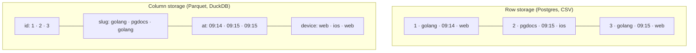
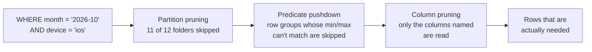

# 17.3 Columnar storage, Parquet and DuckDB

Open a spreadsheet of a million sales and ask for the total of one column: the program has to walk past every other column of every row to find the numbers you wanted. Analytical questions are almost all like that: two or three columns, every row. This chapter shows why storing data **column by column** makes those questions dozens of times faster and the files several times smaller, with numbers you'll reproduce on your own laptop. It introduces **Parquet**, the file format nearly every data tool reads, and **DuckDB**, a complete analytical database that runs inside a single program. At the end you'll point both at the click data you generated for snip.

## What you'll learn

- **Row versus column storage**: why "sum one column" reads 2.8 MB from a Parquet file and 841 MB from the same data as CSV.
- **Compression and encodings**: dictionary, run-length and general-purpose compression, and why sort order changes file size.
- **Row groups, predicate pushdown and partition pruning**: three ways a query avoids reading data it doesn't need.
- **DuckDB**: an analytical database with no server, and when it stops being enough.
- **Window functions**: running totals, day-over-day change and rankings, in one query.

---

## Rows or columns: how the same table can be laid out on disk

:::note[Everyday anchor]
A stack of paper forms, one per customer, is stored by row: everything about one customer is together. To total everyone's age, you leaf through every form. A ledger with one page per question ("ages", "cities", "plans") is stored by column: to total the ages, you read one page and ignore the rest.
:::

A table has rows and columns, but a disk has only a long line of bytes. Something has to decide the order. **Row-oriented** storage writes all of row 1, then all of row 2. Postgres, MySQL and CSV files work like this. **Column-oriented** (columnar) storage writes all values of column 1, then all of column 2.



The rows hold the same information. What differs is what's next to what. To answer "clicks per device", the row layout must read every byte of every row; the column layout reads only the `device` column. And because the values in one column are alike (the same few device names, timestamps that increase), the column compresses far better. That's the whole idea; the rest of the chapter is measuring it.

Row storage still wins for its own job: fetching or updating *one whole row* touches one place on disk, instead of one place per column. That's why the application database is row-oriented (OLTP, [chapter 17.1](./what-data-engineering-is.mdx)) and the analytics store is columnar (OLAP).

---

## The same 10 million rows, as CSV and as Parquet

**Parquet** is an open file format for columnar data, created at Twitter and Cloudera and now an Apache project. It's what Spark, BigQuery, Snowflake, pandas and DuckDB all read and write, which is why data lakes are mostly folders of `.parquet` files. **DuckDB** is the tool for this experiment: install it as in [chapter 17.2](./batch-pipelines.mdx) (`brew install duckdb`, `curl https://install.duckdb.org | sh`, or `winget install DuckDB.cli`), then open it in an empty folder:

```bash
mkdir -p ~/columnar-lab && cd ~/columnar-lab
duckdb
```

Create 10 million fake clicks (the same table as [chapter 17.1](./what-data-engineering-is.mdx)'s Postgres lab) and write it out both ways:

```sql
.timer on
CREATE TABLE clicks AS
SELECT
    i                                                 AS id,
    'link-' || hash(i) % 1000                         AS slug,
    TIMESTAMP '2026-01-01' + INTERVAL (i * 3) SECOND  AS clicked_at,   -- one click every 3 s, all year
    CASE hash(i * 7) % 3 WHEN 0 THEN 'web' WHEN 1 THEN 'ios' ELSE 'android' END AS device,
    'https://news.example.com/article/' || hash(i * 13) % 50000 AS referrer
FROM range(10_000_000) AS t(i);
COPY clicks TO 'clicks.csv';          -- text, one line per row
COPY clicks TO 'clicks.parquet';      -- columnar, compressed
```

Then compare (in another terminal, `ls -l`):

```text
clicks.csv       808,903,335 bytes   (809 MB)
clicks.parquet   180,482,870 bytes   (180 MB)
```

The same data is **4.5 times smaller** as Parquet, before any tuning. Now ask the same question of both files. To compare work rather than how many cores your machine has, first limit DuckDB to one thread:

```sql
SET threads = 1;
SELECT device, count(*) AS clicks FROM 'clicks.csv'     GROUP BY device;   -- Run Time: real 0.835
SELECT device, count(*) AS clicks FROM 'clicks.parquet' GROUP BY device;   -- Run Time: real 0.015
```

Those numbers are from one desktop machine; yours will differ, and the ratio is what to look at: **about 55 times faster**. `EXPLAIN ANALYZE` shows why. Its summary box reports how much data each query read:

```text
clicks.csv       Data Read: 840.9 MB
clicks.parquet   Data Read:   2.8 MB
```

The CSV query had to read and parse every character of every line to find the device names. The Parquet query read the `device` column and nothing else. Here is what each column costs inside the file (`parquet_metadata` is a DuckDB function that reads the file's own index):

```sql
SELECT path_in_schema AS col, sum(total_compressed_size) AS bytes
FROM parquet_metadata('clicks.parquet') GROUP BY ALL ORDER BY bytes DESC;
```

```text
referrer     63,002,457
clicked_at   61,806,244
id           40,020,502
slug         12,880,928
device        2,547,792
```

A query that skips `referrer` skips a third of the file without any effort. The same habit applies to every columnar system: **`SELECT *` is expensive**, because it asks for every column, and the cost of a query is roughly the size of the columns it mentions.

:::info[If you've written code]
CSV is like a JSON array of objects: self-explanatory, and every reader has to parse all of it. Parquet is closer to a struct of arrays, with a table of contents at the end of the file (the **footer**) that says where each column's bytes start, how they're encoded, and their minimum and maximum values. Readers jump straight to the parts they need.
:::

---

## Why columns compress so well

Values in one column are alike, and compression feeds on sameness. Parquet uses two layers.

**Encodings** rewrite a column into something smaller, using what the values are like:

- **Dictionary encoding**: list each distinct value once (`web`, `ios`, `android`) and store a small number per row instead of the text. The `device` column is 10 million short strings, stored in 2.5 MB.
- **Run-length encoding** (RLE): "`golang` × 4,812" instead of 4,812 copies. It shines when equal values sit next to each other.
- **Delta encoding**: store the differences between neighbours. Timestamps one click apart become small numbers.

Then a general-purpose **compression codec** squeezes the encoded bytes further: Snappy (DuckDB's default, very fast), **zstd** (smaller, still fast), gzip (older and slower). Try both effects:

```sql
COPY (FROM 'clicks.parquet') TO 'clicks-zstd.parquet' (COMPRESSION zstd);
COPY (FROM 'clicks.parquet' ORDER BY slug, clicked_at) TO 'clicks-sorted.parquet' (COMPRESSION zstd);
SELECT file_name, path_in_schema AS col, sum(total_compressed_size) AS bytes
FROM parquet_metadata(['clicks-zstd.parquet', 'clicks-sorted.parquet'])
WHERE path_in_schema IN ('slug', 'clicked_at') GROUP BY ALL ORDER BY ALL;
```

```text
file                    total     slug          clicked_at
clicks.parquet          180 MB    12.9 MB       61.8 MB    (Snappy)
clicks-zstd.parquet      88 MB    12.7 MB       29.7 MB    (zstd)
clicks-sorted.parquet   111 MB    13 kB         54.7 MB    (zstd, sorted by slug)
```

zstd halves the file. Sorting by `slug` shrinks that column from 12.7 MB to **13 kB**, because a thousand long runs of equal values is the best case for run-length encoding. But the whole file got *bigger*: `clicked_at` was in time order before, and now it jumps around inside each slug, so it compresses worse. **Sort order is a trade-off**: sort by the column you filter on most, which (as the next section shows) also decides how much a query can skip.

---

## Three ways a query avoids reading data

Reading less is the main way analytical queries get fast. Parquet and DuckDB stack three techniques.

**1. Column pruning.** Read only the columns the query mentions. You saw it: 2.8 MB instead of 180.

**2. Row groups and predicate pushdown.** A Parquet file is cut into **row groups** (DuckDB writes about 122,880 rows per group), and the footer stores each column's minimum and maximum per group:

```sql
SELECT row_group_id, stats_min, stats_max FROM parquet_metadata('clicks.parquet')
WHERE path_in_schema = 'clicked_at' AND row_group_id IN (0, 1, 81);
```

```text
0    2026-01-01 00:00:00   2026-01-05 06:23:57
1    2026-01-05 06:24:00   2026-01-09 12:47:57
81   2026-12-12 14:24:00   2026-12-14 05:19:57
```

For `WHERE clicked_at >= TIMESTAMP '2026-10-01'`, the reader checks each group's maximum and skips every group that ends before October without opening it. Moving the filter down into the file scan like this is called **predicate pushdown** (a **predicate** is the true-or-false condition in a `WHERE`):

```sql
EXPLAIN ANALYZE SELECT count(*) FROM 'clicks.parquet' WHERE clicked_at >= TIMESTAMP '2026-10-01';
```

```text
│ Data Read:  14.2 MB │
...
│ Filters:                                       │
│ clicked_at >= '2026-10-01 00:00:00'::TIMESTAMP │
│ Row Groups Scanned: 19 / 82                    │
│ 2,137,600 rows                                 │
```

19 of 82 groups read. It works because the data was written in time order, so each group covers a narrow time range. Run the same query on `clicks-sorted.parquet` and it reports `Row Groups Scanned: 82 / 82`: sorted by slug, every group spans the whole year and nothing can be skipped. That's the second half of the sort-order trade-off.

**3. Partition pruning.** One level up, a lake splits files into folders by a column's value ([chapter 17.2](./batch-pipelines.mdx)'s `dt=` partitions). A filter on that column skips whole folders without opening a file:

```sql
COPY (SELECT *, strftime(clicked_at, '%Y-%m') AS month FROM 'clicks.parquet')
  TO 'by_month' (FORMAT parquet, PARTITION_BY (month), OVERWRITE);        -- 12 folders: month=2026-01 …
EXPLAIN ANALYZE SELECT count(*) FROM read_parquet('by_month/*/*.parquet', hive_partitioning = true)
WHERE month = '2026-10';
```

```text
│ File Filters: month = '2026-10'       │
│ Scanning Files: 1/12                  │
│ Total Files Read: 1                   │
```



Each stage narrows what the next one reads. A well-laid-out lake answers "last week, for one link" by touching a tiny fraction of its bytes.

:::warning[What can go wrong]
- **Too many small files.** A streaming job that writes one file per second creates 86,400 files a day. Every file costs an open, a footer read and, in the cloud, a request. Query engines slow to a crawl on millions of tiny files. Fix: write bigger files less often, or **compact** small files into large ones on a schedule. Aim for files from tens of MB to around 1 GB.
- **Filters that can't be pushed down.** `WHERE strftime(clicked_at, '%Y') = '2026'` wraps the column in a function, so min/max statistics can't be used and every group is read. Write `WHERE clicked_at >= '2026-01-01' AND clicked_at < '2027-01-01'` instead.
- **Partitioning on the wrong column.** Partitioning by `slug` gives one folder per link: thousands of folders of tiny files, and no help for date queries. Partition by what nearly every query filters on, usually a date, and keep partitions large.
- **Schema drift between files.** Files written at different times can disagree on columns. Read with `union_by_name = true` ([chapter 17.2](./batch-pipelines.mdx) showed a column silently vanishing without it).
:::

---

## DuckDB: an analytical database with no server

:::note[Everyday anchor]
Postgres is like a restaurant: a kitchen runs all day, and many diners send it orders. DuckDB is a camping stove: you carry it, light it when you need it, cook for yourself, and pack it away. No staff, no reservations, and surprisingly good food.
:::

Most databases are **servers**: a separate program, always running, that clients connect to over the network ([chapter 6.1](../data/why-databases.mdx)). DuckDB is **in-process**: a library that runs inside your program (the `duckdb` command-line tool, a Python script, a notebook). There's nothing to install on a server, no port, no password. It's often described as "SQLite for analytics": SQLite is the in-process database for transactions; DuckDB is the in-process database for analytical queries.

What makes it fast is the columnar design all the way through: it stores its own tables in columns, it processes data in batches of values rather than row by row (**vectorised execution**, which suits modern CPUs), and it uses all your cores. What makes it handy is what it reads directly: Parquet, CSV and JSON files, folders of them, files over HTTPS or in S3, and even a live Postgres database (you used that in chapter 17.2).

Where it stops being enough:

- **One machine.** It's very fast up to what fits on one computer's disk (hundreds of GB, even a few TB, often on a laptop). Beyond that, or when the data is already in a cloud warehouse, BigQuery, Snowflake or Spark take over.
- **One writer.** Only one process can open a DuckDB database file for writing, and while it does, other processes can't open it at all:
  ```text
  IO Error: Could not set lock on file "…/lock.duckdb": Conflicting lock is held in …/duckdb (PID 1305755) by user …
  ```
  It's an analysis engine, not a shared application database. Many readers of Parquet files at once is fine; many writers to one `.duckdb` file is not.
- **Not for OLTP.** Thousands of small updates per second are Postgres's job.

:::info[In the real world]
DuckDB is widely used for exactly this book's setup: local development and CI of data pipelines (fast, free, no cloud account), analysts querying Parquet files on a laptop, and embedded analytics inside applications. Teams typically develop dbt models against DuckDB and run the same SQL in a cloud warehouse in production. The same columnar ideas power the big systems: BigQuery's storage, Snowflake's micro-partitions, and ClickHouse's parts are all column stores with min/max skipping.
:::

---

## Window functions: comparing rows with their neighbours

`GROUP BY` squeezes many rows into one ([chapter 6.2](../data/sql-from-zero.mdx)). Analysis often needs the opposite: keep every row, and add a value computed from *related* rows. "Each day's sales, and the change from yesterday." "Each product's rank on that day." That's a **window function**: a function followed by `OVER (…)`, which describes the window of rows it looks at.

```sql
CREATE TABLE sales AS
FROM (VALUES
  (DATE '2026-10-01', 'tea',    12), (DATE '2026-10-01', 'coffee', 30),
  (DATE '2026-10-02', 'tea',    15), (DATE '2026-10-02', 'coffee', 26),
  (DATE '2026-10-03', 'tea',     9), (DATE '2026-10-03', 'coffee', 41),
  (DATE '2026-10-04', 'tea',    20), (DATE '2026-10-04', 'coffee', 22)
) AS t(day, product, cups);

SELECT day, product, cups,
       sum(cups)  OVER (PARTITION BY product ORDER BY day)        AS running_total,
       cups - lag(cups) OVER (PARTITION BY product ORDER BY day)  AS change_vs_yesterday,
       rank()     OVER (PARTITION BY day ORDER BY cups DESC)      AS rank_that_day
FROM sales
ORDER BY product, day;
```

```text
day          product  cups  running_total  change_vs_yesterday  rank_that_day
2026-10-01   coffee     30             30                 NULL              1
2026-10-02   coffee     26             56                   -4              1
2026-10-03   coffee     41             97                   15              1
2026-10-04   coffee     22            119                  -19              1
2026-10-01   tea        12             12                 NULL              2
…
```

Read the `OVER` clause as two instructions. **`PARTITION BY product`**: look only at rows of the same product (this partition has nothing to do with folders; it's a group of rows). **`ORDER BY day`**: in date order. Then `sum` adds up everything so far, `lag` fetches the previous row's value (`NULL` on the first day, which has no yesterday), and `rank` numbers rows by `cups` within each day. Every input row stays in the output. Other common ones: `lead` (the next row), `row_number`, `first_value`, and frames such as `ROWS BETWEEN 6 PRECEDING AND CURRENT ROW` for a seven-day moving average.

DuckDB adds `QUALIFY`, a `WHERE` for window results: `… QUALIFY rank_that_day = 1` keeps only each day's winner, without wrapping the query in a subquery. (Postgres doesn't have `QUALIFY`; you'd filter in an outer query.)

---

## Apply it to snip: query the click lake

snip's click events land in the lake as Parquet, partitioned by day ([chapter 17.2](./batch-pipelines.mdx)): `data/lake/clicks/dt=YYYY-MM-DD/*.parquet`, with columns `event_id`, `slug` and `clicked_at`. If you haven't yet, generate a month of it from the `data/` folder of the handbook's repository:

```bash
cd data
uv run snipdata generate --end 2026-10-29      # 135,037 clicks, 30 days, into ./lake (2 MB)
duckdb                                         # open DuckDB right here
```

The whole month is 2 MB on disk: 135,681 rows in Parquet with zstd. DuckDB reads the folder directly, and the `dt` folder names become a column:

```sql
CREATE VIEW clicks AS
SELECT * FROM read_parquet('lake/clicks/*/*.parquet', hive_partitioning = true, union_by_name = true);

SELECT count(*) AS rows, count(DISTINCT event_id) AS events FROM clicks;   -- 135681 | 135037
```

The 644 extra rows are redelivered duplicates (the stream delivers at least once), so every count below uses `count(DISTINCT event_id)`. The models in chapter 17.4 remove duplicates once, so nobody has to remember.

**Top links last week**, with partition pruning doing the work:

```sql
SELECT slug, count(DISTINCT event_id) AS clicks
FROM clicks
WHERE dt BETWEEN DATE '2026-10-23' AND DATE '2026-10-29'
GROUP BY slug ORDER BY clicks DESC LIMIT 5;
```

```text
golang          9212
go-tour         4264
pgdocs          2789
redis-streams   2001
duckdb          1617
```

Prefix a one-day version with `EXPLAIN ANALYZE` and look for `Scanning Files: 2/60`: of 60 files (30 days, two files on most days), only that day's two are opened.

**Did the launch post keep its traffic?** Daily clicks, the day before, and a seven-day moving average, all from window functions:

```sql
WITH daily AS (
  SELECT slug, dt AS day, count(DISTINCT event_id) AS clicks FROM clicks GROUP BY ALL
)
SELECT day, clicks,
       lag(clicks) OVER (PARTITION BY slug ORDER BY day) AS day_before,
       round(avg(clicks) OVER (PARTITION BY slug ORDER BY day
                               ROWS BETWEEN 6 PRECEDING AND CURRENT ROW), 1) AS avg_7d
FROM daily WHERE slug = 'launch' ORDER BY day LIMIT 7;
```

```text
day          clicks  day_before  avg_7d
2026-10-05     2389        NULL  2389.0
2026-10-06     2326        2389  2357.5
2026-10-07     1821        2326  2178.7
2026-10-08     1309        1821  1961.3
2026-10-09      880        1309  1745.0
2026-10-10      421         880  1524.3
2026-10-11      270         421  1345.1
```

It didn't: by day six the launch link gets a tenth of its first day. **Which link won each day?** One `rank` and a `QUALIFY`:

```sql
WITH daily AS (
  SELECT dt AS day, slug, count(DISTINCT event_id) AS clicks FROM clicks GROUP BY ALL
)
SELECT day, slug, clicks FROM daily
QUALIFY rank() OVER (PARTITION BY day ORDER BY clicks DESC) = 1
ORDER BY day LIMIT 8;
```

`golang` wins most days, except 5 to 7 October, when `launch` takes over. **What hour do people click?** DuckDB's `bar` function draws a chart in the terminal:

```sql
SELECT hour(clicked_at) AS hour_utc, count(*) AS clicks, bar(count(*), 0, 14000, 30) AS chart
FROM clicks GROUP BY ALL ORDER BY hour_utc;
```

The peak is 13:00 to 15:00 UTC, with a quiet floor overnight. (That pattern is the generator's: real snip traffic would show its own users' days.) Every one of these questions was impossible against snip's production tables in [chapter 17.1](./what-data-engineering-is.mdx), and each one reads a couple of megabytes.

If you prefer not to install the DuckDB tool, `uv run snipdata query "…"` runs the same SQL with the views `clicks`, `links`, `owners` and `audit_events` already defined over the lake (`data/src/snipdata/cli.py`).

---

## Lab

Free, on your laptop, with the DuckDB command-line tool.

1. **Measure rows against columns.** Create the 10-million-row table and the two files from [The same 10 million rows](#the-same-10-million-rows-as-csv-and-as-parquet). Then:
   ```sql
   SET threads = 1;                      -- compare work, not cores
   .timer on
   SELECT device, count(*) FROM 'clicks.csv' GROUP BY device;
   SELECT device, count(*) FROM 'clicks.parquet' GROUP BY device;
   EXPLAIN ANALYZE SELECT device, count(*) FROM 'clicks.parquet' GROUP BY device;   -- note Data Read
   SELECT referrer, count(*) FROM 'clicks.parquet' GROUP BY referrer ORDER BY 2 DESC LIMIT 3;
   ```
   Write down both times and the size ratio of the files. Notice the `referrer` query is slower than the `device` one on the *same* Parquet file: it reads a 63 MB column instead of a 2.5 MB one.

2. **Break predicate pushdown.** Compare the `Row Groups Scanned` line of these two equivalent filters:
   ```sql
   EXPLAIN ANALYZE SELECT count(*) FROM 'clicks.parquet' WHERE clicked_at >= TIMESTAMP '2026-10-01';
   EXPLAIN ANALYZE SELECT count(*) FROM 'clicks.parquet' WHERE strftime(clicked_at, '%m') >= '10';
   ```
   Same answer (2,137,600), but the second reads every row group: statistics can't see through a function.

3. **Apply it to snip.** In `data/`, generate the lake and answer three questions with the queries from [Apply it to snip](#apply-it-to-snip-query-the-click-lake): last week's top five links, the launch link's decay, and the busiest hour. Then add one of your own: *which link had the biggest day-over-day jump?* (Hint: `clicks - lag(clicks) OVER (PARTITION BY slug ORDER BY day)`, then `ORDER BY` it.)

## Self-check

<Quiz
  id="data-engineering-columnar-storage-and-duckdb"
  questions={[
    {
      q: 'The same table is 809 MB as CSV and 180 MB as Parquet. Counting clicks per device reads 841 MB from the CSV but only 2.8 MB from the Parquet file. Where does most of that difference come from?',
      options: [
        'Parquet files are cached in memory by DuckDB, while CSV files are not',
        'The Parquet query reads only the device column; the CSV has no columns to skip',
        'DuckDB samples a fraction of the rows in Parquet files to estimate the count',
        'The CSV has a header line, which forces a second full read of the file',
      ],
      answer: 1,
      explain: 'Column pruning: the Parquet footer says where each column lives, so the reader fetches the device column (dictionary-encoded into 2.5 MB) and skips the rest. A CSV line has to be parsed from the start to find its fourth field. The answer is exact (no sampling), the header is read once, and "Data Read" counts bytes read from the files, whatever is cached.',
    },
    {
      q: 'Rewriting a click file sorted by slug made the slug column 1,000 times smaller, but the whole file got bigger. Why?',
      options: [
        'Sorting adds an index to the file, and the index is larger than the savings',
        'zstd compresses sorted text badly, so the other text columns grew',
        'The timestamps lost their time order, so they compress and skip worse',
        'Parquet stores sorted data in more row groups, each with its own footer',
      ],
      answer: 2,
      explain: 'Long runs of equal slugs are ideal for run-length encoding, but the time column, previously increasing smoothly, now jumps around inside each slug, so it compresses worse and its row-group min/max statistics span the whole year. Sorting changes which columns compress and which filters can skip; it adds no index and the row-group size stays the same.',
    },
    {
      q: 'A query WHERE strftime(clicked_at, \'%Y-%m\') = \'2026-10\' reads every row group of a time-ordered file. What would you change first?',
      options: [
        'Write the filter as a range on the raw column: clicked_at >= Oct 1 AND before Nov 1',
        'Add more threads, so every row group is read in parallel instead',
        'Convert the file to CSV, which has no row groups to scan through',
        'Increase the row group size so that there are fewer groups to read',
      ],
      answer: 0,
      explain: 'Min/max statistics describe the raw clicked_at values; wrapped in a function, the reader cannot use them, so every group is read. A plain range lets predicate pushdown skip groups outside October. More threads read the same data faster without reading less, CSV has no statistics at all, and bigger groups make skipping coarser.',
    },
    {
      q: 'Two scripts open the same warehouse.duckdb file: one runs a long rebuild, the other tries a quick SELECT and gets "Could not set lock on file". What does that tell you about DuckDB?',
      options: [
        'The file is corrupted, and must be restored from the last backup',
        'The SELECT needs a read-only flag, and then both can run together',
        'DuckDB allows one query per file at a time, even in a single program',
        'A writing process locks the file, so other processes cannot open it',
      ],
      answer: 3,
      explain: 'DuckDB is in-process: the program that opens a database file for writing holds a lock on it, and other processes cannot open it, even read-only (that also fails while a writer holds it). Inside one process many queries can run. Nothing is corrupted. For many concurrent readers, read the Parquet files, or wait for the rebuild to finish.',
    },
    {
      q: 'You need each day\'s clicks next to the previous day\'s, for every link, keeping one row per link per day. Which SQL feature does that?',
      options: [
        'A GROUP BY slug, day with HAVING to compare consecutive days',
        'A window function: lag(clicks) OVER (PARTITION BY slug ORDER BY day)',
        'A self-join of the table on slug, with a correlated subquery for the date',
        'A partitioned table with one folder per day, read with hive_partitioning',
      ],
      answer: 1,
      explain: 'lag reads a value from the previous row of the same window (the same slug, in date order) while keeping every row. GROUP BY collapses rows, and HAVING filters groups rather than comparing them. A self-join can be made to work but is longer and slower. Folder partitions are about storage, not about comparing rows.',
    },
  ]}
/>

<details>
<summary>Explain to a teammate who only knows Postgres why the analytics store should be columnar, and the one kind of work it is bad at.</summary>

Analytical queries read a few columns of a huge number of rows. Stored by row, the database must read every column of every row to get at the few it needs; stored by column, it reads only those columns, and each column compresses very well because its values are alike (a few device names, increasing timestamps). Column files also keep minimum and maximum values per block, so whole blocks that can't match a filter are skipped. On 10 million rows that meant 2.8 MB read instead of 841 MB. The weakness is the opposite workload: inserting, updating or reading one whole row touches every column's separate location, so a columnar store is a poor application database. The rule: **row storage for running the business, column storage for analysing it.**

</details>

<details>
<summary>Your lake's daily partition holds 40,000 Parquet files of 30 kB each, written by a streaming job, and queries on it have become slow. What's going on, and what would you do?</summary>

Each file has fixed costs: listing it, opening it, reading its footer, and in cloud storage a separate request. With 40,000 tiny files those costs dominate the actual data (about 1.2 GB in total), and each file is too small for compression and row-group statistics to help much. Fix it at both ends: make the writer produce fewer, larger files (buffer more events per file, or flush less often), and run a **compaction** job that merges each finished day's small files into a few large ones (tens of MB to about 1 GB each), sorted by the column queries filter on. Do the compaction atomically (write the new files, then remove the old ones) so readers never see both, or neither. Table formats such as Apache Iceberg and Delta Lake have compaction built in.

</details>
