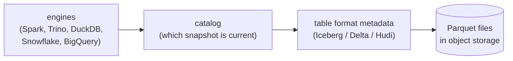
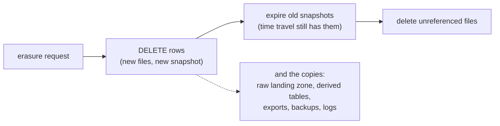

# 17.8 Data platforms, privacy and governance

You've built a pipeline. Clicks flow in, files land, models turn them into tables people use. Then three messages arrive in the same week. Finance asks why the data bill doubled. A user writes: "delete everything you hold about me." An analyst asks whether a column can be trusted, and where it comes from. None of these is about moving data faster. They're about where the data lives, what it costs, what you're allowed to keep, and who can see it. This chapter covers that layer: the platforms data teams build on, and the rules that turn a pile of tables into something a company can defend.

## What you'll learn

- **Warehouses vs lakehouses**: a managed database that stores your data in its own format, or open files in object storage made into tables by a **table format** (Apache Iceberg, Delta Lake, Apache Hudi).
- **Cost models**: compute time (Snowflake), bytes scanned (BigQuery on demand), provisioned capacity (Redshift), and which query habits each one punishes.
- **Personal data and minimisation**: an IP address can identify a person, a plain hash of one can be reversed in seconds, and the cheapest data to protect is data you never collected.
- **Retention and the right to erasure** in a lake where files are never edited: rewrite, compact, expire snapshots, and remember the copies.
- **Access control, catalogs and lineage**: who may read what, what data exists, and where each column came from.
- Applied: a data-handling review of a real service's pipeline (what's collected, where it lives, for how long, who can read it), with concrete fixes.

---

## Warehouses and lakehouses answer "where does analytics data live?"

There are two broad answers, and the industry spent a decade arguing about them before they started to merge.

A **data warehouse** is a database built for analytics, usually run for you as a cloud service: **Snowflake**, **Google BigQuery**, **Amazon Redshift**. You load data into it, it stores the data in its own internal columnar format, and you query it with SQL. Storage, indexing, transactions and permissions are its problem. The trade-off is that the data sits inside one product, and only that product's engine reads it.

A **data lake** is the opposite: files in **object storage** ([chapter 6.10](../data/object-storage.mdx): S3 and similar services store any file by name, cheaply and durably), usually as **Parquet** (a compressed, column-oriented file format for analytics). Any engine can read them: Spark, Trino, DuckDB, the warehouses themselves. Files are cheap and open, but a folder of files is not a table. There's no safe way to change a row, two writers can collide, nobody records which files make up "the table" right now, and a reader can see a half-finished write.

A **table format** closes that gap. It adds a small layer of **metadata** files next to the data files, which list exactly which files form the table at each version (a **snapshot**). A write adds new data files, then swaps in a new snapshot in one atomic step, so readers see the old table or the new one, never a mixture. Old snapshots stay readable for a while (**time travel**). Deleting or updating rows writes new files and a new snapshot, rather than editing files in place. A **lakehouse** is a lake plus a table format plus a **catalog** (the service that knows each table's current snapshot), so it behaves like a warehouse while the files stay open.



Read it from the right: the files hold the data, the metadata says which files make up each version of the table, and the catalog points every engine at the current version. That separation is what lets five different engines share one copy of the data.

### The state of table formats in late 2026

- **Apache Iceberg** (started at Netflix) has become the common denominator: Snowflake, BigQuery, Redshift, Databricks, AWS (S3 Tables), DuckDB and most query engines read and write it. Its **format version 3** spec, finalised in 2025, added **deletion vectors** (a small bitmap per file marking deleted rows, instead of rewriting the file), row lineage and a semi-structured `variant` type; engines rolled out v3 support through 2025 and 2026 ([the spec](https://iceberg.apache.org/spec/)).
- **Delta Lake** (from Databricks, now a Linux Foundation project) is the default inside Databricks, and can also publish Iceberg metadata for the same files (UniForm).
- **Apache Hudi** (from Uber) focuses on frequent updates and incremental processing.
- Newer designs keep the metadata in a SQL database instead of files (DuckDB's **DuckLake**).

The formats now overlap so much that the bigger decision is often the **catalog** (AWS Glue, Databricks' open-sourced Unity Catalog, Apache Polaris, or any implementation of Iceberg's REST catalog protocol), because the catalog is where permissions and table discovery live.

:::info[In the real world]
Small teams often start with a warehouse alone: load, model with SQL, done. Lakehouses pay off when several engines must share data, when data volumes make warehouse storage expensive, or when a company refuses to have its data readable by only one vendor. Many companies run both: raw data in an Iceberg lake, with the warehouse reading those tables directly.
:::

---

## Cost models decide how you should write queries

Every platform bills for storage, which is usually the cheap part. Compute is billed in very different ways, and each way punishes a different habit:

| Platform | You pay for | The habit it punishes |
|---|---|---|
| **Snowflake** | Credits for each second a **virtual warehouse** (a compute cluster) runs, with a 60-second minimum each time it starts or resumes ([docs](https://docs.snowflake.com/en/user-guide/cost-understanding-compute)) | Leaving a warehouse running; oversizing it; many tiny queries that each wake it up |
| **BigQuery, on demand** | **Bytes scanned** by each query ([pricing](https://cloud.google.com/bigquery/pricing)); or reserved capacity (slots) instead | `SELECT *` on a wide table; querying without a filter on the partition column. `LIMIT 10` does not reduce bytes scanned. |
| **Redshift** | Provisioned nodes by the hour, or Serverless capacity by the second | Nodes sized for the peak running all night |
| **Lakehouse** | Object storage, requests, and whatever compute you run (Spark clusters, Trino, a serverless engine) | Millions of tiny files (each one a request); unfiltered scans; data leaving the cloud region (egress) |

The columnar idea behind Parquet is what makes most of this tractable: a query that reads 2 columns of 40 reads about a twentieth of the data, and a filter on the partition column (`dt = '2026-10-30'`) skips whole folders. The habits that cut every bill are the same: select only the columns you need, filter on the partition column, keep files reasonably large (compaction), and set budgets and alerts before the surprise ([chapter 12.7](../cloud/cost-control.mdx)).

---

## Collect less: the data you don't have can't leak

A party host needs a guest list: names, maybe dietary needs. Asking every guest for their passport number would be odd, and keeping that list in a drawer for ten years would be worse. Data teams make the same choice every time they add a column, and the default in most pipelines is "collect everything, it might be useful".

**Personal data**, in the sense of the EU's **GDPR** (General Data Protection Regulation, the law most of the world's privacy rules now resemble), is any information relating to an identified or *identifiable* person. That second word is the one that catches engineers out. A name and an email address are obviously personal. So, often, is an IP address: the EU's Court of Justice ruled in 2016 that even a changing (dynamic) IP address can be personal data when someone, such as the internet provider, can link it to a person ([*Breyer*, C-582/14](https://curia.europa.eu/juris/liste.jsf?num=C-582/14)). So is a combination of harmless-looking columns (time, rough location, device model) that together single out one person.

Three of GDPR's principles ([Article 5](https://gdpr-info.eu/art-5-gdpr/)) map directly onto pipeline design:

- **Purpose limitation**: collect data for a stated purpose, and don't quietly reuse it for another.
- **Data minimisation**: collect only what that purpose needs.
- **Storage limitation**: keep it in identifiable form only as long as needed.

### A hash is not anonymisation

The tempting shortcut is to hash the personal column: replace `203.0.113.45` with `sha256("203.0.113.45")`. That looks anonymous and isn't. There are only about 4.3 billion IPv4 addresses, so anyone with the hash can compute the hash of every possible address and look yours up; for addresses known to be in one network, it takes milliseconds. You'll do it in the lab. A hash of a small or guessable set of values (IP addresses, phone numbers, email addresses from a leaked list) is a lookup table waiting to happen.

The vocabulary matters, because the law treats the cases differently:

| Technique | What it does | Still personal data? |
|---|---|---|
| **Plain hash** | `sha256(ip)` | Yes, and reversible by guessing |
| **Pseudonymisation** with a secret key | A keyed hash (HMAC) with a key kept elsewhere: the same person gets the same stand-in, but only the key holder can link it back | Yes ([Recital 26](https://gdpr-info.eu/recitals/no-26/)), though it lowers the risk |
| **Generalisation** | Keep the network, not the address (`203.0.113.0/24`); the hour, not the second; the country, not the city | Depends on how many people share each value |
| **Aggregation** | Store "412 clicks on Tuesday from 3 countries", not the clicks | Usually not, if the groups are large enough |
| **Not collecting it** | The column never exists | No |

"Anonymised" datasets have been re-identified again and again. In 2006 AOL published 20 million search queries with user names replaced by numbers; journalists identified individual users from what they had searched for ([the AOL search log release](https://en.wikipedia.org/wiki/AOL_search_log_release)). Researchers then showed that the "anonymised" movie ratings Netflix released for a competition could be linked to public IMDb reviews to identify subscribers ([Narayanan and Shmatikov](https://arxiv.org/abs/cs/0610105)). The lesson: **removing names doesn't make data anonymous; a detailed enough record is itself an identifier.**

A real design that takes this seriously: the web analytics tool Plausible counts unique visitors without cookies by hashing the IP address and browser string together with a **salt that is rotated and deleted every 24 hours** ([its data policy](https://plausible.io/data-policy)). It can count today's visitors, but not follow anyone from one day to the next, and it never stores the raw IP. Minimisation by design, not by policy document.

---

## Retention and deletion in an append-only world

Every dataset needs a **retention period**: how long it's kept, and what happens at the end. "Forever" is a choice too, and rarely a defensible one for personal data. The layout you already use makes the mechanics easy: when files are partitioned by date (`clicks/dt=2026-10-30/`), retention is deleting the folders older than N days, and object storage can do it for you with a **lifecycle rule** ("delete objects under this prefix after 400 days").

Deleting *one person's* rows is harder. GDPR's **right to erasure** ([Article 17](https://gdpr-info.eu/art-17-gdpr/)) lets people ask for their personal data to be deleted, and the organisation must normally act within a month. In a database, that's a `DELETE`. In a lake of immutable Parquet files, there is no row to delete: you **rewrite** every file that contains the person's rows, without them. Then you discover the copies:



The DELETE writes a new snapshot without the rows, but the old snapshots still point at the old files, and time travel will happily show them. Only after the snapshots are **expired** and the unreferenced files physically removed is the data gone from the table. Meanwhile, the same person is in the raw landing zone, in every model built from it, in last month's CSV export, and in the backups.

How teams handle it in practice:

- **Don't store what you'd have to erase.** The strongest technique, and the theme of this chapter.
- **Keep identifiers in one place.** Analytics tables carry a pseudonymous key; the mapping from key to real person lives in one small, well-guarded table. Erasing the mapping (and the person's rows, on a schedule) is far easier than hunting a name through 300 tables.
- **Batch erasures.** Collect requests and rewrite affected partitions once a week, instead of rewriting files for every request. Table formats help: merge-on-read and deletion vectors mark rows deleted cheaply, and compaction later rewrites the files for real.
- **Crypto-shredding.** Encrypt each person's sensitive fields with a key of their own, and delete the key to make the data unreadable everywhere at once, backups included. Effective, though lawyers still debate whether ciphertext without a key is "erased"; teams usually combine it with eventual rewriting.
- **Know the exceptions.** Article 17 doesn't apply where data must be kept, for example for a legal obligation or for legal claims. Security audit logs are often kept on that basis, for a fixed period. Whether an exception applies is a decision for a lawyer; engineering's job is to make both answers possible.

:::warning[What can go wrong]
- **"Anonymised" by hashing.** A plain hash of an IP, email or phone number is reversible by guessing. Use a keyed hash with the key stored elsewhere, and still treat the result as personal data.
- **Erasing the table, not the snapshots.** Time travel and unexpired snapshots keep deleted rows readable for days or weeks.
- **Forgetting the copies.** Raw landing zones, derived tables, notebooks, exports and backups each hold their own copy.
- **No retention at all.** Data kept "in case" becomes the biggest part of a breach, and of the bill.
- **Logs as a side channel.** Web server and proxy logs record IP addresses and browser strings by default, often kept longer than any database.
:::

---

## Access control, catalogs and lineage

Three tools turn "we have a lot of tables" into "we know what we have":

**Access control** follows the same least-privilege rule as cloud permissions ([chapter 12.4](../cloud/iam.mdx): give each identity only the access its job needs). Data platforms add finer controls: grants per schema and table, **column masking** (the support team sees `****@example.com`), and **row-level security** (each team sees only its own rows, the database-enforced version of the multi-tenancy rules in [chapter 7.4](../security/authorization-multi-tenancy.mdx)). A common layout: raw data, which may hold personal fields, is readable by a few pipeline identities; cleaned, modelled tables without those fields are readable broadly.

A **catalog**, in this governance sense, is the inventory: every dataset, its schema, its owner, a description, tags such as `pii` or `retention:400d`, and where it lives. The table-format catalogs above track snapshots; tools such as DataHub and OpenMetadata, or the catalog features built into Unity Catalog, Snowflake and BigQuery, add the human side. Without one, "do we store anyone's phone number?" is a week of grepping.

**Lineage** records which inputs produced which outputs, down to the column: `daily_clicks.clicks` is computed from `clicks.event_id`, which came from the stream. dbt draws this graph from its models' references, and the **OpenLineage** standard lets schedulers and engines report it ([openlineage.io](https://openlineage.io/)). Lineage answers the questions that otherwise cost a meeting: what breaks if I drop this column, which dashboards used the bad data from Tuesday, and, for an erasure request, everywhere this person's data could have flowed.

:::info[If you've written code]
Lineage is a dependency graph, like the import graph of a codebase. A catalog is its package registry: names, owners, versions and descriptions. And access control is the same permission model as files and cloud roles, applied per table and column.
:::

---

## Apply it to snip: a data-handling review

snip, the URL shortener built through this handbook, has a small but real data pipeline. Every redirect appends a click event to a Redis stream (`snip/internal/clicks/stream.go`); snip's worker counts clicks in Postgres; and an analytics consumer ([chapter 17.6](./streaming.mdx)) lands the events in a lake as Parquet. A **data-handling review** asks four questions of each place data ends up: what is collected, where it lives, how long it stays, and who can read it. Here is snip's, from its code and a running stack (you'll repeat the checks in the lab).

### What the click event deliberately leaves out

snip's click event has two fields, and the omissions are the design:

```go
Values: map[string]any{"slug": slug, "at": time.Now().UnixMilli()},
```

No IP address, no browser string (user agent), no referrer, no cookie. The question snip answers is "how many times was this link followed, and when?", and two fields answer it. Each field left out is a set of duties avoided: the click stream, the lake, every model built on them and every backup of those holds no visitor's personal data, so there is no visitor to erase, no IP to pseudonymise, and nothing for an attacker to take from the analytics side. Minimisation at the source is the one control that covers every later copy automatically.

Two honest caveats. First, "no personal data" is about *visitors*. A link is created by an owner, and its click history is information about that owner's link, which snip shows only to the owner (the stats endpoint requires their API key, [chapter 7.4](../security/authorization-multi-tenancy.mdx)). Second, context can make even a timestamp personal: a link sent to exactly one person reveals when that person opened it. That's one more reason click data is shown to the link's owner only.

### The inventory

| Data | Contains | Personal? | Where | How long | Who can read |
|---|---|---|---|---|---|
| nginx access log | Client IP, time, path, status, **user agent** | **Yes** | Container output (Docker's `json-file` log) | **Unbounded**: Docker doesn't rotate it by default | Anyone with access to the Docker host |
| snip request log | Request ID, method, route, path, status, duration | No visitor data | Container output | Unbounded, as above | As above |
| `snip:clicks` stream | `slug`, `at` | No | Redis memory | About the newest 1,000,000 events | Anyone with the Redis password |
| Lake: `clicks/dt=…/*.parquet` | `event_id`, `slug`, `clicked_at` | No | `data/lake/` (object storage in production) | **Forever**: no retention yet | Anyone with filesystem (bucket) access |
| `links` table | Slug, **destination URL**, owner, click count | The URL can be: query strings carry emails or tokens | Postgres | Until the owner deletes the link | snip's database role |
| `api_keys` table | Name, SHA-256 of the key | The free-text name can be | Postgres | Forever (revoked keys keep their row) | snip's database role |
| `audit_events` table | Who did what, when; `detail` holds the **URL** for link events | Can be | Postgres, **append-only** (a trigger refuses `UPDATE`, `DELETE`, `TRUNCATE`) | Forever | snip's database role |
| Prometheus metrics | Counts by route, method, status code | No | Prometheus | Its retention (15 days by default) | Anyone who reaches Prometheus |

The surprise is the first row. The careful part of the system, the click event, carries no IP; the default configuration of the front door logs one for every request, with the browser string, and keeps it as long as the container exists.

### Findings and recommendations

1. **The nginx access log is the largest store of personal data in snip.** snip already logs every request itself, without the IP. Recommendation: in `snip/deploy/nginx/nginx.conf`, turn the access log off (`access_log off;`) or use a `log_format` that omits `$remote_addr` and `$http_user_agent`; keep the error log. In any case, cap logs on the host (Docker's `json-file` driver accepts `max-size` and `max-file`, [docs](https://docs.docker.com/engine/logging/drivers/json-file/)) and give the central log store a retention period ([chapter 13.1](../observability/logs.mdx)), for example 14 days. Weigh this against security: the incident drill in [chapter 13.7](../observability/security-incident-response.mdx) collects this very log as evidence of who used a leaked key, so turning it off has a cost too. The usual middle ground is to keep the log but store less: a shortened address (the first three parts of an IPv4 address) instead of the full one, no user agent, and a short retention period.
2. **The lake has no retention policy.** Recommendation: decide one per dataset and write it down, for example raw click events for 400 days and daily aggregates indefinitely (they hold no personal data). Enforce it with a scheduled job that deletes `dt=` folders past the limit, or an object-storage lifecycle rule on the `clicks/` prefix.
3. **Destination URLs travel into the audit log, which can't forget.** A URL such as `https://example.com/report?email=ana@example.com` is personal data that the owner chose to store. Deleting the link removes the `links` row, but `audit_events.detail` keeps the URL forever, by design. Recommendation: record less in the audit detail (the URL's host, or a keyed hash of the URL, is enough to answer "which link was this?"), and give audit events a documented retention period with a legal basis, enforced by a separate migration role allowed to drop old rows, as the comment in `0002_audit_events.sql` already suggests.
4. **One Redis password opens everything.** The analytics consumer only needs to read one stream, but with snip's password it could also rewrite the cache or the rate limits. Recommendation: a Redis ACL user for analytics, allowed only the stream commands it uses (`XREADGROUP`, `XACK`, `XAUTOCLAIM`, `XINFO`, `XGROUP CREATE`) on the key `snip:clicks`.
5. **Readers of the lake and the database should be separate identities.** Recommendation: a read-only Postgres role for analytics that can read `links` (without needing `api_keys`), and read-only access to the lake's bucket for analysts, write access only for the consumer.
6. **Write the inventory down where people look.** The table above is a catalog in miniature. Keep it next to the code, with an owner and a retention for each row, and update it in the same pull request that adds a field. The consumer's gap records (`data/lake/_gaps/clicks.jsonl`) belong in it too: they're lineage for completeness, telling a reader which days are known to be short.

None of these needs a new platform. They are configuration, a scheduled job, and a few lines of documentation, which is what governance mostly is in a system of this size.

---

## Lab

Free, on your own computer. Steps 1–4 use the **DuckDB** command-line tool (an analytics database in one file; on Windows use WSL); step 5 uses snip's compose stack ([chapter 9.3](../containers/docker-compose.mdx)).

```bash
curl https://install.duckdb.org | sh                 # installs the duckdb CLI under ~/.duckdb
export PATH="$HOME/.duckdb/cli/latest:$PATH"
mkdir -p ~/privacy-lab/lake && cd ~/privacy-lab
```

1. **Make a click table the way most pipelines do: with everything.** 1,000 clicks over 68 days, with an IP address and a browser string on each (the addresses come from ranges reserved for documentation).
   ```bash
   duckdb privacy.duckdb <<'SQL'
   SET TimeZone = 'UTC';
   CREATE OR REPLACE TABLE raw_clicks AS
   SELECT
       i AS event_id,
       ['launch', 'docs', 'promo'][1 + i % 3] AS slug,
       TIMESTAMPTZ '2026-08-01 00:00:00+00' + to_minutes(i * 97) AS clicked_at,
       CASE WHEN i % 2 = 0 THEN '198.51.100.' ELSE '203.0.113.' END || (i * 37 % 200)::VARCHAR AS ip,
       ['Mozilla/5.0 (iPhone; CPU iPhone OS 18_6 like Mac OS X)',
        'Mozilla/5.0 (Windows NT 10.0; Win64; x64)',
        'Mozilla/5.0 (X11; Linux x86_64)'][1 + (i // 7) % 3] AS user_agent
   FROM range(1, 1001) t(i);
   SELECT count(*) AS clicks, count(DISTINCT ip) AS visitors FROM raw_clicks;   -- 1000 clicks, 200 visitors
   SQL
   ```

2. **"Anonymise" with a hash, then undo it.** Hash the IPs, then play the attacker: hash every address in the two networks (512 guesses) and join.
   ```bash
   duckdb privacy.duckdb <<'SQL'
   CREATE OR REPLACE TABLE hashed AS
   SELECT event_id, slug, clicked_at, sha256(ip) AS visitor FROM raw_clicks;
   CREATE OR REPLACE TABLE guesses AS
   SELECT prefix || n::VARCHAR AS ip, sha256(prefix || n::VARCHAR) AS h
   FROM (VALUES ('198.51.100.'), ('203.0.113.')) v(prefix), range(0, 256) r(n);
   SELECT count(*) AS clicks, count(g.ip) AS re_identified
   FROM hashed LEFT JOIN guesses g ON g.h = hashed.visitor;
   SQL
   ```
   ```text
   ┌────────┬───────────────┐
   │ clicks │ re_identified │
   │ int64  │     int64     │
   ├────────┼───────────────┤
   │   1000 │          1000 │
   └────────┴───────────────┘
   ```
   Every click re-identified, instantly. The whole IPv4 space is 4.3 billion guesses: more work, not a different kind of work.

3. **Pseudonymise with a key, drop what you don't need, and land it by day.** Mix in a secret (a simplified stand-in for an HMAC; in production the key lives in a secret store, [chapter 7.6](../security/secrets-management.mdx)), keep no IP and no browser string, and write Parquet partitioned by date:
   ```bash
   duckdb privacy.duckdb <<'SQL'
   SET TimeZone = 'UTC';
   SET VARIABLE pepper = 'a-long-random-key-from-your-secret-store';
   CREATE OR REPLACE TABLE minimised AS
   SELECT event_id, slug, clicked_at, sha256(getvariable('pepper') || ip) AS visitor
   FROM raw_clicks;
   SELECT count(g.ip) AS re_identified FROM minimised LEFT JOIN guesses g ON g.h = minimised.visitor;  -- 0
   COPY (SELECT *, clicked_at::DATE AS dt FROM minimised) TO 'lake/clicks' (FORMAT parquet, PARTITION_BY (dt));
   SQL
   ls lake/clicks | head -3; ls lake/clicks | wc -l        # dt=2026-08-01 … : 68 folders
   ```
   The same guesses now match nothing, because the attacker doesn't have the key. Notice what the key holder still can do: link any IP to its rows. That's why this is pseudonymous, not anonymous.

4. **Retention by folder, erasure by rewrite.** Keep 30 days (counting back from the newest data, 2026-10-07), then handle an erasure request from the visitor at `203.0.113.45`:
   ```bash
   for d in lake/clicks/dt=*; do
     [[ "${d#*dt=}" < "2026-09-07" ]] && rm -r "$d"       # delete day folders before the cutoff
   done
   ls lake/clicks | wc -l                                  # 31 days left
   mkdir -p lake-new
   duckdb privacy.duckdb <<'SQL'
   SET VARIABLE pepper = 'a-long-random-key-from-your-secret-store';
   SET VARIABLE who = sha256(getvariable('pepper') || '203.0.113.45');
   SELECT dt, count(*) AS their_clicks FROM read_parquet('lake/clicks/*/*.parquet', hive_partitioning = true)
   WHERE visitor = getvariable('who') GROUP BY dt ORDER BY dt;              -- 3 clicks, on 3 days
   COPY (SELECT * FROM read_parquet('lake/clicks/*/*.parquet', hive_partitioning = true)
         WHERE visitor <> getvariable('who'))
     TO 'lake-new/clicks' (FORMAT parquet, PARTITION_BY (dt));             -- rewrite without them
   SQL
   mv lake lake-old && mv lake-new lake && rm -r lake-old                    # swap, then delete the old files
   duckdb privacy.duckdb -c "SELECT count(*) FROM read_parquet('lake/clicks/*/*.parquet')"   # 448 (451 - 3)
   duckdb privacy.duckdb -c "SELECT count(*) FROM raw_clicks WHERE ip = '203.0.113.45'"      # 5
   ```
   Two things to notice. To remove 3 rows you rewrote 451: that's why table formats track deletions per file and compact later. And the last query: the person is still in `raw_clicks` (and in `hashed`), with two more clicks that retention never touched, because retention ran on the lake, not on the copies. Erasure is a search problem before it's a delete problem.

5. **Review snip for real.** Start snip's stack, create a link whose URL carries an email address, follow it once with a phone's browser string, and look at where that request left traces:
   ```bash
   cd ~/code/zero-to-prod/snip && docker compose up -d --build --wait
   KEY=$(docker compose exec api snip keys create review | grep -o 'snip_[A-Za-z0-9]*')
   curl -s -X POST localhost:8080/api/links -H "Authorization: Bearer $KEY" \
     -d '{"url":"https://example.com/report?email=ana@example.com","slug":"q3-report"}'
   curl -s -o /dev/null -A "Mozilla/5.0 (iPhone; CPU iPhone OS 18_6 like Mac OS X)" localhost:8080/q3-report
   docker compose logs --no-log-prefix nginx | grep q3-report        # IP and user agent
   docker compose logs --no-log-prefix api | grep '/q3-report'       # no IP
   docker compose exec redis redis-cli XRANGE snip:clicks - + COUNT 1   # slug and at, nothing else
   docker compose exec postgres psql -U snip -c "SELECT action, slug, detail FROM audit_events"
   docker compose exec postgres psql -U snip -c "DELETE FROM audit_events"   # refused: append-only
   docker inspect -f '{{.HostConfig.LogConfig}}' snip-nginx-1          # {json-file map[]}: no rotation
   ```
   ```text
   172.22.0.1 - - [30/Oct/2026:08:19:54 +0000] "GET /q3-report HTTP/1.1" 302 71 "-" "Mozilla/5.0 (iPhone; CPU iPhone OS 18_6 like Mac OS X)" "-"
   {"time":"2026-10-30T08:19:54.976603984Z","level":"INFO","msg":"request","request_id":"d09f744c41aa67fe","method":"GET","route":"GET /{slug}","path":"/q3-report","status":302,"duration_ms":1}
   ERROR:  audit_events is append-only: DELETE is not allowed
   ```
   (On your laptop the logged address is Docker's gateway, not yours; in production it's the visitor's.) Match each output to a row of the inventory above. Then apply the first recommendation: add `access_log off;` inside the `server` block of `snip/deploy/nginx/nginx.conf` and restart nginx (the file is mounted into the container, so a restart picks it up):
   ```bash
   docker compose restart nginx
   docker compose logs nginx | grep -c q3-report                      # lines so far (1)
   curl -s -o /dev/null localhost:8080/q3-report                      # one more click
   docker compose logs nginx | grep -c q3-report                      # still 1: no IP logged
   docker compose logs api | grep -c '/q3-report'                     # snip logged both requests itself
   git checkout deploy/nginx/nginx.conf && docker compose down -v      # undo, and clean up
   ```

## Self-check

<Quiz
  id="data-engineering-data-platforms-and-governance"
  questions={[
    {
      q: 'What does a table format such as Apache Iceberg add to a folder of Parquet files?',
      options: [
        'A faster compression codec that makes the files smaller than plain Parquet',
        'Metadata listing which files form each snapshot, so writes commit atomically and rows can be deleted',
        'A query engine that replaces Spark and DuckDB for reading the files',
        'Encryption of every file, with the keys stored in the catalog',
      ],
      answer: 1,
      explain: 'A table format is a metadata layer: it records which data files make up the table at each snapshot, so a write swaps snapshots atomically, readers never see half a write, deletes and updates become new files plus a new snapshot, and old snapshots allow time travel. The data files stay ordinary Parquet, and many different engines read them, which is the point (option 3 has it backwards).',
    },
    {
      q: 'A BigQuery table is billed on demand. An analyst runs SELECT * FROM events LIMIT 10 to "take a quick look" at a 5 TB table. Roughly what does it scan?',
      options: [
        'Only the 10 rows returned, a few kilobytes',
        'One partition, because LIMIT stops after the first file',
        'About the whole table, every column: LIMIT does not reduce bytes scanned',
        'Nothing: previews of the first rows are always free',
      ],
      answer: 2,
      explain: 'On-demand BigQuery bills the bytes in the columns a query reads, and SELECT * reads every column of every row it may need; LIMIT trims the result, not the scan. Selecting only the needed columns and filtering on the partition column are what cut the bytes. The table preview in the console is free, but a query with LIMIT is not (option 4).',
    },
    {
      q: 'A pipeline stores sha256(ip_address) instead of the IP, and the team calls the table anonymous. What is the problem?',
      options: [
        'SHA-256 is broken, so the hashes can be decrypted back into addresses',
        'Hashes are longer than IP addresses, so storage costs go up',
        'Two different addresses can produce the same hash, merging visitors',
        'There are few enough IPv4 addresses to hash them all and look each one up',
      ],
      answer: 3,
      explain: 'A hash cannot be decrypted, and SHA-256 is not broken (option 1). The problem is the input space: about 4.3 billion IPv4 addresses, so an attacker hashes every candidate and matches. Small or guessable inputs (IPs, phone numbers, known email lists) make plain hashes reversible. A keyed hash with a secret key prevents the guessing, and even then the result is pseudonymous, still personal data.',
    },
    {
      q: 'You DELETE a user’s rows from an Iceberg table to honour an erasure request. A colleague queries the table “as of last week” and sees the rows. What step is missing?',
      options: [
        'Expiring old snapshots and removing the files only they reference',
        'Re-running the DELETE, because Iceberg needs a delete issued twice to commit it',
        'Restarting the query engine so it drops its cache of the old table',
        'Nothing: time travel reads from a separate backup outside the table',
      ],
      answer: 0,
      explain: 'The DELETE created a new snapshot without the rows, but older snapshots still reference the old data files, and time travel reads them. The data is gone only after those snapshots are expired and the unreferenced files deleted (and after the other copies, such as raw zones, exports and backups, are dealt with). A single DELETE commits atomically (option 2); time travel is the table’s own history, not a backup (option 4).',
    },
    {
      q: 'Why do snip’s click events carry only a slug and a timestamp, with no IP address or user agent?',
      options: [
        'Redis streams cannot store more than two fields per entry',
        'IP addresses are not available behind nginx, which hides them from the API',
        'The question asked of clicks needs only those two fields, so nothing personal enters the stream or any copy of it',
        'GDPR forbids storing IP addresses in any system',
      ],
      answer: 2,
      explain: 'Minimisation at the source: counting clicks per link over time needs the slug and the time, and leaving the rest out means the stream, the lake, the models and the backups hold no visitor data to protect, retain or erase. Streams hold any number of fields (option 1); nginx forwards the client address in X-Real-IP and X-Forwarded-For (option 2); and GDPR does not ban storing IPs, it requires a purpose, minimisation and limited retention (option 4).',
    },
  ]}
/>

<details>
<summary>Your company receives an erasure request from a customer. Where would you look first to find all their data, and what would you check before saying "done"?</summary>

Start from the **catalog and lineage**, not from grep. The catalog says which datasets are tagged as holding personal data and under which identifier (customer ID, email, a pseudonymous key); lineage says which tables, exports and dashboards were derived from those. Without either, you're searching blind and will miss something.

Before saying "done", check the places a DELETE doesn't reach: unexpired table snapshots (time travel), raw landing zones and staging areas, derived and aggregated tables that kept the identifier, files exported to other teams or vendors, logs (web server, proxy, application), search indexes and caches, and backups (where the usual answer is a documented backup retention, after which the data ages out, plus a process that re-applies erasures if a backup is ever restored). Also check whether an exception applies to any of it, such as records kept for a legal obligation: that's a decision to record, not to make silently. The rule: **erasure is a search problem first, and the search is only as good as your inventory.**

</details>

<details>
<summary>A product manager asks to add visitors' IP addresses to snip's click events "for better analytics". How would you respond?</summary>

Ask what question the IP would answer, because the answer decides what to collect, if anything. "Unique visitors per link" doesn't need the IP: a keyed hash with a key rotated daily (Plausible's approach) counts uniques per day without being able to follow anyone. "Which countries clicks come from" doesn't need it either: look up the country at the moment of the click and store only the country, then drop the IP. "Bot traffic" can often be handled at the edge (nginx, a firewall) without storing anything in analytics.

If the full IP were stored, every copy downstream becomes personal data: the Redis stream, the lake, every model, every backup. Each then needs a retention period, access controls, and a way to honour erasure requests, which in an append-only lake means rewriting files. The cost lands on every future engineer, not on the one who adds the field. So the response is: tell me the question, and we'll collect the smallest thing that answers it. **The cheapest data to protect is data you never collected.**

</details>
