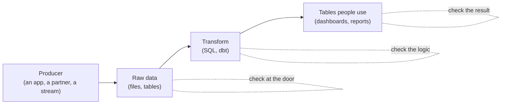
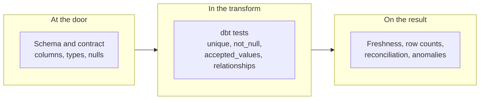

export const ordersSetup = `
CREATE TABLE orders (
  order_id   text,
  customer   text,
  amount_eur numeric(10,2),
  status     text,
  ordered_at timestamptz
);
INSERT INTO orders VALUES
 ('o-101', 'ana',   25.00, 'paid',     '2026-10-24 09:12+00'),
 ('o-102', 'ben',   40.00, 'paid',     '2026-10-24 13:40+00'),
 ('o-103', 'chen',  12.50, 'refunded', '2026-10-25 10:05+00'),
 ('o-104', 'dara',  99.90, 'paid',     '2026-10-25 18:22+00'),
 ('o-105', NULL,    30.00, 'paid',     '2026-10-26 08:01+00'),
 ('o-106', 'ana',  -15.00, 'paid',     '2026-10-26 11:30+00'),
 ('o-107', 'eli',   55.00, 'shipped!', '2026-10-26 16:45+00'),
 ('o-108', 'fay',   18.00, 'paid',     '2026-10-28 09:00+00'),
 ('o-108', 'fay',   18.00, 'paid',     '2026-10-28 09:00+00'),
 ('o-109', 'gus',   72.00, 'paid',     '2026-10-29 12:10+00'),
 ('o-110', 'hana',  20.00, 'paid',     '2062-10-29 12:10+00');
CREATE TABLE daily_revenue (day date PRIMARY KEY, revenue_eur numeric(10,2));
INSERT INTO daily_revenue VALUES
 ('2026-10-24', 65.00), ('2026-10-25', 112.40), ('2026-10-26', 15.00),
 ('2026-10-28', 18.00), ('2026-10-29', 72.00);
`;

# 17.7 Data quality, tests and contracts

A dashboard says sign-ups fell 40% overnight. Someone senior asks why in a channel full of people. Three hours later you find the answer: nothing happened to sign-ups; one of yesterday's files arrived empty, and the pipeline loaded it without a murmur. No error, no crash, no alert: a wrong number that looked like a right one. This chapter is about catching that before anyone sees it: what "good data" means, where to test it, how to agree on it with the team that produces it, and what to do when a check fails.

## What you'll learn

- Why **bad data doesn't crash, it lies**, and the five questions (dimensions) that describe how: completeness, validity, uniqueness, timeliness and consistency.
- That **a data test is a query for bad rows**: zero rows means it passes. You'll write each kind in SQL, in your browser.
- Where each test belongs: **at the door** (schema), **in the transform** (dbt tests), and **on the result** (freshness, reconciliation, anomalies).
- What a **data contract** is: the producer's written promise about the data's shape and meaning, and which changes break it.
- What to do when a check fails (**block, warn or quarantine**) and how **lineage** tells you who is affected.

---

## Bad data doesn't crash, it lies

Imagine baking a cake from a recipe where someone has swapped the sugar jar for salt. The oven works. The timer rings. The cake comes out golden and looks perfect. Nothing in the process failed; the *ingredient* was wrong, and only tasting it tells you.

Software bugs usually announce themselves: an exception, a 500, a crash. Data bugs don't. A pipeline that loads a duplicated file, a column of nulls or yesterday's data again runs to the end, reports success, and produces a plausible, wrong number. **Data quality** is how fit the data is for the questions people ask of it, and since nothing will tell you when it isn't, you have to ask, every run, with checks.

Four boxes, and where the checks go:



The point of the picture: there is no single place to test. Each layer can break in its own way, and a check is cheapest where the problem starts.

---

## Five questions to ask of any table

Practitioners describe quality along a handful of **dimensions**. Names vary between books; these five cover most real problems:

| Dimension | The question | A failure in an orders table |
|---|---|---|
| **Completeness** | Is everything there that should be? | An order with no customer; a whole day with no orders |
| **Validity** | Does each value follow the rules? | A negative amount; a status of `shipped!`; an order dated 2062 |
| **Uniqueness** | Is each thing recorded once? | Order `o-108` twice, so revenue counts it twice |
| **Timeliness** | Is it recent enough to act on? | The newest order is from three days ago |
| **Consistency** | Do related numbers agree? | The daily revenue table disagrees with the orders it summarises |

A sixth, **accuracy** (does the data match reality?), is the one you care about most and can test least: no query can tell whether Ana really paid €25. You get at it indirectly, by reconciling with an independent source, such as the payment provider's report.

Each check is a query that returns the bad rows. Zero rows means it passes; any rows are both the failure and the evidence. Here is a small, deliberately messy orders table; run the checks:

<SqlPlayground setup={ordersSetup} sql={`-- Each check is a query for bad rows. Zero rows: the check passes.
SELECT 'completeness: customer is missing' AS check_name, count(*) AS bad_rows
FROM orders WHERE customer IS NULL
UNION ALL
SELECT 'uniqueness: order_id repeats', count(*)
FROM (SELECT order_id FROM orders GROUP BY order_id HAVING count(*) > 1) AS d
UNION ALL
SELECT 'validity: amount is not positive', count(*)
FROM orders WHERE amount_eur <= 0
UNION ALL
SELECT 'validity: unknown status', count(*)
FROM orders WHERE status NOT IN ('paid', 'refunded', 'cancelled')
UNION ALL
SELECT 'validity: ordered in the future', count(*)
FROM orders WHERE ordered_at > now();`} />

Every check finds one bad row. Change one of them to `SELECT *` instead of `count(*)` and you see the row itself, which is what you'd put in the alert.

Timeliness and missing days need the calendar:

<SqlPlayground setup={ordersSetup} sql={`-- Timeliness: how old is the newest believable order?
SELECT max(ordered_at) AS newest, now() - max(ordered_at) AS age
FROM orders WHERE ordered_at <= now();

-- Completeness of days: which day between the first and the newest has no orders?
SELECT d::date AS missing_day
FROM generate_series(
       (SELECT min(ordered_at)::date FROM orders),
       (SELECT max(ordered_at)::date FROM orders WHERE ordered_at <= now()),
       interval '1 day') AS d
WHERE d::date NOT IN (SELECT ordered_at::date FROM orders);`} />

Notice `WHERE ordered_at <= now()` in both. Without it, the order typed as 2062 makes the table look perfectly fresh, and the second query would list thirty-six years of "missing" days. **One invalid value can fool another check**, which is why validity checks run first.

Consistency compares two things that must agree:

<SqlPlayground setup={ordersSetup} sql={`-- Consistency: does the summary table agree with the orders it summarises?
SELECT r.day, r.revenue_eur AS summary_says, o.paid AS orders_say
FROM daily_revenue AS r
JOIN (SELECT ordered_at::date AS day, sum(amount_eur) AS paid
      FROM orders WHERE status = 'paid' GROUP BY 1) AS o USING (day)
WHERE r.revenue_eur <> o.paid
ORDER BY r.day;`} />

Two disagreements, each with a different cause. On the 25th the summary counted a refund as revenue (a logic bug). On the 28th the duplicate order doubled the orders' side (a uniqueness problem showing up as an inconsistency). Reconciliation tells you *that* something is wrong; the other checks tell you *what*.

---

## Test at the layer where the problem starts

The same symptom (a wrong total) can start in three places, and each has its own kind of test.



**At the door: schema checks.** Before anything reads a new file, check that it has the agreed columns with the agreed types. Problems caught here have the clearest message ("column `slug` is missing") and the smallest blast radius: nothing downstream has run yet.

**In the transform: tests on models.** dbt ([chapter 17.4](./modeling-for-analytics.mdx) introduced it: SQL models with tests, built in dependency order) ships four generic tests, declared next to each column:

```yaml
models:
  - name: orders
    columns:
      - name: order_id
        data_tests: [unique, not_null]          # uniqueness, completeness
      - name: status
        data_tests:
          - accepted_values:                     # validity
              arguments:
                values: [paid, refunded, cancelled]
      - name: customer_id
        data_tests:
          - relationships:                       # every order's customer exists
              arguments:
                to: ref('customers')
                field: customer_id
```

dbt turns each into a query for bad rows, like the ones you ran above, and `dbt build` runs every model's tests right after building it. Anything a generic test can't express becomes a **singular test**: a `.sql` file in `tests/` that selects the bad rows.

**On the result: checks on what people see.**

- **Freshness**: how old is the newest row? dbt checks it for sources with `dbt source freshness`, given a column and two thresholds:
  ```yaml
  sources:
    - name: shop
      tables:
        - name: orders
          config:
            loaded_at_field: ordered_at
            freshness:
              warn_after: {count: 6, period: hour}
              error_after: {count: 30, period: hour}
  ```
- **Row counts and reconciliation**: does the output have as many rows as the input says it should? Does the summary add up to the detail?
- **Anomaly detection**, in brief: compare today with recent history (today's orders against the median of the last seven days, say) and flag what's far outside it. The hard part is **seasonality**: weekends, holidays and month-ends are "anomalies" every time, so the bounds must allow for them or people learn to ignore the alerts. Tools such as Elementary (a dbt package), Soda, Great Expectations and commercial "data observability" products (Monte Carlo and others) learn baselines for you; a median and two bounds in SQL go a long way first.

:::tip[Test what would hurt]
A table where every column has `not_null` and nothing else looks well tested and catches almost nothing. Ask "what wrong number would embarrass us?" and write the test for that: the grain (one row per order), the join that could fan out, the total that must match finance's.
:::

---

## Data contracts: the producer's promise

A restaurant agrees with its supplier: large eggs, by 6am, in trays of thirty. The kitchen builds its recipes and its morning on that. If the supplier switches to medium eggs without a word, nothing "fails" on delivery; the cakes just come out wrong, and the kitchen spends a morning finding out why.

Data has the same relationship. The team that writes the data (the **producer**: an app's developers, a partner, a stream) and the team that reads it (the **consumer**: the data team, a dashboard, a model) depend on each other's assumptions. A **data contract** writes those assumptions down, so a change that would break the consumer is caught before it ships, not three hours into an incident. It usually says:

- **Schema**: the fields, their types, which may be null.
- **Meaning**: "`amount_eur` includes VAT"; "`clicked_at` is when the click happened, in UTC, not when we received it".
- **Service level**: how fresh, how complete, how the data arrives (files per day, events on a topic).
- **Ownership**: who to call when it breaks, and how changes are announced.

The useful part of a contract is the rule for changing it, because changes will come:

| Change | Breaks consumers? | Why |
|---|---|---|
| Add a new optional column | No (**additive**) | Readers that don't know it ignore it |
| Rename or remove a column | **Yes** | Every query that names it fails, or worse, reads nulls |
| Change a type (number to text, ms to µs) | **Yes** | Comparisons, sums and joins change behaviour |
| Change a meaning (now excludes VAT) | **Yes**, and silently | No schema check can see it; only people can |
| Make a required field nullable | **Yes** | Consumers that assumed "never null" now get nulls |

A breaking change ships as a *new version* next to the old one (a new field, a new topic, a `v2` folder), consumers move over, and the old version is retired after an agreed window. It's the same discipline as versioning an API ([chapter 5.5](../apis/api-contracts.mdx): additive changes are safe, renames and removals need a new version), applied to data.

Where contracts are enforced, from strongest to weakest:

1. **In the producer's CI**: a change to the event schema fails the producer's build if it's incompatible. Kafka setups do this with a **schema registry** (schemas in Avro, Protobuf or JSON Schema, with compatibility rules checked on every new version).
2. **At the consumer's door**: every incoming file or message is checked against the contract before use. This is the one you can always add, even when you don't control the producer.
3. **On published tables**: dbt's **model contracts** (`contract: {enforced: true}` with a `data_type` per column) make dbt refuse to build a model whose output columns or types differ from what it promised its own consumers.

There's also an open format for writing contracts down, the Open Data Contract Standard (ODCS), for teams that want one shared, machine-readable file per dataset.

---

## When a check fails: block, warn, or quarantine

A failed check needs a decision, and it should be made in advance, per check, not at 3am. Three responses:

| Response | What happens | Use it when |
|---|---|---|
| **Block** | Stop. Don't build or publish anything downstream. Yesterday's tables stay as they were. | The numbers would be *wrong*: duplicates in a fact table, a broken join, a schema break |
| **Warn** | Publish, and tell someone. | The numbers *might* be fine: an unusual volume, a slightly late source, a known-noisy check |
| **Quarantine** | Set the bad rows or files aside, with the reason, and publish the rest. Replay them once fixed. | A few bad records shouldn't hold up millions of good ones |

The question that decides it: **which is worse for the people using this, a late number or a wrong one?** Finance usually prefers late; a live operations dashboard often prefers partial-but-now.

Blocking is the default for anything that changes totals, and it only works if publishing is a separate step. That pattern is called **write-audit-publish**: build into a staging area, run the checks there, and only then swap the result into the place people read. A dbt build gets most of the way: when a test fails, dbt skips every model downstream of it, so the dashboards keep yesterday's correct tables instead of today's wrong ones.

:::warning[What can go wrong]
- **Alert fatigue.** Twenty warnings a day that nobody acts on teach everyone to ignore the twenty-first, the real one. Every warning needs an owner and an action, or it should be deleted.
- **Quarantine as a black hole.** Rows set aside and never looked at are data loss with extra steps. Count the quarantine, alert when it grows, and replay it.
- **Cleaning hides the producer's problem.** A deduplicating model makes the table right *and* makes a broken upstream invisible. Test the raw input too (how many duplicates arrived?), not only the cleaned output.
- **Lenient readers turn breaks into nulls.** Many tools, asked to combine files whose columns differ, fill the missing ones with nulls instead of failing. A renamed column then looks like a completeness problem, far from its cause. Check schemas at the door.
- **Testing after publishing.** A test that runs on the dashboard's table after the dashboard refreshed tells you what everyone already saw.
:::

---

## Lineage: who breaks if this breaks?

When a flour mill finds a contaminated batch, the recall is only possible because each sack is traced to the bakeries that bought it. **Lineage** is that trace for data: a graph of which tables are built from which. It answers two questions during an incident:

- **Upstream, for the cause**: this dashboard is wrong; which inputs feed it, and which of them changed?
- **Downstream, for the impact**: this source broke; which tables, dashboards and teams depend on it, and who needs to hear?

You've already seen a lineage graph: the DAG from [chapter 17.5](./orchestration.mdx) is one. dbt builds it from every `ref()` and `source()` in your SQL, draws it in `dbt docs`, and lets you query it: `dbt ls --select source:shop.orders+` lists everything downstream of the orders source (the `+` means "and its descendants"). Some tools trace **column-level** lineage (which output column comes from which input column), and **OpenLineage** is an open standard that orchestrators and engines use to report lineage to one place.

---

## Apply it to snip

snip, the URL shortener this handbook builds, records each redirect as a click event. A streaming consumer ([chapter 17.6](./streaming.mdx)) writes those events into a lake of Parquet files, one folder per UTC day, and snipdata (the pipeline in `data/`) turns them into the `fct_clicks` table and a daily rollup. That's a producer and a consumer, so it gets a contract, checks at all three layers, and, below, five ways of breaking it on purpose.

### The contract lives in one place

The schema both sides agree on is in `data/src/snipdata/lake.py`:

```python
# The contract shared with the streaming consumer (chapter 17.6): column names,
# types and layout. Changing it breaks the other side, so it lives in one place.
CLICKS_SCHEMA = pa.schema(
    [
        # the Redis Stream entry ID, e.g. 1761800000000-0
        pa.field("event_id", pa.string(), nullable=False),
        pa.field("slug", pa.string(), nullable=False),
        pa.field("clicked_at", UTC_MS, nullable=False),
    ]
)
```

Its meaning adds what types can't: `event_id` is snip's Redis Stream entry ID (`<milliseconds>-<sequence>`), and each click sits in the `dt=` folder of the UTC day it *happened*. `snipdata check` (in `data/src/snipdata/contract.py`) checks every file against all of it: the columns and their exact types, no nulls, the ID format, and that every click is in its own day's folder. An extra column only warns, because adding is the one change that doesn't break a reader:

```python
    for name in schema.names:
        if name not in lk.CLICKS_SCHEMA.names:
            found.append(v("warn", "schema", f"extra column {name}: additive, consumers ignore it"))
```

The orchestrated run ([chapter 17.5](./orchestration.mdx)) calls it as a step before dbt reads anything, and stops on a violation unless you ask it to quarantine:

```python
    if not cfg.quarantine:
        raise Failed("; ".join(f"{x.path.name}: [{x.rule}] {x.detail}" for x in errors))
    moved = ct.quarantine(cfg.lake, errors)
```

### The checks, by layer

| Layer | Check | Dimension | On failure | Where |
|---|---|---|---|---|
| Door | `snipdata check`: columns, types, nulls, IDs, partitions | Validity, completeness | Block, or quarantine | `src/snipdata/contract.py` |
| Transform | `unique` + `not_null` on `event_id`; `not_null` on `slug` | Uniqueness, completeness | Block | `dbt/models/staging/_staging.yml` |
| Transform | `relationships`: every click's slug is in `dim_links` | Consistency | Block | `dbt/models/marts/_marts.yml` |
| Transform | Model contract on `fct_clicks` (names and types) | Validity | Block | `dbt/models/marts/_marts.yml` |
| Result | `fct_clicks_matches_lake`: per day, the table holds exactly the lake's distinct events | Completeness, consistency | Block | `dbt/tests/` |
| Result | `daily_rollup_matches_fact`: the rollup adds up to the fact table | Consistency | Block | `dbt/tests/` |
| Result | `clicks_redelivery_rate`: over 2% repeated `event_id`s on a day | Uniqueness (at the source) | Warn | `dbt/tests/` |
| Result | `clicks_partitions_have_no_gaps`: a day missing between first and last | Completeness | Warn | `dbt/tests/` |
| Result | `click_volume_is_plausible`: a day under 40% or over 250% of the last week's median | Anomaly | Warn | `dbt/tests/` |
| Result | Source freshness on `clicks.clicked_at`: warn after 6 hours, error after 30 | Timeliness | Warn / error | `dbt/models/staging/_sources.yml` |

The warnings are `{{ config(severity = 'warn') }}` at the top of the test file; everything else fails the build. On a clean lake of ten generated days, `snipdata build` ends with:

```text
Done. PASS=46 WARN=0 ERROR=0 SKIP=0 NO-OP=0 REUSED=0 TOTAL=46
```

### Break it on purpose

Each experiment below starts from that clean lake (`uv run snipdata generate --days 10 --end 2026-10-29`), built once unless it says otherwise. All output is real; dbt's timestamps and its list of skipped tests are trimmed.

**1. A file arrives twice.** A consumer restarts and replays a whole file, so every event of October 27th is now in the lake twice:

```bash
cp lake/clicks/dt=2026-10-27/generated.parquet lake/clicks/dt=2026-10-27/replayed.parquet
```

```text
$ uv run snipdata check --day 2026-10-27
3 file(s) checked, 0 break the contract
$ uv run snipdata build
5 of 46 WARN 1 clicks_redelivery_rate .......................................... [WARN 1 in 0.04s]
Done. PASS=45 WARN=1 ERROR=0 SKIP=0 NO-OP=0 REUSED=0 TOTAL=46
```

The contract holds (each file is valid on its own), and `fct_clicks` still has 5,337 clicks for that day, because the staging model keeps one row per `event_id`. The warning is the point: the table is right, *and* someone hears that a producer replayed a day.

**2. A producer writes a null slug.** A new producer writes a file where one of two clicks has no slug:

```text
$ uv run snipdata check
ERROR lake/clicks/dt=2026-10-28/new-producer.parquet  [not_null] 1 of 2 rows have no slug
21 file(s) checked, 1 break the contract
```

Without the door check, dbt catches it one layer later and blocks everything downstream:

```text
$ uv run snipdata build
19 of 46 FAIL 1 not_null_stg_clicks_slug ....................................... [FAIL 1 in 0.05s]
27 of 46 SKIP relation main.fct_clicks ......................................... [SKIP]
38 of 46 SKIP relation main.link_clicks_daily .................................. [SKIP]
Done. PASS=25 WARN=0 ERROR=1 SKIP=20 NO-OP=0 REUSED=0 TOTAL=46
```

`fct_clicks` and the rollup keep their previous, correct contents. In the orchestrated run, the contract step stops it first, and `--quarantine` sets the file aside so the day can go on:

```text
$ uv run snipdata run --day 2026-10-28
2026-10-28  wait_for_clicks ok        0.0s  3 file(s) in clicks/dt=2026-10-28
2026-10-28  check_contract  failed    0.0s  new-producer.parquet: [not_null] 1 of 2 rows have no slug
$ uv run snipdata run --day 2026-10-28 --quarantine
2026-10-28  wait_for_clicks ok        0.0s  3 file(s) in clicks/dt=2026-10-28
2026-10-28  check_contract  ok        0.0s  quarantined 1 file(s) that break the contract: new-producer.parquet
2026-10-28  extract         ok        0.0s  skipped: generated lake, no Postgres to read
2026-10-28  transform       ok        3.6s  dbt build: 39 pass, 7 success
2026-10-28  verify          ok        0.0s  5520 clicks, fingerprint 6412b81cda94741c
$ cat lake/_quarantine/clicks/dt=2026-10-28/new-producer.parquet.why.json
[
  {
    "path": "lake/clicks/dt=2026-10-28/new-producer.parquet",
    "severity": "error",
    "rule": "not_null",
    "detail": "1 of 2 rows have no slug"
  }
]
```

Notice the cost: the file's *good* click went to quarantine too, because the unit of quarantine here is a file. Finer-grained quarantine (row by row) keeps more data and is more work; either way, the note says why, and the file waits to be fixed and replayed.

**3. A day arrives late.** October 25th's folder is missing when the pipeline first builds (here, moved out of the lake before that build):

```text
$ uv run snipdata build
4 of 46 WARN 1 clicks_partitions_have_no_gaps .................................. [WARN 1 in 0.09s]
Done. PASS=45 WARN=1 ERROR=0 SKIP=0 NO-OP=0 REUSED=0 TOTAL=46
```

A warning, by choice: the other nine days are right, and the rollup is published with one day missing that the warning names. Then the folder arrives, and the next plain build *fails*:

```text
$ uv run snipdata build
31 of 46 FAIL 1 fct_clicks_matches_lake ........................................ [FAIL 1 in 0.04s]
38 of 46 SKIP relation main.link_clicks_daily .................................. [SKIP]
Done. PASS=36 WARN=0 ERROR=1 SKIP=9 NO-OP=0 REUSED=0 TOTAL=46
```

The incremental build only reprocesses the last three days, so October 25th never reached `fct_clicks`. Without the reconciliation test, that day's clicks would be missing from every total, forever, with nothing to say so. The fix is the backfill from [chapter 17.5](./orchestration.mdx), for that one day:

```text
$ uv run snipdata run --day 2026-10-25
2026-10-25  wait_for_clicks ok        0.0s  2 file(s) in clicks/dt=2026-10-25
2026-10-25  check_contract  ok        0.0s  2 file(s) keep the contract
2026-10-25  extract         ok        0.0s  skipped: generated lake, no Postgres to read
2026-10-25  transform       ok        3.7s  dbt build: 39 pass, 7 success
2026-10-25  verify          ok        0.0s  2570 clicks, fingerprint cfd0207b9049ecb4
$ uv run snipdata build
Done. PASS=46 WARN=0 ERROR=0 SKIP=0 NO-OP=0 REUSED=0 TOTAL=46
```

**4. snip changes its event.** Imagine a snip release that renames `slug` to `code` and starts writing `clicked_at` as ISO text. The contract check names every break, and separates them from the harmless addition:

```text
$ uv run snipdata check
ERROR lake/clicks/dt=2026-10-28/snip-v2.parquet  [schema] column slug is missing
ERROR lake/clicks/dt=2026-10-28/snip-v2.parquet  [schema] column clicked_at is string, the contract says timestamp[ms, tz=UTC]
WARN  lake/clicks/dt=2026-10-28/snip-v2.parquet  [schema] extra column code: additive, consumers ignore it
21 file(s) checked, 1 break the contract
```

Now look at what dbt says about the same file without that check:

```text
$ uv run snipdata build
19 of 46 FAIL 2 not_null_stg_clicks_slug ....................................... [FAIL 2 in 0.05s]
27 of 46 SKIP relation main.fct_clicks ......................................... [SKIP]
38 of 46 SKIP relation main.link_clicks_daily .................................. [SKIP]
Done. PASS=25 WARN=0 ERROR=1 SKIP=20 NO-OP=0 REUSED=0 TOTAL=46
```

"Two clicks have no slug." True, and misleading: the lake reader combines files by column name (`union_by_name`), so a file without `slug` contributes nulls. The build is still blocked, which is safe, but the person on call starts by hunting null slugs instead of reading "column slug is missing". **The door check turns a puzzle into a sentence.** The real fix is the contract's change rule: snip would add `code` *next to* `slug`, the consumer would move over, and `slug` would go only after that.

**5. The stream stops.** Freshness runs on its own command, so it can be scheduled more often than the build. With clicks up to the end of yesterday, it's a few hours past the six-hour line and warns; on a lake whose newest click is three days old, it errors:

```text
$ uv run snipdata dbt source freshness
1 of 1 WARN freshness of lake.clicks ........................................... [WARN in 0.02s]
$ uv run snipdata generate --days 10 --end 2026-10-27 && uv run snipdata dbt source freshness
1 of 1 ERROR STALE freshness of lake.clicks .................................... [ERROR STALE in 0.02s]
```

The warning is honest, too: a lake filled by a nightly generator *is* hours old by morning. With the real stream behind it, clicks are seconds old and the six hours means something.

What caught what:

| Broken on purpose | Caught by | Response |
|---|---|---|
| A file replayed | `clicks_redelivery_rate` | Warn; the table stays correct |
| A null slug | `snipdata check`; then `not_null_stg_clicks_slug` | Block, or quarantine the file |
| A late day | `clicks_partitions_have_no_gaps`, then `fct_clicks_matches_lake` | Warn while missing; block until it's backfilled |
| A renamed, retyped column | `snipdata check` (by name); dbt only as nulls | Block |
| The stream stopped | Source freshness | Warn, then error |

### Who's affected: lineage

Before changing anything about clicks, ask dbt what depends on them:

```text
$ uv run snipdata dbt ls --select source:lake.clicks+ --resource-type model --output name -q
fct_clicks
link_clicks_daily
stg_clicks
```

Three models and, with `--resource-type test`, 25 tests. `dim_links` isn't in the list, so a broken clicks file can't touch the link dimension. `uv run snipdata dbt docs generate` followed by `uv run snipdata dbt docs serve` draws the whole graph in your browser.

---

## Cheat sheet

| Term / command | What it means | When you reach for it |
|---|---|---|
| Completeness / validity / uniqueness / timeliness / consistency | The five ways data goes wrong | Deciding which checks a table needs |
| Data test | A query that returns bad rows; zero rows passes | Every check, in any tool |
| Schema check | Columns and types, before anything reads the data | At the door |
| `unique`, `not_null`, `accepted_values`, `relationships` | dbt's generic tests | On every model's key columns |
| Singular test | A `.sql` file in `tests/` selecting bad rows | Anything the generic tests can't say |
| Freshness | Age of the newest row, against thresholds | Every source someone depends on |
| Reconciliation | Two numbers that must agree, compared | Output against input; summary against detail |
| Data contract | The producer's written promise: schema, meaning, freshness, owner | Between any two teams sharing data |
| Block / warn / quarantine | Stop, publish and tell, or set aside and go on | Decided per check, in advance |
| Lineage | The graph of what's built from what | Root cause and impact during an incident |
| `uv run snipdata check [--quarantine]` | snipdata's contract check | Before building on new files |
| `uv run snipdata dbt source freshness` | dbt's freshness check | On a schedule, more often than builds |

---

## Lab

Everything runs on your laptop, free. Steps 1 and 2 run in this page; steps 3 and 4 need [uv](https://docs.astral.sh/uv/) and the repository's `data/` folder.

1. **Find every problem in the orders table.** In the first playground above, change each `count(*)` to `*` (and `AS bad_rows` away) one check at a time, and read the bad row. Then add a check of your own: an order whose `customer` is an empty string `''`. Notice it passes `IS NULL`: an empty string is not null, which is why validity rules need more than `not_null`.

2. **Fix the data, watch the checks pass.** In the consistency playground, add `DELETE FROM orders WHERE ctid = (SELECT max(ctid) FROM orders WHERE order_id = 'o-108');` before the query (that removes one copy of the duplicate) and run again. Notice which of the two disagreements disappears, and which one is a different kind of bug.

3. **Break snipdata: a late day and a replay.** From the repository's `data/` folder:
   ```bash
   uv sync                                                          # install snipdata and dbt
   uv run snipdata generate --days 10                               # a clean lake, ending today
   late=$(date -u -d '-5 days' +%F)                                 # macOS: date -u -v-5d +%F
   mv lake/clicks/dt=$late /tmp/late-day                            # that day hasn't arrived yet
   uv run snipdata build | grep -E "WARN [0-9]|Done"                # the gap warning
   day=$(date -u -d '-2 days' +%F)                                  # macOS: date -u -v-2d +%F
   cp lake/clicks/dt=$day/generated.parquet lake/clicks/dt=$day/replayed.parquet   # a replay
   uv run snipdata build | grep -E "WARN [0-9]|Done"                # a second warning, no failure
   rm lake/clicks/dt=$day/replayed.parquet
   ```
   Notice the replay doesn't change `fct_clicks` (check with `uv run snipdata query "SELECT click_date, count(*) FROM wh.fct_clicks GROUP BY 1 ORDER BY 1"`), and the missing day simply isn't in that list.

4. **The late day arrives: catch it, then repair it.**
   ```bash
   mv /tmp/late-day lake/clicks/dt=$late                            # it arrives
   uv run snipdata build | grep -E "FAIL [0-9]|Done"                # reconciliation fails: the day isn't loaded
   uv run snipdata run --day $late                                  # backfill just that day
   uv run snipdata build | tail -1                                  # all green again
   ```
   The failure depends on the day being outside the incremental build's three-day lookback, which is why it's five days back. Try it with a day two days back and the plain build loads the day on its own.

## Self-check

<Quiz
  id="data-engineering-data-quality"
  questions={[
    {
      q: 'Revenue per day is correct in total, but one order appears twice and another is missing. Which check catches the duplicate?',
      options: [
        'A not_null test on order_id',
        'A unique test on order_id',
        'A freshness check on ordered_at',
        'A reconciliation of total revenue',
      ],
      answer: 1,
      explain: 'Only a uniqueness test looks for the same key twice. not_null passes, because both copies have an order_id. Freshness only looks at the newest timestamp. And the total reconciles by coincidence here: the duplicate and the missing order cancel out, which is exactly why reconciliation tells you that something is wrong but not always what.',
    },
    {
      q: 'A producer adds an optional country column to its click events. What should the consumer\'s contract check do?',
      options: [
        'Fail: any change to the schema breaks the contract',
        'Accept it, and warn so the consumer knows the column is new',
        'Drop the files, since they no longer match the agreed schema',
        'Quarantine the files until the contract file is updated',
      ],
      answer: 1,
      explain: 'Adding an optional column is an additive change: readers that don\'t know it ignore it, so nothing breaks. A warning is still useful, because the consumer may want the new data. Failing, dropping or quarantining on additive changes makes producers afraid to evolve and teaches teams to bypass the contract. Renames, removals, type changes and new nulls are the breaking ones.',
    },
    {
      q: 'A dbt build fails a not_null test on stg_clicks.slug for two rows. What would you check first?',
      options: [
        'Whether the dbt version changed since the last good build',
        'The not_null test\'s SQL, which may have a bug in it',
        'The new files in the lake: their columns, types and nulls',
        'The dashboards, to see how wrong the published numbers are',
      ],
      answer: 2,
      explain: 'The test is telling you about the input, so look at the input first: a producer writing nulls, or (as with a renamed column read by name) a file that lacks the column entirely. A schema check on new files answers it in one line. The dashboards are unaffected, because a failed test blocks every model downstream, and a dbt upgrade or a broken built-in test is far less likely than a changed file.',
    },
    {
      q: 'Your daily volume check flags every Saturday as an anomaly. What is the best fix?',
      options: [
        'Compare each day with the same weekday in earlier weeks',
        'Lower the threshold until Saturdays stop being flagged',
        'Make the check a warning, so it no longer blocks the build',
        'Remove the check: anomaly detection is too noisy to keep',
      ],
      answer: 0,
      explain: 'Saturdays are quieter every week; that is seasonality, not an anomaly. Comparing like with like (or allowing for the weekly pattern) keeps the check sensitive to real problems. Loosening the threshold also hides real drops, demoting it to a warning still spams people (alert fatigue), and removing it throws away the only check that notices a half-empty day.',
    },
    {
      q: 'Why does snipdata block on a failed reconciliation but only warn on a missing day?',
      options: [
        'Warnings are faster to compute than failures',
        'A missing day can\'t be detected reliably, so it only warns',
        'dbt allows only one blocking test per source',
        'A mismatch makes published totals wrong; a gap leaves others right',
      ],
      answer: 3,
      explain: 'The choice follows the cost: when the fact table disagrees with the lake, every total built on it is wrong, so publishing would spread the error. When a day hasn\'t arrived, the other days are still right and the warning names the gap, so a late day shouldn\'t hold up everything else. Severity has nothing to do with speed or a dbt limit, and the gap is detected exactly.',
    },
  ]}
/>

<details>
<summary>The staging model removes duplicate events, so fct_clicks is always right. Why also warn about duplicates in the raw lake?</summary>

Because cleaning hides the cause. A few repeated events are normal for an at-least-once stream, but a day where 50% of rows repeat means a consumer is replaying or a file was copied, and that same fault can lose data next time, which no deduplication can fix. Testing only the cleaned output tells you the table is fine today; testing the raw input tells you the system that feeds it is healthy. The rule: **test the input as well as the output, so a fix downstream can't hide a fault upstream.**

</details>

<details>
<summary>snip's team wants to rename the click field slug to code. Describe a change that doesn't break the data pipeline.</summary>

Treat it as a breaking change to the contract and ship it in steps. First, snip writes *both* fields (`slug` and `code`, same value): an additive change the contract check accepts with a warning. Second, the consumer moves to `code` (in snipdata: the contract schema, the staging model and their tests), deployed and verified. Third, after an agreed window, snip stops writing `slug`, and the contract drops it. At no point does a reader see a file without the field it expects. Lineage (`dbt ls --select source:lake.clicks+`) lists everything to update in step two. The rule: **expand, migrate, contract; never rename in place.**

</details>
