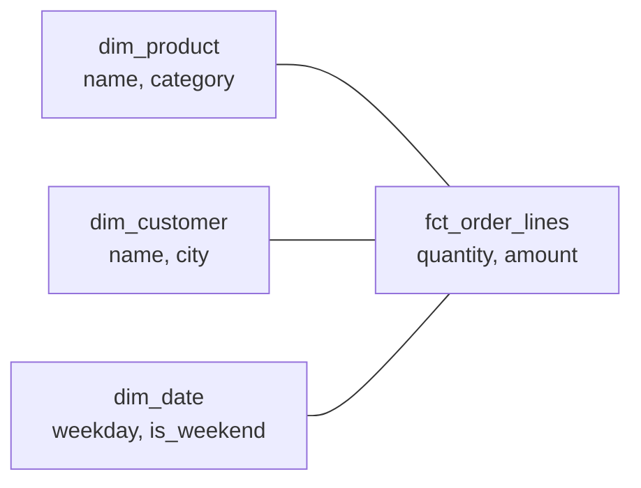
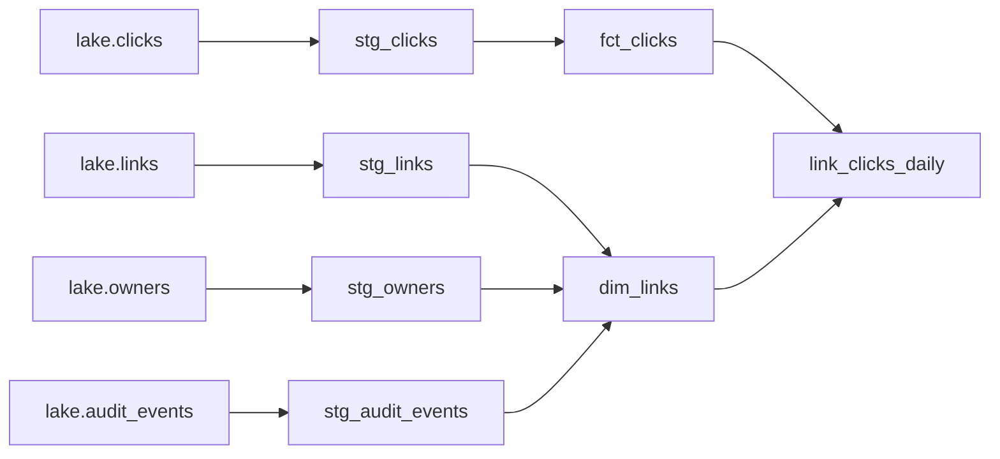

export const starSetup = `
CREATE TABLE dim_product (
  product_key int PRIMARY KEY,
  name text NOT NULL,
  category text NOT NULL
);
INSERT INTO dim_product VALUES
 (1, 'tea', 'drinks'), (2, 'coffee', 'drinks'), (3, 'cake', 'food'), (4, 'muffin', 'food');
CREATE TABLE dim_customer (
  customer_key int PRIMARY KEY,
  name text NOT NULL,
  city text NOT NULL
);
INSERT INTO dim_customer VALUES (1, 'ada', 'London'), (2, 'grace', 'New York'), (3, 'linus', 'Helsinki');
CREATE TABLE dim_date (
  date_key date PRIMARY KEY,
  weekday text NOT NULL,
  is_weekend boolean NOT NULL
);
INSERT INTO dim_date
SELECT d::date, trim(to_char(d, 'Day')), extract(isodow FROM d) >= 6
FROM generate_series(date '2026-10-01', date '2026-10-07', interval '1 day') AS d;
CREATE TABLE fct_order_lines (
  order_id int NOT NULL,
  line int NOT NULL,
  date_key date NOT NULL REFERENCES dim_date,
  customer_key int NOT NULL REFERENCES dim_customer,
  product_key int NOT NULL REFERENCES dim_product,
  quantity int NOT NULL,
  amount numeric(8,2) NOT NULL,
  PRIMARY KEY (order_id, line)
);
INSERT INTO fct_order_lines VALUES
 (101, 1, '2026-10-01', 1, 1, 2, 7.00), (101, 2, '2026-10-01', 1, 3, 1, 5.50),
 (102, 1, '2026-10-02', 2, 2, 1, 4.20),
 (103, 1, '2026-10-03', 3, 2, 2, 8.40), (103, 2, '2026-10-03', 3, 4, 2, 6.00), (103, 3, '2026-10-03', 3, 3, 1, 5.50),
 (104, 1, '2026-10-04', 1, 2, 1, 4.20);
CREATE TABLE fct_orders (
  order_id int PRIMARY KEY,
  date_key date NOT NULL REFERENCES dim_date,
  customer_key int NOT NULL REFERENCES dim_customer,
  delivery_fee numeric(6,2) NOT NULL
);
INSERT INTO fct_orders VALUES
 (101, '2026-10-01', 1, 2.50), (102, '2026-10-02', 2, 0.00), (103, '2026-10-03', 3, 2.50), (104, '2026-10-04', 1, 2.50);
`;

# 17.4 Modeling for analytics: facts, dimensions and dbt

You've seen two people bring two different "revenue last month" numbers to the same meeting, both from the same database. Neither made a typo. One counted refunds, one joined a table that quietly doubled some rows, and both wrote their SQL from scratch. **Data modeling** is how teams stop that: the raw data is reshaped once, into a few tables with clear meanings, and everyone's questions start from those. This chapter teaches the shape that has served analysts for thirty years (facts and dimensions), the one decision that prevents most wrong numbers (the grain), and **dbt**, the tool that turns those tables into tested, documented code. You'll build a five-file dbt project for a coffee shop, then walk through the real one behind snip's click data.

## What you'll learn

- **Facts and dimensions**: events you count, and the things you describe them by, arranged as a **star schema**.
- **Grain**: what exactly one row means, and how getting it wrong doubles numbers (the **fan-out** trap, tried live).
- **Slowly changing dimensions**: what to do when a customer moves city, in brief.
- **dbt**: models as `SELECT` statements, `ref` and `source` for dependencies, **materializations** (view, table, incremental), **tests**, docs and **lineage**.
- How snip's project turns raw click events into `dim_links`, `fct_clicks` and a daily rollup, with 39 tests guarding them.

---

## Facts and dimensions: the receipt and the labels

:::note[Everyday anchor]
A shop receipt lists things that happened: two teas, one cake, at 09:12, paid £12.50. Those are **facts**: events with numbers you can add up. Every line also points at things that *describe* the event: the product (tea, in the "drinks" category), the customer (ada, from London), the day (a Thursday). Those are **dimensions**: the labels you slice the numbers by.
:::

Ralph Kimball's *The Data Warehouse Toolkit* (first published in 1996) turned this into the standard way to model analytics data, and it's still what most data teams draw on a whiteboard. There are two kinds of table:

- A **fact table** has one row per event or measurement: an order line, a click, a payment. It holds **measures** (numbers: quantity, amount) and **keys** pointing to dimensions. It's long and narrow, and it grows forever.
- A **dimension table** has one row per *thing*: a product, a customer, a day. It holds **attributes** (text and flags: name, category, city, is_weekend). It's short and wide, and analysts filter and group by its columns.

Put the fact in the middle and the dimensions around it, and you get a **star schema**:



Every question becomes the same shape: **join the fact to the dimensions you need, filter and group by their attributes, add up the measures.** "Revenue by category at weekends" is one fact and two dimensions. Try it in this coffee shop, a real Postgres in your browser:

<SqlPlayground setup={starSetup} sql={`SELECT p.category, d.is_weekend, sum(f.quantity) AS items, sum(f.amount) AS revenue
FROM fct_order_lines AS f
JOIN dim_product AS p USING (product_key)
JOIN dim_date    AS d USING (date_key)
GROUP BY p.category, d.is_weekend
ORDER BY p.category, d.is_weekend;`} />

Drinks earned 11.20 on weekdays and 12.60 at weekends; food 5.50 and 11.50. Swap `dim_date` for `dim_customer` and `is_weekend` for `city`, and you have revenue by city, without touching the rest of the query.

This is deliberately *not* how [chapter 6.3](../data/designing-schemas.mdx) taught you to design an application's tables. There, **normalisation** split data into many small tables so that each fact is stored once and updates are safe. A star schema does the opposite on purpose: dimensions are **denormalised** (the product's category sits right on the product row, not in a separate `categories` table), so questions need fewer joins. Writes are rare in analytics and reads are everything, so the trade flips.

---

## Grain: decide what one row means, before anything else

The **grain** of a table is the precise meaning of one row: "one row per order line", "one row per click", "one row per link per day". Kimball's first rule is to declare it before choosing any column, because mixing grains is the most common way analytics produces confidently wrong numbers.

The coffee shop has two fact tables at different grains. `fct_order_lines` is one row per *line* (an order can have several). `fct_orders` is one row per *order*, holding the delivery fee, which belongs to the whole order. Now ask "how much did we charge in delivery fees?" two ways. Paste this into the playground and run it:

```sql
SELECT sum(delivery_fee) AS delivery_fees FROM fct_orders;                     -- 7.50

SELECT sum(o.delivery_fee) AS delivery_fees                                    -- 15.00 !
FROM fct_order_lines AS f JOIN fct_orders AS o USING (order_id);
```

The right answer is 7.50. The second query joins an order-grain table to a line-grain table, so each order's fee is repeated once per line: order 103 has three lines, so its 2.50 is counted three times. Nothing errors. The number is simply **double**. This is the **fan-out** trap: joining to a finer grain multiplies rows, and summing a coarser-grain measure after that join inflates it.

:::warning[What can go wrong]
- **Fan-out.** A measure at one grain summed after a join to a finer grain. Fix: aggregate each fact to a common grain *first*, then join the summaries; or keep each measure in a fact table at its own grain.
- **Double-counted events.** Duplicates in the raw data (a retried load, a redelivered message) become duplicate fact rows. Fix: a uniqueness test on the fact's key, and de-duplicate in the first model that touches the data.
- **Orphans.** A fact row points at a product or customer missing from the dimension, so an inner join silently drops it and totals shrink. Fix: a relationships test, and a dimension that includes every key the facts use (even deleted ones, or an explicit "unknown" row).
- **Unwritten grain.** Two people assume different grains for the same table and both are wrong half the time. Fix: write the grain in the model's description, and test it with a uniqueness test on exactly those columns.
:::

---

## Slowly changing dimensions: when the labels change

Dimension attributes change: a customer moves from London to Helsinki, a product moves to a new category. The question is what last year's facts should be labelled with. Kimball called this a **slowly changing dimension** (SCD) and numbered the answers; two matter most:

- **Type 1, overwrite.** Keep one row per customer and update the city. Simple, and every fact, old or new, now reports as Helsinki. Right when the old value was a mistake, or when history doesn't matter.
- **Type 2, add a row.** Close the old row (`valid_to = 2026-10-15`) and add a new one (`valid_from = 2026-10-15`, city Helsinki), each with its own **surrogate key** (a key the warehouse invents, like `customer_key = 7`, instead of the customer's natural ID). Facts recorded before the move point at the London row, later ones at the Helsinki row, so history stays true. Right for anything reported over time: regions, prices, plans.

Type 2 costs more: more rows, and every join must pick the right version. Use it where people will ask "what was true *then*?", and type 1 everywhere else. dbt builds type 2 tables for you with **snapshots** (`dbt snapshot`), which compare each run's data with the last and record the changes.

---

## dbt: SQL models with dependencies, tests and docs

You could build every table above with a pile of SQL scripts and a cron job ([chapter 2.5](../linux/running-a-linux-server.mdx): a line that tells the server "run this command every night at 02:00"). Teams did, for years, and learned what goes wrong: scripts run in the wrong order, nobody knows which table feeds which dashboard, a change breaks a report three steps away, and nothing checks the numbers. **dbt** (data build tool) is the open-source tool that fixed this, and it's now the standard for transforming data inside a warehouse.

:::note[Everyday anchor]
A recipe book where each recipe says which other recipes it uses ("start with the pastry from page 12"). From those references alone, anyone can work out what to cook first, and a taster checks each dish before it goes out. dbt is that book: each model names the models it builds on, dbt works out the order, and tests taste the results.
:::

What dbt is, in four ideas:

1. **A model is a `SELECT` statement in a `.sql` file.** You never write `CREATE TABLE`; dbt wraps your query in whatever DDL is needed. The file name is the table name.
2. **`ref('other_model')` declares a dependency.** dbt replaces it with the real table name *and* records the edge, so it can build models in the right order and draw the **lineage** graph (what feeds what). `source('lake', 'clicks')` does the same for raw tables dbt doesn't build.
3. **A materialization decides what the model becomes**: a **view** (recomputed on every query: cheap to build), a **table** (computed once per build: fast to query), or **incremental** (only new or changed rows are processed on each build, for big facts).
4. **Tests are queries that look for bad rows.** `unique`, `not_null`, `accepted_values` and `relationships` come built in; any `SELECT` that returns rows when something's wrong can be a test. A test passes when its query returns nothing.

`dbt build` runs it all in dependency order: each model, then its tests, and if a test fails, **everything downstream is skipped** rather than built on bad data.

### Five files: a coffee shop in dbt

Make a folder `shop` with these files. dbt and its DuckDB adapter come from PyPI; `uvx` (part of [uv](https://docs.astral.sh/uv/), installed in [chapter 14.1](../ai/python-for-ai-engineers.mdx)) runs them without installing anything permanently.

```yaml
# shop/dbt_project.yml: the project's name and which connection profile to use
name: shop
profile: shop
```

```yaml
# shop/profiles.yml: where to build. A DuckDB file next to the project.
shop:
  target: dev
  outputs:
    dev:
      type: duckdb
      path: shop.duckdb
```

```text
# shop/seeds/raw_orders.csv: a seed is a small CSV that dbt loads as a table
order_id,customer,product,amount_cents,ordered_at
1,Ada,tea,350,2026-10-01 09:12:00
2,grace,coffee,420,2026-10-01 09:40:00
3,ada,coffee,420,2026-10-01 13:05:00
4,Linus,cake,550,2026-10-02 10:30:00
5,grace,coffee,420,2026-10-02 11:15:00
6,ada,tea,350,2026-10-02 16:45:00
```

```sql
-- shop/models/stg_orders.sql: clean the raw data once, so nobody else has to
select
    order_id,
    lower(customer)           as customer,      -- 'Ada' and 'ada' are the same person
    product,
    amount_cents / 100.0      as amount,
    cast(ordered_at as timestamp) as ordered_at
from {{ ref('raw_orders') }}
```

```sql
-- shop/models/daily_revenue.sql: built on stg_orders, never on the raw table
select
    cast(ordered_at as date) as day,
    product,
    count(*)                 as orders,
    sum(amount)              as revenue
from {{ ref('stg_orders') }}
group by all
```

```yaml
# shop/models/schema.yml: descriptions and tests, next to the models they describe
models:
  - name: stg_orders
    description: One row per order, cleaned up.
    columns:
      - name: order_id
        data_tests: [unique, not_null]
      - name: product
        data_tests:
          - accepted_values:
              arguments:
                values: [tea, coffee, cake]
  - name: daily_revenue
    description: Orders and revenue per product per day.
```

Build it:

```bash
cd shop
uvx --from dbt-core --with dbt-duckdb dbt build --profiles-dir .   # seed, models and tests, in order
```

```text
1 of 6 OK loaded seed file main.raw_orders ..................................... [INSERT 6 in 0.06s]
2 of 6 OK created sql view model main.stg_orders ............................... [OK in 0.03s]
3 of 6 PASS accepted_values_stg_orders_product__tea__coffee__cake .............. [PASS in 0.03s]
4 of 6 PASS not_null_stg_orders_order_id ....................................... [PASS in 0.01s]
5 of 6 PASS unique_stg_orders_order_id ......................................... [PASS in 0.01s]
6 of 6 OK created sql view model main.daily_revenue ............................ [OK in 0.12s]
Done. PASS=6 WARN=0 ERROR=0 SKIP=0 NO-OP=0 REUSED=0 TOTAL=6
```

You never told dbt the order. It read the two `ref`s and worked out: seed, then `stg_orders`, then its tests, then `daily_revenue`. Now add two bad rows to the seed (a duplicated order id, and a product nobody sells) and build again:

```bash
echo "7,ada,coffee,420,2026-10-03 08:00:00" >> seeds/raw_orders.csv
echo "7,bob,muffin,300,2026-10-03 08:05:00" >> seeds/raw_orders.csv
uvx --from dbt-core --with dbt-duckdb dbt build --profiles-dir .
```

```text
3 of 6 FAIL 1 accepted_values_stg_orders_product__tea__coffee__cake ............ [FAIL 1 in 0.03s]
5 of 6 FAIL 1 unique_stg_orders_order_id ....................................... [FAIL 1 in 0.01s]
6 of 6 SKIP relation main.daily_revenue ........................................ [SKIP]
Done. PASS=3 WARN=0 ERROR=2 SKIP=1 NO-OP=0 REUSED=0 TOTAL=6
```

Two tests caught the two problems, and `daily_revenue` was **not rebuilt** on top of them: the dashboard keeps yesterday's correct numbers instead of showing today's wrong ones. That's the behaviour you want from a data pipeline.

### Docs and lineage, generated from the code

Every `description` and every `ref` is metadata. `dbt docs generate` turns it into a website: each model's SQL, columns, descriptions and tests, plus a lineage graph drawn from the `ref`s.

```bash
uvx --from dbt-core --with dbt-duckdb dbt docs generate --profiles-dir .
uvx --from dbt-core --with dbt-duckdb dbt docs serve --profiles-dir . --port 8081   # open http://localhost:8081
```

Because the docs come from the code, they can't drift from it. Lineage also answers the question every change raises: "if I change this model, what breaks?" On the command line, `dbt ls --select stg_orders+` lists a model and everything downstream of it; `+daily_revenue` lists everything upstream.

### Choosing a materialization

| Materialization | What dbt creates | Build cost | Query cost | Use for |
|---|---|---|---|---|
| `view` | A saved query | Almost none | Recomputed every time | Thin staging models |
| `table` | A table, rebuilt every run | The whole query | Fast | Dimensions, small and medium facts |
| `incremental` | A table, updated with new rows | Only the new rows | Fast | Large facts that grow every day |
| `ephemeral` | Nothing; inlined into models that use it | None | Part of its users' queries | Small reusable pieces of logic |

**Incremental** models deserve care. On the first run they build everything; afterwards, an `` block in the SQL filters to recent rows, and dbt merges them into the existing table (for example, delete the rows with matching keys, then insert). Two consequences follow. A late event older than your filter's window is never picked up. And a row that disappears upstream is never removed from the table, because the incremental run never looks at it. The cure for both is `dbt build --full-refresh`, which rebuilds from scratch; the lake still holds the raw data, which is why ELT keeps it ([chapter 17.1](./what-data-engineering-is.mdx)).

---

## Apply it to snip: the dbt project behind the click data

The click lake from [chapter 17.2](./batch-pipelines.mdx) holds raw copies: click events (with redelivered duplicates), daily snapshots of `links` and `owners`, and the audit trail. snip's dbt project, in `data/dbt/` of this handbook's repository, turns them into three tables people can query: a **dimension** of links, a **fact** of clicks, and a daily **rollup**.

```text
data/dbt/
  dbt_project.yml                 staging models are views, marts are tables
  profiles.yml                    DuckDB file at warehouse/snip.duckdb, TimeZone = UTC
  models/staging/
    _sources.yml                  the lake's four tables, read straight from Parquet
    stg_clicks.sql                one row per event_id: duplicates removed
    stg_links.sql  stg_owners.sql  stg_audit_events.sql
  models/marts/
    dim_links.sql                 grain: one row per slug, live or deleted
    fct_clicks.sql                grain: one row per click; incremental
    link_clicks_daily.sql         grain: one row per link per day with clicks
    _marts.yml                    descriptions and tests
  tests/
    generic/accepted_range.sql  generic/unique_combination.sql
    daily_rollup_matches_fact.sql
```

Here's its lineage, as `dbt docs` draws it:



Two layers, a convention most dbt projects follow. **Staging** models (`stg_`) are one per source table: rename, cast, de-duplicate, nothing more. **Marts** are the tables people use: facts (`fct_`), dimensions (`dim_`) and aggregates.

**Sources read the lake directly.** dbt-duckdb lets a source point at files instead of a table (`data/dbt/models/staging/_sources.yml`):

```yaml
sources:
  - name: lake
    description: Parquet files written by snipdata extract, snipdata generate and the streaming consumer.
    config:
      meta:
        external_location: >-
          read_parquet('{{ env_var('SNIPDATA_LAKE', '../lake') }}/{name}/*/*.parquet',
          hive_partitioning = true, union_by_name = true)
```

`{name}` becomes `clicks`, `links` and so on, and `union_by_name` keeps a new column from vanishing ([chapter 17.2](./batch-pipelines.mdx)).

**Duplicates die in the first model.** `stg_clicks` keeps one row per `event_id` (`data/dbt/models/staging/stg_clicks.sql`):

```sql
select
    event_id,
    slug,
    clicked_at,
    cast(clicked_at as date) as click_date,   -- the UTC day (the profile sets TimeZone = UTC)
    partition_date
from typed
qualify row_number() over (partition by event_id order by partition_date, clicked_at) = 1
```

That's the window function and `QUALIFY` from [chapter 17.3](./columnar-storage-and-duckdb.mdx): number the copies of each event and keep the first. Every model downstream counts each click once, and nobody has to remember `count(DISTINCT …)`.

**The dimension covers every key the fact uses.** A click can point at a link that was deleted before the latest snapshot was taken, or one created and deleted between two snapshots. If `dim_links` held only the latest snapshot, those clicks would be orphans. So it takes every slug from the snapshots *and* from the audit trail's `link.created` events, and marks deleted ones (`is_deleted`, `deleted_at`) instead of dropping them. It's a **type 1** dimension: one row per slug, latest values. If a deleted slug is created again for a different URL, the old version's attributes are overwritten. Making it **type 2** (one row per version, with a surrogate key) is a small step from here, because the daily snapshots already keep each day's values.

**The fact is incremental, and replaces whole days.** `data/dbt/models/marts/fct_clicks.sql`:

```sql
{{
    config(
        materialized = 'incremental',
        unique_key = 'click_date',
        incremental_strategy = 'delete+insert',
        on_schema_change = 'fail',
        pre_hook = "
            delete from {{ this }}
```

```sql

where click_date between date '{{ var("start_date") }}' and date '{{ var("end_date", var("start_date")) }}'

where click_date >= (select coalesce(max(click_date), date '1970-01-01') - 2 from {{ this }})

```

On every build after the first, the last three days are deleted from `fct_clicks` and rebuilt from the lake (`{{ this }}` is the table itself). That's [chapter 17.2](./batch-pipelines.mdx)'s "replace, don't append" habit at the table level: late events within three days are picked up, events removed upstream within three days disappear, and a rerun changes nothing. Anything older needs `--full-refresh`. (The `start_date`/`end_date` branch and the `pre_hook` let an orchestrator rebuild exactly the days it names; [chapter 17.5](./orchestration.mdx) uses them for backfills.)

**Tests guard the grain and the joins.** From `data/dbt/models/marts/_marts.yml`:

```yaml
  - name: fct_clicks
    description: The click fact table. One row per click event (no duplicates), keyed by event_id.
    columns:
      - name: event_id
        data_tests: [unique, not_null]
      - name: slug
        description: Which link was clicked; joins to dim_links.slug.
        data_tests:
          - not_null
          - relationships:
              arguments:
                to: ref('dim_links')
                field: slug
      - name: clicked_at
        data_tests: [not_null]
      - name: click_date
        data_tests:
          - not_null
          - accepted_range:
              arguments:
                min_value: "date '2020-01-01'"   # older than any snip data could be
                max_value: "current_date + 1"    # a click from the future means a broken clock or a bad parse
```

`unique` on `event_id` checks the grain; `relationships` checks no click is an orphan; `accepted_range` is a **custom generic test** in `tests/generic/accepted_range.sql`, twenty lines of SQL with Jinja that return the rows outside the range (dbt's `dbt_utils` package has one too; writing it shows that a test is only a query). `link_clicks_daily` has a `unique_combination` test on `(slug, click_date)`, which is its grain, and a **singular test**, `tests/daily_rollup_matches_fact.sql`, checks that the rollup's clicks add up to exactly the fact's row count: the fan-out trap, caught automatically.

Build it on the generated lake:

```text
$ uv run snipdata build
… OK created sql view model main.stg_clicks
… OK created sql table model main.dim_links
… OK created sql incremental model main.fct_clicks
… OK created sql table model main.link_clicks_daily
Done. PASS=46 WARN=0 ERROR=0 SKIP=0 NO-OP=0 REUSED=0 TOTAL=46
```

Seven models and 39 tests (four of them added for data quality in [chapter 17.7](./data-quality.mdx)). `fct_clicks` has 135,037 rows: the 135,681 raw rows minus the 644 duplicates. Now the questions from [chapter 17.1](./what-data-engineering-is.mdx) are short star-schema queries (`wh.` is the warehouse, attached by `snipdata query`):

```sql
-- Clicks per owner: the fact joined to the dimension
SELECT d.owner_name, count(*) AS clicks
FROM wh.fct_clicks AS f JOIN wh.dim_links AS d USING (slug)
GROUP BY ALL ORDER BY clicks DESC;
-- growth 62068 · marketing 44988 · docs-team 10858 · release-bot 10714 · alice-laptop 6409

-- Last week by destination site: the rollup and the dimension
SELECT d.url_host, sum(c.clicks) AS clicks
FROM wh.link_clicks_daily AS c JOIN wh.dim_links AS d USING (slug)
WHERE c.click_date >= DATE '2026-10-23'
GROUP BY ALL ORDER BY clicks DESC LIMIT 3;
-- go.dev 13476 · www.postgresql.org 2789 · redis.io 2001

-- Clicks that went to links deleted since: impossible in production, one join here
SELECT d.slug, d.deleted_at, count(*) AS clicks
FROM wh.fct_clicks AS f JOIN wh.dim_links AS d USING (slug)
WHERE d.is_deleted GROUP BY ALL;
-- k8s · 2026-10-21 05:28:20 · 2958
```

And when bad data arrives, the build says so. A click for a slug that never existed, written into the lake by hand:

```text
FAIL 1 relationships_fct_clicks_slug__slug__ref_dim_links_ ............ [FAIL 1 in 0.02s]
SKIP relation main.link_clicks_daily .................................. [SKIP]
Done. PASS=32 WARN=0 ERROR=1 SKIP=9 NO-OP=0 REUSED=0 TOTAL=42
```

The rollup isn't rebuilt on top of it. Delete the bad file and build again: the incremental fact replaces that day, and all 42 pass. The data quality chapter ([chapter 17.7](./data-quality.mdx)) builds on these tests; the orchestration chapter ([chapter 17.5](./orchestration.mdx)) runs this build on a schedule.

---

## Lab

Free, on your laptop. Step 1 runs in this page's playground; steps 2 and 3 need [uv](https://docs.astral.sh/uv/).

1. **Fall into the fan-out trap, then climb out.** In the playground, run both delivery-fee queries from [Grain](#grain-decide-what-one-row-means-before-anything-else) and see 7.50 against 15.00. Then write a query that reports, per day, both revenue (from order lines) and delivery fees (from orders) correctly. Aggregate each fact to one row per day *first*, then join the two summaries:
   ```sql
   WITH lines AS (SELECT date_key, sum(amount) AS revenue FROM fct_order_lines GROUP BY date_key),
        orders AS (SELECT date_key, sum(delivery_fee) AS fees FROM fct_orders GROUP BY date_key)
   SELECT date_key, revenue, fees FROM lines JOIN orders USING (date_key) ORDER BY date_key;
   ```
   The fees column adds up to 7.50 again: both sides are at the same grain (one row per day) before the join.

2. **Build, break and document the coffee shop.** Create the five files from [Five files](#five-files-a-coffee-shop-in-dbt), run `dbt build`, append the two bad rows and build again. Notice which tests fail and that `daily_revenue` is skipped. Fix the seed (delete the two lines), build again, then run `dbt docs generate` and `dbt docs serve --port 8081` and click through the lineage graph.

3. **Apply it to snip.** In `data/`:
   ```bash
   uv run snipdata generate --end 2026-10-29        # the lake (skip if you have one)
   uv run snipdata build                            # 7 models, 39 tests
   uv run snipdata query "SELECT count(*) FROM wh.fct_clicks"          # 135037: duplicates gone
   uv run snipdata query "COPY (SELECT '1793260000000-0' AS event_id, 'ghost' AS slug,
     TIMESTAMPTZ '2026-10-29 12:00:00+00' AS clicked_at) TO 'lake/clicks/dt=2026-10-29/bad.parquet'"
   uv run snipdata build                            # relationships test fails; the rollup is skipped
   rm lake/clicks/dt=2026-10-29/bad.parquet
   uv run snipdata build                            # the last three days are replaced: all green again
   uv run snipdata dbt docs generate                # then: uv run snipdata dbt docs serve --port 8081
   ```
   Then answer one question of your own with a star-schema query: for example, *which owner's links got the most clicks at weekends?* (`fct_clicks.click_iso_weekday` is 6 or 7 at weekends.)

## Self-check

<Quiz
  id="data-engineering-modeling-for-analytics"
  questions={[
    {
      q: 'A table has one row per order, with a delivery_fee column. An analyst joins it to the order-lines table and sums delivery_fee. The total is too high. Why?',
      options: [
        'Order lines include refunds, which add negative fees to the total',
        'The join repeats each order\'s fee once per line, so it is summed several times',
        'delivery_fee is a numeric type, and summing it loses precision',
        'The join drops orders without lines, which pushes the average up',
      ],
      answer: 1,
      explain: 'This is fan-out: the fee lives at order grain, and joining to the finer line grain copies it onto every line of the order. Summing after that join counts it once per line. Aggregate each table to a common grain first, then join. Precision loss would be tiny, and dropping orders would make the total lower, not higher.',
    },
    {
      q: 'Which column belongs in a dimension table rather than a fact table?',
      options: [
        'The amount paid for an order line',
        'The number of items on an order line',
        'The category a product belongs to',
        'The time at which a click happened',
      ],
      answer: 2,
      explain: 'A category describes a thing (the product) and is used to filter and group: an attribute, so it belongs on the product dimension. Amount and quantity are measures you add up, and the click time is part of the event itself; all three live on fact rows.',
    },
    {
      q: 'A customer moves from London to Helsinki. Finance wants last year\'s revenue to stay under London. What should the customer dimension do?',
      options: [
        'Overwrite the city in place, since there is one row per customer (type 1)',
        'Delete the customer, and create a new customer for the new city',
        'Store the city on every fact row, and drop the dimension entirely',
        'Close the London row and add a Helsinki row with its own key (type 2)',
      ],
      answer: 3,
      explain: 'Type 2 keeps both versions with validity dates and separate surrogate keys, so facts recorded before the move keep pointing at the London version. Overwriting (type 1) would move last year\'s revenue to Helsinki. Deleting the customer orphans their facts, and copying attributes onto every fact row works for one attribute but abandons the dimension for everything else.',
    },
    {
      q: 'dbt build reports FAIL on a relationships test for fct_clicks.slug and SKIP for link_clicks_daily. What does the SKIP mean for the dashboard built on link_clicks_daily?',
      options: [
        'It still shows the last good build, because the bad data was not built into it',
        'It shows nothing until the next build, because the table was dropped',
        'It includes the bad rows, since tests run only after every model is built',
        'It is rebuilt without the failing rows, which dbt filters out automatically',
      ],
      answer: 0,
      explain: 'dbt build runs each model\'s tests before building anything downstream, and a failing test skips the downstream models. The rollup is left as it was, so the dashboard keeps its last correct numbers. dbt does not drop tables or filter rows: fixing the data is your job, and the test told you where to look.',
    },
    {
      q: 'An incremental fct_clicks rebuilds only the last three days on each run. A bad click from two weeks ago is deleted from the lake. What happens on the next normal build?',
      options: [
        'The bad click disappears, since dbt compares the table with the source',
        'The build fails, because the source and the table now disagree',
        'The bad click stays in fct_clicks until a full refresh rebuilds the table',
        'dbt rebuilds every partition that changed, detected from file timestamps',
      ],
      answer: 2,
      explain: 'An incremental run only looks at rows inside its filter (here, the last three days), so it never sees that an older row is gone and leaves it in place. dbt does not diff the table against the source or watch file timestamps. A full refresh (dbt build --full-refresh) rebuilds the table from the raw data, which is why keeping the raw data matters.',
    },
  ]}
/>

<details>
<summary>A product manager asks why the data team spends time on "models" instead of letting everyone query the raw tables. How would you explain it?</summary>

Raw tables are what systems produced, not what the business means: duplicates from retries, inconsistent names ("Ada" and "ada"), deleted links, events without context. If everyone queries them directly, everyone cleans them differently, and two people bring two numbers to the same meeting. Modeling does the cleaning once, in code that's reviewed, tested and documented, and produces a few tables with a written meaning per row (the grain): a fact for each kind of event, dimensions for the things you slice by. Questions then become short and hard to get wrong, and when a definition changes, it changes in one place for everyone. The rule: **clean once, define once, test it, and let everyone build on the same tables.**

</details>

<details>
<summary>Why does snip's dim_links include deleted links, and what would break if it held only the newest snapshot?</summary>

Clicks happened on links that were later deleted, and those clicks are real history: they belong in "clicks last month". If the dimension held only links in the newest snapshot, those clicks would point at slugs the dimension doesn't have. An inner join would silently drop them (totals shrink with no error), and the relationships test would fail on every build. Taking slugs from both the snapshots and the audit trail, and flagging deletions instead of removing rows, keeps every fact row joinable and lets analysts choose whether to include deleted links. The general rule: **a dimension must contain every key its facts use**, including deleted or late-arriving ones, or an explicit "unknown" member.

</details>
