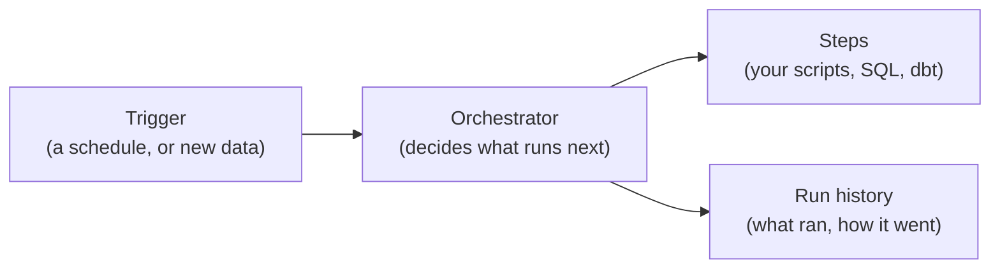
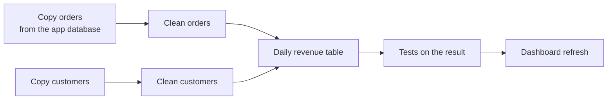
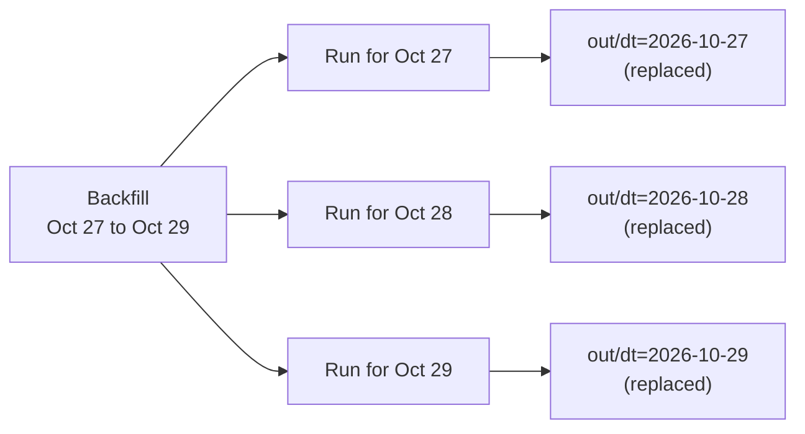
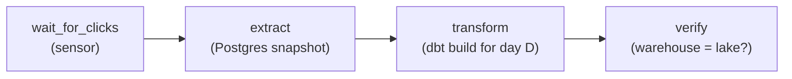

# 17.5 Orchestration: schedules, retries and backfills

You have a script that turns yesterday's raw data into a clean table, and it works when you run it by hand. Now it has to run every night while you sleep, wait when its input is late, try again when the database blinks, never run twice at once, and tell somebody when it didn't work. And one morning you'll find a bug that made last Tuesday's numbers wrong, and you'll want to rerun last Tuesday, only last Tuesday, without breaking anything else. That job is called **orchestration**, and this chapter teaches it from a three-line shell script up to the tools companies run it with.

## What you'll learn

- What an **orchestrator** adds to a scheduler like cron: dependencies, retries, waiting for input, history, and reruns of the past.
- Why a pipeline is a **DAG** (directed acyclic graph): steps with arrows showing which must finish before which.
- Why every step must be **idempotent** (safe to run twice), and the three habits that make it so: work on one partition, replace instead of append, and use the run's day, not the clock.
- **Retries with backoff** for failures that waiting can fix, and why a failed data test is not one of them.
- **Sensors** that wait for data, **backfills** that rerun a range of days, and how to watch a pipeline so a silent failure can't hide.
- What **Airflow**, **Dagster** and **Prefect** are for, and when cron plus a small runner is the better choice.

---

## A pipeline is a recipe with an order, and someone has to run it every night

Think of a bakery's night shift. The dough must rise before it's baked, and the bread must cool before it's sliced. If the flour delivery is late, the baker waits for it rather than baking air. If the oven trips, they reset it and try again, but if the flour turns out to be salt, they stop and call the owner, because trying again won't help. And there's a log on the wall: which batches were baked, when, and which went wrong.

A data pipeline has the same shape. Raw data has to land before it can be cleaned; clean tables have to exist before the summary that reads them. Something has to start the work on time, run the steps in order, react to failure, and keep a record. A program that does that for other programs is an **orchestrator**.

Four boxes:



The thing to notice: the orchestrator doesn't transform any data itself. It runs *your* steps, and its whole value is in the decisions around them: when, in what order, what to do on failure, and remembering what happened.

A few words you'll meet everywhere:

| Word | Means | In the bakery |
|---|---|---|
| **Task** (or step, op) | One unit of work: run a script, a query, a dbt build | Bake one tray |
| **Run** | One execution of the whole pipeline, for one period | Tuesday night's shift |
| **Schedule** | When runs start: every day at 01:30, every hour | The shift starts at 02:00 |
| **Partition** | The slice of data a run works on, usually one day | Tuesday's orders |

---

## Cron runs a command on a schedule, and that's all it does

The oldest orchestrator is **cron**, the Unix scheduler ([chapter 2.5](../linux/running-a-linux-server.mdx) covers it: one line per job, five time fields and a command). For one nightly job, one line is enough:

```text
# minute hour day-of-month month day-of-week   command
  30     1    *            *     *             /opt/pipeline/daily.sh >> /var/log/daily.log 2>&1
```

Cron is reliable and already on every Linux server. What it does is start a command at a time. Everything else is up to you:

| What a pipeline needs | What cron does |
|---|---|
| Run step B only after step A succeeded | Nothing. You chain them in a script (`a && b`). |
| Try again when the database is restarting | Nothing. The job fails until tomorrow. |
| Wait until the input data has arrived | Nothing. It runs at 01:30 whether the data is there or not. |
| Not start a second copy while the first is still running | Nothing. A slow run and the next one overlap. |
| Catch up on the nights the machine was off | Nothing. Missed runs are gone. |
| Rerun last Tuesday | Nothing. That's a person typing a command. |
| Tell someone it failed | It emails the job's output to a local mailbox that nobody reads. |

That last row has hurt real companies. In GitLab's 2017 database outage, the engineers discovered their regular backups had been failing for a while: the cron job's failure emails had been rejected by the receiving mail server, so nobody saw them ([GitLab's postmortem](https://about.gitlab.com/blog/2017/02/10/postmortem-of-database-outage-of-january-31/)). **A scheduled job that fails silently is worse than no job, because everyone believes it works.**

None of this means cron is wrong. It means cron is the *trigger*, and the other rows have to come from somewhere: your own script, or an orchestrator.

---

## Dependencies form a DAG: arrows from "must finish first" to "can start now"

Draw each step as a box and an arrow from each step to the steps that need its output. A typical analytics pipeline:



That drawing has a name: a **DAG**, a **directed acyclic graph**. *Directed* because each arrow points one way (orders feed revenue, not the reverse). *Acyclic* because no arrow path loops back to where it started: if revenue needed itself, nothing could ever start.

Two things an orchestrator gets from the DAG:

- **Parallelism.** "Copy orders" and "Copy customers" don't depend on each other, so they can run at the same time.
- **Stopping the damage.** When "Clean orders" fails, everything downstream of it (revenue, tests, dashboard) is *skipped*, so yesterday's dashboard stays up instead of being replaced by a half-built one. "Copy customers" still runs, because it doesn't depend on the failure.

:::info[If you've written code]
A DAG is the same structure as your build tool's dependency graph (`make`, a bundler, `go build` compiling packages). dbt builds one from your models' `ref()` calls ([chapter 17.4](./modeling-for-analytics.mdx)): it knows `fct_clicks` reads `stg_clicks` because the SQL says so. An orchestrator does the same one level up, between whole tools.
:::

---

## Idempotency: every step must be safe to run twice

Picture a lift's call button: press it once or five times, one lift comes. Now picture a "+1" button on a tally counter: press it twice, you've counted twice. A step that gives the same result however many times it runs is **idempotent**, like the lift button. Every step in a pipeline has to be one, because every step *will* run twice: a retry after a timeout, a rerun after a fix, a backfill, a person who wasn't sure it had finished.

Here is the tally-counter version. It counts one day's orders and appends the answer to a file:

```bash
#!/usr/bin/env bash
# append.sh DAY: the tempting version. Every run adds a line.
set -euo pipefail
day="$1"
echo "$day $(wc -l < "in/dt=$day/orders.txt")" >> totals.txt
```

Run it twice for the same day and the total is now in the file twice:

```text
$ ./append.sh 2026-10-29; ./append.sh 2026-10-29; cat totals.txt
2026-10-29 87
2026-10-29 87
```

Anything that sums that file now reports 174 orders. Here is the lift-button version:

```bash
#!/usr/bin/env bash
# daily.sh DAY: count one day's orders. Safe to run again: it replaces that day's answer.
set -euo pipefail
day="$1"
in="in/dt=$day/orders.txt"
[ -f "$in" ] || { echo "no input for $day yet" >&2; exit 75; }   # 75: "try again later"
mkdir -p out
n=$(wc -l < "$in")
echo "$day $n" > "out/.dt=$day.tmp"           # write a temporary file first...
mv "out/.dt=$day.tmp" "out/dt=$day.txt"       # ...then swap it in: all or nothing
echo "$day: $n orders"
```

```text
$ ./daily.sh 2026-10-29; ./daily.sh 2026-10-29; cat out/*.txt
2026-10-29: 87 orders
2026-10-29: 87 orders
2026-10-29 87
```

Three habits make the difference, and they're the same in every tool:

1. **Work on one partition, named by the run.** The script takes the day as an argument and reads only `in/dt=<day>/`. It never asks the clock "what's today?". The day a run is *for* is called its **logical date** (Airflow's word; others say partition key or data interval). A run for October 29th that starts at 01:30 on October 30th, or is rerun in December, still processes October 29th.
2. **Replace, don't append.** The output for a day is one file (or one set of rows) that each run overwrites whole. Rerunning replaces 87 with 87.
3. **Make the swap atomic.** Write to a temporary name, then rename. A rename on the same filesystem is all or nothing, so a crash halfway leaves the old answer, never half a new one. ([Chapter 8.1](../distributed/distributed-survival-kit.mdx) met the same idea for API requests: an idempotency key makes a retried payment safe.)

:::note[Everyday anchor]
"Set the thermostat to 21°" is idempotent: say it ten times, the room is 21°. "Turn the heat up two degrees" is not. Write pipeline steps as "set", never as "turn up".
:::

---

## Retries with backoff, for failures that waiting can fix

Some failures heal themselves: the database is restarting after an upgrade, the network dropped a packet, another job holds a lock for a few seconds, the input file isn't there *yet*. Others don't: a bug in the SQL, a column that changed type, a test that found duplicate rows. The first kind is **transient**, the second **permanent**, and the rule is:

**Retry transient failures, a few times, waiting longer each time. Never retry permanent ones; stop and tell a person.**

Waiting longer each time is **exponential backoff** (1 second, then 2, 4, 8). Adding a little randomness to each wait is **jitter**, so a hundred jobs that failed together don't all retry in the same second and knock the recovering database over again. A minimal version in bash:

```bash
retry() {                       # retry CMD...: up to 4 tries, waiting 1s, 2s, 4s between them
  local try=1 delay=1
  until "$@"; do
    [ "$try" -ge 4 ] && return 1
    echo "try $try failed; next in ${delay}s" >&2
    sleep "$delay"; try=$((try + 1)); delay=$((delay * 2))
  done
}
```

Run `retry ./daily.sh 2026-10-30` while the day's file is still being written, and it lands on the third try:

```text
no input for 2026-10-30 yet
try 1 failed; next in 1s
no input for 2026-10-30 yet
try 2 failed; next in 2s
2026-10-30: 90 orders
```

Two rules keep retries from making things worse:

- **Only retry idempotent steps.** Retrying `append.sh` turns one failure into a double count.
- **Tell the two kinds apart.** `daily.sh` exits with `75` (in the BSD convention, "temporary failure, try again") when its input is missing, and `1` for anything else, so a smarter `retry` could give up on `1` at once. Orchestrators do the same with exception types or exit codes.

---

## Sensors wait for the data, not for the clock

The nightly run at 01:30 assumes yesterday's data is complete by then. Data doesn't read schedules. The upstream export might finish at 02:10 tonight; a phone that was offline sends its events hours late. A step that checks "is my input ready?" before the real work begins is called a **sensor**. It checks, and if the answer is no, it waits and checks again, up to a timeout.

"Ready" needs a definition you can test:

- **The partition exists**: the folder `in/dt=2026-10-29/` has files.
- **The period is over, plus a grace period**: events for the 29th can still arrive after midnight, so wait until, say, 01:00 on the 30th before calling the day complete. The grace period is a trade-off between waiting for late events and delivering numbers on time.
- **The producer says so**: some systems write a marker file such as `_SUCCESS` when a partition is complete, or publish an event.

The opposite of polling is a **trigger**: the arrival of the data starts the run (an object-storage notification, a message on a queue). Orchestrators support both; Airflow 3 calls the event-driven kind "asset-aware scheduling", Dagster has sensors and "declarative automation".

:::info[Event time and processing time]
"Which day does this click belong to?" has two answers: the day it *happened* (**event time**) and the day it *arrived* (processing time). Partitioning by event time puts late events in the right day, which is why a day needs a grace period before it's complete. [Chapter 17.6](./streaming.mdx) works through the difference.
:::

---

## Backfills: rerunning a range of days

A **backfill** is running the pipeline for past partitions. You'll do it more often than you'd think:

- **First load.** A new pipeline needs the last year of history, not only tonight.
- **A fix.** The revenue SQL double-counted refunds since the 3rd; after the fix, rerun the 3rd to today.
- **Late data.** A partner resent last week's file with corrections.
- **A new column.** The table gains `country`; the old days need it too.

If every run is one partition and every step is idempotent, a backfill is the same run in a loop:

```bash
for day in 2026-10-27 2026-10-28 2026-10-29; do ./daily.sh "$day"; done
```

```text
2026-10-27: 81 orders
2026-10-28: 84 orders
2026-10-29: 87 orders
```

Running it a second time changes nothing, which is the point: a backfill you're afraid to repeat is a backfill you can't trust.



One backfill, many independent runs, each owning exactly one output partition. That is why partitions matter: they are the unit you can redo.

:::warning[What can go wrong]
- **Not every source can be backfilled.** A *snapshot* of a table that changes in place (today's prices, today's link list) shows the database now. You can't take last Tuesday's snapshot today; if you didn't save it then, it's gone. Event logs and dated files can be reprocessed; current-state tables can't.
- **The clock inside the code.** `WHERE day = current_date - 1` works every night and silently processes the wrong day in a backfill. Pass the run's day in.
- **Overlapping runs.** Tonight's run is slow and tomorrow's starts before it finishes; both write the same tables. Take a lock, or tell the orchestrator one run at a time.
- **Backfill storms.** Three hundred days at once can flatten the source database. Limit how many run in parallel, and run big backfills off-peak.
- **Time zones.** Cron uses the server's time zone, and on a daylight-saving change a 02:30 job can be skipped or doubled depending on the cron implementation. Run servers and pipelines in UTC ([chapter 2.5](../linux/running-a-linux-server.mdx) says the same) and define "a day" as a UTC day.
- **Catch-up surprises.** Airflow can create a run for every interval since a DAG's `start_date` (`catchup`). Airflow 3 turned that off by default; on older setups, a new DAG with a start date a year ago could start 365 runs at once.
:::

---

## You can't fix what you can't see: watching a pipeline

A web service tells you it's broken: requests fail, users complain. A pipeline that didn't run says nothing at all; the dashboard shows yesterday's numbers and looks fine. So you watch pipelines on purpose, at three levels:

1. **Did each run succeed?** Every run records its status, attempts, duration and error message. That history is the first thing an orchestrator's UI shows, and the first thing you open when someone says "the numbers look odd".
2. **Is the output fresh?** Alert on *the absence of success*, not only on failure: "the daily table's newest day is more than 30 hours old". That one alert catches the failed run, the run that never started, the server that was off, and the silent cron email. (A service that pings a monitor after every successful run, and pages when the pings stop, is called a **dead man's switch**.)
3. **Does the output look right?** Row counts, duplicates, nulls, totals that should match. Those are data tests, and they get a chapter of their own: [17.7](./data-quality.mdx).

The tools are the ones from [Part 13](../observability/logs.mdx): structured logs for each step ([chapter 13.1](../observability/logs.mdx)), metrics such as run duration and rows written ([chapter 13.2](../observability/metrics.mdx)), and alerts with a runbook ([chapter 13.4](../observability/slos-alerting-on-call.mdx)). Duration is worth graphing: a job that took 4 minutes for a year and takes 40 today is telling you something before it fails.

---

## The landscape: Airflow, Dagster, Prefect, and when cron is enough

Every orchestrator does what this chapter has described. They differ in what they treat as the main thing.

| Tool (version, Oct 2026) | Main idea | You write | Strong at |
|---|---|---|---|
| **[Apache Airflow](https://airflow.apache.org/)** 3.3 | A DAG of **tasks** on a schedule | Python files defining DAGs and operators | The industry default; huge library of integrations; managed versions on every cloud (AWS MWAA, Google Cloud Composer, Astronomer) |
| **[Dagster](https://dagster.io/)** 1.13 | A graph of **assets**: the tables and files you want to exist | Python functions that return data, with partitions built in | Partitions and backfills as first-class ideas; lineage; close dbt integration |
| **[Prefect](https://www.prefect.io/)** 3.9 | Ordinary Python functions as **flows** and **tasks** | Decorated Python | Dynamic, code-first workflows; low ceremony for Python teams |

Other things you'll meet: **Kubernetes CronJobs** ([chapter 10.2](../kubernetes/core-objects.mdx), cron with retries and `concurrencyPolicy: Forbid`), **Argo Workflows** (DAGs of containers on Kubernetes), **dbt's own job scheduler** in dbt Cloud, and **scheduled GitHub Actions**, which teams use for small jobs more than they admit.

Here is the order counter as an Airflow 3 DAG. A sensor waits for the file; then the same idempotent script runs for the run's day, `{{ ds }}`:

```python
# orders_daily.py: the same job as an Airflow 3 DAG.
from datetime import datetime, timedelta
from pathlib import Path

from airflow.providers.standard.operators.bash import BashOperator
from airflow.sdk import DAG, task

with DAG(
    dag_id="orders_daily",
    schedule="30 1 * * *",                  # 01:30 every day (UTC unless you set a time zone)
    start_date=datetime(2026, 10, 1),
    catchup=False,                          # don't run every missed day on first start
    default_args={
        "retries": 3,
        "retry_delay": timedelta(minutes=1),
        "retry_exponential_backoff": True,  # 1, 2, 4 minutes, with jitter
    },
):

    @task.sensor(poke_interval=60, timeout=6 * 60 * 60, mode="reschedule")
    def orders_landed(ds: str) -> bool:     # a sensor: True once the input exists
        return Path(f"/lab/in/dt={ds}/orders.txt").exists()

    count = BashOperator(
        task_id="count_orders",
        bash_command="cd /lab && ./daily.sh {{ ds }}",  # ds: the run's day, YYYY-MM-DD
    )

    orders_landed() >> count                # the DAG: count runs after the sensor succeeds
```

`airflow dags test orders_daily 2026-10-28` runs it once for that day, and a backfill is `airflow backfill create --dag-id orders_daily --from-date 2026-10-01 --to-date 2026-10-28`. And the same job in Dagster, where you declare the *thing that should exist*, one per day:

```python
# orders.py: the same job as a Dagster asset with daily partitions.
import subprocess

import dagster as dg

daily = dg.DailyPartitionsDefinition(start_date="2026-10-27")


@dg.asset(
    partitions_def=daily,
    retry_policy=dg.RetryPolicy(max_retries=3, delay=60, backoff=dg.Backoff.EXPONENTIAL),
)
def daily_order_count(context: dg.AssetExecutionContext) -> None:
    day = context.partition_key                       # "2026-10-28"
    subprocess.run(["./daily.sh", day], check=True)   # the idempotent script from before


defs = dg.Definitions(
    assets=[daily_order_count],
    schedules=[dg.build_schedule_from_partitioned_job(
        dg.define_asset_job("orders_job", selection=[daily_order_count]),
    )],
)
```

`dagster asset materialize -f orders.py --select daily_order_count --partition 2026-10-28` builds one day; the web UI (`dagster dev`) shows every partition as a coloured square and backfills a range with a click. Both files were run as shown against Airflow 3.3.2 and Dagster 1.13.27.

Notice what's the same in both: **the script didn't change.** The orchestrator supplies the day, the retries, the waiting and the history; the idempotent step does the work. That's why the habits above matter more than the choice of tool.

### When cron (and a small runner) is enough

An orchestrator is a service you run: a scheduler, workers, a metadata database, a web UI, upgrades. Pay for it when you have the problems it solves:

- **Cron is enough** for a handful of independent jobs on one machine, each idempotent, each wrapped with a lock and a freshness alert.
- **A small runner of your own** fits one pipeline with a few steps, when you want retries, a sensor, backfills and a run log without a new service.
- **An orchestrator** earns its keep with many pipelines owned by several people, dependencies *between* pipelines, many partitions to track and backfill, or a team that needs a UI to see what ran.

:::info[In the real world]
Most data teams past a handful of pipelines run Airflow or Dagster, often as a managed service so nobody has to operate the scheduler. Moving between them is common and mostly mechanical when the steps are idempotent scripts and dbt builds; it's painful when business logic lives inside the orchestrator's own operators. Keep the logic in your steps and let the orchestrator decide only *when*.
:::

---

## Apply it to snip

snip, the URL shortener this handbook builds, writes one row per click into a lake of Parquet files, one folder per UTC day: `clicks/dt=YYYY-MM-DD/`. snipdata (the Python and dbt project in `data/`, built in [chapter 17.2](./batch-pipelines.mdx) and [17.4](./modeling-for-analytics.mdx)) turns that into a warehouse table, `fct_clicks`, one row per click, plus a daily rollup. Until now you ran it by hand with `snipdata build`. Here it gets an orchestration story.

### Why a hundred lines of Python, not Dagster

The choice, made for this project, and the reasons:

- **The pipeline is small.** Four steps, one machine, one warehouse file. Dagster or Airflow would bring a scheduler, a web server and a metadata database, and several hundred Python packages, to run four functions.
- **The lab must be free and quick on a laptop.** `uv sync` stays the only install.
- **You should see the mechanics.** A retry loop, a sensor and a backfill in plain code teach what the frameworks do for you. When you open Dagster's partition view later, you'll know what each square means.

The day snipdata grows to a dozen pipelines and a team, the steps move into Dagster assets unchanged, as the order counter did above.

### One run is one day, through four steps

`snipdata run --day D` runs these steps, from `data/src/snipdata/orchestrate.py`:

```python
STEPS: list[tuple[str, Step]] = [
    ("wait_for_clicks", wait_for_clicks),
    ("extract", extract),
    ("transform", transform),
    ("verify", verify),
]
```



- **`wait_for_clicks`** is the sensor. Day D is ready when it's over plus a grace hour for late clicks, and `clicks/dt=D/` holds files.
- **`extract`** snapshots snip's Postgres (links and their owners), but only for today or yesterday: it skips older days with the message "a snapshot shows the database now, it can't be taken for a past day". That's the backfill warning above, in code.
- **`transform`** runs `dbt build` for exactly that day:

  ```python
      window = json.dumps({"start_date": day.isoformat(), "end_date": day.isoformat()})
      out = run_dbt(cfg.lake, cfg.warehouse, cfg.dbt_dir, ["build", "--vars", window], quiet=True)
  ```

  and `fct_clicks` (in `data/dbt/models/marts/fct_clicks.sql`) uses the window to overwrite that day whole. A `pre_hook` deletes the day's rows first, then the model inserts the day's events:

  ```sql
  
  where click_date between date '{{ var("start_date") }}' and date '{{ var("end_date", var("start_date")) }}'
  
  where click_date >= (select coalesce(max(click_date), date '1970-01-01') - 2 from {{ this }})
  
  ```

  That is "replace, don't append" in SQL: run the day twice, get the same rows; remove a bad file from the lake and rerun, and its rows leave the table too.
- **`verify`** reconciles: the warehouse must hold exactly as many clicks for D as the lake has distinct events, and it records a **fingerprint**, an XOR of a hash of every row, so two runs can be compared with one glance.

### Retries for what waiting can fix

The runner's loop (same file) gives each step up to `retries` extra attempts, but only for `Retryable` failures: dbt couldn't open the warehouse, Postgres refused the connection, the partition isn't there yet. A `Failed` step (a dbt test failed, the counts don't match) and an unexpected crash stop the run at once:

```python
            except Retryable as err:
                message = str(err)
                status = "retry" if attempt <= cfg.retries else "failed"
            except Failed as err:
                message, status = str(err), "failed"
            except Exception as err:  # a bug, not bad luck: record it, don't retry it
                message, status = f"{type(err).__name__}: {err}", "failed"
```

The wait between attempts doubles and is randomised:

```python
def backoff_delay(cfg: Config, attempt: int) -> float:
    """Exponential backoff with jitter: about 2s, 4s, 8s ... capped, each randomised.

    The jitter spreads out retries, so many failed runs don't all retry at once.
    """
    delay = min(cfg.max_backoff, cfg.backoff * 2 ** (attempt - 1))
    return random.uniform(delay / 2, delay)
```

How does the runner tell a locked warehouse from a failed test? dbt runs as a child process (in `data/src/snipdata/transform.py`), and dbt's exit code says which: `1` means dbt ran and a model or test failed, `2` means dbt hit an error it couldn't handle, such as a file it couldn't open. Here is a real run while another program held the warehouse file open:

```text
2026-10-27  wait_for_clicks ok        0.0s  2 file(s) in clicks/dt=2026-10-27
2026-10-27  extract         ok        0.0s  skipped: generated lake, no Postgres to read
2026-10-27  transform       retry     2.9s  _duckdb.IOException: IO Error: Could not set lock on file "/w/data/warehouse/snip.duckdb": Conflicting lock is held in /usr/local/bin/python3.12 (PID 99). See also https://duckdb.org/docs/current/connect/concurrency
2026-10-27  transform       ok        2.9s  dbt build: 35 pass, 7 success
2026-10-27  verify          ok        0.0s  3989 clicks, fingerprint 10a76b76802bd17c
```

And two runs never overlap: the runner takes a lock on `warehouse/snipdata.lock`, so a second one exits at once with `snipdata: another run is in progress (snipdata.lock is held)`.

### A backfill, and a rerun that changes nothing

On a lake of seven generated days, the nightly run builds the newest day, a backfill fills the six before it, and `snipdata runs` reads the run log (`warehouse/runs.jsonl`, one JSON line per step attempt):

```text
$ uv run snipdata run --day 2026-10-29
2026-10-29  wait_for_clicks ok        0.0s  2 file(s) in clicks/dt=2026-10-29
2026-10-29  extract         ok        0.0s  skipped: generated lake, no Postgres to read
2026-10-29  transform       ok        3.8s  dbt build: 35 pass, 7 success
2026-10-29  verify          ok        0.0s  5337 clicks, fingerprint ca7a30991113a82b
$ uv run snipdata backfill --start 2026-10-23 --end 2026-10-28
...
backfill 2026-10-23 to 2026-10-28: 6 of 6 days done
$ uv run snipdata runs
day         run      status  step            retries  message
2026-10-23  66049c10 ok      verify                0  4471 clicks, fingerprint 6c005955dee589df
2026-10-24  9a7792d2 ok      verify                0  2635 clicks, fingerprint f5b72c46baef31ba
2026-10-25  31c9c0bc ok      verify                0  3123 clicks, fingerprint 0547fe2e7dca1c88
2026-10-26  a7257a70 ok      verify                0  4684 clicks, fingerprint f752d05afd4bc98e
2026-10-27  af67e278 ok      verify                0  3989 clicks, fingerprint 10a76b76802bd17c
2026-10-28  8c0896c5 ok      verify                0  4549 clicks, fingerprint a7da42960db1e010
2026-10-29  affb0406 ok      verify                0  5337 clicks, fingerprint ca7a30991113a82b
```

Rerun one day in the middle:

```text
$ uv run snipdata run --day 2026-10-26
2026-10-26  wait_for_clicks ok        0.0s  2 file(s) in clicks/dt=2026-10-26
2026-10-26  extract         ok        0.0s  skipped: generated lake, no Postgres to read
2026-10-26  transform       ok        3.8s  dbt build: 35 pass, 7 success
2026-10-26  verify          ok        0.0s  4684 clicks, fingerprint f752d05afd4bc98e
```

Same 4,684 clicks, same fingerprint `f752d05afd4bc98e`: the rerun replaced the day with identical rows. The seven days add up to 28,788, exactly the clicks `generate` reported, though 144 of the events had been delivered twice. The test suite (`data/tests/test_orchestrate.py`) checks all of this on every change: a backfill, a full second backfill, and a rerun give byte-for-byte the same table.

### Scheduling it

On a Linux server in UTC, one crontab line starts the nightly run after the grace hour. Cron's environment is nearly empty, so name `uv` by its full path (`command -v uv` prints it):

```text
30 1 * * *  cd /opt/zero-to-prod/data && /usr/local/bin/uv run snipdata run >> warehouse/cron.log 2>&1
```

That covers schedule, order, retries, waiting, no overlap and a history. The missing piece is someone hearing about a failure, and that is [chapter 17.7](./data-quality.mdx)'s freshness check plus an alert from [chapter 13.4](../observability/slos-alerting-on-call.mdx). On Kubernetes, the same command becomes a CronJob with `concurrencyPolicy: Forbid`.

---

## Cheat sheet

| Term / command | What it means | When you reach for it |
|---|---|---|
| Orchestrator | Runs steps on a schedule, in order, with retries and history | More than a couple of dependent jobs |
| DAG | Steps and "must finish first" arrows, no loops | Drawing any pipeline |
| Idempotent step | Same result however many times it runs | Every step, always |
| Logical date / partition key | The day a run is *for*, passed in | Instead of `current_date` in code |
| Retry with backoff + jitter | Try again, waiting longer and slightly random | Transient failures only |
| Sensor | Waits until input is ready | Before processing a day |
| Backfill | Runs the pipeline for past partitions | First load, fixes, late data |
| `uv run snipdata run --day D` | One orchestrated day for snipdata | Nightly, or to redo one day |
| `uv run snipdata backfill --start A --end B` | Every day from A to B, oldest first | Filling or fixing history |
| `uv run snipdata runs` | Each day's latest run from the run log | "Did last night work?" |
| `airflow backfill create --dag-id X --from-date A --to-date B` | Airflow 3's backfill | The same, in Airflow |

---

## Lab

Everything runs on your laptop, free. Steps 1 and 2 need only bash; steps 3 and 4 need [uv](https://docs.astral.sh/uv/) and the repository's `data/` folder.

1. **See the double count, then the fix.** Make a folder and three days of fake orders:
   ```bash
   mkdir orch-lab && cd orch-lab                            # a scratch folder
   for d in 27 28 29; do                                    # three days of input, 81 to 87 lines each
     mkdir -p in/dt=2026-10-$d
     seq 1 $((d * 3)) | sed "s/^/order /" > in/dt=2026-10-$d/orders.txt
   done
   ```
   Save `append.sh` and `daily.sh` from [the idempotency section](#idempotency-every-step-must-be-safe-to-run-twice), `chmod +x *.sh`, then run each twice for `2026-10-29` and `cat totals.txt out/*.txt`. Notice that only the appending version changed its answer.

2. **Retry and backfill.** Paste the `retry` function into your shell, then:
   ```bash
   (sleep 2.5; mkdir -p in/dt=2026-10-30; seq 1 90 > in/dt=2026-10-30/orders.txt) &   # the data lands late
   retry ./daily.sh 2026-10-30                                                    # fails twice, then succeeds
   for day in 2026-10-27 2026-10-28 2026-10-29 2026-10-30; do ./daily.sh "$day"; done   # a backfill
   ```
   Run the backfill line a second time and compare `out/`: nothing changed.

3. **Orchestrate snipdata.** From the repository's `data/` folder:
   ```bash
   uv sync                                                  # install snipdata and dbt
   uv run snipdata generate --days 7                        # 7 days of clicks, ending today
   uv run snipdata run                                      # yesterday: sensor, extract, dbt, verify
   uv run snipdata run --day "$(date -u +%F)"               # today isn't over: the sensor says so, retries, gives up
   uv run snipdata backfill --start "$(date -u -d '-6 days' +%F)" --end "$(date -u -d '-2 days' +%F)"
   uv run snipdata runs                                     # the run log, one line per day
   ```
   (On macOS, `date -u -v-6d +%F` replaces `date -u -d '-6 days' +%F`.) Notice that today's run fails at the sensor without touching the warehouse.

4. **Prove a rerun is safe.** Pick a day from the table, run `uv run snipdata run --day <that day>` again, and compare the fingerprint with `snipdata runs`. Then open a second terminal and hold the warehouse with `uv run python -c "import duckdb, time; c = duckdb.connect('warehouse/snip.duckdb'); time.sleep(5)"` while you rerun the day in the first: watch the `retry` line, then `ok`.

## Self-check

<Quiz
  id="data-engineering-orchestration"
  questions={[
    {
      q: 'A nightly job counts yesterday\'s orders with WHERE day = current_date - 1. What breaks when you backfill last month with it?',
      options: [
        'Each backfill run counts yesterday again, not its own day',
        'The backfill runs too fast and overloads the database',
        'The counts double, because each run appends a new row',
        'Nothing: current_date follows the run\'s logical date',
      ],
      answer: 0,
      explain: 'The query asks the clock, so every run, whatever day it is for, processes the day before the moment it runs. Thirty backfill runs all redo yesterday and last month stays wrong. Pass the run\'s day (its logical date) into the query instead. Doubling would come from appending, a different mistake; and current_date never follows the run, which is the whole problem.',
    },
    {
      q: 'Which failure should a pipeline step retry automatically?',
      options: [
        'A dbt not_null test found 12 clicks with no slug',
        'The SQL references a column the source just renamed',
        'The warehouse file is locked by another process',
        'The run\'s row count doesn\'t match the source\'s count',
      ],
      answer: 2,
      explain: 'A lock is transient: the other process will finish, and the same step will then succeed. The other three are facts about the data or the code; running the same step again gives the same failure, and retries only delay the moment a person finds out. Stop, alert, and fix.',
    },
    {
      q: 'Why must every step in a pipeline be idempotent?',
      options: [
        'Idempotent steps run faster, so the schedule fits the night',
        'Retries, reruns and backfills will run each step more than once',
        'Orchestrators refuse to schedule steps that write files',
        'It lets two runs for the same day safely run in parallel',
      ],
      answer: 1,
      explain: 'A step runs again whenever it is retried after a timeout, rerun after a fix, or included in a backfill. If a second run changes the result (an append, a +1), each of those turns into wrong numbers. Idempotency doesn\'t make steps faster, and it doesn\'t make overlapping runs safe on its own; two runs writing at once still need a lock.',
    },
    {
      q: 'The dashboard shows Monday\'s numbers on Thursday, and no alert fired. Which check would have caught it?',
      options: [
        'An alert on any run whose status is failed',
        'A dbt test that the daily table has no duplicate rows',
        'Retries with exponential backoff on every step',
        'An alert when the newest day in the table is over 30 hours old',
      ],
      answer: 3,
      explain: 'Nothing failed: the job may never have started (the server was off, cron was misconfigured), so a failed-run alert has nothing to fire on. A freshness alert watches the outcome, not the runs, and catches every way the data can stop arriving. Duplicate tests check content, and retries only help runs that actually start.',
    },
    {
      q: 'Your team has three small nightly jobs on one server, each idempotent, each with a lock and a freshness alert. A colleague proposes Airflow. What is the best reason to wait?',
      options: [
        'Airflow can\'t run jobs that are already idempotent',
        'An orchestrator is a service to run and upgrade; three jobs don\'t need it',
        'Cron retries failed jobs, so Airflow adds nothing here',
        'Airflow only supports Kubernetes, not a single server',
      ],
      answer: 1,
      explain: 'Airflow brings a scheduler, workers, a metadata database and a UI to operate. With three independent jobs that already have the habits that matter, that cost buys little. It pays off with many pipelines, dependencies between them, many partitions to backfill, or a team that needs shared visibility. Cron does not retry, Airflow runs fine on one machine, and idempotent jobs are exactly what Airflow runs best.',
    },
  ]}
/>

<details>
<summary>A backfill of 90 days failed on day 41 with a lock error and then finished the rest. What do you do, and why is that safe?</summary>

Rerun only the failed day (`snipdata run --day <day 41>`), or rerun the whole range with `--missing-only`, which skips days whose latest run succeeded. It's safe because each day is an independent partition and each step is idempotent: the rerun replaces day 41's rows whole, so it can't double count, and the other 89 days aren't touched. The lock error was transient, but if it keeps happening, find what else is holding the warehouse (another run, a notebook left open) instead of raising the retry count. The rule: **when the unit of work is a partition and every step replaces its partition, recovery is "run that partition again".**

</details>

<details>
<summary>Why can snipdata backfill clicks for any past day, but not the links snapshot?</summary>

Clicks are **events**: each one is a fact about a moment, stored once in the day folder it belongs to, and nothing ever changes it. Reprocessing October 3rd reads the same October 3rd files and gets the same answer. The links table in snip's Postgres is **current state**: it changes in place, and a query shows it as it is *now*. A snapshot taken today labelled "October 3rd" would be a lie. So history of mutable data has to be captured at the time (a daily snapshot, or an audit trail of changes), because it can't be recreated later. The rule: **you can always recompute from events; you can only remember state.**

</details>
