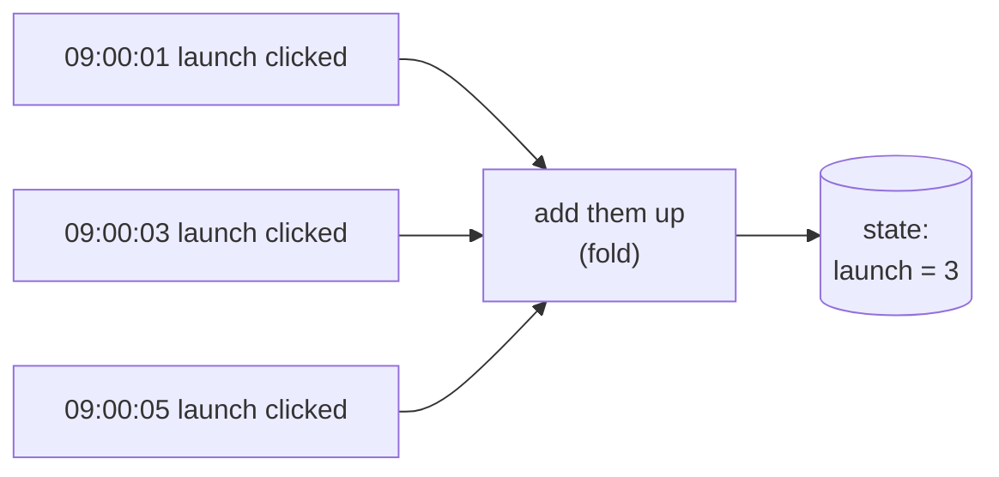
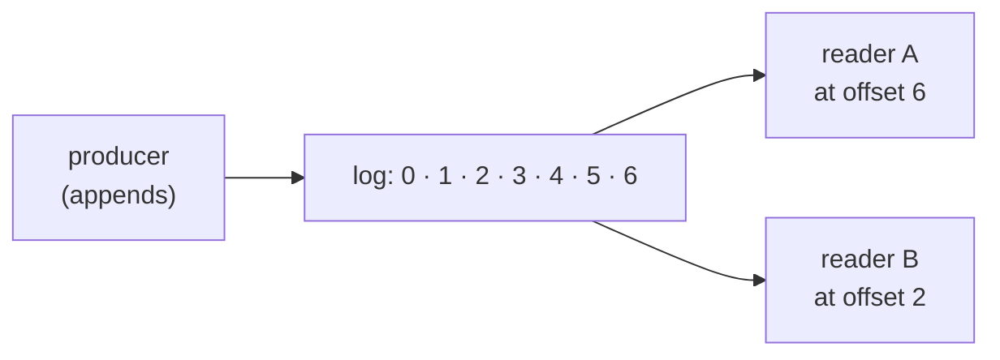
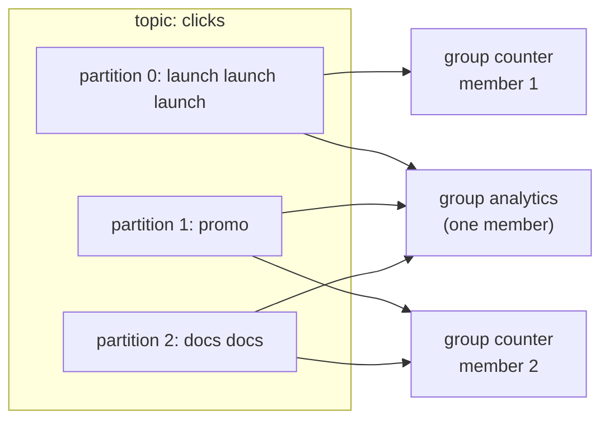
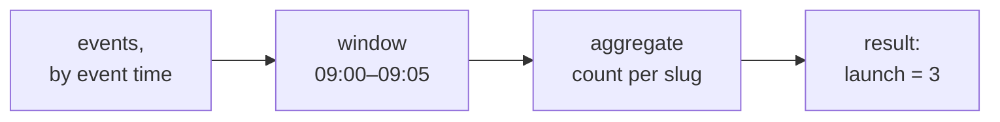
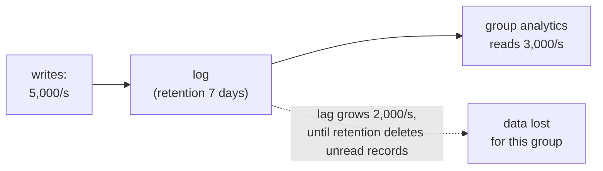

# 17.6 Streaming: events, logs and windows

Your banking app shows a balance, and under it a list: coffee, rent, salary, coffee. The balance is one number that changes. The list only ever grows, and every line in it is something that *happened*. If the bank lost your balance, it could rebuild it by adding up the list; it could never do the reverse. Streaming is the part of data engineering that takes that list seriously: data that never stops arriving, kept as a sequence of facts, read by many programs, each at its own pace. A nightly batch job tells you what happened yesterday. A stream can tell you what happened ten seconds ago, if you can handle the hard parts this chapter is about: duplicates, late arrivals, and readers that fall behind.

## What you'll learn

- **Events vs state**: an event is a fact that happened ("`launch` was clicked at 09:00:03"); state is what the facts add up to ("`launch` has 3 clicks").
- **The log**: an append-only list with numbered positions (**offsets**), split into **partitions**, read by **consumer groups** that each keep their own bookmark, and trimmed by **retention**. Kafka and Redpanda are built on it.
- **Delivery guarantees**: why real pipelines are **at-least-once**, and why "exactly-once" in practice means at-least-once into an **idempotent sink**.
- **Event time vs processing time**, **windows** (tumbling, hopping, session), **watermarks** and what to do with **late data**.
- **Backpressure** in a log: lag grows, and retention is the cliff at the end of it.
- Applied: a consumer that lands a real click stream in a Parquet lake, survives being killed mid-batch without losing or duplicating a click, and says so honestly when events were lost before it could read them.

---

## An event is a fact; state is what the facts add up to

An **event** is a record that something happened, at a moment: "someone clicked the link `launch` at 09:00:03 UTC". Events are written once and never edited. If you got one wrong, you add a correcting event, the way a bank adds a refund instead of erasing the charge.

**State** is the current answer to a question, computed from events: "how many clicks does `launch` have?" State changes all the time. Most application databases store state (a `clicks` column, updated in place). Analytics usually wants the events, because a new question ("clicks per hour", "clicks from the first day only") needs the history, and state has thrown the history away.



The arrow only goes one way. From the three events you can compute the 3, and also "clicks per minute", "time between clicks", anything. From the 3 alone you can compute nothing else. That's why event streams are the raw material of analytics, and why people say a table is a snapshot of a stream (the **stream–table duality**): replay the events from the start and you rebuild the table.

:::note[Everyday anchor]
A shop's till roll lists every sale; the cash drawer holds the total. At closing time the two should agree. When they don't, it's the till roll you trust, because you can read it line by line and find the mistake.
:::

---

## The log: one append-only list that everyone reads at their own pace

The idea behind Kafka, Redpanda, Amazon Kinesis, Redis Streams and a database's write-ahead log is the same, and it is simpler than the products: a **log** is a list you can only append to. Each new entry goes at the end and gets the next number, its **offset** (0, 1, 2, …). Entries are never changed. Readers don't remove what they read; each reader remembers the offset it has reached and asks for "everything after offset 41".



Two readers, one log. Reader A is up to date; reader B is four entries behind and will catch up at its own speed. Neither disturbs the other. Compare that with the job queue of [chapter 8.2](../distributed/queues-and-background-work.mdx), where a message is handed to one worker and deleted once that worker acknowledges it. A log *keeps* entries, so any number of independent readers, including ones you write next year, can read the same history.

### Topics, partitions, offsets: the vocabulary of Kafka

**Apache Kafka** is the best-known log, and its protocol has become a standard: **Redpanda** (a single C++ binary, no JVM) and several cloud services speak the same Kafka API. The vocabulary:

| Term | What it is |
|---|---|
| **Broker** | A server that stores logs and serves readers and writers. A **cluster** is several, with copies of each log on more than one. |
| **Topic** | A named log, for example `clicks`. |
| **Partition** | One topic is split into several independent logs, so different machines and readers can work on it in parallel. Each partition has its own offsets, starting at 0. |
| **Key** | An optional value on each record. Records with the same key go to the same partition (the key is hashed), so **order is guaranteed per key**, not across the whole topic. |
| **Offset** | A record's position within its partition. |
| **Consumer group** | A set of readers sharing one bookmark per partition. Each partition is read by one member of the group at a time. |
| **Retention** | How long the log keeps records: by time (`retention.ms`, 7 days by default), by size, or **compacted** (keep only the latest record for each key). |

Partitions are how a log scales, and keys are how it keeps order where order matters. With the slug as key, every click on `launch` lands in the same partition in the order it was produced, while clicks on other links spread across the others. With 3 partitions, a consumer group can have up to 3 busy members; a fourth would sit idle.



Two groups read the same topic. Group `counter` has two members, which split the three partitions between them; group `analytics` has one member, which reads all three. Each group's bookmarks are separate: `analytics` can be a day behind, or be rewound to replay last week, without `counter` noticing.

### A consumer group's bookmark is its commit

A consumer reads a batch, does its work, then **commits** its offset: "group `analytics` has processed partition 0 up to offset 4". Kafka stores the commit in a topic of its own (`__consumer_offsets`). If the consumer crashes, its replacement starts from the last commit. Where you commit, relative to your work, decides your delivery guarantee, which is the next section.

**Retention** is the other half of the deal. The log doesn't wait for slow readers: a 7-day retention deletes records after 7 days whether every group has read them or not. A group whose bookmark points at a deleted offset has lost those records, and what happens next is a setting (`auto.offset.reset`: jump to the oldest or newest record still there). Hold on to that; it comes back as backpressure.

:::info[If you've written code]
A log is a file opened in append mode plus a dictionary of bookmarks `{group: offset}`. Everything else (partitions, replication, retention) is what it takes to run that idea across many machines and keep it from filling the disk.
:::

---

## Delivery guarantees: why "exactly-once" means an idempotent sink

Every consumer does two things per batch: **process** it (write the results somewhere) and **commit** (tell the log it's done). A crash can land between the two. Which order you choose decides what a crash costs you:

| Order | Crash between the two steps means | Name |
|---|---|---|
| Commit, then process | The log thinks the batch is done; the results were never written. **Lost.** | **At-most-once** |
| Process, then commit | The results are written; the log redelivers the batch. **Written twice.** | **At-least-once** |

Losing data silently is almost never acceptable, so real pipelines are at-least-once ([chapter 8.1](../distributed/distributed-survival-kit.mdx) introduced the terms). That makes duplicates normal, not exceptional: every crash, every rebalance of a consumer group, every network timeout on a commit can replay part of a batch.

**Exactly-once** is the guarantee everyone wants: each event affects the result once. No network can deliver a message exactly once, because a sender that gets no reply can't tell "lost" from "arrived, but the reply was lost". What systems really offer is **effectively-once**: delivery stays at-least-once, and the **sink** (wherever the results go) makes the second delivery harmless. A sink is **idempotent** when writing the same thing twice leaves the same result as writing it once. The common ways to get there:

- **A natural deduplication key.** Every event carries a unique ID; the sink skips IDs it has seen (an `INSERT … ON CONFLICT (event_id) DO NOTHING`), or every query deduplicates on it.
- **Deterministic outputs.** The output's name is computed from its input: "the file for events 1,040 to 1,520" always has the same name, so a replay overwrites it instead of adding a second copy.
- **Committing the results and the bookmark together.** Store the offset in the same database transaction as the results ([chapter 6.5](../data/transactions.mdx)); on restart, read the offset from there. Kafka's own **transactions** (added in 2017, [Confluent's explanation](https://www.confluent.io/blog/exactly-once-semantics-are-possible-heres-how-apache-kafka-does-it/)) do this when both the input and the output are Kafka topics.

The rule to keep: **at-least-once delivery plus an idempotent sink gives effectively-once results.** When a vendor says "exactly-once", ask where the sink is and how it deduplicates.

:::warning[What can go wrong]
- **Committing before writing.** Fast and tidy, and every crash silently loses a batch. Auto-commit settings that commit on a timer can do this behind your back.
- **A sink that appends blindly.** Redelivery doubles some counts, and nothing errors: the numbers are just wrong.
- **Deduplicating on the wrong key.** Two clicks on the same link in the same millisecond are two events; a key of `(slug, timestamp)` merges them. Use an ID assigned once, at the source.
- **Half-written outputs.** A crash in the middle of writing a file leaves a truncated file that a reader may load. Write to a temporary name, then rename (an atomic step on one filesystem).
:::

---

## Event time and processing time are different clocks

A postcard has two dates: the postmark (when it was sent) and the day it lands on your mat. Usually they are a few days apart. Sometimes a card turns up a month late.

Events have the same two clocks. **Event time** is when the thing happened: the click, recorded by the system where it happened. **Processing time** is when your pipeline sees it. They drift apart for ordinary reasons: a phone was offline and uploads its events an hour later, a consumer was down for a deploy and is working through a backlog, a retry delivers a batch twice, five minutes apart.

```text
event time      09:00:01  09:00:03  09:00:05  08:59:58   ← this click happened first...
processing time 09:00:02  09:00:04  09:00:06  09:00:09   ← ...but arrived last
```

If you count "clicks per minute" by processing time, the 08:59:58 click is counted in the 09:00 minute: wrong, and wrong differently every time you replay the data. **Analytics questions are almost always about event time**, so streaming pipelines carry the event's own timestamp with it and group by that. The price is that the pipeline must decide how long to wait for stragglers.

---

## Windows cut an endless stream into countable pieces

"How many clicks?" has no answer on a stream that never ends. "How many clicks between 09:00 and 09:05?" does. A **window** is a slice of event time that you aggregate over:

| Window | Shape | Example question |
|---|---|---|
| **Tumbling** | Fixed size, back to back, no overlap | Clicks per 5-minute bucket (09:00–09:05, 09:05–09:10…) |
| **Hopping** (sliding) | Fixed size, starting every *step*, overlapping | Clicks in the last 10 minutes, updated every minute |
| **Session** | Per key, closed after a gap of inactivity | One visitor's burst of activity, ended by 30 minutes of silence |



A window's result can only be final once no more events for it will arrive, and with late data you never know that for certain. A **watermark** is the pipeline's working assumption: "I believe I've now seen every event up to 09:05". It usually trails the newest event time by an allowance (say 2 minutes). When the watermark passes the end of a window, the window is emitted. An event that arrives after its window was emitted is **late data**, and you choose what to do with it:

- **Drop it** (and count how many you dropped). Simple; the result is slightly low.
- **Update the result**: emit a corrected count for the old window. Correct, but whatever reads the results must handle a window changing after the fact.
- **Send it aside** to a separate output, for a batch job to fold in later.

Stream processors such as **Apache Flink**, **Spark Structured Streaming** and **Kafka Streams** implement windows and watermarks for you. A data lake gives you a simpler option that works well for analytics: **land raw events partitioned by event time, and aggregate later in batch**. A late event is written into its own day's folder, and the next batch run recomputes the days that changed. Nothing is ever "too late"; it only arrives after the dashboard was first drawn.

---

## Backpressure: when readers fall behind the writers

When producers write faster than consumers read, the gap between the newest offset and the group's bookmark grows. That gap is **consumer lag**, measured in records ("1.2 million behind") or, more usefully, in time ("40 minutes behind"). In a job queue, the backlog pushes back on the system: memory fills, and producers slow down or fail ([chapter 8.2](../distributed/queues-and-background-work.mdx) called this **backpressure**). A log absorbs the backlog on disk instead, which is its strength, until the lag reaches the retention limit. Then the oldest unread records are deleted, and the slow group loses them.



Three things keep you away from the cliff:

1. **Alert on lag in time, well before retention.** With 7 days of retention, page someone at a few hours, not at 6 days.
2. **Make consumers catch up faster than producers write.** More partitions and group members, bigger batches, a cheaper sink.
3. **When data was lost anyway, say so.** A consumer that jumps silently to the oldest remaining record produces numbers that look fine and are wrong. Record the gap: which range, how many events, when it was noticed.

---

## Do you need streaming at all?

Streaming has real costs: a cluster to run (or pay for), consumers that run forever, duplicates and late data to design around, and on-call for all of it. Many "real-time" requirements turn out to be "fresh within the hour", which a batch job every 15 minutes meets with far fewer moving parts. Reach for streaming when the value of the data falls off in minutes (fraud checks, alerting, live operations), when many independent systems need the same events, or when you need to replay history into a new consumer.

| Need | Typical tools (2026) |
|---|---|
| A durable, replayable event log | Apache Kafka (4.x runs without ZooKeeper), Redpanda, Amazon Kinesis and MSK, Google Pub/Sub, Azure Event Hubs |
| A lightweight log inside an existing stack | Redis Streams, NATS JetStream, Postgres tables (with care) |
| Windows, joins and state over streams | Apache Flink, Spark Structured Streaming, Kafka Streams, streaming databases such as RisingWave and Materialize |
| Events landed for analytics | A small consumer writing Parquet (this chapter), Kafka Connect sinks, Firehose-style managed delivery |

:::info[In the real world]
Most companies with a stream also keep batch. A common shape: events flow through Kafka; one consumer lands them raw in the lake, partitioned by event time; scheduled batch models compute the official numbers; a few latency-critical features read the stream directly. The raw landing is the safety net: if a streaming job had a bug, you fix it and recompute from the lake.
:::

---

## Apply it to snip

snip, the URL shortener built through this handbook, already has an event stream. On every redirect, the API appends a click event to a Redis stream called `snip:clicks` (`snip/internal/clicks/stream.go`), with two fields: `slug` and `at` (the click's time in unix milliseconds). snip's worker reads the stream in a consumer group called `workers` and adds the clicks to a `clicks` counter in Postgres ([chapter 8.2](../distributed/queues-and-background-work.mdx) walks through it). That counter is state. The events behind it are exactly what analytics needs.

### snip's Redis Stream is a log, with a different retention rule

A Redis stream ([chapter 6.7](../data/redis-and-caching.mdx) introduced Redis, an in-memory data store) is a log too: append-only, each entry with an ID made of a millisecond timestamp and a sequence number (`1793347593926-0`), read by consumer groups that each keep their own position. The differences from Kafka matter:

| | Kafka / Redpanda topic | snip's Redis stream |
|---|---|---|
| Stored in | Files on disk, replicated across brokers | Memory, on one Redis server |
| Retention | By time or size (`retention.ms`, 7 days by default) | By count: `XADD … MAXLEN ~ 1000000` keeps about the newest million entries |
| Parallelism | Partitions | One stream, no partitions |
| Group bookkeeping | One committed offset per partition | A **pending list**: every entry delivered but not yet acknowledged (`XACK`), per consumer |
| Replay | Seek a group to any offset or time | Re-create a group at an older ID, while those entries still exist |

The retention rule is the one to remember. Kafka gives a slow reader a guaranteed amount of *time*. snip's stream gives it a number of *entries*: at 10 clicks a second, a million entries is a bit over a day; during a viral spike of 1,000 a second, it's under 17 minutes. snip chose a count on purpose: Redis holds the stream in memory next to the cache and the rate limits, and a cap in entries is a cap in memory.

### A second consumer group, for analytics

Because a group keeps its own position, a new group, `analytics`, sees every click without taking any from snip's workers. Its consumer is a small Python program in `data/stream/` (package `clickstream`). It batches events and writes them to the lake as **Parquet** (a compressed, column-oriented file format for analytics) in the layout the rest of the data pipeline reads:

```text
data/lake/clicks/dt=2026-10-30/stream-1793347648153-0_1793347648380-0.parquet
                 └ folder per day, by event time      └ first and last event ID in the file
columns: event_id (string, the stream entry ID), slug (string), clicked_at (timestamp, UTC, ms)
```

Each batch goes through the same steps, in an order chosen so that a crash at any point costs a redelivery and never a click (`data/stream/src/clickstream/consumer.py`, trimmed):

```python
# 1. Our own pending events: delivered to us before, never acknowledged (we crashed).
entries = self._read("0", self.cfg.batch_size, block_ms=None)
# 2. Else another analytics consumer's pending events, idle too long: XAUTOCLAIM.
if not entries:
    entries, res.trimmed = self._autoclaim()
# 3. Else new events, until the batch is full or the oldest has waited flush_seconds.
if not entries:
    gap = self.check_gap()           # did the stream trim events we never read?
    if gap is not None:
        self.report_gap(gap)
    entries = self._collect_new()
...
res.files = lake.write_batch(self.cfg.lake_dir, clicks) if clicks else []
# Only now: every event is either in a durable file or deliberately skipped.
self.r.xack(STREAM, GROUP, *[entry_id for entry_id, _ in entries])
```

Every idea from this chapter is in those lines:

- **At-least-once.** The acknowledgement (`XACK`) comes after the write. Kill the process anywhere before it, and the batch stays pending and is delivered again.
- **An idempotent sink.** `write_batch` names each file after the first and last event IDs in it, so the redelivered batch rewrites the same file instead of adding a second one. The event ID, assigned once by Redis, is also a column, so any query can deduplicate on it.
- **A durable write before the acknowledgement.** The file is written under a temporary name, flushed to disk with `fsync`, then renamed into place (`data/stream/src/clickstream/lake.py`):

  ```python
  with open(tmp, "wb") as f:
      pq.write_table(table, f, compression="zstd")
      f.flush()
      os.fsync(f.fileno())  # the bytes are on disk, not only in the OS's cache
  os.replace(tmp, path)  # atomic: readers see the old state or the new, nothing between
  _fsync_dir(path.parent)  # and the rename itself survives a power cut
  ```

- **Event time.** The day folder comes from the click's own `at`, not from when the consumer ran. A click that arrives after midnight from 23:59:58 lands in the earlier day's folder, and the next batch run over that day picks it up.
- **Windows, in batch.** The consumer doesn't aggregate at all. It lands raw events, and counting per hour or per day happens later, in SQL over the files, where late data is simply more rows.
- **Poison messages.** An entry with no slug or an unreadable `at` can never become a row. It is logged, counted, skipped and acknowledged, so it can't block the stream.

### Saying so when clicks were lost

If the analytics consumer is stopped for long enough, snip's `MAXLEN` trims entries it never read. Redis won't complain: the group's position points at an ID that no longer exists, the next read starts at the oldest entry still there, and `XINFO GROUPS` reports a lag of only what's left. Without a check, the lake would have a hole in it and every number built on it would be quietly low.

So before reading new events, the consumer compares its group's position with the oldest entry in the stream. Redis counts every entry ever added to a stream (`entries-added`) and every entry each group has read (`entries-read`); when the oldest entry still there is newer than the group's position, the difference between those counters, minus what remains, is how many were trimmed unread:

```python
lost = added - int(read) - length  # every entry after `last` is unread
```

It logs a `DATA GAP` warning with the count and the ID range, and appends a record to `data/lake/_gaps/clicks.jsonl`, next to the data, for whoever later asks why Tuesday looks low. You'll trigger it in the lab.

---

## Lab

Free, on your own computer with Docker. Steps 1–2 use Redpanda on its own; steps 3–5 use snip's compose stack ([chapter 9.3](../containers/docker-compose.mdx)) from your clone of this repository.

1. **Start a Kafka-compatible broker and write keyed events.** Redpanda runs as one container; `rpk` is its command-line tool.
   ```bash
   docker run -d --name rp redpandadata/redpanda:v26.2.6 \
     redpanda start --mode dev-container --smp 1 --overprovisioned   # a one-node broker for development
   sleep 8
   docker exec rp rpk topic create clicks --partitions 3               # a topic split into 3 partitions
   docker exec -i rp rpk topic produce clicks -f '%k %v\n' <<'EOF'
   launch {"slug":"launch","at":"2026-10-30T09:00:01Z"}
   docs {"slug":"docs","at":"2026-10-30T09:00:02Z"}
   launch {"slug":"launch","at":"2026-10-30T09:00:03Z"}
   promo {"slug":"promo","at":"2026-10-30T09:00:04Z"}
   launch {"slug":"launch","at":"2026-10-30T09:00:05Z"}
   docs {"slug":"docs","at":"2026-10-30T09:00:06Z"}
   EOF
   ```
   Each line is a key (the slug), a space, then the value. Read them back with their positions:
   ```bash
   docker exec rp rpk topic consume clicks --group counter -n 6 -f 'partition %p offset %o  %k\n'
   ```
   ```text
   partition 0 offset 0  launch
   partition 0 offset 1  launch
   partition 0 offset 2  launch
   partition 1 offset 0  promo
   partition 2 offset 0  docs
   partition 2 offset 1  docs
   ```
   Notice that every `launch` landed in the same partition, in order, and each partition counts its own offsets from 0. Which partition a key lands in comes from a hash of the key.

2. **Two groups, one log, and a replay.** Read the same topic as a second group, add two events, and look at the bookmarks:
   ```bash
   docker exec rp rpk topic consume clicks --group analytics -n 6 -f 'partition %p offset %o  %k\n'   # all 6 again
   printf 'promo {"slug":"promo"}\nlaunch {"slug":"launch"}\n' | docker exec -i rp rpk topic produce clicks -f '%k %v\n'
   docker exec rp rpk topic consume clicks --group counter -n 2 -f 'partition %p offset %o  %k\n'    # only the 2 new ones
   docker exec rp rpk group describe analytics       # CURRENT-OFFSET vs LOG-END-OFFSET: LAG 1, 1, 0
   docker exec rp rpk topic consume clicks -p 0 -o 1 -n 3 -f 'offset %o  %v\n'   # read partition 0 from offset 1, no group
   docker exec rp rpk group seek analytics --to start  # rewind the analytics group's bookmarks to 0
   docker exec rp rpk topic consume clicks --group analytics -n 8 -f 'partition %p offset %o  %k\n'   # all 8 again
   docker exec rp rpk topic describe clicks -c | grep '^retention.ms'   # 604800000 ms: 7 days
   docker rm -f rp
   ```
   Notice what didn't happen: reading as `analytics` took nothing from `counter`, and rewinding `analytics` didn't affect `counter` either. A log's records outlive their readers, until retention deletes them.

3. **Run snip with the analytics consumer and watch Parquet files appear.** The consumer runs in a compose **profile**, so `docker compose up` without it starts the usual stack.
   ```bash
   cd ~/code/zero-to-prod/snip
   mkdir -p ../data/lake                                   # the lake, owned by you
   export LAKE_UID=$(id -u) LAKE_GID=$(id -g)              # Linux: the container writes as you (default 1000)
   docker compose --profile analytics up -d --build --wait
   KEY=$(docker compose exec api snip keys create lake-lab | grep -o 'snip_[A-Za-z0-9]*')
   curl -s -X POST localhost:8080/api/links -H "Authorization: Bearer $KEY" -d '{"url":"https://go.dev","slug":"go-home"}'
   for i in $(seq 1 120); do curl -s -o /dev/null localhost:8080/go-home; done   # 120 clicks
   sleep 12; docker compose logs analytics; find ../data/lake -name '*.parquet'
   ```
   ```text
   INFO reading snip:clicks as analytics/analytics-1 into /lake/clicks (batch 1000, flush 10s)
   INFO new: 120 events, 120 written, 0 bad, 0 trimmed -> /lake/clicks/dt=2026-10-30/stream-1793348114390-0_1793348115132-0.parquet
   ```
   The batch waited 10 seconds after its first event before writing, in case more arrived: a file per batch, not a file per click. Count the clicks in the lake with DuckDB (an analytics database that queries Parquet files in place), using the consumer's own Python environment ([uv](https://docs.astral.sh/uv/) installs it):
   ```bash
   cd ../data/stream && uv sync
   uv run python -c "import duckdb; print(duckdb.sql(\"SELECT slug, count(*) AS clicks, count(DISTINCT event_id) AS events FROM '../lake/clicks/*/*.parquet' GROUP BY slug\"))"
   curl -s localhost:8080/api/links/go-home -H "Authorization: Bearer $KEY" | jq .clicks   # snip's own counter agrees
   cd ../../snip
   ```

4. **Kill it at the worst moment: after writing, before acknowledging.** The consumer has a lab-only switch that exits right after writing a file and before `XACK`:
   ```bash
   CLICKSTREAM_CRASH_AFTER_WRITE=1 docker compose --profile analytics up -d analytics
   for i in $(seq 1 40); do curl -s -o /dev/null localhost:8080/go-home; done
   sleep 13; docker compose logs analytics | tail -1        # ERROR ... exiting before XACK
   docker compose exec redis redis-cli XPENDING snip:clicks analytics   # 40 events still pending
   docker compose --profile analytics up -d analytics       # restart, switch off
   sleep 3; docker compose logs analytics | tail -1
   ```
   ```text
   INFO pending: 40 events, 40 written, 0 bad, 0 trimmed -> /lake/clicks/dt=2026-10-30/stream-1793348131622-0_1793348131863-0.parquet
   ```
   The restarted consumer read its own pending events first and rewrote the *same* file name. Run the DuckDB query from step 3 again: `clicks` and `events` are equal, and match snip's counter. Delivered twice, written once. (Try `docker compose kill analytics` in the middle of a batch too: nothing was written, the events stay pending, and the restart writes them.)

5. **Fall behind past the cap, and see the gap reported.** snip trims its stream at about a million entries. Simulate a long outage by stopping the consumer and trimming by hand:
   ```bash
   docker compose stop analytics
   for i in $(seq 1 30); do curl -s -o /dev/null localhost:8080/go-home; done
   docker compose exec redis redis-cli XTRIM snip:clicks MAXLEN 5       # keep only the newest 5
   docker compose exec redis redis-cli XINFO GROUPS snip:clicks         # analytics: lag 5. Looks fine. Isn't.
   docker compose --profile analytics up -d analytics; sleep 12
   docker compose logs analytics | grep 'DATA GAP'; cat ../data/lake/_gaps/clicks.jsonl
   ```
   ```text
   WARNING DATA GAP: 25 click events were trimmed from snip:clicks before the analytics group read them (after 1793348131863-0, before 1793348150969-0)
   ```
   Redis reported a lag of 5, the entries still there. The consumer worked out that 25 more were trimmed unread, and said so. Run the DuckDB query from step 3 once more: the lake has 165 clicks and snip's counter 190. The difference is exactly the 25 in the gap record, which is the point: a number that is short is survivable; a number that is short with nobody knowing is not. Clean up with `docker compose --profile analytics down -v` and `rm -r ../data/lake`.

## Self-check

<Quiz
  id="data-engineering-streaming"
  questions={[
    {
      q: 'Two consumer groups, A and B, read the same Kafka topic. Group A is rewound to offset 0. What happens to group B?',
      options: [
        'Nothing: each group keeps its own committed offsets, so B carries on from where it was',
        'B is rewound too, because a topic has one read position shared by all its readers',
        'B stops receiving records until A catches up to B’s offset again',
        'B receives each record twice, once for its own read and once for A’s replay',
      ],
      answer: 0,
      explain: 'A consumer group’s bookmark (its committed offset per partition) belongs to that group alone. That is what makes a log different from a job queue: readers don’t remove records, so any number of groups read the same history independently. Rewinding one group is how you replay data into one consumer without disturbing the others.',
    },
    {
      q: 'A consumer writes each batch to a database table with plain INSERTs, then commits its offset. After a crash and restart, some counts are too high. Which change fixes it at the root?',
      options: [
        'Commit the offset before the INSERTs, so a crash can never replay a batch',
        'Make the sink idempotent: insert with the event’s unique ID and skip IDs already stored',
        'Lower the batch size to one record, so a crash replays at most one event',
        'Turn on retries in the producer, so every event is sure to arrive once',
      ],
      answer: 1,
      explain: 'Processing then committing is at-least-once: a crash between the two replays the batch, and blind INSERTs count it twice. Keep the order and make the second write harmless, e.g. INSERT … ON CONFLICT (event_id) DO NOTHING. Committing first (option 1) swaps duplicates for silent loss; a batch of one (option 3) shrinks the problem but keeps it; producer retries (option 4) cause duplicates rather than remove them.',
    },
    {
      q: 'A dashboard counts clicks per minute by the time the pipeline received each event. After a consumer outage, the minute when it came back shows a huge spike. What is wrong?',
      options: [
        'Nothing: the spike shows real clicks that the outage had held back',
        'The consumer replayed every event twice after restarting, doubling the minute',
        'It groups by processing time; group by the event’s own timestamp instead',
        'The window is too short; hour-long windows would smooth the spike away',
      ],
      answer: 2,
      explain: 'During the outage, events piled up. When the consumer returned it processed the whole backlog in a minute, so counting by processing time put an hour of clicks into that minute. The clicks happened throughout the outage; grouping by event time puts each one back where it belongs. A replay (option 2) would at most double a batch, not move an hour into a minute; longer windows (option 4) hide the symptom without fixing the clock.',
    },
    {
      q: 'Kafka keeps records for 7 days. snip’s Redis stream keeps about 1,000,000 entries. During a traffic spike of 1,000 clicks per second, how long can an analytics consumer be down before it loses clicks?',
      options: [
        'Seven days, the same as Kafka, because Redis stores the stream on disk too',
        'About 17 minutes: a count cap holds less time as traffic rises',
        'Forever: a consumer group stops Redis from trimming entries it hasn’t read',
        'About 12 days: a million seconds, one entry per second regardless of traffic',
      ],
      answer: 1,
      explain: '1,000,000 entries ÷ 1,000 per second = 1,000 seconds, under 17 minutes. A count-based cap (MAXLEN) gives readers a fixed number of entries, so the time it buys shrinks as traffic grows; a time-based retention gives a fixed time and lets disk use vary. Consumer groups do not hold back trimming in either system (option 3): that is exactly why the consumer checks for gaps.',
    },
    {
      q: 'Why does snip’s analytics consumer name each Parquet file after the first and last event IDs in it, rather than after the time it was written?',
      options: [
        'Parquet requires file names to be unique within a folder, and IDs are shorter than times',
        'So DuckDB can skip files by reading only their names, never their contents',
        'Because the write time is unknown until the fsync and rename have finished',
        'So a redelivered batch produces the same name and replaces its file instead of duplicating it',
      ],
      answer: 3,
      explain: 'After a crash between writing and XACK, the same events come back as the same batch. A name computed from the input (its ID range) is the same both times, so the rename overwrites the earlier file: an idempotent sink. A name from the clock would differ on the second write, leaving two files with the same events.',
    },
  ]}
/>

<details>
<summary>A teammate says "we use Kafka's exactly-once mode, so our pipeline can't produce duplicates". The pipeline reads from Kafka and writes rows to Postgres. What would you check first?</summary>

Check **where the sink is**. Kafka's transactions make a read-process-write cycle atomic when the input *and the output* are Kafka topics: the output records and the consumer's offset commit together. Postgres is outside that transaction. The consumer can write rows to Postgres, crash before its offset commit, and be handed the same records again after restart.

So look at the Postgres write: does it carry a unique event ID with a unique constraint (`ON CONFLICT DO NOTHING`), or store the Kafka offset in the same Postgres transaction as the rows and resume from it? If neither, duplicates are possible after any crash or consumer-group rebalance. The rule: **exactly-once is a property of the whole path, and the sink is where it's won or lost.**

</details>

<details>
<summary>Your click consumer partitions files by event time. A phone that was offline uploads clicks from three days ago. What happens, and what has to happen next?</summary>

The consumer writes those clicks into the folder for three days ago (`dt=…`), next to that day's earlier files. Nothing is dropped; the raw data is now complete.

But anything already computed from that day (a daily report, a dashboard table) is now stale. The batch side has to notice which days received new files and recompute them, rather than only processing "yesterday". That's the trade-off of landing by event time: late data is never lost, at the price of re-running old days. Many teams recompute a sliding range (the last 3 or 7 days) on every run for exactly this reason, and accept that the oldest data is effectively final.

</details>
