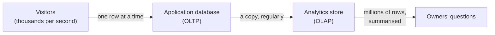
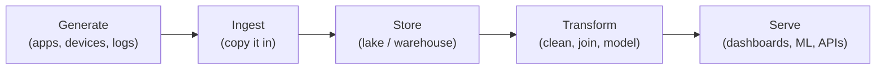
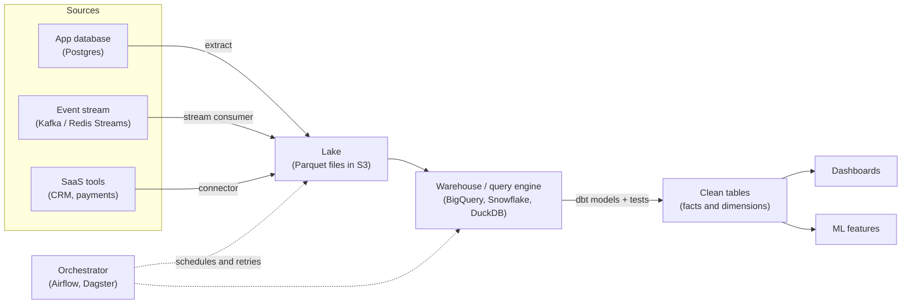
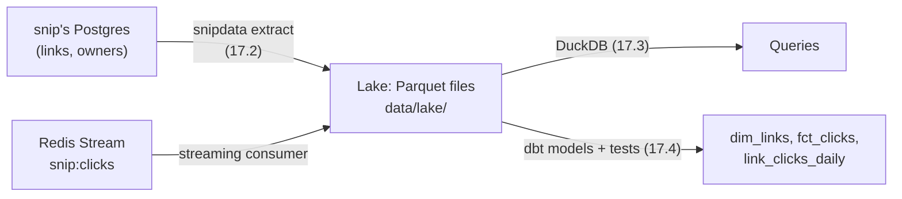

export const shopSetup = `
CREATE TABLE links (
  slug text PRIMARY KEY,
  url text NOT NULL,
  created_at timestamptz NOT NULL
);
INSERT INTO links VALUES
 ('golang', 'https://go.dev/', '2026-09-01'),
 ('pgdocs', 'https://www.postgresql.org/docs/', '2026-09-03'),
 ('duckdb', 'https://duckdb.org/docs/', '2026-09-10'),
 ('launch', 'https://blog.example.com/we-launched', '2026-10-01');
CREATE TABLE clicks (
  id bigint PRIMARY KEY,
  slug text NOT NULL REFERENCES links,
  clicked_at timestamptz NOT NULL
);
INSERT INTO clicks
SELECT i,
       CASE WHEN i % 10 < 5 THEN 'golang' WHEN i % 10 < 8 THEN 'pgdocs'
            WHEN i % 10 < 9 THEN 'duckdb' ELSE 'launch' END,
       timestamptz '2026-10-01 00:00+00' + i * interval '7 minutes'
FROM generate_series(1, 3000) AS i;
`;

# 17.1 What data engineering is: from transactions to analytics

You've seen a dashboard that says "visitors this week: 48,210, up 12%". Behind that one number sit millions of tiny events: a page view here, a click there, each recorded by an application that was busy doing something else. Somebody built the plumbing that collects those events, keeps them safe, cleans them, and turns them into numbers people trust. That plumbing is **data engineering**, and the people who build it are among the most in-demand engineers there are. This chapter gives you the map: what problem the field solves, the vocabulary you'll hear in every data team (OLTP, OLAP, ETL, ELT, lake, warehouse, dbt, orchestrator), and who does what. The rest of this part builds a real pipeline, piece by piece.

## What you'll learn

- **OLTP versus OLAP**: the database that *runs* the business answers "this one row, now"; the one that *analyses* it answers "all the rows, over time".
- Why you don't run analytics on the production database, with **measured numbers**: 0.28 ms for one row, a whole gigabyte read for one chart.
- The **data lifecycle**: generate, ingest, store, transform, serve.
- **ETL versus ELT**, and **batch versus streaming**: where the cleaning happens, and how fresh the answers are.
- The **modern data stack** in plain words (lake, warehouse, lakehouse, dbt, orchestrators) and the **roles**: data engineer, analytics engineer, analyst.

---

## Two kinds of questions: one row now, or every row over time

:::note[Everyday anchor]
A shop's till answers one question, very fast, thousands of times a day: "what does this item cost, and take the payment". At the end of the year the accountant asks a completely different question: "what did we sell, by month, by product, compared with last year?" Nobody does the year-end report *at the till* while customers queue. The accountant takes a copy of the receipts to a back office and works there.
:::

An application's database is the till. When you open a short link, the service looks up **one** row ("where does `golang` go?") and maybe updates one counter. Thousands of these small, fast reads and writes per second are called **OLTP** (online transaction processing): short transactions ([chapter 6.5](../data/transactions.mdx) showed what a transaction guarantees), each touching a handful of rows, found through an index ([chapter 6.4](../data/indexes-and-performance.mdx), the sorted lookup structure that turns "search every row" into "jump to the row").

The owner's questions are the accountant's. "Which links got the most clicks last week?" "At what hour do people click?" "Did the launch post keep its traffic, or fade after two days?" Each one reads **millions** of rows, uses only two or three columns of each, and squeezes them into a small summary. That workload is **OLAP** (online analytical processing).



Three boxes and two arrows: visitors talk to the application database, one row at a time; questions go to a **separate copy**. The arrow in the middle, getting the data from one to the other reliably, is most of what data engineers build.

You've already written both kinds of query if you worked through [chapter 6.2](../data/sql-from-zero.mdx). Here are two tables, `links` and 3,000 `clicks`, in a real Postgres running in your browser. The first query is OLTP; the second is OLAP:

<SqlPlayground setup={shopSetup} sql={`-- OLTP: one row, found by its key (what a redirect does)
SELECT url FROM links WHERE slug = 'golang';

-- OLAP: every click, squeezed into a summary per day and link
SELECT date_trunc('day', clicked_at)::date AS day, slug, count(*) AS clicks
FROM clicks
GROUP BY 1, 2
ORDER BY day, clicks DESC
LIMIT 8;`} />

Both answer instantly here, because 3,000 rows is nothing. The difference shows when the table grows.

| | OLTP: running the business | OLAP: understanding the business |
|---|---|---|
| Typical question | "Where does `golang` point?" | "Clicks per link per day, last 90 days" |
| Rows touched per query | 1 to 100 | Thousands to billions |
| Columns used | Most of one row | Two or three, from every row |
| Writes | Constant, small, in place | Rare, large batches, mostly appends |
| Must be fast for | Each user, every time (milliseconds) | A person waiting for a chart (seconds) |
| Typical tools | Postgres, MySQL, DynamoDB | BigQuery, Snowflake, ClickHouse, DuckDB |

---

## Why you don't run analytics on the production database

"Postgres can do `GROUP BY`. Why not query it directly?" At small scale, you can, and you should (more on that at the end). Here is what changes as the data grows, measured.

The test: a `clicks` table in Postgres 18 with **10 million rows** (965 MB on disk), and two queries, run on a desktop machine with Postgres in Docker. Your numbers will differ; the *ratio* is what matters.

```sql
-- OLTP: one row by primary key
EXPLAIN (ANALYZE, BUFFERS) SELECT slug, device FROM clicks WHERE id = 4242424;
--   Index Scan using clicks_pkey on clicks
--   Buffers: shared hit=1 read=3          -- 4 pages of 8 kB: 32 kB read
--   Execution Time: 0.280 ms

-- OLAP: one small summary over every row
EXPLAIN (ANALYZE, BUFFERS) SELECT device, count(*) FROM clicks GROUP BY device;
--   Parallel Seq Scan on clicks            -- read the whole table, in 3 processes
--   Buffers: shared hit=15958 read=107578  -- 123,536 pages: the whole 965 MB
--   Execution Time: 479.191 ms
```

The lookup reads 32 kB and finishes in a quarter of a millisecond. The chart query reads **every byte of the table**, almost a gigabyte, to produce three numbers, and keeps three CPU cores busy for half a second. Run it every time someone opens a dashboard, with ten analysts and a growing table, and the trouble is easy to predict.

:::warning[What can go wrong]
- **The application slows down for everyone.** The chart query competes with redirects for CPU and disk. Worse, reading a gigabyte pushes the application's hot rows out of Postgres's memory cache (`shared_buffers`, 128 MB by default), so the next redirects have to go to disk too.
- **Long queries block the clean-up.** Postgres keeps old row versions until no running query might still need them. A two-hour report holds them all back, the tables **bloat**, and every query slows down.
- **The history isn't there.** The application keeps the *current* state. A deleted link is gone (and in many schemas its rows go with it, through `ON DELETE CASCADE`); a click counter is one number, not the list of clicks. "How many clicks did this link get on 3 October?" can't be answered from a counter.
- **The shape is wrong.** The application's tables are designed to make writes safe ([chapter 6.3](../data/designing-schemas.mdx)): many narrow tables, joined on every question. Analysts want wide, pre-joined tables that are easy to aggregate.
:::

The first step most teams take is a **read replica** ([chapter 6.8](../data/choosing-a-datastore.mdx): a copy of the database that follows every change and serves reads). It protects the primary, but it still stores data row by row, still forgets history, and still has the application's shape. The lasting fix is to **copy the data out** into a store built for analysis, in a shape built for questions. That copying, cleaning and reshaping is the job.

---

## The data lifecycle: from event to answer

:::note[Everyday anchor]
Think of water. It falls as rain in many places (the sources), is collected into a reservoir (storage), treated so it's safe to drink (transformation), and piped to taps (serving). Nobody drinks straight from the reservoir, and nobody builds a treatment plant at every tap.
:::

Data follows the same path. Every data platform, from a one-person startup to a bank, has these stages, even when they have different names:



1. **Generate.** Applications produce data: rows in a database, events on a queue ([chapter 8.2](../distributed/queues-and-background-work.mdx) showed a Redis Stream of click events), log lines ([chapter 13.1](../observability/logs.mdx)), files from partners. The data engineer usually doesn't own these sources, which is why so much of the job is coping with them.
2. **Ingest.** Copy the data into the platform: on a schedule (every night, every hour) or continuously. The hard parts are doing it without hurting the source and without losing or duplicating anything when a run fails half-way.
3. **Store.** Keep it cheaply, for years, in a form that's fast to scan. This is where columnar files and analytical databases come in ([chapter 17.3](./columnar-storage-and-duckdb.mdx)).
4. **Transform.** Turn raw copies into trustworthy tables: remove duplicates, fix types and time zones, join, and reshape into the tables people query ([chapter 17.4](./modeling-for-analytics.mdx)).
5. **Serve.** Put the answers where people use them: a dashboard, a weekly email, a feature for a machine learning model, or an API the product calls.

Running underneath every stage are **scheduling** (what runs when, and what happens when it fails), **data quality** (are these numbers right?) and **governance** (who may see which data, and how long it's kept). Those get their own chapters later in this part.

---

## ETL or ELT: where the cleaning happens

Copying data from a source into the analytics store involves three verbs: **extract** (read it from the source), **load** (write it into the store), and **transform** (clean and reshape it). The order of the last two splits the field into two eras.

**ETL** (extract, transform, load) cleans the data *on the way*: a separate program reads from the source, transforms it in its own memory, and loads only the finished tables. That was the norm when analytical databases were expensive appliances and storing anything raw felt wasteful.

**ELT** (extract, load, transform) loads the raw data first, unchanged, then transforms it *inside* the analytics store, usually with SQL. Storage became cheap and cloud warehouses became powerful, so most teams now do this. Its big advantage: **the raw copy stays.** When you find a bug in a transformation (and you will), you fix the SQL and rebuild from the raw data. With ETL, the raw data was thrown away at the door.

:::note[Everyday anchor]
ETL is a caterer who cooks in their own kitchen and delivers finished plates; if a dish is wrong, the ingredients are gone. ELT is a meal kit delivered to your kitchen: you store the raw ingredients and cook when needed, and if the first attempt fails you still have the ingredients to try again.
:::

---

## Batch or streaming: the bus timetable or the escalator

**Batch** processing moves data in chunks on a schedule: "every night at 02:00, copy yesterday's clicks". It's simple, easy to rerun, and most business questions ("last week", "last month") don't need fresher data than that.

**Streaming** processes each event as it arrives, so the answer is seconds old instead of hours. Fraud detection, live dashboards and "you just hit your quota" need it. The price is complexity: events arrive late and out of order, the process runs forever and must survive restarts, and "the count for 14:00" can change after 14:00 has passed.

A bus timetable (batch) is cheap and predictable; an escalator (streaming) is always moving, and costs more to keep running. Teams usually start with batch and add streaming where freshness pays for itself. Many "streaming" systems are really **micro-batch**: small batches every few seconds or minutes, which gets most of the freshness with batch's simplicity. This part builds both: a batch pipeline first ([chapter 17.2](./batch-pipelines.mdx)), and a streaming consumer in the streaming chapter ([chapter 17.6](./streaming.mdx)).

---

## The modern data stack, in plain words

The tools change every few years; the jobs they do don't. Here are the jobs, with the names you'll see in job adverts.

| Job | Plain words | Names you'll meet |
|---|---|---|
| **Data lake** | Raw and cleaned data kept as files (usually **Parquet**) in cheap storage, organised in folders | Amazon S3, Google Cloud Storage, Azure Data Lake Storage ([chapter 6.10](../data/object-storage.mdx) introduced object storage) |
| **Data warehouse** | A database built for analytics: columnar, scales to billions of rows, speaks SQL | BigQuery, Snowflake, Amazon Redshift, ClickHouse; DuckDB on one machine |
| **Lakehouse** | Files in a lake plus a **table format** that adds what a warehouse offers: transactions, schema changes, "time travel" to old versions | Apache Iceberg, Delta Lake, Apache Hudi; engines such as Spark, Trino, Databricks |
| **Ingestion** | Connectors that copy data from apps and databases into the platform | Fivetran, Airbyte, Debezium (for change data capture, [chapter 17.2](./batch-pipelines.mdx)) |
| **Transformation** | SQL models that turn raw tables into clean ones, with tests and documentation | **dbt** (data build tool), SQLMesh |
| **Orchestration** | A scheduler that runs the steps in the right order, retries failures, and re-runs past days | Apache Airflow, Dagster, Prefect |
| **Streaming** | Durable logs of events and processors that read them continuously | Apache Kafka, Redis Streams, Apache Flink |
| **BI (business intelligence)** | Dashboards and charts on top of the warehouse | Metabase, Apache Superset, Looker, Tableau, Power BI |

Put together, a typical modern setup looks like this:



Two things in this picture matter most. **Every source lands in one place first** (the lake), raw, before anything is cleaned: that's ELT, and it's what makes rebuilding possible. And the **orchestrator** doesn't move data itself; it decides when each step runs and what to do when one fails.

:::info[In the real world]
Most of the stack has a free, local version. DuckDB is a warehouse that runs inside a single program on your laptop, Parquet files in a folder are a lake, and dbt is open source. That's exactly what this part uses, so everything you build runs for free, and the same ideas carry over to BigQuery or Snowflake. Big companies run the same stages at a larger scale, with more people.
:::

---

## Who does what: three roles around the same data

| Role | Spends the day | Typical tools |
|---|---|---|
| **Data engineer** | Building and running the pipelines: ingestion, storage, scheduling, performance, reliability. Thinks like a backend engineer whose product is data. | Python, SQL, Spark, Kafka, Airflow, cloud storage, Terraform |
| **Analytics engineer** | Turning raw tables into clean, tested, documented models that everyone uses. The role dbt made common. | SQL, dbt, Git, the warehouse |
| **Data analyst** | Answering business questions with those models: dashboards, reports, experiments. | SQL, spreadsheets, BI tools, some Python |

Next to them you'll meet **data scientists** (statistics and experiments, sometimes models) and **ML engineers** (putting models into production, [Part 14](../ai/python-for-ai-engineers.mdx)'s AI engineering). The lines blur: in a five-person startup one person does all of it; in a large company each role is a team. This track teaches the data engineer's job, with enough analytics engineering ([chapter 17.4](./modeling-for-analytics.mdx)) to build the tables analysts use.

---

## When the numbers lie: what goes wrong, and when you need none of this

Pipelines rarely fail loudly. They fail by producing a number that *looks* fine.

:::warning[What can go wrong]
- **Two definitions, two answers.** Marketing counts a click when the redirect happens; the product team counts it when the page loads. Both dashboards say "clicks", and they disagree. Fix: one definition, written down, in one model everyone uses.
- **Duplicates.** A copy job retries after a timeout and loads the same hour twice; a stream redelivers an event. The chart shows a spike that never happened. Fix: every event has an ID, and every step can be rerun without double-counting ([chapter 17.2](./batch-pipelines.mdx)).
- **Time zones.** "Clicks on 3 October" is a different set of clicks in Tokyo and in New York. Fix: store UTC, and decide explicitly which day boundaries a report uses.
- **Silent staleness.** A nightly job has failed for a week; the dashboard still shows numbers, just old ones. Fix: monitor freshness, not only failures.
- **Personal data spreads.** Every copy of a table with emails or IP addresses is one more place to secure and, on request, to delete. Fix: copy only the columns you need.
:::

The judgment call: **you may not need a data platform yet.** If your database is small and a few people ask questions, a read replica and a SQL tool are enough, and much cheaper to run. The signs it's time to copy data out are the ones in this chapter: analytics hurting the application, questions about history the application doesn't keep, data from several sources that has to be combined, and numbers that people argue about. When you do start, start small: one extract, one folder of files, one SQL model, all rerunnable. That's what you'll build next.

---

## Apply it to snip

snip is the URL shortener this handbook builds: a Go service whose Postgres database holds `links` (slug, URL, owner, a click counter) and `api_keys` (the owners), and which records every redirect as an event. Imagine you run it for a company. Here are questions its owners would ask, and why the production database can't answer them well:

| Question | Needs | Why production can't answer it |
|---|---|---|
| Top 10 links this week | Clicks per link, by date | `links.clicks` is one running total, with no dates |
| Clicks per day for one link, last 90 days | Every click with its time | Not stored: only the total is |
| What hour do people click? | Click timestamps | Not stored |
| Did the launch link keep its traffic? | Daily clicks per link, compared day to day | Not stored |
| How many clicks went to links that were later deleted? | Clicks *and* deleted links | Deleting a link deletes its row |
| Does the counter agree with the events? | Both, side by side | The events are gone once counted |

The individual clicks do exist, briefly. On every redirect, snip appends an event to a Redis Stream called `snip:clicks` (`snip/internal/clicks/stream.go`):

```go
// Record appends one event. XADD is a single fast Redis command, so the
// redirect barely waits for it.
func (r *Recorder) Record(ctx context.Context, slug string) error {
	return r.rdb.XAdd(ctx, &redis.XAddArgs{
		Stream: StreamKey,
		MaxLen: maxLen,
		Approx: true,
		Values: map[string]any{"slug": slug, "at": time.Now().UnixMilli()},
	}).Err()
}
```

A worker reads those events in batches, adds the counts to `links.clicks` in Postgres, and acknowledges them. The stream is capped at about a million entries (`maxLen`), so older events are trimmed away. That's the right design for a counter, and exactly the gap data engineering fills: **the events carry the history, and nobody keeps them.**

The rest of this part keeps them. Here is the plan, and which chapter builds each arrow:



The code lives in `data/` in this handbook's repository: a small Python project with a command-line tool called `snipdata`. If you don't have snip running, `snipdata generate` writes a month of realistic clicks in the same layout, so every chapter works on a laptop with nothing else installed.

---

## Lab

Everything runs on your laptop, for free. Step 1 needs only this page; steps 2 and 3 need Docker.

1. **Write both kinds of query.** In the playground above, add a third query that answers "which link had the most clicks on 3 October?" Then prefix the first two queries with `EXPLAIN` and run them.
   ```sql
   EXPLAIN SELECT url FROM links WHERE slug = 'golang';       -- Index Scan: jumps to one row
   EXPLAIN SELECT slug, count(*) FROM clicks GROUP BY slug;    -- Seq Scan: reads every row
   ```
   Notice the plan words: **Index Scan** for the OLTP query, **Seq Scan** (sequential scan, every row) for the OLAP one. No index can save the second: it needs every row.

2. **Feel the difference at 10 million rows.** Start a throwaway Postgres and build the same table used in this chapter's measurement:
   ```bash
   docker run -d --name pg-olap -e POSTGRES_PASSWORD=learn postgres:18-alpine   # a scratch Postgres
   sleep 3
   docker exec -it pg-olap psql -U postgres                                      # open a SQL prompt
   ```
   ```sql
   CREATE TABLE clicks AS                         -- 10 million fake clicks, 965 MB; takes 10–30 s
   SELECT i AS id,
          'link-' || (abs(hashint4(i)) % 1000) AS slug,
          TIMESTAMP '2026-01-01' + make_interval(secs => i * 3) AS clicked_at,
          (ARRAY['web', 'ios', 'android'])[1 + abs(hashint4(i * 7)) % 3] AS device,
          'https://news.example.com/article/' || (abs(hashint4(i * 13)) % 50000) AS referrer
   FROM generate_series(0, 9999999) AS i;
   ALTER TABLE clicks ADD PRIMARY KEY (id);       -- the index an application would have
   VACUUM ANALYZE clicks;                         -- tidy up and gather statistics
   \timing on
   EXPLAIN (ANALYZE, BUFFERS) SELECT slug, device FROM clicks WHERE id = 4242424;
   EXPLAIN (ANALYZE, BUFFERS) SELECT device, count(*) FROM clicks GROUP BY device;
   ```
   Compare the `Buffers:` lines: a handful of pages for the lookup, the whole table for the summary. Clean up with `docker rm -f pg-olap`. You'll run the same summary on the same data in [chapter 17.3](./columnar-storage-and-duckdb.mdx), stored in columns instead of rows.

3. **Apply it to snip: find the events nobody keeps.** Start snip's stack (it needs Docker Compose), create a key and a link, click it a few times, and look at the stream:
   ```bash
   cd snip && docker compose up -d --build --wait                     # snip, its worker, Postgres, Redis, nginx
   KEY=$(docker compose exec -T api snip keys create me | grep -o 'snip_[A-Za-z0-9]*')
   curl -s -X POST localhost:8080/api/links -H "Authorization: Bearer $KEY" \
     -d '{"url":"https://go.dev/","slug":"golang"}'                    # one link
   for i in 1 2 3 4 5; do curl -s -o /dev/null localhost:8080/golang; done   # five clicks
   docker compose exec redis redis-cli XLEN snip:clicks               # 5 events in the stream
   docker compose exec redis redis-cli XRANGE snip:clicks - + COUNT 2  # ID, slug and at (Unix ms) of each
   docker compose exec postgres psql -U snip -c "SELECT slug, clicks FROM links"   # the counter: 5
   ```
   The counter says 5; the stream says *when* each click happened. Write down five questions you'd ask of this data if snip had a million users, and next to each, which of the two you'd need. Leave the stack running if you're continuing to [chapter 17.2](./batch-pipelines.mdx); otherwise `docker compose down -v`.

## Self-check

<Quiz
  id="data-engineering-what-data-engineering-is"
  questions={[
    {
      q: 'An analyst wants "total clicks per link per day for the last year". Why is a new index on the production clicks table not the fix?',
      options: [
        'Indexes only work on primary keys, and the date is not one',
        'Indexes slow down every write, so Postgres refuses to add one',
        'The query needs every row in the range, so an index still reads them all',
        'Postgres cannot use an index together with a GROUP BY clause',
      ],
      answer: 2,
      explain: 'An index helps you find a few rows quickly. A summary of a whole year needs every row in that year, so the database reads them all either way: the work is scanning and aggregating, not finding. Postgres can index any column and can combine indexes with GROUP BY; the problem is the amount of data the question touches, which is why analytics moves to a store built for scanning.',
    },
    {
      q: 'Your team loads raw click events into the warehouse unchanged, then cleans them with SQL inside it. Which approach is that?',
      options: [
        'ELT: extract, load the raw data, then transform it in the warehouse',
        'ETL: extract, transform in a separate program, then load the result',
        'CDC: change data capture, copying each change as it happens',
        'Streaming: processing each event as it arrives, with no batches',
      ],
      answer: 0,
      explain: 'Loading raw data first and transforming it inside the warehouse is ELT. Its big advantage is that the raw copy stays, so a bug in a transformation can be fixed and rebuilt from it. ETL would transform before loading and keep only the result. CDC is a way of extracting changes, and streaming is about timing, not about where the transform happens.',
    },
    {
      q: 'A dashboard shows a sudden spike of exactly double the usual clicks for 02:00 to 03:00 last night, and nothing unusual in the app. What would you check first?',
      options: [
        'Whether the warehouse needs a bigger machine to handle the load',
        'Whether a campaign went out in another time zone at that hour',
        'Whether the dashboard tool cached an old version of the chart',
        'Whether the load for that hour ran twice, duplicating the events',
      ],
      answer: 3,
      explain: 'Exactly double for one hour is the fingerprint of the same data loaded twice, for example a job retried after a timeout. Check for duplicate event IDs in that hour. A campaign would not produce an exact doubling, a bigger machine changes speed rather than counts, and a stale cache would show old numbers rather than doubled ones.',
    },
    {
      q: 'snip counts clicks in links.clicks. Which question can that counter answer on its own?',
      options: [
        'How many clicks each link received on 3 October',
        'How many clicks a link has received in total, right now',
        'At which hour of the day people click most often',
        'How many clicks went to links that were later deleted',
      ],
      answer: 1,
      explain: 'A counter is one running total per existing link: it answers "how many so far" and nothing about when. Per-day and per-hour questions need each click with its timestamp, and a deleted link takes its row (and its counter) with it. That missing history is why the click events are worth keeping.',
    },
    {
      q: 'A 20-person startup has one Postgres database of 5 GB. Two people ask questions about it each week. What is the sensible first step for analytics?',
      options: [
        'A read replica and a SQL tool, revisited when the needs grow',
        'A lakehouse with Iceberg tables, Spark and an Airflow cluster',
        'Run every report on the primary, since 5 GB is small enough',
        'A streaming pipeline, so the reports are always up to the second',
      ],
      answer: 0,
      explain: 'At this size a read replica protects the primary and is enough for two people. A full platform would cost more to run than the questions are worth, and streaming adds complexity nobody asked for. Running reports on the primary works until the first heavy query slows the application, and a replica avoids that for little cost.',
    },
  ]}
/>

<details>
<summary>Explain to a product manager, in plain words, why "just query the production database" stops working as the company grows.</summary>

The production database is built to answer one small question very fast, thousands of times a second: "where does this link go?" A report asks a big question rarely: "what happened across all our data last quarter?" To answer it, the database has to read everything, which takes its attention away from customers (and pushes their data out of its memory), and it can hold back the database's own clean-up. On top of that, the production database only knows the present: deleted things are gone and counters have no dates. So we keep a separate copy, shaped for questions and with history, and refresh it regularly. The rule to keep: **the database that runs the business and the one that analyses it have different jobs; give each its own.**

</details>

<details>
<summary>Why do most teams now load raw data first (ELT), even though it means storing more?</summary>

Because transformations have bugs, and requirements change. If you keep the raw data, fixing a bug means changing the SQL and rebuilding the clean tables from the raw copy, for any period, as often as you like. If you only kept the transformed result (ETL), the information you threw away is gone, and you may have to go back to the source, which may no longer have it (snip's stream trims old events, for example). Storage became cheap enough that keeping raw data costs little, and warehouses became powerful enough to do the transformation themselves. The rule: **keep the raw data; make everything after it rebuildable.**

</details>
