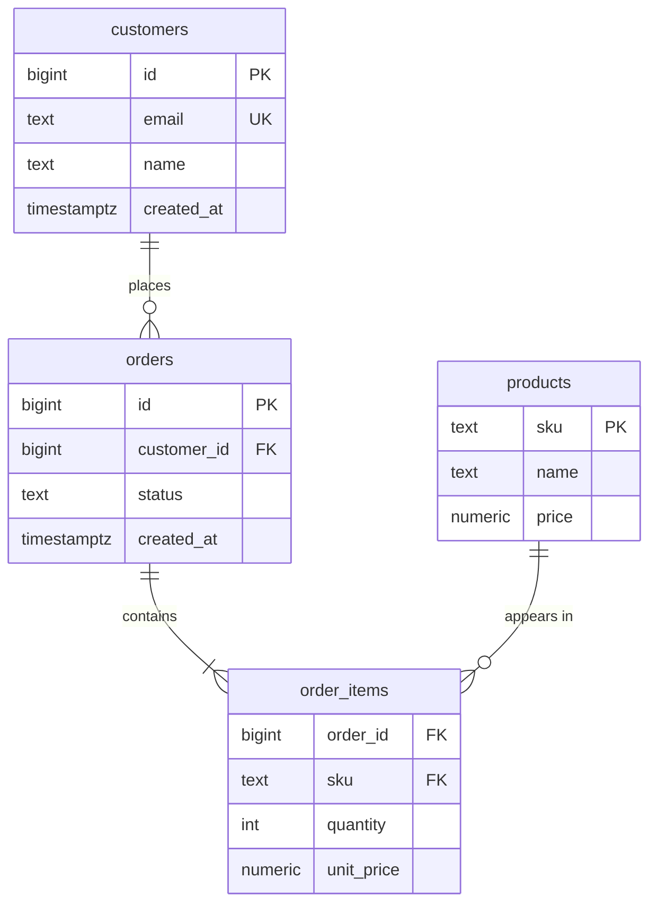

export const shopSetup = `
CREATE TABLE customers (
  id bigserial PRIMARY KEY,
  email text NOT NULL UNIQUE,
  name text NOT NULL,
  created_at timestamptz NOT NULL DEFAULT now()
);
CREATE TABLE products (
  sku text PRIMARY KEY CHECK (sku ~ '^[A-Z0-9-]{3,20}$'),
  name text NOT NULL,
  price numeric(10,2) NOT NULL CHECK (price >= 0)
);
CREATE TABLE orders (
  id bigserial PRIMARY KEY,
  customer_id bigint NOT NULL REFERENCES customers (id) ON DELETE RESTRICT,
  status text NOT NULL DEFAULT 'pending' CHECK (status IN ('pending', 'paid', 'shipped', 'cancelled')),
  created_at timestamptz NOT NULL DEFAULT now()
);
CREATE TABLE order_items (
  order_id bigint NOT NULL REFERENCES orders (id) ON DELETE CASCADE,
  sku text NOT NULL REFERENCES products (sku),
  quantity int NOT NULL CHECK (quantity > 0),
  unit_price numeric(10,2) NOT NULL CHECK (unit_price >= 0),
  PRIMARY KEY (order_id, sku)
);
INSERT INTO customers (email, name) VALUES ('ada@example.com','Ada'),('grace@example.com','Grace'),('linus@example.com','Linus');
INSERT INTO products VALUES ('TEA-GREEN','Green tea, 100 g',4.50),('MUG-BLUE','Blue mug',12.00),('KETTLE-1','Electric kettle',39.99);
INSERT INTO orders (customer_id, status) VALUES (1,'paid'),(1,'pending'),(2,'shipped');
INSERT INTO order_items VALUES (1,'TEA-GREEN',2,4.50),(1,'MUG-BLUE',1,12.00),(2,'KETTLE-1',1,39.99),(3,'TEA-GREEN',5,4.00);
`;

export const tagsSetup = `
CREATE TABLE api_keys (
  id bigserial PRIMARY KEY,
  name text NOT NULL,
  key_hash text NOT NULL UNIQUE,
  created_at timestamptz NOT NULL DEFAULT now(),
  revoked_at timestamptz
);
CREATE TABLE links (
  slug text PRIMARY KEY,
  url text NOT NULL CHECK (length(url) <= 2048),
  owner_id bigint NOT NULL REFERENCES api_keys (id) ON DELETE CASCADE,
  clicks bigint NOT NULL DEFAULT 0 CHECK (clicks >= 0),
  created_at timestamptz NOT NULL DEFAULT now()
);
CREATE TABLE tags (
  id bigserial PRIMARY KEY,
  name text NOT NULL UNIQUE CHECK (name ~ '^[a-z0-9-]{1,30}$')
);
CREATE TABLE link_tags (
  slug text NOT NULL REFERENCES links (slug) ON DELETE CASCADE,
  tag_id bigint NOT NULL REFERENCES tags (id) ON DELETE CASCADE,
  PRIMARY KEY (slug, tag_id)
);
INSERT INTO api_keys (name, key_hash) VALUES ('ada','h1'),('grace','h2');
INSERT INTO links (slug, url, owner_id, clicks) VALUES
  ('godoc','https://go.dev/doc/',1,42),('pgdocs','https://www.postgresql.org/docs/',1,17),('launch','https://blog.example/launch',2,910);
INSERT INTO tags (name) VALUES ('docs'),('go'),('postgres'),('marketing');
INSERT INTO link_tags VALUES ('godoc',1),('godoc',2),('pgdocs',1),('pgdocs',3),('launch',4);
`;

# 6.3 Designing schemas

A **schema** is the shape of your data: which tables exist, what columns they have, what types those columns hold, and which rules the data must always obey. It's the longest-lived decision in most systems. Code gets rewritten and frameworks come and go, but the schema, and the years of data in it, tends to stay. A good schema makes wrong data *impossible* to store and common questions easy to answer. A poor one leaks bugs into every feature built on top of it. This chapter designs one from scratch for a small online shop you can query in the page, then reads a real service's schema with the same eyes.

## What you'll learn

- How to go from a product description to **entities** (tables) and **relationships**.
- Choosing **column types**, and the few that trip people up: money, time and IDs.
- **Primary keys** (natural vs surrogate) and **foreign keys** that keep references valid.
- **Constraints** (`NOT NULL`, `UNIQUE`, `CHECK`, `DEFAULT`) that make the database guard your data.
- **Normalisation**: storing each fact once; **one-to-many** and **many-to-many** relationships.
- Changing a live schema safely with **migrations** and **expand, then contract**.

---

## From product to tables

Start with a plain-English description of what the product does, and underline the **nouns**: they're usually your tables. The **verbs** between them are relationships.

> *A **customer** places **orders**. Each order contains several **products**, each in some quantity. A product can appear in many orders.*



This is an **entity–relationship diagram** (ERD). The crow's-foot markings show **cardinality**, how many of one thing go with another: one customer places **many** orders (`||--o{`), and an order contains **one or more** items (`||--|{`). Notice that "contains several products" became a table of its own, `order_items`; the section on many-to-many explains why. Drawing an ERD before writing SQL is a cheap way to catch design mistakes, and it's exactly the diagram you'd sketch in a design review or interview ([chapter 15.1](../architecture/system-design-method.mdx)).

---

## Choosing column types

Every column has a type, and the right type is itself a rule: a `bigint` column can never hold `"hello"`. The types you'll use most in Postgres:

| Type | Holds | Use for | Watch out |
|---|---|---|---|
| `text` | Any text | Names, emails, codes | Limit length with a `CHECK` if it matters |
| `bigint` | Whole numbers up to ~9.2 × 10¹⁸ | IDs, counts | `int` tops out at ~2.1 billion; counters and IDs outgrow it |
| `numeric(10,2)` | Exact decimals (here: 10 digits, 2 after the point) | **Money** | Never `float`/`real` for money ([chapter 1.3](../foundations/bits-bytes-text-formats.mdx)) |
| `boolean` | `true` / `false` | Flags | Several booleans may really be one status column |
| `timestamptz` | A moment in time, stored in UTC | Almost every date/time | Plain `timestamp` has no time zone; avoid it ([chapter 1.3](../foundations/bits-bytes-text-formats.mdx)) |
| `uuid` | A 128-bit random ID | Public or distributed IDs | Larger than `bigint`; fully random ones make indexes a bit slower |
| `jsonb` | JSON, stored efficiently and queryable | Genuinely flexible, nested data | Not a way to avoid designing tables |

The shop's prices are `numeric(10,2)` because `0.1 + 0.2` in floating point is `0.30000000000000004`, and nobody wants an invoice that's off by a fraction of a cent. Its order `status` is one `text` column with a fixed list of allowed values, rather than four booleans (`is_paid`, `is_shipped`, …) that could contradict each other.

:::info[In the real world]
A classic class of outage: an `int` ID column hits its maximum of 2,147,483,647 and inserts start failing. Several well-known companies have had incidents exactly like this, and migrating a huge table to `bigint` under pressure is painful. Use `bigint` for IDs and counters from day one; the storage difference is trivial.
:::

---

## Primary keys: how each row is identified

Every table needs a **primary key**: a column (or combination of columns) whose value is **unique and never missing** in every row. It's how you point at exactly one row.

Two kinds:

- A **natural key** is real data that's already unique: a product's SKU (stock-keeping unit, the code printed on the box), a country's ISO code (`IN`, `US`).
- A **surrogate key** is an ID invented by the database, with no meaning: `id bigserial`, which counts 1, 2, 3… (`bigserial` means "a `bigint` filled automatically from a counter").

The shop uses both, deliberately:

```sql
CREATE TABLE customers (
    id          BIGSERIAL   PRIMARY KEY,           -- surrogate: meaningless, never changes
    email       TEXT        NOT NULL UNIQUE,       -- unique, but people change emails
    -- …
);

CREATE TABLE products (
    sku         TEXT        PRIMARY KEY CHECK (sku ~ '^[A-Z0-9-]{3,20}$'),   -- natural: stable, unique, already on every box
    -- …
);
```

A customer's email is unique, but people change emails, and every order would have to be updated when they do. So customers get a meaningless `id`, with a `UNIQUE` constraint on `email` to keep it unique anyway. A SKU never changes once printed, so it can be the key itself.

:::tip
If a natural key might **ever change** (email addresses, usernames, company names) or isn't truly unique (people's names), use a surrogate key and put a `UNIQUE` constraint on the natural value instead. Changing a primary key means updating every reference to it.
:::

---

## Foreign keys: references that can't dangle

`orders.customer_id` points at a row in `customers`. What stops it pointing at customer `999`, who doesn't exist, or at a customer who gets deleted later? A **foreign key** constraint:

```sql
customer_id  BIGINT  NOT NULL REFERENCES customers (id) ON DELETE RESTRICT,
```

- **`REFERENCES customers (id)`**: every `customer_id` must match an existing `customers.id`. Insert an order for a non-existent customer and Postgres refuses.
- **`ON DELETE …`** says what happens to orders when their customer is deleted:
  - **`RESTRICT`**: refuse to delete a customer who still has orders. (The default, `NO ACTION`, behaves almost identically.)
  - **`CASCADE`**: delete the orders too.
  - **`SET NULL`**: keep the orders, forget whose they were (the column must allow `NULL`).

Which one is right is a **product decision**, not a technical one. Orders are financial records, so the shop refuses to delete a customer who has them. But `order_items` uses `ON DELETE CASCADE` towards `orders`: an item has no meaning without its order, so deleting an order takes its items with it.

---

## Constraints: let the database guard the data

Constraints are rules written into the schema that the database checks on **every** insert and update, from **every** client: your app, a script, a teammate at a `psql` prompt, a future second service. Here's the shop's `order_items` table:

```sql
CREATE TABLE order_items (
    order_id    BIGINT        NOT NULL REFERENCES orders (id) ON DELETE CASCADE,
    sku         TEXT          NOT NULL REFERENCES products (sku),
    quantity    INT           NOT NULL CHECK (quantity > 0),
    unit_price  NUMERIC(10,2) NOT NULL CHECK (unit_price >= 0),
    PRIMARY KEY (order_id, sku)
);
```

| Constraint | Meaning here |
|---|---|
| `PRIMARY KEY (order_id, sku)` | a product appears at most once per order (raise the quantity instead) |
| `NOT NULL` | every item has an order, a product, a quantity and a price |
| `REFERENCES` | items can't point at orders or products that don't exist |
| `CHECK (quantity > 0)` | no zero or negative quantities, whatever bug tries |
| `DEFAULT` (on `orders.status`, `created_at`) | sensible values when an insert doesn't give one |
| `UNIQUE` (on `customers.email`) | no two accounts with the same email |

Why also check in the database when the app already validates its input? The app's checks give users a friendly, specific error early ("quantity must be at least 1") ([chapter 5.3](../apis/validation-errors-status-codes.mdx)). The database constraints are the **last line of defence** that nothing can bypass. They also solve problems code can't: two people registering the same email at the same instant can both pass an "is this email taken?" check in code, but only one can pass a `UNIQUE` constraint ([chapter 6.5](./transactions.mdx)).

:::note[Everyday anchor]
Constraints are the shape of a plug socket. You *could* print a sign saying "please only insert UK plugs", but the socket's shape makes the wrong plug impossible to insert: for every person, forever, whether or not they read the sign.
:::

Try the shop. First, every order with its customer and total:

<SqlPlayground setup={shopSetup} sql={`SELECT o.id, c.name, o.status,
       sum(i.quantity * i.unit_price) AS total
FROM orders o
JOIN customers c   ON c.id = o.customer_id
JOIN order_items i ON i.order_id = o.id
GROUP BY o.id, c.name, o.status
ORDER BY o.id;`} />

Then paste these statements, one at a time, and read each error. Every one is the schema refusing bad data with no application code involved:

```sql
INSERT INTO order_items VALUES (1, 'TEA-GREEN', 1, 4.50);     -- duplicate (order, product): primary key
INSERT INTO order_items VALUES (1, 'NOPE-1', 1, 1.00);        -- no such product: foreign key
INSERT INTO order_items VALUES (2, 'MUG-BLUE', 0, 12.00);     -- quantity 0: check constraint
INSERT INTO orders (customer_id, status) VALUES (1, 'lost');  -- not an allowed status: check constraint
DELETE FROM customers WHERE id = 1;                           -- Ada has orders: RESTRICT refuses
DELETE FROM orders WHERE id = 2;                              -- allowed: its items cascade away
```

---

## Normalisation: store each fact once

Imagine a single table that stores everything about each order, including the customer's details:

| order_id | customer_name | customer_email | sku | quantity |
|---|---|---|---|---|
| 1 | Ada | ada@example.com | TEA-GREEN | 2 |
| 1 | Ada | ada@example.com | MUG-BLUE | 1 |
| 2 | Ada | ada@example.com | KETTLE-1 | 1 |

It looks convenient. But Ada's email is stored **three times**. When she changes it, you must update every row; miss one and the database holds two different "truths". These are **update anomalies**, and they're how data quietly rots.

**Normalisation** is the discipline of storing **each fact in exactly one place**. Customer facts go in `customers`, once; orders hold only a reference, `customer_id`. You get the combined view back whenever you need it with a `JOIN` ([chapter 6.2](./sql-from-zero.mdx)), as the playground query above does.

The formal theory (first, second, third "normal forms") boils down to one practical question: **"if this fact changes, how many rows must I update?"** The answer should be *one*.

:::info[In the real world]
Look closely at `order_items.unit_price`. Isn't that a copy of `products.price`? No, and the difference is the whole point of schema design: it records the price **at the moment of purchase**, a different fact. Order 3 bought green tea at 4.00 during a sale; if the item's price only lived in `products`, raising the price tomorrow would rewrite every past invoice. Sometimes teams also **denormalise** on purpose, storing a value that *could* be derived (say, a running order count on each customer) to avoid computing it on every request. Do it deliberately, for a measured reason, and know how you'll keep the copies in sync ([chapter 8.2](../distributed/queues-and-background-work.mdx)). Never by accident.
:::

---

## One-to-many and many-to-many

- **One-to-many**: one customer, many orders. The "many" side holds a foreign key to the "one" side (`orders.customer_id`). You've already seen it.
- **Many-to-many**: an order contains many products, and a product appears in many orders. Neither table can hold a single foreign key to the other. The solution is a **join table** (also called a junction or association table) holding pairs. In the shop that's `order_items`: each row says "this order contains this product".

The **composite primary key** `(order_id, sku)` stops the same pair appearing twice. And because the join table is a real table, it can carry facts about the *pair*: here, the quantity and the price paid. Many join tables hold nothing but the two keys; this one earns its own name.

<SqlPlayground setup={shopSetup} sql={`-- Every product with how many units have been ordered,
-- including products nobody has bought yet (LEFT JOIN)
SELECT p.sku, p.name, coalesce(sum(i.quantity), 0) AS units_sold
FROM products p
LEFT JOIN order_items i ON i.sku = p.sku
GROUP BY p.sku, p.name
ORDER BY units_sold DESC;`} />

:::warning[The tempting shortcut]
A column `products_ordered TEXT` holding `"TEA-GREEN,MUG-BLUE"` looks simpler than a join table. It can't be indexed, can't be checked against `products`, can't hold a quantity, and turns "who bought kettles?" into string parsing. Every comma-separated list in a column is a join table waiting to happen.
:::

---

## Naming conventions

Small habits that pay off for years:

- **snake_case**, lower case: `created_at`, `customer_id`. (Postgres folds unquoted names to lower case anyway.)
- **Plural table names** (`orders`, `customers`). Pick one convention and never mix.
- Foreign keys named **`<thing>_id`**: `customer_id`, `order_id`.
- Timestamps named **`<event>_at`**: `created_at`, `shipped_at`, `revoked_at`.
- A nullable timestamp often beats a boolean: `shipped_at` tells you *whether* **and** *when*; `is_shipped` only tells you whether.

---

## Migrations: changing the schema safely

Your schema will change: new features need new tables and columns. Those changes must happen **the same way on every copy of the database** (your laptop, CI, staging, production), **in order**, **exactly once**, and **recorded in Git** alongside the code that needs them. That's a **migration**: a numbered SQL file describing one change.

```text
migrations/
├── 0001_init.sql               customers, products, orders, order_items
├── 0002_shipping_address.sql   ALTER TABLE orders ADD COLUMN shipping_address text
└── 0003_orders_by_customer.sql CREATE INDEX … ON orders (customer_id, created_at DESC)
```

A **migration runner** (a library or tool such as golang-migrate, goose, Flyway or Atlas) records which files have run in a bookkeeping table and applies new ones, each inside a transaction so a failing migration leaves nothing half-done. [Chapter 6.6](./postgres-from-go.mdx) shows a runner working from code.

### Changing a live database without downtime

Adding a table is easy. Changing an existing column that live code depends on is not: during a deployment, **old and new versions of the app run side by side** ([chapter 11.3](../shipping/delivery-and-deployment.mdx)). If a migration renames `customers.name` to `full_name`, every old copy breaks the instant it runs.

The standard technique is **expand, then contract**:

1. **Expand**: add the new thing alongside the old (`ADD COLUMN full_name`), and deploy code that writes both and reads either.
2. **Migrate data**: copy old values into the new column, in batches.
3. **Switch**: deploy code that only uses the new column.
4. **Contract**: once nothing uses the old column, drop it in a later migration.

Slower, yes, but no moment exists where running code and the database disagree.

:::warning[What can go wrong]
- **Rules only in application code.** A second service, a script or a bug writes bad data straight into the table. Put the invariants in the schema.
- **`int` IDs and counters.** Fine for years, then an outage when the counter hits 2.1 billion. Use `bigint`.
- **Money as floating point, times without zones.** [Chapter 1.3](../foundations/bits-bytes-text-formats.mdx)'s classics, now baked into your schema for good.
- **Repeating facts across tables.** Every copy is a future inconsistency. Normalise, and denormalise only on purpose.
- **Cascading deletes on records you must keep.** One `DELETE` of a customer wipes their financial history. Choose `ON DELETE` per relationship.
- **Destructive migrations in one step.** Renaming or dropping a column that running code uses causes an outage mid-deploy. Expand, migrate, contract.
- **Editing an old migration after it has run somewhere.** Other databases already applied the old version and won't re-run it. Always add a new migration instead.
:::

---

## Apply it to snip

snip, the link shortener you build in this handbook ([chapter 0.3](../start/meet-snip.mdx)), has a two-table schema: API keys, which identify who is calling, and the links they create. Its first migration, `snip/internal/store/postgres/migrations/0001_init.sql`, reads like a summary of this chapter:

```sql
CREATE TABLE api_keys (
    id          BIGSERIAL   PRIMARY KEY,
    name        TEXT        NOT NULL,
    key_hash    TEXT        NOT NULL UNIQUE,         -- SHA-256 of the key; the key itself is never stored
    created_at  TIMESTAMPTZ NOT NULL DEFAULT now(),
    revoked_at  TIMESTAMPTZ                          -- NULL = active
);

CREATE TABLE links (
    slug        TEXT        PRIMARY KEY,             -- the primary key doubles as the redirect lookup index
    url         TEXT        NOT NULL CHECK (length(url) <= 2048),
    owner_id    BIGINT      NOT NULL REFERENCES api_keys (id) ON DELETE CASCADE,
    clicks      BIGINT      NOT NULL DEFAULT 0 CHECK (clicks >= 0),
    created_at  TIMESTAMPTZ NOT NULL DEFAULT now()
);
```

(The file ends with one index, which [chapter 6.4](./indexes-and-performance.mdx) explains.) Read it with this chapter's questions:

- **Keys.** `links` uses a **natural key**, the slug: it must be unique anyway, snip never lets a slug change, and every redirect looks a link up by slug, so the primary key's automatic index serves the hottest query for free. `api_keys` has nothing natural that's short and stable, so it gets a **surrogate** `id`, with `UNIQUE` on `key_hash`.
- **`ON DELETE CASCADE`.** snip treats links as belonging entirely to their key, so deleting a key deletes its links. A shop would never do that to orders; for short links it's a reasonable product choice. (In practice snip *revokes* keys by setting `revoked_at`, keeping the row and the history.)
- **Constraints twice.** `CHECK (length(url) <= 2048)` matches the validation in snip's Go code ([chapter 5.3](../apis/validation-errors-status-codes.mdx)): a friendly error at the edge, a hard guarantee at the core. And snip never checks "is this slug free?" before inserting; it lets the `PRIMARY KEY` reject duplicates atomically and turns the error into `409 Conflict` ([chapter 6.6](./postgres-from-go.mdx)).
- **Types and names.** `bigint` for IDs and counts, `timestamptz` for times, `revoked_at` instead of `is_revoked`.
- **A deliberate denormalisation.** `clicks` is a running count stored on each link instead of counting click events on every request: a derived fact, kept for speed and updated by a background worker ([chapter 8.2](../distributed/queues-and-background-work.mdx)).

### Design exercise: tags for snip

A feature snip doesn't have yet: **tags**. A link can have many tags, and a tag can be on many links: a many-to-many relationship, so a join table:

```sql
CREATE TABLE tags (
    id    BIGSERIAL PRIMARY KEY,
    name  TEXT NOT NULL UNIQUE CHECK (name ~ '^[a-z0-9-]{1,30}$')   -- lowercase words, e.g. "go", "docs"
);

CREATE TABLE link_tags (
    slug    TEXT   NOT NULL REFERENCES links (slug) ON DELETE CASCADE,
    tag_id  BIGINT NOT NULL REFERENCES tags (id)   ON DELETE CASCADE,
    PRIMARY KEY (slug, tag_id)          -- each tag at most once per link
);
```

This would ship as a new file, `0002_tags.sql`, never as an edit to `0001_init.sql`. The playground has snip's two tables plus these two:

<SqlPlayground setup={tagsSetup} sql={`-- Every link with its tags
SELECT l.slug, string_agg(t.name, ', ' ORDER BY t.name) AS tags
FROM links l
JOIN link_tags lt ON lt.slug = l.slug
JOIN tags t ON t.id = lt.tag_id
GROUP BY l.slug
ORDER BY l.slug;`} />

---

## Lab

Free. Steps 1–2 run in the page; step 3 reads snip's real migration.

1. **Query the shop.** In either shop playground, write queries for:
   - customers who have never ordered (hint: `LEFT JOIN` from `customers` and keep rows where the order is `NULL`);
   - each customer's total spend across `paid` and `shipped` orders.

2. **Probe the constraints.** Run each "should refuse" statement from the constraints section and match every error message to the constraint that caused it. Then press **Reset**, run `DELETE FROM orders WHERE id = 1;`, and follow it with `SELECT * FROM order_items;`. Order 1's items are gone: `ON DELETE CASCADE` at work. Now try deleting Ada again. Does it work this time? (Not yet: she still has order 2.)

3. **Apply it to snip.** In the tags playground, write a query for links that have **both** the `docs` and `go` tags. Then delete the owner `ada` (`DELETE FROM api_keys WHERE name = 'ada';`) and check what happened to her links and their tags: `ON DELETE CASCADE`, twice over. Finally, open `snip/internal/store/postgres/migrations/0001_init.sql` and, for every line, name the rule it enforces and the bug it prevents. Would adding `0002_tags.sql` be safe during a live deployment? (Yes: it only *adds* tables, which no running code uses yet. That's the easy half of expand/contract.)

<details>
<summary>Answers</summary>

```sql
-- 1a. Customers who have never ordered
SELECT c.name
FROM customers c
LEFT JOIN orders o ON o.customer_id = c.id
WHERE o.id IS NULL;

-- 1b. Total spend per customer on paid and shipped orders
SELECT c.name, sum(i.quantity * i.unit_price) AS spent
FROM customers c
JOIN orders o      ON o.customer_id = c.id AND o.status IN ('paid', 'shipped')
JOIN order_items i ON i.order_id = o.id
GROUP BY c.name
ORDER BY spent DESC;

-- 3. Links with BOTH docs and go
SELECT lt.slug
FROM link_tags lt
JOIN tags t ON t.id = lt.tag_id
WHERE t.name IN ('docs', 'go')
GROUP BY lt.slug
HAVING count(DISTINCT t.name) = 2;
```

The last one is a classic pattern: filter to either tag, group per link, and keep only links that matched *both*.

</details>

## Self-check

<Quiz
  id="data-designing-schemas"
  questions={[
    {
      q: 'Why does snip use the slug itself as the primary key of links?',
      options: [
        'Text primary keys are always faster than numbers in Postgres',
        'Slugs are unique, never change, and every redirect looks them up',
        'Postgres can’t generate numeric keys without a separate sequence table',
        'To save disk space, since slugs are shorter than numeric IDs',
      ],
      answer: 1,
      explain: 'A natural key works well when it is truly unique, stable, and the main way rows are looked up. Slugs are all three, so the primary key’s automatic index serves every redirect. Text keys are not inherently faster, and bigserial generates numbers fine. If slugs could be renamed, a surrogate id plus a UNIQUE slug would be safer.',
    },
    {
      q: 'The shop declares orders.customer_id REFERENCES customers (id) ON DELETE RESTRICT. What happens when you delete a customer who has orders?',
      options: [
        'The customer and all their orders are deleted together',
        'The delete is refused while any order still references them',
        'The orders are kept, with customer_id set to NULL',
        'The customer is deleted and the orders now point at nothing',
      ],
      answer: 1,
      explain: 'RESTRICT refuses to delete a parent row that children still reference. CASCADE would delete the orders too, and SET NULL would orphan them on purpose. A foreign key never allows the last option: dangling references are exactly what it prevents.',
    },
    {
      q: 'A table stores each order with the customer’s email copied into every row. What problem is this?',
      options: [
        'It uses too little disk, so Postgres packs rows inefficiently',
        'An update anomaly: change the email and every row must change, or they disagree',
        'Emails in many rows break the table’s primary key',
        'It makes JOINs impossible, since the email is not a number',
      ],
      answer: 1,
      explain: 'Storing a fact in many places invites inconsistency: miss one row during an update, and the database holds two truths. Normalise: keep the email once in customers and reference it by id.',
    },
    {
      q: 'order_items.unit_price looks like a copy of products.price. Why is it not a normalisation mistake?',
      options: [
        'It is a mistake; the price should only live in products',
        'It records a different fact: the price paid at the time of the order',
        'Postgres needs it to compute sums without a JOIN',
        'Numeric columns are exempt from normalisation rules',
      ],
      answer: 1,
      explain: 'The current price and the price a customer actually paid are different facts that happen to start equal. If the order only referenced products.price, a price change tomorrow would silently rewrite every past invoice. Normalisation is about not storing the same fact twice, not about never having two similar-looking columns.',
    },
    {
      q: 'How do you model "a link can have many tags and a tag can be on many links"?',
      options: [
        'A tags column holding a comma-separated list of the tag names',
        'A join table, link_tags: one row per link–tag pair',
        'A foreign key from tags to links, one per tag',
        'One links row per tag, sharing the same slug',
      ],
      answer: 1,
      explain: 'Many-to-many needs a join table with a foreign key to each side and a composite primary key so a pair appears once. A comma-separated list cannot be indexed, validated or joined, and one links row per tag would break the slug’s primary key.',
    },
  ]}
/>

<details>
<summary>Why check a rule both in application code and with a constraint in the database?</summary>

They do different jobs. The **application check** gives the user a fast, specific, friendly error ("quantity must be at least 1") before any database work. The **database constraint** is the **last line of defence**: it protects the data from *every* writer, including a future second service, a data-migration script, a teammate running SQL by hand, or a bug that skips the validation. Some rules (like "this email is not taken") can only be enforced race-free by the database. Friendly errors at the edge; hard guarantees at the core.

</details>

<details>
<summary>You need to rename <code>customers.name</code> to <code>customers.full_name</code> on a live system. Describe a safe plan.</summary>

**Expand, then contract:**
1. Migration: `ALTER TABLE customers ADD COLUMN full_name text;`
2. Deploy code that **writes both** columns and **reads `full_name` if present, else `name`**.
3. Back-fill in batches: `UPDATE customers SET full_name = name WHERE full_name IS NULL …`, then add `NOT NULL` once every row has a value.
4. Deploy code that uses **only** `full_name`.
5. Later migration: `ALTER TABLE customers DROP COLUMN name;`

At no point does running code expect a column that doesn't exist. A single `RENAME COLUMN` would break every old copy still running during the deploy.

</details>
