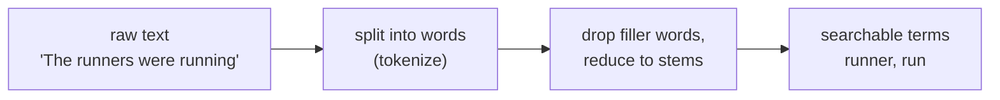
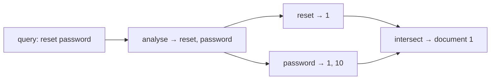
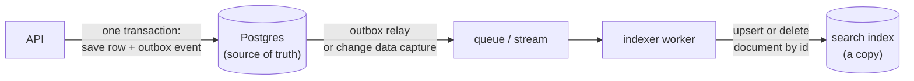

export const helpSetup = `
CREATE TABLE articles (
  id    serial PRIMARY KEY,
  title text NOT NULL,
  body  text NOT NULL
);
INSERT INTO articles (title, body) VALUES
('How to reset your password', 'Forgot your password? Open Settings, choose Security, and click Reset password. We email you a link that expires in one hour.'),
('Changing the email on your account', 'You can change the email address you sign in with from Settings. We send a confirmation to the new address.'),
('Running reports for your team', 'Reports summarise what your team did this month. Admins can run a report at any time and export it as CSV.'),
('Why was my payment declined?', 'Banks decline payments for many reasons: an expired card, a spending limit, or a fraud check. Try another card or contact your bank.'),
('Exporting your data', 'Download everything you have stored with us as a ZIP file of CSV and JSON documents.'),
('Brunch ideas for team events', 'Planning an offsite? Our office manager shares her favourite brunch orders and how far ahead to book.'),
('Two-factor authentication', 'Protect your account with a second step at sign-in: a code from an authenticator app or a passkey.'),
('Deleting your account', 'Deleting your account removes your data permanently after 30 days. Export your data first if you want a copy.'),
('Inviting people to your workspace', 'Admins invite teammates by email. Invitations expire after seven days and can be resent.'),
('Password requirements', 'Passwords must be at least 12 characters. We check every new password against lists of leaked passwords.');
`;

export const helpSetupFts = helpSetup + `
ALTER TABLE articles ADD COLUMN search tsvector
  GENERATED ALWAYS AS (
    setweight(to_tsvector('english', title), 'A') ||
    setweight(to_tsvector('english', body),  'B')
  ) STORED;
CREATE INDEX articles_search_idx ON articles USING gin (search);
`;

export const bigSetup = `
CREATE TABLE docs (id int PRIMARY KEY, body text NOT NULL);
INSERT INTO docs
SELECT g,
  (array['password','payment','report','export','account','invite','team','card','email','security'])[1 + g % 10] || ' ' ||
  (array['reset','declined','monthly','download','delete','expired','settings','limit','change','login'])[1 + (g / 10) % 10] || ' ' ||
  (array['help','guide','question','problem','steps','tips','faq','notes','update','issue'])[1 + (g / 100) % 10] ||
  CASE WHEN g % 5000 = 0 THEN ' refund' ELSE '' END
FROM generate_series(1, 100000) AS g;
ALTER TABLE docs ADD COLUMN search tsvector
  GENERATED ALWAYS AS (to_tsvector('english', body)) STORED;
ANALYZE docs;
`;

# 6.9 Search: from LIKE to full-text to Elasticsearch

You type "reset password" into a help centre and expect the right article at the top, even though the article says "Reset your password", the word "passwords" appears in three other articles, and you misspelled nothing (this time). Every product with more than a page of content grows a search box, and the first version is almost always `WHERE title LIKE '%' || $1 || '%'`. That version is slow on big tables and gives answers that feel broken. This chapter shows you how real search works underneath — the same ideas power Postgres, Elasticsearch and Google — and lets you build it live in your browser, then decide when a dedicated search engine is worth running.

## What you'll learn

- Why **`LIKE '%term%'`** is both slow (it reads every row) and dumb (it matches letters, not words).
- How search engines prepare text: **tokenizing**, **stemming** and **stop words**, and the **inverted index** that makes lookups instant.
- How results are **ranked by relevance**: the intuition behind **TF-IDF** and **BM25**.
- **Postgres full-text search** end to end: `tsvector`, `tsquery`, a **GIN index**, `ts_rank` and `websearch_to_tsquery` — tried live.
- **Fuzzy search** for typos with trigrams (`pg_trgm`).
- When to move to **Elasticsearch / OpenSearch**, how to keep a search index **in sync** with your database, and where **Meilisearch**, **Typesense** and **hybrid vector search** fit.

---

## LIKE matches letters, not meaning

You met `WHERE` and `LIKE` in [chapter 6.2](./sql-from-zero.mdx): `LIKE '%run%'` keeps rows whose text contains the letters `r-u-n` anywhere. It's the obvious first search. Here is a small help centre — ten articles — and the obvious query for someone who typed "run":

<SqlPlayground setup={helpSetup} sql={`SELECT title
FROM articles
WHERE title ILIKE '%run%' OR body ILIKE '%run%';`} />

(`ILIKE` is the case-insensitive `LIKE`.) Look at what came back:

- **"Brunch ideas for team events"** — because b-**run**-ch contains the letters. A false hit.
- **"Running reports"** — correct, by luck: "running" happens to start with "run".

Now try `'%reports%'` and you'll miss the body that says "run **a report**". Try `'%reset password%'` and you'll miss "Reset **your** password". **`LIKE` compares strings of characters; people search for words and ideas.** It has no notion of a word boundary, a plural, word order, or which match is *better*. Every result is equally "a match", returned in whatever order the table happens to be in.

It's also slow. An ordinary B-tree index ([chapter 6.4](./indexes-and-performance.mdx) — a sorted list the database can jump into) helps `LIKE 'run%'`, because "starts with" is a range of a sorted list. A **leading** `%` means "anywhere in the middle", which a sorted list can't help with, so Postgres reads and checks **every row** — a sequential scan, on every keystroke of every user.

:::note[Everyday anchor]
`LIKE '%run%'` is reading every page of a book with a highlighter, marking every place the letters "r-u-n" appear — including inside "brunch". A real search engine works like the **index at the back of the book**: someone already read the book once, wrote down every *word* and its page numbers, and sorted the list. You look up "run" and jump straight to the pages.
:::

---

## Search engines prepare text before anyone searches

The book index works because someone did the hard part ahead of time. Search engines do the same, in a step called **analysis**, which runs once when a document is saved and again on every query, so both sides are in the same form.

Four boxes, the whole pipeline:



Step by step:

1. **Tokenizing** splits text into **tokens** — usually words — at spaces and punctuation, and lowercases them. `"Reset your password!"` → `reset`, `your`, `password`.
2. **Stop words** are words so common they say nothing about the topic: *the*, *a*, *your*, *were*. They're removed.
3. **Stemming** cuts words to a shared root, so different forms match: *running*, *runs* → `run`; *passwords* → `password`; *declined* → `declin`. The stem doesn't have to be a real word; it only has to be the same for every form. A **lemmatizer** is the fussier cousin that uses a dictionary to map *ran* → *run* too; most search engines use the faster stemmer.

All of this is **language-specific**. English stop words and stemming rules are useless for German or Japanese, which is why every search engine asks "which language is this text?"

Postgres has this built in. `to_tsvector` runs the analysis and shows you the result — compare a "simple" configuration (only lowercase) with the English one:

<SqlPlayground sql={`SELECT
  to_tsvector('simple',  'The runners were running; he ran') AS simple,
  to_tsvector('english', 'The runners were running; he ran') AS english;`} />

The English result is `'ran':6 'run':4 'runner':2`: *the*, *were* and *he* are gone as stop words, *running* became `run`, and each term remembers its **position** (useful for phrase search later). Notice `ran` stays `ran` — the stemmer follows spelling rules, not a dictionary, so irregular verbs slip through. That's the honest limit of stemming.

### The inverted index: from words to documents

Now flip the data around. Instead of storing "document → its words", store "**word → the documents that contain it**":

```text
term        articles containing it
--------    ----------------------
account     2, 7, 8
export      3, 5, 8
password    1, 10
report      3
reset       1
```

That's an **inverted index**, and it's the heart of every search engine. Answering "reset password" is now two lookups and an intersection: `reset` → {1}, `password` → {1, 10}; both → {1}. The cost depends on how many documents contain the words, **not** on how big the table is. A billion documents, and "refund" still costs a handful of steps.



The thing to notice: the query goes through the **same analysis** as the documents. If documents were stemmed with English rules and queries weren't, `passwords` in the query would never find `password` in the index. Mismatched analysis is the most common reason a search "obviously should have matched" but didn't.

---

## Relevance: ranking the matches

Finding matches is half of search. The other half is the **order**. A help centre with 5,000 articles might have 300 that mention "password"; the user reads the first three. **Relevance ranking** scores each match so the best one comes first.

Three intuitions, which together are called **TF-IDF** (term frequency × inverse document frequency):

- **Term frequency (TF).** An article that says "password" five times is probably more *about* passwords than one that says it once.
- **Inverse document frequency (IDF).** Rare words matter more. In a help centre every article says "account", so matching "account" tells you little; matching "refund" tells you a lot.
- **Length.** Five mentions in a 50-word article mean more than five mentions in a 5,000-word one.

**BM25** ("Best Match 25") is the refined version used by Elasticsearch, OpenSearch, Lucene, Meilisearch and most modern engines. It adds **saturation**: the tenth mention of "password" adds much less than the second, so keyword-stuffed pages can't win by repetition. You don't need the formula to use it; you need to know it's what's ordering your results and that it can be tuned.

Engines also let you say **where** a match counts more. A match in the **title** usually beats a match in the body: an article *titled* "Password requirements" is more likely what you want than one that mentions passwords in passing. That's called **field boosting**, and you'll do it in Postgres in a moment.

:::info[If you've written code]
An inverted index is a `map[string][]DocID` (a dictionary from word to a sorted list of IDs), and search is set intersection over those lists. Real engines compress the lists and store positions, but a toy version is twenty lines of Go or Python — a good exercise if you want to feel it.
:::

---

## Postgres full-text search: all of the above, built in

Postgres ships a full-text search engine. Its pieces map one-to-one onto the ideas above:

| Idea | Postgres name | Example |
|---|---|---|
| Analysed document | **`tsvector`** (text-search vector) | `to_tsvector('english', body)` |
| Analysed query | **`tsquery`** | `websearch_to_tsquery('english', 'reset password')` |
| "Does it match?" | the **`@@`** operator | `search @@ query` |
| Inverted index | a **GIN** index (Generalized Inverted iNdex) | `CREATE INDEX … USING gin (search)` |
| Relevance score | **`ts_rank`** | `ts_rank(search, query)` |
| Highlighted snippet | **`ts_headline`** | shows the matched words in context |

The playground below adds one column to the articles table: a **generated column** (Postgres recomputes it automatically whenever the row changes) holding the analysed title and body, with the title marked as weight `A` (most important) and the body as `B`. Then it indexes that column with GIN. Run the search:

<SqlPlayground setup={helpSetupFts} sql={`SELECT title,
       round(ts_rank(search, q)::numeric, 3) AS rank
FROM articles, websearch_to_tsquery('english', 'reset password') AS q
WHERE search @@ q
ORDER BY rank DESC;`} />

Only one article contains *both* words, so only one comes back. Now change the query to `'email'` and run it again: "Changing the email on your account", with the word in its **title**, ranks above "Inviting people to your workspace", which only mentions email in the body — field boosting at work. Then try `'run'`: "Running reports" matches, "Brunch ideas" doesn't. That's the fix for both of `LIKE`'s problems in one line.

**`websearch_to_tsquery`** reads the search-box syntax people already know from Google, so you can pass user input to it safely:

| User types | Means | tsquery |
|---|---|---|
| `reset password` | both words | `'reset' & 'password'` |
| `"reset password"` | that exact phrase | `'reset' <-> 'password'` |
| `card or bank` | either word | `'card' \| 'bank'` |
| `account -delete` | without "delete" | `'account' & !'delet'` |

Its stricter cousin `to_tsquery` expects the operator syntax directly and throws an error on input like `reset password` (two words, no operator) — so never feed it raw user text.

Finally, a search result page shows *why* each result matched. `ts_headline` builds that snippet:

<SqlPlayground setup={helpSetupFts} sql={`SELECT title,
       ts_headline('english', body, q, 'StartSel=[, StopSel=]') AS snippet
FROM articles, websearch_to_tsquery('english', 'export data') AS q
WHERE search @@ q
ORDER BY ts_rank(search, q) DESC;`} />

### The GIN index is what makes it fast

Everything above would work without the index — Postgres would analyse and check every row, like `LIKE` does. The GIN index is the inverted index from earlier, stored inside Postgres. The next playground builds 100,000 short documents (the first run takes a few seconds), where only 20 contain the word "refund", and searches **without** an index:

<SqlPlayground setup={bigSetup} sql={`EXPLAIN ANALYZE
SELECT id FROM docs
WHERE search @@ websearch_to_tsquery('english', 'refund');`} />

You'll see a **`Seq Scan`** with **`Rows Removed by Filter: 99980`** — it checked every document to keep 20. Now, in the same playground, create the index and run the `EXPLAIN ANALYZE` again:

```sql
CREATE INDEX docs_search_idx ON docs USING gin (search);
```

The plan switches to a **`Bitmap Index Scan on docs_search_idx`**, and the time drops from around 10 ms to well under 1 ms (your numbers will differ). As in [chapter 6.4](./indexes-and-performance.mdx), the gap grows with the table: at ten million documents it's seconds versus milliseconds.

:::tip[Store the tsvector, don't compute it per query]
`WHERE to_tsvector('english', body) @@ q` works, but it analyses every candidate row again on every search. A **stored generated column** (as above) does the analysis once, on write. If you index an *expression* instead, the query must repeat the expression *exactly* — including the `'english'` argument — or Postgres can't use the index.
:::

### Typos and partial words: trigrams

Full-text search matches **whole words** (after stemming). It does nothing for `pasword` (a typo) or `pass` (half a word, typed while the user is still typing). For those, Postgres has the **`pg_trgm`** extension. It breaks text into **trigrams** — every run of three letters — and measures how many two strings share. `password` and `pasword` share most of their trigrams, so they're **similar**, and a GIN or GiST index makes "find similar" fast.

`pg_trgm` isn't available in the in-browser playground, so run it in a real Postgres (the Lab below starts one in Docker):

```sql
CREATE EXTENSION IF NOT EXISTS pg_trgm;                -- ships with Postgres, off by default

SELECT similarity('password', 'pasword');              -- 0.7: most trigrams shared
SELECT show_trgm('cat');                               -- {"  c"," ca","at ",cat}

CREATE INDEX articles_title_trgm ON articles USING gin (title gin_trgm_ops);
SELECT title FROM articles
WHERE title % 'pasword'                                -- % means "similar enough" (default 0.3)
ORDER BY similarity(title, 'pasword') DESC;

SELECT title FROM articles WHERE title ILIKE '%xport%'; -- trigram index makes this fast too
```

That last line is the bonus: a trigram index also speeds up `LIKE '%…%'`, because the database can look up the trigrams of the middle of a word. It's the right tool for searching **identifiers** — URLs, email addresses, product codes, slugs — where "words" and "stems" don't make sense.

:::warning[What can go wrong]
- **Mixed analysis.** Indexing with `'english'` and querying with `'simple'` (or with the server's default, `default_text_search_config`) silently matches less. Name the configuration every time.
- **Feeding user input to `to_tsquery`.** A stray `&` or `(` raises a syntax error, and your search endpoint returns 500. Use `websearch_to_tsquery` or `plainto_tsquery` for anything a user typed.
- **URLs and codes go through the word parser.** `to_tsvector('english', 'https://go.dev/doc/tutorial')` produces `go.dev` and `/doc/tutorial` as tokens, so searching `tutorial` finds nothing. Use trigrams for identifiers.
- **Ranking without a limit.** `ts_rank` has to score every matching row before sorting. For a query matching half the table, that's slow. Always `LIMIT`, and consider cheaper filters first.
- **Multiple languages in one column.** One configuration per column; store the language per row and analyse with it if your content is mixed.
:::

---

## When you outgrow Postgres: Elasticsearch and OpenSearch

Postgres full-text search is enough for most products' first several years ([chapter 6.8](./choosing-a-datastore.mdx) makes the "start with Postgres" case). It runs out when you need some of these:

- **Typo tolerance and autocomplete** on every query, tuned per field.
- **Facets** — the "Brand (12) · Size (40) · Under $50 (7)" counts beside shop results — over millions of documents, fast.
- **BM25 ranking** with fine control, synonyms, many languages, custom analysers.
- **Scale** — hundreds of millions of documents, or search traffic heavy enough that you don't want it competing with your transactions on the main database.

At that point teams reach for **Elasticsearch** or **OpenSearch**. Both are built on **Apache Lucene**, the search library that implements inverted indexes and BM25. OpenSearch is the Apache-2.0-licensed fork that AWS started in 2021 after Elastic changed Elasticsearch's licence; it's now governed by the Linux Foundation, and Elasticsearch has since added an AGPL licence option. For learning, they behave almost identically. Their vocabulary:

| Term | Means | Postgres equivalent |
|---|---|---|
| **Document** | A JSON object you index, like `{"title": …, "body": …}` | A row |
| **Index** | A named collection of documents | A table *plus* its search index |
| **Mapping** | The schema: each field's type and analyser | Column types |
| **`text` vs `keyword`** | `text` is analysed for full-text search; `keyword` is stored exactly, for filters, sorting and facets | `tsvector` vs a plain indexed column |
| **Analyzer** | Character filters → tokenizer → token filters (lowercase, stop words, stemming, synonyms) | A text-search configuration such as `english` |
| **Shard** | One slice of an index, a self-contained Lucene index; an index is split across shards so it can spread over nodes | Partitioning |
| **Replica** | A copy of a shard on another node, for failover and more read capacity | A read replica |

A search query is JSON over HTTP:

```bash
curl -s localhost:9200/articles/_search -H 'Content-Type: application/json' -d '{
  "query": {
    "multi_match": {
      "query": "reset pasword",
      "fields": ["title^2", "body"],
      "fuzziness": "AUTO"
    }
  }
}'
# title^2 boosts title matches, fuzziness forgives the typo, results come back sorted by BM25 score
```

One behaviour surprises everyone once: search is **near-real-time**. A document you index is written to an in-memory buffer and becomes searchable at the next **refresh**, by default about once per second. Index a document and search for it in the same millisecond, and it isn't there yet. That's a deliberate trade — refreshing on every write would make bulk indexing far slower — and it means **your search index is always slightly behind your database**.

### The search index is a copy: keeping it in sync

Your database stays the **source of truth**. The search engine holds a **copy**, shaped for searching, that you can delete and rebuild at any time. The hard part of running search isn't the queries — it's keeping that copy correct.

The tempting design is **dual writes**: the API saves to Postgres, then sends the same document to Elasticsearch. Picture the failure: Postgres commits, then the Elasticsearch call times out. The article exists but can never be found. Or the reverse — Elasticsearch accepted it, then the database transaction rolled back, and search shows an article that doesn't exist. Two systems, no shared transaction, and they drift apart. This is the **dual-write problem** from [chapter 8.2](../distributed/queues-and-background-work.mdx), and it has the same two fixes:



- **Outbox.** In the same transaction as the change, insert an "article 42 changed" row into an `outbox` table. A worker reads the outbox and updates the search index. The change and the event commit together or not at all.
- **Change data capture (CDC).** A tool such as **Debezium** reads the database's own change log (Postgres's write-ahead log) and streams every insert, update and delete to the indexer. No application code changes, more infrastructure.

Either way, make the indexer **idempotent** — "set document 42 to this content" rather than "add a document" — so delivering the same event twice is harmless. And keep a **full reindex** job you can run any time: read every row, build a new index, then switch an **alias** (a stable name like `articles` that points at `articles_v7`) to the new index in one step. You'll need it the first time you change an analyser, because existing documents must be re-analysed to benefit.

---

## The newer options, and hybrid search

Not every team wants to run an Elasticsearch cluster. Two lighter engines are popular for product search:

- **Meilisearch** and **Typesense** — single-binary search servers built for "search as you type": typo tolerance, prefix matching, facets and good relevance out of the box, with very little tuning. They suit catalogues, docs sites and app search up to tens of millions of documents. They are less suited to log analytics or very large clusters, which is where Elasticsearch/OpenSearch remain the standard.
- **Postgres extensions** keep closing the gap: projects such as ParadeDB's `pg_search` bring BM25 ranking into Postgres itself.

The bigger shift is **semantic search**. Keyword search finds documents that share your *words*; someone asking "how do I undo a bad release?" won't find the article titled "Rolling back a deployment". **Embeddings** ([chapter 14.7](../ai/embeddings-and-vector-search.mdx)) — lists of numbers that represent meaning — find it, but they're weak at exact terms like an error code `ERR_CONN_RESET` or a product SKU.

So modern systems run both and merge the results: **hybrid search**. A common merge method is **reciprocal rank fusion (RRF)**: each document scores `1 / (60 + its rank)` in each result list, and the scores are added. A document that ranks well in both lists rises to the top, without having to compare a BM25 score with a vector distance, which are on different scales. Elasticsearch, OpenSearch, Meilisearch and Typesense all offer hybrid search now, and in Postgres you can combine full-text search with `pgvector` in one query. It's also how good retrieval for AI answers works ([chapter 14.8](../ai/rag.mdx)).

:::info[In the real world]
The usual path: `LIKE` in the prototype → Postgres full-text search (often for years) → a dedicated engine when search becomes a product feature with its own team or metrics → hybrid keyword + vector search when users ask questions in natural language. Teams also measure search quality: the share of searches with zero results, and whether users click one of the first three results. Search that returns nothing is a product bug, logged and fixed like any other.
:::

---

## Apply it to snip: searching your saved links

snip, the URL shortener you build in this handbook, stores each link's `slug`, `url`, `owner_id`, `clicks` and `created_at` (`snip/internal/store/postgres/migrations/0001_init.sql`). A user with 2,000 links wants to type "postgres" and find the ones they saved about Postgres. This is a design exercise — snip doesn't implement search yet — and every choice comes from this chapter:

1. **What to search.** The URL alone is a poor document: as you saw, `to_tsvector` keeps `go.dev/doc/tutorial` as one token, so "tutorial" wouldn't match. The useful text is the **page title**, which snip would fetch once when the link is created (in the background worker, so creating a link stays fast — [chapter 8.2](../distributed/queues-and-background-work.mdx)).
2. **Schema.** A new migration:
   ```sql
   ALTER TABLE links ADD COLUMN title text;
   ALTER TABLE links ADD COLUMN search tsvector
     GENERATED ALWAYS AS (to_tsvector('english', coalesce(title, ''))) STORED;
   CREATE INDEX links_search_idx ON links USING gin (search);
   CREATE EXTENSION IF NOT EXISTS pg_trgm;
   CREATE INDEX links_url_trgm ON links USING gin (url gin_trgm_ops);  -- for "go.dev" style searches
   ```
3. **Query.** `GET /api/links?q=postgres` runs full-text search on the title **and** a trigram `ILIKE` on the URL, always filtered by `owner_id` (users must only ever search *their own* links — [chapter 7.4](../security/authorization-multi-tenancy.mdx)), ranked with `ts_rank` and limited to 20.
4. **No search engine.** One user's links number in the thousands; Postgres answers in milliseconds, and there's no second system to keep in sync. Revisit only if snip adds search across *all* public links at large scale.

## Cheat sheet

| Need | Postgres | Search engine |
|---|---|---|
| Analyse text | `to_tsvector('english', text)` | analyzer in the mapping |
| Parse a user's query | `websearch_to_tsquery('english', $1)` | `match` / `multi_match` query |
| Match | `search @@ query` | `_search` |
| Index | `CREATE INDEX … USING gin (search)` | automatic (inverted index per shard) |
| Rank | `ts_rank(search, query)` | BM25, automatic |
| Boost title | `setweight(…, 'A')` | `"fields": ["title^2", "body"]` |
| Snippet | `ts_headline(…)` | `highlight` |
| Typos, partial words | `pg_trgm`: `%`, `similarity()` | `fuzziness`, `match_phrase_prefix` |

---

## Lab

Runs on your laptop with Docker ([chapter 9.1](../containers/what-a-container-is.mdx) — Docker runs a program in an isolated box from a downloaded image). Free.

1. **Postgres full-text search in a real database.**
   ```bash
   docker run -d --name fts -e POSTGRES_PASSWORD=dev -p 5432:5432 postgres:18   # start Postgres 18
   docker exec -it fts psql -U postgres                                          # open a SQL prompt inside it
   ```
   Paste the `CREATE TABLE articles …` and `INSERT …` statements from the first playground (or write ten rows of your own — notes, recipes, bookmarks), then add the `search` column and GIN index from the second. Search for three things you know are there, using `websearch_to_tsquery`. Notice which ranks first and why.

2. **Break and fix a match.** Search for `ran`. Nothing? Look at `to_tsvector('english', 'running')` and `to_tsquery('english', 'ran')` and explain the difference (the stemmer follows rules, not a dictionary). Then try a URL: `SELECT to_tsvector('english', 'https://go.dev/doc/tutorial');`.

3. **Fuzzy search.** In the same prompt, run the `pg_trgm` block from this chapter. Search the titles for `pasword`, `paymnet` and `xport`. Then `\q` to quit and `docker rm -f fts` to clean up.

4. **Optional: OpenSearch single-node.** Needs about 1 GB of free memory.
   ```bash
   docker run -d --name os -p 9200:9200 \
     -e discovery.type=single-node \
     -e DISABLE_SECURITY_PLUGIN=true \
     -e OPENSEARCH_JAVA_OPTS="-Xms512m -Xmx512m" \
     opensearchproject/opensearch:3                     # local learning only: security is switched off
   sleep 30; curl -s localhost:9200                     # cluster info once it has started
   curl -s -XPUT localhost:9200/articles/_doc/1 -H 'Content-Type: application/json' \
     -d '{"title": "How to reset your password", "body": "Open Settings, choose Security, and click Reset password."}'
   curl -s -XPUT localhost:9200/articles/_doc/2 -H 'Content-Type: application/json' \
     -d '{"title": "Password requirements", "body": "Passwords must be at least 12 characters."}'
   curl -s 'localhost:9200/articles/_search?q=pasword~&pretty'   # ~ asks for a fuzzy match
   curl -s 'localhost:9200/articles/_mapping?pretty'             # the mapping it guessed for you
   docker rm -f os                                               # clean up
   ```
   Notice the `_score` on each hit (BM25), that the typo still matched, and that OpenSearch guessed a mapping with both a `text` field and a `.keyword` sub-field for each string. If a search right after indexing returns nothing, wait a second and repeat it — that's the refresh interval.

## Self-check

<Quiz
  id="data-full-text-search"
  questions={[
    {
      q: 'A search for "run" with LIKE \'%run%\' returns an article about brunch. Why does full-text search not make that mistake?',
      options: [
        'It compares only the first three letters of each word in the text',
        'It splits text into words and matches whole terms, so "brunch" is not "run"',
        'It ignores any article whose title contains a food-related word',
        'It runs LIKE twice and keeps only the rows that match both times',
      ],
      answer: 1,
      explain: 'Full-text search tokenizes text into words (and stems them), then matches terms. "brunch" is one token, brunch, which is not run. LIKE only compares characters, so any string containing r-u-n matches.',
    },
    {
      q: 'Your search finds "password" but not "passwords" in some rows. What would you check first?',
      options: [
        'Whether the server has enough memory for the GIN index',
        'Whether documents and queries use the same text-search configuration',
        'Whether the table has a primary key on its id column',
        'Whether the rows were inserted before the index was created',
      ],
      answer: 1,
      explain: 'Stemming only helps when both sides are analysed the same way. If the tsvector was built with english but the query with simple (or the server default), "passwords" stays "passwords" on one side. Memory and insert order do not change which rows match.',
    },
    {
      q: 'Why does BM25 give little weight to a word like "account" in a help centre?',
      options: [
        'Short words are always ranked below long words by the formula',
        'It appears in most documents, so matching it says little about relevance',
        'It is on the English stop-word list and is removed before ranking',
        'Words that appear in titles are ignored by the ranking formula',
      ],
      answer: 1,
      explain: 'Inverse document frequency: a word found in nearly every document cannot tell them apart, so it counts for little. "account" is not a stop word — it is still matched — it just contributes less to the score than a rare word like "refund".',
    },
    {
      q: 'The API saves an article to Postgres, then calls Elasticsearch to index it. Sometimes new articles never appear in search. What is the cause and the fix?',
      options: [
        'The refresh interval is too long; set it to zero so writes are visible',
        'Dual writes drift when the second call fails; index from an outbox or CDC',
        'Elasticsearch needs more shards; split the index across more nodes',
        'The articles are too long; truncate the body before indexing it',
      ],
      answer: 1,
      explain: 'When the database commits and the indexing call fails, nothing retries it: the two systems drift. Recording the change in an outbox table in the same transaction (or reading the change log with CDC) guarantees the indexer eventually sees every change. The refresh interval delays visibility by about a second; it never loses a document.',
    },
  ]}
/>

<details>
<summary>Explain to a non-engineer why search engines can search a billion documents in milliseconds.</summary>

They do the work in advance. When a document is saved, the engine splits it into words, reduces each word to a root form, and adds the document's ID to a list kept for each word — like the index at the back of a book, which lists every topic with its page numbers. A search then looks up a few words in that sorted list and combines their page lists, instead of reading the documents. The cost depends on how many documents contain the words, not on how many documents exist. The rule: **pay at write time to make reads cheap.**

</details>

<details>
<summary>Your product's search runs on Postgres full-text search and works well. A colleague proposes moving to Elasticsearch "because it's what real companies use". What do you ask before agreeing?</summary>

What problem does it solve that we have today, and measured? Elasticsearch earns its place for typo tolerance and autocomplete on every query, facets over millions of documents, many languages and synonyms, or search load large enough to hurt the main database. It costs a second system to run, secure, monitor and pay for, a sync pipeline (outbox or CDC, plus reindexing) that will occasionally break, and results that lag the database by a refresh. If the answer is "search is slow", check the plan for a missing GIN index first; if it's "users make typos", try `pg_trgm`. Move when Postgres measurably can't do the job — and then, keep Postgres as the source of truth and treat the search index as a rebuildable copy.

</details>

<details>
<summary>Why is hybrid search (keyword + vector) better than either alone?</summary>

Each covers the other's blind spot. Keyword search (BM25) is exact: it finds `ERR_CONN_RESET`, a slug, a product code or a surname, but misses a document that says the same thing in different words. Vector search finds meaning — "undo a bad release" matches "rolling back a deployment" — but can rank an unrelated document above the one containing the exact code you typed. Running both and merging (for example with reciprocal rank fusion) puts documents that do well in either list near the top, and documents that do well in both at the very top.

</details>
