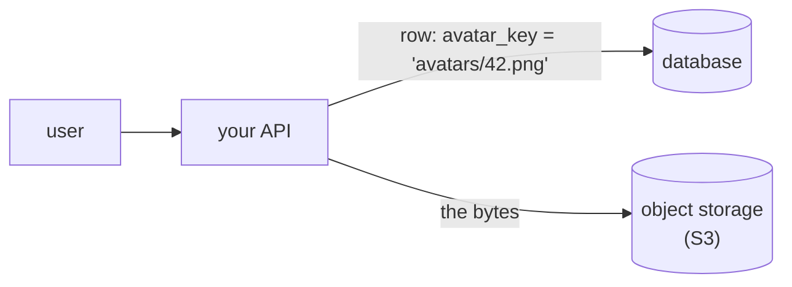
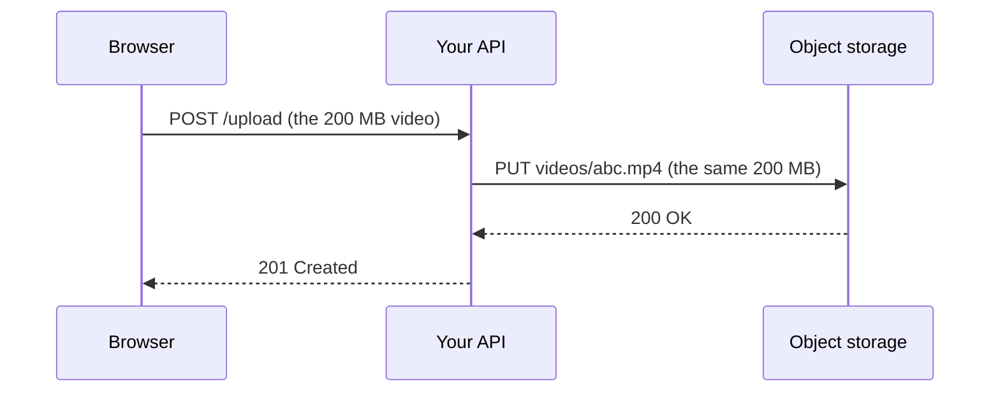
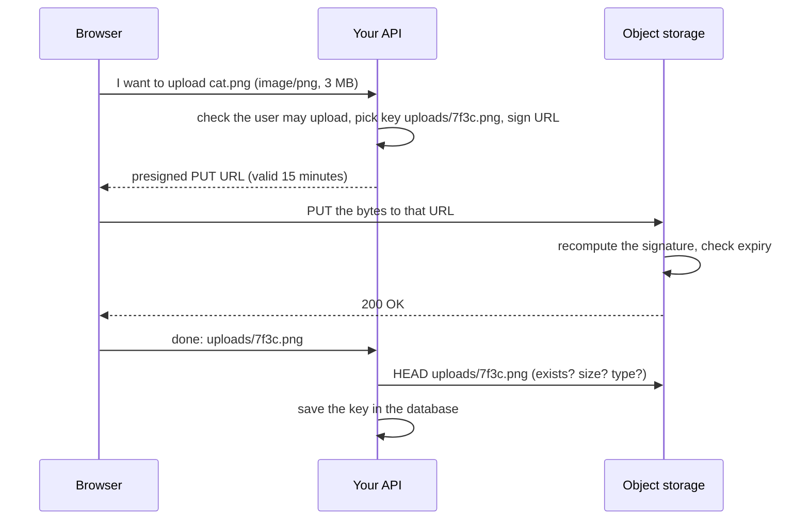

# 6.10 Object storage: files, S3 and presigned URLs

Every app you use stores files: profile photos, PDFs of invoices, voice notes, video, the CSV you exported last week. The first time you build an upload feature, two obvious places suggest themselves — a column in the database, or a folder on the server's disk — and both go wrong in ways that only show up once you have real users. This chapter explains where files actually go in a modern backend (**object storage**, almost always through the **S3 API**), how browsers upload straight to it without your server carrying the bytes, and the security and cost traps that have embarrassed large companies. You'll run an S3-compatible server on your laptop and sign your own upload URLs.

## What you'll learn

- Why files don't belong **in the database** or **on the app server's disk**.
- What **object storage** is — **buckets**, **keys** and **objects** — and why the **S3 API** is the standard every provider speaks.
- How it behaves: **consistency**, **versioning**, **lifecycle rules** and **storage classes**.
- Two ways to upload: **through your server**, or **direct from the browser with a presigned URL** — and **multipart uploads** for big files.
- Serving files through a **CDN**, keeping buckets **private**, validating uploads, and where the **costs** hide (hint: downloads).

---

## Files don't belong in the database or on the server's disk

Picture a photo-sharing app that stores each upload in a `bytea` (binary) column in Postgres. It works on day one. By month six:

- **The database is mostly photos.** A 50 GB database where 48 GB are images. Backups ([chapter 6.1](./why-databases.mdx) — the database is your system's memory, and backups protect it) take hours instead of minutes, restores take longer, and replicas copy every byte.
- **Expensive storage, used cheaply.** Database disks and memory are the most expensive storage you own, tuned for small, frequent, transactional reads. A photo is read whole, rarely changed, and needs none of that.
- **Every download goes through your app and your database.** A viral image means thousands of requests dragging megabytes through both.

The other obvious choice — save to `/var/uploads` on the app server — breaks as soon as there are **two** servers. Upload lands on server A, the next request goes to server B ([chapter 8.6](../distributed/scaling.mdx) — scaling out means many identical servers behind a load balancer), and the file "doesn't exist". Containers make it worse: a container's filesystem disappears when it restarts ([chapter 9.1](../containers/what-a-container-is.mdx)). And when the disk fills, the server falls over.

The rule the industry settled on: **files go to object storage; the database stores a small reference to them.**



The database row holds `avatars/42.png`, a few bytes. The 3 MB image lives in object storage. Each system does what it's good at.

:::note[Everyday anchor]
A **coat check**. You hand over a bulky coat and get a small numbered ticket. The cloakroom (object storage) is huge, cheap per coat, and organised only by ticket number. You keep the ticket in your pocket (the database row). Nobody stores coats in their pockets, and nobody keeps a list of their friends in the cloakroom.
:::

---

## Buckets, keys and objects

Object storage has three nouns:

- A **bucket** is a named container, usually one per application and environment: `acme-uploads-prod`. Bucket names on AWS are **globally unique** across all customers, like domain names.
- An **object** is one file plus **metadata** about it (its size, `Content-Type` such as `image/png`, when it was last modified, and any custom labels you add).
- A **key** is the object's full name inside the bucket: `avatars/42.png`, `invoices/2026/10/inv-9913.pdf`.

There are **no real folders**. `invoices/2026/10/inv-9913.pdf` is one key that happens to contain slashes. Consoles and tools *display* shared prefixes as folders, and listing by **prefix** (`invoices/2026/`) is fast, but nothing called `invoices` exists on its own. [Chapter 12.3](../cloud/compute-storage-databases.mdx) lets you see this on a real public bucket.

You read and write **whole objects** over HTTPS:

| Operation | HTTP | Means |
|---|---|---|
| Upload | `PUT /bucket/key` | Store these bytes under this key (replacing what was there) |
| Download | `GET /bucket/key` | Give me the bytes |
| Metadata | `HEAD /bucket/key` | Size, type, last modified — without the bytes |
| Delete | `DELETE /bucket/key` | Remove it |
| List | `GET /bucket?list-type=2&prefix=…` | Keys starting with this prefix, 1,000 at a time |

There is no "change byte 500" or "append a line": to change an object, you upload a new version of the whole thing. That restriction is what lets providers make it **cheap, practically unlimited and extremely durable** — Amazon S3 is designed for 99.999999999% ("eleven nines") durability, by storing copies across several data centres.

### The S3 API is the standard

Amazon S3 (Simple Storage Service) launched in 2006, and its HTTP API became the de-facto standard. **Google Cloud Storage, Azure Blob Storage, Cloudflare R2, Backblaze B2, DigitalOcean Spaces** and self-hosted servers such as **Ceph**, **SeaweedFS** and **Garage** either speak the S3 API directly or offer an S3-compatible endpoint. So the AWS SDKs, the `aws` command-line tool, backup tools and your own code work against all of them by changing one setting: the **endpoint URL**. That's why this chapter's lab can use a free server on your laptop and the code still applies to AWS.

### How it behaves: consistency, versioning, lifecycle, storage classes

**Consistency.** Since December 2020, S3 is **strongly consistent**: after a successful `PUT`, every `GET` and `LIST` sees the new object. (Before that, a just-uploaded object could briefly appear missing — a source of many confusing bugs, and still worth checking for in other S3-compatible stores.) There are still **no transactions across objects**: two clients uploading the same key at once means the last one wins.

**Versioning.** Turn it on for a bucket and every overwrite or delete keeps the old version. A deploy script that uploads an empty file over `config.json`, or an attacker who deletes everything, becomes recoverable. The cost: you pay to store every old version until you remove them.

**Lifecycle rules** are the bucket's housekeeping, applied automatically:

```json
{
  "Rules": [
    { "ID": "tmp-uploads", "Filter": { "Prefix": "tmp/" }, "Status": "Enabled",
      "Expiration": { "Days": 1 } },
    { "ID": "old-logs", "Filter": { "Prefix": "logs/" }, "Status": "Enabled",
      "Transitions": [ { "Days": 30, "StorageClass": "GLACIER_IR" } ],
      "Expiration": { "Days": 365 } },
    { "ID": "old-versions", "Filter": {}, "Status": "Enabled",
      "NoncurrentVersionExpiration": { "NoncurrentDays": 30 },
      "AbortIncompleteMultipartUpload": { "DaysAfterInitiation": 7 } }
  ]
}
```

Read it as: delete anything under `tmp/` after a day, move logs to cheaper storage after 30 days and delete them after a year, and clean up old versions and abandoned uploads. Without rules like these, buckets only ever grow.

**Storage classes** trade retrieval speed and price for storage price. On AWS: **Standard** for files people use often; **Standard-IA** (infrequent access) and **Glacier Instant Retrieval** for files read rarely but needed quickly; **Glacier Flexible Retrieval** and **Deep Archive** for archives you can wait minutes to hours for; and **Intelligent-Tiering**, which moves objects between tiers based on how often they're read. The colder the class, the cheaper to keep and the more expensive (and slower) to read back.

---

## Uploads: through your server, or straight to the bucket

The simple design sends the file through your API:



It's easy to reason about — your API checks the file and holds the only credentials — and it's fine for small files like avatars. But every byte crosses your servers **twice**, a slow phone upload ties up a server connection for minutes, and request size limits in your proxy ([chapter 8.3](../distributed/reverse-proxies-and-nginx.mdx)) start rejecting large files.

### Presigned URLs: a signed permission slip

The design most apps use for anything larger is a **presigned URL**. Your API, which holds the storage credentials, creates a URL that grants **one action** (say, `PUT`) on **one key** for **a few minutes**, and signs it. It hands that URL to the browser, which uploads **directly** to the bucket. Your server never touches the bytes.



The two things to notice: the bytes go **browser → bucket** directly, and your API still **decides** — who may upload, which key, for how long — and **confirms** afterwards before trusting the result.

A presigned URL looks like this:

```text
http://localhost:8333/uploads/cat.png
  ?X-Amz-Algorithm=AWS4-HMAC-SHA256                      how it was signed
  &X-Amz-Credential=admin/20261029/us-east-1/s3/aws4_request   whose key, which day, region, service
  &X-Amz-Date=20261029T141322Z                            when it was signed
  &X-Amz-Expires=900                                      valid for 900 seconds
  &X-Amz-SignedHeaders=host
  &X-Amz-Signature=3773bcad…                              HMAC over all of the above
```

The **secret key never appears** in the URL. The signature is an **HMAC** ([chapter 7.1](../security/security-literacy.mdx) — a fingerprint of a message that only someone holding the secret can produce) over the method, the key, the expiry and the time. The storage server holds the same secret, recomputes the HMAC, and compares. Change one character — another key, `GET` instead of `PUT`, a longer expiry — and the signatures no longer match, so the server answers `403 Forbidden`.

This handbook includes a small, standard-library-only Go program that builds exactly these URLs, so you can see there's no magic: `snip/examples/presign/presign.go`. The heart of it:

```go
// 2. The canonical request: a fixed text form of exactly what is allowed.
// Change any part (method, object, expiry, host) and the signature breaks.
canonical := strings.Join([]string{
	method,
	encode(u.EscapedPath(), true),
	canonicalQuery(q),
	"host:" + u.Host + "\n",
	"host",
	"UNSIGNED-PAYLOAD", // the body isn't signed: the uploader chooses it
}, "\n")

// 3. The string to sign ties that request to a time and a scope.
sum := sha256.Sum256([]byte(canonical))
toSign := "AWS4-HMAC-SHA256\n" + amzDate + "\n" + scope + "\n" + hex.EncodeToString(sum[:])

// 4. Derive a signing key valid only for this day, region and service,
// then sign. The server repeats steps 2–4 with its copy of the secret
// and compares.
key := hmacSHA256([]byte("AWS4"+c.SecretAccessKey), day)
key = hmacSHA256(key, region)
key = hmacSHA256(key, "s3")
key = hmacSHA256(key, "aws4_request")
sig := hex.EncodeToString(hmacSHA256(key, toSign))
```

Its test (`presign_test.go`) reproduces the example signature from AWS's own documentation, byte for byte. In real code you'd call the AWS SDK's presign client (`s3.NewPresignClient` in Go, `generate_presigned_url` in Python's boto3) — it does the same thing.

Notice `UNSIGNED-PAYLOAD`: a presigned `PUT` signs the **destination**, not the **content**. Whoever holds the URL can upload *any* bytes, of any size, with any `Content-Type`, until it expires. That's why the "confirm afterwards" step matters, and why you'll meet **presigned POST** below.

### Multipart uploads for big files

A single `PUT` to S3 is limited to 5 GB, and a 4 GB upload that fails at 99% has to start over. **Multipart upload** splits a file into parts (5 MiB to 5 GiB each, up to 10,000 parts):

1. **Start**: `CreateMultipartUpload` returns an **upload ID**.
2. **Upload parts**, in parallel and in any order, each with its own presigned URL. A failed part is retried alone.
3. **Complete**: send the list of part numbers and their checksums; the store stitches them into one object.

Parts of an upload you never complete still cost storage, invisibly — hence the `AbortIncompleteMultipartUpload` rule in the lifecycle example above. Browser upload libraries (Uppy, for example) and the AWS SDKs' upload managers handle multipart for you; it's worth knowing the mechanism when a large upload misbehaves.

---

## Serving files: a CDN in front, the bucket stays private

To show an image to millions of people, you don't want every view to be a request to one bucket in one region. A **CDN** (content delivery network — a worldwide set of caching servers that keep copies of your files close to users) sits in front: the first viewer in Frankfurt makes the CDN fetch the image from the bucket, and the next ten thousand in Frankfurt get it from the CDN's copy in milliseconds. Amazon CloudFront, Cloudflare and Fastly are the common choices.

The modern setup keeps the **bucket private** and gives **only the CDN** permission to read it (on AWS, CloudFront's **Origin Access Control**). Users can reach files through the CDN but never the bucket directly. For private files — invoices, medical documents — skip public caching and hand out **short-lived presigned `GET` URLs** (or CDN **signed URLs**) after checking the user may see that file.

Two habits that pay off:

- **Never reuse a key for new content** if a CDN caches it. Upload `avatars/42-v3.png` (or a content hash) instead of overwriting `avatars/42.png`; the old copy may sit in caches for hours.
- **Set `Content-Type` and `Cache-Control`** when uploading. They're stored with the object and sent to browsers on every download.

---

## Security: private by default, and trust nothing you're given

### Public buckets are a classic breach

For years, the most common cloud data leak was a bucket someone had made **public**, often to fix a "403" quickly during development. Security researchers scan for them continuously, and so do attackers. A public bucket that can be **written** is worse still. In July 2020, Twilio reported that a path in one of its S3 buckets, used to serve a JavaScript SDK to customers, had been left writable by anyone; an attacker replaced the library with a modified copy, Twilio told customers who had downloaded it during a roughly 33-hour window to replace it, and Twilio's audit found other buckets with similar settings ([Twilio's incident report](https://www.twilio.com/en-us/blog/incident-report-taskrouter-js-sdk-july-2020)). Its fixes are the standard advice: lock bucket permissions down, serve content only through the CDN, and monitor policy changes.

Since April 2023, new S3 buckets have **Block Public Access** turned on and per-object ACLs (access control lists) disabled by default. **Leave them on.** Grant access through IAM policies to specific roles ([chapter 12.4](../cloud/iam.mdx)), a CDN's origin access, or presigned URLs — never "everyone".

### Validate what users upload

A presigned `PUT` lets the holder upload anything to that key. So:

- **Choose the key yourself**, on the server: `uploads/{user_id}/{random-uuid}.png`. Never let the client pick `../../config.json` or overwrite someone else's file.
- **Limit size and type.** A **presigned POST** (an HTML-form-style upload) can carry a policy the store enforces, such as `content-length-range` and an exact `Content-Type`. With a presigned `PUT`, sign the `Content-Type` and check the size before handing out the URL — and either way, `HEAD` the object afterwards.
- **Don't trust `Content-Type` or the file extension.** Check the file's first bytes (its "magic number"), and re-encode images through an image library before showing them. An "image" that is really HTML, served from your domain, is a cross-site scripting attack ([chapter 7.5](../security/web-attacks.mdx)). Serve user files from a **separate domain** (for example `usercontent.example.com`) with `Content-Disposition: attachment` for anything that isn't an image.
- **Scan for malware** before other users can download a file. A common pattern: upload into a **quarantine** prefix or bucket, let a background worker ([chapter 8.2](../distributed/queues-and-background-work.mdx)) scan it (ClamAV, or your cloud provider's scanning service), then move it to the real location and mark it ready in the database.

:::warning[What can go wrong]
- **A public bucket**, made public "temporarily". Leaks and defacements, found by automated scanners within hours.
- **Long-lived presigned URLs.** A URL valid for 7 days (the maximum with SigV4) that ends up in a log, a chat or a browser history is a 7-day public link. Use minutes.
- **Trusting the client's report** of what it uploaded. Always `HEAD` the object and check size and type yourself.
- **Orphans.** The database row is deleted but the file stays (or the reverse). Delete objects from a background job after the row is gone, and run a periodic sweep comparing keys with rows.
- **Wrong region, slow and expensive.** A bucket in Virginia serving users in Singapore pays in latency and in cross-region transfer.
:::

---

## Costs: storage is cheap, downloads are not

Object storage bills three things:

| What | AWS S3 Standard list price (us-east-1, at the time of writing) | Notes |
|---|---|---|
| **Storage** | about $0.023 per GB per month | 1 TB ≈ $23/month |
| **Requests** | fractions of a cent per thousand `PUT`s and `GET`s | Millions of tiny objects add up |
| **Egress** (data out to the internet) | about $0.09 per GB for the first tiers | 1 TB downloaded ≈ $90 |

Read that table twice: storing a terabyte costs about a quarter of what serving it once costs. **Egress** — data leaving the provider's network — is where object storage bills surprise teams, usually after something goes viral or someone hotlinks your files. A CDN reduces the bill (CDN egress is cheaper and cached files aren't fetched from the bucket again), and some providers compete on exactly this: **Cloudflare R2** charges no egress fees, and **Backblaze B2** offers free egress up to a multiple of what you store. [Chapter 12.7](../cloud/cost-control.mdx) covers watching a cloud bill.

:::info[In the real world]
Most teams: one private bucket per environment, keys like `{kind}/{owner}/{uuid}`, presigned uploads from the browser, a background worker that validates and post-processes (thumbnails, scanning, transcoding), a CDN with origin access for public files, short presigned `GET`s for private ones, versioning on anything precious, and lifecycle rules from day one. Locally and in CI, they run an S3-compatible server in Docker so tests don't touch the cloud.
:::

---

## Apply it to snip: bulk-importing links from a CSV

snip, the URL shortener you build in this handbook, doesn't store files yet. A realistic feature that would: **bulk import** — a user uploads a CSV with thousands of URLs and snip creates a short link for each. Designed with this chapter's tools (a design exercise; snip doesn't implement it):

1. `POST /api/imports` (authenticated with the user's API key) returns a **presigned `PUT` URL** for a key the server picks, `imports/{owner_id}/{uuid}.csv`, valid for 10 minutes — the kind of URL `snip/examples/presign` produces (production code would use the AWS SDK and also sign `Content-Type: text/csv`).
2. The client uploads the file **directly** to the bucket.
3. `POST /api/imports/{uuid}/start` makes the API `HEAD` the object (does it exist, is it under 10 MB?), record an `imports` row with status `queued`, and put a job on the queue snip already uses for click events ([chapter 8.2](../distributed/queues-and-background-work.mdx)).
4. The **worker** streams the CSV from the bucket, validates every URL as the API does ([chapter 5.3](../apis/validation-errors-status-codes.mdx)), inserts links in batches, and marks the import `done` with a count of rejected rows.
5. A **lifecycle rule** deletes `imports/` objects after 7 days — the links are in Postgres now; the CSV was only a vehicle.

The API never holds the file in memory, a slow upload ties up nothing, and the whole design runs against a local S3-compatible server in development and real S3 in production with one changed setting.

---

## Lab

Runs on your laptop with Docker ([chapter 9.1](../containers/what-a-container-is.mdx)). Free. You'll use **SeaweedFS**, an Apache-2.0-licensed, S3-compatible storage server. (Many older tutorials use MinIO; its free community edition stopped publishing images and binaries in October 2025 and was later archived, so this lab uses an actively maintained alternative. Garage and Ceph are other good options.)

1. **Start a private S3-compatible server with one bucket.**
   ```bash
   docker run -d --name s3 -p 8333:8333 \
     -e AWS_ACCESS_KEY_ID=admin -e AWS_SECRET_ACCESS_KEY=secret123 \
     -e S3_BUCKET=uploads \
     chrislusf/seaweedfs mini -dir=/data       # all-in-one dev mode, S3 API on port 8333
   sleep 20                                    # give it time to start
   curl -s http://localhost:8333/uploads       # no credentials: AccessDenied (403)
   ```
   Notice the bucket is **private by default**: an anonymous request is refused.

2. **Talk S3 with credentials.** curl can sign requests with AWS Signature Version 4 itself:
   ```bash
   S3="--aws-sigv4 aws:amz:us-east-1:s3 --user admin:secret123"            # sign every request
   echo "hello, object storage" > hello.txt
   curl -s $S3 -T hello.txt http://localhost:8333/uploads/notes/hello.txt   # PUT an object
   curl -s $S3 "http://localhost:8333/uploads?list-type=2&prefix=notes/"    # list keys by prefix (XML)
   curl -s $S3 -I http://localhost:8333/uploads/notes/hello.txt             # HEAD: size, type, ETag
   curl -s $S3 http://localhost:8333/uploads/notes/hello.txt                # GET it back
   ```
   Notice `notes/` was never created — it's only a prefix of the key.

3. **Make and use presigned URLs.** You need Go ([chapter 4.1](../go/why-go-first-program.mdx)) and this handbook's repository; from its `snip/` directory:
   ```bash
   export AWS_ACCESS_KEY_ID=admin AWS_SECRET_ACCESS_KEY=secret123
   PUT_URL=$(go run ./examples/presign/cmd/presign -method PUT -key avatars/cat.txt)   # 15-minute upload permit
   GET_URL=$(go run ./examples/presign/cmd/presign -key avatars/cat.txt)               # 15-minute download permit
   echo "meow" > cat.txt
   curl -s -w "%{http_code}\n" -T cat.txt "$PUT_URL"        # 200: uploaded with no credentials of its own
   curl -s "$GET_URL"                                        # meow
   curl -s -o /dev/null -w "%{http_code}\n" -T cat.txt "$GET_URL"                    # 403: a GET permit can't PUT
   curl -s -o /dev/null -w "%{http_code}\n" "${GET_URL/cat.txt/dog.txt}"             # 403: change the key, the signature breaks
   ```
   Then make one with `-expires 5s`, wait ten seconds, and try it: `403`. Read `snip/examples/presign/presign.go` alongside — every step of the signature is commented.

4. **Clean up.** `docker rm -f s3`. Everything was stored inside the container, so it's gone too — which is also a reminder of why real storage never lives inside an app container.

## Self-check

<Quiz
  id="data-object-storage"
  questions={[
    {
      q: 'Why store an uploaded photo in object storage and only its key in Postgres?',
      options: [
        'Postgres cannot store binary data in any of its column types',
        'Files bloat the database, slow backups and use its costliest storage',
        'Object storage supports transactions across many files at once',
        'Keys in Postgres are encrypted, while the files themselves are not',
      ],
      answer: 1,
      explain: 'Postgres can store binary data (bytea), but files make the database huge, backups and replicas slow, and waste disk and memory tuned for small transactional rows. Object storage is cheap and durable for whole files, and the database keeps a tiny reference. Object storage has no multi-object transactions.',
    },
    {
      q: 'Your API hands the browser a presigned PUT URL. What can someone who steals that URL do?',
      options: [
        'Read every object in the bucket until the access key is rotated',
        'Upload any content to that one key until the URL expires',
        'Nothing, because a presigned URL only works from the original browser',
        'Create new presigned URLs for other keys using its signature',
      ],
      answer: 1,
      explain: 'A presigned URL is a bearer permit for one method on one key until it expires — it is not tied to a browser, and the secret is not in it, so it cannot be used to sign anything else. That is why expiries are short and why the server checks the uploaded object afterwards.',
    },
    {
      q: 'Users report uploaded avatars sometimes show the old picture for hours. Files are served through a CDN. What would you check first?',
      options: [
        'Whether the bucket has strong read-after-write consistency',
        'Whether new uploads overwrite the same key the CDN has cached',
        'Whether the bucket uses the Standard storage class',
        'Whether multipart upload is enabled for small image files',
      ],
      answer: 1,
      explain: 'S3 itself returns the new object immediately (strong consistency since 2020). A CDN keeps its cached copy of avatars/42.png until it expires. Write each version to a new key (avatars/42-v3.png or a content hash) and update the reference in the database.',
    },
    {
      q: 'An object storage bill is far higher than the storage size suggests. What is the most likely cause?',
      options: [
        'Storage is billed per object, so large files cost more than small ones',
        'Data downloaded to the internet (egress) is billed per GB',
        'Versioning is free but doubles the price of each GET request',
        'Lifecycle rules are billed per rule per day, regardless of use',
      ],
      answer: 1,
      explain: 'Egress usually dominates: serving 1 TB costs several times more than storing it for a month. Check what is being downloaded and from where. A CDN, a provider without egress fees, or stopping hotlinking fixes it. Old versions and abandoned multipart uploads add storage cost too, but slowly.',
    },
  ]}
/>

<details>
<summary>Explain to a non-engineer what a presigned URL is and why apps use them.</summary>

It's a **signed permission slip**. The app's server holds the key to the storage locker. When you want to upload a video, the server writes a note — "the holder may put one file named `videos/7f3c.mp4` in the locker, valid for 15 minutes" — and signs it with a signature only the locker can check. Your phone takes the note straight to the locker and uploads. The server never carries the heavy video, and the locker never needs to trust your phone with the key. If the note is changed (a different file name, a longer time), the signature no longer matches and the locker refuses.

</details>

<details>
<summary>A teammate makes the uploads bucket public "just for now" because the frontend gets 403 errors. What do you suggest instead, and why?</summary>

A 403 means the bucket is doing its job. Public buckets are a classic breach: automated scanners find them quickly, and a publicly *writable* bucket lets attackers replace your files (as happened to Twilio's SDK in 2020). Instead: have the API issue short-lived **presigned URLs** for uploads and private downloads, and for public files put a **CDN** with origin access in front of the still-private bucket. Keep Block Public Access on so nobody can make that mistake by accident later. The rule: **grant the narrowest access for the shortest time**, never "everyone, forever".

</details>

<details>
<summary>Why does the API <code>HEAD</code> the object after a presigned upload, instead of trusting the client's "done" message?</summary>

Because a presigned `PUT` signs the destination, not the content. The client could have uploaded nothing, a 2 GB file, or HTML disguised as an image, and its "done" message is only a claim. `HEAD` returns what the store actually holds — size, `Content-Type`, ETag — so the server checks it against its limits before saving the key to the database and queueing any processing (scanning, thumbnails). Trust what you can verify on the server, not what the client says.

</details>
