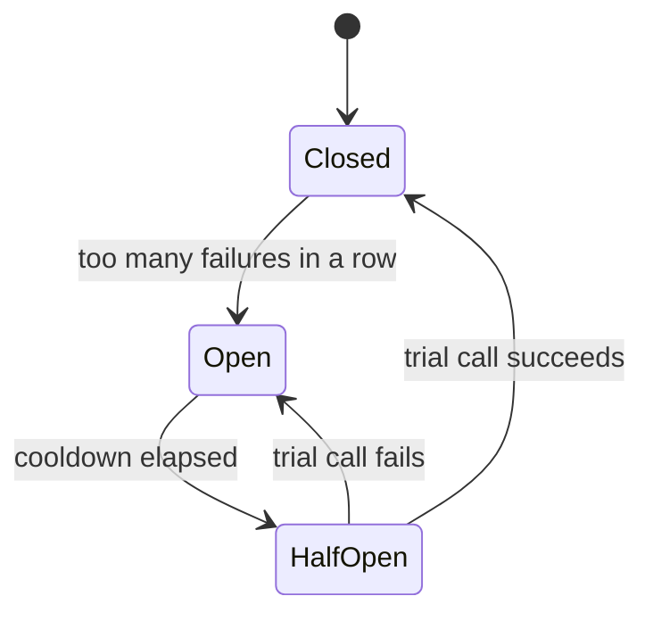
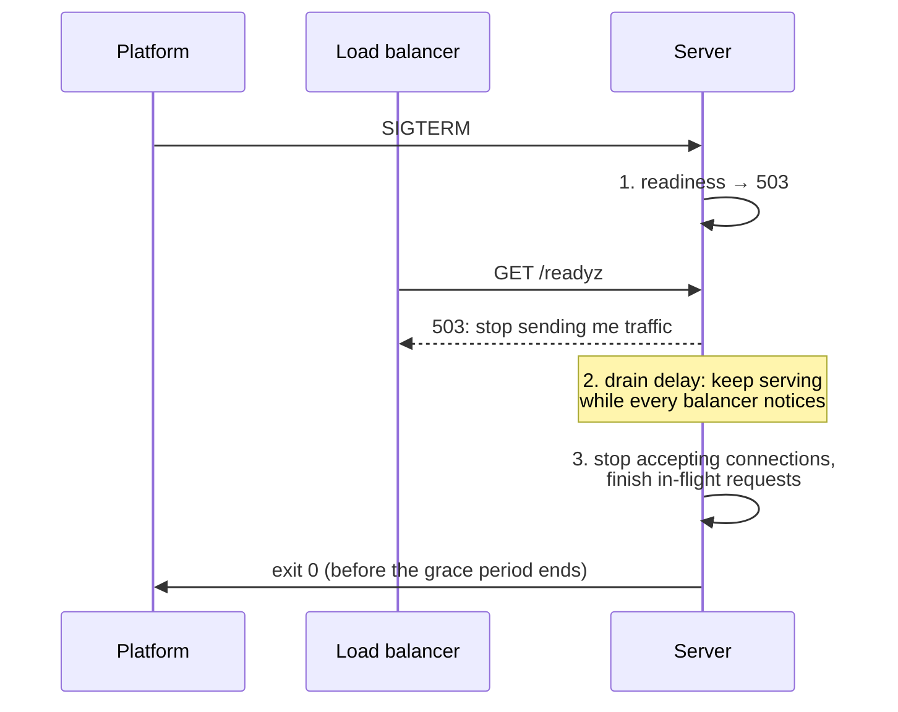

# 8.4 Rate limiting & resilience

Three kinds of trouble arrive at every successful service. The first comes from **outside**: a script stuck in a loop, a scraper, a customer's bug, or an attacker sending far more requests than any honest client would. The second comes from **inside**: a dependency (the database, a payment provider, another team's service) gets slow or fails, and your service, waiting politely on it, fails too. The third comes from **you**: every deploy stops the old copies of your service, and a copy that stops carelessly drops the requests it was serving. This chapter covers the defences against all three: **rate limiting**, to protect your service from its clients; **resilience patterns** (circuit breakers, bulkheads, load shedding and graceful degradation), to protect it from its dependencies; and **graceful shutdown**, so a deploy is invisible to users. You'll watch a circuit breaker trip and recover, and a server finish its last request after being told to stop.

## What you'll learn

- **Rate limiting** algorithms (fixed window, sliding window, token bucket) and their trade-offs.
- Why limits behind a load balancer need **shared counters**, and why a refusal is **429** with **Retry-After**.
- **Fail open vs fail closed**: what to do when the limiter itself is broken.
- **Circuit breakers**: failing fast when a dependency is down, then testing carefully for recovery, live.
- **Bulkheads**, **load shedding** and **graceful degradation**: keeping the most important things working when others can't.
- **Graceful shutdown**: SIGTERM, flipping readiness, draining in-flight requests.

---

## Rate limiting: fairness and self-defence

A **rate limit** caps how many requests a client may make in a period of time: *"60 orders per API key per minute."* It protects:

- **The service**: no single client can consume all capacity.
- **Other customers**: one noisy client can't slow everyone else down (the "noisy neighbour", [chapter 7.4](../security/authorization-multi-tenancy.mdx)).
- **Costs and abuse**: spammers can't create a million accounts or posts ([chapter 7.5](../security/web-attacks.mdx)), and brute-force login attempts become impractically slow ([chapter 7.2](../security/authentication.mdx)).

:::note[Everyday anchor]
A rate limit is a nightclub bouncer with a clicker. Only so many people get in per hour; everyone else waits outside. Nobody's banned. They're told "not yet, come back in ten minutes", and the people already inside can still move and breathe.
:::

### Algorithms

| Algorithm | How it works | Pros | Cons |
|---|---|---|---|
| **Fixed window** | Count requests per calendar window (e.g. per minute: 12:00:00–12:00:59). Reset at each boundary. | Simplest; one counter per client | A burst at 12:00:59 and another at 12:01:00 allow **twice** the limit in two seconds |
| **Sliding window** | Count requests in the *last* 60 seconds, however the clock falls, often approximated by weighting the previous window | Smooth, fair | More bookkeeping |
| **Token bucket** | A bucket holds up to N tokens, refilled at a steady rate; each request takes one; empty bucket = refused | Allows short bursts up to N, enforces a long-run average; very common | Two parameters to tune |
| **Leaky bucket** | Requests queue and are processed at a fixed rate | Perfectly smooth output | Adds waiting; queue can fill |

Fixed window is often good enough: for most endpoints, a brief double burst at a window boundary is harmless. Token bucket is what most API gateways and cloud providers use.

### Counters must be shared

A service with several copies behind a load balancer ([chapter 8.3](./reverse-proxies-and-nginx.mdx)) can't keep its counters in each copy's memory: a client whose requests are spread over three copies would get three times the limit. The counters must live somewhere every copy can reach, and **Redis** (an in-memory data store, [chapter 6.7](../data/redis-and-caching.mdx)) is the usual choice, because its `INCR` command adds one and returns the new value **atomically**: two copies incrementing at the same moment can never both see the same count. A fixed-window limiter is two commands. Try them in `redis-cli` (`docker run -d --name rl redis:7-alpine` then `docker exec -it rl redis-cli`):

```text
> INCR rl:key42:1790284380        # client "key42", window starting at that Unix time
(integer) 1
> EXPIRE rl:key42:1790284380 61   # forget the counter once the window is over
(integer) 1
> INCR rl:key42:1790284380
(integer) 2
> TTL rl:key42:1790284380
(integer) 57
```

If the number `INCR` returns is above the limit, refuse. The key name holds the client and the window, so a new minute starts a fresh counter, and `EXPIRE` stops old counters filling memory.

### Saying no politely: 429 and Retry-After

A refused request gets **`429 Too Many Requests`**, with a **`Retry-After`** header saying how many seconds until the client may try again:

```text
HTTP/1.1 429 Too Many Requests
Retry-After: 23
```

`Retry-After` turns a refusal into instructions: well-behaved clients wait exactly that long instead of hammering the server with immediate retries ([chapter 8.1](./distributed-survival-kit.mdx)).

**What to limit by.** An **API key** or user account is an identity the client can't forge. Limiting by IP address is weaker: many users can share one IP (an office, a mobile network), and attackers can use many IPs or spoof `X-Forwarded-For` ([chapter 8.3](./reverse-proxies-and-nginx.mdx)). Real systems often combine several: per key, per IP for unauthenticated endpoints like login, and a global limit to protect the service overall.

### Fail open or fail closed?

What should happen when **Redis is down** and the limiter can't count? Two choices:

- **Fail closed**: refuse every request. Safest against abuse, but a Redis outage becomes a **total outage**.
- **Fail open**: allow requests without counting. The service keeps working; abuse is briefly unchecked.

There's no universal answer; it depends on what the limit protects. For creating posts or links, availability usually matters more than perfect limiting for a few minutes: fail open, and log a warning. A login endpoint protecting against password guessing might reasonably fail closed. Whichever you choose, write the choice and the reason in a comment, because the next engineer will wonder.

---

## Resilience: surviving your dependencies

[Chapter 8.1](./distributed-survival-kit.mdx) introduced timeouts and retries. They're essential, but not enough. Picture a shop calling a payment provider that's completely down. Each call waits for its timeout (say 2 seconds), then fails. Meanwhile, requests pile up, each holding a thread and a database connection for those 2 seconds; soon the shop runs out of connections, and customers see errors on pages that don't even need payments. One dependency's failure has **cascaded**.

Four patterns stop that.

### 1. Circuit breakers: stop calling what's broken

A **circuit breaker** wraps calls to a dependency and watches for failures. It has three states:



- **Closed** (normal): calls go through; failures are counted.
- **Open** (tripped): after too many failures, calls **fail immediately** without touching the dependency. No waiting on timeouts, no piling up, and the struggling dependency gets breathing room to recover.
- **Half-open** (testing): after a cooldown, one **trial** call is allowed through. Success closes the circuit; failure re-opens it for another cooldown.

The name comes from electrical circuit breakers, which cut the power when something's wrong rather than letting wires overheat.

The handbook's `snip/examples/breaker` (a standalone Go program) shows one working against a fake dependency that fails between 0.3 and 1.5 seconds and is slow while failing:

```text
    0ms  breaker=CLOSED     ok
  401ms  breaker=CLOSED     error: dependency error
  602ms  breaker=CLOSED     error: dependency error
  803ms  breaker=OPEN       error: dependency error          ← 3rd failure in a row: trips
  903ms  breaker=OPEN       failed fast (not called)          ← instant, no waiting
 1305ms  breaker=OPEN       TRIAL CALL → still failing, circuit re-opens
 1406ms  breaker=OPEN       failed fast (not called)
 1707ms  breaker=CLOSED     TRIAL CALL → ok, circuit closes   ← recovered
 1807ms  breaker=CLOSED     ok

the dependency was actually called 10 times; 6 requests failed fast without calling it
```

Six requests got an immediate answer instead of waiting on a dead dependency, and the dependency was left alone to recover. The core of the logic fits in a dozen lines:

```go
func (b *Breaker) Call(op func() error) error {
	if b.state == Open {
		if time.Since(b.openedAt) < b.cooldown {
			return ErrOpen // don't even try: protect ourselves and the dependency
		}
		b.state = HalfOpen // cooldown over: allow one trial
	}
	err := op()
	if err == nil {
		b.state, b.failures = Closed, 0 // success closes the circuit
		return nil
	}
	b.failures++
	if b.state == HalfOpen || b.failures >= b.threshold {
		b.state, b.openedAt = Open, time.Now() // trip (or re-trip after a failed trial)
	}
	return err
}
```

(The real file adds a mutex, because many goroutines share one breaker, [chapter 4.5](../go/concurrency.mdx).) In production, use a maintained library (for Go, `sony/gobreaker`) or a service mesh that does this for every service automatically.

### 2. Bulkheads: contain the damage

Ships are divided into watertight compartments, **bulkheads**, so one hole doesn't sink the whole ship. In software: give each dependency or kind of work its **own, limited resources**, so one can't exhaust everything.

- A **separate connection pool** (or a limit on concurrent calls) per dependency: if the payment provider hangs, at most 10 goroutines wait on it; the other 990 keep serving product pages.
- **Separate processes** for separate jobs: background work runs in a worker ([chapter 8.2](./queues-and-background-work.mdx)), not inside the web app, so a backlog can never slow user requests.
- **Separate queues** per priority, so a flood of low-priority jobs can't delay urgent ones.

### 3. Load shedding: say no early

When a service is genuinely overloaded, it's better to **quickly refuse some requests** than to accept them all and serve everyone slowly, or crash. **Load shedding** rejects excess work at the door (with `503` and `Retry-After`), keeping latency good for the requests it does accept. Common signals to shed on: too many requests in flight, queue depth, CPU. Prioritise what you keep: shed background and non-critical traffic before user-facing requests.

### 4. Graceful degradation: keep the core working

Decide in advance what's **essential** and what's **nice to have**, and design so the nice-to-haves can fail without taking the essentials down. A shop's product page, for example:

| When this fails… | The page… | Because… |
|---|---|---|
| Recommendations service | shows the product without "you might also like" | recommendations are a bonus |
| Reviews service | shows "reviews unavailable" | buying doesn't need them |
| Cache | reads from the database (slower) | the cache is an optimisation |
| Product database | shows an error | without it there is no page: this is the core |

Each "…" row is a **fallback** written into the code: an `if err != nil` that serves something useful instead of returning an error. Only the last row is allowed to fail the page.

:::info[In the real world]
Resilience patterns became mainstream after large companies documented how cascading failures took down their systems. Netflix's Hystrix library popularised circuit breakers and bulkheads in the early 2010s; today the same ideas are usually built into service meshes (Istio, Linkerd), API gateways and cloud load balancers. Some companies go further with **chaos engineering**: deliberately breaking dependencies in production-like environments to prove the system degrades gracefully.
:::

---

## Graceful shutdown: leaving without dropping requests

Your service is stopped far more often than it crashes: every deploy, every scale-down, every machine being patched. Each time, some copy is in the middle of serving requests. Stop it abruptly and those requests fail. Stop it **gracefully** and nobody notices.

:::note[Everyday anchor]
A shop closing for the night doesn't switch the lights off on the customers inside. It turns the sign on the door to "Closed" (no new customers), lets the people already inside finish paying, and then locks up. If someone is still dawdling at midnight, the manager does eventually see them out.
:::

The mechanism has a shape every platform shares. To stop a process, the platform (Docker, Kubernetes, systemd, a deploy script) sends it the **SIGTERM** signal ("please stop", [chapter 1.2](../foundations/programs-processes-threads.mdx)), waits for a **grace period** (10 seconds for `docker stop`, 30 for Kubernetes by default), and then sends **SIGKILL**, which ends the process instantly with no chance to clean up. Graceful shutdown is what your program does with that window:



1. **Flip readiness.** The readiness endpoint (`/readyz`, [chapter 8.3](./reverse-proxies-and-nginx.mdx): "can I serve traffic right now?") starts answering `503`. Load balancers polling it stop sending new requests.
2. **Drain delay.** Keep serving normally for a few seconds, because health checks run every few seconds and a load balancer may still send a request or two before it notices.
3. **Stop and finish.** Stop accepting new connections, let requests already in progress complete, close database pools and flush buffers, then exit. Put a deadline on this step, shorter than the grace period, so a stuck request can't turn a graceful exit into a SIGKILL.

`snip/examples/graceful/main.go` is a standalone server that does exactly those three steps. The heart of it:

```go
// The context is cancelled on SIGTERM (what orchestrators and `docker stop` send) or Ctrl-C.
ctx, stop := signal.NotifyContext(context.Background(), syscall.SIGTERM, os.Interrupt)
defer stop()
...
<-ctx.Done()

// 1. Tell the load balancer to stop sending new requests.
ready.Store(false)
log.Printf("signal received: /readyz now 503; draining for %v", *drain)
// 2. Keep serving while it notices.
time.Sleep(*drain)
// 3. Stop accepting connections and wait for in-flight requests, up to 10 s.
log.Print("shutting down: waiting for in-flight requests")
shutdownCtx, cancel := context.WithTimeout(context.Background(), 10*time.Second)
defer cancel()
if err := srv.Shutdown(shutdownCtx); err != nil {
	log.Fatalf("forced exit, requests cut off: %v", err)
}
```

Go's `http.Server.Shutdown` does step 3 for you: it closes the listeners, then waits for active requests to finish or the context deadline to pass. Sending SIGTERM while a 3-second request is in flight gives:

```text
2026/10/29 14:06:04 listening on :9091 (pid 12323)
2026/10/29 14:06:05 signal received: /readyz now 503; draining for 2s
2026/10/29 14:06:07 shutting down: waiting for in-flight requests
done                                  ← the in-flight request's response, delivered
2026/10/29 14:06:08 stopped cleanly
```

:::warning[What can go wrong]
- **The process never sees SIGTERM.** A shell-form Docker `CMD` makes `sh` PID 1, and `sh` doesn't forward signals ([chapter 9.2](../containers/writing-dockerfiles.mdx)). The grace period runs out and everything is SIGKILLed.
- **No drain delay.** The server stops listening while load balancers still send it traffic: a burst of connection errors on every deploy.
- **Shutdown deadline longer than the grace period.** The platform's SIGKILL arrives first and cuts off the very requests you were waiting for.
- **Long-lived work with no plan.** WebSockets, streaming responses and long jobs don't finish in 10 seconds. Tell clients to reconnect, or checkpoint the job so another worker can resume it.
:::

---

## Apply it to snip

snip, the URL shortener built through this handbook, uses every pattern in this chapter. Here's where.

### A shared limiter in Redis

snip limits link creation per API key with a fixed window in Redis (`snip/internal/ratelimit/ratelimit.go`): the `INCR` and `EXPIRE` you typed above, sent from Go in one round trip:

```go
func (l *Redis) Allow(ctx context.Context, key string) (bool, time.Duration, error) {
	start, untilNext := windowStart(l.now(), l.window)
	k := "snip:rl:" + key + ":" + strconv.FormatInt(start, 10)
	// INCR and EXPIRE in one round trip. INCR is atomic, so two requests
	// arriving together can never both see the same count.
	pipe := l.rdb.TxPipeline()
	incr := pipe.Incr(ctx, k)
	pipe.Expire(ctx, k, l.window+time.Second)
	if _, err := pipe.Exec(ctx); err != nil {
		return true, 0, err // fail open: a Redis outage shouldn't block every user
	}
	if incr.Val() > l.limit {
		return false, untilNext, nil
	}
	return true, 0, nil
}
```

- The key names the **client** and the **window**: `snip:rl:create:7:1790284380` is "owner 7's creations in the minute starting at that Unix time".
- Both commands go in one **pipeline**, a single round trip.
- **`return true, 0, err`** is the fail-open choice, stated in a comment. snip logs `rate limiter unavailable` and lets the request through.

The HTTP handler turns a refusal into a 429 with `Retry-After` (`snip/internal/httpapi/server.go`):

```go
if !allowed {
	w.Header().Set("Retry-After", strconv.Itoa(int(retry.Seconds())+1))
	writeError(w, http.StatusTooManyRequests, "rate_limited", "too many links created; slow down")
	return
}
```

### Bulkheads and graceful degradation

snip's click counting runs in `snip-worker`, a separate process ([chapter 8.2](./queues-and-background-work.mdx)): a bulkhead, so a backlog of clicks can never slow redirects. And it degrades in three places:

| When this fails… | snip… | Because… |
|---|---|---|
| Redis cache | reads from Postgres (slower) | the cache is an optimisation ([chapter 6.7](../data/redis-and-caching.mdx)) |
| Click recording | still redirects; logs a warning | counting is less important than the redirect |
| The rate limiter | allows requests (fails open) | link creation matters more than perfect limits |

The redirect, the one thing users actually need, depends only on finding the link in Postgres. Everything else degrades around it.

### Graceful shutdown

`snip/cmd/snip/main.go` does step 3 itself: on SIGTERM or Ctrl-C it calls `srv.Shutdown` with a 10-second deadline (well under Kubernetes's 30-second grace period) and logs `stopped cleanly`. Steps 1 and 2 are done by the platform rather than in Go: in Kubernetes, snip's Deployment has a `preStop` hook that sleeps 5 seconds before SIGTERM is sent, while Kubernetes removes the Pod from the Service's endpoints ([chapter 10.2](../kubernetes/core-objects.mdx)); on AWS, the load balancer's `deregistration_delay` plays the same role (`snip/infra/aws/compute.tf`). Same three steps, split between the app and the platform. The worker (`snip/cmd/snip-worker/main.go`) stops its loop on the same signal and, because it acknowledges clicks only after counting them, an interrupted batch is redelivered rather than lost.

---

:::warning[What can go wrong]
- **No rate limits.** One buggy client takes the service down for everyone.
- **Per-copy, in-memory limits behind a load balancer.** The real limit becomes N times too high.
- **Limiting by forgeable identifiers.** Spoofed IPs slip past.
- **Retries without a breaker.** Every request waits for timeouts on a dead dependency, and the failure cascades.
- **Shared pools for everything.** One slow dependency starves all the others.
- **Failing closed by accident.** A limiter or cache outage turning into a full outage.
- **No agreed "essential core".** Everything is treated as critical, so any failure is total.
- **Ungraceful shutdown.** Every deploy drops a handful of requests, and nobody connects the errors to the deploys.
:::

---

## Lab

Free, on your own computer. Steps 1–2 are standalone Go programs (they live in `snip/examples/` but don't use snip); steps 3–4 use snip.

1. **Watch the circuit breaker.**
   ```bash
   cd ~/code/zero-to-prod/snip
   go run ./examples/breaker
   ```
   Change `threshold` to 1 and `cooldown` to 200 ms in `examples/breaker/main.go` and rerun: it trips sooner and probes more often. What's the trade-off? (Faster protection vs more false trips on a single random error; more probes vs more load on a recovering dependency.)

2. **Shut a server down gracefully.** In one terminal:
   ```bash
   go run ./examples/graceful -drain-delay 3s          # prints "listening on :9091 (pid 12345)"
   ```
   In a second terminal, start a slow request, then ask the server to stop while it's in flight:
   ```bash
   PID=12345                                           # the pid the server printed
   curl -s localhost:9091/slow &                       # takes 3 s
   sleep 1; kill -TERM $PID                            # SIGTERM, as a platform would send it
   sleep 0.5; curl -s -w " %{http_code}\n" localhost:9091/readyz   # "shutting down 503"
   wait                                                 # the slow request still prints "done"
   ```
   Notice the order in the first terminal: readiness flipped, drain, then "waiting for in-flight requests", then "stopped cleanly". Now try `-work 15s` with a fresh `/slow` request: the 10-second deadline expires and you see "forced exit, requests cut off".

3. **Hit snip's rate limit.** Start snip in memory mode with a low limit, and copy the development key from its log:
   ```bash
   SNIP_RATE_LIMIT=3 SNIP_LOG_FORMAT=text go run ./cmd/snip
   ```
   In another terminal:
   ```bash
   KEY=snip_paste_key_here
   for i in 1 2 3 4 5; do
     curl -s -o /dev/null -w "%{http_code} " -X POST localhost:8080/api/links -H "Authorization: Bearer $KEY" -d '{"url":"https://go.dev"}'
   done; echo                                                        # 201 201 201 429 429
   curl -si -X POST localhost:8080/api/links -H "Authorization: Bearer $KEY" -d '{"url":"https://go.dev"}' | grep -i retry-after
   ```
   Wait for the `Retry-After` seconds and try again: allowed. Then press Ctrl-C in snip's terminal and read its last log lines: `shutting down`, `stopped cleanly`.

4. **See the shared counter in Redis, and fail open** (with Postgres and Redis running, chapters [6.6](../data/postgres-from-go.mdx)–[6.7](../data/redis-and-caching.mdx)). Run snip with `SNIP_REDIS_ADDR=localhost:6379`, create a few links, then:
   ```bash
   docker exec snip-redis redis-cli KEYS 'snip:rl:*'          # one counter per key per minute
   docker exec snip-redis redis-cli TTL "$(docker exec snip-redis redis-cli KEYS 'snip:rl:*' | head -1)"
   ```
   Then stop Redis and create a link: it succeeds (fail open), and snip logs `rate limiter unavailable`.

5. **Design exercise.** snip adds link-preview fetching ([chapter 7.5](../security/web-attacks.mdx)'s SSRF discussion). The fetcher calls arbitrary websites, which are often slow or down. Which of this chapter's patterns would you apply, and how? (Hint: all four resilience patterns, plus graceful shutdown for the fetcher itself.)

## Self-check

<Quiz
  id="distributed-rate-limiting-and-resilience"
  questions={[
    {
      q: 'Why should rate-limit counters live in Redis instead of in each process’s memory?',
      options: [
        'Redis is faster than an in-process map when many threads count',
        'Several copies run; per-process counters would give the limit once per copy',
        'Programs can’t count safely across threads without Redis',
        'To keep counters after a restart, so limits survive deploys',
      ],
      answer: 1,
      explain: 'Several copies run behind a load balancer, and per-process counters would let a client get the full limit from each copy. Limits must be shared across every copy, and Redis gives an atomic INCR on one shared counter. An in-process map is actually faster (option 1), and with a mutex it is perfectly safe (option 3); it just isn’t shared.',
    },
    {
      q: 'What does a circuit breaker do when it is open?',
      options: [
        'Retries the dependency faster, to find out sooner when it recovers',
        'Fails calls at once without contacting the dependency, then tries one',
        'Shuts down the whole service until the dependency is healthy',
        'Queues calls until the dependency recovers, then sends them all',
      ],
      answer: 1,
      explain: 'It fails calls immediately without contacting the dependency, until a cooldown allows one trial call (half-open). Failing fast stops requests piling up behind a dead dependency and gives it room to recover. Queuing every call and sending them all at once (option 4) would hit a recovering dependency with a flood.',
    },
    {
      q: 'A limiter fails open when Redis is unavailable. When might failing closed be the better choice?',
      options: [
        'Never; refusing requests is always worse than letting them in',
        'For limits against serious abuse, like login attempts',
        'For read-only endpoints, since blocking them costs nothing',
        'When the service has many copies, which can’t share one counter',
      ],
      answer: 1,
      explain: 'For limits that guard against serious abuse, like login attempts, letting unlimited password guesses through is worse than refusing logins briefly. The choice depends on what the limit protects: availability wins for creating content; security may win for authentication.',
    },
    {
      q: 'Running background work in a separate worker process, so it can never slow user requests, is which resilience pattern?',
      options: [
        'Circuit breaker, stopping calls to a failing database',
        'Bulkhead: isolating work so one problem can’t starve another',
        'Token bucket, spreading the work over time',
        'Backpressure, slowing the requests when the worker falls behind',
      ],
      answer: 1,
      explain: 'A bulkhead isolates work so a problem in one part cannot exhaust the resources another part needs. A backlog or bug in the worker can’t slow or crash the request path, because they share no process resources. Backpressure (option 4) would do the opposite: let the worker’s trouble slow the users.',
    },
    {
      q: 'Every deploy causes a short burst of "connection refused" errors, even though the server calls Shutdown and waits for in-flight requests. What is most likely missing?',
      options: [
        'A longer Shutdown deadline, so slow requests can finish',
        'A drain delay after readiness turns 503, before it stops listening',
        'A circuit breaker in front of the server',
        'More replicas, so each one gets less traffic during the deploy',
      ],
      answer: 1,
      explain: 'Shutdown handles requests already in progress, but the load balancer still sends new ones until it notices this copy is going. Without a pause between flipping readiness and closing the listener (or a preStop sleep in Kubernetes), those new requests hit a closed port. A longer deadline (option 1) helps slow requests, not new ones that can’t connect.',
    },
  ]}
/>

<details>
<summary>Explain the fixed-window boundary problem with an example, and how a token bucket avoids it.</summary>

With a limit of 60 per minute in fixed windows, a client can send **60 requests at 12:00:59** (end of one window) and **60 more at 12:01:00** (start of the next): **120 in two seconds**, double the intended rate. A **token bucket** of size 60 refilling at one token per second avoids it: after the first burst of 60, the bucket is empty, and only about one request per second is allowed until it refills. It still permits reasonable bursts (up to the bucket size) while enforcing the long-run average.

</details>

<details>
<summary>Why does graceful shutdown need a deadline at all? Wouldn't waiting for every request be kinder?</summary>

Because the platform won't wait forever. After its grace period (30 s in Kubernetes by default) it sends SIGKILL, and then *everything* still running is cut off, with no logs flushed and no connections closed cleanly. A deadline shorter than the grace period lets your program decide how to end: log which requests were cut off, close the database pool, exit with a clear error. And one stuck request (a hung dependency without a timeout, [chapter 8.1](./distributed-survival-kit.mdx)) shouldn't hold a whole deploy hostage. The rule: **your shutdown deadline < the platform's grace period**, and every request already has its own timeout well under both.

</details>

<details>
<summary>Answer lab step 5: how would you protect snip from a slow, unreliable link-preview fetcher?</summary>

- **Timeouts** on every fetch ([chapter 8.1](./distributed-survival-kit.mdx)), short enough that a hung website can't hold resources long.
- **A circuit breaker per destination** (or per domain), so a site that's down fails fast instead of being hammered.
- **A bulkhead**: run fetching in its own worker process (or a separate, limited pool), off the request path, via a queue ([chapter 8.2](./queues-and-background-work.mdx)), so slow websites can never affect redirects or the API.
- **Load shedding and rate limits** on the fetch queue, so a flood of new links can't overwhelm the fetcher, plus per-domain limits to be polite to other people's sites.
- **Graceful degradation**: links work perfectly without a preview; the preview simply appears later or never. And, per [chapter 7.5](../security/web-attacks.mdx), the fetcher must refuse private addresses (SSRF).
- **Graceful shutdown** for the fetcher: on SIGTERM, stop taking new jobs, finish or give back (don't acknowledge) the ones in progress, so they're redelivered to another worker.

</details>
