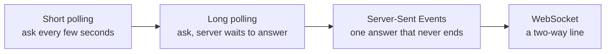
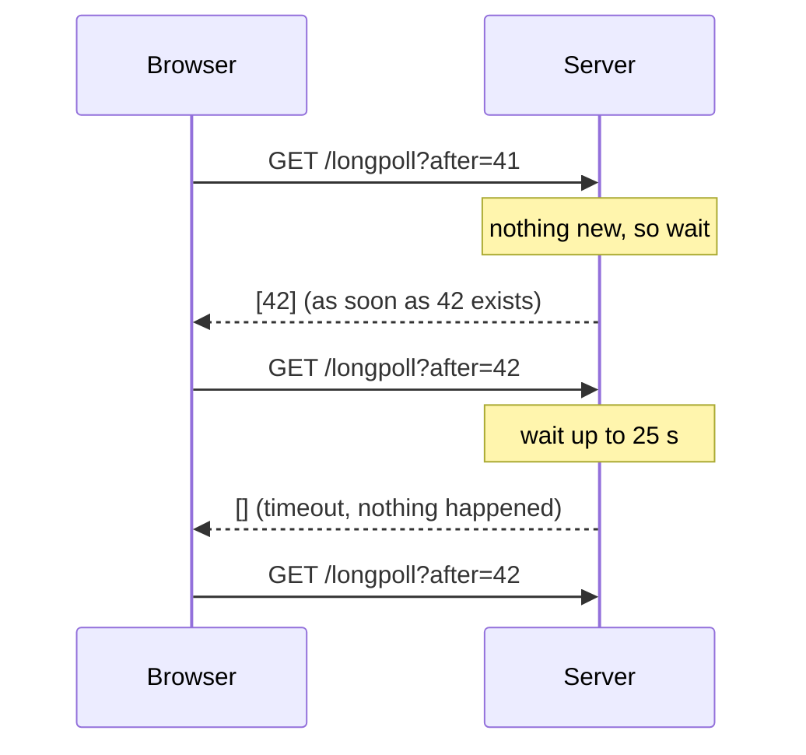
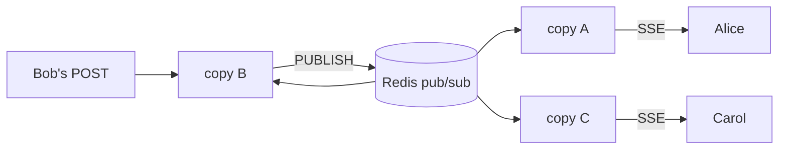
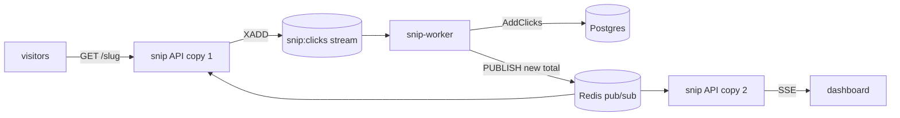

# 8.7 Real-time: polling, SSE and WebSockets

A chat message appears without you pressing refresh. A delivery app's map shows the driver turning the corner. A build log scrolls by while CI runs. In each case the server had news and got it to your screen within a second, even though plain HTTP only ever lets the *browser* speak first. This chapter shows the four ways to get around that rule — short polling, long polling, Server-Sent Events and WebSockets — with one small Go program that serves all four, so you can watch each on the wire. Then it covers the part tutorials skip: what changes when a hundred thousand screens stay connected to many servers at once.

## What you'll learn

- Why HTTP's **request/response** shape makes "the server tells you" hard, and the four workarounds in order of sophistication.
- **Server-Sent Events (SSE)**: one response that never ends, with automatic reconnect and resume via **`Last-Event-ID`**.
- **WebSockets**: an HTTP request that **upgrades** into a two-way connection of **frames**, kept alive by **ping/pong**.
- How to choose: most "real-time" features need only SSE; WebSockets earn their cost when the browser talks back constantly.
- Running it at scale: **fan-out** across servers with **pub/sub**, **backpressure** on slow clients, proxy and load-balancer **timeouts**, and **connection limits**.

---

## HTTP only answers questions

HTTP ([chapter 1.5](../foundations/http-from-zero.mdx)) is a conversation of **requests and responses**: the browser asks, the server answers, done. The server cannot speak first. If a new chat message arrives on the server, there is no request to attach it to.

:::note[Everyday anchor]
HTTP is a shop counter. You walk up, ask "any post for me?", get an answer, and leave. The shopkeeper can't call you when a parcel arrives; you don't even have a phone. Every real-time technique is a way of either asking very often, or not leaving the counter.
:::

Four ways to get news from server to browser, from crudest to most capable:



All four run in this chapter's demo, `snip/examples/realtime`: a server that publishes a "tick" event every 3 seconds, plus anything you send it. Start it now and keep it running:

```bash
cd ~/code/zero-to-prod/snip
go run ./examples/realtime        # listens on http://localhost:8090
```

---

## Short polling: asking every few seconds

The simplest approach: the browser asks again on a timer. "Anything new since event 41?" "No." Two seconds later: "Anything new since 41?" "Yes, 42 and 43."

```bash
curl 'localhost:8090/poll?after=0'    # everything the server remembers, as JSON
curl 'localhost:8090/poll?after=999'  # nothing newer than 999: an empty list, []
```

**Short polling** is plain HTTP, so it works through every proxy, cache and firewall, and the server needs no special code. The costs are easy to compute. With a 2-second interval, news arrives on average 1 second late, and every open tab sends 30 requests a minute, almost all answered "nothing new". Ten thousand idle tabs is 5,000 requests per second of pure overhead, each with headers, authentication and a log line.

Short polling is the right answer more often than people admit: a dashboard that refreshes every 30 seconds, an "is my export ready?" check, anything where a few seconds of delay is fine and the number of clients is modest.

---

## Long polling: the server waits before answering

**Long polling** keeps the request but changes when the server answers. The browser asks "anything after 41?". If there is, the server answers at once. If not, the server *holds the request open* until something happens, or until a timeout (here 25 seconds), and then answers with an empty list. Either way, the browser immediately asks again.

```bash
curl 'localhost:8090/longpoll?after=999999'   # hangs... then answers the moment the next tick is published
```



News now arrives almost instantly, and idle clients cost one request per 25 seconds instead of one per 2. Long polling powered the first generation of in-browser chat, and it still works through any proxy that tolerates a slow response.

The handler in `snip/examples/realtime/handlers.go` shows the one subtle part. Checking for news and starting to wait must be a single step, or an event published in between is missed:

```go
// One call returns both: what's already there after `after`, and a channel
// of live events from now on — taken under one lock, so nothing slips between.
backlog, live, cancel := s.hub.Subscribe(afterParam(r, "after"))
defer cancel()
if len(backlog) > 0 {
	writeJSON(w, backlog)          // news already waiting: answer now
	return
}
select {
case e, ok := <-live:              // the next event, whenever it comes
	if ok {
		writeJSON(w, []Event{e})
		return
	}
case <-timer.C:                    // 25 s with nothing new
case <-r.Context().Done():         // the client hung up
	return
}
writeJSON(w, []Event{})            // empty answer; the client asks again
```

The remaining cost: every event still needs a fresh request, so a burst of ten events in a second means ten round trips, and the browser must track "after" carefully so nothing falls between two requests.

---

## Server-Sent Events: one response that never ends

What if the server never finished its answer? It sends the headers, then writes an event, flushes it to the network, and keeps the response open to write the next one, for as long as the browser stays. That is **Server-Sent Events (SSE)**, a format standardised in HTML and built into every browser as `EventSource`.

Watch it in your terminal. `curl -N` turns off curl's buffering so you see each event as it arrives:

```bash
curl -N localhost:8090/events
```

```text
retry: 3000              ← "if we get disconnected, reconnect after 3 s"

id: 7                    ← this event's ID
data: tick 7 (clients on this copy: 1)
                         ← a blank line ends an event
id: 8
data: tick 8 (clients on this copy: 1)

: ping                   ← a comment line: ignored, it only keeps the connection busy
```

A new connection first receives the recent events the server still remembers (up to 100), then each new one as it happens. In another terminal, publish something and watch it appear in the first:

```bash
curl -X POST localhost:8090/publish -d 'hello from curl'
```

The **`text/event-stream`** format has four fields: `data:` (the payload; several `data:` lines join with newlines), `id:` (the event's ID), `event:` (an optional event type) and `retry:` (reconnect delay in milliseconds). Lines starting with `:` are comments.

### The browser does the hard parts

In a browser, three lines subscribe:

```js
const es = new EventSource('/events');
es.onmessage = (m) => console.log(m.lastEventId, m.data);
```

Open `http://localhost:8090` to see it running. Then stop the server (Ctrl-C in its terminal), wait, and start it again. The page says "reconnecting…" and recovers on its own. That's the best feature of SSE: **reconnecting is built in**. When the connection drops, `EventSource` waits the `retry` time and reconnects, sending a **`Last-Event-ID`** header with the last ID it saw. A server that remembers recent events can send exactly what was missed:

```bash
curl -N -H 'Last-Event-ID: 3' localhost:8090/events   # replays 4, 5, 6… then continues live
```

(The demo forgets everything on restart, so after restarting it you'll only see new events. A real system keeps recent events somewhere durable, as we'll see.)

### The server side, and the timeout trap

The SSE handler in `snip/examples/realtime/handlers.go`, trimmed:

```go
rc := http.NewResponseController(w)
// The server's WriteTimeout (15 s) is meant for normal responses. A stream
// lives for hours, so lift the deadline for this one response.
_ = rc.SetWriteDeadline(time.Time{})

w.Header().Set("Content-Type", "text/event-stream")
w.Header().Set("Cache-Control", "no-cache")
w.Header().Set("X-Accel-Buffering", "no") // ask nginx not to buffer this response

backlog, live, cancel := s.hub.Subscribe(after) // after = Last-Event-ID
defer cancel()
for _, e := range backlog {
	writeSSE(w, e)
}
rc.Flush()                                      // push the bytes out now

for {
	select {
	case <-r.Context().Done():                  // the browser went away
		return
	case e, ok := <-live:
		if !ok {                                // cut off: too slow, or shutting down
			return
		}
		writeSSE(w, e)
	case <-beat.C:
		fmt.Fprint(w, ": ping\n\n")             // heartbeat every 15 s
	}
	rc.Flush()
}
```

Two lines matter more than they look:

- **`Flush`.** Go's `ResponseWriter` buffers output for efficiency. Without flushing, events sit in a buffer and the browser sees nothing until it fills.
- **`SetWriteDeadline(time.Time{})`.** A well-configured server sets a `WriteTimeout` so a stuck response can't live forever ([chapter 5.4](../apis/structuring-a-real-service.mdx)). For a stream, "forever" is the point. Forget this line and every stream dies after exactly 15 seconds, and the browser reconnects, and it dies again 15 seconds later. If you ever see a stream that reconnects on a suspiciously regular schedule, look for a timeout somewhere in the path.

SSE's limits: it is **one-way** (server to browser; the browser sends anything else with normal requests), **text only**, and `EventSource` can only make `GET` requests with no custom headers, so it can't send an `Authorization: Bearer …` token. It sends cookies, which suits websites with a login session; APIs with tokens either use a short-lived token in the URL or read the stream with `fetch()` instead of `EventSource`.

---

## WebSockets: an HTTP request that becomes a two-way line

Sometimes the browser has as much to say as the server: a multiplayer game, a shared document editor, a chat where you type constantly. Sending each keystroke as a separate HTTP request wastes headers and time. A **WebSocket** is a single TCP connection ([chapter 1.4](../foundations/networks-from-zero.mdx)) where **either side can send a message at any moment**, standardised in RFC 6455 in 2011.

:::note[Everyday anchor]
If SSE is a radio you tune in to, a WebSocket is a phone call. It starts by dialling through the normal exchange (an HTTP request), and once the other side picks up, both of you can talk whenever you like until someone hangs up.
:::

### The upgrade handshake

A WebSocket starts life as an ordinary HTTP `GET`, with headers asking to switch protocols:

```text
GET /ws HTTP/1.1
Host: localhost:8090
Upgrade: websocket                         ← "let's stop speaking HTTP"
Connection: Upgrade
Sec-WebSocket-Key: dGhlIHNhbXBsZSBub25jZQ==  ← random, so the server proves it understood
Sec-WebSocket-Version: 13
Origin: http://localhost:8090              ← which page is asking (browsers always send it)

HTTP/1.1 101 Switching Protocols           ← the last HTTP on this connection
Upgrade: websocket
Connection: Upgrade
Sec-WebSocket-Accept: s3pPLMBiTxaQ9kYGzzhZRbK+xOo=
```

The server answers **`101 Switching Protocols`**, and from that moment the same TCP connection carries WebSocket **frames** instead of HTTP. `Sec-WebSocket-Accept` is a hash of the client's key plus a fixed string from the RFC; it proves the server really speaks WebSocket and isn't a confused cache replaying an old response.

See the handshake yourself (curl speaks the opening HTTP part):

```bash
curl -i -N -H 'Connection: Upgrade' -H 'Upgrade: websocket' \
  -H 'Sec-WebSocket-Version: 13' -H 'Sec-WebSocket-Key: dGhlIHNhbXBsZSBub25jZQ==' \
  -H 'Origin: http://localhost:8090' localhost:8090/ws    # prints the 101 response, then frames
```

After the `101` headers, each event arrives as a frame: two bytes of frame header (they print as junk characters) and then the JSON text. Press Ctrl-C to hang up.

### Frames, and ping/pong

After the upgrade, everything is a **frame**: a few bytes of header (what kind of frame, how long) and a payload. The kinds you'll meet:

| Frame | What it carries |
|---|---|
| **text** | A UTF-8 message, often JSON |
| **binary** | Raw bytes (audio, game state, protobuf) |
| **ping** / **pong** | "Are you there?" / "Yes." Either side may ping; the other must pong |
| **close** | "I'm hanging up", with a code (1000 normal, 1001 going away, 1013 try again later) |

Frames from the browser are **masked** (XORed with a random key) by rule. That isn't encryption; it stops a malicious page from crafting bytes that confuse proxies along the way. For real privacy, use **`wss://`**, WebSocket over TLS ([chapter 7.1](../security/security-literacy.mdx)), which also gets through far more corporate proxies than plain `ws://`.

**Ping/pong** solves a problem every long-lived connection has: a connection can die silently. A phone loses signal, a laptop lid closes, a NAT router forgets the mapping. TCP may not notice for many minutes. So the server pings every 15 seconds; no pong within 5 seconds means the line is dead, and the server frees its resources. The pings also count as traffic, so proxies don't close the connection as idle. (SSE's `: ping` comment does the same job one way.)

### A WebSocket in Go

Go's standard library has no WebSocket server, so the demo uses **`github.com/coder/websocket`**, a small, maintained library with no dependencies of its own. The handler (trimmed from `snip/examples/realtime/handlers.go`):

```go
// Accept answers the upgrade handshake with 101. By default it refuses pages
// from other origins (see "What can go wrong" below).
c, err := websocket.Accept(w, r, nil)
if err != nil {
	return
}
defer c.CloseNow()

// One goroutine reads: browser messages become events for everyone.
go func() {
	defer stop()
	for {
		_, msg, err := c.Read(ctx)
		if err != nil {
			return                         // closed, or the client vanished
		}
		s.publish(ctx, "ws: "+string(msg))
	}
}()

// This goroutine writes: events out, plus a ping every 15 s.
for {
	select {
	case e, ok := <-live:
		if !ok {
			c.Close(websocket.StatusTryAgainLater, "too slow or shutting down; reconnect")
			return
		}
		wsjson.Write(wctx, c, e)           // a text frame holding JSON
	case <-beat.C:
		if err := c.Ping(pctx); err != nil { // no pong in 5 s: give up
			return
		}
	}
}
```

Open `http://localhost:8090` in two browser tabs and type in the WebSocket box: the message appears in both. One reader goroutine and one writer goroutine per connection is the standard shape ([chapter 4.5](../go/concurrency.mdx)): reading and writing happen at independent times, which is the whole point.

Notice what the browser code has to do that `EventSource` did for free: **reconnect** (with a random delay), and **remember the last event ID** so it can ask for what it missed (`/ws?after=42`). A WebSocket is a lower-level tool. You get a pipe; any protocol on top (message types, acknowledgements, resume) is yours to design.

---

## Choosing: SSE unless the browser talks back a lot

| | Short polling | Long polling | SSE | WebSocket |
|---|---|---|---|---|
| Direction | Browser asks | Browser asks | Server → browser | Both ways |
| Latency | Up to one interval | Near instant | Near instant | Near instant |
| Idle cost | A request per interval | A request per timeout | One open connection | One open connection |
| Reconnect and resume | Natural | Natural | **Built in** (`Last-Event-ID`) | Build it yourself |
| Works through proxies | Always | Almost always | Needs buffering off | Needs upgrade support |
| Data | Anything | Anything | UTF-8 text | Text or binary |
| Good for | Slow-changing status | Legacy, restrictive networks | Feeds, notifications, progress, AI token streams | Chat, games, collaborative editing |

A useful rule: **start with SSE for anything the server pushes**, and send the browser's actions as ordinary `POST` requests. That covers notifications, live dashboards, progress bars, and the token-by-token answers of AI chat products, which mostly stream over SSE ([chapter 14.4](../ai/calling-models-from-code.mdx)). Reach for WebSockets when the browser sends frequent small messages, needs binary data, or latency in *both* directions matters.

:::info[In the real world]
HTTP/2 and HTTP/3 make SSE cheaper: many streams share one connection, so the old browser limit of about **six HTTP/1.1 connections per site** (shared across all tabs, and a classic "the seventh tab hangs" bug with SSE) stops mattering. **WebTransport**, built on HTTP/3, is a newer option offering several streams and unreliable datagrams for games and media; browser and server support is still uneven, so most teams wait. For mobile apps that are closed, neither SSE nor WebSockets help: the phone's operating system delivers **push notifications** (Apple's APNs, Google's FCM) on the app's behalf.
:::

---

## Real-time at scale: many servers, many connections

Everything so far ran on one server. Production has several copies behind a load balancer ([chapter 8.3](./reverse-proxies-and-nginx.mdx)), and that changes three things.

### Connections stick, so state comes back

A normal request lasts milliseconds, so a load balancer can send each one to any copy; that's what made scaling out easy ([chapter 8.6](./scaling.mdx)). A stream or WebSocket is pinned to **one** copy for its whole life: hours, maybe. Each copy now holds state (its list of connected clients) that other copies don't share.

Two consequences. First, load spreads by *connections*, not requests: a copy started an hour ago may hold 50,000 connections while a copy started a minute ago holds 200, and the load balancer can't move them. Second, when a copy shuts down, during every deploy, all its clients disconnect at once and reconnect elsewhere.

### Fan-out: getting the event to the right server

Alice is connected to copy A. Bob sends her a chat message, and his `POST` lands on copy B. Copy B has no connection to Alice. Somehow the event must reach copy A.

The standard answer is a **pub/sub backbone**: every copy **subscribes** to a shared channel, and whichever copy receives news **publishes** to it. The broker delivers each message to every subscriber, and each copy forwards it to its own connected clients. Sending one message to many receivers like this is called **fan-out**.



Redis ([chapter 6.7](../data/redis-and-caching.mdx)) has this built in: `PUBLISH channel message` and `SUBSCRIBE channel`. The demo's `-redis` flag switches it on (`snip/examples/realtime/redis.go`):

```go
func (b *redisBus) Publish(ctx context.Context, data string) (Event, error) {
	// IDs come from one shared counter, so "event 42" means the same event
	// on every copy, and Last-Event-ID still works after a reconnect lands
	// on a different copy.
	id, err := b.rdb.Incr(ctx, seqKey).Result()
	if err != nil {
		return Event{}, err
	}
	e := Event{ID: id, Data: data}
	payload, _ := json.Marshal(e)
	return e, b.rdb.Publish(ctx, channel, payload).Err()
}
```

Each copy runs one subscriber loop that hands incoming events to its local **hub** (`hub.Deliver(e)`), which sends them to that copy's clients. The lab runs two copies on two ports and shows an event published on one arriving on the other.

Know what Redis pub/sub does **not** do: it is **fire-and-forget**. A copy that is restarting when a message is published never receives it, and nothing is stored for replay. Two other limits show up in the demo's design: IDs from `INCR` can reach subscribers slightly out of order when two copies publish at once, and each copy's replay history only holds what it saw. When clients must never miss an event, publish to a **Redis Stream** instead (`XADD` assigns ordered IDs and stores the events; the same log that powers [chapter 8.2](./queues-and-background-work.mdx)'s queue) and let each copy read from it with `XREAD`; resuming from `Last-Event-ID` then means reading the stream from that ID. Kafka and NATS JetStream are the heavier-duty equivalents, and hosted services (Ably, Pusher, and the real-time features of Supabase and Firebase) run the whole layer for you.

### Backpressure: one slow phone must not stall everyone

Publishing loops over every connected client. Suppose one client is on a train in a tunnel: its TCP buffer is full and a write to it blocks. If publishing waited for it, every other client would wait too. The demo's hub refuses to wait (`snip/examples/realtime/hub.go`):

```go
for ch := range h.subs {
	select {
	case ch <- e:          // room in this client's 16-event buffer
	default:               // full: this client is too slow; cut it off rather than block
		delete(h.subs, ch)
		close(ch)          // its handler sees the closed channel and ends the connection
	}
}
```

Each client has a small buffer. When it fills, the client is disconnected, reconnects when it can, and catches up with `Last-Event-ID`. That's **backpressure** ([chapter 8.2](./queues-and-background-work.mdx)) with a deliberate policy: protect the many from the one. The alternatives are dropping old events for that client (fine for "latest position on a map", where only the newest value matters) or an unbounded buffer, which is how a server runs out of memory.

### Proxies, load balancers and timeouts

Every hop between browser and server has opinions about long-lived connections. nginx's defaults, for instance, break both techniques:

- It **buffers** responses, so SSE events sit in nginx until a buffer fills.
- It talks HTTP/1.0 to backends and drops the `Upgrade` header, so WebSockets never connect.
- It closes a connection after **60 seconds** without data (`proxy_read_timeout`).

A configuration that handles both:

```nginx
# Turn the browser's "Upgrade: websocket" into the right Connection header.
map $http_upgrade $connection_upgrade {
    default upgrade;
    ''      close;
}

location /events {                      # SSE
    proxy_pass http://app;
    proxy_http_version 1.1;
    proxy_set_header Connection "";     # keep the backend connection open
    proxy_buffering off;                # pass each event through immediately
    proxy_read_timeout 1h;              # silence longer than this ends the stream
}

location /ws {                          # WebSocket
    proxy_pass http://app;
    proxy_http_version 1.1;             # upgrades need HTTP/1.1
    proxy_set_header Upgrade $http_upgrade;
    proxy_set_header Connection $connection_upgrade;
    proxy_read_timeout 1h;
}
```

The heartbeat is your second line of defence. Cloud load balancers have **idle timeouts** too (AWS's Application Load Balancer defaults to 60 seconds), and you won't always control them. A ping or comment every 15–30 seconds keeps the connection from ever looking idle.

### Connection limits

Every open connection costs a little of several finite things:

- **File descriptors.** Each socket counts as an open file. Linux commonly defaults to 1,024 per process; raise it (`ulimit -n`, or `LimitNOFILE` in systemd) for a real-time server.
- **Memory.** In Go, each connection is a goroutine or two (a few kilobytes of stack each) plus read and write buffers. Budget roughly tens of kilobytes per connection; 100,000 connections fit comfortably in a few gigabytes.
- **Ports at the proxy.** A proxy opens its own connection to the backend for each client connection, and each one uses a local port from a range of about 28,000 by default on Linux, per backend address. A single nginx in front of a single backend tops out there unless you add backend addresses or widen the range.

And plan for the **reconnect storm**. When a copy holding 50,000 connections is replaced in a deploy, 50,000 clients reconnect within seconds, each re-authenticating and asking for missed events. Spread them with **random jitter** in the reconnect delay ([chapter 8.1](./distributed-survival-kit.mdx)), drain old copies gradually, and test your service under exactly that surge.

:::warning[What can go wrong]
- **Streams die every N seconds.** A timeout somewhere (the app's `WriteTimeout`, `proxy_read_timeout`, a load balancer's idle timeout) is shorter than the gap between messages. Lift the app's deadline for stream handlers, raise proxy timeouts, and send heartbeats.
- **Events arrive in bursts, late.** A buffer in the path: a missing `Flush`, nginx's `proxy_buffering`, or compression middleware holding output until it has enough to compress.
- **Cross-site WebSocket hijacking.** Browsers send cookies with WebSocket handshakes from *any* site, and the same-origin policy doesn't block the connection. A server that accepts any `Origin` lets an attacker's page open a socket as your logged-in user, a cousin of CSRF ([chapter 7.5](../security/web-attacks.mdx)). Check `Origin` (the demo's library does by default) and authenticate the connection.
- **Missed events between reconnects.** Without IDs and a replay buffer, anything published while the client was reconnecting is gone. Resume from `Last-Event-ID`; tell the client to reload in full if the gap is older than your history.
- **Graceful shutdown hangs.** Go's `Server.Shutdown` waits for connections to become idle, and a stream never does. Close the streams yourself on shutdown; the demo registers `hub.Close` with `srv.RegisterOnShutdown`.
:::

---

## Apply it to snip: a live click counter

snip users would like to watch a link's click count climb in real time while a campaign goes out. Here is how the pieces of this chapter fit snip's real architecture. It is a design, not yet code in `snip/`; every number and file it mentions is real.

**Where clicks are counted.** A redirect appends a click event to the Redis stream `snip:clicks`; `snip-worker` reads events in batches, sums them per slug and runs `AddClicks` (`snip/internal/clicks/stream.go`, explained in [chapter 8.2](./queues-and-background-work.mdx)). So the worker is the one place that knows a count changed.

**The design:**



1. **SSE, not WebSockets.** Data flows one way, server to dashboard. SSE's reconnect is free, and the count is a single number, so a missed event is harmless: the next one carries the new total.
2. **The worker publishes totals, not increments.** After `AddClicks` for a batch, the worker publishes `{"slug": "viral", "clicks": 1234}` to a channel such as `snip:live:viral`. Totals make resuming trivial; no replay buffer is needed. Fire-and-forget pub/sub is fine here for the same reason.
3. **A new route, `GET /api/links/{slug}/live`.** It checks the API key and ownership exactly like `GET /api/links/{slug}`, sends the current count first, then subscribes to the slug's channel and streams updates. Because snip authenticates with `Authorization: Bearer` keys, which `EventSource` cannot send, the dashboard reads the stream with `fetch()` and a `ReadableStream` instead.
4. **The timeouts.** `snip/cmd/snip/main.go` sets `WriteTimeout: 15 * time.Second` on the server. The live handler must lift it with `http.NewResponseController(w).SetWriteDeadline(time.Time{})`, or every stream dies at 15 seconds. snip's nginx (`snip/deploy/nginx/nginx.conf`) sets `proxy_read_timeout 15s` for every path; the live route needs its own `location` with `proxy_buffering off` and a longer timeout, plus a heartbeat under 15 seconds anyway.
5. **Coalescing.** A viral link can get thousands of clicks a second, but the worker already batches, so dashboards get at most one update per batch, a few per second. Backpressure is handled by the batching upstream.
6. **Graceful degradation.** If Redis is down, snip already keeps redirecting ([chapter 8.4](./rate-limiting-and-resilience.mdx)). The live view should do the same: report "live updates paused" and fall back to polling `GET /api/links/{slug}` every 10 seconds.

Building it is a good exercise once you've run the lab: the subscriber loop and the SSE handler are the demo's, nearly line for line.

---

## Lab

Free, on your laptop. You need Go (or Docker) and, for step 3, Redis in Docker.

1. **See polling, long polling and SSE side by side.**
   ```bash
   cd ~/code/zero-to-prod/snip
   go run ./examples/realtime &                           # the demo server on :8090
   curl -s 'localhost:8090/poll?after=0'                  # short poll: answers at once
   time curl -s 'localhost:8090/longpoll?after=999999'    # long poll: waits until the next tick (≤ 3 s)
   curl -N localhost:8090/events                          # SSE: events keep arriving; Ctrl-C to stop
   ```
   Notice the long poll's `time`: it answered when there was news, not before. The SSE response never finished.

2. **Resume after a disconnect.**
   ```bash
   curl -N localhost:8090/events | head -20               # note the last id you see, say 12
   curl -N -H 'Last-Event-ID: 9' localhost:8090/events    # replays 10, 11, 12… then continues live
   ```
   Then open `http://localhost:8090` in two tabs and chat through the WebSocket box. In DevTools → Network → WS, click the `/ws` request and open **Messages** to see the frames. Stop the server with `kill %1`: both panels show "reconnecting…". Start it again and watch them recover.

3. **Fan out across two servers.**
   ```bash
   docker run -d --name rt-redis -p 6379:6379 redis:7-alpine          # a throwaway Redis
   go run ./examples/realtime -redis localhost:6379 -addr :8090 &         # copy A (publishes ticks)
   go run ./examples/realtime -redis localhost:6379 -addr :8091 -tick 0 & # copy B (no ticks of its own)
   curl -N localhost:8091/events &                                        # a client on copy B…
   curl -X POST localhost:8090/publish -d 'sent to copy A'                # …receives what copy A published
   docker exec rt-redis redis-cli PUBSUB NUMSUB realtime:events           # 2 subscribers: one per copy
   ```
   Copy B never received the `POST`, yet its client got the event, along with copy A's ticks. Clean up: `kill %1 %2 %3; docker rm -f rt-redis`.

4. **Read the tests.** `go test ./examples/realtime/ -v` runs seven tests, including one that proves a slow subscriber is cut off rather than blocking the hub and one that resumes a stream from `Last-Event-ID`. Then sketch, on paper, the live click counter from "Apply it to snip": which file publishes, which handler subscribes, which timeouts change.

## Self-check

<Quiz
  id="distributed-real-time"
  questions={[
    {
      q: 'An SSE stream works locally but, in production behind nginx, events show up in bursts every few seconds. What do you check first?',
      options: [
        'Whether the browser supports EventSource at all',
        'Buffering in the path: nginx proxy_buffering, or a missing Flush',
        'Whether Redis pub/sub is dropping messages under load',
        'The database query that produces the events, for slow plans',
      ],
      answer: 1,
      explain: 'Bursts mean the events exist but are held somewhere and released together. nginx buffers responses by default, and Go buffers until you Flush. Turn off proxy_buffering (or send X-Accel-Buffering: no) and flush after each event. Redis dropping messages would lose events, not batch them.',
    },
    {
      q: 'Every live stream from your Go server disconnects after exactly 15 seconds, then reconnects. What is the likely cause?',
      options: [
        'The browser’s EventSource reconnects on a 15 s schedule',
        'The server’s WriteTimeout of 15 s also applies to the stream',
        'TCP closes connections that carry no data for 15 s',
        'The pub/sub broker evicts subscribers every 15 s',
      ],
      answer: 1,
      explain: 'A suspiciously regular disconnect is a timeout. http.Server’s WriteTimeout covers the whole response, and a stream is one response that should never end. Lift it for stream handlers with ResponseController.SetWriteDeadline(time.Time{}). EventSource only reconnects after a drop, and TCP itself has no 15-second idle limit.',
    },
    {
      q: 'You have three copies of a chat service. A message POSTed to copy B must reach a user connected to copy A. What is the standard design?',
      options: [
        'Sticky sessions, so both users always land on the same copy',
        'Every copy subscribes to a shared pub/sub channel; the receiver publishes',
        'Copy B polls the database every second for new messages',
        'Run a single copy, since real-time can’t be scaled out',
      ],
      answer: 1,
      explain: 'A pub/sub backbone (Redis pub/sub, NATS, Kafka) fans the message out to every copy, and each forwards it to its own clients. Sticky sessions keep one user on one copy but can’t put two different users on the same copy. Polling the database works but adds a second of delay and constant load.',
    },
    {
      q: 'Which feature is the best fit for SSE rather than WebSockets?',
      options: [
        'A multiplayer game sending player positions 30 times a second',
        'A notifications feed and an AI answer streaming in token by token',
        'A collaborative editor sending every keystroke both ways',
        'A voice chat sending binary audio in both directions',
      ],
      answer: 1,
      explain: 'Both flow one way, server to browser, as text, and both benefit from SSE’s built-in reconnect. The other three send frequent messages from the browser too (and voice is binary), which is what WebSockets are for.',
    },
    {
      q: 'Why does the demo’s hub disconnect a client whose buffer is full, instead of waiting for it?',
      options: [
        'Go channels can’t block, so it has no other option',
        'So one slow client can’t stall delivery to every other client',
        'To save memory by keeping only one event per client',
        'Because SSE forbids sending more than 16 events',
      ],
      answer: 1,
      explain: 'Publishing loops over all clients. If it waited on one stuck connection, everyone would wait. Cutting the slow one off is a backpressure policy; it reconnects and resumes with Last-Event-ID. Go channel sends can block (that is exactly what select with default avoids), and SSE has no event limit.',
    },
  ]}
/>

<details>
<summary>Your real-time service runs 4 copies, each holding about 40,000 WebSocket connections. You deploy a new version with a rolling update. What happens, and what would you do about it?</summary>

When each old copy stops, its 40,000 clients disconnect at once and reconnect to the remaining copies. If the clients reconnect immediately, the surviving copies get 40,000 handshakes, authentications and "what did I miss?" requests within a second or two, on top of their own 40,000 connections; and the *new* copy, which starts empty, gets few of them, because the old connections never come back on their own. Repeat four times.

Mitigations: **jitter** in client reconnect delays (spread over, say, 1–10 seconds) so the storm becomes a slope; **drain** old copies gradually (stop accepting new connections, then close existing ones in small batches with a "try again later" close code); make the **resume** path cheap (send events since `Last-Event-ID` from a fast store, or a fresh snapshot); and over time **rebalance** by occasionally asking a fraction of clients on overloaded copies to reconnect. The rule: in real-time systems, reconnects are normal traffic. Design and load-test for them.

</details>

<details>
<summary>Why does Redis pub/sub suit snip's live click counter but not a chat app, and what would the chat app use instead?</summary>

Pub/sub is fire-and-forget: if a copy is restarting or a client is reconnecting when a message is published, that message is gone. For the click counter, every update carries the **current total**, so missing one costs nothing; the next update corrects the screen. In chat, every message is **unique and must be delivered**: a message lost during a reconnect is a message the user never sees.

A chat app stores each message durably first (in the database, and/or a log like a Redis Stream or Kafka topic, which assigns ordered IDs) and uses those IDs for resume: on reconnect, the client says "I have up to 1042" and the server reads 1043 onward from the store. Pub/sub can still be the fast path for live delivery; the store is what makes it reliable.

</details>
