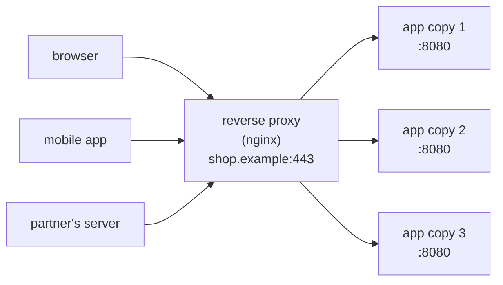

# 8.3 Reverse proxies, load balancers & nginx

Type almost any big website's address and your request doesn't reach the application first. It reaches a **reverse proxy**: a single front door that decides which of many copies of the application should handle it, handles the encryption, protects the application from slow and malicious clients, and quietly routes around copies that have crashed. You've seen its fingerprints already: the `502 Bad Gateway` pages, the `X-Forwarded-For` header. In this chapter you'll build one with nginx in front of two copies of a tiny web server, kill a copy and watch the proxy route around it, then read the front door of a real service.

## What you'll learn

- **Forward** vs **reverse** proxies, and the seven jobs a reverse proxy does.
- A working **nginx** config, line by line: upstreams, keep-alive, timeouts, blocked paths.
- **Load balancing** algorithms, **health checks**, and what happens when a backend dies, tested live.
- What **502**, **503** and **504** actually tell you.
- **TLS termination** and the **`X-Forwarded-For` trust problem**: how an app learns the real client IP, and how attackers fake it.
- **L4 vs L7** load balancers, and what the cloud and Kubernetes use instead of your own nginx.

---

## Forward and reverse proxies

A **proxy** is a program that sits between a client and a server and passes requests along.

- A **forward proxy** acts for **clients**: a company's web filter, or a proxy your browser is configured to use. The *server* doesn't know who the real client is.
- A **reverse proxy** acts for **servers**: it sits in front of your backends, and clients think *it* is the website. The *client* doesn't know which backend really answered.



Many clients, one address, several copies behind it. The clients only ever see the middle box.

:::note[Everyday anchor]
A reverse proxy is a hotel reception desk. Guests only ever deal with reception: they don't know which member of staff will handle their request, or where in the building that person is. Reception checks who's on shift, sends each request to someone available, skips anyone who's gone home sick, and keeps the corridors behind the desk private.
:::

### The jobs a reverse proxy does

| Job | What it means | Why it matters |
|---|---|---|
| **Single entry point** | One address and port for the world | Backends can move, scale and restart invisibly |
| **Load balancing** | Spread requests across copies | Capacity, and no single copy overwhelmed |
| **Health checks & failover** | Stop sending traffic to dead copies | A crash doesn't become an outage |
| **TLS termination** | Handle HTTPS, forward plain HTTP inside | One place for certificates ([chapter 7.1](../security/security-literacy.mdx)) |
| **Buffering** | Absorb slow clients, hand the app complete requests | Slow phones don't tie up the app's workers |
| **Security edge** | Block paths, limit rates and sizes, add headers | Protection before requests reach your code |
| **Compression and caching** | gzip responses; cache static files | Less bandwidth, less backend work |

---

## A reverse proxy in two files

**nginx** (pronounced "engine-x") is one of the most widely used web servers and reverse proxies. Others you'll meet include **HAProxy**, **Envoy**, **Caddy** and **Traefik**; the ideas are the same.

To try it you need something to put behind it. `traefik/whoami` is a tiny web server whose only job is to reply with its own hostname, so you can see *which* copy answered. Docker Compose ([chapter 9.3](../containers/docker-compose.mdx) teaches it; here you only use it) starts two copies of it and nginx, on one private network where each service is reachable by its name. Make a folder `lb/` with two files:

```yaml title="lb/compose.yaml"
name: lb

services:
  app:
    image: traefik/whoami:v1.11.0     # replies with its own hostname, so you can see which copy answered
    deploy:
      replicas: 2                     # two copies: lb-app-1 and lb-app-2

  nginx:
    image: nginx:1.27-alpine
    ports:
      - "8080:80"                     # the only door from your machine
    volumes:
      - ./nginx.conf:/etc/nginx/conf.d/default.conf:ro
    depends_on: [app]
```

```nginx title="lb/nginx.conf"
upstream app_servers {
    server app:80;                  # "app" resolves to every copy; list more servers if you have them
    keepalive 16;                   # keep idle connections to the backends open for reuse
}

server {
    listen 80;

    location / {
        proxy_pass http://app_servers;
        proxy_http_version 1.1;                   # keep-alive to backends needs HTTP/1.1
        proxy_set_header Connection "";           # ...and no "Connection: close" passed through
        proxy_set_header Host $host;
        proxy_set_header X-Forwarded-For $proxy_add_x_forwarded_for;
        proxy_connect_timeout 2s;                 # give up on an unreachable backend quickly
        proxy_read_timeout 15s;                   # give up on a backend that never answers
    }

    location /admin {
        deny all;                                 # an internal page the world never reaches
    }
}
```

Piece by piece:

- **`upstream app_servers`** names a group of backends. Here one line covers both copies, because Docker's DNS returns both addresses for the name `app`. On ordinary servers you list them: `server 10.0.1.5:8080; server 10.0.1.6:8080;`.
- **`listen 80`**: nginx claims the public port ([chapter 1.4](../foundations/networks-from-zero.mdx)); the app copies publish nothing.
- **`proxy_pass http://app_servers`**: forward every request to the group.
- **`location /admin { deny all; }`**: the front door refuses this path with `403` before it reaches any backend.

Run `docker compose up -d` in the folder and `curl localhost:8080`: one of the copies answers with `Hostname: …`.

### Keep-alive to the backends

```nginx
keepalive 16;
proxy_http_version 1.1;
proxy_set_header Connection "";
```

Opening a TCP connection costs a network round trip ([chapter 1.4](../foundations/networks-from-zero.mdx)). Without these three lines, nginx opens a **new** connection to a backend for every request and closes it afterwards. With them, it keeps up to 16 idle connections per worker process open and reuses them: faster and lighter under load. (HTTP/1.1 is needed for keep-alive; clearing the `Connection` header stops nginx forwarding a client's "close".)

### Timeouts

```nginx
proxy_connect_timeout 2s;   # give up connecting to a backend after 2 s
proxy_read_timeout 15s;     # give up waiting for a response after 15 s
```

[Chapter 8.1](./distributed-survival-kit.mdx)'s first rule (every network call gets a timeout) applied at the edge. nginx's defaults are 60 seconds for both, far too long for most web apps. The read timeout should be **at least as long as the app's own deadline**, so the app gets the chance to answer, even with an error, and not much longer. The connect timeout matters more than it looks, as you're about to see.

---

## Load balancing, health checks and failover

### Algorithms

| Algorithm | How it picks a backend | Good for |
|---|---|---|
| **Round robin** (nginx's default) | Each in turn: 1, 2, 3, 1, 2, 3… | Similar backends, similar requests |
| **Least connections** (`least_conn;`) | The backend with the fewest active requests | Requests of very different durations |
| **Weighted** (`server a weight=3;`) | Round robin, but some backends get more | Backends of different sizes |
| **IP / key hash** (`hash $key;`) | Same client (or key) → same backend | Per-backend caches; "sticky" behaviour |

Round robin only works when **any copy can answer any request**. That's true when the app is **stateless** ([chapter 1.5](../foundations/http-from-zero.mdx)): every piece of state (users, sessions, carts) lives in a shared database or cache, not in one copy's memory. Stateful backends need **sticky sessions** (always send a user to the same copy), which make scaling and failover harder: when that copy dies, its users' sessions die with it. Keeping services stateless avoids the problem entirely.

One honest detail: nginx runs one **worker process** per CPU core, and each keeps its own round-robin position. Send 50 requests to the `lb` stack on a many-core laptop and you'll see both hostnames, but not 25/25 (one test on a 24-core machine gave 37/13). Across thousands of requests it evens out.

### When a backend dies

Here is the `lb` stack being broken, with real output:

```text
both copies up:           curl × 50           → both hostnames answer
docker kill lb-app-2:     200 200 200 200 200 200   → every request still succeeds (6 took 4.0 s in total)
docker kill lb-app-1:     502                        → Bad Gateway, after 2.0 s
nginx's error log:        upstream timed out (110: Operation timed out) while connecting to upstream
                          no live upstreams while connecting to upstream
```

When nginx can't connect to a backend, it logs the error, **tries the next backend** with the same request, and marks the failing one unavailable for a short while (10 seconds by default, `fail_timeout`). That's **passive health checking**: noticing failures from real traffic. Two lessons are in those numbers:

- **Nobody saw an error when one copy died**, but a few requests were slow: each nginx worker had to discover the dead copy for itself, waiting out the 2-second connect timeout once. With nginx's default of 60 seconds, those users would have waited a minute.
- nginx retries the next backend only for requests that are **safe to repeat** (by default it won't resend a `POST` that may already have reached a backend: [chapter 8.1](./distributed-survival-kit.mdx)'s idempotency, built into the proxy).

Many load balancers also do **active health checks**: polling an endpoint like `/readyz` every few seconds and removing backends that fail *before* users hit them. That's how cloud load balancers and Kubernetes work ([chapter 10.2](../kubernetes/core-objects.mdx)), and why well-built services expose a **readiness** endpoint ("can I serve traffic right now?") separate from a **liveness** one ("am I alive, or should I be restarted?").

---

## What 502, 503 and 504 mean

Three status codes are almost always produced by the proxy, not your app:

| Status | The proxy is saying… | Usual causes |
|---|---|---|
| **502 Bad Gateway** | "I couldn't get a valid response from any backend" | All backends down or restarting; backend crashed mid-response; wrong port in the config |
| **503 Service Unavailable** | "No backend is available / I'm refusing to forward" | All backends failing health checks; maintenance; rate or connection limits |
| **504 Gateway Timeout** | "A backend accepted the request but didn't answer in time" | Slow database or dependency; timeout too short; deadlock |

When users report 502s, look at the **backends** (are they running? crashing? listening on the right port and address, [chapter 1.4](../foundations/networks-from-zero.mdx)?). For 504s, look at **what's slow** behind them ([chapter 13.6](../observability/debugging-playbook.mdx)).

---

## TLS termination

In production, clients connect with **HTTPS** (HTTP inside TLS, the encryption layer). The proxy holds the certificate and private key ([chapter 7.1](../security/security-literacy.mdx)), decrypts the traffic, and forwards plain HTTP to the backends over the private network. That's **TLS termination**:

```nginx
server {
    listen 443 ssl;
    http2 on;
    server_name shop.example;
    ssl_certificate     /etc/letsencrypt/live/shop.example/fullchain.pem;
    ssl_certificate_key /etc/letsencrypt/live/shop.example/privkey.pem;
    add_header Strict-Transport-Security "max-age=31536000; includeSubDomains" always;
    location / {
        proxy_pass http://app_servers;   # plus the proxy_* lines from above
    }
}

server {                      # send plain HTTP to HTTPS (chapter 1.5)
    listen 80;
    return 301 https://$host$request_uri;
}
```

One place manages certificates and renewal; the app code never touches TLS. (For stricter environments, traffic can be **re-encrypted** to the backends, or encrypted everywhere with a service mesh's mutual TLS.)

---

## The X-Forwarded-For trust problem

Behind a proxy, every connection your app sees comes **from the proxy's IP address**. So how does the app learn the real client's IP, for logs, geolocation or per-IP rate limits? The proxy adds headers:

```nginx
proxy_set_header X-Real-IP $remote_addr;                           # the client, as nginx saw it
proxy_set_header X-Forwarded-For $proxy_add_x_forwarded_for;       # a list: client, then each proxy
proxy_set_header X-Forwarded-Proto $scheme;                        # was it http or https?
```

`X-Forwarded-For` is a list, appended to by each proxy in the chain: `X-Forwarded-For: 198.51.100.4, 10.0.0.2`.

Here's the trap: **a client can send its own `X-Forwarded-For` header**, full of lies. Through the `lb` stack:

```bash
curl -s localhost:8080 -H "X-Forwarded-For: 1.2.3.4" | grep -i forwarded
# X-Forwarded-For: 1.2.3.4, 172.20.0.1
```

nginx *appended* the address it really saw (your machine, as seen from inside Docker) to the one the client typed. If your app blindly takes the first address in the list, anyone can pretend to be any IP: bypassing per-IP rate limits, polluting logs, faking locations. The rule: **only trust the entries added by proxies you control.** Count from the *right*, skipping your own known proxies, and take the first address that isn't one of them, or configure the proxy (nginx's `real_ip` module) to rewrite the client address from trusted proxies only. Better still, rate-limit by something the client can't forge, such as an API key ([chapter 8.4](./rate-limiting-and-resilience.mdx)).

---

## L4 and L7 load balancers, and the cloud

Load balancers work at one of two levels (named after layers of the networking model):

- **Layer 4 (transport)** forwards **TCP/UDP connections** without looking inside. Very fast, works for any protocol (databases, gRPC, anything), but can't route by URL or header. Examples: AWS **Network Load Balancer**, HAProxy in TCP mode.
- **Layer 7 (application)** understands **HTTP**: routes by path or host (`/api/*` to one group, `admin.shop.example` to another), terminates TLS, adds headers, retries idempotent requests. Examples: nginx, Envoy, AWS **Application Load Balancer**, Google Cloud's Application Load Balancer.

In the cloud, you usually don't run the outermost load balancer yourself: the provider's managed load balancer spreads traffic across availability zones ([chapter 12.2](../cloud/cloud-networking.mdx)) and scales automatically. In Kubernetes, an **Ingress controller** or **Gateway** (often nginx, Envoy or Traefik underneath) plays nginx's role ([chapter 10.3](../kubernetes/networking-and-ingress.mdx)). Same jobs, different packaging.

:::warning[What can go wrong]
- **Proxy and app timeouts that don't fit together.** A proxy that gives up before the app can answer produces confusing 504s; one that waits far longer ties up connections.
- **Default connect timeouts.** 60 seconds per discovery of a dead backend is a minute of hanging for real users.
- **Trusting `X-Forwarded-For` blindly.** Anyone can spoof their IP.
- **Stateful backends.** Sessions in one copy's memory break when requests move between copies; keep state in shared stores.
- **No health checks.** Traffic keeps going to a dead or unready copy.
- **Stale addresses.** nginx resolves a hostname like `app` once, at startup. Restart or recreate the backends with new IPs and nginx keeps sending to the old ones (502) until it's restarted or configured to re-resolve.
- **Exposing internal endpoints.** Metrics, admin and debug pages reachable from the internet. Block them at the edge.
- **The load balancer as a single point of failure.** Run it redundantly, or use a managed one.
:::

---

## Apply it to snip

snip, the URL shortener you build in this handbook, runs two copies of its API behind nginx in its Docker Compose stack. Its config, `snip/deploy/nginx/nginx.conf`, is the `lb` config with real names:

```nginx
# nginx as snip's front door (chapter 8.3): one public port, requests spread
# across every api copy. Docker's DNS returns all copies for the name "api".
upstream snip_api {
    server api:8080;
    keepalive 32;               # reuse connections to the backends
}

server {
    listen 80;

    location / {
        proxy_pass http://snip_api;
        proxy_http_version 1.1;
        proxy_set_header Connection "";
        proxy_set_header Host $host;
        proxy_set_header X-Real-IP $remote_addr;
        proxy_set_header X-Forwarded-For $proxy_add_x_forwarded_for;
        proxy_set_header X-Forwarded-Proto $scheme;
        proxy_connect_timeout 2s;
        proxy_read_timeout 15s;
    }

    location = /metrics {       # metrics are for Prometheus inside the network, not the internet
        deny all;
    }

    # The web UI (chapter 16.6): static files built from web/ and copied into
    # this nginx image. Same origin as the API, so the browser needs no CORS.
    # The slug "app" is reserved in snip, so no short link can hide behind it.
    location = /app {
        absolute_redirect off;  # "Location: /app/", not a URL with nginx's own port 80
        return 301 /app/;
    }

    location /app/ {
        root /usr/share/nginx/html;
        try_files $uri /app/index.html;
        add_header Cache-Control "no-cache";   # always check for a new index.html
        # Security headers for the page (chapter 16.10). An add_header inside a
        # location replaces every add_header from outside it, so all of them
        # live here together. "always" adds them to error pages too.
        add_header Content-Security-Policy "default-src 'none'; script-src 'self'; style-src 'self'; img-src 'self'; connect-src 'self'; base-uri 'none'; form-action 'self'; frame-ancestors 'none'; require-trusted-types-for 'script'" always;
        add_header Referrer-Policy no-referrer always;
        add_header X-Content-Type-Options nosniff always;
        add_header Cross-Origin-Opener-Policy same-origin always;
        add_header Permissions-Policy "camera=(), microphone=(), geolocation=()" always;
    }

    location /app/assets/ {     # file names carry a content hash, so they never change
        root /usr/share/nginx/html;
        add_header Cache-Control "public, max-age=31536000, immutable";
        add_header X-Content-Type-Options nosniff always;
    }
}
```

What's specific to snip:

- **`location = /metrics { deny all; }`**: snip's Prometheus metrics ([chapter 13.2](../observability/metrics.mdx)) are for monitoring inside the network. The front door refuses them with `403`; Prometheus scrapes the copies directly.
- **The `/app/` locations** serve a different kind of thing: files from nginx's own disk, the web UI built in [chapter 16.6](../frontend/a-ui-for-snip.mdx). nginx is a web server as well as a proxy; `location /app/` is more specific than `location /`, so those paths never reach snip. snip refuses the slug `app` so no short link can hide behind them.
- **`proxy_read_timeout 15s`** matches snip's own `WriteTimeout` of 15 seconds (`snip/cmd/snip/main.go`, [chapter 5.4](../apis/structuring-a-real-service.mdx)): nginx waits as long as snip may take to answer, and no longer.
- **Round robin is safe** because snip's copies are stateless: links, keys and counters live in Postgres and Redis.
- **`/readyz` and `/healthz`** are separate in snip for exactly the reasons above: `/readyz` fails when a copy can't reach its database, so an active health checker (a cloud load balancer, Kubernetes) takes it out of rotation, while `/healthz` stays green so it isn't restarted for someone else's outage.
- **X-Forwarded-For**: snip sidesteps the trust problem for its most important limit by rate-limiting **per API key** ([chapter 8.4](./rate-limiting-and-resilience.mdx)), not per IP.

---

## Lab

Free, on your own computer with Docker. Steps 1–4 use the `lb/` folder from this chapter; step 5 uses snip.

1. **Start the stack and watch the balancing.**
   ```bash
   cd lb
   docker compose up -d                                   # 2 × app, 1 × nginx
   docker compose ps                                      # only nginx publishes a port (8080)
   for i in $(seq 50); do curl -s localhost:8080 | grep Hostname; done | sort | uniq -c   # both copies answer
   ```

2. **Kill a copy; watch the proxy route around it.**
   ```bash
   docker kill lb-app-2
   time (for i in $(seq 6); do curl -s -o /dev/null -w "%{http_code} " localhost:8080; done; echo)   # all 200, a little slow
   docker kill lb-app-1
   curl -s -o /dev/null -w "%{http_code}\n" localhost:8080          # 502 after 2 s
   docker compose logs nginx | grep error | tail -3                # what nginx saw
   ```
   Notice the total time with one copy dead: a few requests waited out the 2-second connect timeout. Change `proxy_connect_timeout` to `10s`, `docker compose restart nginx`, and repeat to feel the difference.

3. **Bring the copies back, and meet the stale-address problem.**
   ```bash
   docker compose up -d                                   # restarts both copies…
   curl -s -o /dev/null -w "%{http_code}\n" localhost:8080   # …often still 502: they may have new IPs
   docker compose restart nginx                           # nginx looks up "app" again
   curl -s -o /dev/null -w "%{http_code}\n" localhost:8080   # 200
   ```

4. **See the edge rules.**
   ```bash
   curl -s -o /dev/null -w "%{http_code}\n" localhost:8080/admin           # 403: blocked by nginx
   curl -s localhost:8080 -H "X-Forwarded-For: 1.2.3.4" | grep -i forwarded  # "1.2.3.4, 172.…"
   docker compose down
   ```
   Which of the two `X-Forwarded-For` addresses could the app trust, and why? (Only the rightmost, added by the proxy you control; the left one is whatever the client typed.)

5. **Apply it to snip.** Start snip's stack, which puts two API copies behind its nginx:
   ```bash
   cd ~/code/zero-to-prod/snip
   docker compose up -d --build --wait
   curl -s -o /dev/null -w "%{http_code}\n" localhost:8080/metrics   # 403 at the edge
   curl -si localhost:8080/healthz | head -1                        # 200, through the proxy
   docker kill snip-api-2
   for i in $(seq 4); do curl -s -o /dev/null -w "%{http_code} " localhost:8080/healthz; done; echo   # still 200s
   docker compose up -d && docker compose restart nginx            # back to two copies
   docker compose down
   ```

## Self-check

<Quiz
  id="distributed-reverse-proxies-and-nginx"
  questions={[
    {
      q: 'Users see "502 Bad Gateway". Where do you look first?',
      options: [
        'The users’ browsers, in case a stale cache is being served',
        'The backends behind the proxy: running, and on the right port?',
        'The DNS records, in case the domain points at the wrong proxy',
        'The proxy’s TLS certificate, which may have expired overnight',
      ],
      answer: 1,
      explain: '502 is the proxy saying it could not get a valid response from any backend, so look at the backends: running, crashing, listening on the configured port and address, or recreated with new IPs the proxy hasn’t looked up. An expired certificate would fail before the proxy forwarded anything, and 504 would point at slowness instead.',
    },
    {
      q: 'Why can a stateless service use simple round-robin load balancing without sticky sessions?',
      options: [
        'Because nginx doesn’t support sticky sessions without a paid module',
        'Every copy can answer any request, since state lives in shared stores',
        'Because its requests are all the same size, so load evens out',
        'Because round robin is always the fairest way to spread load',
      ],
      answer: 1,
      explain: 'When all state lives in a shared database or cache, any copy can answer any request, so it doesn’t matter which one gets it. Open-source nginx does offer IP and key hashing for stickiness (option 1 is false); you just don’t need it. Statelessness (chapter 1.5) is what makes scaling and failover simple.',
    },
    {
      q: 'Your app rate-limits by the first IP in X-Forwarded-For. What is the problem?',
      options: [
        'Nothing; the first address is the one the proxy saw, so it’s reliable',
        'Clients can set that header themselves and pretend to be any IP',
        'X-Forwarded-For only ever holds the proxy’s own IP address',
        'Browsers strip X-Forwarded-For, so the limit never sees an address',
      ],
      answer: 1,
      explain: 'The proxy appends what it saw to the right of whatever the client sent, so the first entry is client-controlled: an attacker sends a new fake IP on each request and is never limited. Only entries appended by proxies you control are trustworthy. Read from the right, or have the trusted proxy set the client address.',
    },
    {
      q: 'What is TLS termination at the reverse proxy?',
      options: [
        'Turning off encryption for everyone once they reach the proxy',
        'The proxy handles HTTPS with clients and forwards over the private network',
        'Ending TLS sessions early, so each client reconnects often',
        'Checking each backend’s certificate before forwarding traffic',
      ],
      answer: 1,
      explain: 'The proxy holds the certificate, handles HTTPS with clients, and forwards traffic to backends over the private network. Certificates and TLS configuration live in one place, and backends can speak plain HTTP inside a trusted network (or re-encrypt where required). Clients still get full encryption on the internet leg, so option 1 is wrong.',
    },
  ]}
/>

<details>
<summary>One backend died, and no user saw an error, but a few requests took two extra seconds. Explain what nginx did, and what you'd change if the delay were unacceptable.</summary>

Each nginx worker process tried the dead backend once, waited out `proxy_connect_timeout` (2 s) because the dead container's address no longer answered, logged the error, retried the request on the other backend (safe, because it was a `GET`), and marked the dead one unavailable for `fail_timeout` (10 s by default). Every worker learns this separately, so several requests paid the 2-second penalty, and after 10 seconds one more request probes it again.

To shrink it: lower the connect timeout (on a local network a healthy connect takes well under a millisecond, so a few hundred milliseconds is generous); raise `fail_timeout` so probes are rarer; or, best, add **active health checks** (HAProxy, Envoy, cloud load balancers, Kubernetes readiness probes, or NGINX Plus) so a dead backend is removed *before* a user's request finds it.

</details>

<details>
<summary>Explain passive vs active health checks, and why a service exposes a readiness endpoint separate from its liveness endpoint.</summary>

**Passive** health checking learns from real traffic: when requests to a backend fail (connection refused, timeouts), the proxy marks it unhealthy for a while and routes elsewhere. It's automatic but only notices after some requests have failed. **Active** health checking polls a dedicated endpoint every few seconds and removes backends that fail *before* users hit them.

A **readiness** endpoint (`/readyz` in snip) answers "can I serve traffic right now?": it checks the database, and fails when the copy can't do its job, so the balancer stops sending it requests. A **liveness** endpoint (`/healthz`) answers "is this process alive?", and a failure means "restart me". Keeping them separate matters: if the database goes down, every copy's readiness fails (correct: stop routing to them) but liveness stays green (correct: restarting them won't fix the database, and restarting all at once would make recovery worse) ([chapter 5.4](../apis/structuring-a-real-service.mdx)).

</details>

<details>
<summary>Why does nginx use keep-alive connections to backends, and what three lines enable it?</summary>

Because opening a TCP connection costs a network round trip (and TLS, if used, costs more). At thousands of requests per second, opening and closing a connection per request wastes latency and CPU on both sides, and can exhaust ports. Reusing a pool of open connections avoids that. The lines: `keepalive 16;` in the `upstream` block (keep up to 16 idle connections per worker), `proxy_http_version 1.1;` (keep-alive needs HTTP/1.1), and `proxy_set_header Connection "";` (don't pass the client's "close" to the backend).

</details>
