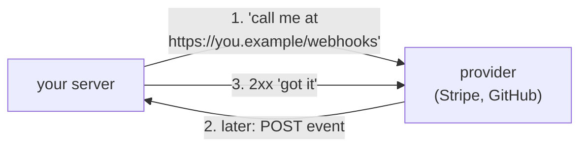
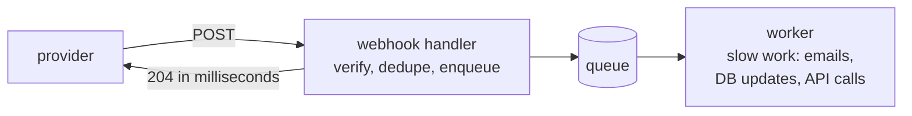

# 8.8 Webhooks: when the server calls you

You take a payment with Stripe, and a few seconds later your app knows the card went through. You push to GitHub, and a CI server you run starts building. You never asked Stripe or GitHub "is it done yet?": *they* called *you*, with an ordinary HTTP request to a URL you gave them. That's a **webhook**, and it is how most of the internet's services tell each other that something happened. Receiving one safely takes four habits that tutorials often skip; sending them well is a small distributed system of its own. This chapter covers both, with a Go program that signs, verifies, retries and blocks the classic attacks, so you can watch each one fail and succeed.

## What you'll learn

- **Polling vs callbacks**: why "call me when it's done" beats asking every minute, and what it costs.
- **Receiving**: verify the **HMAC signature** with a constant-time compare, reject **replays** by timestamp, answer `2xx` fast and do the work from a **queue**, **de-duplicate** by event ID, and never trust the order.
- **Sending**: sign every message, **retry with exponential backoff**, **dead-letter** what never succeeds, block **SSRF**, keep a **delivery log**, and rotate secrets without dropping events.
- The **Standard Webhooks** spec, and how **Stripe** and **GitHub** do it.
- How to test webhooks on your laptop, where the internet can't reach.

---

## Polling or a callback

Your app needs to know when a payment, a video encode or a background check finishes. There are two ways to find out.

**Polling**: ask on a timer. "Is payment 42 done?" "No." A minute later: "Is it done?" "Yes." Easy to build, but you learn the news up to a minute late, and the provider answers millions of "no"s. ([Chapter 8.7](./real-time.mdx) did the same arithmetic for browsers.)

**A callback**: give the provider a URL once, and it sends an HTTP `POST` to that URL when something happens. That `POST` is a **webhook**, the URL is your **webhook endpoint**, and the message is usually JSON describing an **event**:

```json
{
  "type": "payment.succeeded",
  "timestamp": "2026-10-29T12:00:00Z",
  "data": { "payment_id": "pay_42", "amount": 1999, "currency": "eur" }
}
```



:::note[Everyday anchor]
Polling is phoning the dry cleaner every hour to ask if your suit is ready. A webhook is leaving your number so they text you when it is. Much better, but now anyone can text you claiming to be the dry cleaner, the same text may arrive twice, and if your phone is off when they text, you'd better hope they try again. Those three problems are this chapter.
:::

Webhooks turn the provider into a client of *your* server, over the public internet. That brings everything from earlier chapters with it: requests that fail halfway and get retried ([chapter 8.1](./distributed-survival-kit.mdx)), attackers sending forged requests ([chapter 7.5](../security/web-attacks.mdx)), and work that is too slow to do while someone waits ([chapter 8.2](./queues-and-background-work.mdx)).

The demo for this chapter is `snip/examples/webhooks`. Run every scenario at once now, and come back to the output as each section explains it:

```bash
cd ~/code/zero-to-prod/snip
go run ./examples/webhooks demo
```

---

## Receiving, habit 1: prove who sent it

Your endpoint is a public URL. Anyone who learns it can `POST` `{"type":"payment.succeeded"}` and, if you believe them, get goods for free. You need proof that the message came from the provider and wasn't changed on the way.

### HMAC: a seal only the two of you can make

When you register the endpoint, the provider gives you a **signing secret**, a random string only the two of you know. For each message, the provider mixes the secret and the message through a hash function and attaches the result, the **signature**. You do the same calculation with your copy of the secret. If your result matches theirs, the message came from someone who knows the secret, and not one byte of it changed.

That calculation is an **HMAC** (hash-based message authentication code), almost always HMAC-SHA256. A hash ([chapter 7.1](../security/security-literacy.mdx)) turns any input into a fixed-size fingerprint; HMAC is a hash with the secret mixed in, so nobody without the secret can produce the right fingerprint for a forged message.

:::note[Everyday anchor]
A wax seal pressed with a signet ring. Anyone can read the letter, but only the holder of the ring could have made that seal, and breaking the seal to change the letter shows. HMAC is a seal where you and the sender each own an identical ring.
:::

In the **Standard Webhooks** format the demo uses, three headers travel with the body:

```text
webhook-id:        msg_2KWPBgLlAfxdpx2AI54pPJ85f4W   ← unique per event, the same on every retry
webhook-timestamp: 1790000000                        ← when this attempt was signed (Unix seconds)
webhook-signature: v1,K5oZfzN95Z9UVu1EsfQmfVNQhnkZ2pj9o9NDN/H/pI4=
                   ↑ version, then base64 of HMAC-SHA256(secret, "id.timestamp.body")
```

The signing function, from `snip/examples/webhooks/sign.go`:

```go
func Sign(key []byte, id string, ts time.Time, body []byte) string {
	mac := hmac.New(sha256.New, key)
	fmt.Fprintf(mac, "%s.%d.", id, ts.Unix()) // the ID and timestamp are signed too
	mac.Write(body)
	return "v1," + base64.StdEncoding.EncodeToString(mac.Sum(nil))
}
```

The ID and timestamp are inside the signature on purpose. If only the body were signed, an attacker could take a real message and change its timestamp or ID to get past the checks below.

### Two details that break verification

**Verify the raw bytes.** The signature covers the body *exactly as sent*. If your framework parses the JSON and you re-encode it to verify, spacing or key order changes and nothing matches. Read the raw body first, verify, *then* parse. (In Express, that means `express.raw()` on the webhook route; in Go, `io.ReadAll(r.Body)` before anything else.)

**Compare in constant time.** A normal string comparison (`==`) stops at the first byte that differs. That makes a wrong guess with the first byte right take a few nanoseconds longer than one with the first byte wrong. Measured over enough requests, an attacker can recover a valid signature byte by byte: a **timing attack**. `hmac.Equal` always takes the same time:

```go
for _, got := range strings.Fields(sigHeader) { // there may be several signatures (see rotation)
	if hmac.Equal([]byte(got), []byte(want)) {   // never ==
		return nil
	}
}
return ErrSignature
```

Step 3 of the demo changes the body after signing; the receiver answers `401`.

---

## Receiving, habit 2: refuse replays

A valid signature proves the provider sent the message *once*. It doesn't stop someone who captured that request (from a log, a proxy, a misconfigured tool) from sending it again tomorrow. That's a **replay attack**.

The defence is the signed timestamp. Reject any message whose `webhook-timestamp` is more than a few minutes from your clock, in either direction:

```go
if now.Sub(ts) > tolerance || ts.Sub(now) > tolerance { // too old, or from the future
	return ErrTimestamp
}
```

Five minutes is the usual window (it's the default in Stripe's libraries): long enough for clock differences and network delays, short enough that a captured message soon becomes useless. Because the sender re-signs each retry with a fresh timestamp, legitimate retries hours later still pass. Within the window, the next habit catches repeats. Step 4 of the demo replays a message signed 10 minutes ago and gets `401`.

Keep your servers' clocks synced (NTP, on by default in every cloud): a server whose clock drifts six minutes rejects every webhook.

---

## Receiving, habit 3: answer fast, work later

Providers wait only a short time for your answer: GitHub gives you 10 seconds, and the Standard Webhooks spec suggests senders time out after 15 to 30. Miss it and the delivery counts as failed and is retried, even if you finished the work a second later. So the handler does the minimum:

1. Read the raw body and verify it.
2. Check the event ID hasn't been seen (habit 4).
3. Put the event on a queue ([chapter 8.2](./queues-and-background-work.mdx)).
4. Answer `2xx`.



From `snip/examples/webhooks/receiver.go`:

```go
select {
case rc.Queue <- Received{ID: id, Body: body}:
	rc.seen[id] = rc.Now()
	w.WriteHeader(http.StatusNoContent) // accepted; processing happens later
default:
	// Queue full: refuse, and the sender will retry later.
	http.Error(w, "busy, retry later", http.StatusServiceUnavailable)
}
```

`2xx` means "I have safely got it", not "I have finished it". If the queue is full or the database is down, answer `5xx` and let the sender's retries carry the event until you recover. That's free resilience, provided you never answer `2xx` for an event you then lose. (The demo's queue is a Go channel, which vanishes if the process dies. A real receiver writes to a durable queue or a database table before answering.)

---

## Receiving, habit 4: expect duplicates and disorder

Senders retry whenever they don't see your `2xx`, including when you *did* process the event but the response was lost on the way back. So every webhook system delivers **at least once** ([chapter 8.1](./distributed-survival-kit.mdx)): sometimes twice, occasionally more.

Make processing **idempotent** (safe to repeat) by recording each event's ID and skipping IDs you've already handled. The ID is the same on every retry, which is exactly what it's for. Step 2 of the demo sends the same event twice: the second gets `200` and nothing is queued. For real money, record the ID in the same database transaction as the work ([chapter 6.5](../data/transactions.mdx)), with a unique constraint, so two copies arriving at the same instant can't both win.

Order isn't guaranteed either. Retries, parallel delivery and network paths mean `subscription.updated` can arrive before `subscription.created`, or an old update after a newer one. Defences, in order of preference:

- **Treat the webhook as a nudge, then fetch the truth.** On `payment.succeeded`, call the provider's API for payment 42's current state. Order stops mattering because you always read the latest. Many teams use this pattern for anything important.
- **Compare versions or timestamps.** Ignore an update older than what you've stored.
- **Design for any order.** "Mark paid" twice is fine; "add 1 to the count" twice is not.

:::warning[What can go wrong when receiving]
- **Verifying parsed JSON instead of the raw body.** Signatures never match, someone "temporarily" disables the check, and it stays disabled.
- **Comparing signatures with `==`.** A timing leak. Use `hmac.Equal`, `crypto.timingSafeEqual` (Node.js) or `hmac.compare_digest` (Python).
- **No timestamp check.** A captured request works forever.
- **Slow work in the handler.** Timeouts become retries, retries become duplicates, and a slow day becomes a retry storm against your own server.
- **Answering `2xx` before the event is safe.** A crash then loses it, and the sender never retries.
- **Logging full payloads and headers.** Webhook bodies often hold personal data, and logged signatures help replay attacks within the window.
:::

---

## Sending webhooks: you are now the provider

Sooner or later your own service offers webhooks: "notify me when a link is created". Now your server sends requests to URLs typed in by strangers. Five jobs come with that.

### 1. Sign everything, and give a stable ID

Generate a secret per endpoint (`whsec_` plus 24 to 64 random bytes, base64-encoded, in the Standard Webhooks format), show it to the user once, and sign every attempt with a fresh timestamp. Keep the same `webhook-id` across retries so receivers can de-duplicate.

### 2. Retry with exponential backoff, then dead-letter

Receivers go down for deploys, outages and expired certificates. A good sender keeps trying for **days**, waiting longer each time (**exponential backoff**), with a little randomness (**jitter**) so retries to a recovering receiver don't all arrive at the same second ([chapter 8.1](./distributed-survival-kit.mdx)). The Standard Webhooks spec's example schedule, used in `snip/examples/webhooks/sender.go`:

```go
var DefaultSchedule = []time.Duration{ // wait before each retry: about 3 days in total
	5 * time.Second, 5 * time.Minute, 30 * time.Minute, 2 * time.Hour,
	5 * time.Hour, 10 * time.Hour, 14 * time.Hour, 20 * time.Hour, 24 * time.Hour,
}
```

How to read the receiver's answer:

| Response | Meaning to the sender |
|---|---|
| `2xx` | Delivered. Stop. |
| `3xx` | Failure. Don't follow redirects (see SSRF below); the user should fix the URL. |
| `410 Gone` | The receiver says "stop sending here". Disable the endpoint. |
| `429`, `502`, `503`, `504` | Busy or overloaded. Retry, slower; honour a `Retry-After` header. |
| Anything else, timeouts, connection errors | Failure. Retry on schedule. |

When the schedule runs out, the message goes to a **dead-letter** list ([chapter 8.2](./queues-and-background-work.mdx)): kept, visible to the user, and re-sendable by hand. If an endpoint fails for days, email its owner and disable it, rather than retrying forever. Step 6 of the demo shows both outcomes: a receiver that recovers on the third attempt, and one that never does.

Deliveries run in background workers fed by a queue, never inside the request that caused the event. To make sure an event is queued if and only if the change it describes was committed, write it to an **outbox** table in the same transaction ([chapter 8.2](./queues-and-background-work.mdx)).

### 3. Block server-side request forgery

The user types the URL, and your server makes the request. Type `http://169.254.169.254/latest/meta-data/` and your server fetches the cloud metadata service, which hands out the server's own cloud credentials. Type `http://10.0.0.5:6379/` and your server pokes your internal Redis. That's **server-side request forgery (SSRF)** ([chapter 7.5](../security/web-attacks.mdx)), and webhook senders are a classic target.

Checking the hostname when the user saves the URL isn't enough. DNS can answer with a public address when you check and `127.0.0.1` when you send (**DNS rebinding**), and a public URL can redirect to an internal one. The check has to run on the actual IP address at the moment of connecting. Go's dialer has a hook for exactly that (`snip/examples/webhooks/ssrf.go`):

```go
dialer := &net.Dialer{
	Timeout: 5 * time.Second,
	// Runs after DNS, on the exact IP about to be connected to.
	Control: func(network, address string, _ syscall.RawConn) error {
		ap, err := netip.ParseAddrPort(address)
		if err != nil {
			return err
		}
		if !isPublic(ap.Addr()) { // loopback, private, link-local, CGNAT, …
			return fmt.Errorf("%w: %s", ErrBlockedAddress, ap.Addr())
		}
		return nil
	},
}
```

Plus: require `https`, don't follow redirects, cap response sizes, and time out every request. Large providers go further and send all webhooks through a dedicated egress proxy (Stripe open-sourced theirs, **Smokescreen**) from machines in a network segment that can't reach anything internal. Step 7 of the demo tries four internal addresses; all are refused.

### 4. Keep a delivery log

The first support ticket will be "you never sent it". Record every attempt: event ID, endpoint, time, status code, latency, and the error. Show it to the user with a **redeliver** button. Stripe and GitHub both have this page, and it's the most-used webhook debugging tool there is.

### 5. Rotate secrets without dropping events

Secrets leak, and policies require rotation ([chapter 7.6](../security/secrets-management.mdx)). If you swap the secret instantly, every receiver rejects messages until it updates its copy. Standard Webhooks allows **several signatures** in one header, separated by spaces, so rotation is gentle:

1. Generate a new secret. For a while (say 24 hours), sign every message with **both** old and new.
2. The receiver switches to the new secret whenever it's ready; either signature matches.
3. Stop signing with the old one.

Step 5 of the demo does exactly this: the sender signs with both, the receiver knows only the new secret, and delivery succeeds.

---

## Standard Webhooks, Stripe and GitHub

Every provider used to invent its own header names and signing rules, so every integration needed new verification code. **Standard Webhooks** ([standardwebhooks.com](https://www.standardwebhooks.com)) is an open specification, started in 2023 by Svix with other companies that send webhooks, that fixes the format: the three `webhook-*` headers, `id.timestamp.body` signed with HMAC-SHA256, `v1,` prefixes, `whsec_` secrets, space-separated signatures for rotation, and guidance on retries, SSRF and payload shape (`type`, `timestamp`, `data`). It has reference libraries in many languages. The demo's `Sign` reproduces the spec's published test vector exactly (`TestSignMatchesStandardWebhooksExample` in `webhooks_test.go`).

The two providers you're most likely to meet each do it their own way:

| | Stripe | GitHub |
|---|---|---|
| Signature header | `Stripe-Signature: t=1492774577,v1=5257a8…` | `X-Hub-Signature-256: sha256=7d38cd…` |
| What's signed | `timestamp.body`, HMAC-SHA256, hex | The body only, HMAC-SHA256, hex |
| Replay protection | Timestamp in the signature; libraries default to 5 minutes | None in the signature: de-duplicate on the `X-GitHub-Delivery` ID |
| Event ID | `id` in the JSON body (`evt_…`) | `X-GitHub-Delivery` header (a GUID) |
| Retries | Automatic, with backoff, for up to 3 days (live mode) | **None automatic**: redeliver from the UI or API |
| Time to answer | Answer `2xx` quickly; slow handlers count as failures | 10 seconds |
| Docs | [Stripe: webhooks](https://docs.stripe.com/webhooks) | [GitHub: validating deliveries](https://docs.github.com/en/webhooks/using-webhooks/validating-webhook-deliveries) |

Note GitHub's two gaps. A captured GitHub delivery has a valid signature forever, so de-duplicating on the delivery ID matters even more. And GitHub doesn't retry, so an outage on your side silently loses events unless you redeliver from the "Recent Deliveries" page or the API. The shape of a provider's guarantees decides how much of this chapter you must build yourself.

:::info[In the real world]
Use the provider's official library to verify (Stripe's `ConstructEvent`, GitHub's Octokit webhooks, the Standard Webhooks libraries), rather than hand-writing the comparison; this chapter writes it out so you know what the library does. On the sending side, many companies buy rather than build: Svix, Hookdeck and similar services handle signing, retries, logs and the redeliver button. Building it yourself is a queue, a worker, a table of attempts and the SSRF guard, roughly what this chapter's demo sketches.
:::

---

## Testing webhooks on your laptop

The provider is on the internet; your laptop isn't reachable from it. Four ways around that:

- **Call yourself with signed requests.** The demo's `sign` command prints a ready-to-run `curl` with valid headers, so you can test your receiver with no provider at all (the lab does this).
- **The provider's CLI.** `stripe listen --forward-to localhost:8095/webhooks` receives real test-mode events and forwards them to your machine, signed.
- **A tunnel.** `cloudflared tunnel --url http://localhost:8095` or `ngrok http 8095` gives you a temporary public HTTPS URL that forwards to your laptop. Register it with the provider, then take it down when you're done; anyone with the URL can reach your machine while it runs.
- **Replay recorded payloads in tests.** Save real (scrubbed) payloads as test fixtures, sign them in the test, and run them through your handler, the way `webhooks_test.go` does.

---

## Apply it to snip: link events for your users

snip doesn't send webhooks today. Here is how this chapter's pieces would fit its architecture if users could ask to be told when their links change.

1. **Which events.** `link.created` and `link.deleted`, not `link.clicked`: a viral link gets thousands of clicks a second, and nobody wants a webhook per click. For clicks, a periodic summary event or the stats endpoint (`GET /api/links/{slug}`) is the right tool.
2. **Registering an endpoint.** A new `POST /api/webhooks` route, behind the same API-key check as the other `/api` routes (`requireKey` in `snip/internal/httpapi/server.go`). It runs `ValidateURL` (https only), generates a `whsec_` secret, stores it encrypted, and returns it once, the same way `snip keys create` shows an API key only once.
3. **No dual writes.** When `POST /api/links` creates a link, the same Postgres transaction inserts a row into an `outbox` table, as [chapter 8.2](./queues-and-background-work.mdx) describes, so an event exists if and only if the link does.
4. **Delivery in the worker.** `snip-worker` already runs a loop with backoff (`snip/cmd/snip-worker/main.go`); a second loop would read the outbox, sign with `SignHeaders`, send through `SafeClient`, and record each attempt in a `webhook_attempts` table that a `GET /api/webhooks/{id}/attempts` route exposes as the delivery log.
5. **Metrics.** Delivery attempts by status code, queue age, and endpoints disabled, as Prometheus counters next to snip's existing ones ([chapter 13.2](../observability/metrics.mdx)).

---

## Lab

Free, on your laptop. Two terminals.

1. **Run every scenario.**
   ```bash
   cd ~/code/zero-to-prod/snip
   go run ./examples/webhooks demo          # seven numbered scenarios
   ```
   Match each output line to a section of this chapter. Notice which ones the receiver rejected with `401`, and that the final queue holds only one event per unique message.

2. **Run a receiver and send it a signed webhook by hand.**
   ```bash
   go run ./examples/webhooks serve                                   # terminal 1: prints "secret: whsec_…"
   export WEBHOOK_SECRET=whsec_paste-the-printed-secret-here          # terminal 2
   go run ./examples/webhooks sign -body '{"type":"link.created","data":{"slug":"hi"}}' > send.sh
   cat send.sh                                                        # the three headers and the body
   sh send.sh                                                         # HTTP/1.1 204; terminal 1 logs "processing msg_…"
   sh send.sh                                                         # HTTP/1.1 200: a duplicate, not processed again
   ```

3. **Break it on purpose.** Edit one character of the body in `send.sh` and run it again: `401`. Then sign a message as if it were captured 10 minutes ago:
   ```bash
   go run ./examples/webhooks sign -age 10m > old.sh && sh old.sh    # 401: outside the 5-minute window
   ```
   Check terminal 1's log for the reason. The client only ever sees "invalid signature", which tells an attacker nothing.

4. **Read the tests.** `go test ./examples/webhooks/ -v` covers the spec's test vector, tampering, replay, rotation, de-duplication, a full queue, retries with backoff, `410 Gone`, `Retry-After`, redirects and SSRF. Pick one and break the code it protects (replace `hmac.Equal` with `==` and nothing fails, which is why timing leaks need code review, not just tests).

## Self-check

<Quiz
  id="distributed-webhooks"
  questions={[
    {
      q: 'Your webhook handler verifies signatures, but every Stripe event fails verification. Locally, a test event signed by hand passes. What do you check first?',
      options: [
        'Whether Stripe has rotated its own TLS certificate',
        'Whether a framework parses the JSON before you verify the raw bytes',
        'Whether the endpoint is reachable over IPv6',
        'Whether the event types are subscribed in Stripe’s dashboard',
      ],
      answer: 1,
      explain: 'The signature covers the exact bytes sent. Body-parsing middleware that turns JSON into an object and back changes spacing or key order, so nothing matches. Read the raw body on the webhook route, verify, then parse. An unreachable endpoint or unsubscribed events would mean no requests at all, not failing ones.',
    },
    {
      q: 'Why must the receiver compare signatures with hmac.Equal rather than ==?',
      options: [
        'Because == doesn’t work on byte slices in Go',
        'So the time taken doesn’t reveal how many leading bytes were right',
        'Because hmac.Equal also checks the timestamp',
        'Because == is case-sensitive and base64 is not',
      ],
      answer: 1,
      explain: 'An ordinary comparison stops at the first different byte, so a guess with more correct leading bytes takes measurably longer. Over many requests an attacker can build a valid signature byte by byte. hmac.Equal takes the same time whatever the input. It does not check timestamps, and base64 is case-sensitive.',
    },
    {
      q: 'The handler sends an email for each order.paid webhook, and customers sometimes get two. Signatures and timestamps verify fine. What is the cause?',
      options: [
        'An attacker is replaying captured requests',
        'At-least-once delivery: a retry of an event you already handled',
        'The provider’s clock is wrong',
        'The email provider is sending duplicates',
      ],
      answer: 1,
      explain: 'Senders retry whenever they don’t see your 2xx, including when your response was lost or slow. Record each event ID and skip ones already handled (ideally in the same transaction as the work). A replay outside the window would fail the timestamp check; inside it, ID de-duplication catches it too.',
    },
    {
      q: 'Your service lets users set a webhook URL. A user sets https://hooks.attacker.example/ and its DNS later starts answering 169.254.169.254. Which defence still works?',
      options: [
        'Checking the hostname’s IP when the user saves the URL',
        'Checking the IP in the dialer at the moment of connecting',
        'Requiring the URL to use https',
        'Rate limiting the number of webhooks per user',
      ],
      answer: 1,
      explain: 'This is DNS rebinding: the name resolved to a public IP when saved and to the metadata service when sent. Only a check on the actual IP being connected to, every time, catches it. https alone doesn’t help (the attacker controls the name), and rate limits only slow the attack.',
    },
    {
      q: 'Why does the Standard Webhooks spec allow several signatures in one header?',
      options: [
        'So the receiver can choose the hash algorithm it prefers',
        'To rotate a secret: sign with old and new until receivers switch',
        'To sign each JSON field separately',
        'So several receivers can share one endpoint',
      ],
      answer: 1,
      explain: 'During a rotation the sender signs every message with both the old and the new secret. A receiver holding either one finds a match, so it can switch whenever it’s ready and no events are rejected in between. Then the old secret is dropped.',
    },
  ]}
/>

<details>
<summary>Your webhook endpoint was down for two hours during a database outage. What happened to the events sent in that window, for Stripe and for GitHub, and what would you do afterwards?</summary>

It depends on the sender's retry behaviour, which is why you read it before integrating. **Stripe** retries with backoff for up to three days, so its events arrive late but arrive; your de-duplication handles any that you'd half-processed before the outage. You'd watch the backlog drain and check for errors. **GitHub** doesn't retry automatically, so every delivery that failed in those two hours is lost unless you act: open "Recent Deliveries" for the webhook (or use the API), filter to failed ones, and redeliver them. Longer term: answer `5xx` (not `2xx`) whenever you can't safely store an event, so senders that do retry will; keep the handler's dependencies minimal (a durable queue rather than the main database) so it stays up when other things don't; and for providers without retries, run a periodic **reconciliation** job that compares their API's state with yours and fixes what was missed.

</details>

<details>
<summary>Why do careful teams treat a webhook as a "nudge" and call the provider's API for the current state, instead of trusting the event's payload?</summary>

Because it makes three of the hard problems disappear at once. **Ordering**: events may arrive out of order, but the API always returns the latest state, so a late `subscription.updated` can't overwrite a newer one. **Duplicates**: fetching and storing the current state twice gives the same result, so processing is naturally idempotent. **Trust**: even if signature verification had a bug, a forged event only triggers a fetch from the real provider over an authenticated API call, which returns the truth. The cost is one extra API call per event and a dependency on the provider's API being up, which is why it's used for things that matter (payments, subscriptions) and skipped for high-volume, low-stakes events.

</details>
