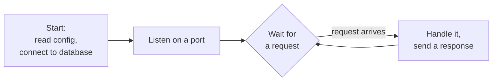
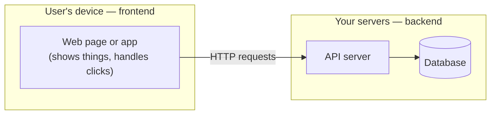
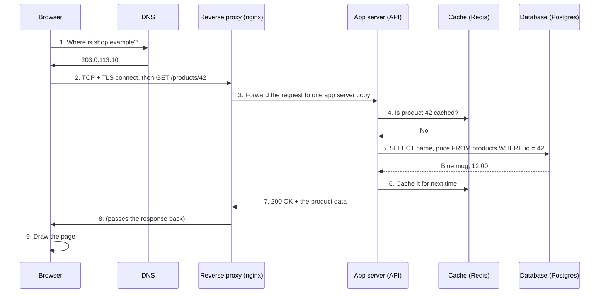

# 1.6 What a server is (and what "backend" means)

"The server is down." "It's a backend issue." You've heard these phrases, and they probably conjure an image of a humming metal box in a cold room. That box exists — but when engineers say *server*, they usually mean something simpler and more interesting: **a program that starts once, then waits forever for someone to ask it something.** This chapter ties together everything in [Part 1](./what-a-computer-does.mdx) — processes, ports, networks and HTTP — into that one idea, then follows a single click all the way through a real backend and back. At the end, you'll run servers yourself and talk to them.

## What you'll learn

- What a **server** is: a long-running process that listens on a port and answers requests — and why "server" means both the program and the machine.
- What **frontend** and **backend** mean, and where the line between them sits.
- The complete **life of a request**, from a click to a database and back, with every step from [Part 1](./what-a-computer-does.mdx) in place.
- Why real backends are **many cooperating programs** — API servers, databases, caches, queues, workers, proxies — rather than one.
- How to **run a server** and talk to it with `curl`, first a one-line one and then snip, the link shortener this handbook builds.

---

## A server is a program that never exits

Most programs you've used have a clear end: you open a document, edit it, close it. A **server** is different. It starts, gets ready, and then **waits** — indefinitely — for requests. When one arrives, it handles it, answers, and goes back to waiting. It only stops when someone stops it.

:::note[Everyday anchor]
A server is a shop assistant who arrives in the morning, unlocks the door, and then stands at the counter all day, serving whoever walks in, one after another. They don't go home between customers. If nobody comes in, they wait. "The server is down" means the shop is shut — the assistant isn't there, or the door is locked.
:::

Four boxes capture the whole life of a server:



The loop on the right is the point: handle, answer, wait again — for days or months. In the computer's terms, a server is a **process** (a running program, [chapter 1.2](./programs-processes-threads.mdx)) that has claimed a **port** (a numbered door on the machine, [chapter 1.4](./networks-from-zero.mdx)) and speaks a **protocol** — an agreed request-and-answer format — like **HTTP** ([chapter 1.5](./http-from-zero.mdx)). That's all a web server is.

You can start one right now. Python ships with a tiny web server, and this one line turns any folder into a website:

```bash
python3 -m http.server 8000   # serve the current folder on port 8000, until you press Ctrl+C
```

While it runs, `http://localhost:8000` in your browser shows the folder's files. Press <kbd>Ctrl</kbd>+<kbd>C</kbd> and the site vanishes: the "server" was that running process, nothing more. The Lab walks through it step by step.

One running server handles many visitors — not one per user. Thousands of people can be served by the same few processes, each request handled by a lightweight worker inside the process ([chapter 1.2](./programs-processes-threads.mdx)'s threads).

### "Server" means two things

Engineers use the word for both:

- **The program** — "a web server", "the database server", "the API server".
- **The machine** it runs on — "we need a bigger server".

Context usually makes it clear. And increasingly, the *machine* is rented by the minute from a cloud provider and shared with others ([Part 12](../cloud/cloud-from-zero.mdx)), so the program is what you really care about.

---

## Frontend and backend: split by where the code runs

Split any app along one line: **where does the code run?**

- The **frontend** runs on the **user's device**: the web page in the browser, or the app on a phone. It draws the screen and reacts to taps and clicks.
- The **backend** runs on **servers** you control: it stores data, enforces rules, and does work the user's device can't or shouldn't be trusted with.



Why not do everything on the user's device? Because:

- **The device can't be trusted.** Anything running there can be changed by the user. The rule "you can only delete your own photos" must be checked on the server, or anyone could bypass it.
- **Data must be shared.** A post you publish has to show up for everyone else, so it can't live only on your phone.
- **Secrets must stay secret.** Database passwords and keys to other services can never be sent to a browser.
- **Some work is heavy or long.** Sending thousands of emails, processing payments, or running an AI model belongs on servers.

A **backend engineer** builds and runs the server side. A **DevOps or platform engineer** builds the machinery that runs, ships and watches the servers. An **AI engineer** often builds backends that call AI models. All three are in this handbook.

:::info[If you've written code]
If you've written a React or Vue app, the frontend/backend boundary is usually a `fetch()` call. Everything before the request leaves the browser is frontend; everything that happens after it arrives at your server's port is backend. The contract between them — which URLs exist and what they accept and return — is the **API** (Application Programming Interface, [Part 5](../apis/first-http-server.mdx)).
:::

---

## The life of a request, end to end

Let's follow one ordinary action through a typical backend: you open a product page in an online shop, `https://shop.example/products/42`. Every step uses something from [Part 1](./what-a-computer-does.mdx).



1. **DNS** (the Domain Name System — the internet's phone book) turns the name into an IP address ([chapter 1.4](./networks-from-zero.mdx)).
2. The browser opens a **TCP** connection and sets up **TLS** (the "S" in HTTPS, which encrypts the connection), then sends an **HTTP** request ([chapter 1.5](./http-from-zero.mdx)).
3. A **reverse proxy** receives it — the single front door — and forwards it to one of several copies of the app server ([chapter 8.3](../distributed/reverse-proxies-and-nginx.mdx)).
4. The app server checks its **cache**, a fast in-memory store ([chapter 1.1](./what-a-computer-does.mdx)'s "countertop").
5. On a miss, it asks the **database**, the permanent store on disk.
6. It saves the answer in the cache so the next visitor is faster.
7. It answers **200 OK** with the product's details.
8. The proxy passes the response back over the same connection.
9. The browser draws the page. Meanwhile the shop might record "someone viewed product 42" in the background, without making you wait ([chapter 8.2](../distributed/queues-and-background-work.mdx)).

The two things to take from the diagram: **the request passes through several separate programs**, and **the slow, permanent store (the database) is only asked when the fast one (the cache) doesn't know**. All of that typically takes a few thousandths of a second.

---

## A real backend is many programs

Notice how many different programs were in that one request: a proxy, an app server, a cache, a database. Real backends are **systems of cooperating servers**, each specialised for one job:

| Kind of program | Its job | Common real tools |
|---|---|---|
| **Reverse proxy / load balancer** | The front door: receives all traffic, spreads it across copies, handles HTTPS | nginx, HAProxy, a cloud load balancer, Kubernetes Ingress |
| **API server** | Your code: enforces rules, answers requests | Whatever you write — in Go, Python, Java, JavaScript… |
| **Database** | Permanent source of truth | PostgreSQL, MySQL |
| **Cache** | Fast copies of hot data | Redis, Memcached |
| **Queue** | A to-do list for slow work, so users don't wait | RabbitMQ, Kafka, Redis Streams, Amazon SQS |
| **Worker** | Processes the queue in the background | Also your code |
| **Observability** | Collects metrics, logs and traces so you can see what's happening | Prometheus, Grafana |

Why split things up instead of one big program? Each piece can be **specialised** (a database is decades of engineering you don't want to rewrite), **scaled separately** (more API copies at peak time, one database), and **fail separately** (if the worker crashes, pages keep loading). The price is complexity: more pieces, more network hops, more ways to break. Much of this handbook is about paying that price wisely.

:::warning[What can go wrong]
- **"Works on my machine, fails on the server."** Your laptop and a server differ in operating system, settings, installed software and network. Containers ([Part 9](../containers/what-a-container-is.mdx)) exist largely to shrink this gap.
- **Treating the server as a pet.** If one hand-configured machine holds everything and nobody remembers how it was set up, losing it is a disaster. Modern practice treats servers like cattle, not pets: replaceable, rebuilt from code (Parts [9](../containers/what-a-container-is.mdx)–[12](../cloud/cloud-from-zero.mdx)).
- **A single point of failure.** If there's exactly one copy of something and it dies, everything that depends on it dies. Spotting these is a core skill ([chapter 15.1](../architecture/system-design-method.mdx)).
:::

---

## Apply it to snip

snip, the link shortener you build across this handbook, is exactly this kind of backend. Here is the moment it becomes a server, from `snip/cmd/snip/main.go` (simplified — the real file also handles graceful shutdown). After setup, the program hands control to Go's built-in HTTP server, which listens and loops for as long as the process lives:

```go
srv := &http.Server{Addr: cfg.HTTPAddr, Handler: api.Handler()}
srv.ListenAndServe() // listen on :8080 and handle requests — until the process is stopped
```

When someone clicks a short link like `https://snip.example/k7Qz2a`, the journey is the shop's journey with two differences: the database query is `SELECT url FROM links WHERE slug = 'k7Qz2a'`, and the answer in step 7 is not a page but a **302 redirect** — "the page you want is over *there*" — which the browser follows. The background job in step 9 is real too: snip records each click on a queue, and a separate worker counts it.

| Kind of program | In snip |
|---|---|
| Reverse proxy | nginx (with Docker Compose) or a Kubernetes Ingress |
| API server | `snip` |
| Database | PostgreSQL |
| Cache | Redis |
| Queue | Redis Streams |
| Worker | `snip-worker` |
| Observability | Prometheus, Grafana |

By the end of the handbook you'll have built every row of that table.

---

## Lab

Free, on your own computer. You'll run two real servers and talk to them.

1. **Run the world's simplest web server.** Python ships with one (Python is preinstalled on macOS and most Linux; on WSL, `sudo apt install -y python3`):
   ```bash
   mkdir -p ~/code/tiny-site && cd ~/code/tiny-site
   echo "<h1>Hello from my server</h1>" > index.html   # a one-line web page
   python3 -m http.server 8000                           # serve this folder on port 8000
   ```
   Open `http://localhost:8000` in your browser. Watch the terminal: every request you make is logged there, with its method, path and status code. Leave it running.

2. **Break it on purpose.** In a second terminal, try to start a second copy on the same port:
   ```bash
   python3 -m http.server 8000   # fails: "OSError: [Errno 98] Address already in use" (the number varies by OS)
   ```
   Two programs can't hold the same port. Now go back to the first terminal, press <kbd>Ctrl</kbd>+<kbd>C</kbd>, and ask again:
   ```bash
   curl localhost:8000           # "Connection refused": nobody is listening on that port any more
   ```
   Two classic errors, both now explainable: **address already in use** means someone already holds the door; **connection refused** means nobody is behind it. The server was the running process, nothing more.

3. **Run snip.** Get the handbook's code and start the reference snip in its simplest mode, with links kept in memory (you need Go, installed in [chapter 0.2](../start/set-up-your-machine.mdx)):
   ```bash
   cd ~/code
   git clone https://github.com/jawwadzafar/zero-to-prod.git
   cd zero-to-prod/snip
   go run ./cmd/snip
   ```
   Go downloads snip's dependencies the first time. When you see `snip listening`, it's in the wait-forever loop. Leave it running.

4. **Talk to it, then stop it.** In a second terminal:
   ```bash
   curl -s localhost:8080/            # snip introduces itself (JSON)
   curl -s localhost:8080/healthz     # {"status":"ok"} — "I'm alive"
   curl -si localhost:8080/nope123    # 404 + a JSON error: no such link yet
   ```
   Look at the first terminal: every request produced a log line with its path, status and how many milliseconds it took. Stop snip with <kbd>Ctrl</kbd>+<kbd>C</kbd> and run `curl localhost:8080/healthz` once more: the same **connection refused** you saw from Python. Different language, same idea. You'll create links against this server in [Part 5](../apis/first-http-server.mdx).

## Self-check

<Quiz
  id="foundations-what-a-server-is"
  questions={[
    {
      q: 'Which description best matches what a web server is?',
      options: [
        'A special kind of computer that only big companies have',
        'A long-running process that listens on a port and answers requests',
        'A website’s HTML files',
        'The internet connection in a data centre',
      ],
      answer: 1,
      explain: 'A server is a program that starts once and waits for requests, answering each one. The machine it runs on is also called a server, but the essential idea is the long-running, listening process.',
    },
    {
      q: 'Why must the rule "you can only delete your own photos" be enforced in the backend, not only in the frontend?',
      options: [
        'The backend is faster at checking rules, so users wait less',
        'Code on the user’s device can be changed by the user, so it can’t enforce rules',
        'Frontends cannot show error messages when a rule is broken',
        'Rules must live in the database, and only the backend can reach it',
      ],
      answer: 1,
      explain: 'Anything on the user’s device is under their control. The server is the only place you control, so every rule that matters must be checked there, even if the frontend also checks it for convenience.',
    },
    {
      q: 'In the life-of-a-request diagram, why does the app server check the cache (Redis) before the database (Postgres)?',
      options: [
        'The cache holds data the database does not have, such as product prices',
        'Redis keeps hot data in memory, so most lookups skip the database',
        'Postgres is only for backups and is never read during a redirect',
        'HTTP requires a cache in front of any database it talks to',
      ],
      answer: 1,
      explain: 'Redis is a cache: a fast in-memory copy of popular data. Postgres remains the source of truth, holding everything. On a cache miss, the app server reads Postgres and fills the cache for next time.',
    },
    {
      q: 'You stop a web server that was using port 8080, then curl localhost:8080 prints "connection refused". What does that confirm?',
      options: [
        'Your internet is down, so curl couldn’t leave the machine',
        'DNS failed to turn "localhost" into an address',
        'Nothing is listening on port 8080 — the server process is gone',
        'The server crashed the operating system’s networking on the way out',
      ],
      answer: 2,
      explain: 'The server is just a process listening on a port. Stop the process and the port is empty, so the operating system refuses the connection.',
    },
  ]}
/>

<details>
<summary>Why do real backends split into many programs (proxy, API, database, cache, worker) instead of one big program? What's the cost?</summary>

**Benefits:** each part can be **specialised** (a database is decades of careful engineering), **scaled independently** (add API copies at peak, keep one database), and **fail independently** (a crashed worker doesn't stop redirects).

**Costs:** more moving parts, more network hops (each one slow, per [chapter 1.1](./what-a-computer-does.mdx)), more things to deploy, monitor and secure, and new failure modes where one part is up and another is down. Good backend design is largely about choosing *where* to split — and not splitting when you don't need to.

</details>

<details>
<summary>Explain what happens between clicking a snip short link and landing on the destination, in five plain-English steps.</summary>

1. Your browser looks up the short link's domain name to find the server's address (**DNS**).
2. It connects securely and sends a request: "give me `/k7Qz2a`" (**TCP, TLS, HTTP**).
3. A front-door program passes the request to one copy of snip (**reverse proxy**).
4. snip looks up where `k7Qz2a` points — first in its fast cache, otherwise in the database.
5. snip replies "go over there" (**302 redirect**) and your browser follows it to the destination, while snip counts the click in the background.

</details>
