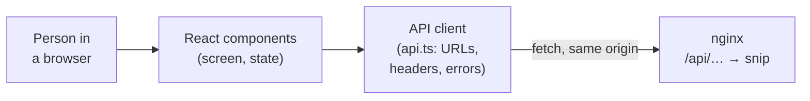
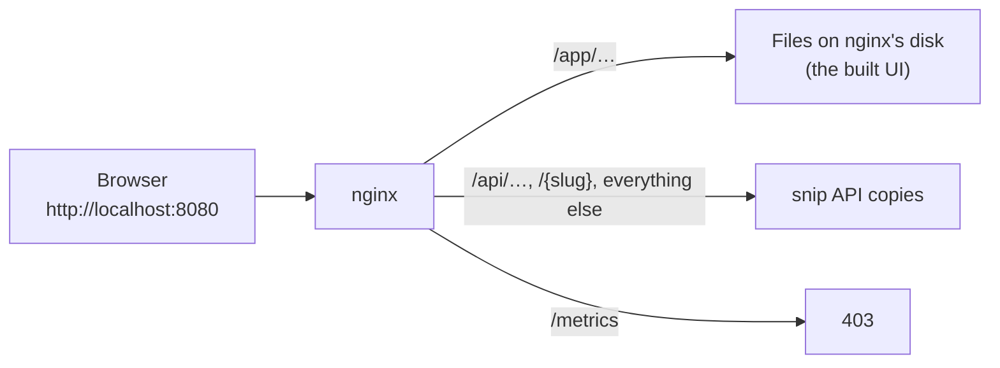

# 16.6 A real UI for snip's API

Most frontend work isn't a blank page. There's already an API, written by someone else, with its own rules, error codes and authentication, and your job is a screen that lets people use it without reading its documentation. This chapter walks through exactly that, end to end, on a real service: a small web UI for snip, the URL shortener built through this handbook. You'll see the decisions that matter in every UI of this kind: how the browser talks to the API, what happens when it fails, where the secret lives, and how the files reach the browser.

## What you'll learn

- How to split a UI into an **API client** (all knowledge of HTTP in one file) and **components** (all knowledge of the screen).
- How to type a client against an API's real responses, and turn its **error codes** into messages people can act on.
- That every screen that loads data has **four states** (loading, error, empty, ready) and how to make them impossible to mix up.
- Where an **API key** can live in a browser, what each choice costs, and why this UI keeps it in memory.
- Why serving the UI and the API from the **same origin** removes CORS entirely, and how nginx does it at `/app/`.

---

## Two layers: a client that knows HTTP, components that know the screen

:::note[Everyday anchor]
A restaurant's waiter knows the kitchen's rules: how orders are written, which dishes are off today, what "86" means. The diners never learn any of it. They say what they want, and get either the dish or a sentence they understand ("we're out of the fish, may I suggest…").
:::

The UI has the same split. One file, the **API client**, is the waiter: it knows the URLs, the headers, the JSON shapes, and every way a request can fail. The **components** are the diners: they call `createLink(url, slug)` and get back either a `Link` or an error with a sentence to show. If the API changes, one file changes.



The UI is small on purpose, under 700 lines of TypeScript and TSX including the tests, and lives in `web/`:

```text
web/
├── index.html              ← the one HTML page; Vite injects the built script
├── vite.config.ts          ← base: '/app/', dev proxy, test settings
├── Dockerfile              ← Node builds it, nginx serves it
└── src/
    ├── main.tsx            ← mounts <App /> inside <StrictMode>
    ├── api.ts              ← the API client: types, fetch, errors
    ├── App.tsx             ← holds the API key; shows KeyForm or LinksPage
    ├── components/
    │   ├── KeyForm.tsx         paste a key
    │   ├── LinksPage.tsx       owns the list: loading / error / ready
    │   ├── CreateLinkForm.tsx  URL + optional slug, field-level errors
    │   └── LinkList.tsx        rows, click counts, delete; the empty state
    ├── styles.css
    ├── api.test.ts         ← client tests against a fake fetch
    └── App.test.tsx        ← the UI driven like a person would
```

The tools (TypeScript, Vite, `npm ci`) are [chapter 16.4](./typescript-and-tooling.mdx); the React ideas (state, effects, keys, lifting state) are [chapter 16.5](./react.mdx).

---

## The client is typed against what the API really sends

snip's API is described by an OpenAPI contract, `snip/api/openapi.yaml` ([chapter 5.5](../apis/api-contracts.mdx): a machine-readable list of every endpoint, request and response). The UI uses four endpoints:

| Call | snip's endpoint | Success |
|---|---|---|
| List my links | `GET /api/links?limit=100` | `200 {"links": [...]}` |
| Create a link | `POST /api/links` with `{"url": …, "slug"?: …}` | `201` and the link |
| Delete a link | `DELETE /api/links/{slug}` | `204`, no body |
| Follow a link | `GET /{slug}` | `302` redirect (the browser does this, not the client) |

The client's types copy the contract's `Link` schema and its list of error codes:

```ts title="web/src/api.ts (excerpt)"
/** One short link, as snip returns it. */
export interface Link {
  slug: string;
  url: string;
  clicks: number;
  created_at: string; // an RFC 3339 timestamp, e.g. "2026-10-30T09:15:00Z"
  short_url: string;
}

/** The stable error codes snip can send (the Error schema's enum). */
export type ErrorCode =
  | 'invalid_json'
  | 'invalid_url'
  | 'invalid_slug'
  | 'slug_taken'
  | 'body_too_large'
  | 'unauthorized'
  | 'not_found'
  | 'rate_limited'
  | 'internal';
```

Copying by hand is honest about its weakness: if snip adds a field, nothing tells the UI. A bigger project would **generate** these types from `openapi.yaml` (with a tool such as `openapi-typescript`) in CI, so a contract change becomes a type error in the UI's build.

### Every failure becomes one kind of error

A request can fail in three different ways, and the client turns all three into one `ApiError` with a `code`, so components handle a single shape:

1. **snip answered with its error shape**, `{"error": {"code": "slug_taken", "message": "that slug is already in use"}}` ([chapter 5.3](../apis/validation-errors-status-codes.mdx) designed it so clients need one piece of code). The code is kept as-is.
2. **Something answered, but not snip.** If every snip copy is down, nginx answers `502 Bad Gateway` or `504 Gateway Timeout` with an HTML page. Parsing that as JSON fails; the client reports code `unexpected`.
3. **Nothing answered.** Wi-Fi dropped, DNS failed: `fetch` itself throws. The client reports code `network`.

Here is the heart of it:

```ts title="web/src/api.ts (excerpt)"
    if (res.status === 204) return undefined as T; // DELETE answers with no body
    const data: unknown = await res.json().catch(() => null);
    if (res.ok) return data as T;

    if (isErrorBody(data)) {
      const retry = Number(res.headers.get('Retry-After')) || undefined;
      throw new ApiError(res.status, data.error.code, data.error.message, retry);
    }
    throw new ApiError(res.status, 'unexpected', `snip answered ${res.status} ${res.statusText}`.trim());
```

`data` starts as `unknown` (anything could have arrived), and `isErrorBody` is a **type guard**: a function that checks the shape at run time and tells TypeScript the result. Note the honest weak spot: `data as T` on success trusts snip's success responses without checking them. That's a judgment call for a client talking to its own team's API with a contract test in CI; for a third-party API you'd validate those too.

Components never show raw codes. One function turns an error into a sentence a person can act on:

```ts title="web/src/api.ts (excerpt)"
export function describeError(err: unknown): string {
  if (!(err instanceof ApiError)) return 'Something went wrong. Try again.';
  switch (err.code) {
    case 'unauthorized':
      return 'snip did not accept that API key. Check it, or create a new one.';
    case 'rate_limited':
      return `You are creating links too fast. Try again in ${err.retryAfterSeconds ?? 'a few'} seconds.`;
    case 'internal':
    case 'unexpected':
      return 'snip had a problem on its side. Try again in a moment.';
    default:
      return err.message; // snip's own message is already written for people
  }
}
```

Two codes get special treatment in the components. **`unauthorized` anywhere** means "ask for a key again": `LinksPage` calls `onUnauthorized`, and `App` clears the key and shows the key form with a notice. That covers a key revoked while the page is open, which you'll do in the Lab. **Field errors go next to their field**: `invalid_url` under the URL box, `invalid_slug` and `slug_taken` under the slug box, with `aria-invalid` set so screen readers announce it too.

---

## Four states, and the screen can only be in one

:::note[Everyday anchor]
A departures board never shows a blank line for a flight. It says *boarding*, *delayed*, *cancelled* or *on time*. A blank would leave everyone guessing.
:::

Any screen that loads data is in one of four states, and each needs something on screen:

| State | What the person sees | In web/ |
|---|---|---|
| **Loading** | "Loading your links…", the Refresh button disabled | `{ status: 'loading' }` |
| **Error** | What went wrong, in words, and a **Try again** button | `{ status: 'error'; message }` |
| **Empty** | "No links yet. Shorten your first one above." | `ready` with zero links |
| **Ready** | The list | `ready` with links |

The empty state is the one teams forget: a new user's first visit shows a blank box and no idea what to do next. `LinksPage` keeps the state as a discriminated union ([chapter 16.4](./typescript-and-tooling.mdx)), so "loading *and* showing an old error" can't be written:

```tsx title="web/src/components/LinksPage.tsx (excerpt)"
        {list.status === 'loading' && <p aria-live="polite">Loading your links…</p>}
        {list.status === 'error' && (
          <div role="alert">
            <p className="error">{list.message}</p>
            <button type="button" onClick={() => void load()}>
              Try again
            </button>
          </div>
        )}
        {list.status === 'ready' && <LinkList links={list.links} onDelete={handleDelete} />}
```

`role="alert"` and `aria-live` make screen readers announce changes that sighted users see; [chapter 16.7](./accessibility.mdx) goes deeper. The **Refresh** button exists for a reason specific to snip: clicks are counted by a background worker reading a queue ([chapter 8.2](../distributed/queues-and-background-work.mdx)), so a count updates a moment after the click, not instantly.

---

## Where the API key lives, and why memory

To call snip's API, the UI sends `Authorization: Bearer snip_…` on every request ([chapter 7.2](../security/authentication.mdx): a **bearer** token works for whoever holds it, so it must not leak). The key has to be somewhere in the browser. The options:

| Where | Survives reload? | Readable by an injected script? | Sent automatically? |
|---|---|---|---|
| **localStorage** | Yes, forever, until cleared | Yes, at any time, by any script on this origin | No |
| **sessionStorage** | Yes, until the tab closes | Yes, while the tab is open | No |
| **A variable in memory** (React state) | No | Only while the page is open, and with more effort | No |
| **HttpOnly cookie** | Yes | **No**: scripts can't read it | Yes, with every request to the site |

web/ keeps the key in memory, in `App`'s state, and nowhere else:

```tsx title="web/src/App.tsx (excerpt)"
// The API key lives only in this component's state: in memory, gone when the
// tab closes or reloads. Chapter 16.6 explains why not localStorage.
export function App() {
  const [apiKey, setApiKey] = useState<string | null>(null);
```

The reasoning, honestly:

- **The threat is cross-site scripting** ([chapter 7.5](../security/web-attacks.mdx)): if an attacker gets a script running on this page, can they steal the key? With localStorage, yes, today or next month. In memory, a script running *while the page is open* could still reach it with effort, so memory is not a wall; it shrinks the window to "while you're using it".
- **The cost is convenience**: reload the tab, paste the key again. For a tool you open, use and close, that's acceptable. Short links open in a new tab for the same reason: leaving the page would forget the key.
- **The best answer for people is a cookie, not a key.** snip's API keys are designed for programs. A product for the general public would have people log in, then have the server set an **HttpOnly session cookie** that scripts can't read at all (7.2's advice for "a person in a browser"). That needs server-side login, sessions, and CSRF protection, because cookies are sent automatically. It's the right next step for a real product, and more than this chapter needs.

Defence in depth on top: React escapes every value it renders (a link titled `<script>` shows as text), and nginx sends a **Content-Security-Policy** (CSP) header that tells the browser to run scripts only from this site, so an injected inline script is refused even if one slipped in.

---

## Same origin: why the UI needs no CORS at all

An **origin** is the scheme, host and port of a URL: `http://localhost:8080`. Browsers let a page's scripts read responses only from the page's own origin, unless the other server opts in with **CORS** headers (Cross-Origin Resource Sharing). [Chapter 16.3](./javascript-in-the-browser.mdx) shows the mechanism in detail; [chapter 7.5](../security/web-attacks.mdx) explains why it's a browser rule, not a server's protection.

If the UI were hosted at `https://ui.example` and the API at `https://api.example`, snip would have to send CORS headers naming the UI's origin, and every request with an `Authorization` header would first trigger a **preflight**: an extra `OPTIONS` request asking permission. snip sends no CORS headers, and doesn't need to, because the UI is served **from the same origin as the API**, by the same nginx:



The UI's client calls `fetch('/api/links')`, a path with no host, so the browser sends it to wherever the page came from. Same origin: no CORS, no preflight, nothing to misconfigure. In development, Vite's server plays nginx's part: `server.proxy` in `web/vite.config.ts` forwards `/api` to `http://localhost:8080`, so the page at `http://localhost:5173/app/` also only ever talks to its own origin.

### nginx serves the files at /app/

nginx was snip's reverse proxy ([chapter 8.3](../distributed/reverse-proxies-and-nginx.mdx)); it's also a fast static file server. These blocks in `web/nginx/app.conf` serve the UI. The file ships inside the web image, and snip's compose config (`snip/deploy/nginx/nginx.conf`) pulls it into its `server` block with one line, `include /etc/nginx/snippets/app.conf;`:

```nginx title="web/nginx/app.conf (excerpt)"
location = /app {
    absolute_redirect off;  # "Location: /app/", not a URL with nginx's own host and port
    return 301 /app/;
}

location /app/ {
    root /usr/share/nginx/html;
    try_files $uri /app/index.html;
    add_header Cache-Control "no-cache";   # always check for a new index.html
    # Security headers for the page (chapter 16.10). An add_header inside a
    # location replaces every add_header from outside it, so all of them
    # live here together. "always" adds them to error pages too.
    add_header Content-Security-Policy "default-src 'none'; script-src 'self'; style-src 'self'; img-src 'self'; connect-src 'self'; base-uri 'none'; form-action 'self'; frame-ancestors 'none'; require-trusted-types-for 'script'" always;
    add_header Referrer-Policy no-referrer always;
    add_header X-Content-Type-Options nosniff always;
    add_header Cross-Origin-Opener-Policy same-origin always;
    add_header Permissions-Policy "camera=(), microphone=(), geolocation=()" always;
}

location /app/assets/ {     # file names carry a content hash, so they never change
    root /usr/share/nginx/html;
    add_header Cache-Control "public, max-age=31536000, immutable";
    add_header X-Content-Type-Options nosniff always;
}
```

- nginx picks the **longest matching prefix**, so `/app/…` goes to the files and everything else still reaches snip through the compose config's `location /`.
- `try_files $uri /app/index.html` serves the file if it exists and the app's page otherwise, which is what a single-page app with its own routes needs later.
- **Caching follows the file names** ([chapter 16.4](./typescript-and-tooling.mdx)): `index.html` is re-checked on every visit (`no-cache` means "check before using", not "never store"), and the hashed assets are cached for a year. A deploy changes `index.html`, which points at new asset names.
- `absolute_redirect off` fixes a classic: behind Docker's port mapping, nginx thinks it's on port 80 and would redirect `/app` to `http://localhost/app/`, a port that isn't there. A relative `Location: /app/` is right behind any proxy.

### Why /app/, and the slug that had to be reserved

snip's redirects own `GET /{slug}`: any one-segment path is a potential short link. Putting the UI at `/` would collide with all of them; putting it at `/app/` collides with exactly one, the slug `app`. Without a fix, someone could create the short link `/app`, and nginx would quietly never send anyone to it. (The same holds on Kubernetes, where a Gateway route sends `/app` to the UI.) So snip refuses that slug, the same way it already refused its own route names:

```go title="snip/internal/links/link.go (excerpt)"
// reserved are slugs that would collide with snip's own routes, or with
// the web UI that nginx serves at /app/ (chapter 16.6).
var reserved = map[string]bool{"api": true, "app": true, "healthz": true, "readyz": true, "metrics": true}
```

with `"App"` added to the invalid cases in `snip/internal/links/service_test.go`, the fuzz property in `fuzz_test.go`, and the OpenAPI description. This is the kind of change a frontend engineer makes in someone else's backend: small, tested, and explained in the commit.

### Built by Docker, served by nginx

`web/Dockerfile` has two stages, like snip's own ([chapter 9.2](../containers/writing-dockerfiles.mdx)): Node builds the files, then only `dist/` is copied into the nginx image, with the two nginx files. No Node, no `node_modules`, in what runs.

```dockerfile title="web/Dockerfile (excerpt)"
# ---- build stage ----
# The output is plain files that run in any browser, so build on the machine's
# own platform even when the image is for another (chapter 9.4's arm64 build).
FROM --platform=$BUILDPLATFORM node:26-slim AS build
WORKDIR /web
# Dependencies first, in their own layer: cached until the lockfile changes.
COPY package.json package-lock.json ./
RUN npm ci --no-audit --no-fund
COPY . .
RUN npm run build

# ---- runtime stage ----
# nginx's own unprivileged image: it runs as user 101, not root, and keeps its
# pid and temporary files in /tmp, so the rest of the filesystem can be
# read-only (chapter 9.4).
FROM nginxinc/nginx-unprivileged:1.30-alpine
# How /app/ is served, shared by every front door (nginx/app.conf), and a
# server that serves only the UI (nginx/default.conf, used on Kubernetes).
# The compose stack mounts snip/deploy/nginx/nginx.conf over default.conf to
# add the proxy to snip's API; it includes the same app.conf.
COPY nginx/app.conf /etc/nginx/snippets/app.conf
COPY nginx/default.conf /etc/nginx/conf.d/default.conf
COPY --from=build /web/dist /usr/share/nginx/html/app
```

And in `snip/docker-compose.yml` ([chapter 9.3](../containers/docker-compose.mdx)), the nginx service now builds that image instead of pulling plain nginx:

```yaml title="snip/docker-compose.yml (excerpt)"
  nginx:
    build: ../web                     # nginx (unprivileged, 1.30-alpine) plus the web UI at /app/ (chapter 16.6)
```

On Kubernetes, the same image runs as its own small Deployment, `web`, with the server in `web/nginx/default.conf`: it listens on 8080, serves `/app/` with the same `app.conf`, and answers `404` for anything else. The Gateway sends `/app` to it and every other path to the API ([chapter 10.3](../kubernetes/networking-and-ingress.mdx)), so the browser still sees one origin. CI publishes the image as `ghcr.io/jawwadzafar/snip-web` next to snip's ([chapter 9.4](../containers/images-in-production.mdx)), and the Helm chart has it too (`web.enabled`).

CI checks all of it: a `web` job runs `npm ci`, the type check, the tests and the build, and the full-stack compose job checks that `/app` redirects, `/app/` serves the page with its CSP, the assets carry the long cache header, and creating the slug `app` returns `400`. The Kubernetes job checks the same things through the Gateway, plus that `/apple` is still a short link.

:::warning[What can go wrong]
- **A forgotten state.** No empty state (a blank box), no error state (a spinner forever), or an error state with no way out. Walk through all four for every screen.
- **Showing raw errors.** "TypeError: Failed to fetch" or `slug_taken` means nothing to a person. Map codes to sentences, and put field errors next to the field.
- **Assuming the response is JSON.** Proxies, load balancers and CDNs answer with HTML when things break. Parse defensively.
- **The API key in localStorage**, "for convenience". It stays readable to any script on the origin indefinitely.
- **A path that shadows the API's own routes.** Reserve it in the API, as snip does for `app`. A short link named `app` created *before* the reservation would still exist in the database and be unreachable; a real migration would find and rename such links.
- **Forgetting `base`.** Built without `base: '/app/'`, the page asks for `/assets/index-….js`, which nginx sends to snip as a slug: a blank page and 404s in snip's logs.
:::

---

## Judgment: same origin, separate hosting, or server-rendered

Serving the UI from the API's own nginx is the simplest setup that's correct: one origin, one deploy, no CORS. It isn't the only one:

- **A separate static host or CDN** (S3 + CloudFront, Netlify, GitHub Pages) for the UI, and the API on its own domain. The UI scales and deploys independently and is cached close to users; the price is CORS (or a CDN rule that routes `/api` to the backend, which gets you back to one origin).
- **A backend for frontend (BFF)**: a small server owned by the UI team that renders pages, holds sessions in HttpOnly cookies, and calls the API server-to-server. It's the strongest answer to "where does the secret live" (not in the browser at all), and what frameworks such as Next.js make convenient.
- **Server-rendered HTML** with a little JavaScript: for a UI this simple, a Go template in snip itself would also work. A React app earns its place as the UI grows: more screens, more shared state, more people working on it.

For snip, same origin behind nginx is the right first step, and chapters [16.7](./accessibility.mdx) to [16.10](./shipping-a-frontend.mdx) build on this app: accessibility, performance, testing and shipping.

---

## Lab

On your laptop, free: Docker, and Node 26 for the last step ([chapter 16.4](./typescript-and-tooling.mdx)'s Lab). From a clone of this handbook's repository.

1. **Start the whole stack and make a key.**
   ```bash
   cd snip
   docker compose up -d --build --wait         # builds snip and the UI's nginx image
   docker compose exec api snip keys create me # prints snip_…; note the owner id too
   ```
   Open `http://localhost:8080/app` (no trailing slash) and notice the address bar gains the `/`: that's the `301` from nginx. Paste the key.

2. **Use it, and watch the network.** Open DevTools → **Network**. Create a link with the slug `my-first`, then try `app` (refused: reserved) and `my-first` again (refused: taken). Click a request and check: it went to `localhost:8080`, the page's own origin; it carries `Authorization: Bearer snip_…`; and there's no `OPTIONS` preflight anywhere. Open your short link (new tab), come back, wait a second and press **Refresh**: the worker has counted the click.

3. **Watch the error states.** Revoke your key while the page is open, then press Refresh:
   ```bash
   docker compose exec api snip keys revoke 1   # use the owner id from step 1
   ```
   The UI returns to the key form with "snip did not accept that API key". Create a new key, paste it (an empty list: the new key is a new owner). Now stop both API copies with `docker compose stop api` and press Refresh: after a two-second wait (nginx's `proxy_connect_timeout`), nginx answers `504` with an HTML page, and the UI says snip had a problem, with **Try again**. Run `docker compose start api` and press Try again a few times: while one copy is still starting you may get another error (a `502` from the copy that isn't up yet), then the list.

4. **Change something and see it.** Run the UI's dev server against the same stack:
   ```bash
   cd ../web
   npm ci
   npm run dev          # open http://localhost:5173/app/ ; /api is proxied to localhost:8080
   ```
   Paste a key. In `src/components/LinkList.tsx`, change the empty-state sentence, or show the click count in bold (`<strong>{link.clicks}</strong>`), and save: the page updates without losing your key, because HMR swaps the component and keeps `App`'s state. Run `npm test` to check you broke nothing, then ship it into the stack:
   ```bash
   cd ../snip && docker compose up -d --build nginx   # rebuilds the UI into nginx
   docker compose down -v                            # when you're done: stop everything, delete the data
   ```

## Self-check

<Quiz
  id="frontend-a-ui-for-snip"
  questions={[
    {
      q: 'Why does snip need no CORS headers for its web UI?',
      options: [
        'Because the UI sends its API key in a header, which CORS ignores',
        'Because nginx serves the UI and the API from one origin',
        'Because snip only accepts JSON, which browsers never block',
        'Because the UI is a single-page app, which is exempt from CORS',
      ],
      answer: 1,
      explain: 'Browsers restrict reading responses from other origins (scheme, host and port). The UI at http://localhost:8080/app/ calls http://localhost:8080/api/…, the same origin, so the rule never applies. A header-based key would actually make a cross-origin call stricter: it triggers a preflight.',
    },
    {
      q: 'After a deploy, every API copy is down and nginx answers 502 with an HTML page. What should the UI show?',
      options: [
        'Nothing new: keep the last list on screen and retry silently forever',
        'The raw text "Unexpected token < in JSON at position 0"',
        'A plain message that snip had a problem, and a Try again button',
        'The key form, because a failed request means the key is wrong',
      ],
      answer: 2,
      explain: 'web/\'s client parses defensively: a non-JSON answer becomes ApiError code "unexpected", which describeError turns into a sentence, and the error state offers Try again. Raw parse errors mean nothing to people, and only a 401 "unauthorized" should send them back to the key form.',
    },
    {
      q: 'Why does the UI keep the API key in React state instead of localStorage?',
      options: [
        'localStorage cannot store strings longer than 32 characters',
        'Memory shrinks the window an injected script has to steal it; localStorage keeps it readable indefinitely',
        'React state is encrypted by the browser, so scripts cannot read it',
        'The browser sends localStorage values to every site, leaking the key',
      ],
      answer: 1,
      explain: 'Any script running on the origin can read localStorage at any time, including weeks later. A key held in memory is gone when the tab closes; it is not encrypted or unreachable, only exposed for less time. For real users the stronger answer is an HttpOnly session cookie that scripts cannot read at all.',
    },
    {
      q: 'Why did adding the UI at /app/ require a change in snip\'s Go code?',
      options: [
        'snip had to add a route that serves the UI\'s files from disk',
        'A short link named app would be hidden behind the UI, so snip now refuses that slug',
        'snip had to send a Content-Security-Policy header for the UI',
        'Go\'s router rejects requests whose path starts with /app',
      ],
      answer: 1,
      explain: 'snip\'s redirects own every one-segment path (GET /{slug}). nginx sends /app/ to the UI\'s files, so a link with the slug app would never be reachable. Adding app to the reserved list makes snip refuse it with invalid_slug. nginx, not snip, serves the files and sends the CSP.',
    },
    {
      q: 'The built UI shows a blank page at /app/, and snip\'s logs show 404s for /assets/index-….js. What is the first thing to check?',
      options: [
        'That Vite\'s base setting is /app/, so asset URLs start with /app/',
        'That the API key was pasted correctly in the key form',
        'That snip\'s database migrations have run before nginx started',
        'That the browser supports JavaScript modules at all',
      ],
      answer: 0,
      explain: 'Asset requests to /assets/… reaching snip means the page asked for the wrong paths: built without base: \'/app/\', the HTML points at /assets/…, which nginx forwards to snip as a slug lookup. The key and the database only matter after the page loads.',
    },
  ]}
/>

<details>
<summary>The owner wants to host the UI on a CDN at a different domain from the API. What changes, and what would you check?</summary>

The UI and the API become different origins, so the browser enforces CORS. snip would have to answer with `Access-Control-Allow-Origin` naming the UI's exact origin (never `*` with credentials), and handle the `OPTIONS` **preflight** that every request with an `Authorization` header now triggers, including `Access-Control-Allow-Headers: Authorization, Content-Type` and the allowed methods. The client's `fetch` calls need the API's full URL instead of a path, set per environment. Check that the preflight is cached (`Access-Control-Max-Age`) so it doesn't double every request's latency, and that the CSP's `connect-src` allows the API's origin. An alternative that keeps everything simple: have the CDN route `/api/*` to the backend, so the browser still sees one origin. The rule: **same origin is the default worth keeping; leave it only for a reason, and then make CORS an exact allow-list.**

</details>

<details>
<summary>Why does the client turn three different failures (snip's error JSON, a non-JSON answer, no answer at all) into one ApiError type?</summary>

So every component handles failure with one piece of code: read `code`, show `describeError(err)`, and treat `unauthorized` specially. If components dealt with raw `fetch` behaviour, each would need to know that `fetch` throws only on network failure, that a `404` resolves normally, that a proxy can send HTML, and that a `204` has no body, and each would get one of those wrong eventually. Concentrating that knowledge in the client means the API's quirks are handled once, tested once (`web/src/api.test.ts` covers all three paths with a fake `fetch`), and changed once. It's the same idea as snip's single `writeDomainError` on the server side: **one place translates between the outside world's errors and your program's.**

</details>
