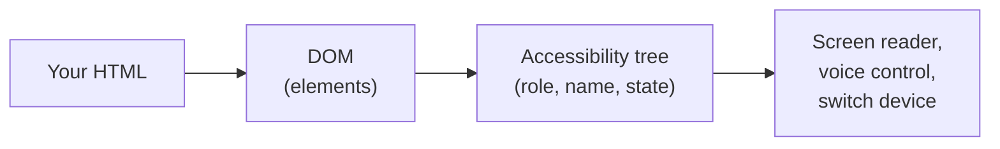

# 16.7 Accessibility: building for everyone

You've probably used a website with your hands full: scrolling a recipe with a floury thumb, reading a bus timetable in bright sun, filling in a form one-handed while holding a child. For a few minutes the page was harder to use than its designer imagined. For many people that is every day: they don't see the screen, can't use a mouse, can't hear the video, or lose their place when the page jumps. This chapter shows you how to build pages that work for them, which turns out to make pages better for everyone, and how to *check* that you did, with tools and with your own hands.

## What you'll learn

- Who **accessibility** serves: permanent, temporary and situational disabilities, and the assistive technology people use.
- What **WCAG 2.2 level AA** asks for, in plain words, and why it's the bar laws and contracts name.
- Why **semantic HTML** does most of the work, and how every control gets an **accessible name**.
- **Keyboard and focus**: visible focus, a sensible order, and moving focus on purpose when the screen changes.
- **Contrast**, ARIA's first rule ("don't use ARIA if HTML can do it"), and **live regions** for results that arrive later.
- How to test: **axe** finds about half of the problems, the keyboard and a **screen reader** find the rest.

---

## Accessibility is for more people than you think

:::note[Everyday anchor]
A ramp at a building's entrance was built for wheelchairs. It is also used every day by parents with pushchairs, couriers with trolleys, travellers with suitcases and someone with a sprained ankle. Designers call this the **curb-cut effect**: a fix for one group helps far more people than it was built for.
:::

**Accessibility** (often written **a11y**: "a", eleven letters, "y") means people with disabilities can perceive, understand, navigate and use what you build. The World Health Organization estimates that [about 1.3 billion people, one in six](https://www.who.int/news-room/fact-sheets/detail/disability-and-health), live with a significant disability. Microsoft's [Inclusive Design](https://inclusive.microsoft.design/) toolkit adds a useful way to see the full range, using touch as the example:

| Kind | Example | Lasts |
|---|---|---|
| **Permanent** | Someone with one arm | Always |
| **Temporary** | A broken wrist in a cast | Weeks |
| **Situational** | A parent holding a baby | Minutes |

The same split works for sight (blind; eye surgery; glare on a phone), hearing (deaf; an ear infection; a loud train) and attention (a cognitive disability; a concussion; a busy day). Design for the permanent case and the temporary and situational ones come along for free.

People reach the web through **assistive technology**: software or hardware between them and your page.

- A **screen reader** reads the page aloud (or to a braille display) and lets the user jump between headings, links, form fields and landmarks. VoiceOver ships with every Mac and iPhone, TalkBack with Android, Narrator with Windows; NVDA is a free Windows screen reader, JAWS a paid one, Orca the Linux one.
- **Keyboard-only** use: people who can't use a mouse, and many power users, move with `Tab`, `Shift+Tab`, `Enter`, `Space` and the arrow keys. Switch devices and voice control (Voice Control on macOS, Voice Access on Windows) act like a keyboard too.
- **Zoom and magnifiers**: browser zoom to 200% or 400%, or a screen magnifier showing a small part of the page at a time.

All of them depend on the same thing: the page saying *what each part is*, not only how it looks.

---

## WCAG 2.2 AA: the bar, in plain words

The rules everyone measures against are the **WCAG** (Web Content Accessibility Guidelines), published by the W3C (the World Wide Web Consortium, which writes web standards). The current version is **[WCAG 2.2](https://www.w3.org/TR/WCAG22/)**, a W3C Recommendation since October 2023. WCAG 3 exists only as a [working draft](https://www.w3.org/WAI/standards-guidelines/wcag/wcag3-intro/) and the W3C says it won't replace WCAG 2 for years after it's finished, so 2.2 is what you build to.

WCAG is a list of **success criteria**: testable statements such as "text has a contrast ratio of at least 4.5:1". Each has a **level**: **A** (the minimum), **AA** (the usual target) and **AAA** (the strictest, not expected for whole sites). "Conforms to WCAG 2.2 AA" means every A and AA criterion is met. Laws and contracts name AA: the European Accessibility Act, in force for many products and services in the EU since June 2025, works through the standard EN 301 549, which is built on WCAG AA, and a 2024 US Justice Department rule names WCAG 2.1 AA for state and local government websites.

The criteria are grouped under four principles, remembered as **POUR**:

| Principle | Means | A few of its AA criteria, in plain words |
|---|---|---|
| **Perceivable** | People can get the content with the senses they have | Images have text alternatives; text contrast is at least 4.5:1; the page works at 200% zoom and at 320 px wide without sideways scrolling |
| **Operable** | People can use every control | Everything works from the keyboard; focus is visible and not hidden behind sticky headers; targets are at least 24×24 px (new in 2.2); nothing requires dragging if a click would do (new in 2.2) |
| **Understandable** | People can follow what happens | The page's language is set; inputs have labels; errors are described in text and say how to fix them; logging in doesn't demand solving a puzzle or remembering a code (new in 2.2) |
| **Robust** | Assistive technology can read it | Every control exposes a name, a role and a state |

You don't memorise eighty-odd criteria. You build on semantic HTML, keep the habits in this chapter, and test; the WCAG [quick reference](https://www.w3.org/WAI/WCAG22/quickref/) is where you look up a specific one.

:::info[In the real world]
The WebAIM Million, an annual automated scan of the top million home pages, found [detectable WCAG failures on 95.9% of them in 2026](https://webaim.org/projects/million/). The six most common problems were low-contrast text, images without alternative text, form fields without labels, empty links, empty buttons and a missing page language. All six are fixable in minutes, and all six are covered below.
:::

---

## Semantic HTML does most of the work

When a browser loads a page it builds the DOM ([chapter 16.1](./how-a-page-works.mdx): the live tree of elements), and from it a second tree: the **accessibility tree**. Each node has a **role** (button, link, heading, textbox), an **accessible name** (what it's called) and a **state** (checked, expanded, disabled, invalid). Assistive technology reads this tree, not the pixels.

Four boxes:



The one thing to take away: **the accessibility tree is only as good as the HTML it comes from**. Use the element that means what you want, and the browser fills in the role, the keyboard behaviour and the state for free.

Here are two "buttons". They look the same once styled:

```html
<div class="btn" onclick="save()">Save</div>      <!-- looks like a button -->
<button type="button" onclick="save()">Save</button>  <!-- is a button -->
```

The `div` has no role (a screen reader says "Save", as if it were text), can't be reached with `Tab`, and doesn't respond to `Enter` or `Space`. To repair it you'd add `role="button"`, `tabindex="0"` and a key handler for both keys, and you'd still miss details, such as how it should behave inside a form. The `button` has all of that built in. The same goes for links (`<a href>` navigates; `<button>` acts), headings (`<h1>`…`<h6>`, which screen reader users jump between like a table of contents), lists, tables, and the landmark elements (`<header>`, `<nav>`, `<main>`, `<footer>`) from [chapter 16.1](./how-a-page-works.mdx).

### Every control needs a name

The **accessible name** is what a screen reader announces and what a voice-control user says ("click Save"). The browser works it out in a fixed order, roughly:

1. `aria-labelledby`: the text of other elements, by id.
2. `aria-label`: a string you write.
3. The native way: a `<label>` for an input, the text inside a button or link, the `alt` of an image.
4. As a last resort, `title` or `placeholder`, which are unreliable.

So the habits are:

```html
<label for="email">Email</label>
<input id="email" type="email" autocomplete="email">   <!-- name: "Email" -->

  <!-- says what it shows -->
                          <!-- decorative: an empty alt, so it's skipped -->

<button type="button" aria-label="Close dialog">×</button>   <!-- an icon needs words -->
```

A `placeholder` is not a label: it disappears as soon as the user types, and its default grey usually fails contrast. Helper text that sits below a field is connected with `aria-describedby`, so it's read after the name: "Password, edit text, at least 12 characters".

One more rule from WCAG ("label in name"): when a control has visible text, its accessible name should *contain* that text. A button showing "Delete" and named "Delete godoc" works for a voice-control user who says "click Delete"; one named "Remove item" doesn't.

---

## The keyboard: focus you can see, in an order that makes sense

:::note[Everyday anchor]
Focus is the cursor of the whole page. With a mouse you point wherever you like; with a keyboard you can only be in one place at a time, and `Tab` moves you to the next stop. If the stop isn't visible, or the next stop is on the other side of the page, you're lost.
:::

Whatever element receives keystrokes has **focus**. Links, buttons, inputs and other controls are **focusable**: `Tab` visits them in DOM order, `Shift+Tab` goes back. Three rules follow:

- **Focus must be visible.** Browsers draw a **focus ring** around the focused element. Never remove it (`outline: none`) without drawing something at least as clear. The CSS pseudo-class `:focus-visible` matches when the browser judges a ring is useful, typically after keyboard use, so you can style it without showing rings on every mouse click.
- **Focus order follows reading order.** Because `Tab` follows the DOM, laying things out with CSS in a different order than the HTML (with `order`, or grid placement, from [chapter 16.2](./css-from-zero.mdx)) makes focus jump around. Keep the source order logical. Avoid positive `tabindex` values (`tabindex="3"`): they override the natural order for the whole page. `tabindex="0"` makes something focusable in its natural place; `tabindex="-1"` makes it focusable from code only.
- **No traps.** The user must always be able to `Tab` away, except inside a modal dialog, which keeps focus inside until it closes and then returns it to the button that opened it. The native `<dialog>` element opened with `showModal()` does this for you.

### When the screen changes, put focus somewhere on purpose

The bug that automated tools can't see, and that every single-page app has once: **the focused element disappears**. You press a "Delete" button, its row is removed, and the button with it. The browser has nowhere to keep focus, so it drops it on `<body>`, the top of the page. A keyboard user's next `Tab` starts from the beginning; a screen reader user hears nothing at all and has to explore to find out what happened.

The same happens when one view replaces another (submitting a login form that's replaced by the app), and, less obviously, when a button becomes `disabled` while it works: the browser removes focus from a disabled element.

The fix is to decide where focus goes next and move it there:

```js
// After removing a row: focus the list's heading, which is focusable from code only.
heading.setAttribute('tabindex', '-1');
heading.focus();
```

Good destinations: the first field of a new view, the heading of the region that changed, the next item in a list, or the control that opened a dialog. For buttons that are busy, `aria-disabled="true"` (announced as unavailable, but still focusable) plus a check in the click handler keeps focus where the user left it.

---

## Contrast: text has to stand out from its background

[Chapter 16.2](./css-from-zero.mdx) introduced the **contrast ratio**: a number from 1:1 (same colour) to 21:1 (black on white) comparing the brightness of two colours. WCAG AA asks for:

| What | Minimum ratio | Criterion |
|---|---|---|
| Normal text | **4.5:1** | 1.4.3 |
| Large text (24 px, or about 18.7 px bold) | **3:1** | 1.4.3 |
| Parts of controls you need to see to use them (an input's border, a checkbox's box, a focus ring) and meaningful graphics | **3:1** against what's next to them | 1.4.11 |

The second row of criteria is the one people forget. An input whose only visible edge is a pale grey line on white (a ratio around 1.4:1, a common design) is close to invisible for someone with low vision: they see a label floating above nothing.

Two more contrast rules: **colour can't be the only signal** (an invalid field needs a message or an icon, not only a red border, because about one in twelve men has some colour-vision deficiency), and **placeholder text is text**: if it carries information, it needs 4.5:1 too.

Check with the colour picker in DevTools (it shows the ratio), the Accessibility pane, or any contrast checker such as WebAIM's.

---

## ARIA: the first rule is not to use it

**ARIA** (Accessible Rich Internet Applications) is a set of HTML attributes that change the accessibility tree directly: `role="dialog"`, `aria-expanded="true"`, `aria-label="Close"`, `aria-live="polite"`. It exists for widgets HTML has no element for: tabs, tree views, comboboxes.

ARIA changes only what assistive technology is *told*. It adds no behaviour: `role="button"` on a `div` makes a screen reader say "button" while `Enter` still does nothing. That's why the W3C's [first rule of ARIA](https://www.w3.org/TR/using-aria/#rule1) is: **if a native HTML element or attribute does what you need, use it instead.** A wrong ARIA attribute is worse than none, because it makes a confident promise the page doesn't keep. The 2026 WebAIM Million found that home pages using ARIA averaged 59 detected errors against 42 for pages without; WebAIM notes those pages are also more complex, so ARIA isn't the only cause, but it's rarely a fix on its own.

When you do need ARIA, follow the patterns in the W3C's [ARIA Authoring Practices Guide](https://www.w3.org/WAI/ARIA/apg/), which say which roles, states and keys each widget needs.

### Live regions: telling people what happened

Some results arrive later and somewhere else: "Saved", "3 results", "Message sent". A sighted user glances at the change. A screen reader user, whose attention is on the button they pressed, hears nothing unless the page says so. A **live region** is an element whose changes the screen reader announces without moving focus:

```html
<p role="status"></p>      <!-- polite: announced when the reader finishes what it's saying -->
<p role="alert"></p>       <!-- assertive: interrupts; for errors that need action now -->
```

```js
document.querySelector('[role="status"]').textContent = 'Saved';  // read out: "Saved"
```

**The live region must be in the page before its text changes.** Screen readers watch existing regions for changes; a region inserted together with its text is often not announced. So render the empty region with the page, and fill it later. (`role="alert"` is more forgiving, since browsers fire a special event when one is inserted, but the same habit is safer.) Use `status` for confirmations and `alert` only for things that need attention, or users hear a stream of interruptions.

:::warning[What can go wrong]
- **Clickable `div`s and `span`s.** No role, no keyboard. Use `<button>` and `<a href>`.
- **Inputs labelled only by a placeholder.** The name vanishes as you type. Use `<label for>`.
- **`outline: none` with no replacement.** Keyboard users lose their place.
- **Focus dropped on `<body>`** after a delete, a view change or a disabled button. Move it on purpose.
- **Live regions created together with their message.** Often silent. Render them empty up front.
- **ARIA that lies.** `aria-hidden="true"` on something focusable, `role="button"` with no key handler, `aria-expanded` that never changes.
:::

---

## Testing: machines find half, people find the rest

**Automated checkers** read the DOM and apply rules a machine can decide. The most widely used engine is **axe-core** (from Deque, open source), which powers the axe browser extension, the accessibility part of Chrome's Lighthouse, and test integrations for Playwright, Cypress and Vitest. It catches missing labels, missing `alt`, low text contrast, invalid ARIA, duplicate ids and missing page language reliably, and it reports no false positives by design.

What it can't judge:

- whether alt text is *right* (`alt="image"` passes);
- whether focus goes somewhere sensible after an action;
- whether the focus order makes sense, or a focus ring is visible enough;
- whether a live region announces the right thing at the right time;
- non-text contrast of borders and icons, and text in placeholders, which axe doesn't check;
- whether the page makes sense read aloud, top to bottom.

Deque's own study of its audits found automated rules [covered about 57% of issues by volume](https://www.deque.com/blog/automated-testing-study-identifies-57-percent-of-digital-accessibility-issues/); measured by WCAG criteria the share is lower. Either way, "axe is green" means "no *detectable* problems", not "accessible".

So a real check has three layers:

1. **Automated**, on every change: axe in your tests.
2. **Keyboard**, before each release: unplug the mouse (or don't touch it) and do every task with `Tab`, `Shift+Tab`, `Enter`, `Space`, `Esc` and the arrows. Can you see focus at every step? Does it land somewhere sensible after each action?
3. **Screen reader**, for anything new: turn one on and do the task with your eyes closed or the screen dimmed. Start with the one on your system: VoiceOver on a Mac (`Cmd+F5`), Narrator or NVDA on Windows, Orca on Linux. The first ten minutes are disorienting; after that, you'll hear problems no tool reports.

And the best test of all is people who use assistive technology every day. Larger companies pay disabled testers and run audits with specialists; that's where the remaining issues surface.

---

## Apply it to snip: an audit of the web UI

snip, the URL shortener built through this handbook, has a React UI in `web/` ([chapter 16.6](./a-ui-for-snip.mdx)): paste an API key, then create, list and delete short links. It was written with care: real `<label>`s, `<button>`s, a `<main>`, error messages tied to their fields with `aria-describedby` and `aria-invalid`. Here is what an audit found, honestly.

**axe found nothing.** `web/e2e/a11y.spec.ts` runs axe with Playwright against the running app, in light and dark mode, before and after logging in, checking the WCAG 2.0–2.2 A and AA rules:

```ts title="web/e2e/a11y.spec.ts (excerpt)"
async function axeViolations(page: Page) {
  const results = await new AxeBuilder({ page })
    .withTags(['wcag2a', 'wcag2aa', 'wcag21a', 'wcag21aa', 'wcag22aa'])
    .analyze();
  // Only the parts a person needs to fix it: which rule, and which elements.
  return results.violations.map((v) => ({ rule: v.id, help: v.help, nodes: v.nodes.map((n) => n.target.join(' ')) }));
}
```

It reported zero violations on the original code, and zero after the fixes below. That's the lesson of this section: every problem that follows was invisible to it.

**The keyboard found four places where focus was lost.** A short Playwright script pressed each button with the keyboard and printed `document.activeElement` afterwards. On the original code, all four printed `<body>`:

| Action | Why focus was lost | Fix in `web/src` |
|---|---|---|
| Submit the API key | The key form is replaced by the links page | The "Long URL" field takes focus when it appears (`CreateLinkForm.tsx`) |
| Press "Create short link" or "Refresh" | The button becomes `disabled` while it works | `aria-disabled` plus a guard in the handler, so it keeps focus (`CreateLinkForm.tsx`, `LinksPage.tsx`) |
| Press "Delete" on a link | The button disappears with its row | Focus moves to the "Your links" heading (`LinksPage.tsx`) |
| Press "Forget key" | The links page is replaced by the key form | The key field takes focus when the form returns (`KeyForm.tsx`, `App.tsx`) |

The delete fix, in the component that owns the list:

```tsx title="web/src/components/LinksPage.tsx (excerpt)"
      await client.deleteLink(slug);
      setAnnouncement(`Deleted ${slug}`);
      // The Delete button that had focus is gone with its row. Put focus on
      // the list's heading, so keyboard users continue from a known place.
      headingRef.current?.focus();
```

with `<h2 id="links-heading" ref={headingRef} tabIndex={-1}>` on the heading.

**Results were seen but not heard.** Creating or deleting a link changed the list, and nothing told a screen reader. The original code had one live region, `<p aria-live="polite">Loading your links…</p>`, which was inserted together with its text, the pattern screen readers often miss. Now `LinksPage` renders one `role="status"` paragraph, empty and visually hidden, from the start, and fills it with "Created http://localhost:8080/godoc" or "Deleted godoc".

**Two contrast problems axe doesn't check.** A contrast checker on the colours in `web/src/styles.css` found:

- Input borders were `#d6dae0` on a white card: **1.4:1**, under 1.4.11's 3:1. A new `--input-border` colour (`#868e98`, **3.3:1**; `#7b8490` at 4.4:1 in dark mode) keeps the light look and makes the fields visible.
- Placeholder text used the browser's default grey, `#757575`: **4.3:1** on the light input background and **4.0:1** on the dark one. It now uses the muted text colour: 5.6:1 and 8.0:1.

**And one missing description.** The hint under the API key field ("Create one with `snip keys create NAME`…") wasn't connected to the field, so a screen reader user tabbing into it heard only "API key, secure edit text". It now has `aria-describedby`.

Each fix has a test, so it can't quietly come back. The Vitest tests run in milliseconds against a fake API, the way [chapter 16.9](./testing-the-frontend.mdx) describes:

```tsx title="web/src/App.test.tsx (excerpt)"
  it('after a delete, announces it and puts focus on the list heading', async () => {
    stubFetch(json(200, { links: [godoc] }), new Response(null, { status: 204 }));
    vi.stubGlobal('confirm', () => true);
    const user = userEvent.setup();
    render(<App />);
    await enterKey(user);

    await user.click(await screen.findByRole('button', { name: 'Delete godoc' }));

    expect(await screen.findByRole('status')).toHaveTextContent('Deleted godoc');
    expect(screen.getByRole('heading', { name: 'Your links' })).toHaveFocus();
  });
```

and `web/e2e/a11y.spec.ts` walks the whole flow in a real browser with the keyboard alone, checking where focus is after every step.

What's left for a person: listening to the whole flow with VoiceOver or NVDA (the tests check that the right sentence is in the live region, not how each screen reader reads it), and deciding whether "Your links" is the best place for focus after a delete or the next row's Delete button would be better. Those are judgment calls, which is why they're people's work.

---

## Cheat sheet

| Habit / tool | What it gives you | When you reach for it |
|---|---|---|
| `<button>`, `<a href>`, `<label for>`, headings, landmarks | Role, name, keyboard support for free | Always, before anything else |
| `alt="what it shows"` / `alt=""` | Text alternative / "skip this decorative image" | Every `` |
| `aria-describedby` | Hints and errors read after the name | Help text, field errors |
| `:focus-visible` styles | A clear focus ring for keyboard users | When you restyle focus |
| `el.focus()` (+ `tabindex="-1"`) | Focus moved on purpose | After deletes, view changes, closing dialogs |
| `aria-disabled="true"` | "Unavailable" without losing focus | Buttons that are busy |
| `role="status"` / `role="alert"` | Polite / urgent announcements | Async results / errors needing action |
| axe (extension, Lighthouse, `@axe-core/playwright`) | The detectable half of the problems | On every change, in tests |
| Keyboard pass, screen reader pass | The other half | Before releasing anything new |

---

## Lab

On your laptop, free. You need a browser and a text editor; the last step needs Node and Docker from [chapter 16.4](./typescript-and-tooling.mdx) and [chapter 9.3](../containers/docker-compose.mdx).

1. **Build an inaccessible page and feel it.** Save this as `bad.html` and open it in your browser:
   ```html
   <!doctype html>
   <html>
   <head><title>Sign up</title>
     <style>
       .hint { color: #aaa; }                                     /* pale grey */
       .btn { background: #2563eb; color: white; padding: 8px; display: inline-block; cursor: pointer; }
       *:focus { outline: none; }                                 /* "looks cleaner" */
     </style>
   </head>
   <body>
     <h3>Sign up</h3>                                               <!-- skips h1 and h2 -->
     <input type="email" placeholder="Email">                      <!-- no label -->
     <p class="hint">We never share your email.</p>
                                               <!-- no alt -->
     <div class="btn" onclick="alert('Signed up')">Sign up</div>   <!-- not a button -->
   </body>
   </html>
   ```
   Click in the page's address bar, then press `Tab` repeatedly without touching the mouse. Notice that you can't tell where you are (the outline is gone), and that you can never reach "Sign up": a `div` isn't focusable.

2. **Ask a machine.** Open DevTools (F12), go to the **Lighthouse** tab, tick only **Accessibility**, and run it. It uses axe-core. Notice what it reports (no `lang`, no label, no `alt`, low contrast on the hint) and what it doesn't: nothing about the unreachable "button" or the missing focus ring. Now open the **Elements** tab, select the input, and look at the **Accessibility** pane: the computed name is empty (or just the placeholder, depending on the browser).

3. **Fix it and listen.** Change the page to: `<html lang="en">`, an `<h1>`, `<label for="email">Email</label>` with `id="email"` on the input, `aria-describedby="hint"` on the input with `id="hint"` on the hint and a darker colour (`#555`), `alt="Acme"` on the image, a real `<button type="button">`, and delete the `outline: none` rule. Run Lighthouse again: 100. Then turn on your screen reader and `Tab` through:

   <Tabs>
   <TabItem value="mac" label="macOS">

   Press `Cmd+F5` to start VoiceOver (again to stop). `Tab` moves between controls; `Ctrl+Option+U` opens the rotor, a list of headings, links and form controls.

   </TabItem>
   <TabItem value="win" label="Windows">

   Press `Ctrl+Win+Enter` to start Narrator (again to stop), or install the free NVDA from nvaccess.org (`Insert+Q` quits). `Tab` moves between controls; in NVDA, `H` jumps between headings.

   </TabItem>
   <TabItem value="linux" label="Linux">

   In GNOME, press `Super+Alt+S` to start Orca (again to stop). `Tab` moves between controls; `H` jumps between headings in a browser page.

   </TabItem>
   </Tabs>

   Notice that you now hear "Email, edit text, We never share your email" and "Sign up, button". Run the `bad.html` version once more with the screen reader on: the difference is the whole chapter.

4. **Apply it to snip.** In this handbook's repository, run the UI's unit tests, including the accessibility ones, then the axe and keyboard tests against the running stack:
   ```bash
   cd web && npm ci && npm test                          # Vitest: includes the focus and live-region tests
   cd ../snip && docker compose up -d --build --wait     # the whole stack, UI at http://localhost:8080/app/
   export SNIP_API_KEY=$(docker compose exec -T api snip keys create a11y | grep -o 'snip_[A-Za-z0-9]*')
   cd ../web && npx playwright install chromium          # a browser for Playwright, once
   npx playwright test a11y                              # axe in light and dark mode, plus the keyboard walk
   ```
   Then open http://localhost:8080/app/, paste the key, and do the same flow yourself with the keyboard and your screen reader. Create a link and listen for "Created…"; delete it and notice where focus lands. Finish with `cd ../snip && docker compose down -v`.

## Self-check

<Quiz
  id="frontend-accessibility"
  questions={[
    {
      q: 'axe reports zero violations on your page. What can you conclude?',
      options: [
        'The page conforms to WCAG 2.2 AA and can be signed off',
        'No problems that axe\'s rules can detect were found; focus handling, alt text quality and reading order still need checking by hand',
        'The page works with screen readers, though not necessarily with the keyboard',
        'Contrast and labels are fine, so only the ARIA attributes need reviewing',
      ],
      answer: 1,
      explain: 'Automated rules cover roughly half of real issues. They can\'t tell whether alt text is right, whether focus lands somewhere sensible, or whether a live region says the right thing, and axe doesn\'t check border contrast or placeholders. snip\'s UI had a clean axe report and still lost focus four times. Contrast and labels are among the things axe does check well, so the last option has it the wrong way round.',
    },
    {
      q: 'A keyboard user deletes an item from a list and their next Tab jumps to the top of the page. What is the most likely cause?',
      options: [
        'The list items have positive tabindex values that reorder the page',
        'The focused Delete button was removed with its row, so focus fell back to the body',
        'The browser\'s focus ring was hidden with outline: none',
        'The list is missing role="list", so the browser can\'t track focus in it',
      ],
      answer: 1,
      explain: 'When the focused element leaves the DOM, the browser has nowhere to keep focus and resets it to the document, so the next Tab starts from the beginning. The fix is to move focus on purpose, to the list\'s heading or the next row. A hidden focus ring makes focus invisible but doesn\'t move it; positive tabindex scrambles the order everywhere, not only after a delete.',
    },
    {
      q: 'Which change best fixes <div class="btn" onclick="save()">Save</div>?',
      options: [
        'Add role="button" so screen readers announce it as a button',
        'Add tabindex="0" so keyboard users can reach it',
        'Replace it with <button type="button" onclick="save()">Save</button>',
        'Add aria-label="Save" so it has an accessible name',
      ],
      answer: 2,
      explain: 'A native button brings the role, focusability, Enter and Space activation and correct form behaviour in one go. role="button" only changes what is announced (the first rule of ARIA: use HTML when it can do the job), tabindex alone makes it focusable but not operable by key, and it already has a name from its text.',
    },
    {
      q: 'Your app shows "Saved" in a new paragraph after a save, with role="status" on that paragraph. Screen reader users say they hear nothing. Why?',
      options: [
        'role="status" is only for errors; it should be role="alert"',
        'The live region is inserted together with its text, and screen readers announce changes to regions that already exist',
        'Screen readers never read text that appears without a page load',
        'The paragraph needs tabindex="0" so the screen reader can focus it',
      ],
      answer: 1,
      explain: 'Screen readers watch existing live regions for changes. Render the role="status" element empty when the page loads, then change its text. role="alert" is for urgent messages that should interrupt, not confirmations; and moving focus to the message isn\'t necessary, that\'s the point of a live region.',
    },
    {
      q: 'Input fields have a 1px #d6dae0 border on white (1.4:1). Labels and text all pass 4.5:1. Is this a WCAG AA problem?',
      options: [
        'No: contrast rules apply only to text',
        'No: the fields have labels, which is all WCAG requires for inputs',
        'Yes: criterion 1.4.11 needs 3:1 for the parts of a control you need to see to find and use it',
        'Yes, but only at level AAA',
      ],
      answer: 2,
      explain: 'Non-text contrast (1.4.11, level AA) covers component boundaries, icons and focus indicators needed to identify a control. With a 1.4:1 border a low-vision user sees a label with no visible field under it. It\'s easy to miss because axe doesn\'t check it; snip\'s UI had exactly this and now uses a 3.3:1 border.',
    },
  ]}
/>

<details>
<summary>A designer asks you to remove the focus outline because it "looks ugly on buttons when you click them". What do you do, and why?</summary>

Keep a focus indicator, but show it only when it helps. The outline exists for keyboard users: without it they can't tell where they are, which fails WCAG 2.4.7 (focus visible, level AA). The designer's real complaint is the ring appearing after a mouse click. Style `:focus-visible` instead of `:focus`: browsers apply it after keyboard navigation and not after most mouse clicks, so mouse users don't see rings and keyboard users do. Then design a ring that fits the brand and has at least 3:1 contrast against its surroundings, for example `outline: 3px solid` in the accent colour with `outline-offset: 2px`. The rule: **you may restyle focus, never remove it.**

</details>

<details>
<summary>Your team has an axe check in CI that has been green for a year. A blind customer writes that they can't finish checkout. What went wrong, and what would you add to the process?</summary>

The check did its job: it found nothing it could detect. Checkout probably breaks in a way only a person notices: focus lost after an address form is replaced, a custom dropdown that doesn't respond to arrow keys, a payment widget in an iframe with unlabelled fields, an error shown visually but never announced. Add a keyboard-only pass and a screen reader pass of every critical flow (sign-up, checkout, account settings) before releases; write end-to-end tests for the things you learn (where focus goes after each step, what the live region says), so fixes stay fixed; and, for important flows, pay people who use assistive technology daily to test them. Then ask the customer exactly where they got stuck: they've just done the most valuable test you have. The rule: **automated checks are the floor, not the ceiling.**

</details>
