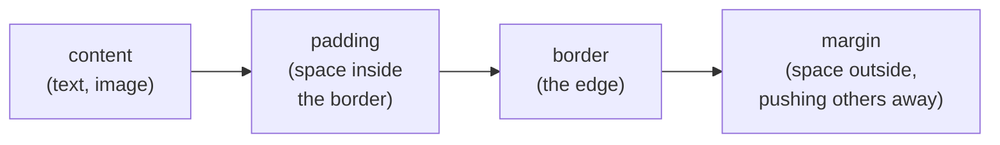
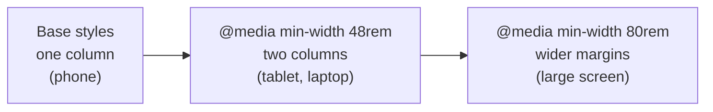

# 16.2 CSS from zero: boxes, layout and responsive design

You've changed a font in a word processor, and you've seen a web page that looks perfect on a laptop fall apart on a phone. **CSS** (Cascading Style Sheets) is the language that decides how every element on a web page looks and where it sits. Most people learn it by trial and error: add a rule, refresh, add `!important`, refresh again. This chapter gives you the three ideas that make the guessing stop — which rule wins, how big a box really is, and how boxes are laid out — and then uses them to build a layout that adapts from a wide screen to a phone.

## What you'll learn

- How a **selector** picks elements, and how the **cascade** and **specificity** decide which rule wins when several disagree — the cause of most "why isn't my style applied?".
- The **box model**: every element is a box of content, padding, border and margin, and `box-sizing: border-box` makes widths mean what you think.
- **Units** (`px`, `rem`, `%`, `vw`) and **colour**, including the **contrast** text needs to be readable by everyone.
- **Flexbox** for laying things out in a row or a column, and **grid** for two-dimensional layouts.
- **Responsive design**: the viewport tag, **media queries**, and building **mobile-first**.
- **Custom properties** (CSS variables), **dark mode** with `prefers-color-scheme`, and where frameworks like **Tailwind** fit.

---

## A rule is a selector plus declarations

CSS is a list of **rules**. Each rule says *which elements* and *what to set*:

```css
h1 {                 /* selector: every h1 element */
  color: #1d4ed8;    /* declaration: property, colon, value, semicolon */
  font-size: 2rem;
}
```

The part before the braces is the **selector**; each `property: value;` line inside is a **declaration**. You attach a stylesheet to a page with `<link rel="stylesheet" href="style.css">` in the `head` ([chapter 16.1](./how-a-page-works.mdx) explained why that file blocks the first paint), or put rules inside a `<style>` element.

Selectors walk the HTML tree from [chapter 16.1](./how-a-page-works.mdx). The ones you'll use daily:

| Selector | Picks | Example |
|---|---|---|
| `p` | every element of that type | all paragraphs |
| `.card` | every element with `class="card"` (elements can have several classes) | `<article class="card featured">` |
| `#signup` | the element with `id="signup"` (ids are unique per page) | one form |
| `nav a` | `a` elements anywhere *inside* a `nav` (the space means "descendant") | menu links |
| `ul > li` | `li` elements that are *direct children* of a `ul` | top-level list items |
| `a:hover`, `input:focus` | an element in a state (a **pseudo-class**) | a link under the mouse |
| `[type="email"]` | elements with that attribute value | email inputs |
| `article:has(img)` | an `article` that *contains* an `img` | cards with pictures |

`:has()`, the "parent selector" people wanted for twenty years, works in every current major browser.

:::note[Everyday anchor]
A stylesheet is a stack of instructions to a decorator walking through a house (the DOM). "Paint every door blue." "Paint the front door red." "Paint the door to room 12 green." Each instruction picks rooms by description, and some doors match several. The decorator needs a rule for which instruction wins on each door — that rule is the cascade.
:::

---

## The cascade: which rule wins

One element often matches several rules that set the same property. This paragraph is matched by all three:

```html
<p id="intro" class="lead">Welcome.</p>
```

```css
p      { color: black; }
.lead  { color: green; }
#intro { color: red; }
```

It comes out **red**. The browser settles every conflict with the **cascade**, comparing these in order and stopping at the first difference:

1. **Importance.** A declaration marked `!important` beats normal ones.
2. **Specificity**: how precisely the selector describes the element (below).
3. **Order.** If everything else ties, the rule that appears **later** wins.

**Specificity** is counted as three numbers, compared left to right — like version numbers, so `1-0-0` beats `0-12-0`:

| Selector | IDs | Classes, attributes, pseudo-classes | Types | Score |
|---|---|---|---|---|
| `p` | 0 | 0 | 1 | 0-0-1 |
| `.lead` | 0 | 1 | 0 | 0-1-0 |
| `nav a:hover` | 0 | 1 | 2 | 0-1-2 |
| `#intro` | 1 | 0 | 0 | 1-0-0 |
| `style="color: blue"` attribute | beats every selector | | | |

That table is the answer to most "why isn't my style applied?" questions. You write `.button { background: orange; }` and nothing happens, because an older rule `#sidebar a { background: grey; }` (1-0-1) beats your 0-1-0, however late yours appears.

Two more mechanisms complete the picture:

- **Inheritance.** Some properties, mostly text ones (`color`, `font-family`, `font-size`, `line-height`), pass from parent to children unless a child sets its own. Set the font once on `body` and the whole page gets it. Box properties (`border`, `padding`, `width`) don't inherit.
- **Cascade layers.** `@layer reset, base, components;` declares named layers; a rule in a later layer beats one in an earlier layer *regardless of specificity*. Large codebases and frameworks (Tailwind among them) use layers to stop specificity wars.

**DevTools shows the cascade for you.** Select an element in the Elements panel, and the **Styles** pane lists every matching rule, most specific first, with the losing declarations ~~struck through~~. When a style "doesn't work", look for your rule there: missing means the selector doesn't match; struck through means something else wins, and the winner is listed above it.

:::warning[What can go wrong]
- **`!important` as a fix.** It wins today, and the next person needs `!important` with higher specificity to beat it. Find the winning rule in DevTools and change the selectors instead.
- **Styling by `id`.** One `#id` outweighs any number of classes, so id-based styles are hard to override. Style with classes; keep ids for links (`href="#list"`) and labels.
- **Long selectors** like `body main .content ul li a`. They're brittle (they break when the HTML is restructured) and over-specific. One class on the element you mean is clearer.
:::

---

## Every element is a box

The browser lays out every element as a rectangle, with four layers from the inside out:



That is the **box model**. Padding takes the element's background colour; margin is always transparent.

Here is the trap. By default, `width` sets the width of the **content only**, and padding and border are added on top:

```css
.card { width: 300px; padding: 20px; border: 2px solid; }  /* actual width: 300 + 40 + 4 = 344px */
```

Nearly every site resets that with one rule, so `width` means the visible width of the box:

```css
*, *::before, *::after { box-sizing: border-box; }  /* width now includes padding and border: 300px */
```

Boxes also come in two main kinds, set by `display`:

- **Block** elements (`div`, `p`, `h1`, `section`, `article`) start on a new line and stretch to the full width available.
- **Inline** elements (`span`, `a`, `em`, `strong`) sit inside a line of text and are only as wide as their content; `width` and vertical margins don't apply to them.

`display: flex` and `display: grid`, below, turn a box into a layout container. `display: none` removes it from the page entirely.

A last surprise: the vertical margins of two blocks stacked on top of each other **collapse** — `margin-bottom: 20px` above `margin-top: 30px` gives a 30px gap, not 50px. Inside flex and grid containers, margins never collapse, which is one reason modern layouts use the `gap` property instead.

Open DevTools on any element and find the **box model diagram** (Chrome: bottom of the **Styles** pane or the **Computed** tab; Firefox: **Layout** tab): the four layers with their real sizes in pixels.

---

## Units: pixels, rems and percentages

| Unit | Means | Use it for |
|---|---|---|
| `px` | a CSS pixel (on high-density screens one CSS pixel is several physical ones) | borders, small fixed details |
| `rem` | a multiple of the **root** font size (16px by default, unless the user changed it) | font sizes, spacing |
| `em` | a multiple of the **current element's** font size | spacing that should grow with its own text |
| `%` | a share of the parent's size | widths inside a container |
| `vw`, `vh` | 1% of the viewport's width / height | full-screen sections |
| `dvh` | 1% of the *dynamic* viewport height, which accounts for a phone's address bar appearing and disappearing | full-height layouts on phones |
| `ch` | the width of the "0" character | readable line lengths (`max-width: 65ch`) |
| `fr` | a fraction of the free space in a grid | grid columns |

**Prefer `rem` for font sizes.** People with low vision set a larger default font in their browser settings. Sizes in `rem` grow with that setting; sizes in `px` ignore it. The function `clamp(1.5rem, 4vw, 2.5rem)` gives a size that scales with the screen but never goes below the first or above the last value.

---

## Colour, and the contrast everyone needs

CSS accepts colour in several notations, all describing the same thing:

```css
color: #1d4ed8;                 /* hex: red, green, blue as two hex digits each (chapter 1.3) */
color: rgb(29 78 216);          /* the same, in decimal */
color: rgb(29 78 216 / 50%);    /* with 50% opacity */
color: oklch(48% 0.2 264);      /* lightness, chroma, hue — easier to adjust by hand */
```

The colour that matters most is the one you don't notice: **contrast** between text and its background. Light grey text on white looks elegant on a designer's bright monitor and is unreadable on a phone in sunlight, or for the many people with low vision. The **WCAG** (Web Content Accessibility Guidelines, the international standard for accessible web content) sets the bar at level AA: a **contrast ratio** of at least **4.5:1** for normal text and **3:1** for large text (about 24px, or 19px bold). Pure black on white is 21:1.

DevTools checks it for you: in Chrome, click the colour swatch next to a `color` declaration in the Styles pane and the picker shows the ratio with a tick or a cross; Firefox's **Accessibility** panel can check a whole page. Contrast is one of the most common accessibility failures on the web, and the accessibility chapter later in this part covers the rest.

---

## Flexbox: laying things out in a row or a column

Before 2015, putting three boxes side by side meant floats and hacks. **Flexbox** makes a box arrange its *children* along one direction:

```html
<nav class="bar">
  <a href="/">Home</a>
  <a href="/books">Books</a>
  <a href="/login" class="push">Log in</a>
</nav>
```

```css
.bar {
  display: flex;              /* children are laid out in a row */
  gap: 1rem;                  /* space between them, never at the edges */
  align-items: center;        /* centre them vertically within the row */
  padding: 0.5rem 1rem;
}
.push { margin-left: auto; }  /* an auto margin soaks up the free space: Log in moves to the right */
```

The vocabulary, all set on the container unless noted:

| Property | Does |
|---|---|
| `flex-direction: row` / `column` | the main direction (row by default) |
| `justify-content` | spread along the main direction: `flex-start`, `center`, `space-between` |
| `align-items` | align across it: `stretch` (default), `center`, `flex-start` |
| `gap` | space between children |
| `flex-wrap: wrap` | let children wrap onto new lines when they don't fit |
| `flex: 1` *(on a child)* | this child grows to take the leftover space |

The famous centring problem is two lines: `display: flex; justify-content: center; align-items: center;` on the parent.

Save that snippet (HTML in a `body`, CSS in a `style` element in the `head`) as a file and open it; then, in DevTools, click the small **flex** badge next to the `nav` in the Elements panel. The browser draws the container, the gaps and the free space over the page.

---

## Grid: rows and columns at once

Flexbox thinks in one line at a time. **Grid** lays children out in rows *and* columns that line up with each other, which is what page layouts and card galleries need:

```css
.page {
  display: grid;
  grid-template-columns: 2fr 1fr;   /* two columns: the first gets 2 shares of the width, the second 1 */
  gap: 2rem;
}
```

Every child of `.page` takes the next cell. Named areas make whole layouts readable:

```css
.page {
  display: grid;
  grid-template-columns: 2fr 1fr;
  grid-template-areas:
    "header header"
    "main   aside"
    "footer footer";
}
header { grid-area: header; }
main   { grid-area: main; }
aside  { grid-area: aside; }
footer { grid-area: footer; }
```

And one line builds a gallery that fits as many columns as the width allows, with no media query at all:

```css
.gallery {
  display: grid;
  grid-template-columns: repeat(auto-fill, minmax(12rem, 1fr));  /* columns at least 12rem wide, as many as fit */
  gap: 1rem;
}
```

**Which one?** Flexbox when the content decides the sizes and things flow in one direction (a toolbar, a row of tags, a card's insides). Grid when the layout decides and things must line up in two directions (the page skeleton, a gallery, a form with aligned labels). Real pages nest them freely: a grid page whose header is a flex row.

---

## Responsive design: one page, every screen

A **responsive** page rearranges itself to fit the screen it's on, rather than shipping a separate mobile site. Three pieces make it work.

**1. The viewport tag.** Without it, phones pretend to be a 980px-wide desktop and shrink the whole page to fit, so text is microscopic. This line in the `head` says "use the device's real width":

```html
<meta name="viewport" content="width=device-width, initial-scale=1">
```

**2. Media queries** apply rules only when a condition holds, most often a minimum width:

```css
@media (min-width: 48rem) {   /* only on screens at least 48rem (768px at default size) wide */
  .page { grid-template-columns: 2fr 1fr; }
}
```

**3. Mobile-first.** Write the plain styles for the narrowest screen — one column, everything stacked — and add `min-width` media queries that rearrange things as space appears. The alternative, desktop-first with `max-width` queries that undo things, tends to pile up overrides. Mobile-first also matches who's reading: worldwide, more web traffic now comes from phones than from desktops ([StatCounter](https://gs.statcounter.com/platform-market-share/desktop-mobile-tablet)).



Each step only *adds*. Pick breakpoints where your content breaks — where lines get too long or a sidebar gets too cramped — not at the widths of particular phones, which change every year.

**Container queries** go one step further: a component responds to the width of *its container*, not the whole screen, so the same card can be compact in a sidebar and spacious in the main column:

```css
.sidebar { container-type: inline-size; }          /* this box can be queried */
@container (min-width: 30rem) {
  .card { display: flex; }                          /* side-by-side only when the card's container is wide */
}
```

Container queries, `:has()` and **nesting** (writing `.card { &:hover { … } }` inside one another, as preprocessors like Sass long allowed) all work in every current major browser. The web's compatibility project, **Baseline**, labels each feature "newly available" once it works in all major browsers and "widely available" 30 months later; MDN shows the label at the top of each feature's page, and it's the quickest way to decide whether you can use something.

**Test it in DevTools' device mode**: the phone-and-tablet icon at the top left of DevTools (or <kbd>Ctrl</kbd>+<kbd>Shift</kbd>+<kbd>M</kbd>, <kbd>Cmd</kbd>+<kbd>Shift</kbd>+<kbd>M</kbd> on a Mac) shrinks the page to a phone's size and lets you drag the width to watch your breakpoints fire. It's a good simulation, not a real phone: check on a real device before you trust touch targets and performance.

---

## Custom properties and dark mode

**Custom properties** (usually called CSS variables) are values you name once and reuse. They start with two dashes and are read with `var()`:

```css
:root {                         /* :root is the html element: variables set here apply everywhere */
  --bg: #ffffff;
  --text: #1f2937;
  --accent: #1d4ed8;
  --space: 1rem;
}
body   { background: var(--bg); color: var(--text); }
a      { color: var(--accent); }
.card  { padding: var(--space); }
```

Unlike variables in a preprocessor, which are replaced once at build time, custom properties are **live**: they inherit through the DOM and can change at runtime. Redefine them and everything that uses them updates. That makes **dark mode** a handful of lines. Operating systems let people choose a dark theme, and the browser exposes the choice to CSS:

```css
@media (prefers-color-scheme: dark) {
  :root {
    --bg: #111827;
    --text: #e5e7eb;
    --accent: #93c5fd;          /* a lighter blue: the dark-background version needs its own contrast check */
  }
}
:root { color-scheme: light dark; }  /* also switches form controls and scrollbars to match */
```

DevTools can fake the setting: Chrome's **Rendering** panel (in the ⋮ menu → More tools) has "Emulate CSS media feature prefers-color-scheme"; Firefox has a sun/moon toggle in the Inspector's Styles pane. Sites that also offer a manual toggle usually set an attribute such as `data-theme="dark"` on `html` with JavaScript and redefine the variables under `:root[data-theme="dark"]`.

:::info[In the real world]
Most teams don't write every rule from scratch. **Utility-first CSS**, led by **Tailwind CSS**, puts small single-purpose classes straight in the HTML — `<button class="px-4 py-2 rounded bg-blue-700 text-white">` — and a build step generates only the CSS for the classes you used. Teams like it because styles live next to the markup and there are no specificity fights; critics find the HTML noisy. **Component libraries** (Material UI, shadcn/ui, Bootstrap) go further and hand you styled buttons, dialogs and forms. **CSS Modules** and similar tools scope class names to one component so they can't collide. All of them compile to the same selectors, cascade and boxes you met here, which is why a team using Tailwind still opens the Styles pane when something looks wrong. The next chapters set up the build tools those approaches rely on.
:::

---

## What can go wrong with CSS

:::warning[What can go wrong]
- **The style isn't applied.** Either the selector doesn't match (a typo, a missing class, the wrong nesting) — the rule is missing from the Styles pane — or a more specific rule wins — your declaration is struck through. Diagnose in DevTools before changing anything.
- **Horizontal scrolling on phones.** Something is wider than the screen: a fixed `width: 800px`, a long unbroken URL, a wide image or table. Use `max-width: 100%` on images, `overflow-wrap: anywhere` for long strings, and find the culprit in device mode by scrolling right.
- **Fixed heights.** `height: 200px` on a box of text overflows the moment the text is longer, the user zooms, or a translation is wordier. Let content decide the height; use `min-height` if you need a floor.
- **Contrast that only works on your screen**, and a dark mode where nobody re-checked it.
- **Layout shift.** Images without `width`/`height` or `aspect-ratio`, and web fonts that swap in late, make the page jump while loading ([chapter 16.1](./how-a-page-works.mdx)).
- **Global class names colliding.** Two parts of a large app both define `.card`, and whichever loads last wins. Naming conventions (BEM: `.card__title`), CSS Modules or utility classes exist to prevent this.
:::

---

## Cheat sheet

| You want to… | Write |
|---|---|
| Make widths include padding and border | `*, *::before, *::after { box-sizing: border-box; }` |
| Centre something in both directions | parent: `display: flex; justify-content: center; align-items: center;` |
| Put items in a row with space between | `display: flex; gap: 1rem;` |
| Push the last item to the far side | on it: `margin-left: auto;` |
| Two columns, 2:1 | `display: grid; grid-template-columns: 2fr 1fr; gap: 2rem;` |
| As many columns as fit | `grid-template-columns: repeat(auto-fill, minmax(12rem, 1fr));` |
| Change layout on wider screens | `@media (min-width: 48rem) { … }` (mobile-first) |
| Keep lines readable | `max-width: 65ch;` |
| Images that never overflow | `img { max-width: 100%; height: auto; }` |
| Reuse a value | `:root { --accent: #1d4ed8; }` then `var(--accent)` |
| Follow the user's dark mode | `@media (prefers-color-scheme: dark) { :root { … } }` |
| Find out why a style lost | DevTools → Elements → Styles: look for it struck through |

---

## Lab

Free, on your own computer: a text editor, a browser and the page from [chapter 16.1](./how-a-page-works.mdx)'s lab (`~/code/frontend-lab/index.html`). If you skipped that lab, copy the page from it now.

1. **Link a stylesheet and set the basics.** Add this line to the page's `head`, after the `viewport` meta:
   ```html
   <link rel="stylesheet" href="style.css">
   ```
   Then create `~/code/frontend-lab/style.css`:
   ```css
   *, *::before, *::after { box-sizing: border-box; }   /* widths include padding and border */

   :root {
     --bg: #ffffff; --text: #1f2937; --muted: #4b5563; --accent: #1d4ed8; --card: #f3f4f6;
     color-scheme: light dark;
   }
   @media (prefers-color-scheme: dark) {
     :root { --bg: #111827; --text: #e5e7eb; --muted: #9ca3af; --accent: #93c5fd; --card: #1f2937; }
   }

   body {
     margin: 0;
     font-family: system-ui, sans-serif;               /* the operating system's own font */
     line-height: 1.5;
     background: var(--bg);
     color: var(--text);
   }
   header, main, footer { padding: 1rem; max-width: 64rem; margin-inline: auto; }  /* centred, capped width */
   a { color: var(--accent); }
   footer { color: var(--muted); }
   ```
   Open the page (double-click it, or serve it with `python3 -m http.server 8000` as before). Notice the system font and the comfortable line height. Switch your operating system to dark mode, or emulate it in DevTools, and watch every colour change at once.

2. **Lay it out: one column on a phone, two on a laptop.** Append to `style.css`:
   ```css
   header { display: flex; flex-wrap: wrap; align-items: baseline; justify-content: space-between; gap: 0.5rem 2rem; }
   header h1 { margin: 0; font-size: clamp(1.5rem, 4vw, 2.25rem); }

   main { display: grid; gap: 2rem; }                  /* phone first: one column, stacked */
   aside { background: var(--card); padding: 1rem; border-radius: 0.5rem; align-self: start; }
   form { display: flex; flex-direction: column; gap: 0.5rem; }
   input, button { font: inherit; padding: 0.5rem 0.75rem; }
   button { background: var(--accent); color: var(--bg); border: 0; border-radius: 0.375rem; cursor: pointer; }

   @media (min-width: 48rem) {                         /* 768px and wider: two columns */
     main { grid-template-columns: 2fr 1fr; }
   }
   ```
   Make the browser window wide: the book list and the "Suggest a book" box sit side by side. Narrow it slowly and watch the layout snap to one column at 48rem, while the header's title and links wrap onto two lines when they run out of room.

3. **Verify it in device mode, and win a specificity fight.** Open DevTools' device mode, pick a phone preset (an iPhone or Pixel), and check: one column, no horizontal scroll bar, text readable without zooming. Drag the width handle across 768px to see the breakpoint fire. Then select the **Send** button in the Elements panel and add this at the end of `style.css`:
   ```css
   #suggest button { background: green; }  /* 1-0-1 */
   aside button    { background: orange; } /* 0-0-2 */
   button.primary  { background: purple; } /* 0-1-1 */
   ```
   Add `class="primary"` to the button, reload, and predict the colour before looking. It's green: the id rule comes *first* and still wins, because order only breaks ties. In the Styles pane, find the two struck-through declarations and match each to its score. Then delete these three rules.

4. **Check the contrast.** Select the footer text, click the colour swatch next to `color` in the Styles pane (Chrome) and read the contrast ratio. Try `--muted: #9ca3af` in light mode and watch it fail 4.5:1; put `#4b5563` back.

5. **Apply it to snip: a card for a short link.** In [chapter 16.3](./javascript-in-the-browser.mdx) you'll build a small page that asks snip, the link shortener this handbook builds, for a short link and shows the result. Give it somewhere to land now. Add to `style.css`:
   ```css
   .result { display: flex; flex-wrap: wrap; align-items: center; gap: 0.5rem 1rem;
             padding: 1rem; border: 1px solid var(--muted); border-radius: 0.5rem; }
   .result a { font-weight: 600; overflow-wrap: anywhere; }   /* long URLs wrap instead of overflowing */
   .result .meta { color: var(--muted); font-size: 0.875rem; flex-basis: 100%; }
   ```
   and paste a sample into the page's `article` in the Elements panel (right-click a node → **Edit as HTML**):
   ```html
   <p class="result"><a href="http://localhost:8080/k7Qz2a">http://localhost:8080/k7Qz2a</a>
     <span class="meta">→ https://developer.mozilla.org/en-US/docs/Web/CSS/CSS_grid_layout/Basic_concepts_of_grid_layout</span></p>
   ```
   Shrink to a phone width and check the long destination wraps rather than pushing the page sideways.

## Self-check

<Quiz
  id="frontend-css-from-zero"
  questions={[
    {
      q: 'You add .button { background: orange; } at the very end of the stylesheet, but the button stays grey. DevTools shows your declaration struck through. What is the most likely reason?',
      options: [
        'The stylesheet failed to load, so none of its rules apply',
        'An earlier rule with a more specific selector, such as #sidebar a, sets the background',
        'Rules at the end of a file are ignored once the page has painted',
        'The button element does not support the background property',
      ],
      answer: 1,
      explain: 'A struck-through declaration means the rule matched but lost the cascade. Order only decides ties: #sidebar a scores 1-0-1 and beats .button at 0-1-0 wherever it appears. If the file had not loaded or the selector did not match, the rule would be missing from the Styles pane entirely, not struck through.',
    },
    {
      q: 'A box has width: 300px, padding: 20px and border: 2px, with the browser’s default box-sizing. How wide is it on screen?',
      options: [
        '300px, because width always means the outside of the box',
        '344px, because padding and border are added to the content width',
        '256px, because padding and border are taken out of the 300px',
        '340px, because borders are drawn over the padding',
      ],
      answer: 1,
      explain: 'By default (content-box) width sets the content only, so 300 + 2×20 + 2×2 = 344px. 256px is what the content width would be with box-sizing: border-box, where the 300px includes padding and border — which is why nearly every site sets border-box globally.',
    },
    {
      q: 'You need a toolbar where a few buttons sit in a row and a "Log in" link is pushed to the far right. Which tool fits best?',
      options: [
        'Grid with grid-template-areas, because it is the modern layout system',
        'Flexbox with gap, and margin-left: auto on the last item',
        'A media query that adds left margin to the last link',
        'position: absolute; right: 0 on the link',
      ],
      answer: 1,
      explain: 'A one-direction row where the content decides the sizes is flexbox’s job, and an auto margin soaks up the free space. Grid can do it, but is built for two-dimensional layouts. Absolute positioning takes the link out of the flow, so it can overlap the buttons on a narrow screen; a media query only changes things at a breakpoint.',
    },
    {
      q: 'A page looks perfect in a desktop browser, but on a real phone the text is tiny and the layout looks like a shrunken desktop. What is missing first?',
      options: [
        'A max-width media query for every common phone width',
        'The viewport meta tag, width=device-width, initial-scale=1',
        'Font sizes in px instead of rem',
        'A separate stylesheet linked only for mobile browsers',
      ],
      answer: 1,
      explain: 'Without the viewport tag, mobile browsers lay the page out as if the screen were about 980px wide and then shrink it to fit, so your media queries never see the real width. Add the tag first; then mobile-first min-width queries do the rest. Switching to px would make text ignore the user’s font-size setting, the opposite of helpful.',
    },
    {
      q: 'Why does switching a site to dark mode take only a few lines when its colours are custom properties?',
      options: [
        'Browsers invert custom-property colours automatically in dark mode',
        'Custom properties are live: redefine them in one place and every rule using var() updates',
        'Custom properties are replaced at build time with both light and dark values',
        'prefers-color-scheme only works on properties declared with var()',
      ],
      answer: 1,
      explain: 'Custom properties keep their names in the running page and inherit through the DOM, so redefining --bg and --text inside a prefers-color-scheme media query changes everything that reads them. Preprocessor variables are the ones replaced at build time; browsers do not invert colours for you, and the media query works with any property.',
    },
  ]}
/>

<details>
<summary>Why build mobile-first with min-width media queries, rather than desktop-first with max-width ones?</summary>

Because the narrow layout is the **simplest** one: a single column where every block stacks in reading order, which is roughly what HTML does with no CSS at all. Mobile-first starts there and each `min-width` query only **adds** arrangement as space appears. Desktop-first starts with the complicated layout and each `max-width` query must **undo** parts of it (un-float, un-grid, reset widths), and the overrides pile up and fight each other. It also puts phones, which are a large share — often the majority — of visits, on the code path with the least CSS to download and apply. The rule to keep: **write the base for the smallest screen, and let wider screens opt in.**

</details>

<details>
<summary>A colleague fixes a style bug with `!important`. What's the cost, and what would you do instead?</summary>

`!important` skips specificity entirely, so it wins today — and the next person who needs to change that style must write `!important` with an even more specific selector, and the stylesheet slides into an arms race nobody can reason about. Instead, open the Styles pane, find the declaration that wins (it's listed above yours), and see *why*: usually an `id` selector or a long descendant chain. Lower that rule's specificity (a class instead of an id), or make yours match the element more precisely, or put the competing styles in ordered **cascade layers**. Keep `!important` for the rare case designed for it, such as a utility class that must always apply.

</details>
