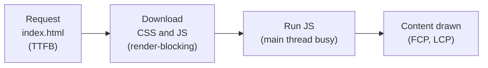
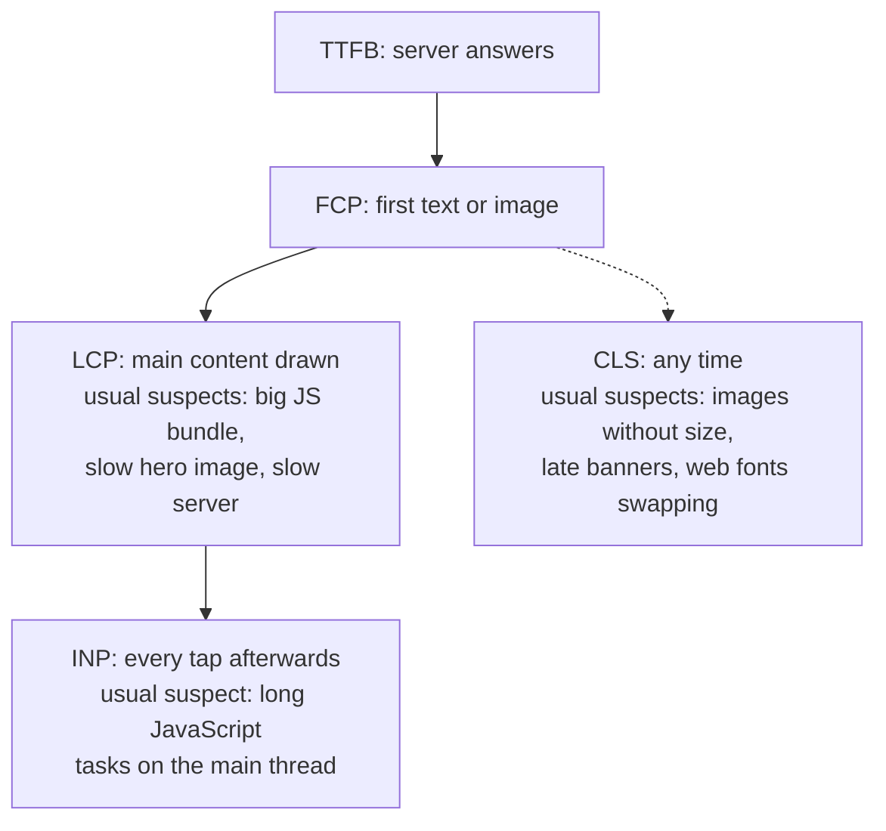

# 16.8 Frontend performance and Core Web Vitals

You've waited for a page that showed a white screen, then a spinner, then text that jumped down just as you went to tap a link, so you tapped an advert instead. Nobody on that team decided to build a slow page. It got slow one dependency, one image and one font at a time, on fast office laptops where nobody noticed. This chapter gives you the three numbers the industry uses for "does this page feel fast?", the tools that measure them, and the handful of fixes that move them, finishing with a real measurement and a real improvement.

## What you'll learn

- What users actually feel: **waiting for content**, **waiting after a tap**, and **things jumping**, and the metric for each.
- The **Core Web Vitals**: **LCP**, **INP** and **CLS**, with their "good" thresholds and why they're judged at the 75th percentile.
- **Lab data versus field data**: Lighthouse and the DevTools Performance panel on your machine, real users' numbers from the field.
- Why **JavaScript size** matters twice (download and run), and when **code splitting** helps and when it doesn't.
- The fixes with the best return: **compression**, **caching with hashed file names**, **images** with dimensions and the right format, and **fonts** that don't hide text.

---

## Users feel three kinds of slow

:::note[Everyday anchor]
Think of a restaurant. Slow is when your food takes forever to arrive. Slow is also when you raise your hand and the waiter takes a minute to notice. And it's bad when someone moves your plate just as you reach for it. A good restaurant gets all three right; so does a good page.
:::

Those three map onto three measurements Google defined in 2020 and called the **Core Web Vitals**. They're measured in real browsers, on real visits, and they're what search ranking and most performance dashboards use.

| Users feel | Metric | Measures | Good | Poor |
|---|---|---|---|---|
| "Is it loading?" | **LCP**, Largest Contentful Paint | Time until the biggest text block or image in view is drawn | ≤ 2.5 s | > 4 s |
| "Did it hear me?" | **INP**, Interaction to Next Paint | Time from a click, tap or key press until the screen shows a response, for (nearly) the slowest interaction of the visit | ≤ 200 ms | > 500 ms |
| "Stop moving!" | **CLS**, Cumulative Layout Shift | How much visible content jumps around without the user causing it, as a score | ≤ 0.1 | > 0.25 |

Between "good" and "poor" is "needs improvement". The thresholds come from [web.dev](https://web.dev/articles/vitals) and haven't changed since INP replaced an older metric, First Input Delay, in March 2024.

A page **passes** when the **75th percentile** of its visits is good on all three, measured separately for phones and desktops. The percentile is the important part: an average hides the slow quarter of your users, who are often the ones on older phones and worse networks. "75th percentile LCP is 2.1 s" means three visits out of four drew their main content within 2.1 seconds.

Three more numbers are useful for diagnosis, though they aren't Core Web Vitals:

- **TTFB** (Time To First Byte): how long the server took to start answering. A slow TTFB is a backend problem ([chapter 8.5](../distributed/performance-and-load-testing.mdx)), and everything else waits for it.
- **FCP** (First Contentful Paint): when *anything* first appears.
- **TBT** (Total Blocking Time): in a lab test, how long the main thread was too busy with long tasks to respond. It's the lab stand-in for INP.

---

## How a page spends its first seconds

Four boxes, the critical path from [chapter 16.1](./how-a-page-works.mdx):



Each box is a place to lose time, and each has its own fix:

- **Box 1** is the server and the network. A CDN ([chapter 16.10](./shipping-a-frontend.mdx)) puts the files closer to the user.
- **Box 2** is bytes. Fewer and smaller files arrive sooner: compression, less JavaScript, caching so that a returning visitor downloads nothing.
- **Box 3** is work. JavaScript must be parsed, compiled and run on the phone's CPU, which may be four or more times slower than your laptop's.
- **Box 4** is what's on screen. In a **single-page app** (SPA) that draws everything with JavaScript, nothing appears until box 3 finishes; a server-rendered page can show content after box 2.

Here's the fuller picture of where each Core Web Vital lives on that path, because each one has a different usual suspect:



---

## Measure before you change anything

There are two kinds of measurement, and you need both.

**Lab data** is one load, on one machine, under conditions you choose. It's repeatable, so it's what you use to compare before and after.

- **Lighthouse** (the DevTools **Lighthouse** tab, or `npx lighthouse <url>` from the command line) loads the page with a simulated mid-range phone on a slow 4G network and gives a performance score from 0 to 100, the metrics, and a list of **insights**: specific things that cost time, such as render-blocking requests or unused JavaScript.
- The DevTools **Performance** panel shows live LCP, INP and CLS as you use the page, and records a timeline of every request, script and paint. Click "Record", reload, and you can see the main thread's long tasks as red-flagged blocks. You can throttle the CPU and network here too.

**Field data** is real users' visits, with their phones, networks and behaviour. It's the truth, but slower to gather and noisier.

- The **Chrome UX Report** (CrUX) collects Core Web Vitals from Chrome users who opted in, for sites with enough traffic. **PageSpeed Insights** (pagespeed.web.dev) shows a site's CrUX field data above a Lighthouse lab run.
- **RUM** (Real User Monitoring): your page measures itself, with Google's small `web-vitals` library, and sends the numbers to your own analytics or observability backend ([chapter 13.2](../observability/metrics.mdx)).

```js
import { onCLS, onINP, onLCP } from 'web-vitals';

// Each callback fires with the metric's final value for this visit.
function send(metric) {
  navigator.sendBeacon('/analytics', JSON.stringify({ name: metric.name, value: metric.value }));
}
onLCP(send);
onINP(send);
onCLS(send);
```

:::warning[What can go wrong when measuring]
- **Measuring on your laptop.** Your machine and network are far faster than your median user's. Throttle, or test on a cheap Android phone.
- **One run.** Lab numbers vary between runs. Run three or more and compare medians.
- **Lab and field disagreeing.** Lighthouse loads the page once, cold, and never clicks, so it can't measure INP at all; the field includes returning visitors with a warm cache. When they disagree, field data is what users experienced.
- **Chasing the score.** The Lighthouse score is a weighted summary for a lab run. Users feel LCP, INP and CLS, not the score.
:::

---

## JavaScript costs twice: to download and to run

An image of 200 kB costs a download and a quick decode. JavaScript of 200 kB costs a download *and* parsing, compiling and running on the main thread, the same thread that responds to taps. That's why JavaScript is the most expensive byte on the web, and why its size is the first number to watch.

Bundlers tell you the size on every build. [Chapter 16.4](./typescript-and-tooling.mdx) showed `vite build` printing each file with two sizes: the raw size (what the browser must parse) and the **gzip** size (roughly what crosses the network when the server compresses it).

When the bundle is too big, three tools, in order:

1. **Don't ship it.** Look at what's in the bundle with a visualiser (`npx vite-bundle-visualizer` draws a map of every module's size). The usual finds: a date library imported whole for one function, an icon set imported whole for six icons, two libraries doing the same job. Replace, import less, or delete.
2. **Ship it later: code splitting.** A dynamic `import()` tells the bundler to put a module in its own file, downloaded only when that line runs. In React, `lazy` does this for components:

   ```tsx
   import { lazy, Suspense } from 'react';

   // Reports.tsx and everything only it imports go into a separate file,
   // fetched the first time a user opens the reports screen.
   const Reports = lazy(() => import('./Reports'));

   function App({ screen }: { screen: string }) {
     return (
       <Suspense fallback={<p>Loading…</p>}>
         {screen === 'reports' ? <Reports /> : <Home />}
       </Suspense>
     );
   }
   ```

   Splitting pays off when a large part of the code is used by few visitors or later in the visit: an admin area, a chart library on one screen, a rich-text editor. It doesn't pay when the split-off part is small: each chunk is another request, and the user waits for it at the moment they click.
3. **Run less of it.** Long tasks (over 50 ms) block the main thread and hurt INP. Break up big loops, move heavy computation to a **Web Worker** (a background thread for JavaScript), and avoid re-rendering large lists on every keystroke.

A **performance budget** keeps the gains: a size limit checked in CI that fails the build when the bundle grows past it, so a big new dependency becomes a conversation instead of a surprise.

---

## Compression, caching, images and fonts

### Compress text on the way out

HTML, CSS, JavaScript, JSON and SVG are text, and text compresses well. The browser says what it can decode in the `Accept-Encoding` request header; the server picks one and says so in `Content-Encoding`:

```text
GET /app/assets/index-DqQcDqhf.js
Accept-Encoding: gzip, deflate, br, zstd

200 OK
Content-Encoding: gzip
Vary: Accept-Encoding
```

**gzip** works everywhere. **Brotli** (`br`) compresses text roughly 15–20% smaller than gzip and is supported by every current browser; **zstd** is newer and fast. Servers either compress each response as it goes out (nginx's `gzip on`), or the build writes pre-compressed `.gz`/`.br` files next to the originals and the server sends those. CDNs usually compress for you. The one thing not to do is forget: nginx ships with compression **off**.

### Cache forever, safely, with hashed file names

The fastest request is the one never sent. HTTP's `Cache-Control` response header ([chapter 1.5](../foundations/http-from-zero.mdx)) tells the browser how long it may reuse a file without asking. The trouble is updates: cache `app.js` for a year and users keep last year's app.

Build tools solve this with **content hashes** in file names, as [chapter 16.4](./typescript-and-tooling.mdx) showed: `index-DqQcDqhf.js`. The name changes whenever the content does, so:

| File | Header | Why |
|---|---|---|
| `assets/index-DqQcDqhf.js`, `.css`, images | `Cache-Control: public, max-age=31536000, immutable` | This name will never have different content. Keep it a year; don't even revalidate. |
| `index.html` | `Cache-Control: no-cache` | Reuse it only after checking with the server (a cheap `304 Not Modified` when nothing changed). It's the one file that points at the new names. |

A release changes `index.html` to point at new hashed names, and returning visitors download only the files that changed.

### Images: the right size, the right format, the right priority

Images are usually the largest bytes on a page and often the LCP element.

- **Always set `width` and `height`** (or a CSS `aspect-ratio`). The browser reserves the space before the image arrives, so nothing jumps: the most common cause of CLS.
- **Use a modern format.** AVIF and WebP are typically far smaller than JPEG or PNG at the same quality, and every current browser supports both.
- **Send a size that fits the screen**, with `srcset` and `sizes`, so a phone doesn't download a 2,400-pixel desktop image.
- **Lazy-load what's below the fold** (`loading="lazy"`), but **never the LCP image**: give that one `fetchpriority="high"` so the browser fetches it first.

```html

```

### Fonts: don't hide the text

A custom web font is another download in the critical path, and by default some browsers hide text for up to three seconds while it loads. Use `font-display: swap` in your `@font-face` so the text appears at once in a fallback font and switches when the custom one arrives; serve WOFF2; load only the weights you use. Or skip the download entirely: a **system font stack** (`font-family: system-ui, sans-serif`) uses the fonts already on the device.

:::warning[What can go wrong]
- **Images and embeds without dimensions**, and banners injected above content after load: layout shift, and misclicks.
- **`loading="lazy"` on the hero image**: the most important image is fetched last.
- **Caching `index.html` for a long time**: users are stuck on an old release, which also asks for hashed files that a new deployment may have deleted.
- **Compression switched off** on the server: two to three times the bytes, for nothing.
- **A dependency added for one function** that doubles the bundle.
:::

---

## When performance work isn't worth it

Performance is a feature with a cost, and judgment means knowing where it pays:

- **An internal tool** used by twenty colleagues on fast laptops doesn't need the same effort as a shop whose mobile visitors leave when it's slow.
- **Fix the biggest number first.** A 2-second TTFB makes front-end tuning irrelevant; a 3 MB hero image dwarfs any bundle trimming.
- **Architecture matters more than tweaks.** A content site that ships a 500 kB SPA will never be as fast as the same content as static HTML ([chapter 16.5](./react.mdx) made the case for not using React at all on such sites). Server rendering, React Server Components and static generation exist mostly for this reason.
- **Field data decides.** If 75% of real visits are already good on all three metrics, spend the time elsewhere.

---

## Apply it to snip: measuring the web UI

snip's UI in `web/` ([chapter 16.6](./a-ui-for-snip.mdx)) is a small React app, served by nginx at `/app/` from the same origin as the API. Here are real measurements of its production build, from October 2026.

**The bundle**, from `npm run build` (Vite 8):

```text
dist/index.html                   0.70 kB │ gzip:  0.41 kB
dist/assets/index-DfDaiVEs.css    2.36 kB │ gzip:  0.95 kB
dist/assets/index-DqQcDqhf.js   226.99 kB │ gzip: 71.26 kB
```

How much of that is the app? Building an empty React app (one `<p>` rendered with `createRoot`) with the same settings gives 219.5 kB, 68.6 kB gzipped. **React and React DOM are about 97% of the JavaScript; the app's own code is under 3 kB gzipped.** So code splitting the app would save almost nothing: the key form and the links page together are smaller than one extra request's overhead. That's a judgment worth writing down, because "split your bundle" is the first advice people give.

**Lighthouse** (13.6, mobile, run three times in a container with Chromium). The default run, which *simulates* a slow network and CPU, scored 100 with LCP 0.8 s. The run that *applies* the throttling for real (`--throttling-method=devtools`: slow 4G and a CPU four times slower) told a different story:

| Configuration | Bytes transferred | LCP (three runs) | CLS | TBT | Score |
|---|---|---|---|---|---|
| nginx as shipped (no compression) | 232 kB | 2.47–2.55 s | 0 | 0 ms | 94 |
| nginx with gzip, level 6 | 74 kB | 1.63–1.74 s | 0 | 0 ms | 99 |

Two things to notice. First, **nginx was sending the 227 kB JavaScript file uncompressed**: `curl -H 'Accept-Encoding: gzip'` got no `Content-Encoding` back. Compression is off in nginx unless you switch it on. Second, LCP is the moment React draws the form, because this is a client-rendered app: nothing appears until the JavaScript has downloaded and run, so every kilobyte of it is on the critical path. CLS is 0 (nothing is inserted above existing content, and there are no images or web fonts: `web/src/styles.css` uses the system font stack). TBT is 0 because the app does very little work.

**Fix 1: compress.** Five lines in `snip/deploy/nginx/nginx.conf`, inside the `server` block:

```nginx title="snip/deploy/nginx/nginx.conf (excerpt)"
    gzip on;
    gzip_comp_level 6;
    gzip_min_length 1024;
    gzip_types text/css application/javascript application/json image/svg+xml;
    gzip_vary on;               # "Vary: Accept-Encoding", so caches keep both versions apart
```

`gzip_types` lists what to compress besides HTML (which nginx always includes); images such as PNG and fonts are already compressed and left out. `gzip_vary` adds the `Vary: Accept-Encoding` header, which tells caches between the server and the browser to store the compressed and uncompressed versions separately. The JavaScript drops from 227 kB to 71 kB on the wire, and LCP on a slow phone by about 0.8 s.

**Caching was already right.** The same file gives hashed assets a year and `index.html` a revalidation, exactly the table above:

```nginx title="snip/deploy/nginx/nginx.conf (excerpt)"
    location /app/assets/ {     # file names carry a content hash, so they never change
        root /usr/share/nginx/html;
        add_header Cache-Control "public, max-age=31536000, immutable";
        add_header X-Content-Type-Options nosniff always;
    }
```

so a returning visitor's second load transfers only `index.html`, or a `304` for it.

**Fix 2: a budget, so it stays this way.** `web/scripts/check-size.mjs` gzips every JavaScript file in `dist/assets/` and fails when the total passes 90 kB, leaving room for the app to grow but not for a careless dependency:

```bash
npm run build && npm run size
```

```text
index-DqQcDqhf.js                227.0 kB   gzip   70.4 kB

JavaScript, gzipped: 70.4 kB of a 90 kB budget
```

(70.4 kB here against Vite's 71.26 kB because the script uses gzip's maximum level.) Run in CI next to the tests, it turns "the bundle doubled" from a surprise in production into a failed check on the pull request that caused it.

---

## Cheat sheet

| Term / tool | What it is | When you reach for it |
|---|---|---|
| LCP ≤ 2.5 s | Main content drawn | "The page is slow to load" |
| INP ≤ 200 ms | Response to taps and keys | "The page feels sluggish" |
| CLS ≤ 0.1 | Unexpected movement | "Things jump around" |
| 75th percentile | The value three visits in four beat | Judging any of the three |
| Lighthouse, Performance panel | Lab data, repeatable | Comparing before and after |
| CrUX, PageSpeed Insights, `web-vitals` | Field data, real users | Knowing what users actually get |
| `gzip on` / Brotli | Compressed text over the network | Always, for HTML, CSS, JS, JSON, SVG |
| Hashed names + `immutable`; `index.html` `no-cache` | Cache forever, update instantly | Every static build |
| `width`/`height`, AVIF/WebP, `srcset`, `fetchpriority` | Images that don't shift and arrive fast | Every image |
| `import()` / `React.lazy` | Code splitting | Big code used by few visitors |
| A size budget in CI | Stops regressions | Every project with a bundle |

---

## Lab

On your laptop, free. You need a Chromium-based browser (Chrome, Edge, Brave) and Python 3 for the first steps; Node and Docker for the last.

1. **Watch a layout shift happen.** Save this as `shift.html`, then run `python3 -m http.server 8000` in the same folder and open `http://localhost:8000/shift.html`:
   ```html
   <!doctype html>
   <html lang="en">
   <head><meta charset="utf-8"><title>Shift</title></head>
   <body>
     <h1>News</h1>
     <p>Read the first paragraph and get ready to click the link below.</p>
     <p><a href="#">Read more</a></p>
     <script>
       // An "announcement" that arrives a second later, above the content.
       setTimeout(() => {
         const banner = document.createElement('div');
         banner.textContent = 'Subscribe to our newsletter!';
         banner.style.cssText = 'padding:40px;background:#fde68a';
         document.body.prepend(banner);
       }, 1000);
     </script>
   </body>
   </html>
   ```
   Open DevTools, go to the **Performance** panel and look at its live metrics while you reload. Notice the CLS value go from 0 to well above 0.1 the moment the banner pushes "Read more" down. Change the script to put the banner in a box that already exists and has a fixed height (`<div id="slot" style="min-height:100px"></div>` above the heading, then `slot.append(banner)`), reload: CLS stays 0. Reserving space is the whole fix.

2. **See compression in numbers.** Start nginx with a large JavaScript file and fetch it with and without asking for gzip:
   ```bash
   mkdir -p perf && cd perf
   curl -sL https://unpkg.com/react-dom@18.3.1/umd/react-dom.production.min.js -o big.js   # 132 kB of real JavaScript
   printf 'server { listen 80; root /usr/share/nginx/html; gzip on; gzip_types application/javascript text/plain; }\n' > gzip.conf
   docker run -d --name perf -p 8090:80 -v "$PWD:/usr/share/nginx/html:ro" -v "$PWD/gzip.conf:/etc/nginx/conf.d/default.conf:ro" nginx:1.30-alpine
   curl -s -o /dev/null -w 'plain: %{size_download} bytes\n' http://localhost:8090/big.js
   curl -s -o /dev/null -w 'gzip:  %{size_download} bytes\n' -H 'Accept-Encoding: gzip' http://localhost:8090/big.js
   docker rm -f perf                                       # clean up
   ```
   Notice the gzip download is a fraction of the plain one; the browser always sends `Accept-Encoding`, so real visitors get the small one, if the server is configured to compress.

3. **Lighthouse the same page two ways.** Back on `shift.html` from step 1, open the **Lighthouse** tab, choose **Mobile** and **Performance**, and run it. Then run it from the terminal, which is how you'd put it in a script:
   ```bash
   npx lighthouse http://localhost:8000/shift.html --only-categories=performance --view   # opens the report
   ```
   Read the CLS line and the insights list, and notice that Lighthouse never clicks anything, so INP isn't in the report.

4. **Apply it to snip.** In this handbook's repository, build the UI and check its budget, then measure the running stack:
   ```bash
   cd web && npm ci && npm run build && npm run size        # bundle sizes, and the 90 kB budget
   cd ../snip && docker compose up -d --build --wait        # UI at http://localhost:8080/app/
   curl -sI -H 'Accept-Encoding: gzip' http://localhost:8080/app/ | grep -iE 'content-encoding|cache-control'
   npx lighthouse http://localhost:8080/app/ --only-categories=performance --throttling-method=devtools --view
   docker compose down -v                                   # when you're done
   ```
   Find the JavaScript file in the report's network requests and compare its transfer size with `npm run build`'s raw and gzip columns: that tells you whether nginx compressed it.

## Self-check

<Quiz
  id="frontend-frontend-performance"
  questions={[
    {
      q: 'Your Lighthouse score is 98, but field data in PageSpeed Insights shows a poor INP. How can both be true?',
      options: [
        'Lighthouse loads the page once and never interacts with it, so it can\'t measure INP; real users\' taps and key presses can be slow',
        'The field data is out of date, and the lab score is the one to trust',
        'INP only counts on desktop, while Lighthouse tests a mobile device',
        'A score of 98 means INP must be under 200 ms, so the field data is wrong',
      ],
      answer: 0,
      explain: 'INP needs real interactions; a lab load has none (TBT is its rough stand-in). Field data is what users actually experienced, so it wins when the two disagree. Use the Performance panel to record yourself doing the slow interaction and find the long task behind it. INP is measured on both phones and desktops.',
    },
    {
      q: 'A product page\'s LCP element is its main product photo. Which change is most likely to make LCP worse?',
      options: [
        'Adding width and height attributes to the photo',
        'Adding loading="lazy" to the photo',
        'Converting the photo from JPEG to AVIF',
        'Adding fetchpriority="high" to the photo',
      ],
      answer: 1,
      explain: 'Lazy loading delays the fetch until layout shows the image is near the viewport, so the most important image starts downloading late. Lazy-load below-the-fold images only. Dimensions prevent layout shift, AVIF makes the file smaller, and fetchpriority="high" moves it up the queue: all three help.',
    },
    {
      q: 'You set Cache-Control: max-age=31536000 on every file, including index.html. What happens after your next release?',
      options: [
        'Everyone gets the new release at once, because hashed file names change',
        'Returning visitors keep the old index.html for up to a year, so they keep running the old release',
        'Browsers ignore max-age on HTML files, so nothing changes',
        'Only the CSS is stale, because JavaScript files are always revalidated',
      ],
      answer: 1,
      explain: 'Hashed names make the assets safe to cache forever, but index.html is the file that points at the new names, and it has a fixed name. Cached for a year, it keeps pointing at the old assets (which may even be gone after the deploy). Give index.html no-cache, so the browser checks for a new one every time, cheaply with a 304 when nothing changed.',
    },
    {
      q: 'An app\'s JavaScript is 230 kB, of which 220 kB is the React library and 10 kB is your code. A colleague proposes code-splitting each screen. What do you expect?',
      options: [
        'A large win: each screen loads only its own code',
        'Little or no win: React itself is needed on every screen, and the split-off code is tiny, while each split adds a request',
        'A large win, because split chunks are compressed better than one big file',
        'A slower first load, because code splitting duplicates React into every chunk',
      ],
      answer: 1,
      explain: 'Code splitting saves what a visitor doesn\'t use. Here every screen needs React, and your own code is a few kilobytes, so there\'s nothing worth deferring (snip\'s UI measured exactly this). Bundlers put shared code like React in one shared chunk, so it isn\'t duplicated. Better wins: compression on the server, and checking what else is in the bundle.',
    },
    {
      q: 'Users report that the page "jumps" while it loads and they tap the wrong thing. Which metric captures this, and what is the usual fix?',
      options: [
        'LCP; serve the largest image faster from a CDN',
        'INP; split long JavaScript tasks into smaller ones',
        'CLS; reserve space for images, embeds and late content before they arrive',
        'TTFB; make the server answer the first request faster',
      ],
      answer: 2,
      explain: 'Unexpected movement is Cumulative Layout Shift. The usual causes are images without width and height, ads or banners inserted above content, and web fonts swapping in with different sizes; reserving the space (dimensions, aspect-ratio, min-height slots) removes the shift. A faster image or server changes when things appear, not whether they move.',
    },
  ]}
/>

<details>
<summary>Your team's dashboard shows the average LCP is 1.9 s, so a manager says performance is fine. Why might it not be, and what would you look at instead?</summary>

An average blends fast and slow visits into one number that describes nobody. A site where most visits take 1 s and a fifth take 6 s can average under 2 s, while one user in five has a bad experience, typically those on older phones and slower networks. That's why Core Web Vitals are judged at the **75th percentile**, per device type: look at p75 LCP for mobile and desktop separately, and at the distribution (how many visits are good, needs improvement, poor). Then slice it: by country, connection type, page template. The slow group usually has a cause you can fix (a heavy page type, a region far from your servers). The rule: **performance is a distribution; report percentiles, never averages.**

</details>

<details>
<summary>Why does JavaScript cost more than an image of the same size, and what does that mean for how you build a page?</summary>

Both must be downloaded, but an image is then decoded (often off the main thread) and drawn. JavaScript must be parsed, compiled and executed on the main thread, which is also the thread that handles taps, clicks and scrolling. On a mid-range phone, a few hundred kilobytes of JavaScript can take seconds of CPU time, during which the page may be visible but not respond, which hurts INP; and in a client-rendered app nothing appears until it has run, which hurts LCP. So: send less JavaScript (remove, replace, split what few users need), render content as HTML where you can (server rendering or static generation for content pages), and move heavy work off the main thread. The rule: **every kilobyte of JavaScript is paid for in download time and in CPU time on the user's device.**

</details>
