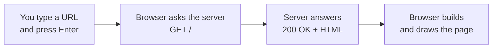
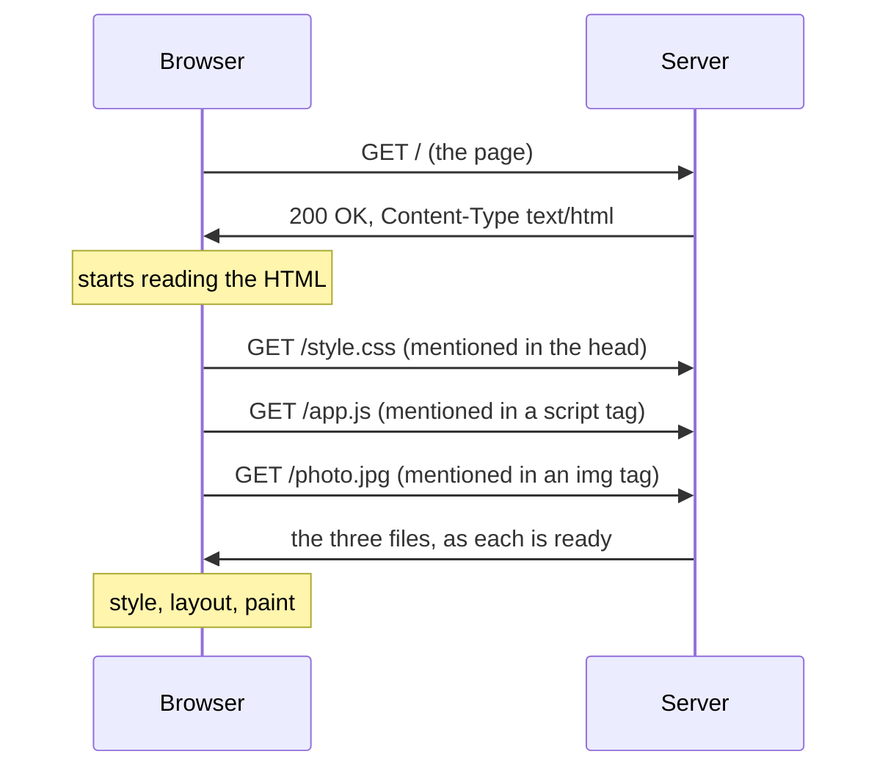
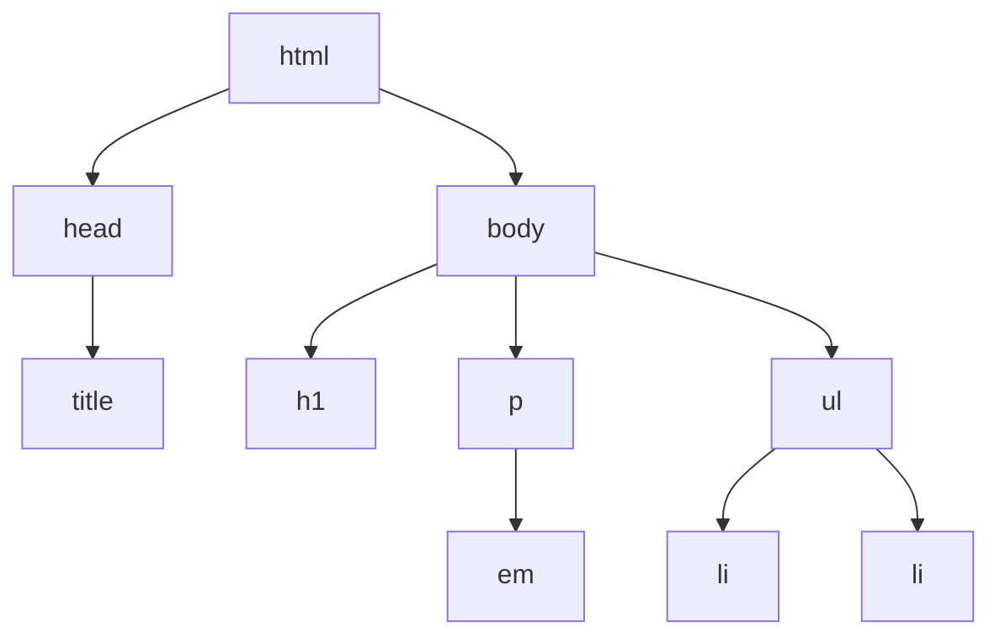
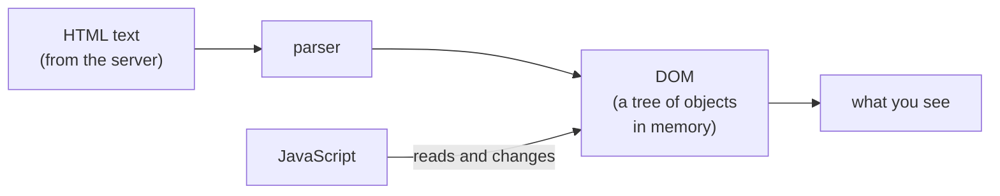
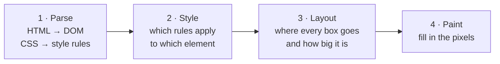
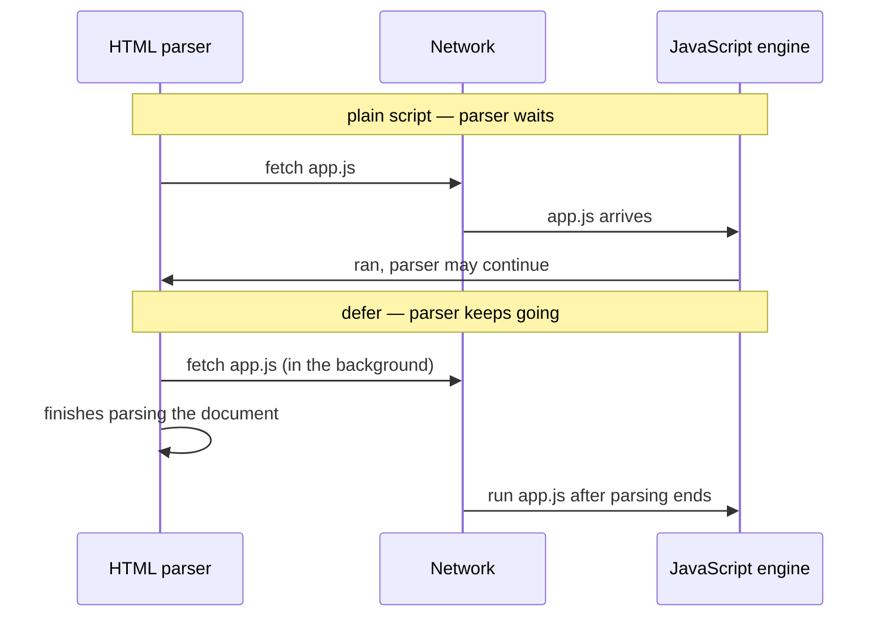

# 16.1 How a web page works: HTML, the DOM and the browser

You've opened thousands of web pages. You type an address, press Enter, and a fraction of a second later there's text, pictures and buttons. Between the Enter key and the picture, your browser has had a conversation with a server, received a text file, turned it into a tree, worked out where every box goes, painted pixels, and fetched a dozen more files along the way. This chapter takes that fraction of a second apart, so that when a page looks wrong, loads slowly or ignores your click, you know where to look — and you'll write a page by hand and watch the browser do each step.

## What you'll learn

- What happens between **typing a URL and seeing a page**: a request, an HTML answer, and more requests for everything the HTML mentions.
- What **HTML** is: plain text that describes a **tree of elements**, and why **semantic elements** (`header`, `nav`, `main`, `button`) matter for people using screen readers and for search engines.
- How a **form** makes the browser itself send a `GET` or a `POST`, with no JavaScript at all.
- What the **DOM** (Document Object Model) is: the live tree the browser builds from HTML, which JavaScript can change — and why it can differ from the HTML the server sent.
- The **rendering pipeline** in plain words — parse, style, layout, paint — and why CSS and some scripts **block** the page from appearing, and what `defer` and `async` change.
- How to see all of this in **DevTools**: the Elements and Network panels.

---

## From Enter to pixels: one request, then many

When you type `https://example.com/` and press Enter, the browser does what any HTTP client does ([chapter 1.5](../foundations/http-from-zero.mdx)): it looks up the name, connects, and sends a request. HTTP, recall, is a strict exchange: one request from the client, exactly one response from the server.



Four boxes, but the last one hides most of the work. The answer to that first request is a text file of **HTML** (HyperText Markup Language). It describes the page's content and structure, and it *mentions* other files — a stylesheet, a script, some images. The browser reads the HTML from top to bottom, and each time it meets a mention of another file, it sends another request. A typical news site makes well over a hundred requests to show one article.

:::note[Everyday anchor]
Loading a page is like a restaurant kitchen receiving an order ticket. The ticket (the HTML) lists the dishes. The cooks start on what they can straight away and send runners to the store room for every ingredient the ticket mentions (the CSS, scripts and images). Some dishes can go out as soon as they're ready; others can't leave until a missing ingredient arrives — and that waiting is most of what makes a page slow.
:::

Here is the fuller picture, because the order matters for speed:



Two things in it matter. First, the browser doesn't wait for the whole page before asking for the extra files: it starts fetching them as soon as it reads their names, several at once (over one connection with HTTP/2 or HTTP/3). Second, the `Content-Type` header ([chapter 1.5](../foundations/http-from-zero.mdx)) is what tells the browser *what kind of thing* it received. `text/html` gets parsed and drawn as a page; `application/json` gets shown as data; `image/png` gets drawn as a picture. The file name doesn't decide; the header does.

---

## HTML is a tree of elements

HTML is plain text ([chapter 1.3](../foundations/bits-bytes-text-formats.mdx)) with **tags** in angle brackets that mark up what each piece of text *is*. Here is a complete, valid page:

```html
<!doctype html>
<html lang="en">
  <head>
    <meta charset="utf-8">
    <title>Reading list</title>
  </head>
  <body>
    <h1>My reading list</h1>
    <p>Books I mean to finish <em>this</em> year.</p>
    <ul>
      <li>The Pragmatic Programmer</li>
      <li>Designing Data-Intensive Applications</li>
    </ul>
  </body>
</html>
```

The vocabulary:

- An **element** is a start tag, its content and an end tag: `<p>…</p>` is a paragraph element. Some elements have no content and no end tag, like `<meta>` and ``.
- An **attribute** is a `name="value"` pair inside the start tag that adds information: `lang="en"` says the page is in English; `charset="utf-8"` says which text encoding to use, so *Zoë* doesn't come out as *Zoë* ([chapter 1.3](../foundations/bits-bytes-text-formats.mdx)).
- `<!doctype html>` on the first line tells the browser "this is modern HTML". Without it, browsers fall into **quirks mode**, imitating 1990s bugs for old pages.
- `<head>` holds information *about* the page (title, encoding, links to stylesheets). `<body>` holds what you see.

Because elements sit inside other elements, an HTML document is a **tree**: `html` contains `head` and `body`; `body` contains `h1`, `p` and `ul`; `ul` contains two `li`s. Every element has exactly one parent.



Everything else in this part of the handbook — CSS choosing which elements to style, JavaScript finding the button to listen to, React drawing components — works by walking this tree.

:::info[If you've written code]
HTML is forgiving in a way no programming language is. Forget a `</p>` and the browser closes it for you; misspell a tag and it's treated as an unknown element rather than an error. The rules for recovering from broken HTML are written down in the HTML standard, so every modern browser builds the same tree from the same broken input. Forgiving is not the same as correct: run your pages through the [W3C validator](https://validator.w3.org/) now and then.
:::

---

## Semantic elements say what something *is*

You could build a whole page out of two generic elements: `div` (a block) and `span` (a run of text). Many pages are built that way. It looks the same on screen — but only on screen.

HTML has elements that say what a piece of the page **means**:

| Element | Means | Instead of |
|---|---|---|
| `header` | introductory content: logo, site title | `div class="header"` |
| `nav` | the main navigation links | `div class="menu"` |
| `main` | the page's main content (one per page) | `div id="content"` |
| `article` | a self-contained piece: a post, a product card | `div class="post"` |
| `aside` | related but secondary content: a sidebar | `div class="sidebar"` |
| `footer` | closing content: copyright, contact links | `div class="footer"` |
| `h1` … `h6` | headings, in order of importance | `div class="big-bold"` |
| `button` | something you press to *do* something | `div onclick="…"` |
| `a href` | a link that *goes* somewhere | `span onclick="location=…"` |

These are called **semantic elements**, and choosing them costs nothing. They pay off for three groups of readers who don't see your page the way you do:

- **People using screen readers.** A **screen reader** is software that reads the page aloud for blind and low-vision users. It lists the headings and landmarks (`nav`, `main`) so its user can jump straight to the content, the way you skim with your eyes. A `button` is announced as "button", can be reached with <kbd>Tab</kbd> and pressed with <kbd>Enter</kbd> or <kbd>Space</kbd>; a `div` with a click handler is silent, unreachable by keyboard, and unusable. The accessibility chapter later in this part goes much deeper.
- **Search engines.** A crawler reads HTML, not pixels. Headings, `main`, `article` and link text tell it what the page is about.
- **The browser itself.** A real `a href` gets "open in new tab", a status-bar preview and a working Back button for free. A `span` that changes `location` gets none of them.

**Rule: use the element that means what you mean; reach for `div` and `span` only when nothing else fits.**

---

## Forms: the browser can send requests without any JavaScript

Long before JavaScript could talk to servers, web pages could send data with a **form**:

```html
<form action="/search" method="get">
  <label for="q">Search books</label>
  <input id="q" name="q" type="search" required>
  <button>Search</button>
</form>
```

When you press the button, the **browser itself** builds an HTTP request from the form. Each input's `name` and current value become a `name=value` pair:

- With `method="get"`, the pairs go in the URL's query string: `GET /search?q=go+concurrency`. Bookmarkable and shareable — right for searches and filters.
- With `method="post"`, they go in the request body, encoded as `application/x-www-form-urlencoded` (`q=go+concurrency`): right for anything that *changes* something, because `GET` must never change data ([chapter 1.5](../foundations/http-from-zero.mdx)).

Then the browser **navigates**: it shows whatever page the server answers with, the same as clicking a link.

Forms bring a few things for free. The `label` with `for="q"` names the input for screen readers, and clicking the label focuses the box. `required` and `type="email"` or `type="url"` make the browser check the value before sending. That check is a convenience for honest users only; anyone can send a request without your form, with `curl` for example, so the server must validate everything again ([chapter 5.3](../apis/validation-errors-status-codes.mdx)).

:::info[In the real world]
A form that posts to the server and gets a new page back is the oldest pattern on the web, and it still works with JavaScript switched off or failing to load. Modern frameworks have rediscovered it: React's form actions and Remix/React Router are built around plain HTML forms that JavaScript then enhances. Starting from a working form and adding JavaScript on top is called **progressive enhancement**.
:::

A browser that can send a `POST` from any page has a security consequence: a page on *another* site can contain a form that posts to *your* site, and the browser will attach your site's cookies to it. That is **cross-site request forgery**, and [chapter 7.5](../security/web-attacks.mdx) shows the attack and the defences (`SameSite` cookies, CSRF tokens).

---

## The DOM: the live tree the browser keeps

The browser doesn't keep your HTML text around and re-read it. It **parses** the text once — reads it and builds a tree of objects in memory, one object per element, each with its attributes, its text and links to its parent and children. That in-memory tree is the **DOM** (Document Object Model).



The DOM, not the HTML file, is the page. Two consequences:

1. **JavaScript changes the DOM, and the screen follows.** A script that runs `document.querySelector('ul').append(newItem)` adds a new list item to the tree, and the browser redraws. The HTML file on the server never changes. ([Chapter 16.3](./javascript-in-the-browser.mdx) does this properly.)
2. **"View page source" and DevTools' Elements panel can disagree.** View Source shows the HTML text the server sent. The Elements panel shows the *current DOM*: after the parser repaired any broken HTML, and after every script has had its way. On a page built by a JavaScript framework, the source may be an almost empty `<div id="root"></div>` while the Elements panel shows thousands of elements.

:::note[Everyday anchor]
The HTML file is the architect's drawing; the DOM is the building. Builders follow the drawing, and fix the obvious mistakes in it as they go. Once people move in, they knock through walls and add shelves (JavaScript). If you want to know what the building looks like *now*, you walk through it (the Elements panel) — the drawing (View Source) only tells you how it started.
:::

---

## Parse, style, layout, paint: how the DOM becomes pixels

Turning the DOM into pixels happens in a fixed order of steps, called the **rendering pipeline**. Simplified, there are four:



1. **Parse.** HTML becomes the DOM; CSS (the styling language, [chapter 16.2](./css-from-zero.mdx)) becomes a set of rules.
2. **Style.** For every element, the browser works out which CSS rules apply and their final values: this paragraph is 16 pixels, dark grey, in this font.
3. **Layout.** With sizes known, the browser computes the geometry: where each box sits on the page and how wide and tall it is. Text wraps here; a wider window means a different layout.
4. **Paint.** The browser fills in the pixels: text, colours, borders, images. (Modern browsers split this further — painting into layers and then **compositing** the layers together, often on the graphics chip — which is why some animations stay smooth when others stutter. The performance chapter later in this part measures this.)

The order explains a lot of everyday behaviour. Change an element's text colour and only paint needs redoing. Change its width and layout must run again for it and possibly everything around it. A script that changes the DOM in a loop, measuring sizes in between, can force layout hundreds of times — a classic cause of janky pages.

---

## How CSS, scripts and images load — and which ones make you wait

The parser reads the HTML top to bottom, and the files it meets on the way are not treated equally.

**Images don't block anything.** The browser requests them and keeps going; they appear when they arrive. Add `width` and `height` attributes so the browser reserves the space and the text doesn't jump when the picture lands. Add `loading="lazy"` to images far down the page so they're only fetched when the reader scrolls near them.

**CSS blocks rendering.** A stylesheet linked in the `head`:

```html
<link rel="stylesheet" href="style.css">
```

doesn't stop the parser, but the browser **won't paint anything until it has arrived**. The reason is good: painting the page unstyled and then repainting it styled would flash raw content at the reader (the "flash of unstyled content"). The cost is that a slow stylesheet means a blank screen. Resources that hold back the first paint like this are called **render-blocking**.

**A plain script blocks parsing.** When the parser meets

```html
<script src="app.js"></script>
```

it **stops**, downloads the script, runs it, and only then continues reading the HTML. It must, because the script might change the document being parsed (scripts were once allowed to write HTML into the page mid-parse with `document.write`). A script in the `head` therefore delays everything below it, and a script that runs before the parser has reached an element can't find that element.

Two attributes change that, and the difference matters:

| Tag | Download | Runs | Order between scripts | Use it for |
|---|---|---|---|---|
| `<script src>` | stops the parser | immediately | in page order | almost nothing, today |
| `<script defer src>` | in parallel with parsing | after the whole document is parsed | in page order | your app's own scripts |
| `<script async src>` | in parallel with parsing | as soon as it arrives (pausing the parser briefly) | whichever arrives first | independent scripts: analytics, ads |
| `<script type="module" src>` | in parallel | after parsing, like `defer` | in page order | modern JavaScript with `import` ([chapter 16.3](./javascript-in-the-browser.mdx)) |



**Rule: put your scripts in the `head` with `defer` (or use `type="module"`), keep stylesheets small, and give images their dimensions.** The performance chapter later in this part turns this into numbers you can measure.

---

## DevTools: the page's own debugger

Every desktop browser ships **DevTools** (developer tools): open it with <kbd>F12</kbd>, or <kbd>Ctrl</kbd>+<kbd>Shift</kbd>+<kbd>I</kbd> (<kbd>Cmd</kbd>+<kbd>Option</kbd>+<kbd>I</kbd> on a Mac), or right-click anything and choose **Inspect**. Two panels cover most of what this chapter described:

- **Elements** (Firefox: **Inspector**) shows the live DOM as a tree. Hover a node and the element lights up on the page; double-click to edit text or attributes and watch the page change instantly. The **Styles** pane beside it shows every CSS rule that applies to the selected element — where [chapter 16.2](./css-from-zero.mdx) will send you constantly.
- **Network** lists every request the page made, in order: method, URL, status code, type, size and a **waterfall** bar showing when each started and finished. Click one for its request and response headers and its body. Tick **Preserve log** to keep the list across navigations (otherwise a redirect or a form submit wipes it), and **Disable cache** to see a first-time visit.

The **Console** (where JavaScript errors appear, and where you can type JavaScript) gets its turn in [chapter 16.3](./javascript-in-the-browser.mdx); **Lighthouse** and **Performance** in the performance chapter.

---

## What can go wrong on a page

:::warning[What can go wrong]
- **A script that can't find its element.** A plain `<script>` in the `head` runs before the parser has reached the `body`, so `document.querySelector('#list')` returns `null` and the next line throws. Fix: `defer`, `type="module"`, or move the script to the end of the `body`.
- **A blank screen while one file loads.** A stylesheet or a plain script from a slow server (often a third party's) holds back the first paint for everyone. The Network panel's waterfall shows the long bar everything else waits on.
- **"I fixed the HTML, but the page didn't change."** You edited a file the browser cached, or the element was created by JavaScript and never came from that file. Check **Disable cache**, and compare View Source with Elements.
- **`div` buttons.** Clickable `div`s and `span`s are invisible to keyboards and screen readers. Use `button` for actions and `a href` for navigation.
- **Missing `<!doctype html>` or `charset`.** The first puts the browser in quirks mode, where layout follows 1990s rules; the second garbles any character outside plain English.
- **Trusting the form's checks.** `required` and `type="url"` are for the user's convenience. The server must validate every input, because anyone can skip your form.
:::

---

## Apply it to snip: an API is not a page

snip, the link shortener this handbook builds, has no web pages yet: it is an HTTP API that answers in JSON ([chapter 5.2](../apis/designing-rest-apis.mdx)). That makes it a good place to see the `Content-Type` rule at work. Its home page, `GET /`, is answered in `snip/internal/httpapi/server.go` with:

```go
func (s *Server) home(w http.ResponseWriter, _ *http.Request) {
	writeJSON(w, http.StatusOK, map[string]string{
		"service": "snip",
		"docs":    "https://jawwadzafar.github.io/zero-to-prod/",
	})
}
```

and `writeJSON` sets `Content-Type: application/json; charset=utf-8`. Open it in a browser and you get a JSON viewer, not a page: there is no HTML to parse into a DOM. snip's `observe` middleware also sends `X-Content-Type-Options: nosniff` on every response, which tells the browser never to *guess* a different type from the content — a guess that has turned uploaded files into running scripts in the past ([chapter 7.5](../security/web-attacks.mdx)).

The other half of snip that a browser meets is the redirect. Following a short link answers `302 Found` with a `Location` header, and the browser, without asking you, sends a second request to that address. In the Network panel (with **Preserve log** on) you see both rows: the `302` from snip and the `200` from the destination. That pair is snip's whole product, seen from the browser's side. [Chapter 16.3](./javascript-in-the-browser.mdx) writes a first small page that talks to snip's API.

---

## Cheat sheet

| Term / tag | What it is | When you reach for it |
|---|---|---|
| element, tag, attribute | `<a href="/x">text</a>`: tag `a`, attribute `href`, content `text` | Always |
| `<!doctype html>`, `<meta charset="utf-8">` | Modern mode; the text encoding | First two things in every page |
| `header` `nav` `main` `article` `aside` `footer` | Landmarks that say what a region is | Page structure, instead of `div` |
| `button` vs `a href` | Do something vs go somewhere | Every clickable thing |
| `form action method` | The browser builds a `GET`/`POST` from named inputs | Search boxes, sign-ups, anything that works without JS |
| DOM | The live tree of objects built from the HTML | Debugging what's *really* on the page |
| `<link rel="stylesheet">` | Render-blocking CSS | Styles; keep it small |
| `<script defer>` / `type="module"` | Download in parallel, run after parsing, in order | Your own scripts |
| `<script async>` | Run as soon as it arrives, any order | Independent third-party scripts |
| `` | Reserve space; fetch only when near the screen | Every image below the fold |
| DevTools Elements / Network | The live DOM / every request with timings | Every frontend bug starts here |

---

## Lab

Free, on your own computer, with nothing but a text editor, a browser and Python (already installed on macOS and most Linux; [chapter 0.2](../start/set-up-your-machine.mdx) covers Windows with WSL).

1. **Write a page by hand.** Make a folder and save this as `index.html` inside it. You'll style it in [chapter 16.2](./css-from-zero.mdx) and add JavaScript in [chapter 16.3](./javascript-in-the-browser.mdx), so keep it.
   ```bash
   mkdir -p ~/code/frontend-lab && cd ~/code/frontend-lab   # a folder for this part's labs
   ```
   ```html
   <!doctype html>
   <html lang="en">
     <head>
       <meta charset="utf-8">
       <meta name="viewport" content="width=device-width, initial-scale=1">
       <title>Reading list</title>
       <script defer src="app.js"></script>
     </head>
     <body>
       <header>
         <h1>My reading list</h1>
         <nav><a href="#list">Books</a> · <a href="#suggest">Suggest one</a></nav>
       </header>
       <main>
         <article id="list">
           <h2>Books</h2>
           <ul>
             <li>The Pragmatic Programmer</li>
             <li>Designing Data-Intensive Applications</li>
           </ul>
         </article>
         <aside id="suggest">
           <h2>Suggest a book</h2>
           <form action="/suggest" method="post">
             <label for="title">Title</label>
             <input id="title" name="title" required>
             <button>Send</button>
           </form>
         </aside>
       </main>
       <footer>Made by hand, Zoë approves.</footer>
     </body>
   </html>
   ```
   And save this one line as `app.js` next to it:
   ```js
   document.querySelector('ul').insertAdjacentHTML('beforeend', '<li>Added by JavaScript</li>');
   ```
   Double-click `index.html` to open it. The address bar starts with `file://`: no server involved. Notice there are **three** books on screen, though the HTML lists two.

2. **Compare the source with the DOM.** Right-click → **View Page Source**: two books. Now right-click a book → **Inspect**: the Elements panel shows three `li`s, because it shows the DOM after `app.js` ran. Double-click a book's text in the Elements panel, change it, and press <kbd>Enter</kbd>. The page changes; the file on disk doesn't. Reload, and your edit is gone.

3. **Watch the requests, and send a POST without JavaScript.** Serve the folder over HTTP, so the Network panel shows real requests:
   ```bash
   cd ~/code/frontend-lab
   python3 -m http.server 8000      # a tiny web server for this folder; stop it with Ctrl+C
   ```
   Open `http://localhost:8000/`, open DevTools → **Network**, tick **Preserve log**, and reload. Notice the rows: the document, then `app.js` (and a `favicon.ico` the browser asks for on its own, answered `404`). Click the document row and find `Content-Type: text/html` in the response headers. Now type a title in the form and press **Send**. A new row appears: method `POST`, path `/suggest`, and under **Payload** (Firefox: **Request**) the body `title=…` — the browser built that request itself. The status is `501`, because Python's simple server only serves files and refuses `POST`; the request was still sent exactly as a real server would receive it. Delete the `required` attribute in the Elements panel, submit an empty form, and notice the browser no longer stops you: that check was only ever on your side.

4. **Find the same ideas on a real page.** Open a large site you use (a news site works well) with the Network panel open and **Disable cache** ticked, and reload. Notice:
   - how many requests one page makes (the count is at the bottom of the panel), and which types (document, stylesheet, script, image, font);
   - in the waterfall, which files start early and which ones everything else waits on;
   - in the Elements panel, whether the page uses `header`, `nav`, `main` and `button` — or a forest of `div`s. Search the Elements panel (<kbd>Ctrl</kbd>+<kbd>F</kbd>) for `<script` and look for `defer` and `async`.

5. **Apply it to snip (optional, needs Docker).** Start snip's stack as in [chapter 9.3](../containers/docker-compose.mdx) (`docker compose up --build` in `~/code/zero-to-prod/snip`), open `http://localhost:8080/` and notice the JSON viewer instead of a page; the Network panel shows `Content-Type: application/json`. If you have a short link from an earlier lab, open it with **Preserve log** on and find the `302` row and its `Location` header, followed by the destination's own requests.

## Self-check

<Quiz
  id="frontend-how-a-page-works"
  questions={[
    {
      q: 'Your script runs document.querySelector("#list") and gets null, though the page clearly has an element with id="list". The script tag is a plain <script src="app.js"> in the head. What is the most likely cause?',
      options: [
        'The id is case-sensitive, and querySelector needs a capital L',
        'The script ran before the parser reached the body, so #list did not exist yet',
        'The browser cached an old copy of the HTML without the list in it',
        'querySelector only searches elements that the stylesheet has already styled',
      ],
      answer: 1,
      explain: 'A plain script stops the parser and runs immediately. In the head, that is before the body has been parsed, so the element is not in the DOM yet. Adding defer (or type="module") makes it run after parsing ends. Case does matter in ids, but the question says the id matches; caching would show stale content, not a missing element, and styling has nothing to do with what querySelector can find.',
    },
    {
      q: 'View Page Source shows an almost empty <div id="root"></div>, but the Elements panel shows hundreds of elements. Why?',
      options: [
        'View Source hides elements that are styled with display: none',
        'View Source shows the HTML the server sent; Elements shows the DOM after scripts built the page',
        'The Elements panel downloads a second, more complete copy of the page from the server',
        'The server sends different HTML to DevTools than it sends to the browser window',
      ],
      answer: 1,
      explain: 'The DOM is the live tree. The server sent a nearly empty shell, and JavaScript (here, probably a framework like React) built the rest of the tree in the browser. View Source never runs scripts, and DevTools does not fetch anything extra: it shows the current state of memory.',
    },
    {
      q: 'Which change lets the browser download a script while it keeps parsing the HTML, and still run the scripts in the order they appear in the page?',
      options: [
        'Adding async to every script tag',
        'Adding defer to every script tag',
        'Moving the stylesheets below the scripts in the head',
        'Adding loading="lazy" to every script tag',
      ],
      answer: 1,
      explain: 'defer downloads in parallel and runs the scripts after parsing, in page order. async also downloads in parallel, but runs each script the moment it arrives, so the order is whichever finishes first: fine for independent analytics, dangerous for scripts that depend on each other. loading="lazy" is for images and iframes, not scripts.',
    },
    {
      q: 'A form has method="post" and an input name="email". The user submits it. What does the browser send?',
      options: [
        'Nothing until a JavaScript handler calls fetch() with the form data',
        'A POST whose body is email=… (form-encoded), followed by a navigation to the server’s answer',
        'A GET with ?email=… in the URL, because forms always use the query string',
        'A POST with a JSON body {"email": "…"}, the format web APIs expect',
      ],
      answer: 1,
      explain: 'Forms predate JavaScript: the browser itself builds the request from each named input and shows the response as a new page. With post, the pairs go in the body as application/x-www-form-urlencoded; with get, in the query string. Browsers do not send JSON from a plain form, which is why calling a JSON API needs JavaScript (chapter 16.3).',
    },
    {
      q: 'A designer builds a menu from div elements with click handlers. It looks perfect. What does it break?',
      options: [
        'Nothing that users notice, because it only matters to search engines',
        'Keyboard and screen-reader users cannot find, reach or press the items',
        'The page fails HTML validation, so some browsers refuse to show it',
        'Click handlers on div elements only work in Chrome',
      ],
      answer: 1,
      explain: 'A div is not focusable with Tab, is not announced as a button or link, and does not respond to Enter or Space. Real button and a href elements get all of that for free. Browsers render invalid HTML anyway, and div click handlers work everywhere, which is why the problem survives until a keyboard user arrives.',
    },
  ]}
/>

<details>
<summary>Why does a browser refuse to paint anything until a stylesheet in the head has loaded, when it happily paints before images arrive?</summary>

Because a stylesheet can change **every** element's size, position, colour and visibility, so painting without it would show the page in a completely different shape and then rearrange it a moment later: a flash of unstyled content and text jumping under the reader's eyes. An image changes only its own box, and if you give it `width` and `height` the browser can reserve that box in advance. The rule to keep: **anything that can change the whole layout blocks rendering, so keep it small and fast**; anything that changes one box shouldn't.

</details>

<details>
<summary>The form check `required` already stops empty submissions. Why must the server check again?</summary>

Because the browser's checks run on the user's machine, under the user's control. Anyone can remove the attribute in DevTools (you did, in the lab), disable JavaScript, or skip the page entirely and send the request with `curl`. The server is the only place you control, so it is the only place a check actually protects anything ([chapter 5.3](../apis/validation-errors-status-codes.mdx)). Client-side checks are still worth having — they give honest users instant feedback — but they are a convenience, not a guarantee.

</details>
