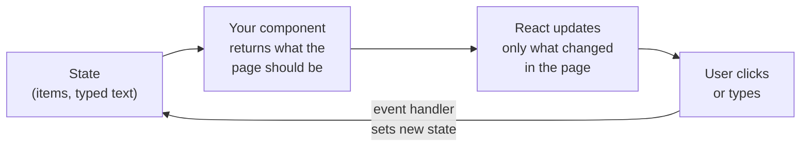
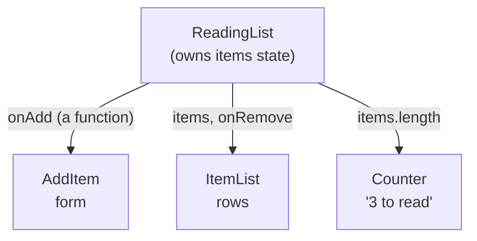
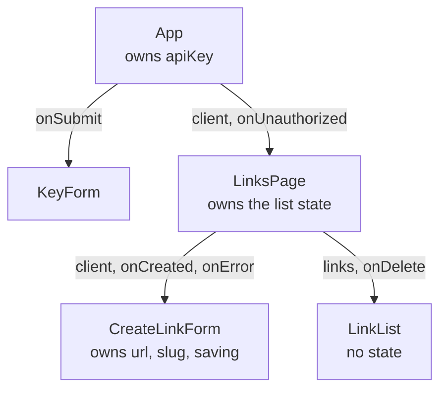

# 16.5 React: components, state and effects

You've used pages where one click changes several things at once: you like a post, the heart turns red, the count goes up, and a "you liked this" line appears. Written by hand, with code that finds each element and changes it (the approach in chapter 16.3), every new feature adds another place to keep in sync, and sooner or later one is forgotten. React flips the approach around: you describe what the page should look like *for the current data*, and React works out what to change. This chapter teaches the handful of ideas that make that work, and the few traps that catch everyone once.

## What you'll learn

- The core idea: **the UI is a function of state**. You change data; React re-draws.
- **Components** and **props**: functions that return a piece of page, configured by their inputs.
- **State** with `useState`, why changing it **re-renders** the component, and why state is a snapshot.
- **Events**, controlled form inputs, **lists and keys**, and **lifting state up** to share it.
- **Effects** with `useEffect`: syncing with the outside world, **cleanup**, and why StrictMode runs them twice in development.
- Where React ends: routers, data-fetching libraries, Server Components, and when plain HTML is the better choice.

---

## The page is a function of the data

:::note[Everyday anchor]
A stadium scoreboard operator could update the board by hand: change the home score, change the shot count, flip the "goal" light, and hope nothing is missed. Or the board could be wired to the official score sheet: the operator writes on the sheet, and the board redraws itself from it. React is the wiring.
:::

In React you keep the facts that can change, such as the list of items or what's typed in a box, in **state**. You write **components**: functions that take the current state and return a description of what should be on screen. When state changes, React calls your function again (**re-renders**), compares the new description with the previous one, and changes only the parts of the real page that differ.

Four boxes, the whole loop:



The one thing to take away: **you never change the page directly**. You change state, and the page follows. Bugs of the form "the counter says 3 but the list shows 4" become hard to write, because both come from the same state.

---

## Components are functions, props are their inputs

A **component** is a function whose name starts with a capital letter and which returns **JSX**: HTML-like syntax inside JavaScript. A build tool (Vite, [chapter 16.4](./typescript-and-tooling.mdx)) turns JSX into ordinary function calls, so `<h1>Hi</h1>` becomes something like `jsx('h1', { children: 'Hi' })`.

```tsx
interface Props {
  title: string;
  clicks: number;
}

// A component: inputs in (props), a piece of page out.
function LinkCard({ title, clicks }: Props) {
  return (
    <div className="card">
      <h2>{title}</h2>
      <p>{clicks} {clicks === 1 ? 'click' : 'clicks'}</p>
    </div>
  );
}

// Using it looks like using an HTML tag, with props as attributes.
function Page() {
  return (
    <main>
      <LinkCard title="Go docs" clicks={3} />
      <LinkCard title="Launch post" clicks={1} />
    </main>
  );
}
```

The vocabulary, piece by piece:

- **Props** (properties) are a component's inputs, passed like attributes. A component never changes its own props; they belong to whoever rendered it.
- **Curly braces** `{…}` inside JSX hold any JavaScript expression: a variable, a calculation, a conditional.
- **`className`**, not `class`, because `class` is a reserved word in JavaScript. Likewise `htmlFor` instead of `for` on labels.
- Text you put in braces is **escaped** automatically: a link title containing `<script>` shows up as text, not as a script. That's React's built-in defence against cross-site scripting ([chapter 7.5](../security/web-attacks.mdx)); the escape hatch, `dangerouslySetInnerHTML`, is named to make you stop and think.

Components nest: a page is a tree of components, each responsible for one piece.

---

## State: the component's memory

A component function runs from top to bottom on every render, so ordinary variables reset each time. To remember something between renders, you ask React to keep it: `useState`.

```tsx
import { useState } from 'react';

function Counter() {
  const [count, setCount] = useState(0);   // initial value 0
  return (
    <button onClick={() => setCount(count + 1)}>
      Clicked {count} times
    </button>
  );
}
```

`useState(0)` returns a pair: the current value and a function to change it. Calling `setCount` doesn't change `count` in place; it asks React to **re-render** with a new value. Functions whose names start with `use` are **hooks**: they hook into React's bookkeeping, and they must be called in the same order on every render (never inside an `if` or a loop), because React matches them up by position.

**State is a snapshot.** Inside one render, `count` is a fixed number. This catches everyone once:

```tsx
function handleClick() {
  setCount(count + 1);  // count is 0 here: "set it to 1"
  setCount(count + 1);  // count is STILL 0 here: "set it to 1" again
}                       // result: 1, not 2
```

When the new value depends on the old one, pass a function instead, and React gives you the latest value: `setCount((c) => c + 1)`.

**Never mutate state.** `items.push(x)` changes the existing array, React sees the same array as before, and may skip the re-render. Always create a new value: `setItems([...items, x])` to add, `setItems(items.filter(…))` to remove. The `...` (**spread**) copies the old items into a new array.

### Events and controlled inputs

Event handlers are props named `onClick`, `onChange`, `onSubmit`, given a function. A form input whose value comes from state and whose `onChange` updates that state is a **controlled input**: state is the single source of truth, so you can clear the box, validate as the user types, or disable a button until it's filled in.

```tsx
function AddItem({ onAdd }: { onAdd: (text: string) => void }) {
  const [text, setText] = useState('');

  function handleSubmit(e: FormEvent<HTMLFormElement>) {
    e.preventDefault();       // stop the browser's own submit, which reloads the page
    onAdd(text);
    setText('');              // clearing the box is one line, because state owns it
  }

  return (
    <form onSubmit={handleSubmit}>
      <label htmlFor="title">Title</label>
      <input id="title" value={text} onChange={(e) => setText(e.target.value)} />
      <button type="submit" disabled={!text.trim()}>Add</button>
    </form>
  );
}
```

(`FormEvent` comes from `import { type FormEvent } from 'react'`.) Use a real `<form>` with `onSubmit`, not a `<div>` with a click handler: pressing Enter submits, and screen readers announce it as a form.

---

## Lists need keys

To show a list, `map` each item to JSX. Each element needs a **key**: a value that identifies that item among its siblings and stays the same across renders.

```tsx
<ul>
  {items.map((item) => (
    <li key={item.id}>{item.text}</li>
  ))}
</ul>
```

React uses keys to tell, after a change, which row is which: "this `li` is still item 7, it moved" rather than "the first `li` now shows different text". That matters whenever a row holds its own state: a checkbox, a half-typed input, an animation.

**The classic bug is using the array index as the key.** Tick the checkbox on the first of three rows, then delete that row. With `key={index}`, the old second row is now at index 0, React thinks row 0 survived, and the tick stays on the *first visible row*, which is a different item. The Lab reproduces it. Use a stable ID from your data (a database ID, a slug); fall back to the index only for lists that never reorder, insert or delete.

---

## Lift state up to share it

Two components that need the same data can't read each other's state. The fix is to move the state to their closest common parent, pass the value down as a prop, and pass down a function for changing it. This is called **lifting state up**.



Data flows **down** as props; requests to change it flow **up** as calls to functions the parent passed in. When something on screen is wrong, you find the one component that owns that state, which is much easier than hunting through every place that might have edited the page.

Also, don't store what you can compute. "3 to read" is `items.length`, worked out during render. Keeping it in a second piece of state means keeping two things in sync by hand, the very problem React exists to remove.

---

## Effects: syncing with the world outside React

Rendering should only *calculate* the page. Some work has to reach outside: fetching data, starting a timer, subscribing to a WebSocket, setting the document title. That goes in an **effect**:

```tsx
useEffect(() => {
  // runs after React has updated the page
  const id = setInterval(() => setSeconds((s) => s + 1), 1000);
  return () => clearInterval(id);   // cleanup: undo what the effect started
}, []);                             // dependencies: when to re-run
```

Three parts:

1. **The effect function** runs after the render is on screen.
2. **The cleanup function** (what the effect returns) runs before the effect runs again, and when the component is removed. Everything an effect starts, its cleanup stops.
3. **The dependency array** lists the values the effect uses. React re-runs the effect when one of them changes. `[]` means "after the first render only"; leaving the array out means "after every render", which is rarely what you want.

### Fetching data in an effect, and its four traps

Here is a component that loads data when it appears, written to avoid every trap below:

```tsx
function Tip() {
  const [tip, setTip] = useState<string | null>(null);

  useEffect(() => {
    const controller = new AbortController();      // lets us cancel the request
    fetch('/tip.json', { signal: controller.signal })
      .then((res) => res.json())
      .then((data: { tip: string }) => setTip(data.tip))
      .catch((err: unknown) => {
        if (!controller.signal.aborted) console.error(err);
      });
    return () => controller.abort();               // cleanup: cancel if we're gone
  }, []);

  return <p>{tip ?? 'Loading a tip…'}</p>;
}
```

The traps:

- **Racing responses.** The user picks product A, then quickly product B. Both requests are in flight; if A's answer arrives last, the page shows A's data under B's heading. Cancelling the old request in the cleanup (above) prevents it.
- **Updating a component that's gone.** The user navigates away before the answer arrives. Without cleanup, the late answer calls `setTip` on a component no longer on screen. The abort stops that too.
- **StrictMode's double run.** In development, React's `<StrictMode>` mounts every component, unmounts it, and mounts it again, so each effect runs, cleans up, and runs again. It's deliberate: an effect without a proper cleanup now misbehaves visibly (two requests, two subscriptions) while you're developing, instead of subtly in production. In the Lab you'll see `effect`, `cleanup`, `effect` in the console, and the first request marked as cancelled. Production builds run effects once.
- **Infinite loops.** An effect that sets state, with a dependency that changes on every render (an object or function created during render), runs, re-renders, runs again, forever. Depend on stable values, or move the object inside the effect.

:::warning[What can go wrong]
- **Effects for things that aren't side effects.** Filtering a list, formatting a date or combining two props belongs in the render, not in an effect that copies it into state. React's own docs have a page titled "You Might Not Need an Effect".
- **Missing dependencies.** An effect that uses `userId` but lists `[]` keeps using the first `userId` forever. A linter (`eslint-plugin-react-hooks`) flags this.
- **Mutating state** (`items.push`) so React doesn't notice, then wondering why the page is stale.
- **Index keys** on lists that change: state sticks to the wrong row.
:::

---

## The wider ecosystem, and when you don't need React

React itself draws components. Real applications add a few more pieces, and you'll meet them in job listings:

- **Routers** map URLs to screens inside a single-page app: React Router, TanStack Router.
- **Data-fetching libraries** (TanStack Query, SWR) do what the effect above does, plus caching, retries, deduplication and refetching when the window regains focus. In a larger app they replace most hand-written fetch effects.
- **Frameworks** (Next.js, React Router's framework mode) add server rendering, routing and builds. They also bring **React Server Components**: components that run only on the server, read the database directly, and send finished HTML to the browser with no JavaScript for that part.
- **The React Compiler** (1.0 in October 2025) adds the memoisation that `useMemo` and `useCallback` provide by hand, automatically at build time.

And sometimes the right amount of React is none:

- **Content sites** (a blog, docs, a marketing page) are mostly text. Plain HTML, or a static-site tool such as Astro or Docusaurus (which builds this handbook), ships less JavaScript and loads faster.
- **A small widget** on a server-rendered page can be twenty lines of plain JavaScript.
- **Other component libraries** follow the same state-drives-the-page idea with different trade-offs: Vue, Svelte, Solid, Angular. What you learn here transfers.

React is a good choice for applications: many interactive pieces, shared state, a team, and a huge pool of libraries and developers who know it.

---

## Apply it to snip: the web UI's components

snip, the URL shortener built through this handbook, has a small React UI in `web/` that [chapter 16.6](./a-ui-for-snip.mdx) walks through in full. Every idea above appears in it:



**Lifted state.** The list lives in `LinksPage`, because both the form (which adds to it) and the list (which shows it and deletes from it) need it. **A discriminated union** ([chapter 16.4](./typescript-and-tooling.mdx)) makes "loading", "error" and "ready" mutually exclusive, so the page can't show a spinner and an error at once:

```tsx title="web/src/components/LinksPage.tsx (excerpt)"
type ListState =
  | { status: 'loading' }
  | { status: 'error'; message: string }
  | { status: 'ready'; links: Link[] };
```

**An effect with cleanup**, which is why StrictMode's double run in development sends one cancelled request and one real one:

```tsx title="web/src/components/LinksPage.tsx (excerpt)"
  useEffect(() => {
    const controller = new AbortController();
    void load(controller.signal);
    return () => controller.abort();
  }, [load]);
```

**New arrays, never mutation**, when a link is created:

```tsx title="web/src/components/LinksPage.tsx (excerpt)"
  function handleCreated(link: Link) {
    setList((prev) => (prev.status === 'ready' ? { status: 'ready', links: [link, ...prev.links] } : prev));
  }
```

And **keys** in `web/src/components/LinkList.tsx` are each link's slug (`<li key={link.slug}>`), which snip guarantees is unique.

---

## Cheat sheet

| Term / code | What it means | When you reach for it |
|---|---|---|
| `function Name(props)` returning JSX | A component | Every piece of UI |
| `const [v, setV] = useState(init)` | State that survives re-renders | Anything the user can change |
| `setV((old) => …)` | Update from the latest value | New value depends on the old one |
| `[...arr, x]`, `arr.filter(…)` | New arrays instead of mutation | Updating list state |
| `value` + `onChange` | Controlled input | Forms |
| `key={item.id}` | Stable identity in a list | Every `map` that renders elements |
| `useEffect(fn, deps)` + returned cleanup | Sync with something outside React | Fetching, timers, subscriptions |
| `<StrictMode>` | Dev-only checks, double-runs effects | Always on in development |

---

## Lab

On your laptop, free. You need Node 26 from [chapter 16.4](./typescript-and-tooling.mdx)'s Lab.

1. **Create a React + TypeScript project.**
   ```bash
   npm create vite@latest hello-react -- --template react-ts --no-interactive   # scaffold
   cd hello-react && npm install
   echo '{ "tip": "Read the first chapter tonight." }' > public/tip.json   # data to fetch
   ```
   Open `src/main.tsx` and find `<StrictMode>` wrapped around `<App />`.

2. **Build a reading list.** Replace `src/App.tsx` with:
   ```tsx
   import { useEffect, useState, type FormEvent } from 'react';

   interface Item {
     id: number;
     text: string;
   }

   let nextId = 1; // outside the component: survives re-renders

   export default function App() {
     const [items, setItems] = useState<Item[]>([]);
     const [text, setText] = useState('');

     function handleSubmit(e: FormEvent<HTMLFormElement>) {
       e.preventDefault(); // no page reload
       if (!text.trim()) return;
       setItems([...items, { id: nextId++, text: text.trim() }]); // a new array, never items.push
       setText('');
     }

     function remove(id: number) {
       setItems(items.filter((item) => item.id !== id));
     }

     return (
       <main>
         <h1>Reading list</h1>
         <form onSubmit={handleSubmit}>
           <label htmlFor="title">Title</label>
           <input id="title" value={text} onChange={(e) => setText(e.target.value)} />
           <button type="submit">Add</button>
         </form>
         <p>{items.length === 0 ? 'Nothing yet.' : `${items.length} to read`}</p>
         <ul>
           {items.map((item) => (
             <li key={item.id}>
               <input type="checkbox" aria-label={`Read ${item.text}`} /> {item.text}{' '}
               <button type="button" onClick={() => remove(item.id)}>
                 Remove
               </button>
             </li>
           ))}
         </ul>
         <Tip />
       </main>
     );
   }

   function Tip() {
     const [tip, setTip] = useState<string | null>(null);

     useEffect(() => {
       console.log('effect: fetching the tip');
       const controller = new AbortController();
       fetch('/tip.json', { signal: controller.signal })
         .then((res) => res.json())
         .then((data: { tip: string }) => setTip(data.tip))
         .catch((err: unknown) => {
           if (!controller.signal.aborted) console.error(err);
         });
       return () => {
         console.log('cleanup: cancelling');
         controller.abort();
       };
     }, []); // [] = run after the first render only

     return <p>{tip ?? 'Loading a tip…'}</p>;
   }
   ```
   Run `npm run dev`, open the page and the browser's DevTools (F12). Add three titles. Notice that the count and the list never disagree: both come from `items`.

3. **Watch StrictMode run the effect twice.** Reload with the **Console** and **Network** tabs open. The console shows `effect: fetching the tip`, `cleanup: cancelling`, `effect: fetching the tip`, and the Network tab shows two requests for `tip.json`, the first cancelled. Now run `npm run build && npm run preview`, open that URL: one effect, one request.

4. **Break the keys.** Add three titles, tick the first one's checkbox, and remove it: the tick disappears with it. Now change `items.map((item) => (` to `items.map((item, index) => (` and `key={item.id}` to `key={index}`, save (HMR reloads the component), and repeat: after removing the first row, the tick is on the *second* title. That's the bug index keys cause whenever rows have their own state.

5. **Apply it to snip.** In this handbook's repository, open `web/src/components/LinksPage.tsx` and find the state, the effect, and its cleanup. Then run the UI's tests, break one behaviour, and watch a test catch it:
   ```bash
   cd web && npm ci && npm test     # all pass
   ```
   In `LinksPage.tsx`, inside `load`, delete the line `if (message) setList({ status: 'error', message });` and run `npm test` again. The test "offers to try again when the list fails to load" fails: without that state, a failed load leaves the page saying "Loading…" forever. Put the line back.

## Self-check

<Quiz
  id="frontend-react"
  questions={[
    {
      q: 'A handler calls setCount(count + 1) twice in a row, starting from 0. What is count after the re-render?',
      options: [
        '2, because each call adds one to the latest value',
        '1, because count is a fixed snapshot during that render',
        '0, because React ignores a second update in the same handler',
        'It depends on whether StrictMode is switched on',
      ],
      answer: 1,
      explain: 'Inside one render, count is a constant (0). Both calls say "set it to 0 + 1". To build on the latest value, pass a function: setCount((c) => c + 1) twice gives 2. StrictMode double-runs effects and renders in development, not your event handlers.',
    },
    {
      q: 'In development, your data-loading effect sends two identical requests every time the page loads. What is the most likely cause?',
      options: [
        'A bug in React: effects should never run twice for one component',
        'The dependency array is missing, so the effect runs after every render',
        'StrictMode mounts, unmounts and remounts components to test your cleanup',
        'The browser retries the request automatically because the first one was slow',
      ],
      answer: 2,
      explain: 'StrictMode deliberately runs each effect, its cleanup, then the effect again, in development only. With a cleanup that aborts the request, you see one cancelled request and one real one, and production runs it once. A missing dependency array would cause a request on every render, usually many more than two.',
    },
    {
      q: 'You render a list with key={index}. Each row has a checkbox. After deleting the first row, the second item appears ticked. Why?',
      options: [
        'React reuses the first row\'s element for the item now at index 0, state included',
        'The browser remembers checkbox positions on the page across renders',
        'filter() returned the same array, so React skipped the re-render entirely',
        'Checkboxes need a name attribute so that React can track them',
      ],
      answer: 0,
      explain: 'Keys tell React which element is which item. After the delete, the item that was second now has key 0, so React keeps the old key-0 element (with its ticked checkbox) and only changes its text. A stable key from the data (an ID) makes React remove the right element.',
    },
    {
      q: 'Two sibling components need to show and change the same list. Where should the list\'s state live?',
      options: [
        'In each sibling, with an effect that copies changes from one to the other',
        'In their closest common parent, passed down as props with a change function',
        'In a global variable outside React that both components read directly',
        'In the browser\'s localStorage, which both components can read and write',
      ],
      answer: 1,
      explain: 'Lift state up to the closest common parent: it owns the list, passes it down, and passes functions for changing it. Copying between two states drifts out of sync; a global variable changes without telling React, so nothing re-renders.',
    },
    {
      q: 'When is React a poor fit?',
      options: [
        'A dashboard with forms, filters and live updates built by a team',
        'A documentation site that is mostly text and links',
        'An app where several panels share and edit the same data',
        'A product with many screens and a large group of developers',
      ],
      answer: 1,
      explain: 'A text-heavy site gains little from client-side components and pays for shipping and running the JavaScript. Plain HTML or a static-site tool loads faster. The other three are what React was built for: lots of interactive state, shared between parts of the page, maintained by a team.',
    },
  ]}
/>

<details>
<summary>A teammate fetches a user's profile in an effect with an empty dependency array, though the component receives userId as a prop. Users report seeing the wrong profile after switching accounts. Explain the bug and the fix.</summary>

The effect ran once, for the first `userId`, and `[]` tells React never to run it again. When the prop changes, the component re-renders but keeps showing the first user's data. The fix is to list `userId` as a dependency, so the effect re-runs when it changes, **and** to cancel the previous request in the cleanup, so a slow answer for the old user can't arrive after the new one and overwrite it. The rule: an effect's dependency array lists every value from the component that the effect uses; a linter (`eslint-plugin-react-hooks`) checks that for you. For lots of data fetching, a library such as TanStack Query handles keys, cancellation and caching for you.

</details>

<details>
<summary>Why does React want you to create new arrays and objects instead of changing the existing ones?</summary>

Because React decides what changed by comparing values, and for arrays and objects it compares *identity*: is this the same array as last time? `items.push(x)` changes the contents but keeps the same array, so React (and anything memoised on it) can conclude nothing changed and skip work, leaving a stale page. A new array (`[...items, x]`) is a different value, so the change is visible. It also makes each render's state a true snapshot that nothing later can alter, which is what makes bugs reproducible. The rule: **treat state as read-only; replace it, never edit it.**

</details>
