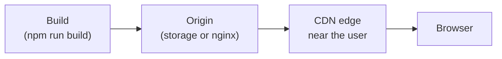

# 16.10 Shipping a frontend

You've run `npm run build` and got a `dist/` folder: an `index.html`, a few files with odd names, maybe an image or two. That folder *is* your app. There's no server program to keep running, no database connection to configure. Shipping it is mostly copying files somewhere, which makes it easy to do badly: a secret baked into the JavaScript for anyone to read, users stuck on last week's version, a page that any site can frame and trick people into clicking. This chapter covers how frontends are hosted, configured, cached, protected and rolled back, and ends with a Content-Security-Policy tested in a real browser.

## What you'll learn

- A built frontend is **static files**: how **static hosting** and **CDNs** serve them, and why that's cheap and fast.
- **Build-time versus runtime config**: why anything in `VITE_…` variables is **public**, and how to configure one build for many environments.
- **Cache busting** with hashed names, the one file you must never cache, and the **SPA fallback** that must not swallow missing assets.
- The **security headers** a frontend needs: **CSP**, **frame-ancestors**, **Referrer-Policy** and friends, and how to roll a policy out without breaking the page.
- **Source maps**, **preview deployments** and **rollbacks**: debugging production, reviewing before merging, and undoing a bad release in seconds.

---

## A built frontend is a folder of files

:::note[Everyday anchor]
A printed brochure is finished before it reaches anyone. You print it once, ship boxes of it to every branch, and each branch hands copies out; nobody at the branch writes anything. A built frontend is the brochure: produced once by the build, copied to servers near your users, handed out unchanged. The API is the person at the counter who answers questions.
:::

After `vite build` ([chapter 16.4](./typescript-and-tooling.mdx)), everything the browser needs is in `dist/`: HTML, JavaScript, CSS, images, fonts. A **static host** serves those files as they are, for any request, with no code of yours running on the server. Any web server can do it (nginx, Caddy, Apache), and so can object storage such as Amazon S3 ([chapter 6.10](../data/object-storage.mdx)), and dedicated platforms such as Cloudflare Pages, Netlify, Vercel and GitHub Pages. This handbook is itself a static site on GitHub Pages.

A **CDN** (Content Delivery Network) puts copies of those files on servers in many cities, called **edge locations**. A visitor in Sydney gets the files from Sydney, not from your one server in Frankfurt. The CDN fetches each file once from your server (the **origin**), keeps it as long as the cache headers allow, and serves everyone nearby from that copy.

Four boxes:



The one thing to take away: **the files are the same for every user and every environment, so they can be cached and copied anywhere.** Everything else in this chapter follows from protecting that property.

Most real apps have a second part, the API, which is a running program (like the Go services in this handbook). The frontend can live on the same origin as the API, behind one reverse proxy ([chapter 8.3](../distributed/reverse-proxies-and-nginx.mdx)), or on a separate domain, which then needs CORS ([chapter 16.3](./javascript-in-the-browser.mdx)). Same origin is simpler: no CORS, cookies just work, one set of headers.

---

## Configuration: anything in the bundle is public

Apps need settings that differ between environments: the API's address, an analytics ID, a feature flag. On a server, you'd read environment variables when the program starts ([chapter 11.5](../shipping/twelve-factor.mdx)). A static bundle can't do that: there's no program on the server to start. So Vite offers **build-time** variables. Any environment variable whose name starts with `VITE_` is pasted into the JavaScript during the build:

```bash
# .env, read by vite build
VITE_API_URL=https://api.example.com
VITE_ANALYTICS_ID=G-12345
DB_PASSWORD=hunter2              # no VITE_ prefix: never reaches the bundle
```

```ts
const api = import.meta.env.VITE_API_URL;   // becomes the literal "https://api.example.com" in the build
```

Two consequences:

- **Every `VITE_` value is public.** It's text inside a file that every visitor downloads, and anyone can read it in DevTools or with `curl`. The prefix exists precisely so that you can't leak `DB_PASSWORD` by accident; it is not a way to hide anything. **A frontend can't keep a secret.** API keys for paid services, signing keys and database passwords belong on a server, and the browser calls your server, which calls the paid service. (Publishable keys designed to be public, such as a Stripe publishable key or a public analytics ID, are fine.)
- **A build is tied to one environment.** Staging and production need different builds, which breaks "build once, deploy the same artifact everywhere", the rule that makes what you tested the thing you ship.

Two ways to configure at **runtime** instead:

1. **Avoid the setting.** If the frontend and API share an origin, the API's address is `/api`, a relative path that works in every environment with no configuration at all.
2. **Fetch it.** The app loads `/config.json` when it starts; each environment's server or deployment serves its own version of that one file (from a Kubernetes ConfigMap, say). The bundle stays identical everywhere.

---

## Caching: hashed files forever, index.html never

[Chapter 16.8](./frontend-performance.mdx) set up the caching rule that every static deployment depends on:

| File | `Cache-Control` | Because |
|---|---|---|
| `assets/index-DqQcDqhf.js` and every other hashed file | `public, max-age=31536000, immutable` | A content hash in the name means it never changes |
| `index.html` | `no-cache` (revalidate every time) | It's the one file that points at the new names |

A deployment uploads the new hashed files first, then the new `index.html`. Visitors who load the page after that get the new version; their browser already has any unchanged files.

Two things go wrong at deploy time:

- **Old tabs ask for old files.** Someone opened your app an hour ago. Their tab's JavaScript is from the old release, and when they navigate to a screen that's code-split ([chapter 16.8](./frontend-performance.mdx)), it requests `Reports-a1b2c3.js`, which the new deployment deleted. The fix is to **keep the previous releases' assets for a while** (days, not minutes); most static hosts and CDNs do this naturally. Vite also fires a `vite:preloadError` event when a dynamic import fails, which an app can handle by reloading the page.
- **A CDN caching `index.html`.** If the edge keeps the old `index.html`, nobody sees the release until the cache expires. Either send `no-cache` (or a short `max-age`) for HTML, or tell the CDN to **purge** it as the last step of every deploy.

### The SPA fallback, and the trap inside it

A single-page app handles its own URLs in JavaScript: `/settings/profile` isn't a file on the server, it's a screen the app's router draws. If a user reloads that page or follows a link to it, the server must answer with `index.html` anyway, and let the app take over. That's the **SPA fallback**. In nginx:

```nginx
location / {
    try_files $uri /index.html;    # a real file if there is one, otherwise the app
}
```

The trap: if this rule also covers `/assets/`, a request for a *missing* JavaScript file returns `index.html`, with status 200 and type `text/html`. The browser refuses to run HTML as a module ("Expected a JavaScript module script but the server responded with a MIME type of text/html"), the page is blank, and the CDN may cache that HTML under the `.js` name for a year. **Give assets their own location with no fallback**, so a missing asset is an honest 404.

---

## Security headers: what the page tells the browser to refuse

A static page has no server code to attack, but the *browser* running it can still be turned against your users. [Chapter 7.5](../security/web-attacks.mdx) covered the attacks; here are the response headers a frontend sends to defend against them, and what each one costs.

### Content-Security-Policy: an allow-list for everything the page loads

**Cross-site scripting** (XSS) means getting a victim's browser to run an attacker's script inside your page, where it can read everything the page can. Escaping (React does it by default, [chapter 16.5](./react.mdx)) is the first defence. The **Content-Security-Policy** (CSP) header is the second: a list, per kind of resource, of where the page may load things from. Anything else, the browser refuses, and logs why.

```text
Content-Security-Policy: default-src 'self'; img-src 'self' data:; object-src 'none';
                         base-uri 'none'; form-action 'self'; frame-ancestors 'none'
```

| Directive | Controls | `'self'` / `'none'` here means |
|---|---|---|
| `default-src` | Everything not listed separately | Only from this origin |
| `script-src`, `style-src`, `img-src`, `font-src`, `connect-src` | Scripts, stylesheets, images, fonts, `fetch` targets | Override the default for one kind |
| `object-src` | Old plugins (`<object>`, `<embed>`) | None at all |
| `base-uri` | The `<base>` tag, which changes how relative URLs resolve | Can't be used, so injected HTML can't redirect your scripts |
| `form-action` | Where forms may submit | Only here, so injected forms can't post passwords elsewhere |
| `frame-ancestors` | Who may show this page in a frame | Nobody (see below) |

The most important effect of a strict CSP is the one you don't see in the list: **inline scripts are blocked** unless you allow them. An attacker who manages to inject `<script>steal()</script>` or `` into the page gets a console error instead of a running script. That's why modern build tools put all code in files: a Vite build has no inline scripts, so `script-src 'self'` costs nothing.

What a CSP costs, and the classic surprises:

- **Inline styles and scripts** in your own code (or a library's) need `'unsafe-inline'`, which weakens the policy, or a **nonce** (a random value generated per response, which a static host can't produce) or a **hash** of each allowed snippet.
- **Third parties.** Every analytics script, font service or payment widget needs its domain added to the right directive, and each one you add is code you trust to run in your page.
- **Build-tool details.** Vite turns small images (under 4 kB by default) into `data:` URLs inside the CSS or JavaScript. `img-src 'self'` blocks those, and the image silently disappears; `img-src 'self' data:` allows them. The Lab shows exactly this happening.

So you roll a CSP out carefully: first as **`Content-Security-Policy-Report-Only`**, which reports violations (to the console, or to a URL with `report-to`) without blocking anything; fix what it reports; then switch to the enforcing header. And you test it, because a policy that's too strict breaks the page in production while every unit test stays green.

### frame-ancestors: no clickjacking

**Clickjacking** loads your page invisibly in a frame on the attacker's site, positioned so that a victim who thinks they're clicking "Play video" is really clicking your "Delete account". `frame-ancestors 'none'` tells the browser never to render your page inside another page's frame. The older header `X-Frame-Options: DENY` does the same and is still worth sending for very old browsers; `frame-ancestors` wins in browsers that support both.

### The rest of the set

| Header | Value for a typical app | What it prevents |
|---|---|---|
| `Referrer-Policy` | `strict-origin-when-cross-origin` (the browsers' default) or `no-referrer` | Full URLs, which may contain IDs or tokens, leaking to other sites in the `Referer` header |
| `X-Content-Type-Options` | `nosniff` | The browser guessing a file's type and running, say, an uploaded "image" as a script |
| `Strict-Transport-Security` | `max-age=31536000; includeSubDomains` | Anyone downgrading the connection to plain HTTP. Sent where TLS ends ([chapter 8.3](../distributed/reverse-proxies-and-nginx.mdx)), never on plain HTTP |
| `Cross-Origin-Opener-Policy` | `same-origin` | A page you opened (or that opened you) keeping a handle on your window |
| `Permissions-Policy` | `camera=(), microphone=(), geolocation=()` | Your page, or a script in it, asking for powerful features you never use |

:::warning[What can go wrong]
- **Secrets in `VITE_` variables.** They're in the bundle, readable by anyone. Move the call to a server.
- **`index.html` cached for a long time**, at the browser or the CDN: the release doesn't reach users.
- **The SPA fallback answering for `/assets/`**: missing files come back as HTML with a 200, and a blank page.
- **A CSP that was never tested in a browser.** It ships, and a `data:` image, a third-party font or an inline style breaks in production.
- **nginx's `add_header` inheritance.** An `add_header` inside a `location` block *replaces* all `add_header` lines from the `server` level, rather than adding to them. Put a location's security headers together in that location, and add `always` so they're also sent on error responses.
:::

---

## Source maps, previews and rollbacks

### Source maps: readable stack traces without publishing your source

A production bundle is minified: an error in it reads `TypeError: Cannot read properties of undefined (reading 'x') at e (index-DqQcDqhf.js:1:52341)`. A **source map** is a file that maps every position in the bundle back to your original file, line and name, so DevTools and error trackers show `LinksPage.tsx:47` instead.

Vite's `build.sourcemap` has three useful settings:

- `false` (the default): no maps. Smallest output; production errors are hard to read.
- `true`: maps are written next to the bundle and linked from it, so anyone's DevTools can show your original source. Your frontend code is public anyway (it's in the bundle), so this isn't a leak of secrets, but it does publish comments and file structure.
- `'hidden'`: maps are written but not linked. You upload them to an error tracker (Sentry and similar services) during the deploy and don't publish them. Production errors arrive readable; the public gets only the bundle. This is the common choice for production.

### Preview deployments: see the change before you merge it

Because a frontend build is a folder of files, it's cheap to deploy every pull request to its own URL: `pr-482.preview.example.com`. Cloudflare Pages, Netlify and Vercel do this automatically for each push and post the link on the pull request ([chapter 3.3](../git/pull-requests-and-review.mdx)); with your own hosting, CI can upload each build to a separate folder. Reviewers, designers and product managers click the link instead of checking out the branch, and end-to-end tests ([chapter 16.9](./testing-the-frontend.mdx)) can run against the preview. Preview builds must point at a test or staging API, never at production data.

### Rollbacks: point back at the old files

A static deployment can be made **atomic**: upload the new release's files to a new location, then switch one pointer (which folder the server serves, which `index.html` the CDN returns) in a single step. Visitors get the old release or the new one, never a mix. Rolling back is switching the pointer back, in seconds, with no rebuild, because the old release's files are still there. Static hosting platforms keep every previous deployment for this reason; with your own nginx, keeping the previous image tag ([chapter 11.3](../shipping/delivery-and-deployment.mdx)) gives you the same.

The catch is the API. If release 42 of the frontend needs an API field that release 41 of the API doesn't have, rolling back only one of them breaks the app. Keep the API backwards compatible ([chapter 5.5](../apis/api-contracts.mdx)), and deploy API changes before the frontend changes that use them.

---

## When you need more than static files

Static hosting covers most single-page apps, documentation and marketing sites. You need a running server for the frontend itself when pages must be rendered per request: **server-side rendering** for content that changes per user and must be indexable or fast on first paint, or frameworks such as Next.js using React Server Components. Then the frontend is a service like any other, with containers, health checks and scaling ([Part 9](../containers/what-a-container-is.mdx)), and the CDN caches only what's safe to share. Choose that when the product needs it, not by default: a static deployment has fewer moving parts than anything else you'll ship.

---

## Apply it to snip: how the web UI ships

snip's UI in `web/` ([chapter 16.6](./a-ui-for-snip.mdx)) ships inside an nginx image. In the compose stack that image is the front door to the API too; on Kubernetes it runs as its own `web` Deployment behind the Gateway, which sends it `/app` ([chapter 10.3](../kubernetes/networking-and-ingress.mdx)). `web/Dockerfile` builds it in two stages, the same pattern as snip's own Go image ([chapter 9.2](../containers/writing-dockerfiles.mdx)):

```dockerfile title="web/Dockerfile (excerpt)"
# ---- build stage ----
# The output is plain files that run in any browser, so build on the machine's
# own platform even when the image is for another (chapter 9.4's arm64 build).
FROM --platform=$BUILDPLATFORM node:26-slim AS build
WORKDIR /web
# Dependencies first, in their own layer: cached until the lockfile changes.
COPY package.json package-lock.json ./
RUN npm ci --no-audit --no-fund
COPY . .
RUN npm run build

# ---- runtime stage ----
# nginx's own unprivileged image: it runs as user 101, not root, and keeps its
# pid and temporary files in /tmp, so the rest of the filesystem can be
# read-only (chapter 9.4).
FROM nginxinc/nginx-unprivileged:1.31-alpine
# How /app/ is served, shared by every front door (nginx/app.conf), and a
# server that serves only the UI (nginx/default.conf, used on Kubernetes).
# The compose stack mounts snip/deploy/nginx/nginx.conf over default.conf to
# add the proxy to snip's API; it includes the same app.conf.
COPY nginx/app.conf /etc/nginx/snippets/app.conf
COPY nginx/default.conf /etc/nginx/conf.d/default.conf
COPY --from=build /web/dist /usr/share/nginx/html/app
```

The final image has nginx, its two config files and the static files, and no Node. It runs as an ordinary user, so Kubernetes can start it with a read-only root filesystem and every Linux capability dropped, like snip's API. `snip/docker-compose.yml` builds it as the `nginx` service (`build: ../web`); CI publishes it as `ghcr.io/jawwadzafar/snip-web` with the same tags as snip ([chapter 9.4](../containers/images-in-production.mdx)).

**Configuration: none needed.** The UI and the API share an origin, so `web/src/api.ts` calls relative paths (`/api/links`), and the same build works on a laptop, in staging and in production. The UI has no `VITE_` variables at all, so there's nothing in the bundle to leak. The API key the user pastes stays in memory and is never part of the build.

**Caching and the SPA fallback** are already right in `web/nginx/app.conf`, the one file both compose and Kubernetes use to serve `/app/`: `/app/` answers unknown paths with `index.html` marked `no-cache`, and `/app/assets/` is a separate location with a one-year `immutable` cache and **no** fallback, so `curl -I http://localhost:8080/app/assets/nope.js` is a 404, not a page.

**Security headers.** The first version of the `/app/` location sent a policy:

```nginx
        add_header Content-Security-Policy "default-src 'self'; base-uri 'none'; frame-ancestors 'none'; form-action 'self'" always;
        add_header X-Content-Type-Options nosniff always;
```

That's a good start: scripts, styles, images and `fetch` only from the same origin, no inline scripts, no framing. Measured against this chapter, it can be tighter. Here is the tighter version of the `/app/` location in `web/nginx/app.conf`, tested as described below:

```nginx title="web/nginx/app.conf (excerpt)"
location /app/ {
    root /usr/share/nginx/html;
    try_files $uri /app/index.html;
    add_header Cache-Control "no-cache";   # always check for a new index.html
    # Security headers for the page (chapter 16.10). An add_header inside a
    # location replaces every add_header from outside it, so all of them
    # live here together. "always" adds them to error pages too.
    add_header Content-Security-Policy "default-src 'none'; script-src 'self'; style-src 'self'; img-src 'self'; connect-src 'self'; base-uri 'none'; form-action 'self'; frame-ancestors 'none'; require-trusted-types-for 'script'" always;
    add_header Referrer-Policy no-referrer always;
    add_header X-Content-Type-Options nosniff always;
    add_header Cross-Origin-Opener-Policy same-origin always;
    add_header Permissions-Policy "camera=(), microphone=(), geolocation=()" always;
}
```

What changed, and why:

- **`default-src 'none'` plus an explicit list.** Instead of "anything from here", the page may load exactly four kinds of thing from its own origin: scripts, styles, images (the favicon) and `fetch` calls to the API. Fonts, frames, media, workers and plugins are refused outright. A new kind of resource now needs a deliberate line in the policy.
- **`require-trusted-types-for 'script'`.** In browsers that support **Trusted Types** (Chrome and Edge, with others adding it), assigning a plain string to a dangerous sink such as `innerHTML` throws an error, closing the most common route for DOM-based XSS. React only writes HTML strings through `dangerouslySetInnerHTML`, which this app never uses, so it runs unchanged.
- **`Referrer-Policy: no-referrer`.** The UI has nothing to tell other sites. (The short links in the list already open with `rel="noreferrer"`.)
- **`Cross-Origin-Opener-Policy` and `Permissions-Policy`** close two doors the app never uses.

How it was tested: a container from the compose stack's own nginx image ran with this location in place of the first version, on the stack's network, and the end-to-end suite ([chapter 16.9](./testing-the-frontend.mdx)) ran against it. All seven tests passed, including `web/e2e/csp.spec.ts`, which listens for the browser's `securitypolicyviolation` events through the whole create-and-delete flow and fails on any:

```ts title="web/e2e/csp.spec.ts (excerpt)"
  await page.addInitScript(() => {
    document.addEventListener('securitypolicyviolation', (e) => {
      (window as unknown as { reportViolation: (v: string) => void }).reportViolation(
        `${e.effectiveDirective} blocked ${e.blockedURI || 'inline code'}`,
      );
    });
  });
```

To check that the test can fail, the same run was repeated with `style-src 'none'`: it failed, listing `style-src-elem blocked http://…/app/assets/index-….css`. A CSP test that has never failed proves nothing.

What's not here: `Strict-Transport-Security`, because this nginx speaks plain HTTP on a laptop; in production it belongs on whatever terminates TLS. And **rollbacks**: compose builds the image from the working tree, so locally a rollback is `git checkout` of the previous commit and `docker compose up -d --build nginx`. In a real deployment you roll back by deploying the previous image tag: `image.yml` publishes `snip-web` as `sha-<commit>` (and as a version on release tags), so on Kubernetes it's the same `kubectl rollout undo` or Git revert as for the API ([chapter 11.3](../shipping/delivery-and-deployment.mdx)).

---

## Cheat sheet

| Term / setting | What it does | When you reach for it |
|---|---|---|
| Static host, CDN | Serve the build's files, from near the user | Every SPA, docs site, marketing site |
| `VITE_…` variables | Pasted into the bundle at build time: **public** | Public settings only |
| Relative `/api` or `/config.json` | One build for every environment | Runtime configuration |
| `immutable` for hashed files, `no-cache` for `index.html` | Cache forever, update instantly | Every static deployment |
| `try_files $uri /index.html` (not for `/assets/`) | SPA fallback | Apps with client-side routes |
| `Content-Security-Policy` | Allow-list for scripts, styles, images, connections | Every app; start as `-Report-Only` |
| `frame-ancestors 'none'` | No framing, no clickjacking | Every app that isn't meant to be embedded |
| `Referrer-Policy`, `nosniff`, HSTS, COOP, `Permissions-Policy` | The rest of the defensive set | Every app |
| `build.sourcemap: 'hidden'` | Readable errors in a tracker, nothing public | Production builds with error tracking |
| Preview deployments, atomic deploys | Review before merge, roll back in seconds | Every team |

---

## Lab

On your laptop, free. You need Node 26 and Docker; ports 8081 and 8000 must be free.

1. **See a build-time variable end up in public.** Create a small app with a "secret" in its environment:
   ```bash
   npm create vite@latest ship-me -- --template vanilla-ts --no-interactive   # scaffold, no framework
   cd ship-me && npm install
   echo 'VITE_API_KEY=sk-live-not-a-secret-anymore' > .env      # VITE_ prefix
   echo 'DB_PASSWORD=hunter2' >> .env                           # no prefix
   echo 'console.log("key:", import.meta.env.VITE_API_KEY, "db:", import.meta.env.DB_PASSWORD);' >> src/main.ts
   npm run build
   grep -l sk-live-not-a-secret-anymore dist/assets/*.js        # found: it's in the bundle
   grep -c hunter2 dist/assets/*.js                             # 0: never included
   ```
   Notice the `VITE_` value is plain text in a file every visitor downloads, and the unprefixed one isn't there at all. Also notice the hashed file names in `dist/assets/`.

2. **Serve it the way production would.** Save this as `nginx.conf` in `ship-me/`:
   ```nginx
   server {
       listen 80;
       root /usr/share/nginx/html;

       location / {
           try_files $uri /index.html;            # unknown paths get the app (SPA fallback)
           add_header Cache-Control "no-cache";   # always check for a new index.html
           add_header Content-Security-Policy "default-src 'self'; base-uri 'none'; form-action 'self'; frame-ancestors 'none'; object-src 'none'" always;
           add_header Referrer-Policy strict-origin-when-cross-origin always;
           add_header X-Content-Type-Options nosniff always;
       }

       location /assets/ {                        # hashed names: cache for a year
           add_header Cache-Control "public, max-age=31536000, immutable";
           add_header X-Content-Type-Options nosniff always;
       }
   }
   ```
   and start it:
   ```bash
   docker run -d --name ship -p 8081:80 -v "$PWD/dist:/usr/share/nginx/html:ro" -v "$PWD/nginx.conf:/etc/nginx/conf.d/default.conf:ro" nginx:1.30-alpine
   curl -sI http://localhost:8081/ | grep -iE 'cache-control|content-security'   # no-cache, and the policy
   curl -sI http://localhost:8081/settings/profile | head -1                    # 200: the SPA fallback
   curl -sI http://localhost:8081/assets/missing.js | head -1                   # 404: no fallback for assets
   ```
   Open http://localhost:8081/ with the DevTools **Console** open. Notice an error saying that loading a `data:image/svg+xml` image violates the policy: Vite inlined a small SVG as a `data:` URL, and `default-src 'self'` doesn't allow those. In `nginx.conf`, add `img-src 'self' data:;` after `default-src 'self';`, run `docker restart ship`, and reload: the error is gone. That's a CSP doing its job and you tuning it, which is why policies are tested in a browser.

3. **Watch the policy stop an attack.** Pretend an attacker got a script into the page: edit `dist/index.html` and put `<script>console.log("injected script ran")</script>` just before `</body>`, then reload. Notice the console says executing the inline script violates the policy, and "injected script ran" never appears. Now try clickjacking: save this as `frame.html` in a new empty folder and serve it from a different origin:
   ```html
   <!doctype html>
   <title>Another site</title>
   <h1>Another site, framing yours</h1>
   <iframe src="http://localhost:8081/" width="600" height="400"></iframe>
   ```
   ```bash
   python3 -m http.server 8000      # in the folder with frame.html; open http://localhost:8000/frame.html
   ```
   Notice the frame stays empty and the console names `frame-ancestors 'none'`. Stop the server with `Ctrl+C` and clean up with `docker rm -f ship`.

4. **Apply it to snip.** Start the stack, look at the UI's real headers, and run the CSP test:
   ```bash
   cd snip && docker compose up -d --build --wait
   curl -sI http://localhost:8080/app/ | grep -iE 'cache-control|content-security|x-content'
   curl -sI http://localhost:8080/app/assets/nope.js | head -1          # 404, as it should be
   export SNIP_API_KEY=$(docker compose exec -T api snip keys create ship | grep -o 'snip_[A-Za-z0-9]*')
   cd ../web && npx playwright install chromium && npx playwright test csp   # no violations through the whole flow
   cd ../snip && docker compose down -v
   ```
   Then try the policies side by side: copy `web/nginx/app.conf`, change the `Content-Security-Policy` line to the first version shown above (or to something deliberately broken, such as `style-src 'none'`), mount your copy over `/etc/nginx/snippets/app.conf` in a `docker-compose.override.yml`, and run the test again.

## Self-check

<Quiz
  id="frontend-shipping-a-frontend"
  questions={[
    {
      q: 'A teammate puts a paid AI service\'s API key in VITE_AI_KEY so the React app can call the service directly. What is wrong?',
      options: [
        'Nothing, as long as the .env file is in .gitignore',
        'The key is pasted into the JavaScript bundle at build time, so every visitor can read it and use it',
        'Vite refuses to build when a variable name contains KEY',
        'The key works only in development, because Vite drops VITE_ variables in production builds',
      ],
      answer: 1,
      explain: 'VITE_ variables become literal text in the built files, which every visitor downloads. Keeping .env out of git protects the repository, not the bundle. A frontend can\'t keep a secret: the browser should call your own server, which holds the key and calls the paid service (and can rate-limit and authenticate users while it\'s at it).',
    },
    {
      q: 'After a deploy, some users see a blank page and the console says "Expected a JavaScript module script but the server responded with a MIME type of text/html". What is the most likely cause?',
      options: [
        'The new JavaScript has a syntax error',
        'The SPA fallback also covers /assets/, so a request for a missing old chunk got index.html instead of a 404',
        'The CSP blocks module scripts and needs \'unsafe-inline\'',
        'The browser cached the new index.html for too long',
      ],
      answer: 1,
      explain: 'Users with an old tab (or an old cached index.html) asked for a hashed file the deploy removed; the catch-all fallback answered with HTML and a 200. Give assets their own location with no fallback, so missing files are honest 404s, and keep previous releases\' assets around for a while. A CSP block produces a different, explicit "violates the following Content Security Policy directive" message.',
    },
    {
      q: 'You add a CSP and the app works in every test, but in production one image is missing. The console shows a violation for a data: URL. Why did tests not catch it, and what is the fix?',
      options: [
        'Unit and component tests run in jsdom, which doesn\'t enforce CSP; allow img-src \'self\' data: and test the policy in a real browser',
        'data: URLs are always unsafe; replace the image with an external URL',
        'The CDN stripped the header in tests; purge the CDN',
        'Images aren\'t covered by CSP, so the cause must be something else',
      ],
      answer: 0,
      explain: 'CSP is enforced by real browsers on responses from the real server; jsdom-based tests never see the header. Vite inlines small images as data: URLs, which img-src \'self\' alone blocks. Allowing data: for images is a common, low-risk choice; then add an end-to-end test that fails on securitypolicyviolation events, as snip\'s web/e2e/csp.spec.ts does.',
    },
    {
      q: 'What does frame-ancestors \'none\' protect against?',
      options: [
        'Your page loading iframes from other sites',
        'Other sites showing your page inside a frame to trick users into clicking it (clickjacking)',
        'Scripts in your page opening pop-up windows',
        'Search engines indexing the page',
      ],
      answer: 1,
      explain: 'frame-ancestors controls who may embed your page, not what your page embeds (that\'s frame-src). With \'none\', the browser refuses to render your page inside anyone\'s frame, so an attacker can\'t overlay it invisibly on their own site. X-Frame-Options: DENY is the older equivalent.',
    },
    {
      q: 'Why should production builds usually use sourcemap: \'hidden\' rather than true?',
      options: [
        'Source maps contain the app\'s secrets, which must not be published',
        'Linked source maps make the bundle slower for every visitor',
        'Hidden maps can be uploaded to an error tracker for readable stack traces, without publishing the original source and comments to everyone',
        'Browsers refuse to run bundles that link a source map',
      ],
      answer: 2,
      explain: 'The bundle is public either way, so there should be no secrets in it or its maps. The difference is what you publish: linked maps let anyone browse your original files and comments; hidden ones serve only your error tracker. Browsers fetch source maps only when DevTools is open, so visitors don\'t pay for them.',
    },
  ]}
/>

<details>
<summary>Your company wants the same frontend build deployed to staging and production, but each must talk to its own API on a different domain. How would you do it?</summary>

Don't use build-time variables for the API address, because then each environment needs its own build and the artifact you tested isn't the one you ship. Two good options. Best: put the frontend and the API behind the same origin in each environment (a reverse proxy routing `/api` to the API and everything else to the static files), and call relative paths like `/api/links`; the build needs no configuration at all and there's no CORS to manage. Otherwise: have the app fetch a small `/config.json` at startup, served per environment (a ConfigMap, a file the deploy writes), and read the API's address from it. Either way, the same files, with the same hashes, go to both. The rule: **build once; configure at runtime; never put anything secret in either.**

</details>

<details>
<summary>A team ships a strict CSP straight to production on Friday and support tickets arrive within the hour. How should they have rolled it out?</summary>

In steps that can't break anyone. First, send the policy as `Content-Security-Policy-Report-Only` with a `report-to` endpoint (or watch the console in testing): the browser reports every resource the policy would block, but blocks nothing. Collect reports for a week across real traffic, which reveals the third-party widget on one page, the `data:` image, the inline style in a library. Fix the code or adjust the policy for each. Add an automated check that fails on violations (an end-to-end test listening for `securitypolicyviolation`). Only then switch to the enforcing header, ideally on a weekday morning, with the report endpoint still on to catch what the reports missed. The rule: **observe, then enforce; and test security headers in a real browser, because nothing else enforces them.**

</details>
