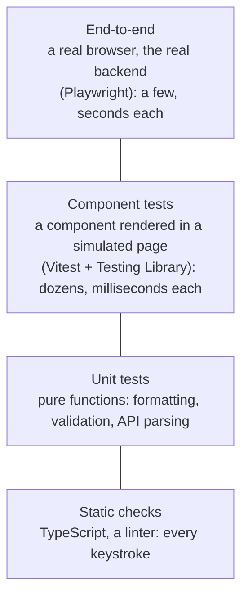
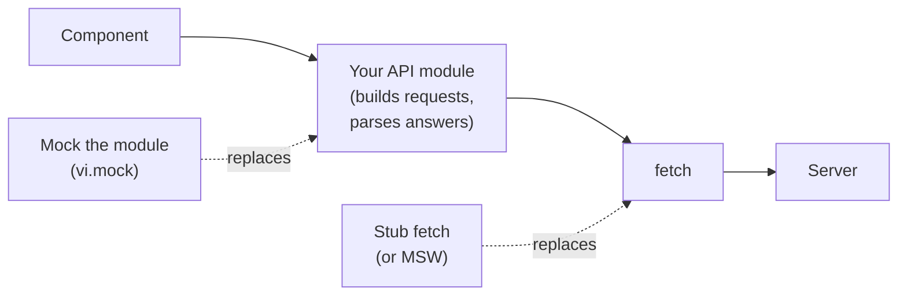

# 16.9 Testing the frontend

You've clicked through a form after every change to check it still works: type a URL, press the button, see the result, try the error case, try it again in the other browser. It works for a week. Then the app has twelve screens, a release goes out on Friday, and the "forgot password" link has been broken since Tuesday because nobody clicked it. Automated tests do that clicking for you, on every change, in seconds. This chapter shows which tests to write for a UI, how to write them so they survive refactoring, and how to keep browser tests from failing at random.

## What you'll learn

- The **testing pyramid** for a UI: many fast checks at the bottom, a few slow, realistic ones at the top, and what each layer catches.
- **Component tests** with Vitest and Testing Library that test **behaviour, not implementation**, finding elements by **role** and label the way users do.
- **Mocking `fetch` versus mocking your API module**: what each one skips, and where fakes lie.
- **End-to-end tests** with Playwright: a real browser against the real stack, with web-first assertions that wait for you.
- Why browser tests **flake**, and the cure: **wait on state, never on time**; isolate test data.
- **Visual regression** testing, briefly: comparing screenshots, and what makes it hard.

---

## A pyramid of tests, from milliseconds to minutes

:::note[Everyday anchor]
A car factory tests every bolt as it arrives (fast, cheap, thousands a day), every engine on a bench (slower, fewer), and then a handful of finished cars on a test track (slow, expensive, and the only way to know the whole car drives). Nobody would test bolts by driving finished cars around the track. Nobody would ship a car tested only bolt by bolt, either.
:::

[Chapter 4.4](../go/testing.mdx) introduced this for a Go service: many small, fast tests and a few slow, realistic ones. A UI has the same shape, with layers of its own:



Read it from the bottom:

- **Static checks** ([chapter 16.4](./typescript-and-tooling.mdx)) catch typos, wrong types and unused variables before anything runs. They're free once set up.
- **Unit tests** check plain functions: "an error with code `rate_limited` becomes *Try again in 7 seconds*". No page, no browser.
- **Component tests** render a component (or a whole screen) into a simulated page and drive it like a user: type here, click there, expect this text. This is where most UI behaviour is tested.
- **End-to-end (e2e) tests** start a real browser against the real server and database and click through a whole task. They prove the parts fit together, and they're the slowest and most fragile layer, so you keep them few: the paths that would cost you most if they broke (sign-up, checkout, the core feature).

Some teams draw this as a "testing trophy" with the component layer widest, because for UIs that's where tests give the most confidence per minute spent. The point is the same: **push each check to the lowest layer that can catch it**, and use the top layer for what only the top layer can see.

---

## Component tests: test what the user sees, not how you built it

A component test needs three things:

- a **test runner** that finds and runs test files: **Vitest**, which uses Vite's configuration ([chapter 16.4](./typescript-and-tooling.mdx)) so TypeScript and JSX work with no extra setup;
- a **simulated page**: **jsdom**, a JavaScript implementation of the DOM that runs in Node, with no real rendering;
- a way to render and query components: **Testing Library** (`@testing-library/react`), and `@testing-library/user-event` to type and click like a person.

Here is a complete test of a small search box:

```tsx
import { useState } from 'react';
import { render, screen } from '@testing-library/react';
import userEvent from '@testing-library/user-event';
import { expect, test, vi } from 'vitest';

function Search({ onSearch }: { onSearch: (q: string) => void }) {
  const [q, setQ] = useState('');
  return (
    <form onSubmit={(e) => { e.preventDefault(); onSearch(q); }}>
      <label htmlFor="q">Search</label>
      <input id="q" value={q} onChange={(e) => setQ(e.target.value)} />
      <button type="submit">Go</button>
    </form>
  );
}

test('searches for what the user typed', async () => {
  const onSearch = vi.fn();                    // a fake function that records its calls
  const user = userEvent.setup();
  render(<Search onSearch={onSearch} />);

  await user.type(screen.getByLabelText('Search'), 'cats');      // find by label, type
  await user.click(screen.getByRole('button', { name: 'Go' }));  // find by role and name, click

  expect(onSearch).toHaveBeenCalledWith('cats');
});
```

The test never mentions `useState`, the `q` variable, CSS classes or the component's structure. It does what a user does and checks what a user would notice. That's Testing Library's guiding principle: **the more your tests resemble the way your software is used, the more confidence they give you.** It pays off in two ways:

- **Refactoring doesn't break the tests.** Rename the state, split the component in two, swap the `form` for a library: as long as the user sees the same thing, the test passes.
- **The tests check accessibility for free.** `getByRole('button', { name: 'Go' })` only finds a real button with an accessible name ([chapter 16.7](./accessibility.mdx)). A clickable `div` fails the test, as it fails a screen reader user.

Testing Library's queries, in the order to prefer them:

| Query | Finds by | Use for |
|---|---|---|
| `getByRole('button', { name: 'Save' })` | Role and accessible name | Almost everything: buttons, links, headings, inputs, lists |
| `getByLabelText('Email')` | The form label | Form fields |
| `getByText('No links yet')` | Visible text | Non-interactive text, messages |
| `getByTestId('chart')` | A `data-testid` attribute | Last resort, when nothing a user can perceive identifies it |

Each comes in three flavours: `getBy…` (must be there now, or the test fails), `queryBy…` (returns `null` if absent, for checking something is *not* there), and `findBy…` (waits, retrying until it appears or a timeout passes, for anything that shows up after a network call or a timer).

:::warning[What can go wrong with component tests]
- **Testing implementation details.** Checking a component's state, calling its internal functions, or matching on CSS classes makes tests break on every refactor and pass when the user-visible behaviour is broken.
- **Forgetting that things are asynchronous.** `getByText` right after a click fails if the text arrives after a fetch. Use `findByText`, which waits.
- **Trusting jsdom too far.** jsdom has no layout and no real CSS: it can't tell you that a button is hidden behind another element, that text overflows, or that the page looks right. That's the browser layer's job.
:::

---

## Fake the network, but choose where

A component that fetches data needs an answer in a test, and a real server would make the test slow and dependent on everything else working. You fake it, and where you fake it decides what the test still covers:



- **Mock the API module** (`vi.mock('./api')`): the component calls a fake `listLinks()` that returns an array. Quick to write, but the real module, which sets headers, encodes bodies and turns error responses into errors, isn't tested at all.
- **Stub `fetch`**: the fake answers with real `Response` objects (status, headers, JSON body). Everything above the network runs for real, including your error handling, so the test fails if the code sends the wrong header or misreads a 409.
- **Mock Service Worker** (MSW) does the same at the network level with request handlers ("for `POST /api/links`, answer 201 with…"), and the same handlers can run in the browser during development. It's the common choice in larger apps.

Faking lower in the stack tests more of your code. Whatever you fake, remember **fakes can lie**: your fake says the server answers `{ "links": [...] }`, and if the real server changes its shape, the fake keeps passing. Two defences: generate types or fakes from the API's contract (an OpenAPI file, [chapter 5.5](../apis/api-contracts.mdx)), and keep a few end-to-end tests that talk to the real thing.

---

## End-to-end tests: a real browser, the real backend

An **end-to-end test** starts the whole system (the frontend's server, the API, the database, the cache), opens a real browser, and does what a user does. **Playwright** (from Microsoft, open source) drives Chromium, Firefox and WebKit (Safari's engine) from one test file; Cypress is the other widely used tool.

```ts
import { expect, test } from '@playwright/test';

test('a user can sign in', async ({ page }) => {
  await page.goto('/login');
  await page.getByLabel('Email').fill('ada@example.com');
  await page.getByLabel('Password').fill(process.env.TEST_PASSWORD!);
  await page.getByRole('button', { name: 'Sign in' }).click();
  await expect(page.getByRole('heading', { name: 'Dashboard' })).toBeVisible();
});
```

It reads like the component test, with the same role-based locators, but everything is real: CSS, layout, the network, cookies, the server's actual responses.

Two Playwright features do most of the work of keeping these tests stable:

- **Auto-waiting.** Before `click()`, Playwright waits until the element exists, is visible, is enabled and has stopped moving. You don't write "wait for the button".
- **Web-first assertions.** `await expect(locator).toBeVisible()` (or `toHaveText`, `toHaveCount`, `toBeFocused`) **retries** until the condition holds or a timeout passes (5 seconds by default). The assertion waits for the state you expect, however long the app takes to reach it, within reason.

And when a test fails, the **trace viewer** (`npx playwright show-trace trace.zip`) replays it step by step, with a screenshot, the DOM, the console and the network for each action. In CI that's how you debug a failure you can't reproduce.

---

## Flaky tests: wait on state, never on time

A **flaky test** passes and fails on the same code. It's worse than no test: people learn to press "re-run" and stop believing red builds, including the ones that are right.

The most common cause, by far: **the test assumes timing**. The app does something asynchronous (a network call, an animation, a debounce) and the test checks the result after a fixed pause, or immediately:

```ts
// Flaky: passes when the server answers in under 400 ms, fails when it doesn't.
await button.click();
await page.waitForTimeout(400);
expect(await button.textContent()).toBe('Count is 1');   // read once, no retry

// Stable: retries until the text is right, however long that takes (up to the timeout).
await button.click();
await expect(button).toHaveText('Count is 1');
```

The flaky version is also *slow*: it waits 400 ms even when the answer took 20. The stable version waits exactly as long as needed. **Never `sleep` in a test; wait for the condition you care about.** When the condition isn't visible on one element (a background job finishing, say), retry a whole block until it holds; Playwright's `expect(async () => { … }).toPass()` does that.

The other causes, and their fixes:

- **Shared data between tests.** Test A creates a link with slug `demo`; test B, run in parallel or later, fails with "slug taken". Give every test its own data: unique names (a timestamp or random suffix), a fresh user, or a database reset between tests.
- **Order dependence.** A test that only passes after another one has run. Each test sets up what it needs.
- **Races in the test itself**: starting the next action before the previous one has finished. Wait for the visible result of each step before taking the next one.
- **The outside world.** A test that follows a link to a real third-party site fails when that site is slow. Keep the test inside your system.

Retries (Playwright's `retries: 1` in CI) are a safety net that keeps one unlucky run from blocking a deploy. Playwright reports a test that failed and then passed as **flaky** rather than green, so you can see and fix it. A retry that hides a flake forever is a bug report nobody reads.

---

## Visual regression: comparing pictures

Functional tests check that the "Save" button works; they don't notice that a CSS change made it white on white. **Visual regression testing** takes screenshots and compares them with approved **baseline** images, failing when pixels differ beyond a threshold. Playwright has it built in:

```ts
await expect(page).toHaveScreenshot('links-page.png');   // first run saves the baseline
```

It's powerful and fiddly. Fonts render differently on macOS, Windows and Linux, so baselines are made and compared in one fixed environment (usually a Docker image in CI); anything that changes on every run (dates, random IDs, animations) must be hidden or frozen first; and every intentional design change means reviewing and approving new images. Hosted services (Chromatic, Percy) add review workflows on top. Worth it for design systems and component libraries; often too much for a small app.

---

## Apply it to snip: the web UI's tests

snip's React UI in `web/` ([chapter 16.6](./a-ui-for-snip.mdx)) has all three layers.

**Static checks**: `npm run lint` runs the TypeScript compiler over the app and over the e2e tests.

**Unit and component tests, with Vitest**: 17 tests in two files, finishing in about a second and a half. `web/src/api.test.ts` checks the API client: the `Authorization` header, the request bodies, that a 409 becomes an `ApiError` with code `slug_taken`, that nginx's HTML 502 page doesn't crash the JSON parser. `web/src/App.test.tsx` renders the whole app and drives it the way a user does.

These tests **stub `fetch`**, not the API module, so the client code runs for real in every component test. The helper answers each call in order, with real `Response` objects:

```ts title="web/src/test/fakeFetch.ts (excerpt)"
/** Replaces the global fetch; each call gets the next answer in order. */
export function stubFetch(...answers: (Response | Error)[]) {
  const fetchMock = vi.fn(async (_input: RequestInfo | URL, _init?: RequestInit) => {
    const next = answers.shift();
    if (!next) throw new Error('fetch called more times than the test expected');
    if (next instanceof Error) throw next;
    return next;
  });
  vi.stubGlobal('fetch', fetchMock);
  return fetchMock;
}
```

and a test reads like a user story, with roles and labels only:

```tsx title="web/src/App.test.tsx (excerpt)"
  it("shows snip's message next to the slug field when the slug is taken", async () => {
    stubFetch(json(200, { links: [] }), snipError(409, 'slug_taken', 'that slug is already in use'));
    const user = userEvent.setup();
    render(<App />);
    await enterKey(user);
    await screen.findByText(/No links yet/);

    await user.type(screen.getByLabelText('Long URL'), 'https://go.dev/doc/');
    await user.type(screen.getByLabelText('Custom slug (optional)'), 'godoc');
    await user.click(screen.getByRole('button', { name: 'Create short link' }));

    expect(await screen.findByText('that slug is already in use')).toBeInTheDocument();
    expect(screen.getByLabelText('Custom slug (optional)')).toHaveAttribute('aria-invalid', 'true');
  });
```

**End-to-end tests, with Playwright**, in `web/e2e/`, against the real compose stack: nginx serving the UI at `/app/`, two copies of the Go API, Postgres, Redis and the worker that counts clicks. There are seven tests, about four seconds in all: the main flow, a taken slug, a wrong key, the axe and keyboard checks from [chapter 16.7](./accessibility.mdx), and a Content-Security-Policy check from [chapter 16.10](./shipping-a-frontend.mdx).

The API key comes from snip itself (`snip keys create`) through an environment variable, and logging in is a shared helper that waits on what a user waits on:

```ts title="web/e2e/fixtures.ts (excerpt)"
/** Opens the UI and logs in the way a person does: paste the key, press Continue. */
export async function logIn(page: Page) {
  await page.goto('/app/');
  await page.getByLabel('API key').fill(apiKey());
  await page.getByRole('button', { name: 'Continue' }).click();
  // Wait on what the user waits on: the list has loaded.
  await expect(page.getByText('Loading your links…')).toBeHidden();
  await expect(page.getByRole('heading', { name: 'Your links' })).toBeVisible();
}
```

The main test creates a link, checks the redirect, waits for the click to be counted, and deletes it. Two details show the flakiness rules at work. Every run uses a fresh slug (`uniqueSlug()` adds a timestamp and a random number), so reruns never collide. And clicks are counted by a background worker a moment after the redirect ([chapter 8.2](../distributed/queues-and-background-work.mdx)), so the test retries "press Refresh and look" until the count appears, instead of sleeping:

```ts title="web/e2e/links.spec.ts (excerpt)"
  // The click is counted by snip's worker, a moment later. Wait for the state,
  // never for a fixed time: refresh until the row says so, or give up after 15 s.
  await expect(async () => {
    await page.getByRole('button', { name: 'Refresh' }).click();
    await expect(row).toContainText('1 click', { timeout: 1_000 });
  }).toPass({ timeout: 15_000 });
```

The redirect itself is checked with Playwright's HTTP client and `maxRedirects: 0`: the test asserts the `302` and its `Location` header without ever loading the real `go.dev`, keeping the outside world out of the test.

One honest war story: the "slug already taken" test **failed on its first run**. It filled the form and pressed Create twice in a row. The second `fill` ran while the first request was still in flight; when the first answer arrived, the app cleared the form (as it should, after a success), wiping the second set of values, and the browser refused to submit an empty required field. A textbook race in the *test*. The fix was one line, waiting for the first link's row to appear before creating the second:

```ts title="web/e2e/links.spec.ts (excerpt)"
  await create();
  // Wait until the first one has landed. Without this line the test is flaky:
  // the second fill can run while the first request is in flight, and the
  // first success then clears the form under it.
  await expect(page.getByRole('button', { name: `Delete ${slug}` })).toBeVisible();
  await create();
```

After the fix, the whole suite ran ten times in a row (`--repeat-each=10`): 70 of 70 passed.

To run them yourself (the commands are also at the top of `web/playwright.config.ts`):

```bash
cd snip && docker compose up -d --build --wait            # the whole stack
export SNIP_API_KEY=$(docker compose exec -T api snip keys create e2e | grep -o 'snip_[A-Za-z0-9]*')
cd ../web && npm ci && npx playwright install chromium     # a browser for Playwright, once
npm run test:e2e                                           # the seven tests, ~4 s
cd ../snip && docker compose down -v                       # clean up
```

`SNIP_URL` points the tests elsewhere (it defaults to `http://localhost:8080`), for example at `http://nginx` when the tests run in Playwright's Docker image on compose's network.

---

## Cheat sheet

| Tool / code | What it does | When you reach for it |
|---|---|---|
| `render(<App />)`, `screen` | Render into jsdom, query the page | Every component test |
| `getByRole`, `getByLabelText`, `getByText` | Find elements the way users do | First choice for any query |
| `findBy…` / `queryBy…` | Wait for it / check it's absent | Async results / "not shown" |
| `userEvent.setup()`, `user.type`, `user.click` | Act like a person | Every interaction |
| `vi.fn()`, `vi.stubGlobal('fetch', …)` | Fake functions and globals | Callbacks, network |
| `page.getByRole(…)`, `locator.click()` | Playwright locators, auto-waiting | Every e2e step |
| `await expect(locator).toHaveText(…)` | Retrying assertion | Instead of any pause |
| `expect(async () => …).toPass()` | Retry a block until it holds | Background work finishing |
| `--repeat-each=10` | Run every test ten times | Hunting flakiness |
| `npx playwright show-trace` | Step-by-step replay of a failure | Debugging CI failures |

---

## Lab

On your laptop, free. You need Node 26 from [chapter 16.4](./typescript-and-tooling.mdx)'s Lab; the last step needs Docker.

1. **A component test.** Create a project and add the testing tools:
   ```bash
   npm create vite@latest hello-tests -- --template react-ts --no-interactive   # scaffold
   cd hello-tests && npm install
   npm install -D vitest jsdom @testing-library/react @testing-library/user-event @testing-library/jest-dom
   ```
   Replace `vite.config.ts` with:
   ```ts
   /// <reference types="vitest/config" />
   import { defineConfig } from 'vite';
   import react from '@vitejs/plugin-react';

   export default defineConfig({
     plugins: [react()],
     test: {
       environment: 'jsdom',              // a simulated browser page, in Node
       include: ['src/**/*.test.tsx'],    // Vitest's files; e2e/ is Playwright's
     },
   });
   ```
   and create `src/App.test.tsx`:
   ```tsx
   import { render, screen } from '@testing-library/react';
   import userEvent from '@testing-library/user-event';
   import '@testing-library/jest-dom/vitest';
   import { expect, test } from 'vitest';
   import App from './App';

   test('the counter counts clicks', async () => {
     const user = userEvent.setup();
     render(<App />);
     const button = screen.getByRole('button', { name: /count is/i });

     await user.click(button);
     await user.click(button);

     expect(button).toHaveTextContent('Count is 2');
   });
   ```
   Run `npx vitest run`: one test, passing in well under a second. Now change the button in `src/App.tsx` to a `<div>` with the same `onClick` and run it again. Notice it fails with "Unable to find an accessible element with the role button": the test caught an accessibility bug. Put the `<button>` back.

2. **The same test end to end.** Add Playwright and a config that builds and serves the app for the tests:
   ```bash
   npm install -D @playwright/test && npx playwright install chromium   # the browser, once
   mkdir e2e
   ```
   `playwright.config.ts`:
   ```ts
   import { defineConfig } from '@playwright/test';

   export default defineConfig({
     testDir: './e2e',
     use: { baseURL: 'http://localhost:4173' },
     // Build the app and serve it before the tests; stop it after.
     webServer: { command: 'npm run build && npm run preview', url: 'http://localhost:4173' },
   });
   ```
   `e2e/counter.spec.ts`:
   ```ts
   import { expect, test } from '@playwright/test';

   test('waits for the state (stable)', async ({ page }) => {
     await page.goto('/');
     const button = page.getByRole('button', { name: /count is/i });
     await button.click();
     await expect(button).toHaveText('Count is 1');         // retried until true, up to 5 s
   });

   test('reads the text once (flaky)', async ({ page }) => {
     await page.goto('/');
     const button = page.getByRole('button', { name: /count is/i });
     await button.click();
     await page.waitForTimeout(400);                       // "should be enough"
     expect(await button.textContent()).toBe('Count is 1'); // checked once
   });
   ```
   Run `npx playwright test`: both pass, because the app answers instantly.

3. **Make it flaky, then watch the difference.** Simulate a slow server: in `src/App.tsx`, change the button's handler from `onClick={() => setCount((count) => count + 1)}` to:
   ```tsx
   onClick={() => setTimeout(() => setCount((count) => count + 1), Math.random() * 800)}
   ```
   Run each test ten times:
   ```bash
   npx playwright test --repeat-each=10
   ```
   Notice that the "flaky" test fails in some runs and passes in others (in our run, 4 of 10 failed) on the same code, while the "stable" test passes all ten. Only the way they wait differs.

4. **Apply it to snip.** In this handbook's repository, run the UI's component tests, then the end-to-end tests against the real stack:
   ```bash
   cd web && npm ci && npm test                              # 17 Vitest tests, ~1.5 s
   cd ../snip && docker compose up -d --build --wait
   export SNIP_API_KEY=$(docker compose exec -T api snip keys create e2e | grep -o 'snip_[A-Za-z0-9]*')
   cd ../web && npx playwright install chromium
   npm run test:e2e                                          # 7 Playwright tests
   ```
   Then break something on purpose: in `web/e2e/links.spec.ts`, delete the line that waits for the first link's Delete button in the "slug already taken" test, and run `npx playwright test links --repeat-each=5`. Watch for the race. Put it back, and finish with `cd ../snip && docker compose down -v`.

## Self-check

<Quiz
  id="frontend-testing-the-frontend"
  questions={[
    {
      q: 'A component test finds the submit button with container.querySelector(\'.btn-primary\'). A designer renames the class and the test fails, though the form works. What is the better query?',
      options: [
        'getByTestId(\'submit\'), with a data-testid added to the button',
        'getByRole(\'button\', { name: \'Create short link\' })',
        'container.querySelector(\'button[type=submit]\')',
        'getByText(\'Create short link\'), which matches any element with that text',
      ],
      answer: 1,
      explain: 'Querying by role and accessible name is how users (and screen readers) find the button, so the test survives class and structure changes and also fails if the button stops being a real, named button. A test ID works but checks nothing a user perceives; a selector on type=submit still depends on structure; getByText also matches non-interactive text, so it can pass when the button is gone.',
    },
    {
      q: 'Your component tests mock your API module with vi.mock(\'./api\'). The backend renames a field and production breaks, yet all tests stay green. Why?',
      options: [
        'vi.mock runs the tests against an outdated build of the module',
        'The fake returns the old shape, so nothing in the tests ever sees the real server\'s answer',
        'Vitest caches the module between runs and ignores changes to it',
        'Component tests can\'t check data at all; only e2e tests can',
      ],
      answer: 1,
      explain: 'A fake is a copy of your belief about the server. When the server changes, the fake doesn\'t. Stubbing fetch tests more of your code (the client\'s parsing and error handling) but has the same blind spot. The defences are types or fakes generated from the API contract, and a few end-to-end tests against the real backend.',
    },
    {
      q: 'An e2e test clicks "Save", waits 500 ms with waitForTimeout, then reads a message. It fails about one run in ten in CI. What is the best fix?',
      options: [
        'Increase the wait to 2000 ms so slow CI machines have time',
        'Add retries: 3 so occasional failures don\'t block the build',
        'Replace the wait and read with await expect(message).toHaveText(...), which retries until the text appears',
        'Run the test on a faster CI machine',
      ],
      answer: 2,
      explain: 'The test assumes timing. A retrying assertion waits for the state itself: as short as possible when the app is fast, as long as needed (up to the timeout) when it\'s slow. A longer sleep makes every run slower and still fails on a bad day; retries hide the flake instead of fixing it; faster machines only move the odds.',
    },
    {
      q: 'Two e2e tests both create a link with the slug "demo". Each passes alone; together they sometimes fail with "slug taken". What is the cause?',
      options: [
        'Playwright runs tests in a random order, which is not supported for e2e tests',
        'The tests share data: whichever runs second finds the first one\'s link',
        'The browser caches the first test\'s response for the second one',
        'The API\'s rate limiter rejects the second request',
      ],
      answer: 1,
      explain: 'Tests that share data depend on order and timing. Give each test its own data, for example a unique slug built from a timestamp and a random number (as snip\'s e2e tests do), or reset the database between tests. The error message here is the API\'s answer to a duplicate slug, not caching or rate limiting.',
    },
    {
      q: 'Which problem can a jsdom component test NOT catch?',
      options: [
        'A button that has no accessible name',
        'A click handler that sends the wrong request body',
        'A button covered by a sticky header, so a real click lands on the header',
        'An error message that never appears after a failed request',
      ],
      answer: 2,
      explain: 'jsdom has no layout: elements have no size or position, so overlapping and hidden-by-CSS problems are invisible. A real browser test (Playwright refuses to click an element that another element covers) catches it. The other three are behaviour that component tests check well.',
    },
  ]}
/>

<details>
<summary>Your team has 400 e2e tests that take 40 minutes and fail randomly a few times a week, and almost no component tests. What would you change?</summary>

The pyramid is upside down: most checks run at the slowest, most fragile layer. Go through the e2e suite and ask, for each test, "could a component or unit test catch this?" Form validation, error messages, empty states, formatting, permissions shown or hidden: all of that moves down, where it runs in milliseconds against a stubbed network and can't flake on timing. Keep e2e tests for the critical journeys and for what only a real stack shows (the parts fitting together: auth, routing, the real API's responses), perhaps twenty to forty tests. For the remaining flakes, use the trace viewer and `--repeat-each` to find their causes (fixed sleeps, shared data, order dependence) and fix them rather than adding retries. The rule: **test each behaviour at the lowest layer that can catch it; keep the top layer small and trustworthy.**

</details>

<details>
<summary>Why do Testing Library's authors discourage checking a component's state or calling its internal functions in tests?</summary>

Because those are implementation details, and users never see them. A test that asserts `state.items.length === 3` breaks when you rename the state or move it to a parent, even though the screen is unchanged: a false alarm that teaches people to "fix the test" without thinking. Worse, it can pass while the user-visible behaviour is broken: the state holds three items, but a CSS or rendering bug shows none. A test that asserts "three rows are on screen" fails exactly when users would notice something wrong, and survives every refactor that doesn't change what they see. The rule: **test the contract the user experiences, not the code that produces it.**

</details>
