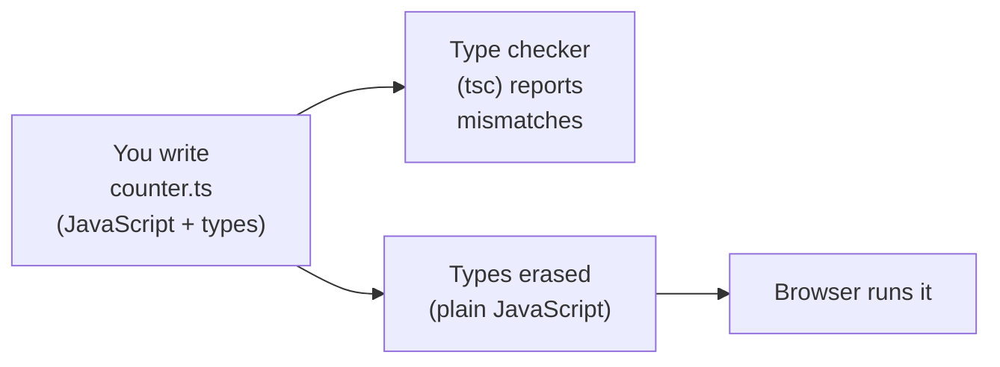
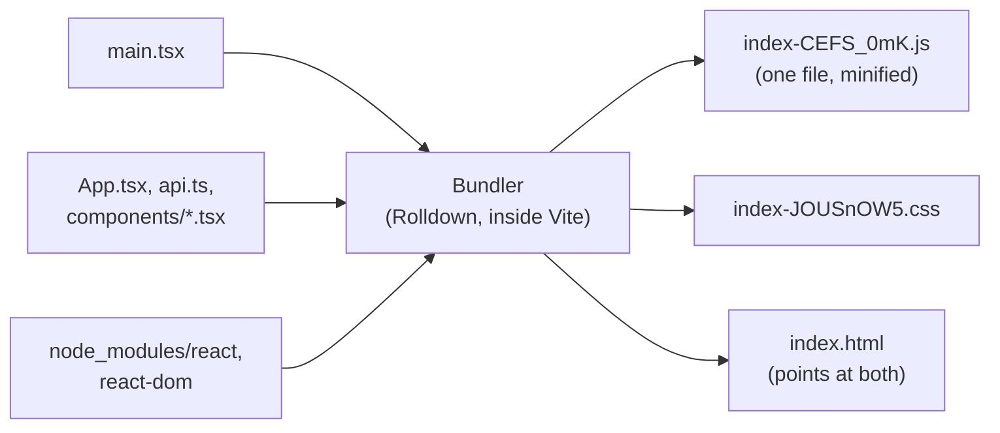

# 16.4 TypeScript and modern tooling

Here is a real bug. A click counter adds one to a number on every click, but somewhere a `'1'` (text) slipped in instead of `1` (a number). JavaScript doesn't complain: `0 + '1'` is the text `"01"`, then `"011"`, and the counter grows like a typo. Nobody notices until a user does. This chapter is about the tools that catch that bug the moment you type it, and about the machinery around every modern frontend project: `package.json`, lockfiles, bundlers and Vite. By the end you can open any frontend repository and know what each file is for.

## What you'll learn

- What **TypeScript** adds to JavaScript: descriptions of your data that a checker reads *before* the code runs, then throws away.
- The day-one basics: **interfaces**, **unions**, **narrowing**, and why data from the network is `unknown` until you check it.
- What `package.json` and a **lockfile** promise, why CI runs `npm ci`, and how npm **supply-chain attacks** abuse the gaps.
- Why browsers get **bundled** code, and what **Vite** does: a fast development server with hot reload, and a production build.
- The difference between a **type checker**, a **linter** and a **formatter**, and which one catches what.

---

## Types catch the bug before the user does

:::note[Everyday anchor]
A paper form has labelled boxes: "date of birth (DD/MM/YYYY)", "postcode". A clerk checking the form spots a name written in the date box before it's filed. Without the labels, the mistake travels until something downstream breaks.
:::

JavaScript has values with kinds (a number, some text, a list), but a variable can hold any kind at any moment, and nothing checks what you pass where. Mistakes show up only when that line runs, in someone's browser.

**TypeScript** is JavaScript plus labels. You write what kind of value each variable, parameter and field holds: its **type**. A program called the **type checker** (`tsc`, the TypeScript compiler) reads the whole project and reports every place where the labels and the code disagree. Then the labels are **erased**: what runs in the browser is plain JavaScript. Types cost nothing at run time, and they also *do* nothing at run time.

Four boxes, the whole idea:



The two arrows out of your file matter. **Checking** and **running** are separate steps, done by separate tools. A project can run code that fails the type check, unless something (a build script, CI) refuses to.

Here is the counter bug in TypeScript. This is the real starter project from the Lab, with the bug added:

```ts title="src/counter.ts"
export function setupCounter(element: HTMLButtonElement) {
  let counter = 0
  const setCounter = (count: number) => {          // count must be a number
    counter = count
    element.innerHTML = `Count is ${counter}`
  }
  element.addEventListener('click', () => setCounter(counter + '1'))  // the bug
  setCounter(0)
}
```

And what the checker says, before anyone clicks anything:

```text
$ npx tsc
src/counter.ts(7,54): error TS2345: Argument of type 'string' is not assignable to parameter of type 'number'.
```

File, line 7, column 54, and the reason. That's the whole value proposition: **a class of bugs moves from "a user found it" to "your editor underlined it"**. Editors (VS Code, Zed, WebStorm) run the same checker as you type, which also gives you autocomplete: type `link.` and the editor lists `slug`, `url`, `clicks`.

:::info[If you've written code]
If you know Go ([Part 4](../go/why-go-first-program.mdx)), this is Go's compiler checks without Go's compiler output: TypeScript only checks, and the types vanish. Unlike Go, TypeScript's types are **structural**: any object with the right fields fits an interface, with no `implements` needed (Go interfaces work the same way for methods).
:::

---

## The TypeScript you need on day one

A dozen ideas cover most real code. Each example below runs as-is with Node 26 (`node example.ts` strips the types and runs it; it does **not** check them) and type-checks with `npx tsc`.

**Primitive types and inference.** `string`, `number`, `boolean`. You rarely write them on variables, because TypeScript **infers** the type from the value:

```ts
let slug = 'godoc';      // inferred: string
slug = 42;               // error: Type 'number' is not assignable to type 'string'
```

**Describing objects with an interface.** An **interface** names a shape: which fields, of which types. A `?` marks a field as optional.

```ts
interface Link {
  slug: string;
  url: string;
  clicks: number;
  note?: string;           // may be missing
}

function describe(link: Link): string {            // parameter type, return type
  return `${link.slug} → ${link.url} (${link.clicks} clicks)`;
}

describe({ slug: 'godoc', url: 'https://go.dev/doc/', clicks: 3 });   // fine
describe({ slug: 'godoc', url: 'https://go.dev/doc/' });               // error: Property 'clicks' is missing
```

**Unions: one of several.** A **union** type (`A | B`) says "either of these". Unions of exact strings are how TypeScript describes a fixed set of options, like the error codes an API can send:

```ts
type Status = 'loading' | 'ready' | 'error';
let s: Status = 'ready';
s = 'done';                // error: Type '"done"' is not assignable to type 'Status'
```

**Narrowing.** When a value could be several types, you check which one it is, and inside that `if` TypeScript knows. This is called **narrowing**:

```ts
function show(value: string | number): string {
  if (typeof value === 'number') {
    return value.toFixed(2);       // here value is a number
  }
  return value.toUpperCase();      // here it can only be a string
}
```

**Discriminated unions: states that can't contradict each other.** Give each shape a field with a fixed value (`status` below) and TypeScript narrows on it. The payoff is that impossible states, such as "loaded *and* failed", can't even be written:

```ts
type ListState =
  | { status: 'loading' }
  | { status: 'error'; message: string }
  | { status: 'ready'; links: Link[] };

function summary(state: ListState): string {
  switch (state.status) {
    case 'loading': return 'Loading…';
    case 'error':   return state.message;               // only error has message
    case 'ready':   return `${state.links.length} links`;
  }
}
```

**Generics: a type with a blank.** `Link[]` (also written `Array<Link>`) is "an array of Links". A **generic** function leaves a type blank for the caller to fill, so one function serves many types without losing precision. `Promise<Link>` is "a value that will be a Link later". You'll read generics far more often than you write them.

**`unknown` versus `any`.** `any` switches the checker off for that value: anything goes, nothing is caught. `unknown` means "could be anything, so you must check before you use it". Prefer `unknown`; treat `any` as a hole in the net.

| Syntax | Means | Example |
|---|---|---|
| `x: string` | x holds text | `let slug: string` |
| `field?: T` | the field may be missing | `note?: string` |
| `A \| B` | either A or B | `'loading' \| 'ready'` |
| `T[]` | an array of T | `Link[]` |
| `Promise<T>` | a T that arrives later | `Promise<Link>` |
| `unknown` | anything; check before use | `const data: unknown = await res.json()` |
| `value as T` | "trust me, it's a T" (no check!) | `data as Link` |

### Types stop at the network

Types describe *your* code. They know nothing about what a server actually sends. `await res.json()` can return anything: the shape you expect, an error body, or nginx's HTML error page. Writing `const link = data as Link` is an **assertion**: you promise the checker it's a `Link`, and it believes you. If you're wrong, the bug is back, at run time.

Three honest options, from least to most work:

1. **Check the parts you rely on** at run time with a small function (a **type guard**), as web/'s API client does for errors at the end of this chapter.
2. **Validate the whole response** with a schema library such as Zod or Valibot, which checks the data *and* gives you the type.
3. **Generate the types** from the API's contract. An OpenAPI file ([chapter 5.5](../apis/api-contracts.mdx), a machine-readable description of every endpoint) can feed a generator such as `openapi-typescript`, so client types change when the contract does.

:::warning[What can go wrong]
- **`as` and `any` everywhere.** Each one is a place the checker stopped looking. A codebase full of them has TypeScript's cost and little of its benefit.
- **Trusting that types exist at run time.** They don't. A form field typed `number` still receives text from the browser; JSON typed `Link` can still be anything.
- **Type-checking nowhere.** Many tools (Vite, Node, esbuild) strip types *without checking them*. If no step in your build or CI runs `tsc`, type errors ship.
:::

---

## package.json and lockfiles: a recipe and a receipt

:::note[Everyday anchor]
A recipe says "about 200 g of flour, any brand". A receipt says "Brand X flour, 1 kg, batch 4471, bought Tuesday". Cook from the recipe twice and you can get two different cakes; repeat the receipt and you get the same one.
:::

**npm** (the Node Package Manager) downloads other people's code, **packages**, from the public registry at `npmjs.com`. Two files describe what a project needs:

- **`package.json`** is the recipe. It lists the packages you asked for, with **version ranges**, plus your project's **scripts** (named commands such as `npm run build`).
- **`package-lock.json`** is the receipt: the **lockfile**. It records the exact version of *every* package installed, including the packages your packages need (the full tree), where each came from, and a hash of its contents (`integrity`).

Version numbers follow **semantic versioning** (semver): `MAJOR.MINOR.PATCH`, where a major bump may break you, a minor bump adds features, and a patch fixes bugs. Ranges in `package.json` use that:

| Written | Accepts | Example matches for `5.0.5` |
|---|---|---|
| `5.0.5` | exactly that version | `5.0.5` |
| `~5.0.5` | newer patches | `5.0.6`, `5.0.9` |
| `^5.0.5` | newer minors and patches | `5.1.0`, `5.9.2` (not `6.0.0`) |

Two install commands, two jobs:

| Command | Reads | Lockfile | Use it |
|---|---|---|---|
| `npm install` | `package.json` ranges | updates it if needed | When you add or upgrade a package |
| `npm ci` | the lockfile only | must match `package.json`, or it fails | In CI, Dockerfiles, and any fresh checkout |

`npm ci` ("clean install") deletes `node_modules` and installs exactly what the lockfile says, checking every hash. That's why CI uses it ([chapter 11.2](../shipping/ci-with-github-actions.mdx)): the build tests the same code you tested, not whatever was newest that morning. **Commit the lockfile.** A project without one is a recipe that changes every time someone cooks it.

`dependencies` are packages your code needs when it runs (React). `devDependencies` are tools you need to build and test it (TypeScript, Vite, Vitest). For a website the distinction is softer than for a server, because the bundler copies the code it needs into the build either way, but it still tells a reader which is which.

### Every package is code you run

`node_modules` grows fast. The tiny starter project in the Lab asks for two packages and installs sixteen, 66 MB of them. Each one is code written by someone you've never met, and npm packages can run **install scripts** (`postinstall`) on your machine the moment they're installed. Attackers know this:

- **event-stream, 2018.** A popular package's maintainer handed it to a volunteer, who added a dependency that stole funds from a specific Bitcoin wallet app. It sat in millions of installs for weeks ([the public issue](https://github.com/dominictarr/event-stream/issues/116)).
- **Shai-Hulud, September 2025.** A self-replicating worm stole npm and GitHub tokens from developers' machines, then used them to publish infected versions of the victims' own packages. CISA counted over 500 packages ([CISA alert](https://www.cisa.gov/news-events/alerts/2025/09/23/widespread-supply-chain-compromise-impacting-npm-ecosystem)).

The defences are the habits above plus a few more: a committed lockfile and `npm ci` (nothing changes without a reviewed diff), fewer dependencies, automated update PRs you actually read (Dependabot), scanners such as `npm audit` and their limits ([chapter 7.13](../security/security-testing.mdx), which explains why `npm audit` reports so much noise), and `npm ci --ignore-scripts` where you can.

---

## Modules and bundling: many files in, a few files out

**Modules** let code live in many small files. A file **exports** what others may use, and other files **import** it:

```ts
// counter.ts
export function setupCounter(element: HTMLButtonElement) { /* … */ }

// main.ts
import { setupCounter } from './counter.ts';
```

Browsers understand this (`<script type="module">`) and fetch each imported file. That's fine for five files and slow for five hundred, and browsers can't resolve `import { useState } from 'react'` on their own: `'react'` is a name, not a URL, and the code lives in `node_modules`.

A **bundler** reads your entry file, follows every import (yours and your packages'), and writes a few optimised files for production:



On the way it **strips types**, **minifies** (removes spaces, shortens names), drops code nothing imports (**tree shaking**), and puts a **content hash** in each file name. The hash changes only when the content does, so a server can tell browsers to cache those files forever: a new release has new names. [Chapter 16.8](./frontend-performance.mdx) builds on that.

---

## What Vite does for you

**Vite** (French for "quick", said "veet") is the default build tool for most new frontend projects, and the one many frameworks build on. It does two different jobs.

**In development (`npm run dev`)** it runs a local web server that *doesn't bundle*. When the browser asks for `/src/App.tsx`, Vite strips the types from that one file and serves it as a module. Startup is near-instant however big the project is. When you save a file, Vite pushes the change to the open page over a WebSocket and swaps the module in place: **hot module replacement** (HMR). With React, the component re-renders and keeps its state; you don't lose what you typed in a form.

**For production (`npm run build`)** it bundles with **Rolldown**, a bundler written in Rust that Vite 8 uses for both jobs, and writes the result to `dist/`. `npm run preview` serves `dist/` locally so you can check the real build.

Vite strips types; it does not check them. You can prove it with the counter bug:

```text
$ npx vite build
✓ built in 110ms                     # the buggy code built fine

$ npm run build                      # the starter's script is "tsc && vite build"
src/counter.ts(7,54): error TS2345: Argument of type 'string' is not assignable to parameter of type 'number'.
```

`&&` runs the second command only if the first succeeded, so the type check guards the build. Fast stripping while you work, a full check before anything ships: that's the split every modern setup uses.

---

## Linters and formatters catch different things

Three kinds of tool read your code without running it:

| Tool | Answers | Example catch | Common choices |
|---|---|---|---|
| **Type checker** | "Do the types fit?" | Passing text where a number goes | `tsc` |
| **Linter** | "Is this a known mistake or a risky pattern?" | A promise nobody awaits; a React hook called inside an `if` | ESLint (with typescript-eslint), Biome, Oxlint |
| **Formatter** | "Is the layout consistent?" | Quotes, semicolons, line width | Prettier, Biome |

A formatter ends style arguments in code review: the tool decides, everyone's editor applies it on save. A linter encodes lessons ("this pattern caused bugs before"). Both are worth adding to a growing project. Vite's own React starter (the one in [chapter 16.5](./react.mdx)'s Lab) now comes with Oxlint wired to `npm run lint`.

:::info[In the real world]
TypeScript 7.0 (July 2026) is the compiler rewritten in Go, about ten times faster than 6.0 ([announcement](https://devblogs.microsoft.com/typescript/announcing-typescript-7-0/)). It ships without a programmatic API, which tools such as typescript-eslint need for their type-aware rules. Until 7.1 adds one, the TypeScript team publishes a compatibility package so those tools keep running on 6.0 while `tsc` runs 7.0. Small projects, such as the one at the end of this chapter, often start with `tsc` and strict compiler options alone and add a linter when the team grows.
:::

---

## When types and tools aren't worth it

TypeScript earns its keep as soon as more than one person, or one person over more than a few weeks, touches the code. The costs are real: a build step, type errors that block you while you're exploring, and library types that are sometimes harder to read than the library.

- **A single page with a few lines of script** doesn't need any of this. A `<script>` tag is fine.
- **JSDoc comments** (`/** @param {number} count */`) give you type checking in plain `.js` files with no build step; some well-known libraries use exactly that.
- **No bundler** is a real option for small sites now that browsers support modules and **import maps** (a JSON list telling the browser where `'react'` lives).

For an application with forms, API calls and several screens, the tooling pays for itself within days.

---

## Apply it to snip: web/'s setup, file by file

The web UI for snip, the URL shortener built through this handbook, lives in `web/` and is the subject of [chapter 16.6](./a-ui-for-snip.mdx). Its tooling is the same as the starter's, with stricter settings.

`web/package.json` pins every version exactly (no `^`), so even `npm install` can't drift, and names the scripts CI runs:

```json title="web/package.json (excerpt)"
  "scripts": {
    "dev": "vite",
    "lint": "tsc --noEmit",
    "test": "vitest run",
    "test:watch": "vitest",
    "build": "tsc --noEmit && vite build",
    "preview": "vite preview"
  },
  "dependencies": {
    "react": "19.3.1",
    "react-dom": "19.3.1"
  },
```

`web/tsconfig.json` turns on the checks that catch the most:

```json title="web/tsconfig.json (excerpt)"
    "strict": true,
    "noUncheckedIndexedAccess": true,
    "noUnusedLocals": true,
    "noUnusedParameters": true,
    "noFallthroughCasesInSwitch": true,

    "verbatimModuleSyntax": true,
    "erasableSyntaxOnly": true,
```

- **`strict`** includes `strictNullChecks`: a value that might be `null` must be checked before use. This one setting prevents the most common JavaScript crash, "cannot read properties of null".
- **`noUncheckedIndexedAccess`**: `links[0]` has type `Link | undefined`, because the array might be empty.
- **`erasableSyntaxOnly`** forbids the few TypeScript features that generate code (such as `enum`), so "strip the types" is always enough. It's why Node can run `.ts` files directly.

`web/vite.config.ts` sets two things that matter for serving it behind nginx:

```ts title="web/vite.config.ts (excerpt)"
  // nginx serves the built UI at /app/ (snip's redirects own every other
  // one-segment path), so every asset URL in the build starts with /app/.
  base: '/app/',
  server: {
    // In development, Vite's own server forwards API calls to snip, so the
    // browser still sees one origin and needs no CORS (chapter 16.6).
    proxy: { '/api': 'http://localhost:8080' },
  },
```

And CI (`.github/workflows/ci.yml`, job `web`) runs the same four commands you will: `npm ci`, `npm run lint`, `npm test`, `npm run build`.

---

## Cheat sheet

| Command / term | What it does | When you reach for it |
|---|---|---|
| `npx tsc` / `tsc --noEmit` | Type-checks the project, writes nothing | Before every commit; in CI |
| `node file.ts` | Runs TypeScript with types stripped (Node 22.18+), no checking | Small scripts |
| `npm install pkg` | Adds a package, updates `package.json` and the lockfile | Adding or upgrading |
| `npm ci` | Installs exactly the lockfile, fails if it's out of date | CI, Docker, fresh clones |
| `npm run <name>` | Runs a script from `package.json` | `npm run build`, `npm run dev` |
| `npm create vite@latest` | Scaffolds a new Vite project from a template | Starting something new |
| `npx vite` / `npm run dev` | Dev server with HMR | While you work |
| `npx vite build` | Production bundle in `dist/` | Before deploying |
| `unknown` vs `any` | "Check first" vs "check nothing" | Prefer `unknown` for outside data |

---

## Lab

Everything runs on your laptop and is free. You need Node.js 26 (the current long-term support release) and npm, which comes with it.

1. **Install Node.**

   <Tabs>
   <TabItem value="unix" label="macOS / Linux / Windows (WSL)">

   ```bash
   curl -fsSL https://fnm.vercel.app/install | bash   # fnm: a small Node version manager
   # open a new terminal, then:
   fnm install 26                                     # download Node 26
   node -v && npm -v                                  # v26.x and 11.x or newer
   ```

   </TabItem>
   <TabItem value="docker" label="Only Docker">

   ```bash
   docker run --rm -it -v "$PWD:/work" -w /work -p 5173:5173 node:26-slim bash   # a shell with Node 26
   ```

   </TabItem>
   </Tabs>

   A version manager lets each project use the Node version it was built for, instead of whatever the system has.

2. **Create a Vite + TypeScript project and run it.**
   ```bash
   npm create vite@latest hello-ts -- --template vanilla-ts --no-interactive   # scaffold
   cd hello-ts
   npm install                       # reads package.json, writes package-lock.json
   npm run dev -- --host             # open the URL it prints; --host is needed inside Docker
   ```
   Click the counter. Now edit the heading text in `src/main.ts` and save: the page updates without a reload (HMR). Look at `package.json` (`"vite": "^8…"`: a range) and find the same package in `package-lock.json` (one exact version, with an `integrity` hash).

3. **Add the bug and watch who catches it.** In `src/counter.ts` change `setCounter(counter + 1)` to `setCounter(counter + '1')`.
   ```bash
   npx vite build      # succeeds: Vite strips types, doesn't check them
   npx tsc             # error TS2345 … not assignable to parameter of type 'number'
   npm run build       # "tsc && vite build": the check stops the build
   ```
   Undo the bug, run `npm run build` again and look in `dist/assets/`: hashed file names. Change the words `Count is` in `src/counter.ts`, rebuild, and compare: the `.js` file has a new name, while the CSS, the PNG and the SVG keep theirs, so a returning visitor downloads only what changed.

4. **Apply it to snip: read web/'s setup.** From a clone of this handbook's repository:
   ```bash
   cd web
   npm ci              # exactly the lockfile; compare its speed with npm install
   npm run lint        # tsc --noEmit
   npm test            # Vitest: the UI's tests (chapter 16.6)
   npm run build       # dist/index.html refers to /app/assets/…, because base is /app/
   ```
   Now break things on purpose. In `src/api.test.ts`, delete the `!` from `fetchMock.mock.calls[0]!` (a **non-null assertion**: "I know this isn't undefined") and run `npm run lint`: `noUncheckedIndexedAccess` says the first call might not exist. Put it back. Then, in `src/api.ts`, rename the `clicks` field of `Link` to `click` and run `npm run lint`: every use is listed, in the components and the tests, with "Did you mean 'click'?". A rename in plain JavaScript would have found them one user at a time.

## Self-check

<Quiz
  id="frontend-typescript-and-tooling"
  questions={[
    {
      q: 'A project builds with "vite build" alone, and a type error ships to production. Why did nothing stop it?',
      options: [
        'Vite checks types only in development mode, with the dev server running',
        'Vite strips types without checking them; no step ran tsc',
        'Type errors only appear in the browser console after the build',
        'The lockfile pinned an old TypeScript version that skips the check',
      ],
      answer: 1,
      explain: 'Vite (like Node and esbuild) removes types to make the code runnable, and never checks them; that is what makes it fast. Checking is tsc\'s job, so a build script such as "tsc --noEmit && vite build", or a CI step, must run it. Type errors never appear in the browser: the types are gone by then.',
    },
    {
      q: 'Your code does: const link = (await res.json()) as Link. What does the "as Link" do at run time?',
      options: [
        'It checks that the JSON has every field of Link and throws if one is missing',
        'It converts the JSON into a Link, filling in default values for missing fields',
        'Nothing: it tells the checker to trust you, and the types are erased',
        'It makes fetch reject the promise when the response is not a Link',
      ],
      answer: 2,
      explain: 'An assertion is a promise you make to the checker, not a check. If the server sent an error body or an HTML page, your code now treats it as a Link and fails later, somewhere confusing. Check the data at run time (a type guard, or a schema library such as Zod) when correctness matters.',
    },
    {
      q: 'Which command belongs in a CI job or a Dockerfile, and why?',
      options: [
        'npm install, because it fetches the newest compatible versions every run',
        'npm update, because CI should always test against the latest releases',
        'npm ci, because it installs exactly what the lockfile records and fails on a mismatch',
        'npm audit fix, because it upgrades anything with a known vulnerability first',
      ],
      answer: 2,
      explain: 'npm ci installs exactly the lockfile\'s versions and checks each package\'s hash, so CI tests the same code you tested, and a new release (or a hijacked one) can\'t slip in unreviewed. npm install may resolve ranges to newer versions and rewrite the lockfile, which makes builds unrepeatable.',
    },
    {
      q: 'Why do production builds put a content hash in file names, like index-CEFS_0mK.js?',
      options: [
        'So browsers can cache the file forever, since new content gets a new name',
        'So the server can verify the file was not tampered with in transit',
        'So two builds of the same code never overwrite each other on disk',
        'Because browsers refuse module scripts whose names lack a hash',
      ],
      answer: 0,
      explain: 'The hash changes only when the content changes, so the server can mark those files "cache for a year" and a new release is fetched because index.html points at new names. Tampering in transit is what HTTPS (and Subresource Integrity) handle, not file names.',
    },
    {
      q: 'Which of these would a linter catch that the TypeScript checker would not?',
      options: [
        'Calling a function with a string where it expects a number',
        'Reading a field that does not exist on an interface',
        'A React hook called inside an if statement, which breaks React\'s rules',
        'Returning undefined from a function declared to return a string',
      ],
      answer: 2,
      explain: 'The other three are type mismatches, tsc\'s job. A hook inside an if is valid TypeScript, but React relies on hooks being called in the same order every render, so it breaks at run time. Linters (ESLint with the React hooks plugin, Biome, Oxlint) encode rules like that, learned from real bugs.',
    },
  ]}
/>

<details>
<summary>A teammate says "we have TypeScript, so we don't need to validate API responses." What do you tell them?</summary>

That TypeScript checks the code you wrote against the types you wrote, and nothing else. The types are erased before the code runs, so they can't see what a server actually sends. A response can be an error body, an HTML page from a proxy, or a field that a newer API version renamed, and `as Link` will happily let your code treat it as a `Link`. Validate at the boundary: a type guard for the fields you depend on, a schema library for whole responses, or types generated from the API's OpenAPI contract so that a contract change becomes a type error. The rule to keep: **types are trusted inside your program; data from outside is `unknown` until checked.**

</details>

<details>
<summary>Why is committing package-lock.json a security measure, and what does it not protect you from?</summary>

The lockfile records the exact version and content hash of every package in the tree, and `npm ci` refuses anything else. A newly published malicious version (as in the Shai-Hulud worm) can't enter your build until someone runs `npm install` or merges an update, which creates a lockfile diff that can be reviewed. What it doesn't protect you from: a bad version that is *already* in your lockfile, a malicious update you merge without reading, and install scripts running on the machine that does that `npm install`. That's why the other habits matter too: fewer dependencies, update PRs you review, scanners, and `--ignore-scripts` where possible.

</details>
