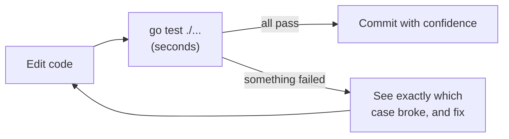
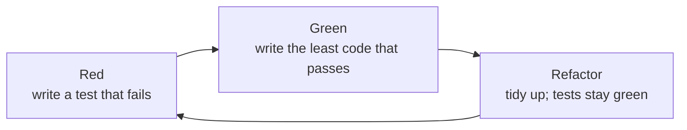
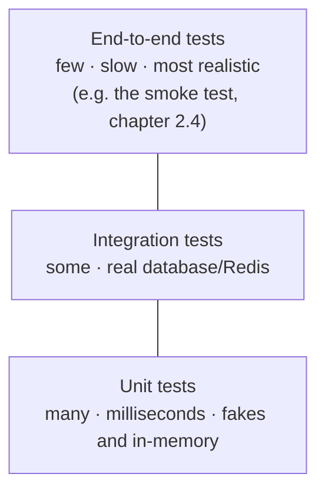

# 4.4 Testing

How do you know your code works? You run it, try a few things, and it seems fine. Then you change one small thing next week — and something you didn't touch breaks, and a user finds it before you do. **Automated tests** are code that checks your code: small programs that run your functions with known inputs and complain if the outputs are wrong. They run in seconds, every time you change anything, and on every pull request ([chapter 3.3](../git/pull-requests-and-review.mdx)). They're the reason professional teams can change code confidently many times a day. In this chapter you'll write tests for small standalone code — a pure function, a function with a dependency, an HTTP handler — and then read the test suite of a real service.

## What you'll learn

- **Why** automated tests matter, and what "confidence to change code" really means.
- The basics of **`go test`**: test files, test functions, `t.Error` and `t.Fatal`.
- **Test-driven development (TDD)**: red, green, refactor — writing the test *first*.
- **Table-driven tests**, the idiomatic Go way to check many cases compactly.
- **Test doubles** — fakes, stubs and mocks — and **`httptest`**, for code that depends on email, databases or HTTP.
- **Integration tests**, **coverage**, the **race detector**, and what makes a test *good*.

---

## Why test at all

Imagine an app without tests. You improve its URL validation. Did you just start allowing `javascript:` URLs (a security hole)? Did you break URLs with query strings? You could check by hand — every case, every time, forever. Or you can write the checks down once as code, and let the computer re-run all of them in under a second, every time.

That's the real value of tests: not proving code works once, but **catching it the moment it stops working**. They give you — and your teammates, and your future self — the **confidence to change code**. Untested code tends to become code nobody dares touch.



:::note[Everyday anchor]
Tests are the checklist a pilot runs before every flight. The pilot knows how to fly; the checklist exists because humans forget things, and because a mistake caught on the ground is cheap while one caught in the air is not. Tests are your ground check before code reaches users.
:::

---

## go test: the basics

Go has testing built in. The rules:

- Tests live in files ending in **`_test.go`**, next to the code they test.
- A test is a function named **`TestXxx`** that takes **`t *testing.T`**.
- Inside, you run your code and report problems with **`t.Errorf`** (record a failure, keep going) or **`t.Fatalf`** (record a failure, stop this test now).

Here's the simplest possible test, for the `combinations` function from [chapter 4.1](./why-go-first-program.mdx):

```go
// combinations_test.go
package main

import "testing"

func TestCombinations(t *testing.T) {
	got := combinations(2, 3)
	want := 8
	if got != want {
		t.Errorf("combinations(2, 3) = %d, want %d", got, want)
	}
}
```

Run it:

```bash
go test ./...                    # run every test in the module
go test -v ./...                 # verbose: show each test by name
go test -run Combinations ./...  # only tests whose names match "Combinations"
```

Notice the failure message format: **what was called, what it returned, what was expected**. When a test fails six months from now, that one line should tell the reader exactly what broke, without opening the code.

---

## Test-driven development: red, green, refactor

You can write tests after the code. Or you can write them **first**, which is called **test-driven development (TDD)**. It runs in a tight three-step loop:



Here's one turn of the loop. You need a function that turns a blog-post title into a URL-friendly **slug**: `"Hello, World!"` → `"hello-world"`.

1. **Red.** Before `Slugify` does anything useful, write what it *should* do:
   ```go
   func TestSlugify(t *testing.T) {
   	if got := Slugify("Hello, World!"); got != "hello-world" {
   		t.Errorf("Slugify(%q) = %q, want %q", "Hello, World!", got, "hello-world")
   	}
   }
   ```
   Run `go test`. It fails — that's the point. A test you've never seen fail might not be testing anything.
2. **Green.** Write the simplest code that makes it pass: lowercase the text, keep letters and digits, turn everything else into a dash.
3. **Refactor.** Now that a test guards the behaviour, clean up the code — rename, simplify, speed up — and re-run. Green means you didn't break it.

Then the next requirement becomes the next red test: *"no double dashes"*, *"no dash at the ends"*. Each turn takes minutes.

TDD's real gift is that it makes you decide **what the code should do** before you're attached to how it does it, and it leaves a test behind for every behaviour. Teams argue about whether to always work this way; they agree on one rule: **a bug fix comes with a test that fails without the fix.**

---

## Table-driven tests

Most functions need checking with many inputs. Instead of copying the same test ten times, Go programmers write a **table**: a list of cases, and one loop that checks them all. Here's the finished `Slugify` test, from the handbook's example `snip/examples/testdemo/slug_test.go`:

```go
func TestSlugify(t *testing.T) {
	tests := []struct {
		name, in, want string
	}{
		{"lowercases", "Hello", "hello"},
		{"spaces become dashes", "hello world", "hello-world"},
		{"punctuation is dropped", "Hello, World!", "hello-world"},
		{"no double dashes", "a  --  b", "a-b"},
		{"no dash at the ends", "  -go-  ", "go"},
		{"digits are kept", "Top 10 tips", "top-10-tips"},
		{"empty stays empty", "", ""},
	}
	for _, tt := range tests {
		t.Run(tt.name, func(t *testing.T) {
			if got := Slugify(tt.in); got != tt.want {
				t.Errorf("Slugify(%q) = %q, want %q", tt.in, got, tt.want)
			}
		})
	}
}
```

- The **table** is a slice of anonymous structs ([chapter 4.2](./types-structs-errors.mdx)): each row is one case, with the input and the expected result.
- **`t.Run`** makes each row a named **subtest**, so a failure reports exactly which case broke: `--- FAIL: TestSlugify/no_double_dashes`.
- Adding a case — say, a bug someone reported — is **one line**.

Read the table itself and you have a precise specification of what `Slugify` does. Tests are documentation that can't go out of date.

---

## Test doubles: fakes, stubs and mocks

Some code depends on things that are slow, costly or unpredictable: an email provider, a database, a payment API. Testing it against the real thing means tests that need accounts and networks, run slowly, and fail for reasons unrelated to your code.

If the dependency is an **interface** ([chapter 4.3](./packages-modules-interfaces.mdx)), a test can pass in a **test double** — a stand-in that behaves just well enough. You'll hear several names:

| Kind | What it does | Example |
|---|---|---|
| **Stub** | returns canned answers | a mailer whose `Send` always returns an error |
| **Fake** | a working, simplified version | an in-memory map instead of a database |
| **Spy** | records how it was called, for the test to check | a mailer that appends each recipient to a list |
| **Mock** | is told in advance which calls to expect, and fails the test otherwise | usually generated by a library such as `gomock` |

In everyday Go, people hand-write small fakes and spies, and "mock" is often used loosely for all of them. Here's the example's signup code, which registers a user and sends a welcome email through a `Mailer` interface (`examples/testdemo/signup.go`):

```go
type Mailer interface {
	Send(to, subject string) error
}

func (s *Signup) Register(email string) error {
	// … validate, refuse duplicates …
	s.users[email] = true
	if err := s.mail.Send(email, "Welcome!"); err != nil {
		return fmt.Errorf("send welcome email: %w", err)
	}
	return nil
}
```

And its test double, from `signup_test.go` — a spy that can also act as a failing stub:

```go
type fakeMailer struct {
	sent []string // who we were asked to email
	fail error    // if set, Send returns it
}

func (f *fakeMailer) Send(to, _ string) error {
	if f.fail != nil {
		return f.fail
	}
	f.sent = append(f.sent, to)
	return nil
}

func TestRegisterTwiceIsRefused(t *testing.T) {
	mail := &fakeMailer{}
	s := NewSignup(mail)
	_ = s.Register("ada@example.com")

	err := s.Register("ADA@example.com")
	if !errors.Is(err, ErrExists) {
		t.Fatalf("second Register error = %v, want ErrExists", err)
	}
	if len(mail.sent) != 1 {
		t.Fatalf("sent %d emails, want 1: a refused signup must not email anyone", len(mail.sent))
	}
}
```

The test checks **behaviour** a customer would care about — one welcome email, and none for a duplicate signup — in microseconds, with no email account.

---

## Testing HTTP handlers with httptest

Go's standard library includes **`net/http/httptest`** for testing web code. Its **`NewRecorder`** is a fake `ResponseWriter`: you call a handler directly and then inspect what it wrote — no network, no port. From `examples/testdemo/handler_test.go`:

```go
req := httptest.NewRequest(http.MethodGet, "/hello?name=Ada", nil)
rec := httptest.NewRecorder()

Hello(rec, req) // call the handler like any function

if rec.Code != 200 {
	t.Fatalf("status = %d, want 200", rec.Code)
}
// … decode rec.Body and check {"greeting": "hello, Ada"}
```

Its sibling, **`httptest.NewServer`**, starts a real HTTP server on a random local port for the length of a test, so you can send real requests through routing, middleware and all — exactly as a client would. You'll see it at work below.

---

## Integration tests: the real thing, when available

Doubles can't catch everything. Does the SQL actually work? Does the database really reject a duplicate? **Integration tests** talk to real systems. A common Go habit: they **skip themselves** when the system isn't configured, so `go test ./...` still works on a laptop with nothing installed:

```go
func openTestDB(t *testing.T) *sql.DB {
	t.Helper()
	url := os.Getenv("TEST_DATABASE_URL")
	if url == "" {
		t.Skip("TEST_DATABASE_URL not set") // reported as SKIP, not a pass or a failure
	}
	// … connect, create the tables …
}
```

In CI ([chapter 11.2](../shipping/ci-with-github-actions.mdx)), the real database runs alongside the tests and the variable is set, so they always run there.

### The testing pyramid

Different kinds of tests trade speed for realism:



Have **many** fast unit tests, **some** integration tests for the boundaries with real systems, and **a few** end-to-end checks of the most important flows. That shape gives you fast feedback and real confidence.

---

## Coverage and the race detector

**Coverage** tells you which lines your tests actually ran:

```bash
go test -cover ./examples/testdemo/                       # coverage: 96.4% of statements
go test -coverprofile=cover.out ./examples/testdemo/      # save the details
go tool cover -html=cover.out                             # browser view: covered lines green, missed lines red
```

Coverage is a **flashlight, not a score**. Red lines show code no test exercises — often error paths that deserve a test. But 100% coverage doesn't mean correct: a test can run a line without checking its result. Aim for meaningful tests of important behaviour, not a number.

The **race detector** ([chapter 1.2](../foundations/programs-processes-threads.mdx)'s race conditions) watches your program as it runs and reports when two goroutines touch the same memory unsafely:

```bash
go test -race ./...      # many teams run every CI build this way
```

It only finds races in code that actually runs during the tests — another reason to test concurrent code paths.

---

## What makes a good test

- **Tests behaviour, not implementation.** Check *what* a function promises (inputs → outputs, visible effects), not *how* it does it. Then you can rewrite the insides freely.
- **Fast and independent.** Each test sets up what it needs and doesn't depend on other tests or their order.
- **Deterministic.** Same code, same result, every time. A test that sometimes fails — a **flaky test** — is worse than useless: people learn to ignore red.
- **Clear failure messages.** `got X, want Y, for input Z`.
- **Readable.** A test is often the best documentation of how code is meant to be used.

:::warning[What can go wrong]
- **Flaky tests.** Usually caused by timing (`time.Sleep` "waiting" for something), shared state between tests, random data, or real network calls. Fix the cause; never re-run until green.
- **Testing the double, not the code.** A test so full of fakes and mocks that it only checks the fakes proves nothing. Keep doubles minimal, and back them up with some integration tests.
- **Mocks that pin the implementation.** A mock that expects "`Get` then `Set`, in that order" fails when you refactor, even if users see no difference. Prefer checking results over checking calls.
- **Ignoring a failing test "for now".** Skipped and disabled tests rot. If a test is wrong, fix or delete it deliberately.
- **Chasing a coverage number.** Tests written to raise a percentage, without assertions, give false confidence.
:::

---

## Apply it to snip

**snip**, the link shortener you build in this handbook, has a real test suite using every technique above. A few highlights.

**A table-driven test that doubles as a security spec** — URL validation, from `internal/links/service_test.go` (trimmed):

```go
func TestNormalizeURL(t *testing.T) {
	tests := []struct {
		in      string
		want    string
		wantErr bool
	}{
		{in: "https://go.dev", want: "https://go.dev"},
		{in: "  http://example.com/a?b=c  ", want: "http://example.com/a?b=c"},
		{in: "", wantErr: true},
		{in: "javascript:alert(1)", wantErr: true},                     // dangerous scheme
		{in: "https://bank.example@evil.example/login", wantErr: true}, // really goes to evil.example
		// …
	}
	for _, tt := range tests {
		t.Run(tt.in, func(t *testing.T) {
			got, err := links.NormalizeURL(tt.in)
			if tt.wantErr {
				if !errors.Is(err, links.ErrInvalidURL) {
					t.Fatalf("NormalizeURL(%q) error = %v, want ErrInvalidURL", tt.in, err)
				}
				return
			}
			if err != nil || got != tt.want {
				t.Fatalf("NormalizeURL(%q) = %q, %v; want %q", tt.in, got, err, tt.want)
			}
		})
	}
}
```

**A fake and a spy for the business logic.** snip's `Service` depends on a `Store` and a `Cache` interface. Its test passes the real in-memory store (a fake database) and a hand-written cache that counts its calls (a spy), then checks behaviour — the first lookup misses the cache and fills it, the second hits:

```go
cache := &fakeCache{data: map[string]string{}}
svc := links.NewService(memory.New(), cache, nil)

l, _ := svc.Shorten(ctx, 1, "https://go.dev/doc", "")
svc.Resolve(ctx, l.Slug)              // miss → reads the store, fills the cache
r2, _ := svc.Resolve(ctx, l.Slug)     // hit
if !r2.CacheHit {
	t.Fatal("second resolve should hit the cache")
}
```

**`httptest.NewServer` for the whole API.** `internal/httpapi/server_test.go` starts snip on a random port and walks a table of bad requests — routing, authentication, JSON decoding, validation and error mapping all at once:

```go
func TestErrors(t *testing.T) {
	base, key := newTestServer(t, 100) // snip on a random port, in-memory, with a valid key
	tests := []struct {
		name, method, path, key, body string
		wantStatus                    int
		wantCode                      string
	}{
		{"no key", "POST", "/api/links", "", `{"url":"https://go.dev"}`, 401, "unauthorized"},
		{"bad json", "POST", "/api/links", key, `{"url":`, 400, "invalid_json"},
		{"bad url", "POST", "/api/links", key, `{"url":"javascript:alert(1)"}`, 400, "invalid_url"},
		{"missing link", "GET", "/nope123", "", "", 404, "not_found"},
		// …
	}
	// loop: send each request, check the status and the error code in the JSON body
}
```

**Integration tests that skip.** `internal/store/postgres/postgres_test.go` uses the `openTestDB` pattern with `SNIP_TEST_DATABASE_URL`; in CI (`.github/workflows/ci.yml`), real Postgres and Redis run as services, and every test runs with `-race`.

---

## Lab

Free, on your own computer.

1. **Run the example suite.**
   ```bash
   cd ~/code/zero-to-prod/snip
   go test -v ./examples/testdemo/      # every test and subtest, by name
   ```
   Open `examples/testdemo/` side by side: one pure function (`slug.go`), one with a dependency (`signup.go`), one HTTP handler (`handler.go`), each with a `_test.go` file.

2. **Break the code, watch the tests catch it.** In `slug.go`, delete `&& !dash` from the second `case`. Run `go test ./examples/testdemo/`. Read the failures: each names the exact case (`no_double_dashes`, …), the input, what came back and what was expected — one small change broke three promises at once. Undo the change.

3. **Find the gap with coverage, then close it TDD-style.**
   ```bash
   go test -coverprofile=cover.out ./examples/testdemo/ && go tool cover -html=cover.out
   ```
   Find the red line in `signup.go`: no test sends an invalid email. Write `TestRegisterRejectsInvalidEmail` (expect `errors.Is(err, ErrInvalidEmail)` *and* no email sent), watch it pass, and re-run coverage: 100%.

4. **Watch the race detector.**
   ```bash
   go run ./examples/race             # usually fewer than 1000: lost updates
   go run -race ./examples/race       # WARNING: DATA RACE, with the exact line
   go run ./examples/race -safe       # a mutex fixes it: always 1000 (chapter 4.5)
   ```

5. **Apply it to snip.**
   ```bash
   go test ./...                                          # every package; integration tests skip themselves
   go test -v -run TestNormalizeURL ./internal/links/    # one test, with every subtest listed
   ```
   Notice the `SKIP` lines for Postgres and Redis tests: they explain why they didn't run. Then add a row to the `TestNormalizeURL` table checking that a URL with a port is accepted — `{in: "https://example.com:8443/x", want: "https://example.com:8443/x"},` — and one you think should be **rejected**, such as `"mailto:someone@example.com"`. Run the tests again.

## Self-check

<Quiz
  id="go-testing"
  questions={[
    {
      q: 'What is the main value of an automated test suite?',
      options: [
        'It proves the code has no bugs in the parts that the tests cover',
        'It catches within seconds when a change breaks existing behaviour',
        'It makes programs run faster, because tested code is optimised',
        'It replaces code review, since the tests already read every line',
      ],
      answer: 1,
      explain: 'Tests cannot prove the absence of bugs — they only check the cases someone wrote down. What they do is re-check known behaviour instantly after every change, which is what lets teams change code often and safely.',
    },
    {
      q: 'Why are table-driven tests popular in Go?',
      options: [
        'They run in parallel automatically, one goroutine per row of the table',
        'Cases are listed compactly, reported by name, and each new one is a line',
        'They don’t need the testing package, so they build faster',
        'They guarantee 100% coverage, since every branch gets its own row',
      ],
      answer: 1,
      explain: 'A table of inputs and expected outputs plus one loop with t.Run keeps tests readable, precise about which case failed, and easy to extend when bugs are found. Rows only run in parallel if you call t.Parallel, and no test style guarantees coverage.',
    },
    {
      q: 'Why does snip’s Service test use an in-memory store and a fake cache instead of Postgres and Redis?',
      options: [
        'Postgres can’t run inside go test, so its code can’t be tested at all',
        'Fakes keep it fast and focused on logic; integration tests cover the real stores',
        'Fakes find more bugs than real systems, because they are stricter',
        'To avoid writing SQL, which the tests are not allowed to contain',
      ],
      answer: 1,
      explain: 'Interfaces let tests plug in fast stand-ins, so unit tests check the business logic in microseconds. Postgres can be tested — separate integration tests do exactly that, skipping when no database is configured. Fakes are not stricter than the real thing; that is why both kinds of test exist.',
    },
    {
      q: 'A test passes most of the time but fails randomly about once in twenty runs. What should you do?',
      options: [
        'Re-run the pipeline until it passes; one green run proves it works',
        'Delete it, since a test that sometimes fails tells you nothing',
        'Treat it as real: find the non-determinism (timing, shared state, network) and fix it',
        'Mark it as skipped, and add a note so someone fixes it later',
      ],
      answer: 2,
      explain: 'Flaky tests teach people to ignore failures and often hide real races. Re-running hides the problem; deleting or skipping loses the protection. Find and fix the cause — go test -race is a good first step.',
    },
  ]}
/>

<details>
<summary>What does "test behaviour, not implementation" mean? Give an example with the signup code.</summary>

It means checking **what the code promises**, not **how it's written inside**. For signup: a behavioural test checks that "registering sends exactly one welcome email, and a duplicate registration sends none and returns `ErrExists`" — promises a user would notice. An implementation-focused test would check, say, that `Register` lowercases the email before checking the map, or inspect the private `users` field. The behavioural test keeps passing if you move users into a database; the implementation test breaks on every refactor even when nothing is wrong for users.

</details>

<details>
<summary>Users complain that "Don't panic" becomes <code>don-t-panic</code>; they want <code>dont-panic</code>. Using TDD, what are the steps, and what must the pull request include?</summary>

**Red:** add a row to the table — `{"apostrophes vanish", "Don't panic", "dont-panic"}` — and run the tests to see it **fail**, proving the test reproduces the bug. **Green:** change the code until it passes, with every other row still passing. **Refactor:** tidy up with the tests green. The pull request must include that **test case**: it proves the fix works, guards against the bug returning (CI fails the moment anyone reintroduces it), and documents the expected behaviour for the next reader.

</details>
