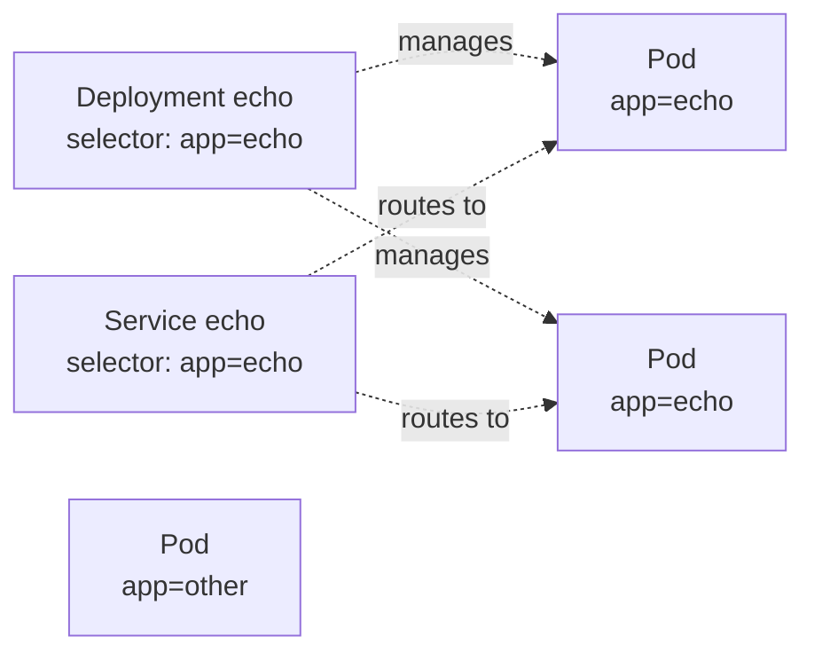
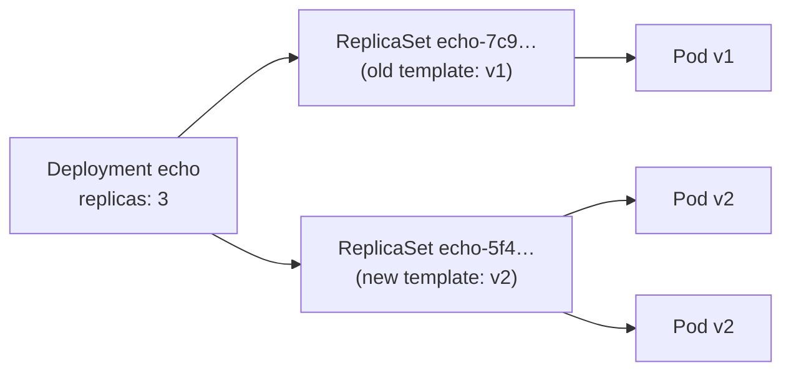

# 10.2 Core objects: Pods, Deployments and friends

You can start a container on Kubernetes with one command, as [chapter 10.1](./why-orchestration.mdx) did. Real teams don't work that way. They write **files**: YAML manifests, kept in Git, that describe every object an application needs, so the setup can be reviewed, repeated and undone. Kubernetes has dozens of object types, but a handful do nearly all the everyday work. This chapter builds them up in the order they depend on each other: the **Pod** (containers that run together), the **Deployment** (keeps N identical Pods running and upgrades them safely), and the objects for work that doesn't fit that mould: databases, per-node agents and batch jobs. Along the way come the settings that separate a toy from a production workload: **health probes**, **resource requests and limits**, and **graceful shutdown**. You'll learn each on a tiny web server, roll out a new version of it while traffic flows with zero failed requests, and then read and deploy snip's full manifests (Postgres, Redis, API, worker).

## What you'll learn

- The **anatomy of a manifest**: `apiVersion`, `kind`, `metadata`, `spec`, `status`.
- **Pods**, and **labels and selectors**, the glue that connects everything.
- **Deployments** and ReplicaSets: replicas, **rolling updates**, **rollbacks**.
- **Probes** (startup, liveness, readiness), **graceful shutdown**, and **requests and limits**.
- **StatefulSets**, **DaemonSets**, **Jobs** and **CronJobs**, and when to use each.
- **Namespaces**, **kustomize**, the everyday `kubectl` commands, and how snip's manifests put it all together.

---

## Every object has the same shape

:::note[Everyday anchor]
A manifest is an **order form**. Every form has the same header boxes (what kind of form, which version, your name) and a body that depends on the form. You fill in what you *want*; the shop writes back what it *did*.
:::

Every Kubernetes object, of every kind, is written in the same five parts. Here is the start of a Deployment for a small web server called `echo`:

```yaml
apiVersion: apps/v1          # which API group and version defines this kind
kind: Deployment             # what type of object
metadata:
  name: echo                 # unique within its namespace and kind
  labels:                    # key/value tags for finding and grouping objects
    app: echo
spec:                        # DESIRED state: you write this
  replicas: 3
  # ...
status:                      # OBSERVED state: Kubernetes writes this
  readyReplicas: 3
```

You write `spec`; controllers write `status`; the gap between them is what reconciliation loops close ([chapter 10.1](./why-orchestration.mdx): controllers that observe, compare and act, forever). You never write `status` yourself. `kubectl explain` documents every field, straight from the cluster you're connected to:

```bash
kubectl explain deployment.spec.strategy              # what does this field do?
kubectl explain pod.spec.containers.readinessProbe    # works for any kind and any depth
```

---

## Pods: the smallest unit

A **Pod** is one or more containers that are always scheduled together on the same node, share one network namespace (one IP address; they reach each other on `localhost`), and can share volumes. Usually a Pod holds one main container. Extra containers are for tightly coupled helpers: a **sidecar** (a log shipper or proxy running alongside), or an **init container** that runs to completion before the main one starts.

:::note[Everyday anchor]
If a container is a person, a Pod is a **shared hotel room**. Everyone in the room is checked in and out together, shares one room number (IP address) and one phone line (ports), and can leave things for each other on the table (shared volumes). Most rooms have one guest. Sometimes a guest brings an assistant (a sidecar).
:::

Pods are **disposable**. When one dies, or its node dies, it's never repaired or moved. A **new** Pod, with a new name and a new IP address, is created in its place. That's why you almost never create Pods directly: you create an object that **manages** Pods for you, and you reach them through a Service ([chapter 10.3](./networking-and-ingress.mdx)), never by IP.

### Labels and selectors

**Labels** are key/value tags on any object (`app: echo`). **Selectors** are queries over labels ("every Pod with `app=echo`"). They're how objects find each other, without hard-coded names or IPs:

- A Deployment manages the Pods matching its selector.
- A Service sends traffic to the Pods matching its selector.
- You filter with them: `kubectl get pods -l app=echo`.



Neither the Deployment nor the Service knows the Pods' names. Both ask "which Pods carry `app=echo` right now?", so Pods can come and go freely. The `app=other` Pod is ignored by both. Kubernetes also defines **recommended labels** such as `app.kubernetes.io/name` and `app.kubernetes.io/part-of`, which tools and dashboards understand. Short labels like `app` work just as well for learning.

---

## Deployments: N identical Pods, upgraded safely

A **Deployment** keeps a set of identical, stateless Pods running, and changes them safely when you change the Pod template. It's the object for web servers, APIs and workers: most of what you run. Here's a complete one for `echo`, the tiny web server from [chapter 10.1](./why-orchestration.mdx) (`hashicorp/http-echo` answers every request with the text in its `ECHO_TEXT` environment variable), plus a Service in front of it:

```yaml title="echo.yaml"
apiVersion: apps/v1
kind: Deployment
metadata:
  name: echo
  labels: { app: echo }                      # so `kubectl get -l app=echo` finds it too
spec:
  replicas: 3
  selector:
    matchLabels:
      app: echo                              # "the Pods I manage are the ones with this label"
  strategy:
    rollingUpdate:
      maxUnavailable: 0                      # never drop below 3 ready copies during a rollout
      maxSurge: 1                            # allow 1 extra copy while replacing
  template:                                  # the Pod to stamp out, N times
    metadata:
      labels:
        app: echo                            # must match the selector
    spec:
      containers:
        - name: echo
          image: hashicorp/http-echo:1.0
          env:
            - name: ECHO_TEXT
              value: "hello from v1"         # what the server answers
          ports:
            - name: http
              containerPort: 5678            # http-echo listens here
          readinessProbe:                    # explained below
            httpGet: { path: /health, port: http }
            periodSeconds: 2
          livenessProbe:
            httpGet: { path: /health, port: http }
            periodSeconds: 10
          lifecycle:
            preStop:
              sleep: { seconds: 5 }          # explained below
          resources:
            requests: { cpu: 10m, memory: 16Mi }
            limits: { memory: 32Mi }
---
apiVersion: v1
kind: Service                                # a stable name in front of the Pods (chapter 10.3)
metadata:
  name: echo
  labels: { app: echo }
spec:
  selector:
    app: echo
  ports:
    - name: http
      port: 80
      targetPort: http
```

`kubectl apply -f echo.yaml` sends both objects to the API server, and the controllers take it from there. The lab does exactly that.

Under the hood, a Deployment manages **ReplicaSets**, and each ReplicaSet manages Pods. Every time the Pod `template` changes (a new image, a new environment variable), the Deployment creates a **new** ReplicaSet and shifts Pods from the old one to the new one:



The picture is a rollout caught halfway: one old Pod left, two new ones already serving.

### Rolling updates and rollbacks

With `maxSurge: 1` and `maxUnavailable: 0`, a rollout of 3 replicas goes: start 1 new Pod → wait until it's **ready** → stop 1 old Pod → repeat until no old Pods remain. Capacity never drops below 3, and **a new version that never becomes ready stops the rollout** before it can take down the old Pods. Then:

```bash
kubectl rollout status deployment/echo       # follow a rollout until it finishes (or fails)
kubectl rollout history deployment/echo      # the revisions (old ReplicaSets are kept, 10 by default)
kubectl rollout undo deployment/echo         # go back to the previous revision
```

Old ReplicaSets are kept, scaled to zero, which is what makes `undo` instant: it's just another rollout, back to the previous template.

The other strategy, `Recreate`, stops all old Pods before starting new ones. That means downtime, but it's needed when two versions must never run at once.

---

## Health probes: alive, ready, started

:::note[Everyday anchor]
A shop manager checks staff in two different ways. "Are you **conscious**?" If not, call an ambulance (restart). "Are you **at the till** right now?" If not, don't send customers to you, but nobody panics: you might be fetching stock. Kubernetes asks your containers both questions, separately.
:::

The kubelet (the agent on each node, [chapter 10.1](./why-orchestration.mdx)) asks each container up to three questions, usually through HTTP endpoints the application provides:

| Probe | Question | If it fails… |
|---|---|---|
| **startupProbe** | Has it finished starting? | Keep waiting (up to a limit); the other probes don't run yet |
| **livenessProbe** | Is it alive, or stuck? | **Restart the container** |
| **readinessProbe** | Should it receive traffic right now? | **Take it out of the Service**, but don't restart it |

The difference between liveness and readiness matters enormously. Imagine a web app whose liveness probe checks its database. The database goes down for a minute. Every copy of the app now fails liveness, so Kubernetes restarts every one of them, again and again. That fixes nothing, and adds a restart storm to a database outage. The rule:

- **Liveness checks only the process itself**: "can I answer at all?" Cheap, no dependencies.
- **Readiness may check what the app needs to do useful work**: "can I reach my database?" A failure pauses traffic, and the Pod rejoins by itself when the dependency recovers.

`echo` has no dependencies, so both its probes call the same `/health` endpoint. You'll see the split for real in snip below.

:::warning[What can go wrong]
- **Liveness probes that check dependencies**: one database blip restarts everything.
- **No readiness probe**: new Pods get traffic before they can serve it, and rollouts cause errors.
- **No startup probe on slow starters**: the liveness probe kills the container before it ever finishes starting, forever (`CrashLoopBackOff`, [chapter 10.5](./operating-and-debugging.mdx)).
- **Timeouts too tight**: a probe with a 1-second timeout on a busy Pod fails under load, restarting healthy Pods exactly when you need them.
:::

### Graceful shutdown

When a Pod is removed (a rollout, scale-down, node drain), Kubernetes does two things **at the same time**: it removes the Pod from Service endpoints, and it starts shutting the Pod down. The endpoint removal takes a moment to reach every node, so a Pod that exits instantly can still receive a few requests after it's gone, and they fail. The `preStop` hook in `echo.yaml` closes that race:

```yaml
lifecycle:
  preStop:
    sleep:
      seconds: 5          # keep serving for 5 s while the Service stops routing here
terminationGracePeriodSeconds: 30   # (Pod-level; 30 is the default)
```

The `preStop` hook runs first. Then the container gets SIGTERM, finishes its in-flight requests (if the program handles SIGTERM gracefully, [chapter 5.4](../apis/structuring-a-real-service.mdx)), and exits. If it's still running when the grace period ends, it's killed. The `sleep` action is built into Kubernetes, so it works even in images with no shell or `sleep` binary, like `http-echo`.

---

## Requests and limits

Each container declares the CPU and memory it needs:

```yaml
resources:
  requests: { cpu: 10m, memory: 16Mi }    # reserved: used by the scheduler
  limits:   { memory: 32Mi }              # enforced: cgroup limit (chapter 9.1)
```

- **Requests** are what the **scheduler** uses. A Pod goes only to a node with that much *unreserved* capacity, and it's guaranteed that much. `100m` is 100 **millicores**: a tenth of one CPU core; `10m` is a hundredth.
- **Limits** are enforced by the kernel's cgroups (the resource fences around a container, [chapter 9.1](../containers/what-a-container-is.mdx)). Over the **memory** limit, the container is **OOM-killed** (exit code 137) and restarted. Over a **CPU** limit, it's throttled (slowed), never killed.
- A common, sensible pattern: set CPU and memory **requests**, a memory **limit**, and no CPU limit. CPU limits often cause surprising throttling, while memory has no "slow down" option.

Requests matter more than they look. Without them, the scheduler can pack too many Pods onto one node, and the autoscaler ([chapter 8.6](../distributed/scaling.mdx)) measures CPU as a **percentage of requests**: "70% CPU" means 70% of whatever the container requested.

---

## The other workload objects

Deployments assume every copy is interchangeable. Some work isn't like that:

| Object | Runs | Use for | Example |
|---|---|---|---|
| **Deployment** | N identical, interchangeable Pods | Stateless services: APIs, web apps, workers | `echo`; nearly every web service |
| **StatefulSet** | N Pods with **stable identities** (`db-0`, `db-1`), started in order, each with **its own persistent volume** | Databases, message brokers, anything where each copy owns data | Postgres, Kafka |
| **DaemonSet** | **One Pod on every node** (or chosen nodes) | Per-node agents: log collectors, monitoring, networking | `kube-proxy`, a log shipper |
| **Job** | Pods that **run to completion**, retried on failure | Migrations, batch processing, one-off tasks | A database migration |
| **CronJob** | A Job **on a schedule** (cron syntax, [chapter 2.5](../linux/running-a-linux-server.mdx)) | Nightly reports, cleanups, backups | A nightly backup |

A StatefulSet's Pod `db-0` always gets the same disk, even when it's recreated on another node. [Chapter 10.4](./config-secrets-storage.mdx) covers storage properly. You can try a Job in one line:

```bash
kubectl create job hello --image=busybox:1.37 -- echo "done"   # runs once, to completion
kubectl get jobs                                               # COMPLETIONS 1/1
kubectl logs job/hello                                         # done
```

---

## Namespaces, kustomize and kubectl

A **namespace** is a named group of objects: `default`, `kube-system`, `monitoring`. Names only need to be unique within a namespace. You can apply permissions and quotas per namespace, and deleting a namespace deletes everything in it. Namespaces aren't a security boundary on their own: Pods in different namespaces can still talk to each other unless NetworkPolicies say otherwise ([chapter 10.3](./networking-and-ingress.mdx)).

**kustomize** (built into `kubectl`, via `-k`) assembles a set of manifests and customises them **without templates**. A `kustomization.yaml` lists the files and the changes to make to all of them:

```yaml title="kustomization.yaml"
apiVersion: kustomize.config.k8s.io/v1beta1
kind: Kustomization
namespace: demo                  # put every object in this namespace
resources:
  - echo.yaml                    # the plain manifests
images:
  - name: hashicorp/http-echo    # swap the image tag without editing echo.yaml
    newTag: "1.0.0"
```

`kubectl kustomize .` prints the result; `kubectl apply -k .` applies it. A common layout is a **base** directory with the shared manifests and **overlays** (one per environment) that reuse the base and change only what differs.

The everyday commands:

| Command | Does |
|---|---|
| `kubectl apply -k DIR` / `-f FILE` | Make the cluster match these manifests (create or update) |
| `kubectl diff -f FILE` | Show what `apply` would change, before applying |
| `kubectl get pods -o wide` | List objects (`-o yaml` for the full object; `-w` to watch) |
| `kubectl describe pod NAME` | Details plus recent **events**: the first place to look when something's wrong |
| `kubectl logs deploy/echo -f` | Container output (`--previous` for the last crashed container) |
| `kubectl exec -it deploy/NAME -- CMD` | Run a command in a container (if the image has the command) |
| `kubectl port-forward svc/echo 8080:80` | Tunnel a local port to a Service or Pod |
| `kubectl rollout status/history/undo` | Follow, inspect and revert Deployments |
| `kubectl delete -f FILE` | Delete what those manifests created |

Add `-n NAMESPACE` to any of them, or set a default: `kubectl config set-context --current --namespace=demo`.

---

## Apply it to snip

snip's manifests live in `snip/deploy/k8s/`: a `base` directory with ten files (Postgres, Redis, the API, the worker, the web UI, config, autoscaling, disruption budget, network policies) and an `overlays/kind` directory for your laptop. Every idea above appears in them. Here is the API's Deployment, trimmed to the parts this chapter taught (`snip/deploy/k8s/base/api.yaml`):

```yaml
apiVersion: apps/v1
kind: Deployment
metadata:
  name: api
spec:
  replicas: 2
  selector:
    matchLabels:
      app.kubernetes.io/name: api
  strategy:
    rollingUpdate:
      maxUnavailable: 0                     # never drop below 2 ready copies during a rollout
      maxSurge: 1
  template:
    metadata:
      labels:
        app.kubernetes.io/name: api
    spec:
      terminationGracePeriodSeconds: 30
      securityContext:
        runAsNonRoot: true
        runAsUser: 65532                    # distroless "nonroot"; must be numeric for runAsNonRoot to verify it
      containers:
        - name: api
          image: snip                       # replaced by kustomize's images: section
          envFrom:
            - configMapRef:
                name: snip-config
            - secretRef:
                name: snip-db
            - secretRef:
                name: snip-redis
          ports:
            - name: http
              containerPort: 8080
          startupProbe:                     # give migrations time on first start
            httpGet: { path: /healthz, port: http }
            periodSeconds: 2
            failureThreshold: 30
          livenessProbe:                    # alive? if this fails, restart the container
            httpGet: { path: /healthz, port: http }
            periodSeconds: 10
          readinessProbe:                   # ready for traffic? (fails only if Postgres is down)
            httpGet: { path: /readyz, port: http }
            periodSeconds: 5
          lifecycle:
            preStop:
              sleep:
                seconds: 5                  # let the Service stop routing here before shutdown starts
          resources:
            requests: { cpu: 100m, memory: 64Mi }
            limits: { memory: 256Mi }
```

Three things are worth noticing, compared with `echo`:

- **The probe split is real here.** snip has a database, so `/healthz` (liveness) never touches it, while `/readyz` (readiness) fails if Postgres is unreachable ([chapter 5.4](../apis/structuring-a-real-service.mdx) built both endpoints). If Postgres goes down, snip's Pods stay alive but stop getting traffic, and come back by themselves. A Redis outage only marks snip degraded, not unready ([chapter 13.5](../observability/incidents-and-postmortems.mdx)).
- **A startup probe**, because snip runs its database migrations at start, which can take a while the first time: up to 30 × 2 seconds before liveness takes over.
- **Configuration comes from outside the image**: `envFrom` turns every key of a ConfigMap and a Secret into environment variables, which is how snip reads its `SNIP_*` settings. [Chapter 10.4](./config-secrets-storage.mdx) is about exactly that.

The other objects map onto the table above: `api`, `worker`, `redis` and `web` (nginx serving the web UI of [chapter 16.6](../frontend/a-ui-for-snip.mdx)) are Deployments; `postgres` is a StatefulSet with a `volumeClaimTemplates` entry, so `postgres-0` always gets the disk `data-postgres-0`. `snip/deploy/k8s/base/kustomization.yaml` lists the files, puts everything in the `snip` namespace, adds the label `app.kubernetes.io/part-of: snip` to every object, and sets the images to the ones CI publishes, `snip` and `snip-web`. The kind overlay reuses the base and changes only the images, to ones you built yourself:

```yaml title="snip/deploy/k8s/overlays/kind/kustomization.yaml"
apiVersion: kustomize.config.k8s.io/v1beta1
kind: Kustomization
resources:
  - ../../base
images:
  - name: ghcr.io/jawwadzafar/snip
    newName: snip
    newTag: dev
  - name: ghcr.io/jawwadzafar/snip-web
    newName: snip-web
    newTag: dev
```

:::warning[What can go wrong]
The first time snip's manifests ran in CI, **no snip Pod ever started**. `kubectl describe pod` showed `CreateContainerConfigError` and this event:

```text
Error: container has runAsNonRoot and image has non-numeric user (nonroot),
cannot verify user is non-root
```

snip's Pods set `runAsNonRoot: true`, a promise the kubelet must check before starting the container. The image's `USER nonroot` is a *name*, and the kubelet can't look up names inside the image, so it refuses rather than guess. The fix is to state the numeric user ID in the Pod's `securityContext` (`runAsUser: 65532`, distroless's `nonroot`), or to use `USER 65532:65532` in the Dockerfile. Two lessons: security settings fail **closed**, which is what you want; and `describe` plus **Events** is where the reason always is.
:::

:::info[In the real world]
Production manifests are almost never applied by hand from a laptop. They live in Git, are validated in CI (schema checks like **kubeconform**, policy checks), and are applied by a pipeline or a GitOps controller that continuously reconciles the cluster with the repository ([chapter 11.4](../shipping/gitops.mdx)). Teams also standardise on **Helm** charts ([chapter 10.6](./helm.mdx)) or kustomize, and enforce security settings like snip's (non-root, read-only root filesystem, no privilege escalation, all capabilities dropped) cluster-wide with **Pod Security Standards**, where the `restricted` level requires exactly these.
:::

---

## Lab

Free, on your kind cluster from [chapter 10.1](./why-orchestration.mdx) (`kind create cluster --name z2p` if you deleted it). Steps 1–3 use only `echo`; steps 4–6 apply the same moves to snip, and run in snip's CI on a fresh kind cluster on every push.

1. **Write and apply your first manifest.** Save the `echo.yaml` from "Deployments: N identical Pods, upgraded safely" into a new folder, then:
   ```bash
   kubectl apply -f echo.yaml                        # create the Deployment and the Service
   kubectl get deploy,rs,pods,svc -l app=echo        # one Deployment, one ReplicaSet, three Pods, one Service
   kubectl describe deploy/echo | tail -5            # events: "Scaled up replica set echo-… to 3"
   ```

2. **Roll out a new version while traffic flows.** Start a Pod that calls the Service ten times a second for 40 seconds and counts failures:
   ```bash
   kubectl run probe --image=curlimages/curl:8.22.0 --restart=Never --command -- sh -c '
     ok=0; bad=0; end=$(( $(date +%s) + 40 ))
     while [ "$(date +%s)" -lt "$end" ]; do
       if curl -fs -m 2 http://echo/ > /dev/null; then ok=$((ok+1)); else bad=$((bad+1)); fi
       sleep 0.1
     done; echo "ok=$ok bad=$bad"'
   kubectl set env deploy/echo ECHO_TEXT="hello from v2"   # changes the Pod template → rollout
   kubectl rollout status deploy/echo
   kubectl get rs -l app=echo                              # old ReplicaSet at 0, new at 3
   ```
   After 40 seconds, `kubectl logs probe` shows `bad=0`, and `kubectl port-forward svc/echo 8080:80` plus `curl localhost:8080` answers `hello from v2`. Old and new Pods overlapped, readiness gated each step, and `preStop` covered the shutdown race.

3. **Roll back, then see the race without `preStop`.**
   ```bash
   kubectl rollout history deploy/echo               # two revisions
   kubectl rollout undo deploy/echo                  # back to v1, as a new rollout
   kubectl delete pod probe
   ```
   Now delete the three-line `lifecycle:` block from `echo.yaml`, `kubectl apply -f echo.yaml`, and repeat step 2 with a new text. You may see a handful of failures: requests sent to Pods that had already stopped. Put the block back afterwards.

4. **Apply it to snip: build and load the images.** kind's node can't see your local Docker images, so you copy them in:
   ```bash
   cd ~/code/zero-to-prod/snip
   docker build -t snip:dev .                        # build snip's image (chapter 9.2)
   docker build -t snip-web:dev ../web               # and the web UI's nginx image (chapter 16.6)
   kind load docker-image snip:dev snip-web:dev --name z2p   # copy both into the kind node
   ```
   (Or skip this and apply `deploy/k8s/base` instead of the overlay, to use the image CI published.)

5. **Read, apply and use snip's manifests.**
   ```bash
   kubectl kustomize deploy/k8s/overlays/kind | less     # the final YAML that will be applied
   kubectl apply -k deploy/k8s/overlays/kind
   kubectl -n snip get pods -w                           # Ctrl-C once all are Running and READY 1/1
   kubectl -n snip get deploy,rs,sts,pods,svc,pvc        # Deployments, a StatefulSet, its claim
   kubectl -n snip port-forward svc/api 8080:80 &
   KEY=$(kubectl -n snip exec deploy/api -- snip keys create me | grep -o 'snip_[A-Za-z0-9]*')
   SNIP_API_KEY="$KEY" ./scripts/smoke.sh http://localhost:8080        # [smoke] PASS
   ```
   Watch the order things settle in. The API Pods may stay not-ready until Postgres is ready: the readiness probe doing its job.

6. **Roll snip out under traffic, and back.** Repeat step 2's probe Pod with `-n snip` and the URL `http://api/healthz`, then change a setting instead of the text:
   ```bash
   kubectl -n snip set env deploy/api SNIP_LOG_LEVEL=debug     # changes the Pod template → rollout
   kubectl -n snip rollout status deploy/api
   kubectl -n snip rollout undo deploy/api
   ```
   The probe Pod should again report `bad=0`. Keep everything running for [chapter 10.3](./networking-and-ingress.mdx).

## Self-check

<Quiz
  id="kubernetes-core-objects"
  questions={[
    {
      q: 'Why do you almost never create Pods directly?',
      options: [
        'Pods cannot be created from YAML, only by other controllers',
        'A bare Pod isn’t replaced if it dies; a controller replaces its Pods',
        'Pods are reserved for system components in kube-system',
        'Pods created directly skip the scheduler, so they all land on the control-plane node',
      ],
      answer: 1,
      explain: 'Pods are disposable and aren’t recreated if they die; a Deployment, StatefulSet or Job manages them and replaces them. A bare Pod that dies stays dead. Pods are perfectly valid YAML, and they are scheduled like any other: the problem is only that nothing brings them back.',
    },
    {
      q: 'What connects a Deployment or a Service to its Pods?',
      options: [
        'The Pods’ IP addresses, recorded when each Pod starts',
        'Labels on the Pods, matched by a selector',
        'The owner name written into each Pod by the scheduler',
        'The container names, which must match the Deployment’s name',
      ],
      answer: 1,
      explain: 'A selector such as app=echo matches labels on the Pods. Pods come and go with new names and IPs, so anything based on IPs or names would break at the first rollout. Labels and selectors keep the connection stable.',
    },
    {
      q: 'snip’s readiness probe checks Postgres, but its liveness probe does not. Why?',
      options: [
        'Liveness probes cannot make network calls to other services',
        'A DB outage would then restart every API Pod; readiness only pauses traffic',
        'Readiness probes run far less often, so checking Postgres there puts less load on it',
        'It is a mistake; both should check every dependency the API needs',
      ],
      answer: 1,
      explain: 'If liveness checked the database, a database outage would restart every API Pod repeatedly, which fixes nothing. Readiness just stops sending them traffic until the database recovers. Liveness failure means "restart me". Readiness failure means "don’t send me traffic right now".',
    },
    {
      q: 'With replicas: 3, maxSurge: 1 and maxUnavailable: 0, what happens if the new version never becomes ready?',
      options: [
        'All old Pods are replaced anyway once the deadline passes',
        'It stalls: one new Pod isn’t ready, and all three old Pods keep serving',
        'One old Pod is removed to make room, so capacity drops to two',
        'Kubernetes rolls back to the previous version automatically',
      ],
      answer: 1,
      explain: 'The rollout stalls: one extra new Pod exists but isn’t ready, and the three old Pods keep serving. Old Pods are only removed when new ones are ready. Kubernetes does not roll back by itself: it reports the rollout as stuck, and you fix forward or run kubectl rollout undo.',
    },
    {
      q: 'A container uses more memory than its limit. What happens?',
      options: [
        'It is slowed down until its usage falls below the limit again',
        'It is OOM-killed (exit 137) and restarted',
        'Kubernetes moves it to a node with more free memory',
        'Nothing; limits are only used for scheduling decisions',
      ],
      answer: 1,
      explain: 'The kernel OOM-kills it (exit code 137) and the kubelet restarts it. Memory can’t be throttled, so exceeding the limit kills the container. Slowing down is what happens with CPU over its limit. Scheduling uses requests, not limits.',
    },
    {
      q: 'Which object should run Postgres, where each copy needs a stable name and its own disk?',
      options: ['Deployment', 'StatefulSet', 'DaemonSet', 'CronJob'],
      answer: 1,
      explain: 'StatefulSets give each Pod a stable identity (postgres-0) and its own PersistentVolumeClaim that follows it. A Deployment’s Pods are interchangeable and get random names; a DaemonSet runs one per node; a CronJob runs to completion on a schedule.',
    },
  ]}
/>

<details>
<summary>Explain why a rolling update could cause a few failed requests without the preStop sleep, even when the program shuts down gracefully.</summary>

When a Pod is deleted, two things start **in parallel**:
1. The control plane removes the Pod from the Service's endpoints, and every node's kube-proxy (and any load balancer or gateway) must then update its routing. That takes a moment to propagate.
2. The kubelet sends the container SIGTERM, and the program starts shutting down: it stops accepting new connections and finishes in-flight requests.

If (2) happens faster than (1) finishes, some nodes still route new requests to a Pod that has stopped accepting connections, and those requests fail. Graceful shutdown handles requests already in progress, not new ones that arrive after the program stopped listening. The `preStop` sleep delays SIGTERM by 5 seconds. The Pod keeps serving normally while the endpoint removal propagates everywhere, and only then begins shutting down. By then no new traffic is arriving.

</details>

<details>
<summary>Your API Pods show READY 0/1 and never become ready, but logs show no errors. How do you investigate?</summary>

1. `kubectl describe pod NAME` and read the **Events** at the bottom: failing readiness probes are reported there with the HTTP status or error.
2. Check what the readiness probe checks. For snip, `/readyz` fails when it can't reach Postgres (a Redis outage alone doesn't fail it), so check the Postgres Pod is Running and ready, and that its Service exists: `kubectl get pods,svc`.
3. Test the endpoint yourself from inside the cluster, e.g. `kubectl run -it --rm debug --image=curlimages/curl:8.22.0 --restart=Never -- curl -v http://api/readyz`, or port-forward to one Pod and curl `/readyz`.
4. Check the configuration the Pod actually received. `kubectl exec deploy/api -- env` isn't possible in a distroless image (no `env` binary), but `kubectl get pod NAME -o yaml` shows the env sources, and `kubectl get cm snip-config -o yaml` shows values. A typo in a database URL is a classic cause.
5. Check probe settings: a port name or path typo, or a timeout too short for the check.

</details>
