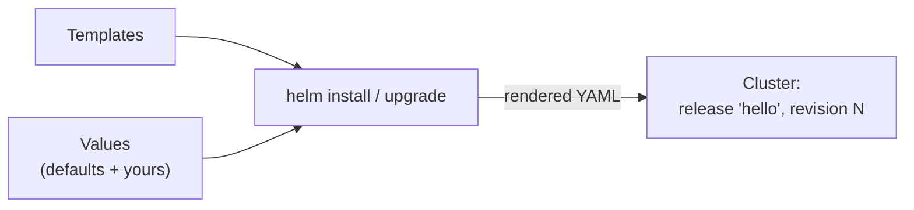

# 10.6 Helm: packaging for Kubernetes

A real application on Kubernetes is a dozen objects across several files, with values like the image tag, the replica count and the database password repeated in several places. Now imagine installing it three times (development, staging and production), each with different settings, or handing it to another team who wants their own database. Copy-and-edit YAML doesn't scale. **Helm** is Kubernetes' package manager. A **chart** is an application's manifests turned into templates, with the adjustable parts pulled out into **values**. `helm install` renders and applies them as a named **release**, and Helm remembers every revision so you can upgrade and roll back the whole application as one unit. It's also how most third-party software is installed on Kubernetes: if you did the earlier labs, you've already used it for Envoy Gateway and metrics-server. This chapter builds a tiny chart from scratch, installs, upgrades and rolls it back, and then reads snip's real chart.

## What you'll learn

- What **charts**, **templates**, **values** and **releases** are.
- Writing a chart: `Chart.yaml`, `values.yaml`, and templates with `{{ }}`.
- `helm install`, `upgrade`, `rollback`, `history` and `uninstall`, and what a release revision is.
- Installing **third-party charts** responsibly.
- **Helm vs kustomize**, and when to use which; and the tricks a real chart (snip's) uses.

---

## Charts, values, releases

:::note[Everyday anchor]
A chart is a **flat-pack furniture kit**: the parts and instructions (templates) are the same for everyone, and the order form (values) says which colour, which size, how many shelves. `helm install` is assembling one; the assembled piece in your room is a **release**. You can assemble the same kit in three rooms with three different order forms, and each keeps its own receipt of every change (revisions).
:::

| Term | What it is | Example |
|---|---|---|
| **Chart** | A directory (or packaged `.tgz`) of templates, default values and metadata | `echo/` below |
| **`Chart.yaml`** | The chart's name, **chart version**, and the **app version** it deploys | `version: 0.1.0`, `appVersion: "1.0"` |
| **Templates** | Kubernetes manifests with placeholders, written in Go's template language | `templates/deployment.yaml` |
| **Values** | The settings that fill the placeholders: defaults in `values.yaml`, overridden per install | replicas, text, image |
| **Release** | One installed instance of a chart, with a name, in a namespace | `hello` in namespace `demo` |
| **Revision** | A numbered version of a release; every install, upgrade and rollback adds one | 1, 2, 3… |



Templates plus values go in; plain Kubernetes YAML comes out and is applied. Helm stores each revision's rendered manifests and values inside the cluster (as Secrets in the release's namespace). That's what makes `helm rollback` possible, and `helm get values` / `helm get manifest` show exactly what's deployed.

---

## A chart from scratch

The smallest useful chart packages the `echo` web server from [chapter 10.2](./core-objects.mdx) (`hashicorp/http-echo`, which answers every request with the text in `ECHO_TEXT`). Four files:

```text
echo/
├── Chart.yaml
├── values.yaml
└── templates/
    ├── deployment.yaml
    └── service.yaml
```

```yaml title="echo/Chart.yaml"
apiVersion: v2              # Helm 3 and 4 chart format
name: echo
version: 0.1.0              # the chart's own version: bump when the chart changes
appVersion: "1.0"           # the app version it deploys by default (the image tag)
```

### Values: the chart's interface

`values.yaml` is the part users read, so it's written as documentation:

```yaml title="echo/values.yaml"
replicas: 2
text: "hello from Helm"     # what every response says
image:
  repository: hashicorp/http-echo
  tag: ""                   # empty = the chart's appVersion
service:
  enabled: true             # set false to skip the Service
```

Users override values without touching templates, either with files (`-f prod-values.yaml`, the usual way, kept in Git) or with single settings (`--set replicas=4`).

### Templates: YAML with placeholders

Templates are ordinary manifests with `{{ }}` expressions:

```yaml title="echo/templates/deployment.yaml"
apiVersion: apps/v1
kind: Deployment
metadata:
  name: {{ .Release.Name }}-echo                 # the release name keeps installs apart
spec:
  replicas: {{ .Values.replicas }}
  selector:
    matchLabels:
      app: {{ .Release.Name }}-echo
  template:
    metadata:
      labels:
        app: {{ .Release.Name }}-echo
    spec:
      containers:
        - name: echo
          image: "{{ .Values.image.repository }}:{{ .Values.image.tag | default .Chart.AppVersion }}"
          env:
            - name: ECHO_TEXT
              value: {{ .Values.text | quote }}
          ports:
            - name: http
              containerPort: 5678
          readinessProbe:
            httpGet: { path: /health, port: http }
```

```yaml title="echo/templates/service.yaml"
{{- if .Values.service.enabled }}
apiVersion: v1
kind: Service
metadata:
  name: {{ .Release.Name }}-echo
spec:
  selector:
    app: {{ .Release.Name }}-echo
  ports:
    - name: http
      port: 80
      targetPort: http
{{- end }}
```

- `.Values.text` reads a value; `.Release.Name` and `.Chart.AppVersion` are built in.
- `| quote` pipes a value through a function. Helm includes dozens: `default`, `quote`, `toYaml`, `sha256sum`…
- `{{- if }}…{{- end }}` includes a block conditionally; the `-` trims surrounding whitespace so the YAML stays valid.
- Naming everything after `.Release.Name` is what lets you install the same chart twice in one namespace without the objects colliding.

:::info[If you've written code]
`helm template` renders a chart to plain YAML without touching a cluster: `helm template hello ./echo --set service.enabled=false`. It's the fastest way to check what a values change actually produces. CI can pipe it into schema validation (kubeconform) or policy checks. `helm lint` catches template errors and missing fields. Charts can also include a `values.schema.json` so bad values (a string where a number belongs) are rejected before rendering. `helm create NAME` generates a fuller starter chart with all the conventional pieces, worth reading once you've written this small one.
:::

---

## Install, upgrade, roll back

```bash
helm install hello ./echo -n demo --create-namespace --wait     # revision 1
helm -n demo list                               # releases: name, revision, status, chart, app version
helm -n demo upgrade hello ./echo --reuse-values --set text="hello again" --wait   # revision 2
helm -n demo history hello                      # revision 1: install, 2: upgrade
helm -n demo rollback hello 1 --wait            # back to revision 1's values and manifests (as revision 3)
helm -n demo uninstall hello                    # remove everything the release created
```

- **`--wait`** waits until the resources are ready (Deployments rolled out and so on), so a broken upgrade fails the command, which is what you want in CI and pipelines.
- **`--reuse-values`** keeps the values from the last revision and applies only your new `--set`. Without it, an upgrade uses the chart defaults plus whatever you pass now, which is a classic way to reset settings by accident. In real pipelines, the whole values file is passed every time, so this doesn't come up.
- **`helm upgrade --install`** installs if the release doesn't exist, upgrades if it does: the usual form in CI/CD ([chapter 11.3](../shipping/delivery-and-deployment.mdx)).
- A rollback is itself a new revision: history is never rewritten.

:::warning[What can go wrong]
- **Values that silently don't apply**: a typo like `replica: 4` is ignored, since it matches nothing in the templates. `helm get values` and `helm template` show what's really in effect. A values schema prevents it.
- **Secrets in values files**: a password in a values file in Git is a password in Git ([chapter 10.4](./config-secrets-storage.mdx)). Reference an existing Secret instead.
- **Editing resources by hand** (`kubectl edit`) behind Helm's back: the next upgrade overwrites the change, or fails on the conflict. Change the values instead.
- **Huge, clever templates**: a chart full of conditionals and loops becomes a programming language nobody can debug. Keep templates simple, and render them with `helm template` to review.
:::

---

## Other people's charts

Most infrastructure is installed from public charts: ingress and gateway controllers, cert-manager, Prometheus, databases. If you followed chapters [10.3](./networking-and-ingress.mdx) and [10.5](./operating-and-debugging.mdx), you've already done it:

```bash
helm install eg oci://docker.io/envoyproxy/gateway-helm --version v1.9.3 -n envoy-gateway-system --create-namespace
helm repo add metrics-server https://kubernetes-sigs.github.io/metrics-server/
helm install metrics-server metrics-server/metrics-server -n kube-system
```

Charts come either from **OCI registries** (the same registries that store images, [chapter 9.4](../containers/images-in-production.mdx)) or from classic **chart repositories** (`helm repo add`). Treat installing a chart like running someone's code with cluster-wide permissions, which it often is:

- **Pin the chart version** (`--version v1.9.3`), exactly as you pin images. An unpinned install gets whatever is newest.
- **Read the values** before installing: `helm show values oci://docker.io/envoyproxy/gateway-helm --version v1.9.3`. Defaults are often not production settings.
- **Render and review** what it creates: `helm template …`, especially RBAC (ClusterRoles), and any privileged Pods.
- **Prefer official sources**: the project's own chart, from its documented location.

---

## Helm or kustomize?

kustomize ([chapter 10.2](./core-objects.mdx)) solves an overlapping problem differently: plain YAML plus patches, no templates.

| | kustomize | Helm |
|---|---|---|
| Approach | Plain YAML plus **patches** and overlays | **Templates** plus values |
| Built into kubectl | Yes (`-k`) | No, separate tool |
| Logic (ifs, loops) | None, by design | Full template language |
| Release tracking, history, rollback | No: `kubectl apply` just applies | Yes: revisions, `rollback`, `uninstall` |
| Distributing to others | Awkward | The standard: charts in registries |
| Readability | What you see is what's applied | Must render to see the result |

A common combination: **Helm for third-party software** (the ecosystem is built around charts) and **either** for your own apps, based on team taste. Kustomize suits a few environments with small differences; Helm suits many configurations or distributing to other teams. GitOps tools ([chapter 11.4](../shipping/gitops.mdx)) support both.

:::info[In the real world]
In mature setups, nobody runs `helm install` by hand in production. A **GitOps** controller like Argo CD or Flux watches a Git repository listing which charts, at which versions, with which values files, should be installed in which clusters, and continuously reconciles the cluster to match ([chapter 11.4](../shipping/gitops.mdx)). Chart versions and values changes go through pull requests like code, and a rollback is a revert of a commit. Helm 4, released in late 2025, is the current major version; charts written for Helm 3 (`apiVersion: v2`) work unchanged.
:::

---

## Apply it to snip

snip, the link shortener you build in this handbook, ships both kustomize manifests (`snip/deploy/k8s`) and a Helm chart, so you can compare them directly. The chart is the `echo` chart grown up:

```text
snip/deploy/helm/snip/
├── Chart.yaml               # version: 0.1.0, appVersion: "main"
├── values.yaml              # every setting, with defaults and comments
└── templates/
    ├── _helpers.tpl         # shared snippets: names, labels, security settings
    ├── config.yaml          # ConfigMap (+ database Secret, if the chart runs Postgres)
    ├── api.yaml             # Deployment, Service, HPA, PodDisruptionBudget
    ├── worker.yaml
    ├── postgres.yaml        # only if postgres.enabled
    ├── redis.yaml           # only if redis.enabled
    ├── networkpolicy.yaml
    └── NOTES.txt            # printed after install: how to use it
```

Its values (`snip/deploy/helm/snip/values.yaml`, trimmed) show the same idea at a bigger scale, including switching whole components on and off:

```yaml
image:
  repository: ghcr.io/jawwadzafar/snip
  tag: ""                 # empty = the chart's appVersion

api:
  replicas: 2
  autoscaling:
    enabled: true
    minReplicas: 2
    maxReplicas: 6

config:
  logLevel: info
  rateLimit: 60

database:
  existingSecret: ""      # the name of a Secret you created (recommended), or…

postgres:
  enabled: true           # …an in-cluster Postgres for learning
  password: snip-dev-only # development only: never put a real password in values files
```

Three details in snip's chart are worth copying.

**Named helpers.** Every object's name comes from `include "snip.fullname" .`, a snippet defined once in `_helpers.tpl`, instead of repeating `{{ .Release.Name }}-…` everywhere as the `echo` chart does. From `templates/config.yaml`:

```yaml
apiVersion: v1
kind: ConfigMap
metadata:
  name: {{ include "snip.fullname" . }}-config
  labels: {{- include "snip.labels" . | nindent 4 }}
data:
  SNIP_BASE_URL: {{ .Values.config.baseURL | quote }}
  SNIP_LOG_LEVEL: {{ .Values.config.logLevel | quote }}
  SNIP_RATE_LIMIT: {{ .Values.config.rateLimit | quote }}
  {{- if .Values.redis.enabled }}
  SNIP_REDIS_ADDR: {{ include "snip.fullname" . }}-redis:6379
  {{- end }}
```

**A config checksum that forces rollouts.** [Chapter 10.4](./config-secrets-storage.mdx) showed that changing a ConfigMap doesn't restart Pods that read it as environment variables. (The `echo` chart doesn't have this problem: its text is written straight into the Pod template.) snip's Deployments carry a hash of the rendered config in a Pod annotation:

```yaml
annotations:
  checksum/config: {{ include (print $.Template.BasePath "/config.yaml") . | sha256sum }}
```

Change any config value, and the hash changes. That changes the Pod template, so `helm upgrade` rolls the Pods automatically.

**Fail early on impossible combinations.** The worker reads clicks from Redis, so `templates/worker.yaml` starts with:

```yaml
{{- if .Values.worker.enabled }}
{{- if not .Values.redis.enabled }}
{{- fail "worker.enabled needs redis.enabled: the worker reads clicks from Redis" }}
{{- end }}
```

A mistaken setting gives a clear error at install time instead of a crash-looping Pod later. The chart also carries the same hardened security context as [chapter 10.2](./core-objects.mdx)'s manifests, and `database.existingSecret` lets a real deployment take its database URL from a Secret managed elsewhere ([chapter 10.4](./config-secrets-storage.mdx)); `postgres.enabled: false` then removes the in-cluster database entirely.

---

## Lab

Free, on your kind cluster from [chapter 10.1](./why-orchestration.mdx). Steps 1–4 use the `echo` chart; steps 5–6 apply the same moves to snip's chart (with the `snip:dev` image loaded in [chapter 10.2](./core-objects.mdx)'s lab) and run in snip's CI.

1. **Install Helm.** macOS: `brew install helm`. Linux/WSL: follow [helm.sh/docs/intro/install](https://helm.sh/docs/intro/install/) (a script or your package manager). Check with `helm version`: `v4.x` is current, and `v3.x` works for everything here too.

2. **Write the chart and render it.** Create the four files from "A chart from scratch" in a folder called `echo`, then:
   ```bash
   helm lint ./echo                                         # 1 chart(s) linted, 0 chart(s) failed
   helm template hello ./echo                               # the YAML Helm would apply
   helm template hello ./echo --set service.enabled=false | grep "^kind:"   # only the Deployment
   helm template hello ./echo --set replicas=5 | grep replicas              # replicas: 5
   ```

3. **Install, upgrade, look.**
   ```bash
   helm install hello ./echo -n demo --create-namespace --wait
   helm -n demo list                                        # hello  1  deployed  echo-0.1.0  1.0
   kubectl -n demo port-forward svc/hello-echo 8080:80 & sleep 2; curl localhost:8080   # hello from Helm
   helm -n demo upgrade hello ./echo --reuse-values --set text="hello again" --wait
   curl localhost:8080                                      # hello again (the port-forward may need restarting)
   helm -n demo get values hello                            # text: hello again
   ```
   A second, independent copy is one command: `helm install other ./echo -n demo --set text=other --wait`. Its objects are all named `other-echo`.

4. **Roll back, read the history, uninstall.**
   ```bash
   helm -n demo rollback hello 1 --wait
   helm -n demo history hello                               # 1 install, 2 upgrade, 3 "Rollback to 1"
   helm -n demo uninstall hello && helm -n demo uninstall other
   kill %1; kubectl delete namespace demo
   ```

5. **Apply it to snip: render, then install a second snip** next to the kustomize one, in its own namespace:
   ```bash
   cd ~/code/zero-to-prod/snip
   helm lint deploy/helm/snip
   helm template snip deploy/helm/snip --set postgres.enabled=false --set database.existingSecret=prod-db | grep -E "^kind:"
   helm template snip deploy/helm/snip --set redis.enabled=false        # the chart's own error message
   helm install snip deploy/helm/snip -n snip-helm --create-namespace \
     --set image.repository=snip --set image.tag=dev --wait
   kubectl -n snip-helm get pods
   ```
   Read the printed notes, then follow them to port-forward, create a key and run `./scripts/smoke.sh` against it.

6. **Watch the checksum roll the Pods, then roll back.**
   ```bash
   kubectl -n snip-helm get deploy snip-api -o jsonpath='{.spec.template.metadata.annotations.checksum/config}'; echo
   helm -n snip-helm upgrade snip deploy/helm/snip --reuse-values --set config.logLevel=debug --wait
   kubectl -n snip-helm get deploy snip-api -o jsonpath='{.spec.template.metadata.annotations.checksum/config}'; echo   # different
   kubectl -n snip-helm get rs                          # a new ReplicaSet: the Pods were replaced
   helm -n snip-helm rollback snip 1 --wait
   helm -n snip-helm uninstall snip
   kubectl -n snip-helm get pvc                         # the Postgres claim remains
   ```
   StatefulSet claims are deliberately not deleted with the release ([chapter 10.4](./config-secrets-storage.mdx)). Delete the claim yourself when you're sure.

## Self-check

<Quiz
  id="kubernetes-helm"
  questions={[
    {
      q: 'What is a Helm release?',
      options: [
        'A new version of a chart, published to a repository',
        'One installed copy of a chart, with a name and revision history',
        'A packaged chart file (.tgz) ready to be installed',
        'A Git tag marking which version of the chart is deployed',
      ],
      answer: 1,
      explain: 'One installed instance of a chart, with a name and namespace, and a history of revisions. The same chart can be installed many times as different releases (hello and other in the lab), each with its own values. A new chart version is just a chart version; a .tgz is a packaged chart.',
    },
    {
      q: 'Why does snip’s chart put a checksum of the config in a Pod annotation?',
      options: [
        'For security, so tampered config can be detected at start',
        'A config change then alters the Pod template, so new Pods roll out',
        'Kubernetes requires a checksum annotation before it will mount a ConfigMap as a volume',
        'To let Helm skip upgrades when nothing has changed',
      ],
      answer: 1,
      explain: 'So a config change alters the Pod template, which makes the Deployment roll out new Pods that read the new values. Environment variables are read once at start, and changing a ConfigMap alone doesn’t touch the Pod template. Kubernetes has no checksum requirement; the annotation is a Helm convention.',
    },
    {
      q: 'You run helm upgrade --set replicas=4 without --reuse-values or a values file. What might go wrong?',
      options: [
        'Nothing; only the value you set changes, everything else stays',
        'Values set in earlier revisions are dropped back to defaults',
        'The release is recreated from scratch, deleting the Pods first',
        'Helm refuses to run without --reuse-values or a values file',
      ],
      answer: 1,
      explain: 'Values set in earlier revisions (and not in the chart defaults) are dropped, reverting them to defaults: in the lab, the text would go back to "hello from Helm". Without --reuse-values (or passing your full values file), an upgrade starts from defaults plus the new flags.',
    },
    {
      q: 'What should you do before installing a third-party chart?',
      options: [
        'Nothing; public charts are reviewed before they are published',
        'Pin its version, read its values, and render it to review what it creates',
        'Always use the latest version, so you get every security fix',
        'Install it in its own namespace, which keeps it isolated',
      ],
      answer: 1,
      explain: 'Pin its version, read its values, and render it to review what it creates, especially RBAC and privileged Pods. A chart often installs software with broad cluster permissions, which a namespace doesn’t contain. Treat it like running someone’s code.',
    },
    {
      q: 'When is kustomize a better fit than Helm?',
      options: [
        'When you distribute your app to many other teams, each needing different settings',
        'Your own app in a few similar environments: plain YAML plus patches',
        'Never; kustomize is an older tool that Helm replaced',
        'When you need release history and one-command rollbacks',
      ],
      answer: 1,
      explain: 'For your own app with a few environments differing slightly, when you want plain YAML with patches and no template logic. kustomize keeps manifests readable as-is. Distribution, many configurations and release history are where Helm shines.',
    },
    {
      q: 'What does helm rollback hello 1 do to the release history?',
      options: [
        'Deletes revisions 2 and later, so revision 1 is current again',
        'Adds a new revision copying revision 1; history is kept',
        'Resets the revision counter to 1 and clears the history',
        'Uninstalls the release, then installs revision 1 again',
      ],
      answer: 1,
      explain: 'It creates a new revision with revision 1’s manifests and values; history is kept, as helm history showed in the lab (3: "Rollback to 1"). Rollbacks are recorded like any other change, so you can see exactly what happened and when.',
    },
  ]}
/>

<details>
<summary>How would you install snip in production with its chart? List the values you'd set and why.</summary>

A `values-prod.yaml` kept in Git (with no secrets in it):

```yaml
image:
  tag: sha-0309539              # an immutable tag or digest, never "main" (chapter 9.4)
api:
  autoscaling: { enabled: true, minReplicas: 3, maxReplicas: 20 }
  resources:
    requests: { cpu: 250m, memory: 128Mi }   # from load tests (chapter 8.5)
    limits: { memory: 512Mi }
config:
  baseURL: https://snip.example.com
  logLevel: info
database:
  existingSecret: snip-db       # created by the External Secrets Operator from the cloud secret manager
postgres:
  enabled: false                # a managed database instead (chapter 12.3)
redis:
  enabled: false                # would need an external Redis option in the chart: a good exercise
podDisruptionBudget:
  minAvailable: 2
```

Then `helm upgrade --install snip deploy/helm/snip -n snip -f values-prod.yaml --wait`, run by a pipeline or GitOps controller rather than a person ([chapter 11.1](../shipping/how-software-ships.mdx)). Note the gaps it reveals: the chart can't yet point at an *external* Redis, and with `redis.enabled: false` the worker must be disabled too (the chart's own `fail` says so). That's how chart interfaces grow: real requirements expose missing values.

</details>

<details>
<summary>A teammate's chart has 400 lines of template logic in one file, and nobody dares change it. What would you suggest?</summary>

- **Render it and diff**: build the habit of `helm template` before and after each change (and in CI), so changes are reviewed as plain YAML.
- **Move repetition into small, named helpers** in `_helpers.tpl`, and keep each template close to plain YAML.
- **Delete options nobody uses.** Every value is a feature to maintain and test.
- **Add a `values.schema.json`** so wrong values fail loudly.
- **Test it**: lint, render the common values combinations in CI, and install into a kind cluster, as snip's CI does.
- Consider whether some of the variation belongs in **separate charts** or in **kustomize overlays** applied after rendering. Not every difference needs a template branch.

</details>
