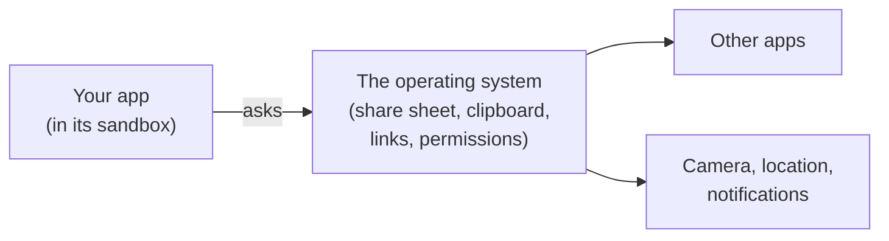
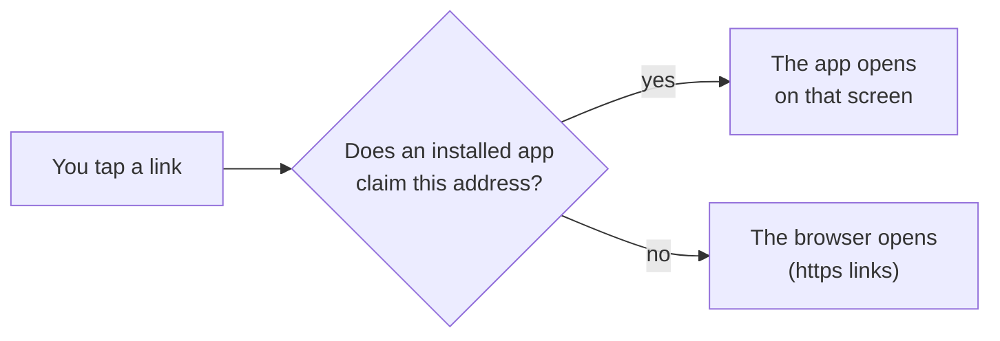
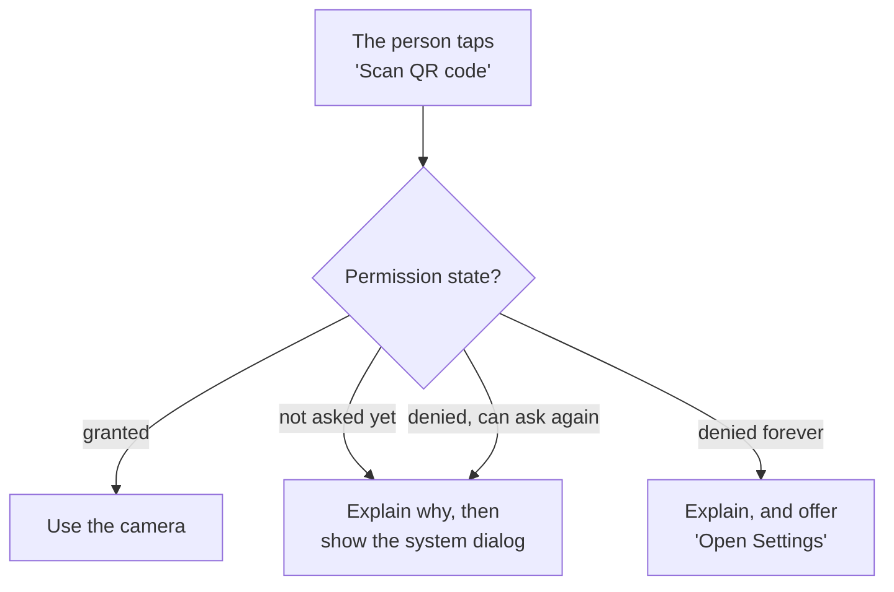
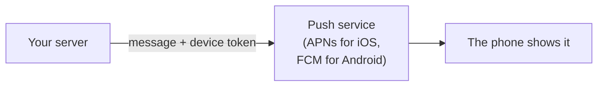

# 18.5 Device features: sharing, the clipboard, links and permissions

You tap **Share** in an app and a panel slides up with your messaging apps, your email and a dozen others. You tap a link in a message and, instead of a web page, an app opens on exactly the right screen. An app asks "Allow access to your camera?", and you wonder why it wants that. These are the moments an app stops being a website in a box and uses the phone itself. This chapter shows how each one works, which rules the phone enforces, and how to use them without making people suspicious of your app, using snip's app for what it really does and plain examples for what it doesn't.

## What you'll learn

- The **share sheet**: one call hands text or a link to any app on the phone, and your app never learns which.
- The **clipboard** is shared by every app, so phones now tell people when an app reads it: write freely, read only when asked.
- **Deep links** (`snip://new`) and **universal links** or **app links** (an `https://` address that opens your app), and how expo-router makes every screen linkable.
- The **permission** model in practice: ask at the moment of need, explain first, and handle "denied" and "denied forever", with a way to **Settings**.
- How **push notifications** travel: your server, Apple's or Google's push service, the phone; and why snip's app doesn't need any permission at all.

---

## The phone offers services, and your app asks for them

[Chapter 18.1](./how-mobile-apps-work.mdx) described the **sandbox**: each app lives in its own walled space. That raises a question: how does an app hand a link to a messaging app it can't see, or use a camera it doesn't own?

Think of a hotel guest. The guest can't walk into the kitchen or the laundry, but they can ask the front desk, and the desk does it, under the hotel's rules. The phone's operating system is the front desk. Your app asks; the system does the work and decides what your app gets to know.



The thing to notice: the arrow goes through the system every time. That's why the person, not your app, chooses who receives a shared link, and why a camera needs their yes.

---

## The share sheet hands your content to any app

When you call the system's **share sheet**, you give it some text or a URL. The system shows every app that can accept it (messages, email, chat apps, notes, "Copy"), the person picks one, and the system passes your content across. Your app never sees the list of apps, and never touches the other app.

React Native has it built in, as `Share`; there's nothing to install:

```tsx title="Sharing a link (illustration)"
import { Share } from 'react-native';

async function shareArticle() {
  const result = await Share.share({ message: 'Worth reading: https://go.dev/doc/' });
  if (result.action === Share.dismissedAction) console.log('closed without sharing');   // iOS only
}
```

The content takes three fields, and the platforms read them differently:

| Field | iOS | Android |
|---|---|---|
| `message` | shared | shared |
| `url` | shared, as a separate item | ignored |
| `title` | ignored | shown as the title of the share message |

So if you pass both `message` and `url` on iOS, many apps receive *both*, and the link can appear twice. Putting the link inside `message` and leaving `url` out gives the same result on both platforms. And note what you get back: on iOS, whether the person shared or closed the sheet; on Android, always "shared", because Android doesn't say.

---

## The clipboard is shared, so write freely and read rarely

The clipboard is one slot that every app on the phone can reach. Copy a link in one app; paste it in another. That's its purpose, and its risk: a password, a one-time code or a bank number you copied sits there for any app to read.

Phones now watch who reads it. Since iOS 16, an app that reads the clipboard in code (rather than through the person tapping **Paste**) triggers a system prompt asking whether to allow the paste. Since Android 12, the system shows a short message when an app reads the clipboard. Both exist because apps were caught reading it silently, and people noticed.

For writing and reading, Expo's library is `expo-clipboard`:

```bash
npx expo install expo-clipboard      # expo install picks the version that matches your SDK
```

```tsx title="Copying and reading (illustration)"
import * as Clipboard from 'expo-clipboard';

await Clipboard.setStringAsync('https://go.dev/doc/');     // copy: no prompt, no permission
const text = await Clipboard.getStringAsync();              // read: iOS asks the person first
```

The rule follows from the prompt: **write whenever the person asks you to copy; read only when they ask you to paste.** An app that reads the clipboard on launch, to "helpfully" fill a field, now shows a system prompt to everyone who opens it, which looks exactly like what it is. A `TextInput` already supports the system's Paste menu, which needs no prompt because the person chose to paste.

Two options are worth knowing for secrets you copy: `android: { isSensitive: true }` hides the content from Android 13's copy preview and keyboards' suggestions, and on iOS `ios: { localOnly: true }` keeps it off the person's other Apple devices.

---

## Links can open your app on the right screen

A web address opens a page. Phones also let an address open an *app*, on a particular screen. There are two kinds.

**Deep links** use the app's own **scheme**, the part before `://`: `snip://new`, `spotify://…`, `mailto:`. When an app is installed, it tells the system "addresses starting with `snip://` are mine". Tapping one opens the app with that address, and the app decides which screen to show. They take one line to set up and have one weakness: nothing stops another app from claiming the same scheme.

**Universal links** (iOS) and **app links** (Android) use an ordinary `https://` address, such as `https://snip.example/app/new`. The app claims a domain, and the domain confirms it: the website serves a small file (`/.well-known/apple-app-site-association` for Apple, `/.well-known/assetlinks.json` for Android) naming the app. The phone checks that file, so only the real owner of the domain can claim its links. If the app isn't installed, the same address opens the website, so the link is never broken.



With expo-router, every screen already has an address ([chapter 18.3](./navigation-and-screens.mdx): the file `app/new.tsx` is `/new`), so every screen is a deep link target as soon as the app has a scheme. You set the scheme in `app.json`:

```json title="app.json (excerpt)"
{ "expo": { "scheme": "snip" } }
```

In Expo Go, your app doesn't have its own scheme yet (Expo Go does), so links look different: `exp://192.168.1.20:8081/--/new` means "the app Metro is serving at that address, screen `/new`". `expo-linking`'s `Linking.createURL('/new')` builds the right form for wherever the app runs: `snip://new` in a build of your app, the `exp://` form in Expo Go. Universal links and app links need the domain files and a build with your app's identity, so they're set up with a development build, not in Expo Go.

Going the other way, an app opens other apps and websites with React Native's `Linking.openURL('https://go.dev/doc/')`, and the system picks the browser or the app that claims that address.

---

## Permissions: ask at the moment of need, and plan for no

The camera, the microphone, location, contacts, photos, notifications: each is behind a **permission**, and the person decides. The system shows its own dialog (you can't change its buttons), and records the answer.

Think of lending your car. A friend who asks "can I borrow your car?" the minute they walk in gets a suspicious no. A friend who says "my train is cancelled, can I borrow your car to get to the station?" usually gets a yes. Same request; the timing and the reason make the difference.

What actually happens, on both platforms:

- **Each permission has a state**: not asked yet (`undetermined`), `granted` or `denied`. Expo's permission functions return it, with a `canAskAgain` flag.
- **You can ask only so often.** On iOS, the system dialog appears **once**; after a "Don't Allow", asking again does nothing. On Android 11 and later, after the person denies a permission twice, the system stops showing the dialog. Either way, `canAskAgain` turns `false`: the answer is **denied forever**, unless the person changes it in Settings.
- **The reason is required.** On iOS, every permission needs a **usage description**, a sentence in the app's settings that the dialog shows ("snip uses the camera to scan a QR code"). Expo libraries take it as a config plugin option; without it, the app is rejected from the store or crashes when it asks.
- **Answers change.** A person can revoke a permission in Settings at any moment, choose "Allow Once" (iOS), or grant only approximate location. Check the state each time you need it, not once at install.

So the pattern has four branches:



Here is that pattern with `expo-camera`, as an illustration. **snip's app doesn't use the camera** and doesn't include `expo-camera`; it's here because a camera is the clearest example:

```tsx title="Asking for the camera at the moment of need (illustration, not in snip's app)"
import { Button, Linking, Text, View } from 'react-native';
import { CameraView, useCameraPermissions } from 'expo-camera';

export function ScanScreen() {
  const [permission, requestPermission] = useCameraPermissions();   // [state, ask]

  if (!permission) return null;                                      // still checking
  if (permission.granted) return <CameraView style={{ flex: 1 }} />;

  return (
    <View style={{ flex: 1, padding: 24, gap: 12, justifyContent: 'center' }}>
      <Text>To scan a QR code, this app needs the camera. Nothing is recorded or uploaded.</Text>
      {permission.canAskAgain ? (
        <Button title="Allow camera" onPress={requestPermission} />                    // the system dialog
      ) : (
        <Button title="Open Settings" onPress={() => Linking.openSettings()} />       // denied forever
      )}
    </View>
  );
}
```

Three things to notice. The dialog appears only after the person tapped something that clearly needs the camera, with a sentence of reason on screen first. The "denied forever" branch doesn't dead-end: `Linking.openSettings()` opens your app's page in the phone's Settings. And the rest of the app works without the camera.

**Location** follows the same pattern with `expo-location` (`requestForegroundPermissionsAsync`), plus two choices the person makes: **while using the app** or **always** (background location, which both stores scrutinise closely), and **precise** or **approximate**. Ask for the least you need: "while using" and approximate, unless the feature truly needs more.

### Notifications travel through Apple and Google

A **push notification** reaches a phone even when your app isn't running, so it can't come from your app. It comes from your server, through the platform's push service:



What actually happens:

1. The app asks for permission to show notifications (always on iOS; on Android 13 and later too).
2. If granted, the system gives the app a **device token**: an address for this app on this phone. The app sends it to your server, which stores it with the person's account.
3. To notify them, your server sends the message and the token to **APNs** (Apple Push Notification service) or **FCM** (Firebase Cloud Messaging, Google's), which delivers it.

The **Expo push service** sits in front of both: your server sends one kind of request to Expo with an Expo push token, and Expo forwards it to APNs or FCM. You still need your own Apple and Google credentials, and since Expo SDK 53, push notifications don't work in Expo Go on Android: you need a development build ([chapter 18.2](./react-native-with-expo.mdx)). **Local notifications**, scheduled by the app itself ("remind me in an hour"), need no server and do work in Expo Go.

:::warning[What can go wrong]
- **Asking for everything at launch.** A wall of permission dialogs before the person has seen the app gets "Don't Allow" on all of them, and on iOS that answer is final. Ask at the moment of need.
- **No plan for "denied forever".** The button that asks does nothing, because the system won't show the dialog again, and the person thinks the app is broken. Detect `canAskAgain === false` and offer Settings.
- **A missing usage description.** On iOS the app is rejected in review, or crashes the moment it asks. Set it in the library's config plugin options.
- **Reading the clipboard uninvited.** Every launch shows a system "Allow Paste" prompt on iPhones, and an "app pasted from your clipboard" notice on Android. Read only on a Paste action.
- **Passing both `message` and `url` to `Share.share`.** iPhone users' recipients get the link twice. Put the link in `message`.
- **Trusting a deep link.** A link can be crafted by anyone: `snip://links/../anything`, unexpected parameters, a screen the person shouldn't reach. Treat link parameters as untrusted input, and let your guards decide which screens exist (snip's do).
- **Testing push only in Expo Go.** On Android it doesn't work there since SDK 53; test notifications in a development build on a real device.
:::

---

## Judgment: which features earn their place

- **Use a feature when the person's goal needs it**, not because it's available. Every permission is a small cost in trust, and every feature is a review question at the store.
- **Prefer the feature that needs no permission.** The share sheet and clipboard writes need none, which is why they're the first tools for "get this link to someone". A contact picker needs contacts; the share sheet doesn't.
- **Deep links or universal links?** A custom scheme is enough for links between your own apps and for development. Anything people will send each other should be a universal link or app link: it can't be hijacked by another app, and it still works when the app isn't installed.
- **Should snip's short links open snip's app?** Probably not. A person tapping `https://snip.example/godoc` wants the destination page, not a link-management app; claiming the domain would send every click to the app first, which must then redirect, and would skip snip's redirect and click count unless the app reproduced them. If snip wanted app links, it would claim a separate path, such as `/app/…`, for screens of its own, and leave short links to the browser.
- **Notifications are a promise.** Ask for them when the person has asked to be told something ("notify me when this link gets 100 clicks"), never on first launch, and send only what they asked for. Apps that send marketing through a permission granted for alerts get it revoked.

---

## Apply it to snip

snip's app uses fewer device features than you might expect, on purpose, and **asks for no permission at all**. Here's what it does and doesn't use:

| Feature | In snip's app? | Where |
|---|---|---|
| Share sheet | Yes, React Native's `Share` | **Share** on each row, `app/links.tsx` |
| Clipboard | Writes only, with `expo-clipboard` | tapping a row copies the short link, `app/links.tsx` |
| Deep links | The scheme `snip`, and expo-router's routes | `app.json`; expo-router handles incoming links with `expo-linking` (the app never calls it directly) |
| Universal links / app links | No | it would need a domain, the `.well-known` files and its own build |
| Camera, location, contacts | No | nothing in the app needs them |
| Push notifications | No | snip has no notification sender, and the app no device token |

The two features it uses are four lines in `app/links.tsx`:

```tsx title="mobile/app/links.tsx (excerpt)"
  async function handleCopy(link: Link) {
    await Clipboard.setStringAsync(link.short_url);
    announce(`Copied ${link.short_url}`);
  }

  async function handleShare(link: Link) {
    // The system share sheet: Messages, Mail, WhatsApp, whatever this phone
    // has. On iOS, message and url would both be shared, so send only message.
    await Share.share({ message: link.short_url });
  }
```

Notice the comment in `handleShare`: it's the `message`-and-`url` rule from the share sheet section. And notice `announce`: after copying, the app says so, both on screen and to screen readers, because a copy is otherwise invisible ([chapter 18.6](./mobile-accessibility-and-performance.mdx) covers the second half). The app never *reads* the clipboard. The setup screen's key field takes a paste the ordinary way, through the system's Paste menu, which shows no prompt because the person chose it.

The deep links come almost free. `app.json` sets `"scheme": "snip"`, so a build of the app opens `snip://links` and `snip://new`. And because the screens sit behind protected routes ([chapter 18.3](./navigation-and-screens.mdx)), a link can't skip the setup: open `snip://new` with no key saved, and the guard sends you to **Connect to snip**. The "trusting a deep link" warning above is handled by the same rule that handles sign-out.

If snip ever needs the camera (scanning a QR code with its address and key, say, instead of typing them), it would add `expo-camera` with a usage description, ask on the scan screen only, and keep the typed fields for anyone who says no.

---

## Lab

On your laptop and your phone (or an emulator or simulator), free. Use the `hello` project from [chapter 18.2](./react-native-with-expo.mdx)'s lab and the `nav-demo` project from [chapter 18.3](./navigation-and-screens.mdx)'s; any blank Expo project works.

1. **Share and copy.** In `hello`, run `npx expo install expo-clipboard`, then add two buttons to `App.tsx`:
   ```tsx
   <Pressable onPress={() => Share.share({ message: 'Worth reading: https://go.dev/doc/' })}>   {/* the share sheet */}
     <Text>Share</Text>
   </Pressable>
   <Pressable onPress={() => Clipboard.setStringAsync('https://go.dev/doc/')}>                 {/* copy, silently */}
     <Text>Copy</Text>
   </Pressable>
   ```
   (Import `Share` from `react-native` and `* as Clipboard` from `expo-clipboard`.) Run it and tap **Share**: notice the apps listed are yours, and your app learns nothing about which you pick. Tap **Copy** and paste into a note in another app. Now add a third button that calls `Clipboard.getStringAsync()` and shows the result. On an iPhone, notice the system asks whether to allow the paste; on Android 12 or later, notice the short notice that the app read your clipboard.

2. **Ask for a permission, and refuse it.** In `hello`, run `npx expo install expo-camera` and replace `App.tsx` with the `ScanScreen` example above (export it as the default `App`). On Android, if you scanned the QR code inside Expo Go, Expo Go already has the camera, and the preview appears at once: turn the camera off for Expo Go in **Settings → Apps → Expo Go → Permissions** first. Tap **Allow camera** and choose **Don't Allow**. On iOS, notice the button changes to **Open Settings** at once: one refusal is final. On Android, tap **Allow camera** and deny again: after the second refusal, the same switch happens. Tap **Open Settings** and notice it opens Expo Go's page in Settings (in Expo Go, the permission belongs to Expo Go; in your own build it would be your app's page). Turn the camera on there, return, and notice the preview appears.

3. **Open a screen from a link.** In `nav-demo`, start Metro and note the address it prints, such as `exp://192.168.1.20:8081`. With the app open on an emulator or simulator, run:
   ```bash
   npx uri-scheme open "exp://192.168.1.20:8081/--/details" --android   # or --ios on a Mac with the simulator
   ```
   Notice the app jumps to the Details screen: `/--/details` is the route `app/details.tsx`. No code in your app mentions links; expo-router made the screen addressable.

4. **Do the same to snip.** Run snip's app (`cd mobile && npx expo start`, connected to snip as in [chapter 18.4](./a-mobile-client-for-snip.mdx)'s lab). Tap a row and notice "Copied …" at the top; tap **Share** and send the link to yourself. Then open `exp://<Metro's address>/--/new` with `uri-scheme` as in step 3: the create form slides up. Tap **Forget key**, open the same link again, and notice you land on **Connect to snip** instead: the guard decides, not the link. Finally, check the phone's Settings page for Expo Go, and notice that nothing in snip's app asked for a permission.

## Self-check

<Quiz id="mobile-device-features" questions={[
  {q: 'Your app calls Share.share({ message: text, url: link }) where text already contains the link. iPhone users say the recipient gets the link twice. Why?', options: ['A bug in the share sheet', 'On iOS, message and url are shared as separate items, so many apps receive both', 'Android sends url twice', 'The link is too long'], answer: 1, explain: 'iOS shares url as an extra item next to message; Android ignores url. Put the link inside message and leave url out, and both platforms behave the same. That is exactly what snip\'s handleShare does.'},
  {q: 'You want to pre-fill the API key field from the clipboard when the setup screen opens. What is the problem?', options: ['Clipboard reads need the camera permission', 'Reading the clipboard without the person choosing Paste makes iOS show an Allow Paste prompt and Android show a notice, on every launch, and it may read something private', 'expo-clipboard cannot read text', 'Nothing; it is a common pattern'], answer: 1, explain: 'Phones now announce clipboard reads because apps abused them. Reading on launch looks like snooping and may grab a password the person copied for something else. Let the person paste through the system menu, which shows no prompt. It used to be common, which is why the platforms added the warnings.'},
  {q: 'A person denied the camera on iOS. Later they tap "Scan" again and your app calls requestPermission. What happens?', options: ['The system dialog appears again', 'Nothing visible: iOS shows the dialog only once, so canAskAgain is false and the app should offer Linking.openSettings()', 'The app crashes', 'The camera opens anyway'], answer: 1, explain: 'iOS asks once; after a refusal, only Settings can change it. Android stops asking after two refusals on Android 11 and later. Check canAskAgain and, when it is false, explain and offer an Open Settings button instead of a button that silently does nothing.'},
  {q: 'Why is a universal link (https://snip.example/app/new) safer than a custom-scheme deep link (snip://new) for links people send each other?', options: ['HTTPS links are faster', 'The domain must publish a file naming the app, so no other app can claim it, and it opens the website when the app is not installed', 'Custom schemes do not work on Android', 'Universal links skip permissions'], answer: 1, explain: 'Any app can register the scheme snip://, and a link with that scheme goes nowhere useful when the app is missing. A universal or app link is verified through a file on the domain, which only its owner can publish, and falls back to the web. Custom schemes work on both platforms; they are weaker for links that leave your control.'},
]} />

<details>
<summary>Users report that your app's "Scan QR code" button "does nothing" for some of them, while it works for you. What would you check first?</summary>

Check **the permission state on their devices**, especially `canAskAgain`. The classic cause: they denied the camera once (on iOS) or twice (on Android 11+), so `requestPermission()` returns at once without showing any dialog, and the code only handles "granted". To them, the button does nothing. You never see it because you allowed the camera on your first try.

The fix is the four-branch pattern: granted, not asked, denied but askable, denied forever. For the last one, show a sentence explaining why the camera is needed and an **Open Settings** button (`Linking.openSettings()`). Also check whether they chose "Allow Once" or later revoked it in Settings, which is why the state is checked each time. The rule: **"no" and "never again" are normal answers; design a screen for each.**

</details>

<details>
<summary>A product manager asks for snip's app to request notifications, contacts and location on first launch, "so the features are ready when we build them". How would you respond?</summary>

Asking now costs more than it gains. With no feature on screen to explain the request, many people refuse, and on iOS a refusal is final: the dialog can't be shown again when the feature actually ships, so the feature launches already broken for them. Each permission also needs a usage description that matches a real feature, or store review rejects the app, and an app that asks for contacts and location to shorten links looks like it's collecting data.

Propose the opposite: no permissions until a feature needs one, and then ask at the moment of use with a reason ("Notify me when this link gets 100 clicks" asks for notifications when the person taps it). snip's app today asks for nothing, because sharing and copying need no permission. The rule: **a permission is asked for a feature the person is using right now, never in advance.**

</details>
