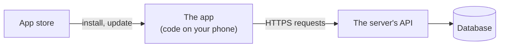
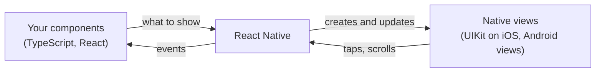
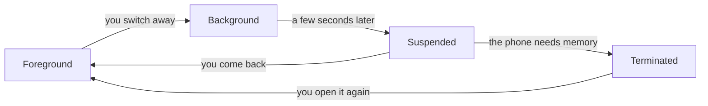

# 18.1 How mobile apps work: native, cross-platform and the web

You use apps on your phone every day: a bank, a map, a chat. Most of them show you data that lives on a server somewhere, exactly like a website does. So why do companies build an app *and* a website, why does an app need an update from a store while a website changes the moment you reload it, and why do some apps still work in a tunnel with no signal? This chapter answers those questions, so that when you build an app in the next chapters you know what kind of thing you're building and which rules the phone plays by.

## What you'll learn

- What an **app** is: a package of code installed on your phone, which talks to a server through the same kind of **API** (application programming interface: the requests a server accepts) a website uses.
- The three ways to build one: **native** (one app per platform), **cross-platform** (one codebase, two apps) and **web** (a website that behaves like an app), and when each fits.
- How **React Native** works: your JavaScript describes the screen, and the phone draws it with its own real buttons and lists.
- The **app lifecycle** and the **sandbox**: the phone can pause or end your app at any moment, and every app lives in its own walled-off space.
- Why **old versions never go away**, and what that means for the API on the server.

---

## An app is code you take home; a website is a shop you visit

Think of a restaurant. A **website** is the restaurant itself: you walk in, and whatever the kitchen cooks today is what you get. Change the menu and every guest sees the new one at their next visit. A **phone app** is a meal kit delivered to your home: the recipe and most of the ingredients now live in *your* kitchen. You can cook it with the shop closed. But when the shop changes the recipe, your kit doesn't change until a new one arrives, and some people keep the old kit in the cupboard for years.

What actually happens: an app is a **package**, one file holding the program's code, its images and a description of what it needs. On an iPhone that file is an **IPA** (iOS App Store package); on Android it's an **APK** (Android package), which Google Play builds for each device from the **AAB** (Android App Bundle) a developer uploads. You install it from a **store** (Apple's App Store or Google Play), and from then on the code runs *on your phone*, not on a server.

Four boxes, the whole idea:



Two things matter in it. The app gets its *code* from the store, but its *data* from the server, over the same HTTPS requests a website sends ([chapter 1.5](../foundations/http-from-zero.mdx)): an app is another **client** of the API. And between the store and the server there is nobody who can change the code on your phone today: a fix reaches you only when you install the next version.

:::note[Everyday anchor]
A website is the restaurant; an app is the meal kit in your cupboard. The kit works without a trip out and can use everything in your kitchen (your camera, your contacts, your location), but it only changes when a new kit arrives.
:::

### Why build an app at all?

If a website can show the same data, an app has to earn its place. It does when it needs one of these:

- **The device.** The camera, Bluetooth, the fingerprint sensor, the contact list, the share menu, background location. Websites can reach some of these, apps can reach all of them.
- **Being there when you're not looking.** **Push notifications** (messages the phone shows even when the app is closed), widgets on the home screen, work that continues in the background.
- **Working offline.** The code is already on the phone, so an app can open instantly and show what it saved last time, even with no signal.
- **Feeling native.** Scrolling, gestures and buttons that behave exactly like every other app on that phone.

If none of these matter, a good mobile website (responsive, [chapter 16.2](../frontend/css-from-zero.mdx)) is often the better choice: one codebase, no store, and every visitor always runs the newest version.

---

## Three ways to build one

Apple's iPhone and Google's Android are two different **platforms**: different operating systems, different languages, different stores. That gives three ways to build an app.

| Approach | You write | You ship | Good at | The cost |
|---|---|---|---|---|
| **Native** | Swift (SwiftUI) for iOS *and* Kotlin (Jetpack Compose) for Android | Two apps from two codebases | Everything the platform can do, on day one; the smoothest feel | Two teams, two codebases, every feature built twice |
| **Cross-platform** | One codebase: **React Native** (JavaScript/TypeScript) or **Flutter** (Dart) | Two apps from one codebase | Most apps: forms, lists, media, maps, a shared team | A layer between you and the platform; brand-new platform features may need a little native code |
| **Web app** | A website (HTML, CSS, JavaScript), installable as a **PWA** (progressive web app) | One website | Reach: no store, no install, always the newest version | Limited device access, and iPhones restrict what web apps can do in the background |

**Native** means using each platform's own language and tools, the way Apple and Google build their own apps. **Cross-platform** means one codebase that produces a real app for each platform. A **PWA** is a website with a small manifest file that lets you "install" it to the home screen; since 2023 iPhones can even show its notifications, but it still can't do everything an installed app can.

### How React Native draws a real screen

This part of the handbook uses **React Native**, because it builds on what the Frontend part taught: JavaScript, TypeScript and React components ([chapter 16.5](../frontend/react.mdx)). If you've written React for the web, you already know most of it.

What actually happens when a React Native app runs:

1. Your JavaScript runs on the phone, in a JavaScript engine shipped inside the app (**Hermes**, built by Meta for React Native).
2. Your components describe the screen, exactly as in React: "a list, and in each row a title and a button".
3. React Native turns that description into the platform's **own native views**: a real iOS list on an iPhone, a real Android list on Android. It is not a web page in disguise.



The thing to notice is the direction of each arrow: your code never draws pixels. It says *what* should be on screen, React Native keeps the native views in step, and taps come back to your code as events. That's why a React Native button looks and behaves like every other button on that phone.

:::info[If you've written code]
Flutter takes the other road: it doesn't use the platform's views at all, it draws every pixel itself with its own rendering engine, like a game. That gives the same look on every phone and full control, at the price of not getting the platform's own controls for free. React Native's "New Architecture" (the default since React Native 0.76, in 2024) lets JavaScript call native code directly instead of sending messages across a bridge, which removed most of the old performance complaints.
:::

---

## The phone is in charge: lifecycle and sandbox

On your laptop, a program runs until you quit it. A phone works differently, because its battery and memory are small and the person in front of it switches apps every few seconds.

### Your app can be paused or ended at any moment

The operating system moves every app through a **lifecycle**:

- **Foreground (active):** on screen, receiving taps.
- **Background:** you switched away. The app gets a few seconds to save its work, then usually stops running.
- **Suspended:** still in memory, frozen. Switching back is instant.
- **Terminated:** the system needed the memory and ended the app, *without asking it*. The next launch starts from scratch.



The arrow to notice is the one from Suspended to Terminated: nobody tells your app it's happening. So an app must save anything the person typed as they go, not "when they quit", because there may be no moment of quitting. React Native tells your code about the first transitions through its `AppState` API (`active`, `background`), which is where an app saves a draft or pauses a video.

### Every app lives in its own sandbox

Each app gets its own **sandbox**: a private folder for its files and data that no other app can read, and no access to the camera, microphone, location, contacts or photos until the person grants a **permission** in a system dialog. A permission can be refused, or taken back later in Settings, and the app must keep working (with less) when it is.

The sandbox is also why secrets need care. Each platform has a locked box for small secrets: the **Keychain** on iOS and the **Keystore** on Android, encrypted with keys held by the phone's security hardware. A password or API key belongs there, not in an ordinary file. [Chapter 18.4](./a-mobile-client-for-snip.mdx) stores snip's API key that way.

---

## Old versions never go away

This is the rule that surprises web developers most. When you deploy a website, every visitor gets the new version at their next page load. When you release an app:

1. You upload a new build, and the store **reviews** it. Apple reviews every update by hand and with automated checks; Google mostly automatically. It usually takes hours to a day or two, and sometimes a rejection sends you back to step 1.
2. Phones download the update when they get round to it. Many update automatically overnight; some people turn automatic updates off; some phones are too old for the new version at all.
3. So at any moment, **several versions of your app are in use at once**, some of them years old, and you can't force any of them to update.

The consequence lands on the server. Every version of the app that is still installed is a client of your API, and it will keep sending the requests it was built to send. The web-UI habit of changing the API and the UI in the same deploy doesn't work any more:

- **Never remove or rename a field that an old version sends or reads.** Add new optional fields instead ([chapter 5.5](../apis/api-contracts.mdx) on compatible changes).
- **Ship the server first, the app second.** The server must understand the new request before any app sends it, and must keep understanding the old one.
- **Plan for an emergency exit.** Most serious apps ask the server at startup "is my version still supported?", so a version with a dangerous bug can be told to update before it does damage.

:::warning[What can go wrong]
- **A fix that can't be deployed.** A bug in the app's code stays on people's phones until a fixed version passes review and gets installed. Server-side checks (validation, limits, permissions) are the safety net you *can* change in minutes, so never rely on the app alone to enforce a rule.
- **An API change that breaks old versions.** Rename a field and every phone still running the old version breaks at once, while the new version looks fine in your tests. Test the server against the requests old versions send.
- **Treating the app as trusted.** The app runs on someone else's device. Anyone can unpack the package, read the code, and send your API any request they like with `curl`. A secret compiled into the app is not a secret.
- **Assuming the app stays open.** Data typed into a form and saved only "on exit" is lost the first time the phone ends the app to free memory.
:::

### Judgment: which way to build

- **A product whose value is on the server** (most business apps: banking, shopping, booking, a URL shortener) is a good fit for **cross-platform**: one team, one codebase, two real apps. React Native and Flutter both serve apps used by millions of people.
- **An app that lives on the hardware** (a camera app, a game engine, audio production, deep platform integration like watches and widgets everywhere) often goes **native**, or cross-platform with more native modules than usual.
- **Content people read once** (a news article, a menu, an event page) usually needs no app at all: a fast mobile **website**, maybe a PWA, reaches everyone without a store.
- Many companies mix them: a website for reach, an app for the people who come back every day.

---

## Apply it to snip

snip, the link shortener this handbook builds, already has two clients: `curl` and the web UI from [chapter 16.6](../frontend/a-ui-for-snip.mdx). This part adds a third: an app in `mobile/`, built with React Native and **Expo** (a toolkit that handles the native build setup for you, [chapter 18.2](./react-native-with-expo.mdx)), that lists, creates, shares and deletes your short links.

Everything in this chapter shows up in it:

- It's **another client of the same API**: the same `GET /api/links`, `POST /api/links` and `DELETE /api/links/{slug}` requests the web UI sends, with the same `Authorization: Bearer` API key.
- It keeps that key in the **Keychain or Keystore**, not in a plain file ([chapter 18.4](./a-mobile-client-for-snip.mdx)).
- It has to cope with being paused and ended, and with no signal at all.

And the "old versions" rule applies to snip's API right now. snip refuses a request body with a field it doesn't know (Go's `DisallowUnknownFields()` in `createLink`, `snip/internal/httpapi/server.go`), answering `400 invalid_json`. That's a good habit for catching typos. But it means a newer app that sends a new field, say a link's expiry date, would fail against a server that hasn't learned that field yet. So any new field must reach the server before any app sends it, which is the "server first" rule in practice. You'll see it fail in the lab.

---

## Lab

On your laptop, free: Docker and a clone of this handbook's repository. The first step uses your own phone.

1. **Look at an app the way the phone does.** On your phone, open **Settings** and find any app you use (iPhone: **Settings → Apps** then the app; Android: **Settings → Apps** then the app). Find its **version number**, how much **storage** it uses (the app itself versus its data), and which **permissions** it has. Turn one permission off, open the app and use the feature that needs it. Notice how the app behaves: does it ask again, explain, or break? That's the sandbox and the permission model from this chapter.

2. **Be the app: talk to snip's API with curl.** Start snip and make an API key:
   ```bash
   cd snip
   docker compose up -d --build --wait                    # snip, its database, its cache and more
   docker compose exec api snip keys create me --operator you   # prints snip_…
   KEY=snip_...                                          # paste the key it printed
   curl -s -X POST localhost:8080/api/links -H "Authorization: Bearer $KEY" \
     -d '{"url":"https://go.dev/doc/","slug":"godoc"}'  # create a link
   curl -s localhost:8080/api/links -H "Authorization: Bearer $KEY"   # the list an app's screen would show
   ```
   Notice the second answer: a JSON object with a `links` list, each with `slug`, `url`, `clicks` and `short_url`. That JSON is everything the app's main screen will display in [chapter 18.4](./a-mobile-client-for-snip.mdx). The app is a client like `curl`, with nicer buttons.

3. **Play a newer app talking to an older server.** Send a field the server doesn't know:
   ```bash
   curl -s -X POST localhost:8080/api/links -H "Authorization: Bearer $KEY" \
     -d '{"url":"https://go.dev/","expires_in_days":7}'   # a field from a "future" app version
   ```
   snip answers `{"error":{"code":"invalid_json",…}}`. Imagine a new app version that sends `expires_in_days` reaching people's phones before the server learned the field: every create would fail for them. That's why the server ships first. When you're done, run `docker compose down -v` to stop everything and delete its data.

## Self-check

<Quiz id="mobile-how-mobile-apps-work" questions={[
  {q: 'A bug in your app shows the wrong price. You fix it the same afternoon. When do all your users have the fix?', options: ['Immediately, like a website', 'When they next open the app, because it downloads the new code', 'Only after the store approves the new version and each phone installs it; some never will', 'After the server is redeployed'], answer: 2, explain: 'An app\'s code lives on the phone. A fix must pass store review and then be installed, and some people update late or never. That\'s why rules that matter (prices, permissions, limits) belong on the server, which you can change in minutes. (Some apps can push small JavaScript updates without a new store version, but only within strict store rules; the last chapter of this part covers them.)'},
  {q: 'How does a React Native app draw a list on an iPhone?', options: ['It shows a web page inside the app', 'Your components describe the list, and React Native creates a real native iOS list', 'It draws every pixel itself, like a game', 'The server sends the finished screen as an image'], answer: 1, explain: 'React Native turns your components into the platform\'s own views. Drawing every pixel itself is how Flutter works; a web page inside an app is a WebView, which some hybrid apps use.'},
  {q: 'Your app saves what the person typed when they press "Quit". Some users lose their work. What\'s the most likely cause?', options: ['The server rejected the data', 'The phone ended the app to free memory while it was in the background, and there was no "quit" moment', 'The person turned off permissions', 'The keyboard deleted it'], answer: 1, explain: 'A suspended app can be terminated without warning. Save as the person types, or when the app moves to the background (React Native\'s AppState reports "background"), never only on an explicit quit.'},
  {q: 'You want to rename the API field "url" to "target". Which plan keeps every installed app working?', options: ['Rename it on the server and release the app on the same day', 'Release the app first, then the server', 'Have the server accept and return both names, release the app using "target", and remove "url" only when no supported version uses it', 'Rename it and force everyone to update'], answer: 2, explain: 'Old versions keep sending "url" for years. Accept both, move clients over, measure who still sends the old field, and remove it only when it\'s unused. You can\'t force an update unless you built a version check in advance, and even then it\'s a last resort.'},
]} />

<details>
<summary>A teammate wants to put the company's admin API key inside the app so it can call an internal endpoint. Why is that a bad idea, and what should happen instead?</summary>

The app runs on devices you don't control. Anyone can download the package, unpack it and read every string in it, or watch the app's network traffic. A key compiled into the app is therefore public, and an admin key would give anyone admin access.

Instead, each *user* gets their own credential (a login, or in snip's case a personal API key they paste in), stored in the Keychain or Keystore on their phone, and the server decides what that user may do. Anything only the company may do stays on the server, behind its own checks. The rule to keep: **the app is a client like any other, and the server must never trust it more than it trusts `curl`.**

</details>

<details>
<summary>Your product is a recipe site. People find recipes through search and read them once. Your manager asks for an app. What would you ask, and what might you recommend?</summary>

Ask what the app would do that the website can't: offline access to saved recipes, a shopping list, a cooking timer, notifications. If the answer is "show the same recipes", most visitors arrive from search, read one page and leave, and they won't install an app for that. A fast, responsive website (perhaps installable as a PWA) reaches them with no store and no install.

An app earns its cost for the people who come back every week: saved recipes offline, a shopping list that works in the shop with no signal, a timer that alerts them. A common answer is both: the website for reach, a cross-platform app for the regulars. The rule: **build an app for what a phone does better, not because competitors have one.**

</details>
