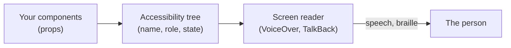
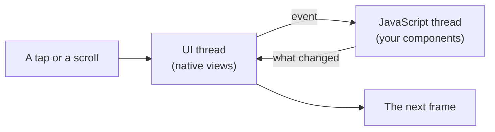

# 18.6 Accessibility and performance on a phone

Hand your phone to someone who can't see the screen and they can still read their messages, book a taxi and pay a bill. Their phone talks: it reads out whatever their finger touches, and a double-tap presses it. Hand a cheap two-year-old Android phone to anyone and they can still scroll a list of a thousand items, if the app was built for it. Both of those depend on choices you make in your code, and both fail silently: the app looks fine on your new phone, held by you. This chapter shows you how to use your app the way those people do, what React Native needs from you to make it work, and how to measure the difference instead of guessing.

## What you'll learn

- How a **screen reader** (VoiceOver on iOS, TalkBack on Android) turns your screen into a list of elements that people walk through by swiping, and press by double-tapping.
- The props that give each element its **role**, **label**, **hint** and **state**, and why a button inside another button can never be reached.
- How to tell a screen reader user that something happened elsewhere on the screen: a **live region** or an **announcement**.
- Text that grows (**Dynamic Type**, font scaling), targets big enough for a thumb, contrast and **reduced motion**.
- Why an app stutters: the **JavaScript thread** and the **UI thread**, a budget of about **16 ms per frame**, and why `FlatList` beats a `ScrollView` for long lists.
- How to measure it with the **performance monitor** and **React Native DevTools**, on the phone that matters: a low-end Android.

---

## A screen reader turns the screen into a list you walk through

Imagine visiting a museum with a guide who describes one exhibit at a time. You don't see the room; you say "next" and the guide moves on and tells you what's there: "a painting, *Water Lilies*, by Monet". You say "go in" at a door and the guide takes you through. You never know where an exhibit hangs on the wall, only the order the guide visits them in, and anything the guide doesn't know about, you never meet.

That is how a **screen reader** works on a phone. It's built in: **VoiceOver** on iPhones and **TalkBack** on Android. When it's on, a single tap no longer presses anything. Instead:

- **Touching** an element (or **swiping right**) moves a focus box to it, and the phone *says* what it is: "Delete godoc, button".
- **Swiping left** goes back one element. The order is the reading order of the screen, top to bottom, left to right.
- **Double-tapping** anywhere presses the element that has the focus.

The phone doesn't read pixels. It reads a description of the screen called the **accessibility tree**: one entry per element, each with a name, a role (button, heading, text field) and a state (disabled, selected). React Native builds that tree from the props on your components, the same way a browser builds it from your HTML ([chapter 16.7](../frontend/accessibility.mdx) introduced it for the web: every control needs a **name** and a **role**).



The box in the middle is the one you control. If an element isn't in the tree, or is in it with no name, the screen reader can't describe it, and for that person it doesn't exist.

| | iPhone: VoiceOver | Android: TalkBack |
|---|---|---|
| Turn it on | **Settings → Accessibility → VoiceOver** | **Settings → Accessibility → TalkBack** |
| Next / previous element | Swipe right / left with one finger | Swipe right / left with one finger |
| Press the focused element | Double-tap | Double-tap |
| Scroll a list | Swipe up or down with **three** fingers | Swipe up or down with **two** fingers |
| A quick on/off switch | **Accessibility Shortcut** (Settings → Accessibility): triple-click the side button | **Accessibility shortcut** (in TalkBack's settings): hold both volume keys for a few seconds |

:::tip[Set up the shortcut before you turn it on]
With a screen reader on, your usual taps stop working, which is disorienting the first time. Set up the shortcut first so you can switch it off again in one move.
:::

### Four props describe each element

A plain `Text` already has a name: its words. A tappable thing you build yourself, a `Pressable` around an icon, has none until you give it one. Here is the smallest example, a heart icon that saves a recipe:

```tsx
import { Pressable, Text } from 'react-native';

export function SaveButton({ saved, onPress }: { saved: boolean; onPress: () => void }) {
  return (
    <Pressable
      onPress={onPress}
      accessibilityRole="button"                 // "button": it can be pressed
      accessibilityLabel="Save recipe"           // the name, instead of "heart"
      accessibilityHint="Adds it to your saved list" // what pressing it will do
      accessibilityState={{ selected: saved }}   // "selected" when it's saved
    >
      <Text>{saved ? '♥' : '♡'}</Text>
    </Pressable>
  );
}
```

VoiceOver says something like "Save recipe, button. Adds it to your saved list." Each prop answers one question:

- **`accessibilityRole`**: what is it? `button`, `link`, `header`, `image`, `switch`, `alert` and more. The role tells the person what they can do with it.
- **`accessibilityLabel`**: what is it called? Short, without the role ("Save recipe", not "Save recipe button": the reader adds "button" itself).
- **`accessibilityHint`**: what happens if I press it? Only when the label doesn't make it clear. Many people turn hints off, so never put essential information only there.
- **`accessibilityState`**: what state is it in? `disabled`, `selected`, `checked`, `busy`, `expanded`.

:::info[If you've written code]
React Native also accepts the web's names: `role`, `aria-label`, `aria-disabled`, `aria-live` and friends map to the same accessibility tree. Pick one style per codebase. snip's app uses the `accessibility…` props, which every React Native tutorial and older library uses.
:::

### A button inside a button can't be reached

On a web page you can, with some effort, nest a link inside a clickable card. On a phone, a touchable element is **one** element to the screen reader: the focus box lands on the whole thing, reads all the text inside it as one label, and a double-tap presses it. Anything tappable *inside* it is swallowed and can never get the focus. A sighted user can tap the small "Delete" in the corner of a row; a VoiceOver user, swiping, never meets it.

The fix is layout, not a prop: put the actions **beside** the big tappable area, not inside it. You'll see snip's app do exactly that below.

---

## Telling people what happened somewhere else

You press "Copy". A sighted person sees "Copied" appear at the top of the screen. A screen reader user's focus is still on the button they pressed, so unless the app says something, they hear nothing and don't know whether it worked. ([Chapter 16.7](../frontend/accessibility.mdx) met the same problem on the web, solved with `role="status"`.)

A phone gives you two tools:

- A **live region**: `accessibilityLiveRegion="polite"` (or `"assertive"`) on an element makes **Android** read its new content whenever it changes, without moving the focus. It is Android only; iOS ignores the prop.
- An **announcement**: `AccessibilityInfo.announceForAccessibility('Copied')` asks the screen reader to say a sentence right now. It works on both platforms.

And one marker: **`accessibilityRole="alert"`** tells the screen reader that a piece of text is an important message, and the reader includes "alert" when the person reaches it. On iOS the role on its own does *not* make VoiceOver speak the text the moment it appears: for that you still need an announcement.

Two honest caveats. Announcements interrupt, so use them for results the person asked for ("Copied", "Deleted", an error after they pressed Save), not for every change on the screen. And Android 16 (API level 36) **deprecated** the system call behind `announceForAccessibility`, warning that accessibility services may ignore it and recommending live regions, state descriptions and pane titles instead ([Android's `View` reference](https://developer.android.com/reference/android/view/View#announceForAccessibility(java.lang.CharSequence))). So on Android, a live region is the more future-proof choice, and pairing both covers both platforms today.

---

## Text that grows, targets a thumb can hit, colours that read

Not everyone who needs help uses a screen reader. Far more people use these:

- **Larger text.** iOS calls it **Dynamic Type** (Settings → Accessibility → Display & Text Size → Larger Text); Android calls it **Font size** (Settings → Display, or Accessibility). React Native's `Text` and `TextInput` follow it by default: every `fontSize` you write is multiplied by the person's setting. The prop that turns this off is `allowFontScaling={false}`. **Don't use it** to protect a layout: the person who set huge text needs it to read your app. If one label truly can't grow past a point (a tab bar), cap it with `maxFontSizeMultiplier={1.5}` instead of switching scaling off.
- **Layouts that grow with it.** Text at the largest size can be twice as tall or more. A row with a fixed `height: 48` clips it; a row with `minHeight: 48` grows. Let text wrap, and let rows and buttons size to their content.
- **Big enough targets.** Fingers are not mouse pointers. Apple's Human Interface Guidelines ask for touch targets of at least **44×44 points**; Android's Material guidelines ask for at least **48×48 dp** ([Android's accessibility guidance](https://developer.android.com/develop/ui/compose/accessibility/api-defaults)). Points and **dp** (density-independent pixels) are both units that stay the same physical size on every screen, which is what React Native's numbers mean too. An icon can be small if the pressable area around it is big; `hitSlop` extends the area without changing the look.
- **Contrast.** The web's numbers apply ([chapter 16.7](../frontend/accessibility.mdx)): 4.5:1 for body text, 3:1 for large text and for the edges of controls. Phones are used outdoors in sunlight, which makes low contrast worse.
- **Reduced motion.** Some people get dizzy or nauseous from sliding and zooming animations, and turn on **Reduce Motion** (iOS) or **Remove animations** (Android). `AccessibilityInfo.isReduceMotionEnabled()` tells your code, so a decorative animation can become a fade or nothing at all.

:::warning[What can go wrong]
- **An icon button with no label.** VoiceOver says "button" and nothing else, or reads the icon font's character name. Every `Pressable` that isn't plain text needs an `accessibilityLabel`.
- **Ten buttons called "Delete".** In a list, the label must say *which*: "Delete godoc". A sighted person sees the row; a screen reader user hears only the button.
- **Actions nested in a touchable row.** Unreachable by swiping, as above. Put them beside it.
- **`allowFontScaling={false}` to stop a layout breaking.** You've fixed the layout by hiding the text from the people who needed it bigger. Fix the layout.
- **Fixed heights.** Text at 200% clipped to half a line. Use `minHeight` and let rows grow.
- **Success shown, never said.** "Saved" appears in green; a VoiceOver user hears silence and presses Save again.
:::

---

## A phone draws a new frame every 16 milliseconds

Picture a flip book. Flip 60 pages a second and the drawing moves smoothly. If the artist is late with one page, the book shows the old page twice, and your eye sees a jerk. Late twice in a row and the motion visibly stutters.

A phone screen is the flip book. Most phones redraw **60 times a second**, which leaves about **16.7 milliseconds** to produce each frame ([React Native's performance guide](https://reactnative.dev/docs/performance)); many newer phones run at 90 or 120 Hz, which leaves 11 or 8 ms. A frame that isn't ready in time is a **dropped frame**, and enough of them make **jank**: the stutter you feel when a list catches as you scroll.

In a React Native app, two threads (two lines of work running at the same time) share that budget:

- The **JavaScript thread** runs your code: your components, your state updates, `fetch` callbacks, the work React does to decide what changed.
- The **UI thread** (also called the **main thread**) is the platform's own: it lays out and draws the native views, runs native animations, and receives touches.



The thing to notice: a native `ScrollView` scrolls on the UI thread, so it keeps moving even while JavaScript is busy. But anything that needs your code (a button responding, a new row appearing, a screen opening) waits for the JavaScript thread. A 200 ms loop in a press handler means 12 frames at 60 Hz where taps aren't answered. This is the same lesson as long tasks on the web's main thread ([chapter 16.8](../frontend/frontend-performance.mdx)), with a smaller, weaker processor.

### Long lists: FlatList draws only what's on screen

The commonest performance mistake in a React Native app is a long list built like this:

```tsx
// Every row is created, laid out and kept in memory, even the 990 you can't see.
<ScrollView>
  {items.map((item) => (
    <Row key={item.id} item={item} />
  ))}
</ScrollView>
```

A `ScrollView` renders *all* its children at once. With 20 rows nobody notices. With 1,000 the screen takes seconds to appear, memory climbs, and on a cheap phone the app may be ended by the operating system for using too much.

**`FlatList`** **virtualises** the list: it creates only the rows near the visible area, and as you scroll it creates rows coming into view and throws away those far out of it. By default it renders 10 rows first (`initialNumToRender`) and keeps about 21 screens' worth around the visible one (`windowSize`, counted in screen heights), so memory stays flat however long the list is.

```tsx
import { FlatList } from 'react-native';

<FlatList
  data={items}                              // the array, not a list of elements
  keyExtractor={(item) => item.id}          // a stable identity per row
  renderItem={({ item }) => <Row item={item} />} // called only for rows near the screen
/>
```

**`keyExtractor`** does what `key` does in a web list: it tells React which row is which, so when an item is deleted the others keep their state and nothing is rebuilt that didn't change. Use an id from the data, never the array index. For very large or very fast lists, Shopify's **FlashList** is a widely used replacement with the same shape of API that recycles row views instead of destroying them.

### The rest of the budget

- **Re-renders.** When a component's state changes, React re-runs it and its children. Typing in a search box that sits *above* a 1,000-row list re-renders the list on every keystroke unless the rows are memoised (`React.memo`) or the state lives lower down. The React Compiler, which Expo projects can turn on, adds much of that memoisation for you.
- **Images.** Decoding a 4000×3000 photo to show a 64×64 avatar costs memory and time. Ask the server for the size you'll display.
- **Startup time.** Before the first screen, the phone loads the app, starts the JavaScript engine and runs your bundle. **Hermes** (React Native's engine, [chapter 18.1](./how-mobile-apps-work.mdx)) helps by compiling your JavaScript to **bytecode** when the app is built, so the phone skips parsing it at launch. What's left is yours: import less at startup, and don't fetch five things before showing anything.
- **`console.log` in a release build.** Logging large objects in a loop slows the JavaScript thread; strip debug logging from release builds.

### Measure, on the right phone, in the right build

Three tools, from quickest to deepest:

- The **performance monitor**: open the developer menu (shake the phone, or press `m` in the terminal running `npx expo start`) and choose the performance monitor. It shows two live frame rates, **UI** and **JS**, plus memory. Scroll a list and watch which one drops.
- **React Native DevTools**: press `j` in that terminal. Its **Performance** panel (since React Native 0.83) records what JavaScript did over a few seconds, and the **React Profiler** shows which components rendered and how long each took.
- The platform tools for native work: Android Studio's profiler and Xcode's Instruments.

Two rules make the numbers mean something. **Development builds are much slower** than release builds (extra checks, no bytecode), so use dev builds to find *where* time goes and a release build to judge whether it's fast enough. And **test on a low-end Android phone.** Your users' median phone is slower than yours, often a lot slower; an app that is smooth on a new iPhone can drop half its frames on an inexpensive Android with a weaker processor and less memory. If your team has one test device, make it that one.

:::warning[What can go wrong]
- **A long list in a `ScrollView`.** Slow first render and rising memory. Use `FlatList` (or FlashList).
- **The array index as the key.** Delete row 3 and every row after it is rebuilt, and per-row state jumps to the wrong row.
- **Judging speed in development mode.** Everything looks slow and you optimise the wrong thing, or a release-only problem hides. Profile a release build before deciding.
- **Heavy work in a press handler.** Parsing a big response or sorting thousands of items on the JavaScript thread freezes every button. Move it off the press, page the data, or let the server do it.
- **Only testing on the developer's phone.** The flagship hides every problem the median phone has.
:::

### Judgment: what to fix first

- **Accessibility first, because it is binary.** A slow screen is annoying; a button with no label is a wall. Labels, roles, unreachable controls and font scaling are cheap to fix when you write the component and expensive to retrofit.
- **Performance where people feel it.** Profile the screens people use most (the list, the first screen after launch) on a low-end Android release build. Don't memoise everything by habit: it adds code and can hide bugs. Fix what the profiler shows.
- **Prefer the platform's own pieces.** Native buttons, native navigation transitions, native lists come with accessibility and smoothness that custom-drawn controls must earn. That was a reason to choose React Native over drawing everything yourself ([chapter 18.1](./how-mobile-apps-work.mdx)).

---

## Apply it to snip

snip, the link shortener this handbook builds, has a phone app in `mobile/` ([chapter 18.4](./a-mobile-client-for-snip.mdx) builds its client). Here is everything from this chapter in it.

**One button component gets the details right everywhere.** Every button in the app is this one (`mobile/src/components/Button.tsx`):

```tsx
// One button for the whole app, so every one of them gets the accessibility
// details right: a role, a label, a disabled state and a big enough target.
export function Button({ title, onPress, accessibilityLabel, variant = 'primary', disabled = false }: Props) {
  return (
    <Pressable
      accessibilityRole="button"
      accessibilityLabel={accessibilityLabel ?? title}
      accessibilityState={{ disabled }}
      disabled={disabled}
      onPress={onPress}
      style={({ pressed }) => [
        styles.base,
        styles[variant],
        (pressed || disabled) && styles.dim, // feedback that the press landed
      ]}
    >
      <Text style={[styles.text, textStyles[variant]]}>{title}</Text>
    </Pressable>
  );
}
```

The role, the label and the disabled state come for free to every caller, and a caller can pass a better label: in the list each Delete button is `` accessibilityLabel={`Delete ${link.slug}`} ``, so ten rows give ten different names. The size comes from `MIN_TOUCH` in `mobile/src/theme.ts`, used as `minHeight` and `minWidth`:

```ts
// Apple asks for touch targets of at least 44×44 points; Android's guideline
// is 48dp. 44 is the floor here, and nothing has a fixed height, so a row
// grows when someone turns their system font size up.
export const MIN_TOUCH = 44;
```

Notice the honest trade-off in that comment: 44 meets Apple's guideline and falls a little short of Android's 48. With padding and text, most buttons end up taller than the floor anyway, but it's a choice you could reasonably make the other way. The same file's colours each pass 4.5:1 against their background, and the app never sets `allowFontScaling`, so all its text follows the person's size setting.

**The row puts its actions beside the big button, not inside it** (`mobile/app/links.tsx`):

```tsx
function LinkRow({ link, onCopy, onShare, onDelete }: RowProps) {
  return (
    <View style={styles.row}>
      {/* The text is one big button that copies the short link. The Share and
          Delete buttons sit beside it, not inside it: a screen reader treats
          a touchable as one element, and would never reach buttons nested in it. */}
      <Pressable
        style={styles.rowText}
        accessibilityRole="button"
        accessibilityLabel={`${link.short_url}, ${link.clicks} ${link.clicks === 1 ? 'click' : 'clicks'}`}
        accessibilityHint="Copies the short link"
        onPress={onCopy}
      >
        {/* … the slug, the long URL and the click count as Text … */}
      </Pressable>
      <View style={styles.actions}>
        <Button title="Share" variant="secondary" accessibilityLabel={`Share ${link.slug}`} onPress={onShare} />
        <Button title="Delete" variant="danger" accessibilityLabel={`Delete ${link.slug}`} onPress={onDelete} />
      </View>
    </View>
  );
}
```

Swiping through one row gives three stops: the link (with its click count, and a hint saying what pressing does), "Share godoc", "Delete godoc".

**Results are both shown and said.** After a copy or a delete, the screen calls one function that does both:

```tsx
  // Tell everyone what happened: sighted users read the status line, and
  // screen readers say it out loud.
  function announce(message: string) {
    setStatus(message);
    AccessibilityInfo.announceForAccessibility(message);
  }
```

The status line it sets is a `Text` with `accessibilityLiveRegion="polite"`, so Android has a second route to hear it. The forms (`mobile/app/index.tsx` and `mobile/app/new.tsx`) mark their error messages with `accessibilityRole="alert"` and `accessibilityLiveRegion="polite"`, *and* announce them with `AccessibilityInfo.announceForAccessibility`. The announcement is there for iOS, where the role alone doesn't make VoiceOver speak; the first version of this app relied on the role alone, which would have left VoiceOver users not knowing their link was refused.

**The list is a `FlatList` keyed by slug.** From the same file:

```tsx
        // FlatList draws only the rows near the screen, not all 100: on a
        // phone, memory and frame time are the budget. keyExtractor gives
        // each row a stable identity (the slug), like key in web/'s list.
        <FlatList
          data={list.links}
          keyExtractor={(link) => link.slug}
          renderItem={({ item }) => (
            <LinkRow
              link={item}
              // … onCopy, onShare and onDelete call the screen's handlers …
            />
          )}
          // … pull to refresh, separators, and the empty-list message …
        />
```

A slug is unique per link, which makes it the right key: delete one link and React removes exactly that row.

---

## Lab

On your own phone and laptop, free. Steps 1 and 2 need only a phone; step 3 needs the Expo app you made in [chapter 18.2](./react-native-with-expo.mdx); step 4 runs snip's app.

1. **Use any app the way a blind person does.** Set up the shortcut from the table above, then turn on VoiceOver or TalkBack and open an app you use every day. Swipe right through a whole screen without looking, and try to do one task (send a message, find a setting). Notice which buttons have useful names and which say only "button" or "image", and how long a screen takes to walk through. Turn it off with the shortcut when you're done.

2. **Turn the text up all the way.** Set the largest text size (on iPhone, turn on **Larger Accessibility Sizes** under Larger Text for the biggest ones). Open three apps. Notice which ones grow, which ones clip text or overlap it, and which ones ignore the setting entirely. Set it back afterwards.

3. **Feel the difference a FlatList makes.** In your `hello` app from [chapter 18.2](./react-native-with-expo.mdx) (or a fresh one: `npx create-expo-app@latest hello --template blank-typescript`), put this on a screen of its own: in the blank template that's `App.tsx`, in an app using expo-router it's `app/index.tsx`.
   ```tsx
   import { useState } from 'react';
   import { Button, FlatList, ScrollView, Text, View } from 'react-native';

   const items = Array.from({ length: 1000 }, (_, i) => ({ id: String(i), title: `Row ${i}` }));

   function Row({ title }: { title: string }) {
     return <Text style={{ padding: 16, fontSize: 16 }}>{title}</Text>;
   }

   export default function App() {
     const [virtual, setVirtual] = useState(false);
     return (
       <View style={{ flex: 1, paddingTop: 60 }}>
         <Button title={virtual ? 'Showing FlatList' : 'Showing ScrollView'} onPress={() => setVirtual(!virtual)} />
         {virtual ? (
           <FlatList data={items} keyExtractor={(i) => i.id} renderItem={({ item }) => <Row title={item.title} />} />
         ) : (
           <ScrollView>{items.map((i) => <Row key={i.id} title={i.title} />)}</ScrollView>
         )}
       </View>
     );
   }
   ```
   Run it with `npx expo start`, open the developer menu and turn on the performance monitor. Toggle between the two and scroll fast. Notice how long the switch to the `ScrollView` takes (all 1,000 rows are built at once), what happens to memory, and which frame rate (UI or JS) moves. Then try a cheaper or older phone if you have one: the gap widens.

4. **Walk through snip's app with a screen reader.** Start snip and the app as in `mobile/README.md` (snip with `docker compose up -d --build --wait` in `snip/`, then `npm ci && npm start` in `mobile/`), connect, and create two links. Now turn on VoiceOver or TalkBack and:
   - swipe through one row and count the stops: the link, "Share …", "Delete …";
   - double-tap the link to copy it, and notice that you *hear* "Copied …" without moving;
   - open the create form, enter a slug that's taken (one of yours), double-tap Create, and notice the error is spoken without moving: that's the announcement. Then remove the `AccessibilityInfo.announceForAccessibility(message)` line from `app/new.tsx`, save, and try again: on Android the live region still makes TalkBack say it, but on iOS you now find the error only by swiping to it. Put the line back;
   - turn the text size to the largest and notice the rows growing instead of clipping.

   When you're done, run `docker compose down -v` in `snip/`.

## Self-check

<Quiz id="mobile-mobile-accessibility-and-performance" questions={[
  {q: 'Each row in a list is a Pressable that opens the item, with a small Delete button inside it. Sighted users can delete; VoiceOver users say they can\'t. Why?', options: ['VoiceOver doesn\'t support delete actions', 'A touchable is one element to the screen reader, so the Delete button nested inside it never gets the focus', 'The Delete button needs a hint', 'The row needs accessibilityRole="list"'], answer: 1, explain: 'The screen reader treats the whole row as one element: it reads all its text as one label and a double-tap presses the row. Anything tappable inside it can\'t be reached by swiping. Move Delete beside the row. A hint only describes an element the reader can already reach, so it wouldn\'t help.'},
  {q: 'A designer\'s layout breaks when people turn their font size up. Which fix is right?', options: ['Set allowFontScaling={false} on every Text', 'Replace fixed heights with minHeight, let text wrap, and cap one or two labels with maxFontSizeMultiplier if they truly must stay small', 'Use smaller fonts so they have room to grow', 'Show a message asking people to reset their font size'], answer: 1, explain: 'The people who set large text need it to read your app. Turning scaling off hides the text from exactly them. A layout that grows (minHeight, wrapping) fixes the real problem; maxFontSizeMultiplier is a narrow escape hatch for a label that can\'t grow, not a default.'},
  {q: 'A list of 2,000 items opens slowly and the app is sometimes ended on cheap Android phones. It is built with items.map inside a ScrollView. What is the most likely cause?', options: ['The server is slow', 'A ScrollView renders all 2,000 rows at once, costing time and memory; a FlatList renders only those near the screen', 'The JavaScript engine is out of date', 'The keys are strings instead of numbers'], answer: 1, explain: 'A ScrollView creates every child up front. FlatList virtualises: it renders about ten rows first and keeps only a window around the visible area, so memory stays flat. The type of the key doesn\'t matter as long as it\'s stable and unique.'},
  {q: 'You profile a screen in development mode and it drops frames everywhere. What should you conclude?', options: ['It will be as slow for users', 'Development builds are much slower; use the profile to see where time goes, and judge speed in a release build on a low-end phone', 'React Native is too slow for this screen', 'Turn off the performance monitor, which causes the slowness'], answer: 1, explain: 'Dev mode adds checks and skips the bytecode compilation release builds get, so absolute numbers mislead. Relative numbers (this component takes most of the time) are still useful. The verdict comes from a release build on the kind of phone your users have.'},
  {q: 'After "Copy", the app shows "Copied" at the top of the screen. A TalkBack user hears nothing. Which change fixes it?', options: ['Make the text bigger', 'Give the "Copied" text accessibilityLiveRegion="polite" (Android) and announce it with AccessibilityInfo.announceForAccessibility (both platforms)', 'Give the Copy button an accessibilityHint', 'Move the focus to the top of the screen'], answer: 1, explain: 'The person\'s focus stays on the button, so a change elsewhere is silent unless the app reports it. A live region makes Android read the new text; an announcement covers iOS. Moving the focus away would also be heard, but it throws the person out of the place they were working.'},
]} />

<details>
<summary>Users on older Android phones say the app "freezes for a second" after they tap Save, then works normally. On your phone it's instant. What would you check first, and how?</summary>

Reproduce it where it happens: a release build on a low-end Android phone (or the cheapest device in a device lab), not a development build on yours. Open the performance monitor and tap Save: if the **JS** frame rate drops to near zero while the UI rate stays up, your JavaScript is blocking the thread. Record the tap in React Native DevTools' Performance panel to see which function takes the time.

The usual suspects, in order: heavy work in the press handler (sorting, parsing a large response, building a big object), a state change that re-renders a large tree (a whole list re-rendering because the form's state lives above it), and synchronous storage or logging. Fix the one the profile shows, then measure again on the same phone. The rule: **performance problems live on the slowest device your users have, so that's where you measure.**

</details>

<details>
<summary>Your team wants to skip accessibility for the first release ("we'll add it later") and spend the time on animations. What would you argue?</summary>

Most accessibility work on a phone is cheap *while* you write a component and expensive afterwards: a label, a role and a big enough target are one line each in a shared `Button`, but retrofitting means finding every icon button, every nested touchable and every fixed height across the app, and redesigning rows whose actions were nested. Some of it changes layout, which means design work again.

There are also people for whom the app is unusable, not merely less pretty, without it: screen reader users, people with large text, people with tremors who need bigger targets. App stores and many countries' laws increasingly expect it. Animations, by contrast, can be added later without reworking anything, and need a reduced-motion path anyway. The rule: **build accessibility into the shared components from the first screen, and make "works with a screen reader and the largest text" part of done.**

</details>
