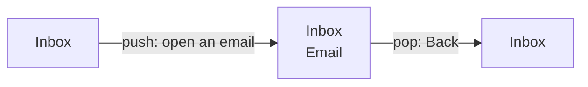

# 18.3 Navigation, screens and app state

You tap an email and it slides in from the right. You swipe from the left edge, or press Back, and you're in the inbox again, scrolled exactly where you left it. You tap "Compose" and a sheet slides up from the bottom instead. You do this hundreds of times a day without thinking, and an app that gets it wrong feels broken at once. This chapter shows how that motion is organised, how expo-router turns a folder of files into screens, where state lives when five screens need the same thing, and how an app decides, before you see anything, whether to show you a sign-in form or your data.

## What you'll learn

- The **stack**: screens pile up like cards, a new one on top (**push**), Back takes it off (**pop**). Plus **tabs** (several stacks side by side) and **modals** (a sheet over everything).
- **File-based routing** with **expo-router**: each file in `app/` is a screen with an address, and `_layout.tsx` decides how they're arranged.
- Why screens under the top card **stay mounted**, so `useEffect` runs once, and why **`useFocusEffect`** is the hook for "every time this screen comes into view".
- **App-wide state with React context**: one provider above every screen, so signing in on one screen is seen by all.
- **Protected routes**: screens that exist only while a condition holds, so the app follows sign-in and sign-out by itself; and holding the **splash screen** until you know which screens to show.

---

## Screens pile up like a stack of cards

Picture a stack of index cards on a desk. You start with one card: the inbox. Opening an email puts a new card on top; you see only the top card, but the inbox is still there, underneath, exactly as you left it. Going back takes the top card off. That's how almost every app moves between screens.

What actually happens: a **navigator** keeps an ordered list of screens. Showing a new screen **pushes** it onto the top of the list; Back **pops** the top one off and reveals the one beneath. The list is called the **stack**, and the screens in it, all of them, are alive in memory.



Two other shapes cover nearly every app you use:

| Shape | What you see | Everyday example | How Back behaves |
|---|---|---|---|
| **Stack** | One screen at a time; new ones slide in on top | Settings → Wi-Fi → a network | Removes the top screen |
| **Tabs** | A bar at the bottom; each tab keeps its own stack | Home, Search, Library in a music app | Works inside the current tab |
| **Modal** | A sheet that slides up over everything, for a self-contained task | Compose an email, a share menu | Dismisses the sheet (on iOS, swipe it down) |

A modal is a detour, not a destination. You open it to do one thing (write a message, create a link) and close it to return exactly where you were. That's why it slides up rather than in from the side: it signals "this sits on top of where you are", not "you've moved somewhere new".

:::note[Everyday anchor]
A stack is cards on a desk. Tabs are several desks side by side, each with its own pile, and you walk between them. A modal is a sticky note slapped on top of the current card: you deal with it, peel it off, and the card is still there.
:::

---

## In expo-router, the folder is the map

You could describe every screen and its address in code. **expo-router** takes a shortcut the web made popular: **file-based routing**. Every file in the `app/` folder is a screen, and its path in the folder is its address, its **route**. (Projects with a `src/` folder can use `src/app/` instead; expo-router looks in either.)

| File | Route | What it's for |
|---|---|---|
| `app/index.tsx` | `/` | The first screen |
| `app/details.tsx` | `/details` | A screen at `/details` |
| `app/links/[slug].tsx` | `/links/godoc`, `/links/docs`… | One file for many screens; `[slug]` is a parameter |
| `app/(tabs)/…` | (the folder name isn't in the address) | A **group**: files that share a layout, such as tabs |
| `app/_layout.tsx` | none | How the screens in this folder are arranged |

The last row is the one that isn't a screen. A **layout** wraps every screen in its folder and decides how they're shown: as a stack, as tabs, or as something else. Here's a complete app with three screens, one of them a modal:

```tsx title="app/_layout.tsx"
import { Stack } from 'expo-router';

export default function RootLayout() {
  return (
    <Stack>
      <Stack.Screen name="index" options={{ title: 'Home' }} />
      <Stack.Screen name="details" options={{ title: 'Details' }} />
      <Stack.Screen name="about" options={{ title: 'About', presentation: 'modal' }} />  {/* slides up */}
    </Stack>
  );
}
```

```tsx title="app/index.tsx"
import { Link, router } from 'expo-router';
import { Pressable, Text, View } from 'react-native';

export default function Home() {
  return (
    <View style={{ flex: 1, padding: 24, gap: 16 }}>
      <Link href="/details">Open details</Link>                  {/* like an <a>, for routes */}
      <Pressable onPress={() => router.push('/about')}>         {/* the same, from code */}
        <Text>About this app</Text>
      </Pressable>
    </View>
  );
}
```

```tsx title="app/details.tsx"
import { router } from 'expo-router';
import { Pressable, Text, View } from 'react-native';

export default function Details() {
  return (
    <View style={{ flex: 1, padding: 24 }}>
      <Pressable onPress={() => router.back()}>                 {/* pop this card off */}
        <Text>Back to home</Text>
      </Pressable>
    </View>
  );
}
```

Three things to notice:

- **`Link` and `router.push` both push a screen.** `Link` is for a tap on text; `router.push('/about')` is for code that decides to navigate (after a save, say). `router.back()` pops. `router.replace` swaps the top card instead of adding one, and `router.dismiss()` closes a modal.
- **`Stack.Screen` sets options per screen**: the title in the header, and `presentation: 'modal'`. A screen can also set its own options from inside itself by rendering `<Stack.Screen options={…} />`, which is how a screen adds buttons to its own header.
- **The header and the Back arrow come free.** The stack draws a native header on each platform, with a Back button whenever there's a card underneath.

:::info[If you've written code]
expo-router is built on **React Navigation**, the most used navigation library for React Native, and the routes double as **deep links**: every file has a URL, so `/details` can be opened from outside the app ([chapter 18.5](./device-features.mdx)). Next.js developers will recognise the file conventions: `[param]` for parameters, `(group)` folders, a layout per folder.
:::

---

## Screens under the stack stay mounted

On the web, leaving a page throws it away; coming back builds it again. In a stack, the screen underneath is still there, still mounted, its state intact. That's what makes Back instant and keeps your scroll position. It also changes when your code runs.

Here's the trap. A list screen loads its data in a `useEffect` with `[]` ([chapter 16.5](../frontend/react.mdx): an effect runs after the component appears, and `[]` means only the first time). You push a form on top, create a new item, and pop back. The list didn't unmount, so it didn't re-mount, so the effect didn't run again. The new item isn't there.

The fix is a hook that follows the screen's **focus**, whether it's the one in view, instead of its life in memory: **`useFocusEffect`**. It runs its function each time the screen comes into view, and runs the cleanup each time it goes out of view.

```tsx
import { useCallback } from 'react';
import { useFocusEffect } from 'expo-router';

useFocusEffect(
  useCallback(() => {
    console.log('in view: reload');           // runs on first show, and every time you come back
    return () => console.log('out of view');  // runs when another screen covers this one
  }, []),
);
```

The `useCallback` around it matters: `useFocusEffect` re-runs whenever the function you pass is a new one, and without `useCallback` it's a new one on every render.

| Hook | Runs when | Reach for it to |
|---|---|---|
| `useEffect(…, [])` | The screen mounts (once, while it stays in the stack) | Set up something for the screen's whole life |
| `useFocusEffect(useCallback(…))` | Every time the screen comes into view | Reload data, start and stop a timer or a camera |

---

## App-wide state lives above the navigator

Some state belongs to one screen: the text in a form. Some belongs to the whole app: who's signed in, the theme, the user's settings. If the setup screen saves an API key, the list screen must know at once, and so must the layout that decides which screens exist.

In React, state flows down through props ([chapter 16.5](../frontend/react.mdx) calls this lifting state up). Screens aren't rendered by you, though; the router renders them, so you can't hand them props. The answer is **React context**: a value placed *above* the navigator that any component below can read directly.

Think of a noticeboard in the hallway of an office. Nobody passes notes desk to desk; whoever needs to know looks at the board, and whoever changes it changes it for everyone.

```tsx title="A minimal context (illustration)"
import { createContext, useContext, useState, type ReactNode } from 'react';

const AuthContext = createContext<{ signedIn: boolean; setSignedIn(v: boolean): void } | null>(null);

export function AuthProvider({ children }: { children: ReactNode }) {
  const [signedIn, setSignedIn] = useState(false);
  return <AuthContext.Provider value={{ signedIn, setSignedIn }}>{children}</AuthContext.Provider>;
}

export function useAuth() {
  const value = useContext(AuthContext);
  if (!value) throw new Error('useAuth must be used inside <AuthProvider>');   // a clear error, not undefined
  return value;
}
```

Wrap the stack in `AuthProvider` in the root layout, and every screen can call `useAuth()`. When one screen calls `setSignedIn(true)`, every component that reads it re-renders with the new value.

---

## Protected routes: let a condition decide which screens exist

A signed-out person should see a sign-in screen; a signed-in one should see their data. The tempting way is to navigate: after a successful sign-in, call `router.replace('/home')`. It works on the happy path, and leaks everywhere else:

- **Back can return to the wrong side.** If the sign-in screen is still in the stack, Back after signing in shows it again; after signing out, Back can show the data screen.
- **Sign-out happens in more places than you think.** A "Sign out" button, yes. But also a server that rejects your key on any screen, at any moment. Each place must remember to navigate.
- **Links from outside skip your button.** A deep link can open a data screen directly, without passing your sign-in code.

The better way is declarative: say **which screens exist under which condition**, and let the router enforce it. In expo-router that's **`Stack.Protected`**:

```tsx title="app/_layout.tsx (with protected routes)"
<Stack>
  <Stack.Protected guard={!signedIn}>
    <Stack.Screen name="sign-in" />
  </Stack.Protected>
  <Stack.Protected guard={signedIn}>
    <Stack.Screen name="index" />
  </Stack.Protected>
</Stack>
```

While a `guard` is `false`, the screens inside it are out of the stack: you can't push them, Back can't reach them, and a link to them goes elsewhere. When the guard flips while you're on one of them, the router moves you to the `redirectTo` route you gave, or by default to the navigator's anchor route (usually `index`). Sign-in code no longer navigates at all: it changes state, and the layout follows.

### Hold the splash screen until you know where to go

There's one moment the guard can't answer: the first. When the app starts, it has to read storage to know whether someone is signed in, which takes a few milliseconds to a second. Show nothing and the person sees a blank flash; show the sign-in screen and a signed-in person sees it blink past.

Every app has a **splash screen**: the image the operating system shows while the app starts. expo-router normally hides it as soon as the first layout appears. You can keep it up longer, until you know which screens to show:

```tsx
import { SplashScreen } from 'expo-router';

SplashScreen.preventAutoHideAsync();   // at the top of the file: keep it up after the first render

// later, inside the layout, once storage has answered:
SplashScreen.hideAsync();
```

### Back means different things on each platform

Android has a system **Back** action: a button or a swipe from either screen edge. It pops the stack, closes a modal, and on the first screen it leaves the app. iOS has no system Back: the header's Back button and a **swipe from the left edge** pop a screen, and a modal is **swiped down** to dismiss it. A native stack gives you all of these without code, which is a big reason to use one.

There's one case where you want to interrupt Back: a form with unsaved changes. expo-router exports `usePreventRemove` (from React Navigation) to ask "Discard your changes?" before the screen goes, however the person tried to leave.

:::warning[What can go wrong]
- **Stale data after Back.** A list loads in `useEffect` and never reloads when you return to it, because it never unmounted. Use `useFocusEffect` for anything that should refresh on return.
- **Navigating after sign-in or sign-out.** A `router.replace` in the sign-in handler leaves a sign-in screen reachable by Back, and every sign-out path (including a server's `401`) must remember to navigate. Guards make it one rule in one place.
- **A context used outside its provider.** `useContext` returns the default (often `null`) and the app fails far from the cause. A hook that throws a clear error (as `useAuth` does above) points at the real mistake.
- **A context that changes on every render.** If the provider builds a new `value` object each render, every reader re-renders each time, and an effect that depends on it can loop. Memoise the value with `useMemo` and the functions in it with `useCallback`.
- **A blank flash or a blinking sign-in screen at launch.** The splash was hidden before the app knew who was signed in.
- **Modals that act like destinations.** A modal with its own deep stack of screens inside confuses Back on both platforms. Keep modals to one task.
:::

---

## Judgment: which shape, and where state lives

- **Stack first.** Most small apps are one stack with a modal or two. Add **tabs** when there are three to five equally important places the person switches between all day; don't use tabs for a sequence of steps.
- **expo-router or React Navigation directly?** expo-router gives you deep links for every screen, typed routes and less wiring, and is the default in Expo's templates. Using React Navigation directly gives you full control and suits apps that predate file-based routing. Both use the same native stack underneath.
- **Context for small, slow-changing, app-wide state**: the session, the theme, the locale. For data fetched from a server (lists, details, caching, refetching), teams often add a library such as TanStack Query; for large client-side state, Zustand or Redux. Context isn't wrong for those, but every change re-renders every reader, which gets expensive as the app grows.
- **Guards over navigation, always**, for anything that decides whether a screen should exist (signed in, onboarding finished, a feature turned on).

---

## Apply it to snip

snip's app, in `mobile/`, has three screens and the exact shape this chapter described: a stack, one modal, and two groups of screens guarded by "is a key saved?".

```text
app/_layout.tsx   the stack, the guards and the splash screen
app/index.tsx     "/"       setup: snip's address and your API key (only without a key)
app/links.tsx     "/links"  your links                              (only with a key)
app/new.tsx       "/new"    the create form, as a modal             (only with a key)
```

Here is the whole root layout:

```tsx title="mobile/app/_layout.tsx (comments trimmed)"
import { useEffect } from 'react';
import { SplashScreen, Stack } from 'expo-router';
import { SessionProvider, useSession } from '../src/session';

SplashScreen.preventAutoHideAsync();

export default function RootLayout() {
  return (
    <SessionProvider>
      <RootStack />
    </SessionProvider>
  );
}

function RootStack() {
  const { loading, session } = useSession();

  useEffect(() => {
    if (!loading) SplashScreen.hideAsync();
  }, [loading]);

  if (loading) return null;

  return (
    <Stack>
      <Stack.Protected guard={!session} redirectTo="/links">
        <Stack.Screen name="index" options={{ title: 'Connect to snip' }} />
      </Stack.Protected>
      <Stack.Protected guard={!!session} redirectTo="/">
        <Stack.Screen name="links" options={{ title: 'Your links' }} />
        {/* A modal: it slides up over the list and is dismissed, not navigated back from. */}
        <Stack.Screen name="new" options={{ title: 'Shorten a link', presentation: 'modal' }} />
      </Stack.Protected>
    </Stack>
  );
}
```

Every idea is here. `SessionProvider` (the context) sits above the stack, so the layout itself can read it. The splash screen stays up while `loading` is true, the moment Secure Store takes to say whether a key is saved, and `return null` is safe because the splash covers it. Then the two guards: with no session, only `index` exists; with one, only `links` and `new`.

The context is `src/session.tsx`. It holds three things and two actions:

```tsx title="mobile/src/session.tsx (excerpt)"
interface SessionContextValue {
  loading: boolean; // true until Secure Store has answered, once, at startup
  session: Session | null;
  notice: string | null; // why we are asking for a key again, if we are
  signIn(session: Session): Promise<void>;
  signOut(notice?: string): Promise<void>;
}

// …

  const signIn = useCallback(async (next: Session) => {
    await saveSession(next);
    setNotice(null);
    setSession(next);
  }, []);

  const signOut = useCallback(async (why?: string) => {
    await forgetKey();
    setNotice(why ?? null);
    setSession(null);
  }, []);

  const value = useMemo(
    () => ({ loading, session, notice, signIn, signOut }),
    [loading, session, notice, signIn, signOut],
  );
```

Notice `useCallback` and `useMemo`: the value only changes when one of its parts does, which is the "context that changes on every render" trap avoided. And notice that neither `signIn` nor `signOut` navigates. Here is what happens when you save a key:

<StepThrough
  title="Saving a key on the setup screen"
  nodes={[
    {id: "setup", label: "Setup screen", sub: "app/index.tsx"},
    {id: "session", label: "Session", sub: "context"},
    {id: "store", label: "Secure Store", sub: "on the phone"},
    {id: "layout", label: "Layout", sub: "the guards"},
  ]}
  steps={[
    {title: "Tap Save", text: "You type snip's address and your key and tap Save and continue. The setup screen calls `signIn` from the session context. It does not navigate anywhere.", from: "setup", to: "session"},
    {title: "Store the key", text: "`signIn` writes the address and the key to Secure Store, the phone's vault for secrets, and waits until both are saved.", from: "session", to: "store"},
    {title: "Change the state", text: "Only after the write succeeds does `signIn` set the session. Every component reading the context re-renders with the new value, the layout included.", active: ["session"]},
    {title: "The guards flip", text: "In the layout, `!session` is now false and `!!session` is true. The setup screen's group closes; the links group opens.", from: "session", to: "layout"},
    {title: "The router redirects", text: "You are on a screen whose guard is now false, so the router sends you to its `redirectTo`, `/links`. The setup screen is gone from the stack, so Back can't return to it.", active: ["layout"]},
  ]}
/>

Signing out runs the same steps in the other direction, from anywhere. The links screen calls `signOut` when snip answers `401` (the key was revoked); the create form does the same; the **Forget key** button does too. None of them knows where the setup screen is. That's what [chapter 18.4](./a-mobile-client-for-snip.mdx) relies on when a key is revoked while the app is open.

Two more pieces from this chapter live in the screens. The list reloads with `useFocusEffect`, so a link created in the modal shows up when the modal closes:

```tsx title="mobile/app/links.tsx (excerpt)"
  // useFocusEffect is useEffect for screens: it runs when this screen comes
  // into view, including when the create form's modal closes over it, so a
  // new link shows up without any extra wiring. The cleanup cancels the
  // request if the screen goes out of view first.
  useFocusEffect(
    useCallback(() => {
      const controller = new AbortController();
      void load(controller.signal);
      return () => controller.abort();
    }, [load]),
  );
```

And the list screen adds its own header buttons with `Stack.Screen`, the **New** button pushing the modal with `router.push('/new')`, while the form closes itself with `router.back()` after a successful create:

```tsx title="mobile/app/new.tsx (excerpt)"
      await client.createLink(url.trim(), slug.trim() || undefined);
      router.back(); // close the modal; the list reloads when it comes back into view
```

---

## Lab

On your laptop and your phone (or an emulator or simulator), free. Same setup as [chapter 18.2](./react-native-with-expo.mdx): Node.js 22+, Expo Go.

1. **Make a project with expo-router, and empty it.**
   ```bash
   npx create-expo-app@latest nav-demo      # the default template: expo-router, already set up
   cd nav-demo
   npm run reset-project                    # answer n: it deletes the demo and leaves a blank src/app/
   ```
   Open `src/app/`: there's an `_layout.tsx` returning `<Stack />` and an `index.tsx`. Notice there's no list of routes anywhere; the files are the list.

2. **Push, pop and slide up.** Replace `src/app/_layout.tsx` and `src/app/index.tsx` with the versions in "In expo-router, the folder is the map", and create `src/app/details.tsx` from the same section and `src/app/about.tsx` (any screen with a `Text`). Run `npx expo start` and open it in Expo Go. Tap **Open details**: it slides in from the side, with a Back arrow in the header. Go back with the arrow, then with Android's Back or an iPhone's swipe from the left edge. Tap **About**: on iOS it slides up as a sheet you can swipe down; on Android, which has no sheet style for this, it opens like a normal screen. Notice that Home never lost anything you'd done on it.

3. **See the difference between mount and focus.** Add to `Home`:
   ```tsx
   useEffect(() => { console.log('mounted'); }, []);                           // once
   useFocusEffect(useCallback(() => { console.log('focused'); }, []));         // every time it's in view
   ```
   (Import `useEffect` and `useCallback` from `react`, `useFocusEffect` from `expo-router`.) Open Details and come back three times. Notice the terminal: `mounted` appeared only when the app started, while `focused` appears again every time you return. That's why snip's list reloads with `useFocusEffect`.

4. **Watch snip's guards.** Run snip's app (`cd mobile && npm ci && npx expo start`, as in [chapter 18.2](./react-native-with-expo.mdx)'s lab). snip doesn't need to be running. Type any address and any key, such as `snip_test`, and tap **Save and continue**. Notice three things: you land on **Your links** with no Back arrow (the setup screen left the stack); the list shows an error, because the app saved the key without checking it and there's no snip to ask; and on Android, Back now leaves the app instead of returning to setup. Tap **Forget key**: you're on setup again. Now save the key again, close the app completely and reopen it: the splash screen, then straight to **Your links**. The key was remembered, and you never saw the setup screen blink past.

## Self-check

<Quiz id="mobile-navigation-and-screens" questions={[
  {q: 'A list screen loads its items in useEffect with an empty dependency array. You push a form, create an item and go back. The new item is missing. Why?', options: ['The form did not save the item', 'The list stayed mounted underneath the form, so its effect did not run again', 'useEffect only runs on Android', 'Back always restores an old copy of the screen from storage'], answer: 1, explain: 'In a stack, covered screens stay mounted, which is what keeps their scroll and state. An effect with [] runs once per mount, and there was no new mount. useFocusEffect runs each time the screen comes into view. Nothing is restored from storage: the screen never went away.'},
  {q: 'Which file creates the screen at the address /links/godoc?', options: ['app/links/godoc.tsx only', 'app/links/[slug].tsx, with slug set to godoc', 'app/_layout.tsx', 'app/(links)/index.tsx'], answer: 1, explain: 'Square brackets make a parameter: one file serves every slug. A file named godoc.tsx would also work, but only for that one slug. A folder in parentheses is a group and is left out of the address; _layout.tsx arranges screens and is never a screen itself.'},
  {q: 'Why is a protected route better than calling router.replace after a successful sign-in?', options: ['It is faster', 'Which screens exist follows the state, so every way of signing in or out, including a server rejecting the key on any screen, ends on the right screen and Back cannot reach the other side', 'router.replace does not work in Expo Go', 'It encrypts the screens'], answer: 1, explain: 'Navigating works for the one path you wrote it for. A guard is a single rule: while signed out, the data screens do not exist, so no button, deep link or Back gesture can reach them, and a sign-out from anywhere sends you to the right place without that code knowing where it is.'},
  {q: 'Your app reads a saved session at startup. Users see the sign-in screen flash for a moment before their data appears. What fixes it?', options: ['Read the session faster', 'Keep the splash screen up until the session has loaded, and render nothing until then', 'Show a spinner on the sign-in screen', 'Move the session to the server'], answer: 1, explain: 'The first render happens before storage answers, so any screen you show is a guess. SplashScreen.preventAutoHideAsync keeps the launch image up; hide it when loading finishes. A spinner on the sign-in screen still shows the wrong screen, only more politely.'},
]} />

<details>
<summary>A tester reports: "On Android, I signed out, pressed Back, and saw my links again for a second before the app crashed." What would you look for first?</summary>

Look at **how sign-out works**. If the sign-out handler navigates (`router.push('/')` or `router.replace('/')`) instead of changing the state that decides which screens exist, the links screen can stay in the stack underneath the setup screen. Back pops to it; it renders without a session, its API client is missing, and something throws.

Check that the links screen is inside a guarded group whose condition is the session itself (`Stack.Protected guard={!!session}`), and that sign-out only clears the session. Then the screen *can't* be in the stack when signed out, whatever the person presses. The rule: **don't move the user to the right screen; remove the wrong screens.**

</details>

<details>
<summary>snip's app keeps the session in React context. A colleague suggests a global state library instead, "because everyone uses one". When would you agree?</summary>

The session is small (an address and a key), changes rarely (sign in, sign out), and is read by a handful of components. Context does that with no dependency, and memoising the value keeps re-renders rare. Adding a library would add code to learn and update without solving a problem the app has.

You'd agree when the state grows in size or change rate: many screens reading and writing many pieces, frequent updates where re-rendering every reader shows up as lag, or server data that needs caching and refetching, where a data-fetching library such as TanStack Query earns its place. The rule: **reach for a state library when context's cost (every reader re-renders) is measurably hurting, not before.**

</details>
