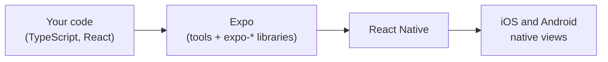
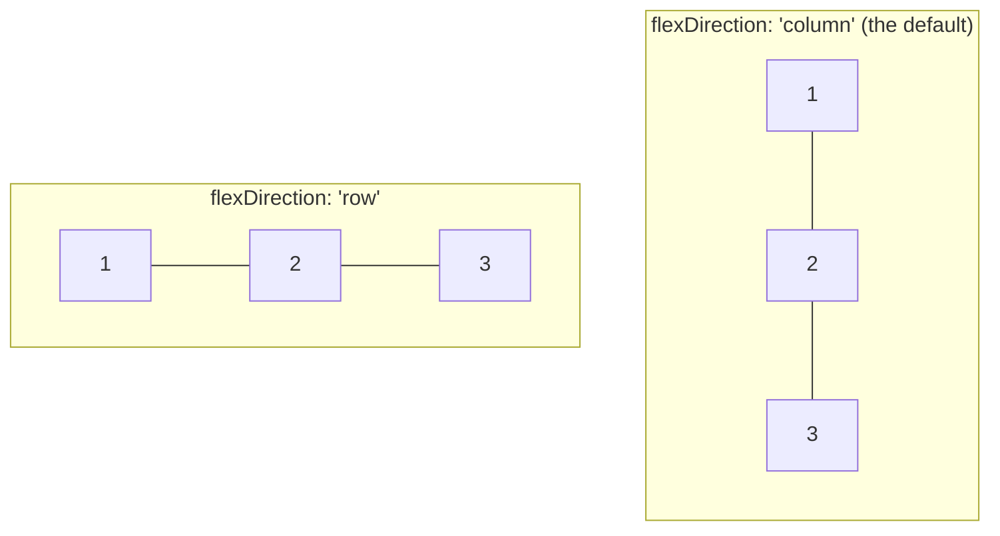
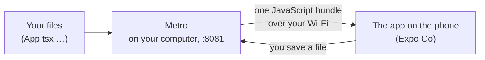

# 18.2 React Native with Expo: your first screen

You've used apps for years, and maybe you've built a web page with React. But the gap between "I have an idea for a screen" and "it's running on my phone" looks huge from the outside: Xcode, Android Studio, signing, two operating systems. This chapter closes that gap in about ten minutes. You'll create an app with one command, open it on your own phone by scanning a QR code, change a line and watch the phone update before you can look up. Along the way you'll learn what is different from the web: no HTML, no CSS files, no cascade, and a layout system that starts sideways from what you expect.

## What you'll learn

- What **Expo** is: the tools, libraries and optional cloud services around React Native, so you write TypeScript and never touch Xcode or Android Studio until you choose to.
- The **core components** that replace HTML elements: `View` instead of `div`, `Text` instead of `p`, `Pressable` instead of `button`, and the rule that every piece of text lives inside a `Text`.
- How **styling** works: JavaScript objects, flexbox for every layout (in a column by default), no cascade, and numbers in **density-independent pixels** instead of `px`.
- What **Metro** and **Fast Refresh** do: bundle your code, send it to the phone, and swap in each change while the app keeps its state.
- Three places to run an app: **Expo Go** on your own phone, an **Android emulator**, the **iOS simulator**, and when you outgrow Expo Go.

---

## Expo is the workshop around React Native

[Chapter 18.1](./how-mobile-apps-work.mdx) explained **React Native**: your JavaScript describes the screen, and the phone draws it with its own native views. React Native on its own is an engine. To get from an engine to a car you drive every day, you need a body, a dashboard, a garage and a mechanic.

**Expo** is that workshop. It's an open-source toolkit, made by a company of the same name, in three layers:

1. **Tools**: a command-line program (`npx expo …`) that starts your project, serves your code to a phone, and generates the native iOS and Android projects for you when you need them.
2. **Libraries**: dozens of `expo-*` packages for the phone's features (the clipboard, secure storage, the camera, notifications), each working the same on iOS and Android.
3. **Cloud services** (optional): **EAS** (Expo Application Services) builds your app on Expo's servers and submits it to the stores. There's a free tier, and you never need it to learn. [Chapter 18.8](./shipping-mobile-apps.mdx) covers it.

The alternative is **"bare" React Native**: you start from React Native's own template and own the native `ios/` and `android/` folders yourself, opening Xcode or Android Studio for every native change. That's still a real choice for teams with native developers. But React Native's own documentation now recommends starting with a framework, and names Expo; most new apps do.



The thing to notice: Expo sits *beside* React Native, not instead of it. Every Expo app is a React Native app, and anything you learn about React Native components applies.

### Your first app is two small files

Create one. You need Node.js 22 or newer ([chapter 16.4](../frontend/typescript-and-tooling.mdx) covers `npx` and `package.json`):

```bash
npx create-expo-app@latest hello --template blank-typescript   # a new project in ./hello
cd hello
```

The template gives you a handful of files. Two of them matter:

```text
hello/
├── index.ts        the entry point: registers your App with React Native
├── App.tsx         your first (and only) screen
├── app.json        the app's name, icon and settings, read by Expo's tools
├── package.json    expo ~58.0, react-native 0.88.1, react 19.3.0, typescript ~6.0
└── assets/         icons and the splash image
```

`index.ts` is three real lines:

```ts title="hello/index.ts (from the template, comments trimmed)"
import { registerRootComponent } from 'expo';

import App from './App';

registerRootComponent(App);
```

`registerRootComponent` tells React Native "this component is the whole app". And `App.tsx` is the screen:

```tsx title="hello/App.tsx (from the template)"
import { StatusBar } from 'expo-status-bar';
import { StyleSheet, Text, View } from 'react-native';

export default function App() {
  return (
    <View style={styles.container}>
      <Text>Open up App.tsx to start working on your app!</Text>
      <StatusBar style="auto" />
    </View>
  );
}

const styles = StyleSheet.create({
  container: {
    flex: 1,
    backgroundColor: '#fff',
    alignItems: 'center',
    justifyContent: 'center',
  },
});
```

If you've read [chapter 16.5](../frontend/react.mdx), this is a React component: a function that returns what the screen should show. What's new is every word inside the `return`, which the next two sections explain. (`StatusBar` sets the colour of the clock and battery icons at the top of the phone; `"auto"` picks dark or light to match.)

---

## Core components replace HTML elements

On the web, you build pages from HTML elements and the browser draws them. A phone has no browser in a React Native app, and no HTML. Instead, React Native gives you a small set of **core components**, each of which becomes a real native view on each platform.

| React Native | Closest web element | Becomes on iOS / Android | Notes |
|---|---|---|---|
| `View` | `div` | `UIView` / `android.view.View` | A box: layout, background, border. Shows no text itself. |
| `Text` | `p`, `span` | `UILabel`-like / `TextView` | The **only** place text can appear. |
| `Image` | `img` | `UIImageView` / `ImageView` | A picture from your files or a URL; a URL image needs a width and height. |
| `TextInput` | `input` | `UITextField` / `EditText` | Calls `onChangeText` with the new text, not an event object. |
| `Pressable` | `button` | a touchable view | Anything that reacts to a tap: `onPress`, plus a `pressed` state for feedback. |
| `ScrollView` | a `div` with `overflow: scroll` | `UIScrollView` / `ScrollView` | Nothing scrolls unless it's inside one. |

Two rules surprise every web developer:

- **Text must be inside `Text`.** Write `<View>Hello</View>` and the app stops with the error *Text strings must be rendered within a `<Text>` component*. A `View` is a box; only a `Text` can draw letters.
- **Nothing scrolls by default.** A web page scrolls when it's too long. A phone screen doesn't: content that doesn't fit is cut off until you wrap it in a `ScrollView` (or, for long lists, a `FlatList`, which [chapter 18.6](./mobile-accessibility-and-performance.mdx) explains).

Here is a small screen using four of them: a name field and a button that counts presses.

```tsx title="App.tsx (a small screen to try)"
import { useState } from 'react';
import { Pressable, StyleSheet, Text, TextInput, View } from 'react-native';

export default function App() {
  const [name, setName] = useState('');
  const [count, setCount] = useState(0);

  return (
    <View style={styles.container}>
      <TextInput
        style={styles.input}
        value={name}
        onChangeText={setName}            // gets the new text, not an event
        placeholder="Your name"
      />
      <Pressable
        style={({ pressed }) => [styles.button, pressed && styles.pressed]}   // dim while held down
        onPress={() => setCount((c) => c + 1)}
      >
        <Text style={styles.buttonText}>Say hello</Text>
      </Pressable>
      <Text>{count === 0 ? 'Nobody greeted yet.' : `Hello ${name || 'you'}, ${count} times.`}</Text>
    </View>
  );
}

const styles = StyleSheet.create({
  container: { flex: 1, padding: 24, paddingTop: 80, gap: 12 },
  input: { borderWidth: 1, borderColor: '#888', borderRadius: 6, padding: 10, fontSize: 16 },
  button: { backgroundColor: '#c2410c', padding: 12, borderRadius: 6, alignItems: 'center' },
  pressed: { opacity: 0.6 },
  buttonText: { color: '#fff', fontSize: 16, fontWeight: '600' },
});
```

State, props and events work exactly as in React for the web: `useState` holds the count, and pressing the button sets a new one. The component names change; the way of thinking doesn't.

:::note[Everyday anchor]
HTML elements are a generic set of building blocks the browser knows. Core components are the same idea with a different supplier: you still say "a box, some text, a button", and each phone builds it from its own parts.
:::

---

## Styles are JavaScript objects, and flexbox does every layout

On the web, CSS lives in its own files, rules **cascade** (a colour set on `body` flows down to every paragraph), and you choose between several layout systems. React Native keeps the vocabulary of CSS and drops most of the rest.

What actually happens:

- **A style is a JavaScript object** passed to a component's `style` prop. Property names are camelCase (`backgroundColor`, not `background-color`), and values are numbers or strings: `{ padding: 12, color: '#fff' }`. `StyleSheet.create` groups them and checks them in development.
- **There is no cascade.** A style applies to the component it's given to, and only that one. The single exception: a `Text` nested inside another `Text` inherits its font and colour. Setting `color` on a `View` changes nothing.
- **Every `View` is a flexbox container.** There's no `display: block` or `float`. And the default direction is a **column**, top to bottom, where the web's default is a row. So `justifyContent` positions children *vertically* and `alignItems` *horizontally*, until you set `flexDirection: 'row'`.
- **Numbers have no unit, and they aren't screen pixels.** `padding: 12` means 12 **density-independent pixels** (Android calls them **dp**; iOS calls them **points**): a unit that looks about the same physical size on every phone, whether its screen packs two or three real pixels into each one.



The template's `container` style now reads clearly: `flex: 1` makes the box fill the screen, and in a column, `justifyContent: 'center'` centres the text vertically while `alignItems: 'center'` centres it horizontally.

Sometimes a platform needs something different. `Platform.OS` tells your code where it's running (`'ios'` or `'android'`), so a style or a behaviour can depend on it:

```tsx
import { Platform } from 'react-native';

const topPadding = Platform.OS === 'ios' ? 60 : 24;   // iOS draws the status bar over your content
```

:::info[If you've written code]
`style` also accepts an array (`[styles.button, pressed && styles.pressed]`), merged left to right, with `false` and `null` ignored. That's how you combine a base style with a conditional one, the job `className` strings do on the web. Libraries such as NativeWind bring Tailwind-style class names to React Native, if your team prefers them; they compile to the same style objects underneath.
:::

---

## Metro bundles your code, and Fast Refresh swaps it in

Your app's code is dozens of TypeScript files plus everything in `node_modules`. A phone can't read TypeScript and doesn't have your files. Something has to turn them into one JavaScript file and deliver it. On the web, that's Vite's job ([chapter 16.4](../frontend/typescript-and-tooling.mdx)). In React Native, it's **Metro**, React Native's own **bundler**.

Start it:

```bash
npx expo start      # starts Metro on port 8081 and prints a QR code
```

What actually happens, in four boxes:



1. Metro reads `index.ts`, follows every `import`, converts TypeScript and JSX to plain JavaScript, and serves the result as one **bundle** over HTTP on port `8081`.
2. The phone downloads that bundle and runs it.
3. When you save a file, Metro rebuilds only what changed and pushes it to the phone.
4. **Fast Refresh** swaps the new code into the running app *without restarting it*: a component you edited re-renders with its state kept. Type a name in the field, change the button's colour in the code, save, and the name is still there.

Fast Refresh keeps state only when it safely can. Edit a file that exports only components, and those components update in place. Edit a file with other exports (a helper, a constant), and Fast Refresh re-runs it and every file that imports it, which can reset state there; if the file is used outside React components altogether, it falls back to a full reload. Press `r` in the terminal for a full reload whenever you want one.

When your code throws, the app shows a red **error screen** with the message and the file and line, and Metro prints the same in your terminal. Fix the file, save, and the screen goes away by itself.

---

## Three places to run it

Your code needs a phone, or something pretending to be one. You have three choices, and the first is free on any computer.

### Expo Go on your own phone

**Expo Go** is an app from the App Store and Google Play that already contains React Native and Expo's libraries. It can't do anything on its own: it downloads *your* JavaScript bundle from Metro and runs it.

1. Install Expo Go on your phone.
2. Put the phone on **the same Wi-Fi** as your computer.
3. Scan the QR code `npx expo start` printed: with the Camera app on an iPhone, or from inside Expo Go on Android.

The QR code holds an address such as `exp://192.168.1.20:8081`: your computer's address on the Wi-Fi and Metro's port. The phone connects to it over your network. On iPhone, Expo Go asks once for permission to find devices on your local network; it needs a yes.

### An Android emulator, on any computer

An **emulator** is a whole Android phone running as a program on your computer. Install **Android Studio** (free, on macOS, Windows and Linux), create a virtual device in its Device Manager, start it, and press `a` in the terminal where `npx expo start` is running. Expo installs Expo Go on the emulator and opens your app.

### The iOS simulator, on a Mac only

Apple's **simulator** comes with **Xcode**, which only runs on macOS. With Xcode installed, press `i` in the Metro terminal. There's no way to run the iOS simulator on Windows or Linux; there, use a real iPhone with Expo Go.

### When you outgrow Expo Go: development builds

Expo Go contains a fixed set of native code: React Native plus the `expo-*` libraries. Any library that brings native code of its own (a payment SDK, a map from a vendor Expo doesn't include, your own native module), and some features that need your app's own identity (push notifications, deep links with your own scheme), won't work in it. Then you make a **development build**: your own app, with exactly your native code, plus the same developer tools as Expo Go. You build it once (on your machine or with EAS), install it, and keep using Metro and Fast Refresh as before. [Chapter 18.8](./shipping-mobile-apps.mdx) covers builds.

:::warning[What can go wrong]
- **The phone can't reach Metro.** Expo Go spins, then says it couldn't connect. The phone and computer are on different networks, or the Wi-Fi isolates devices from each other (common on guest, office and hotel Wi-Fi), or a firewall blocks port `8081`. Try `npx expo start --tunnel`, which relays through the internet instead of your Wi-Fi.
- **"Project is incompatible with this version of Expo Go."** The store's Expo Go runs one Expo SDK version, the latest. A project made with an older SDK (or a newer one, for a few days after a release) won't open in it. Upgrade the project, or use a development build.
- **Text outside `Text`, or a style that does nothing.** `<View>Hello</View>` crashes; `color` on a `View` and `'12px'` as a value are silently wrong or rejected. They're web habits; the red screen and TypeScript catch most of them.
- **Content cut off at the bottom.** Nothing scrolls unless it's in a `ScrollView` or a list. On a small phone, or with the system font size turned up, your form runs off the screen.
- **Testing only on one platform.** iOS and Android draw the same components with different native views. A layout that's fine on your iPhone can wrap differently on Android. Try both, even if one is an emulator.
:::

---

## Judgment: Expo or bare, Expo Go or a development build

- **Start with Expo.** It costs you nothing you can't get back: when you need native code, a development build (or `npx expo prebuild`, which generates the `ios/` and `android/` folders) gives you full access while keeping Expo's tools. Going bare from day one makes sense when your team already maintains native iOS and Android code and wants to own every line of the build.
- **Use Expo Go to learn and to try ideas**, because it needs no build at all. Move to a development build as soon as your app depends on native code Expo Go doesn't include, which for most real apps happens early. Teams usually keep both: Expo Go for quick experiments, a development build for the real app.
- **Use real devices before you ship.** Emulators and simulators are fast and free, but they don't have your phone's real network, real performance or real camera. A cheap Android phone is the most honest test device you can own.
- **Keep styles in `StyleSheet` objects next to the component** until the app is large enough that a design system pays off. snip's app does exactly that, with one shared file for colours.

---

## Apply it to snip

snip, the link shortener this handbook builds, has a phone app in `mobile/`. It's an Expo app like `hello`, with two differences in shape. It uses **expo-router** for several screens ([chapter 18.3](./navigation-and-screens.mdx)), so `package.json` points `main` at `expo-router/entry` instead of an `index.ts`, and the screens live in an `app/` folder:

```text
mobile/
├── app/                 the screens (expo-router turns each file into a route)
│   ├── _layout.tsx      how the screens are arranged
│   ├── index.tsx        setup: snip's address and your API key
│   ├── links.tsx        your links
│   └── new.tsx          the create form
├── src/
│   ├── api.ts           a typed client for snip's API
│   ├── session.tsx      the key in secure storage, shared with every screen
│   ├── theme.ts         colours and shared styles
│   └── components/
│       └── Button.tsx   the one button every screen uses
├── app.json             name "snip", scheme "snip", portrait, plugins
└── package.json         expo ~58.0.21, react-native 0.88.1, react 19.3.0
```

`src/theme.ts` is styling as this chapter described it: plain objects, no cascade, so shared styles are exported and imported by name.

```ts title="mobile/src/theme.ts (excerpt)"
// Apple asks for touch targets of at least 44×44 points; Android's guideline
// is 48dp. 44 is the floor here, and nothing has a fixed height, so a row
// grows when someone turns their system font size up.
export const MIN_TOUCH = 44;

export const shared = StyleSheet.create({
  screen: { flex: 1, backgroundColor: colors.bg },
  form: { padding: 16, gap: 8 },
  // … label, input, inputInvalid, hint and error
});
```

Notice the unit in the comment: points and dp, not pixels. And `minHeight` rather than `height`, so text that grows never gets clipped.

`src/components/Button.tsx` is the `Pressable` from the small screen above, made once for the whole app:

```tsx title="mobile/src/components/Button.tsx (excerpt)"
// One button for the whole app, so every one of them gets the accessibility
// details right: a role, a label, a disabled state and a big enough target.
export function Button({ title, onPress, accessibilityLabel, variant = 'primary', disabled = false }: Props) {
  return (
    <Pressable
      accessibilityRole="button"
      accessibilityLabel={accessibilityLabel ?? title}
      accessibilityState={{ disabled }}
      disabled={disabled}
      onPress={onPress}
      style={({ pressed }) => [
        styles.base,
        styles[variant],
        (pressed || disabled) && styles.dim, // feedback that the press landed
      ]}
    >
      <Text style={[styles.text, textStyles[variant]]}>{title}</Text>
    </Pressable>
  );
}
```

Three ideas from this chapter in one component: the text sits inside a `Text`; the style is an array, with `dim` added while pressed; and `variant` picks one of three style objects (`primary`, `secondary`, `danger`) by name. The `accessibility…` props tell screen readers what this is, which [chapter 18.6](./mobile-accessibility-and-performance.mdx) explains.

---

## Lab

On your laptop and your phone, free. You need Node.js 22 or newer, and Expo Go installed on your phone (or Android Studio's emulator, or on a Mac the iOS simulator).

1. **Create an app and open it on your phone.**
   ```bash
   npx create-expo-app@latest hello --template blank-typescript   # a new Expo project
   cd hello
   npx expo start                                                 # Metro starts and prints a QR code
   ```
   Scan the QR code (iPhone: Camera app; Android: inside Expo Go). Notice the terminal: it shows the bundle being built the first time, then the phone shows "Open up App.tsx…". That text came from your laptop over your Wi-Fi, a few seconds ago.

2. **Watch Fast Refresh keep your state.** Replace `App.tsx` with the small screen from "Core components replace HTML elements" above and save. Type your name and press **Say hello** three times. Now change the button's `backgroundColor` to `'#1d4ed8'` and save. Notice the button turns blue and the count and your name are still there: Fast Refresh swapped the component, not the app. Press `r` in the terminal and notice the difference: a full reload, state gone.

3. **Break it on purpose, twice.** In `App.tsx`, add `<View>Hello</View>` inside the container and save: read the red error screen, then remove it. Then add `flexDirection: 'row'` to `container` and save: notice the input, button and text now line up side by side, because the column default was doing work you didn't see. Remove it again.

4. **Open snip's app.** From a clone of this handbook's repository:
   ```bash
   cd mobile
   npm ci              # installs exactly the versions in package-lock.json
   npx expo start      # same Metro, a different app
   ```
   Scan the QR code. Notice the screen titled **Connect to snip**, with two fields and a **Save and continue** button: those are `TextInput`s and the `Button` component you read above. Open `src/theme.ts`, change `accent` to `'#1d4ed8'` and save: every primary button changes at once, because they all import the same style. Undo it with `git checkout src/theme.ts`. Connecting the app to a running snip is [chapter 18.4](./a-mobile-client-for-snip.mdx)'s lab.

## Self-check

<Quiz id="mobile-react-native-with-expo" questions={[
  {q: 'You write <View>Total: 3</View> and the app shows a red error screen. Why?', options: ['View cannot have children', 'Text can only be drawn by a Text component; a View is a box with no way to show letters', 'Numbers must be converted to strings first', 'Expo Go does not support View'], answer: 1, explain: 'React Native has no HTML, so there is no anonymous text the way a div can hold it. Wrap it: <View><Text>Total: 3</Text></View>. Converting the number does not help, because the string is still outside a Text.'},
  {q: 'Your container has alignItems: center and nothing else about direction. Which way are its children centred?', options: ['Vertically', 'Horizontally', 'Both', 'Neither, without display: flex'], answer: 1, explain: 'Every View is a flex container, and the default direction is a column. alignItems works across the direction, so in a column it centres horizontally; justifyContent works along it, so it would centre vertically. On the web the default is a row, which is why the two feel swapped.'},
  {q: 'You set color: red on a View that contains several Text components. What colour is the text?', options: ['Red, because styles cascade to children', 'The default text colour: styles apply only to the component they are given to', 'Red on iOS, default on Android', 'An error: color is not a style'], answer: 1, explain: 'React Native has no cascade. Only a Text nested inside another Text inherits font and colour. Put the colour on each Text, or make a shared style object and use it everywhere.'},
  {q: 'Your app uses a payment library that ships its own native iOS and Android code. It fails to load in Expo Go. What do you do?', options: ['Switch to bare React Native and rewrite the app', 'Make a development build: your own app with that native code inside, still using Metro and Fast Refresh', 'Load the library from a CDN at run time', 'Wait for Expo Go to update'], answer: 1, explain: 'Expo Go contains a fixed set of native code and cannot load new native code from your bundle; only JavaScript is downloaded. A development build includes your native libraries and keeps the same workflow. Rewriting as bare React Native is not needed: Expo projects can include any native code.'},
]} />

<details>
<summary>A classmate's phone shows "Could not connect to the development server" when they scan the QR code, while your phone works on the same code. What would you check, in order?</summary>

First, **the network**: is their phone on the same Wi-Fi as the computer? A phone on mobile data, or on a guest network, can't reach `192.168.1.20:8081`, the address in the QR code. Second, **whether the network lets devices talk to each other**: many office, school and hotel networks isolate clients, so even the same Wi-Fi name doesn't help. `npx expo start --tunnel` sidesteps both, by relaying through the internet. Third, on an iPhone, **the local network permission**: if they tapped "Don't Allow" when Expo Go asked, it can't reach any device on the Wi-Fi; turn it on under Settings for Expo Go. Last, **a firewall on the computer** blocking port `8081`.

The rule to keep: **Expo Go is a client of Metro over your network**, so "can't connect" is a networking question, not a code question. The same reasoning comes back when the app needs to reach snip in [chapter 18.4](./a-mobile-client-for-snip.mdx).

</details>

<details>
<summary>React Native could have let you write CSS files with a cascade, like the web. Why might its designers have chosen style objects with no inheritance instead?</summary>

A cascade makes a style's effect depend on everything above it: to know why a label is grey, you have to search every rule that could reach it. In a large web app that's a well-known source of bugs, and the industry invented CSS modules, CSS-in-JS and utility classes largely to escape it. Styles as objects on the component make every style local: what you see in the component is all that applies to it. They're also JavaScript, so they can be computed, combined in arrays and type-checked.

The cost is repetition: you can't set a font once on the whole app. The usual answer, and snip's, is a shared module (`theme.ts`) that components import by name, which makes sharing explicit. The rule: **local by default, shared on purpose.**

</details>
