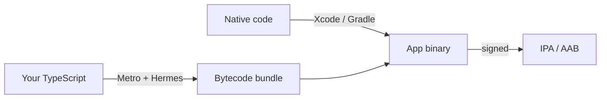

# 18.8 Shipping to the app stores: builds, signing and updates

Your app runs in Expo Go on your own phone, reloading every time you save. Getting it onto a stranger's phone is a different job. They can't scan your QR code; your laptop won't be running. They'll download it from a store, which wants a compiled package, proof of who built it, an account, a review, and a new version number every time. And once it's out, you'll need a way to fix it that's faster than the store, within rules the store sets. This chapter walks that whole road, so that the first time you ship, nothing on it is a surprise.

## What you'll learn

- What a **release build** is: your JavaScript compiled to **Hermes bytecode** and packed with native code compiled by Xcode or Gradle, needing no laptop to run.
- Why Expo **generates** the `ios/` and `android/` projects (`npx expo prebuild`) instead of keeping them in git, and where to build: on your own machine or with **EAS Build**.
- **Signing**: how the store and the phone know who built an app, the Android **upload key** and Apple's **certificates** and **provisioning profiles**, and why a signing key must never be committed or lost.
- The store accounts, **review**, **version and build numbers**, and releasing slowly with **staged rollouts** while you watch crash reports.
- **Over-the-air (OTA) updates**: what can change without the store (JavaScript, images) and what can't (native code), the store rules, and **runtime versions**.
- How a **minimum supported version** check rescues you from the versions you can't update.

---

## A release build is your app, compiled and packed for strangers

Think of a book. While you write it, the manuscript sits on your desk and you change it whenever you like. To sell it, you send it to a printer: it's typeset, bound, and every copy is identical and complete. Nobody needs your desk to read it.

In development your app is the manuscript. The app on the phone (Expo Go, or a development build) asks **Metro**, the bundler running on your laptop, for your JavaScript every time it starts, and reloads it when you save ([chapter 18.2](./react-native-with-expo.mdx)). A **release build** is the printed book. Two things happen to make it:

1. **Your JavaScript is bundled and compiled.** Metro joins every file into one bundle, and **Hermes**, React Native's JavaScript engine, compiles it into **bytecode**: a compact, already-parsed form the phone can run without reading source code at launch. That's one reason release builds start faster.
2. **The native app is compiled.** On iOS, **Xcode** compiles the native code (React Native itself, Expo's modules, the app shell) and packs everything into an **IPA**. On Android, **Gradle** (Android's build tool) does the same and produces an **AAB** (Android App Bundle) for Google Play, or an **APK** you can install directly.



Notice the two halves. The bytecode bundle is the part *you* change every day; the native half changes only when you add a library with native code, change a permission, or upgrade React Native. That split matters again when we get to over-the-air updates.

You can make the first half on any laptop, no phone needed:

```bash
npx expo export --platform android --output-dir dist   # bundle and compile the JavaScript, as a release build would
```

The output is a folder: `dist/_expo/static/js/android/entry-<hash>.hbc` (the **`.hbc`** file is Hermes bytecode: the `file` command on Linux or macOS calls it "Hermes JavaScript bytecode"), `dist/assets/` with every image the app uses, and `dist/metadata.json` listing them. You'll look inside it in the lab.

### The native projects are generated, not written

A React Native app needs a real Xcode project and a real Android Gradle project. You could create them once and edit them by hand forever, and many older apps do. Expo's approach, which it calls **Continuous Native Generation**, is to **generate** them whenever they're needed:

```bash
npx expo prebuild    # writes ios/ and android/ from app.json and each library's config plugin
```

**Prebuild** starts from a template that matches your Expo SDK version, then applies your app config (`app.json`: the name, the identifier, the version) and every **config plugin** (a small script a library ships to make its own native changes, such as adding a permission or a URL scheme). The generated folders are build output, like `dist/`: the source of truth is `app.json` plus your dependencies. So the usual practice, and Expo's default for new projects, is to keep `ios/` and `android/` **out of git**. Upgrading React Native then means changing versions and regenerating, not merging a thousand lines of someone else's Xcode changes into yours. The price: any native change must go through `app.json` or a config plugin, because hand edits in `android/` are lost on the next `npx expo prebuild --clean`.

### Where to build: your machine or EAS Build

- **Locally.** Android builds with Gradle on macOS, Linux or Windows, once Android Studio (or the Android SDK) is installed. iOS builds need **Xcode, which runs only on macOS**. `npx expo run:android --variant release` prebuilds and builds in one step.
- **EAS Build** (Expo Application Services): Expo's cloud build service. You run `eas build`, it uploads your project, builds it on Expo's machines (Macs for iOS, so you don't need one), manages signing credentials for you if you let it, and gives you the file. It has a **free plan** with a limited number of builds per month on a lower-priority queue, where waits can be long at busy times, and paid plans with faster queues; check [Expo's pricing page](https://expo.dev/pricing) for the current limits rather than trusting a number in a book. `eas build --local` runs the same build steps on your own Mac or Linux machine.

Teams with a Mac and patience often build locally; teams without Macs, or who want builds from CI without maintaining build machines, use a cloud service like EAS.

---

## Signing: the seal that proves who built the app

A sealed jar of jam from a shop has a tamper-evident lid: if it's been opened, you can tell. A wax seal on a letter does the same and also tells you *who* sent it, because only they own that seal.

An app package carries a **digital signature** made with a **private key** that only the developer holds. Anyone can check the signature with the matching public key (inside a **certificate**), but nobody can make a valid one without the private key. That gives two guarantees:

- **The package wasn't changed** after it was signed. A single altered byte breaks the signature.
- **Updates come from the same developer.** A phone installs an update only if it's signed by the same identity as the installed app. Without that, anyone could publish "an update" to your banking app.

**On Android**, there are two keys when you publish on Google Play:

- The **upload key**: you sign the AAB with it before uploading. Google checks it to confirm the upload came from you.
- The **app signing key**: Google holds it and re-signs the APKs that phones download. It never changes for the life of the app.

That arrangement is **Play App Signing**, and it's required for new apps (an AAB can't be published without it). Its big advantage: if you lose your upload key, or it leaks, you can ask Google to reset it, and you keep publishing updates. Apps signed the old way, with a key only the developer held, could never be updated again if that key was lost ([Android's app signing guide](https://developer.android.com/studio/publish/app-signing)). The key lives in a **keystore** file (`.jks` or `.keystore`) protected by passwords.

**On iOS**, Apple issues the identity:

- A **distribution certificate**: your signing identity, created through your Apple Developer account. Its private key is exported as a `.p12` file to move it between machines.
- A **provisioning profile** (`.mobileprovision`): a file Apple signs that says "this app ID may be signed with this certificate, and installed here", where *here* is the App Store, or a list of registered test devices.
- An **App Store Connect API key** (`.p8`): lets a script or a CI job upload builds without your Apple password.

EAS can create and store all of these for you; otherwise you manage them in Xcode and the Apple Developer website.

**None of these files ever go in git.** Anyone with the key and its password can sign packages as you. Keep them in a password manager or a secret store, and give them to CI as **encrypted secrets** ([chapter 11.2](../shipping/ci-with-github-actions.mdx); [chapter 7.6](../security/secrets-management.mdx) on secrets in general): a keystore is often stored base64-encoded in a secret and written to a file during the job.

---

## Accounts, review and version numbers

Both stores need a developer account before you can publish:

- **Apple Developer Program**: an **annual** membership, listed at US$99 a year on [Apple's program page](https://developer.apple.com/programs/) at the time of writing (fee waivers exist for some non-profits and institutions). Distributing on the App Store, and even installing test builds on registered iPhones outside your own Xcode, requires it.
- **Google Play Console**: a **one-time** registration fee, US$25 on [Google's help page](https://support.google.com/googleplay/android-developer/answer/6112435) at the time of writing. New *personal* accounts must first run a **closed test** with at least 12 testers opted in for 14 days in a row before they can publish to everyone ([Google's testing requirements](https://support.google.com/googleplay/android-developer/answer/14151465)), so plan for it.

Then every version goes through **review** ([chapter 18.1](./how-mobile-apps-work.mdx): Apple reviews every update; Google's review is mostly automated). Both stores also need a store listing: screenshots, a description, a privacy policy, and answers about what data the app collects.

Every upload needs two numbers:

| Field in `app.json` | Becomes | Who sees it | Rule |
|---|---|---|---|
| `version` | iOS `CFBundleShortVersionString`, Android `versionName` | People, in the store | You choose it: `1.0.0`, `1.1.0` |
| `ios.buildNumber` | iOS `CFBundleVersion` | The store | Must be new for each upload of a version |
| `android.versionCode` | Android `versionCode` | The store and the phone | A whole number that must go **up** with every upload |

Uploading a build number the store has already seen gets it rejected, and Android won't install a lower `versionCode` over a higher one. Counting by hand is error-prone, so EAS can keep the build numbers on its servers and increase them on every production build (`"appVersionSource": "remote"` in `eas.json` and `"autoIncrement": true` in the production profile), leaving `version` for you to set when you release ([Expo's app versions guide](https://docs.expo.dev/build-reference/app-versions/)).

---

## Release slowly and watch the crashes

A canary release on a server ([chapter 11.3](../shipping/delivery-and-deployment.mdx)) sends 5% of traffic to the new version, watches, and widens. Both stores offer the same idea for apps, with one important difference: you can halt it, but you **can't take a version back** from phones that already installed it.

- **Google Play staged rollout**: you choose a percentage of users to offer the update to, and raise it yourself (it never rises on its own). Users are chosen at random. If something's wrong, **halt** the rollout and no more users get that version; those who have it keep it ([Google's staged rollout guide](https://support.google.com/googleplay/android-developer/answer/6346149)).
- **App Store phased release**: the update goes out over **7 days** to a random sample of users with automatic updates on: 1%, 2%, 5%, 10%, 20%, 50%, then 100%. You can pause it, for up to 30 days in total, or release to everyone early. Anyone can still download it by hand from the store at any time ([Apple's phased release guide](https://developer.apple.com/help/app-store-connect/update-your-app/release-a-version-update-in-phases/)).

A rollout is only as good as what you watch during it. **Crash reporting** collects every crash from real phones with a stack trace: the stores' own consoles (Android vitals in the Play Console, the Organizer in Xcode) and services such as Sentry or Firebase Crashlytics, which add JavaScript stack traces mapped back to your source. Watch the share of sessions that don't crash, and halt when it drops.

Here's the whole road, one hop at a time:

<StepThrough
  title="From a git tag to a phone"
  nodes={[
    {id: "ci", label: "CI", sub: "your pipeline"},
    {id: "build", label: "Build", sub: "EAS or local"},
    {id: "store", label: "Store", sub: "review, rollout"},
    {id: "phone", label: "Phone", sub: "a user's"},
  ]}
  steps={[
    {title: "Tag a release", text: "You set `version` in app.json, merge, and tag the commit. CI runs the tests and starts a release build for each platform.", from: "ci", to: "build"},
    {title: "Build", text: "Prebuild generates the native projects. Metro bundles the JavaScript and Hermes compiles it to bytecode. Gradle or Xcode compiles the native code and packs an AAB or an IPA, with a build number one higher than the last.", active: ["build"]},
    {title: "Sign", text: "The package is signed: with the upload key on Android, with the distribution certificate and an App Store provisioning profile on iOS. The keys come from encrypted secrets, never from the repository.", active: ["build"]},
    {title: "Upload", text: "The signed package goes to Google Play or App Store Connect. The store checks the signature and that the build number is new.", from: "build", to: "store"},
    {title: "Review", text: "The store reviews the version: automated checks, and on Apple a person too. It usually takes hours to a day or two; a rejection sends you back to the build with a reason.", active: ["store"]},
    {title: "Staged rollout", text: "You release to a small share of users: a percentage on Google Play, the 7-day phased release on the App Store. Crash reports and reviews start arriving.", from: "store", to: "phone"},
    {title: "Install", text: "Phones in the rollout download the update, often overnight on Wi-Fi. Google Play's copy is re-signed with the app signing key; the phone checks the signature matches the installed app before replacing it.", active: ["phone"]},
    {title: "Watch, then widen or halt", text: "If the crash-free rate holds, widen the rollout to everyone. If it drops, halt it, fix, and ship a new build number. Phones that already updated keep the bad version until the fix arrives.", from: "phone", to: "ci"},
  ]}
/>

Two things to take from it. The slow steps (review, the rollout, people installing) are outside your control, which is why the next section exists. And the last step has no "undo": the only way to replace a bad version on a phone is a newer one.

---

## Over-the-air updates: new JavaScript without the store

Back to the meal kit from [chapter 18.1](./how-mobile-apps-work.mdx). The shop can't change the kit in your cupboard, but it can post you a corrected recipe card. What it can't post is a new oven: if the new recipe needs equipment you don't have, the card is useless.

An **over-the-air (OTA) update** is that recipe card. A library in the app (Expo's is **`expo-updates`**, with **EAS Update** as the server; other services exist) checks an update server when the app starts. If there's a newer JavaScript bundle and assets for this build, it downloads them, and the *next* time the app starts it runs the new code instead of the bundle compiled into the app ([`expo-updates` reference](https://docs.expo.dev/versions/latest/sdk/updates/)). No store, no review queue: a JavaScript bug fix can reach phones in hours.

What an OTA update **can** change, and what it **can't** ([EAS Update introduction](https://docs.expo.dev/eas-update/introduction/)):

| Can change (the recipe card) | Can't change (the oven) |
|---|---|
| Your JavaScript: logic, screens, text, styles | Native code and libraries with native code |
| Images and other assets | Permissions (camera, location) |
| | The Expo SDK or React Native version |

### Runtime versions keep the card matched to the oven

An update that calls a native module the installed build doesn't have would crash on start. So every build carries a **runtime version**: a label for its native half. An update is published for one runtime version and is only delivered to builds with the same one. Change the native half and you must change the runtime version, which means a new store build. Expo offers policies to set it: **`appVersion`** (the runtime version follows your `version`, which works if you remember to bump the version after every native change) and **`fingerprint`** (a hash of everything that affects native code, recomputed on each build, so a native change can't slip through unnoticed) ([Expo's runtime versions guide](https://docs.expo.dev/eas-update/runtime-versions/)). Builds also listen on a **channel** (such as `preview` or `production`), so a test build can receive updates that production phones don't.

### The store rules allow it, within limits

OTA updates are allowed because both stores make an exception for interpreted code, and both draw lines:

- **Apple's Developer Program License Agreement, section 3.3.1(B)**, says an app may not download executable code, but "Interpreted code may be downloaded to an Application but only so long as such code: (a) does not change the primary purpose of the Application by providing features or functionality that are inconsistent with the intended and advertised purpose of the Application (b) does not bypass signing, sandbox, or other security features of the OS". App Review Guideline 2.5.2 adds that apps may not download code that "introduces or changes features or functionality of the app" ([App Review Guidelines](https://developer.apple.com/app-store/review/guidelines/)). In practice: fix bugs and adjust what's already there; ship new features through review.
- **Google Play's Device and Network Abuse policy** says an app "may not modify, replace, or update itself using any method other than Google Play's update mechanism", and that this "does not apply to code that runs in a virtual machine or an interpreter where either provides indirect access to Android APIs" ([Google Play policy](https://support.google.com/googleplay/android-developer/answer/9888379)). JavaScript in React Native falls under that exception, with the same spirit: no sneaking new behaviour past review.

Rules change; read the current wording before you rely on OTA for anything more than fixes.

---

## The versions you can't update: a minimum supported version

[Chapter 18.1](./how-mobile-apps-work.mdx) ended with a warning: old versions stay on phones for years, and you can't force them to update. OTA helps only within one runtime version, and only for people whose app starts and reaches the update server. So most serious apps add an emergency exit *before* they need it: at startup, ask the server which versions are still supported, and if this one isn't, show a screen that says "please update" with a link to the store.

A sketch of the idea (not in snip's app; it uses `expo-application`, which reads the version from the installed build):

```tsx
import * as Application from 'expo-application';

// Compare "1.4.0" with "1.10.2" part by part, as numbers, not as text.
function isOlder(current: string, minimum: string): boolean {
  const a = current.split('.').map(Number);
  const b = minimum.split('.').map(Number);
  for (let i = 0; i < Math.max(a.length, b.length); i++) {
    if ((a[i] ?? 0) !== (b[i] ?? 0)) return (a[i] ?? 0) < (b[i] ?? 0);
  }
  return false;
}

export async function mustUpdate(apiBase: string): Promise<boolean> {
  try {
    const res = await fetch(`${apiBase}/app-config`);         // e.g. {"min_version": "1.3.0"}
    const { min_version } = (await res.json()) as { min_version: string };
    return isOlder(Application.nativeApplicationVersion ?? '0', min_version);
  } catch {
    return false; // offline or server down: let people use the app rather than lock them out
  }
}
```

Two judgment calls are in it. The minimum lives on the **server**, so you can raise it in minutes when a version turns out to be dangerous. And a failed check lets the app run, because locking everyone out when your config endpoint has a bad day is worse than the bug you were guarding against. Use it rarely: forcing an update is a last resort, and each time you raise the minimum, everyone on an older phone that can't install the new version is locked out.

:::warning[What can go wrong]
- **A lost or leaked signing key.** With Play App Signing, ask Google to reset the upload key. An app signed only with a key you held, and lost, can never be updated: you publish a new app and ask everyone to move. Back up keys somewhere safe that isn't git.
- **A keystore committed to git.** Treat it as leaked: anyone with the history can sign as you. Rotate it (with Play App Signing, request an upload key reset) and remove it with history-rewriting tools, knowing copies may already exist.
- **A release signed with the debug key.** The Android project prebuild generates signs its `release` build type with the shared debug keystore until you configure your own (the generated `build.gradle` says so in a comment). Google Play rejects it; sideloaded APKs signed that way can't be updated by your real build later.
- **The same build number twice.** The store rejects the upload. Let the build system count.
- **An OTA update that needs native code the build lacks.** The update crashes on start for everyone who gets it. Runtime versions prevent it when they're set correctly; the `fingerprint` policy makes that automatic.
- **Shipping to 100% on day one.** A crash on one Android version reaches everyone before the first report arrives. Use staged rollouts and watch crash reports.
- **No version check until you need one.** The check must be in the versions already installed; adding it after a dangerous release is too late for that release.
:::

### Judgment: how to ship

- **Build service.** EAS Build (or another hosted build service) removes the need for Macs and makes signing manageable for a small team; building locally or on your own CI runners gives full control and no queue, at the cost of maintaining Xcode and Android toolchains. Both produce the same signed packages.
- **OTA updates for fixes, store releases for features.** OTA makes a JavaScript bug fix reach people in hours; it's not a way around review. Release native changes and new features through the store, with a staged rollout.
- **Release on a rhythm.** Many teams ship a store release every week or two from `main`, so each release is small and a bad one is quick to find, the same reason small deploys are safer on a server ([chapter 11.3](../shipping/delivery-and-deployment.mdx)).
- **Build the exits on day one**: crash reporting, a minimum version check, and, if you'll use them, OTA updates. Each must already be in the versions on people's phones before the day you need it.

---

## Apply it to snip

snip, the link shortener this handbook builds, has a phone app in `mobile/`. It isn't published to a store, but it's set up the way a published app starts, and its gaps are the steps of this chapter.

**The native projects are generated.** `mobile/.gitignore` keeps them, and every kind of signing file, out of git:

```text
# Native projects: generated by `npx expo prebuild`, never edited by hand.
/ios
/android

# Signing keys and certificates: never in git.
*.jks
*.keystore
*.p8
*.p12
*.key
*.mobileprovision
*.pem
```

The first block is Continuous Native Generation: `app.json` and the config plugins are the source of truth. The second block covers the Android keystore (`.jks`, `.keystore`), Apple's API key (`.p8`), certificate export (`.p12`) and provisioning profile (`.mobileprovision`), and private keys in other formats (`.key`, `.pem`). A `.gitignore` line is a safety net against `git add .`, not a vault: the keys still need a proper home.

**The app config is short** (`mobile/app.json`):

```json
{
  "expo": {
    "name": "snip",
    "slug": "snip-mobile",
    "version": "1.0.0",
    "scheme": "snip",
    "orientation": "portrait",
    "userInterfaceStyle": "light",
    "plugins": ["expo-router", "expo-secure-store"]
  }
}
```

`version` is the user-facing `1.0.0`; `scheme` becomes the `snip://` links the app answers to; the two `plugins` are the config plugins prebuild runs, so expo-router and Secure Store can make their own native changes. What's missing for a store release is as instructive: no `ios.bundleIdentifier` or `android.package` (the app's permanent identity in the stores, such as `com.example.snip`; prebuild invents a placeholder if they're absent, as you'll see in the lab), no build numbers, no icon or splash image, no `eas.json`, no `runtimeVersion` and no `expo-updates`. Each is one decision in this chapter.

**CI already builds the JavaScript half.** The `bundle` script in `mobile/package.json` is the first half of a release build:

```json
    "bundle": "expo export --platform android --output-dir dist"
```

and the `mobile` job in `.github/workflows/ci.yml` runs it on every push ([chapter 18.7](./testing-mobile-apps.mdx)), so a change that breaks bundling fails before it could ever reach a store build. A release workflow would add the native build, signing from encrypted secrets, and an upload, triggered by a tag.

**And the server side is ready for old versions.** The client reads only the fields it needs and sends only the fields snip knows, and snip's API changes follow the compatible-change rules of [chapter 5.5](../apis/api-contracts.mdx), so a `1.0.0` app keeps working as the server grows.

---

## Lab

On your laptop, free, with a clone of this handbook's repository. No accounts, no phone.

1. **Look inside a release bundle.**
   ```bash
   cd mobile
   npm ci                                                   # the exact versions in package-lock.json
   npm run bundle                                           # expo export --platform android --output-dir dist
   find dist -type f | head                                 # the bundle, the assets, metadata.json
   file dist/_expo/static/js/android/*.hbc                  # "Hermes JavaScript bytecode"
   ls -lh dist/_expo/static/js/android/                     # its size
   ```
   Notice that your TypeScript is gone: what ships is one bytecode file of a few megabytes (React Native, Expo Router and your code together) and the images in `dist/assets`, named by their content hash. This is exactly what an OTA update would replace. `dist/` is in `.gitignore`; delete it with `rm -rf dist` when you're done.

2. **Generate the Android project in a throwaway copy, and read it.** Prebuild writes files and edits `app.json`, so run it on a copy, never in the repository:
   ```bash
   cd ..                                                    # back to the repository's root
   tmp=$(mktemp -d)                                         # an empty temporary folder
   git archive HEAD mobile | tar -x -C "$tmp"               # a clean copy of mobile/, without node_modules
   cd "$tmp/mobile" && npm ci                               # install its dependencies
   npx expo prebuild --platform android --no-install        # generate android/ (accept the suggested package name if asked)
   grep -n "applicationId\|versionCode\|versionName" android/app/build.gradle
   grep -n -A3 "release {" android/app/build.gradle         # which key signs a release build?
   grep -n "uses-permission\|scheme" android/app/src/main/AndroidManifest.xml
   cat app.json                                             # prebuild added something
   ```
   Notice four things. `versionName "1.0.0"` came from `version` in `app.json`, and `versionCode 1` is the build number you'd raise. The `applicationId` is a placeholder (`com.anonymous.snipmobile`), and prebuild wrote it into `app.json` as `android.package`: a real app picks its own once, forever. The `release` build is signed with `signingConfigs.debug`, next to a comment that says to make your own keystore. And the manifest holds the `snip` scheme, copied from `scheme` in `app.json`. Then delete it all:
   ```bash
   cd ~ && rm -rf "$tmp"                                    # it was generated; nothing is lost
   ```

3. **Optional: a real installable build in the cloud.**

   :::note[Accounts and limits]
   This step needs a free Expo account (`npx eas-cli login`) and uses one build from the free plan's monthly allowance, which waits in a low-priority queue that can take a long time at busy hours. No Apple or Google account is needed for an Android test build. Check [Expo's pricing page](https://expo.dev/pricing) for the current limits.
   :::

   In a copy of `mobile/` as in step 2 (so the repository stays unchanged), run `npx eas-cli build:configure` (it creates `eas.json` with `development`, `preview` and `production` profiles and links the project to your account), then `npx eas-cli build --profile preview --platform android`. The `preview` profile uses internal distribution, which builds an APK instead of an AAB. When it finishes you get a link: open it on an Android phone and install it. Notice that EAS offered to create a keystore for you, and that the installed app starts with no laptop and no Metro: it's the printed book.

## Self-check

<Quiz id="mobile-shipping-mobile-apps" questions={[
  {q: 'You fix a typo in a screen\'s text and add a library that uses the camera. Which can reach users as an over-the-air update?', options: ['Both', 'The typo fix only; the camera library adds native code, which needs a new store build', 'The camera library only', 'Neither: everything needs store review'], answer: 1, explain: 'OTA updates replace the JavaScript bundle and assets. A library with native code, and the camera permission it needs, change the native half, which only a new build can deliver. Runtime versions exist to stop an update that needs the new native code from reaching old builds.'},
  {q: 'Your Android release build is rejected because of its version. You changed version from 1.2.0 to 1.2.1 in app.json. What most likely went wrong?', options: ['Version numbers must have two parts', 'The versionCode (build number) wasn\'t increased, and the store has already seen it', 'Google requires the version to be a single number', 'The keystore expired'], answer: 1, explain: 'The store tracks the whole-number versionCode, which must go up with every upload; version is the label people see. Let the build system increment build numbers (EAS remote versioning with autoIncrement) so this can\'t happen.'},
  {q: 'Why do ios/ and android/ appear in mobile/.gitignore?', options: ['They contain secrets', 'They are generated by npx expo prebuild from app.json and config plugins, so the config is the source of truth and upgrades regenerate them', 'Git can\'t store binary files', 'They are too large for GitHub'], answer: 1, explain: 'Under Continuous Native Generation the native projects are build output, like dist/. Hand edits there are lost on the next clean prebuild, so native changes go through app.json or a config plugin. Secrets have their own ignore lines further down the file.'},
  {q: 'Your new version crashes for some users on day 2 of a Google Play staged rollout at 10%. What can you do?', options: ['Remove the version from every phone that installed it', 'Halt the rollout so no more users get it, then fix and release a new build; users who installed it keep it until then', 'Nothing until the rollout reaches 100%', 'Lower the versionCode to roll back'], answer: 1, explain: 'Halting stops new installs, but nothing removes a version from phones that have it, and Android won\'t install a lower versionCode over a higher one. The fix is a newer build (or, for a JavaScript-only bug, an OTA update for that runtime version).'},
]} />

<details>
<summary>A developer leaves the company, and nobody can find the Android keystore the app has always been signed with. What would you check first, and what are the outcomes?</summary>

First check whether the app uses **Play App Signing** (in the Play Console, under app signing). If it does, the lost key is only the **upload key**: the app signing key is safe with Google. Request an upload key reset in the Play Console, generate a new upload key, store it properly (a secret store plus an offline backup), and keep releasing as before.

If the app predates Play App Signing and was signed only with that key, nobody can sign an update that phones will accept. The app can't be updated: you'd publish a new app under a new package name and ask users to move. Also search the old CI's secrets and EAS credentials, where the key may still be stored. The rules: **keep signing keys in a managed secret store with a backup, never only on one laptop, and use Play App Signing so the key that matters is not one you can lose.**

</details>

<details>
<summary>Your team has OTA updates set up and proposes skipping store releases: "we'll ship every new feature as an OTA update, it's faster." What's wrong with that plan?</summary>

Three things. **The rules**: Apple's license agreement allows downloaded interpreted code only if it doesn't change the app's primary purpose or bypass security, and the review guidelines forbid downloading code that introduces or changes features; Google Play's policy has the same spirit. Shipping features around review risks the app being removed. **The native half**: any feature that needs a new native library, permission or SDK upgrade can't go over the air at all, so the store release is unavoidable eventually, and a long gap makes that release big and risky. **Old builds**: an update reaches only builds with the matching runtime version, so phones on older builds drift further apart from what you test.

A healthy pattern: regular store releases (with staged rollouts) for features and native changes, OTA updates for urgent JavaScript fixes and small corrections within the current release. The rule: **OTA is a fast lane for fixes, not a road around review.**

</details>
