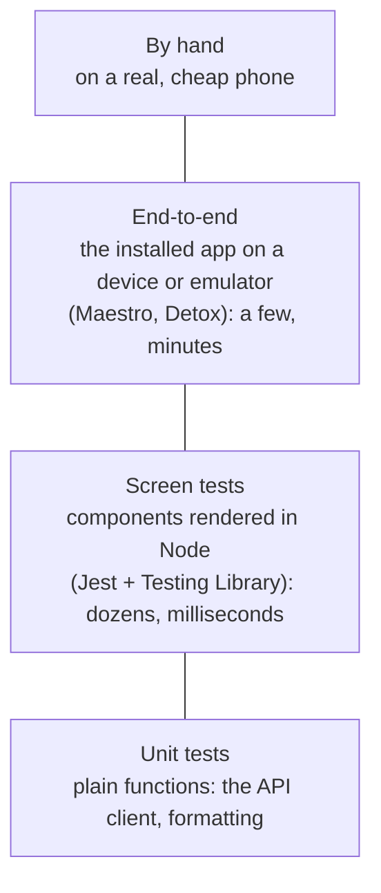
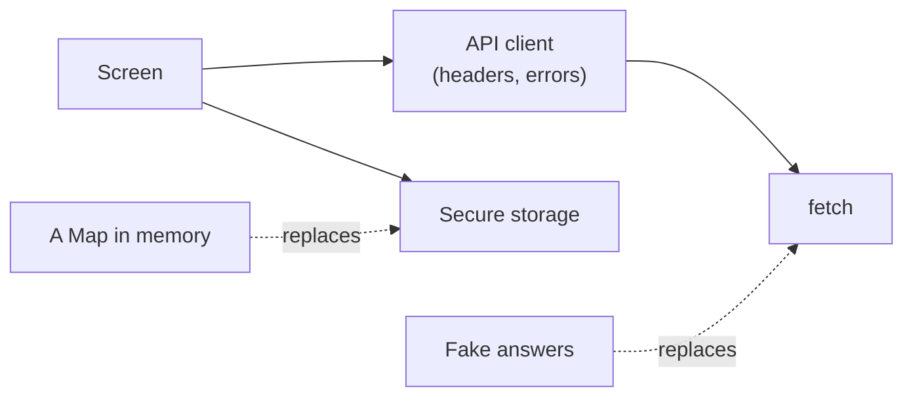

# 18.7 Testing mobile apps

You change one line in your app. Does it still work? To find out by hand you'd build it, install it on an iPhone and an Android phone, connect, create a link, delete one, try a wrong key, turn off the Wi-Fi and try again. That's ten minutes per change, per phone, and nobody does it every time, which is how bugs reach the store, where a fix takes days to reach people ([chapter 18.1](./how-mobile-apps-work.mdx): old versions never go away). This chapter shows how to get most of that certainty in seconds, from a command on your laptop, and how to be honest about the part only a real phone can check.

## What you'll learn

- The **test pyramid** on a phone: many fast tests of logic, a good number of **screen tests**, a few slow **end-to-end** tests on a device, and some testing by hand.
- How **Jest** and **React Native Testing Library** render your real screens in Node, with no phone, and find things the way a screen reader does: by role and label.
- What to fake (**only the edges**: the network and the phone's secure storage) and why faking more makes tests lie.
- What **Maestro** and **Detox** do on a real device or emulator, and what device farms add.
- What a test in Node **can't** see: native drawing, gestures, permissions, the slow phone.
- What a CI job that type-checks, tests and bundles your app proves, and what it doesn't.

---

## The same pyramid, with a phone at the top

[Chapter 16.9](../frontend/testing-the-frontend.mdx) drew the testing pyramid for a web UI with a car factory: test every bolt (fast, thousands), every engine on a bench (slower, fewer), and a few finished cars on the track (slow, the only proof the whole car drives). A phone app has the same shape. The difference is the top: the "finished car" is your app installed on a phone, and phones are slower to drive, harder to automate, and come in thousands of models.



Read it from the bottom:

| Layer | What runs | Where | How fast | Catches |
|---|---|---|---|---|
| **Unit** | One function, with fake inputs | Node, on your laptop or CI | Milliseconds | Wrong logic: a bad URL, a misread error |
| **Screen (component)** | Your real components and navigation, drawn into memory | Node | Milliseconds to a second | Wrong behaviour: the error isn't shown, Delete doesn't remove the row |
| **End-to-end** | The real built app | An emulator, a simulator or a phone | Seconds to minutes per test | Parts that don't fit: native code, the real server, real taps |
| **By hand** | You, with the app | A real phone, ideally a slow one | Minutes | What feels wrong: jank, clipped text, a confusing screen |

The rule from the web carries over: **push each check down to the lowest layer that can catch it**, and keep the top layers for what only they can see.

---

## Unit tests: Jest runs plain functions in milliseconds

**Jest** is the test runner most React Native projects use. Expo's preset, **`jest-expo`**, configures it so TypeScript, JSX and React Native's own modules load in Node. A unit test calls a function and checks what came back:

```ts
// clicks.ts
export function clicksLabel(n: number): string {
  return n === 1 ? '1 click' : `${n} clicks`;
}

// clicks.test.ts
import { clicksLabel } from './clicks';

it('uses the singular for one click', () => {
  expect(clicksLabel(1)).toBe('1 click');   // fails if someone shortens it to `${n} clicks`
  expect(clicksLabel(3)).toBe('3 clicks');
});
```

To add Jest to an Expo app (Expo's own setup steps):

```bash
npx expo install jest-expo jest @types/jest @testing-library/react-native -- --save-dev  # versions that match your Expo SDK
```

and in `package.json`, `"scripts": { "test": "jest" }` and `"jest": { "preset": "jest-expo" }`. Then `npm test` finds every `*.test.ts(x)` file and any file in a `__tests__` folder.

The most valuable unit tests in an app are usually around the **network layer**: the code that builds requests and turns answers into data or errors. That's where the server's contract meets your app, and where a bad network shows up. You'll see snip's below.

---

## Screen tests: render real components, find them like a person

A **screen test** (or component test) renders a component, or a whole screen, and drives it the way a person does: press this, type that, expect to see this text. On a phone there's no browser to simulate, so the setup differs from the web:

- `jest-expo` runs your components with a **test renderer**: React does all its normal work and produces the tree of `View`s and `Text`s, but nothing is drawn. There are no pixels, no layout and no native views.
- **React Native Testing Library** (`@testing-library/react-native`) renders a component into that tree and gives you queries and events: `screen.getByText`, `screen.getByRole('button', { name: 'Add one' })`, `fireEvent.press`, `fireEvent.changeText`.

A complete test of a small counter:

```tsx
import { useState } from 'react';
import { Pressable, Text, View } from 'react-native';
import { fireEvent, render, screen } from '@testing-library/react-native';

function Counter() {
  const [count, setCount] = useState(0);
  return (
    <View>
      <Text>{count === 1 ? '1 tap' : `${count} taps`}</Text>
      <Pressable accessibilityRole="button" accessibilityLabel="Add one" onPress={() => setCount(count + 1)}>
        <Text>+</Text>
      </Pressable>
    </View>
  );
}

it('counts taps', async () => {
  await render(<Counter />);                         // version 14 of the library: render and events are async
  expect(screen.getByText('0 taps')).toBeOnTheScreen();

  await fireEvent.press(screen.getByRole('button', { name: 'Add one' }));  // find by role and label, press

  expect(screen.getByText('1 tap')).toBeOnTheScreen();
});
```

Notice how the test finds the button: by its **role** and its **label**, the same two things a screen reader reads ([chapter 18.6](./mobile-accessibility-and-performance.mdx)). That's deliberate. A test that can find "the button called Add one" proves that a VoiceOver user can find it too; if you forget the label, the query fails. Finding elements by `testID` works, but tells you nothing about accessibility, so keep it for the rare element with no role or text.

### Fake the edges, keep the middle real

A screen that loads data calls `fetch`, and some screens read the phone's secure storage. Neither exists in a Node test: there's no server, and no Keychain. You replace them with fakes. *Where* you fake decides how much of your own code the test still covers ([chapter 16.9](../frontend/testing-the-frontend.mdx) drew the same choice on the web):



Fake `fetch` itself, not your API module, and everything above it runs for real: the screen, the client's headers and URLs, its error handling. A test then fails if the app sends the wrong header or misreads a `409`. Mock the API module instead and those parts are never tested at all. The rule: **fake the outermost edge your code touches, and nothing inside it.**

---

## What a test in Node can't see

Screen tests are fast because they skip the phone. So everything the phone does is invisible to them:

- **Native drawing and layout.** There are no pixels. A button pushed off-screen, text clipped at the largest font size, white text on white: all pass.
- **Gestures and physics.** A swipe to delete, pull to refresh, a scroll that catches. `fireEvent` calls the handler directly; it doesn't drag a finger.
- **Real permissions and system dialogs.** The camera prompt, the share sheet, the native `Alert`: in Node they're stand-ins, so you test that your code *asked*, not what the person saw.
- **The real secure storage, the real network.** A fake Keychain never fails; a real one can. A fake `fetch` never meets a captive Wi-Fi portal or an iOS rule that blocks plain `http://`.
- **Native code and its build.** A misconfigured native module loads fine against Jest's stand-ins and crashes on a phone.
- **Speed.** A test renderer on your laptop says nothing about a cheap Android phone.

### End-to-end tests drive the real app on a device

An **end-to-end (e2e) test** installs the built app on an emulator, a simulator or a phone, and taps through it like a person, against a real (test) server. Two tools are common for React Native:

- **Maestro** (open source, from mobile.dev): you describe a **flow** in YAML, and it finds elements by their visible text or accessibility label and waits for the screen to settle on its own. A sketch of a flow for a link app, *not* in snip's repository:

  ```yaml
  appId: com.example.snip        # the app's package name
  ---
  - launchApp
  - tapOn: "New short link"      # by accessibility label
  - tapOn: "Long URL"
  - inputText: "https://go.dev/doc/"
  - tapOn: "Create short link"
  - assertVisible: "go.dev/doc"  # the new link is in the list
  ```

- **Detox** (open source, from Wix): tests are JavaScript with Jest, and Detox knows when the app is busy (network requests, animations, timers), so it waits for it to go idle before each step instead of sleeping. It needs a special build of your app and more setup.

Both run on your machine against an emulator, and in CI. iOS simulators need a Mac, so iOS e2e in CI means macOS runners, which cost more and start slower. **Device farms** (Firebase Test Lab, AWS Device Farm, BrowserStack and others) run your tests on racks of real phones of many models; they're paid services, some with free quotas, so check their current pricing before you plan on them.

And then there's **testing by hand**, which no team skips: before a release, someone installs the release build on a real phone, ideally the cheapest Android you support, and walks through the main tasks with a screen reader on and the text size up. A short written checklist makes it repeatable.

:::warning[What can go wrong]
- **A test whose name promises more than it checks.** "Shows the error under the slug field" that only checks the error text exists anywhere. It passes when the message moves somewhere else. Read your assertions, not your test names: you'll find a real one in snip's app below.
- **Faking too much.** Mock the API module, the navigation and the storage, and the test proves only that your mocks agree with each other.
- **Fakes that drift from the server.** The fake answers `{ "links": [...] }`; the real server changes shape; every test stays green. Keep the fake's shapes tied to the API contract ([chapter 5.5](../apis/api-contracts.mdx)), and keep a few tests against the real server.
- **E2e tests that sleep.** "Wait 3 seconds, then tap" fails on a slow CI machine and wastes time on a fast one. Wait for a *state* (an element visible), which Maestro and Detox do for you.
- **Testing only on the iOS simulator.** It runs on your laptop's fast processor and shares its network. An Android emulator, and then a real Android phone, catch different bugs.
:::

### Judgment: how much of each

- **Most of your effort goes into screen tests.** They test behaviour the way people use it, run in seconds, and cost little to keep. For an app whose value is talking to an API (most apps), a screen test with a fake `fetch` covers most of what can go wrong.
- **Unit tests for the tricky logic**: the API client, parsing, anything with branches. Cheap and precise.
- **A few e2e flows for what would hurt most**: sign-in, the core action, payment. Add them when the app has native code you wrote, several people releasing, or a past bug that only showed on a device. Each one is slower and more fragile than a screen test, so keep the set small.
- **Hand testing is a release step, not a substitute.** It's the only check for "this feels slow" and "this is confusing".

---

## Apply it to snip

snip, the link shortener this handbook builds, has a phone app in `mobile/` ([chapter 18.4](./a-mobile-client-for-snip.mdx) builds it). Its tests follow the pyramid's bottom two layers: unit tests for the API client and screen tests for the two screens that matter, all with Jest and the `jest-expo` preset (`"jest": { "preset": "jest-expo" }` in `mobile/package.json`).

**The fake network.** `mobile/src/test/fakeFetch.ts` replaces the global `fetch` with one that hands back prepared answers, in order:

```ts
/** Replaces the global fetch; each call gets the next answer in order. */
export function stubFetch(...answers: (Response | Error)[]) {
  const fetchMock = jest.fn(async (_input: RequestInfo | URL, _init?: RequestInit) => {
    const next = answers.shift();
    if (!next) throw new Error('fetch called more times than the test expected');
    if (next instanceof Error) throw next;
    return next;
  });
  globalThis.fetch = fetchMock as typeof fetch;
  return fetchMock;
}
```

Each answer is a real `Response` (status, headers, JSON body), built by two helpers in the same file, `json()` and `snipError()`, so the app's own code reads them exactly as it would read snip's. An `Error` in the list plays a dead network. And `jest.fn` records every call, so a test can check what the app *sent*.

**Unit tests of the client** (`mobile/src/api.test.ts`) check the contract with snip: the URL, the `Bearer` header, and that snip's error shape becomes an `ApiError` with the same code:

```ts
  it("turns snip's error shape into an ApiError with the same code", async () => {
    stubFetch(snipError(409, 'slug_taken', 'that slug is already in use'));

    const err = await client().createLink('https://go.dev', 'godoc').catch((e: unknown) => e);

    expect(err).toBeInstanceOf(ApiError);
    expect(err).toMatchObject({ status: 409, code: 'slug_taken', message: 'that slug is already in use' });
  });
```

Others in the same file cover a `429` with `Retry-After`, an HTML `502` from nginx, a network failure, and the ten-second timeout, using Jest's fake clock so the test doesn't wait ten real seconds.

**Screen tests render the real routes.** The app uses expo-router ([chapter 18.3](./navigation-and-screens.mdx)), whose test helper `renderRouter` (from `expo-router/testing-library`) mounts the real layout and screens with real navigation in memory. `mobile/__tests__/new.test.tsx`:

```tsx
const routes = { _layout: RootLayout, index: SetupScreen, links: LinksScreen, new: NewLinkScreen };

beforeEach(() => saveSession({ baseUrl: 'http://localhost:8080', apiKey: 'snip_test' }));
afterEach(() => forgetKey());

describe('create form', () => {
  it("shows snip's message under the slug when the slug is taken", async () => {
    const fetchMock = stubFetch(json(200, { links: [] }), snipError(409, 'slug_taken', 'that slug is already in use'));
    await renderRouter(routes);
    await fireEvent.press(await screen.findByRole('button', { name: 'New short link' }));

    await fireEvent.changeText(await screen.findByLabelText('Long URL'), 'https://go.dev/doc/');
    await fireEvent.changeText(screen.getByLabelText('Custom slug (optional)'), 'godoc');
    await fireEvent.press(screen.getByRole('button', { name: 'Create short link' }));

    expect(await screen.findByText('that slug is already in use')).toBeOnTheScreen();
    expect(screen).toHavePathname('/new'); // still open, so the user can pick another slug
    expect(fetchMock).toHaveBeenLastCalledWith(
      'http://localhost:8080/api/links',
      expect.objectContaining({ method: 'POST', body: '{"url":"https://go.dev/doc/","slug":"godoc"}' }),
    );
  });
});
```

Read it as a story: a key is already saved (`beforeEach`), the app opens on the list (the first fake answer, an empty list), the person presses New, types, presses Create, and snip says the slug is taken (the second fake answer). The test checks what the person sees, that the form stays open (`toHavePathname`), and exactly what went over the wire. `findBy…` queries wait for the element to appear, because loading and navigation are asynchronous. Every query is by role or label, so the test also checks that those labels exist.

`mobile/__tests__/links.test.tsx` does the same for the list: it lists links, deletes one after pressing Delete in the confirmation dialog (it replaces `Alert.alert` with `jest.spyOn`, since there's no native dialog in Node), and sends the person back to the setup screen when snip answers `401`.

**Only two things are fake.** The header of `links.test.tsx` says so: "only fetch and Secure Store are fakes." Secure Store is replaced by `mobile/__mocks__/expo-secure-store.ts`:

```ts
// Jest uses this file in place of expo-secure-store in every test (a
// __mocks__ folder next to node_modules does that automatically). There is
// no Keychain or Keystore in Node, so a Map stands in for the phone's vault.
const items = new Map<string, string>();

export async function getItemAsync(key: string): Promise<string | null> {
  return items.get(key) ?? null;
}
// … setItemAsync and deleteItemAsync do the same with items.set and items.delete
```

The `Map` *remembers*, which the tests rely on: `saveSession` in `beforeEach` writes the key, and the layout reads it at startup to decide which screen to show. Everything between those two fakes (the screens, navigation and its guards, the session context, the API client) is the real code.

**Find the gap.** Look again at the test above. Its name says the message appears *under the slug*. Its assertions check that the message is somewhere on the screen. In `mobile/app/new.tsx`, a function decides which field an error belongs under:

```tsx
function fieldFor(err: unknown): Field {
  if (err instanceof ApiError) {
    if (err.code === 'invalid_url') return 'url';
    if (err.code === 'invalid_slug' || err.code === 'slug_taken') return 'slug';
  }
  return 'form';
}
```

Delete `|| err.code === 'slug_taken'` and the message moves to the bottom of the form, the slug field loses its red border, and **all the tests still pass**. That's not a disaster (the person still reads the message), but it's exactly the "name promises more than it checks" trap, and you'll prove it in the lab. Placement is hard to assert in Node with no layout; a test could instead check the slug field's invalid style, or the order of elements, and an e2e screenshot could check the look.

**No end-to-end tests yet, and why.** The app is four screens that talk only to snip's API, with no native code of its own; the screen tests already drive those screens through real navigation with real request and error handling. An e2e suite would add an emulator (minutes per CI run on Linux, and macOS runners for iOS), a running snip, and a release build. It becomes worth it when the app gains native code or a flow that only a device can check, such as opening a short link from another app ([chapter 18.5](./device-features.mdx)). Until then, the release checklist covers the device by hand.

**The CI job.** Every push runs the `mobile` job in `.github/workflows/ci.yml` ([chapter 11.2](../shipping/ci-with-github-actions.mdx) explains workflows):

```yaml
      - run: npm ci                           # exactly the lockfile's versions
      - run: npm run typecheck                # tsc --noEmit
      - run: npm test                         # Jest (jest-expo) with a fake fetch and Secure Store
      - run: npm run bundle                   # expo export: the Android JavaScript bundle builds, no device needed
```

What a green run proves: the TypeScript types agree everywhere; the client, the list and the form behave as the tests describe; and Metro (Expo's bundler) can resolve every import and produce the Android JavaScript bundle, compiled to Hermes bytecode. What it does *not* prove: that the native Android or iOS project builds (there's no Gradle or Xcode step), that the iOS bundle builds (only Android is exported, so a file used only on iOS could break unnoticed), that the app starts on a phone, or that anything looks right. Those are covered when you build for the store ([chapter 18.8](./shipping-mobile-apps.mdx)) and by hand.

---

## Lab

On your laptop, free. Node 22 or later; no phone or server needed.

1. **A first screen test, on its own.** In your `hello` app from [chapter 18.2](./react-native-with-expo.mdx) (or a fresh `npx create-expo-app@latest hello --template blank-typescript`), add Jest:
   ```bash
   npx expo install jest-expo jest @types/jest @testing-library/react-native -- --save-dev  # SDK-matched versions
   npm pkg set scripts.test=jest jest.preset=jest-expo   # "npm test" runs Jest with Expo's preset
   ```
   Save the counter test from this chapter as `Counter.test.tsx` and run `npm test`. Then delete `accessibilityLabel="Add one"` and run it again. Notice *why* it fails: the query by role and name can't find the button, which is also what a screen reader user would meet.

2. **Run snip's app's tests.** From a clone of this handbook's repository:
   ```bash
   cd mobile
   npm ci          # installs exactly the versions in package-lock.json
   npm test        # Jest: the API client, the links screen, the create form
   ```
   Notice the count (three files, a dozen tests) and the time: seconds, with no phone, no emulator and no snip running.

3. **Break the slug_taken message and watch a test catch it.** In `mobile/src/api.ts`, inside `describeError`'s `switch`, add a case above `case 'unauthorized':`
   ```ts
       case 'slug_taken':
         return 'Pick another slug.';
   ```
   Run `npm test`. Notice which test fails ("create form › shows snip's message under the slug when the slug is taken") and the message: `Unable to find an element with text: that slug is already in use`. The test noticed the person would see different words. Undo with `git checkout src/api.ts`.

4. **Find a change no test catches.** In `mobile/app/new.tsx`, delete `|| err.code === 'slug_taken'` from `fieldFor` and run `npm test`. Everything passes, although the error now appears at the bottom of the form instead of under the slug. Notice the difference between the test's *name* and its *assertions*. Undo with `git checkout app/new.tsx`.

5. **Write a test of your own: the empty list.** In `mobile/__tests__/links.test.tsx`, inside the `describe` block, add:
   ```tsx
     it('says how to start when there are no links yet', async () => {
       stubFetch(json(200, { links: [] }));   // snip answers with an empty list
       await renderRouter(routes);

       expect(await screen.findByText('No links yet. Tap New to shorten your first one.')).toBeOnTheScreen();
     });
   ```
   Run `npm test` and see it pass. Then prove it can fail: change one word of the message in `mobile/app/links.tsx`, run again, and watch your test go red. A test you've never seen fail might not be testing anything. Put the message back with `git checkout app/links.tsx`, and keep the test or delete it.

## Self-check

<Quiz id="mobile-testing-mobile-apps" questions={[
  {q: 'Why do snip\'s app\'s screen tests replace fetch rather than the app\'s API client module?', options: ['Replacing fetch is faster', 'So the real client (URLs, headers, error handling) runs in every screen test, and a mistake there makes the test fail', 'Jest can\'t replace modules', 'The API client has no functions to replace'], answer: 1, explain: 'Faking at the outermost edge keeps everything inside it real. Mock the API module and the screen tests would never notice a wrong header or a misread 409. Jest can replace modules perfectly well; it\'s a choice about how much real code each test covers.'},
  {q: 'A screen test finds a button with getByRole(\'button\', { name: \'Delete godoc\' }). What else does that query check, for free?', options: ['That the button is red', 'That the button has the role and the label a screen reader will announce', 'That the button is at least 44 points tall', 'That the delete request succeeds'], answer: 1, explain: 'Testing Library\'s role and name queries read the same accessibility props VoiceOver and TalkBack read. Size and colour are layout, which the test renderer doesn\'t compute; the request is checked separately through the fake fetch.'},
  {q: 'Every Jest test passes. Which of these bugs could still be in the app?', options: ['describeError returns the wrong sentence for a 429', 'The Delete button is pushed off the right edge of the screen on a small phone', 'The client sends the key without "Bearer "', 'The form closes after a slug_taken error'], answer: 1, explain: 'The test renderer draws nothing and computes no layout, so a button off-screen passes. The other three are behaviour the existing unit and screen tests do check: the 429 sentence, the Authorization header and the pathname staying /new.'},
  {q: 'Your end-to-end test taps Create, waits 2 seconds, then checks for the new link. It fails one run in ten on CI. What is the best fix?', options: ['Wait 5 seconds instead', 'Wait for the state you expect (the link visible), which Maestro and Detox do, instead of a fixed time', 'Retry the whole test three times', 'Delete the test'], answer: 1, explain: 'A fixed sleep is too short on a slow machine and wasted time on a fast one. Waiting on a condition finishes as soon as the app is ready and only fails when it truly never gets there. Retrying hides the flakiness rather than fixing it.'},
]} />

<details>
<summary>A tester reports that on their Android phone, pressing Delete in snip's app does nothing, but every test passes and it works on your iPhone simulator. What would you check first, and why don't the tests catch it?</summary>

First reproduce it where it happens: an Android device or emulator, ideally the same Android version, with the same build (a release build if they have one). Watch the logs (`npx expo start` prints the JavaScript console; Android Studio's Logcat shows native errors) while pressing Delete.

The tests can't catch it because the part that differs is exactly what they fake. In Jest, `Alert.alert` is replaced with a function that presses "Delete" immediately, so the native dialog, its buttons and their order on Android are never exercised. Likewise the network: a phone on the Wi-Fi may be unable to reach the address saved in the app, which a fake `fetch` never shows. The rule: **when a bug appears only on one platform, look first at the code the tests replace with stand-ins: native dialogs, storage, the network, permissions.** If it was a real gap, it's a candidate for one end-to-end flow on Android.

</details>

<details>
<summary>A teammate proposes snapshot tests for every screen: render it, save the whole tree to a file, and fail if it ever changes. Why might that give less confidence than it seems, and what would you suggest?</summary>

A snapshot fails on *any* change to the tree, including harmless ones (a style tweak, a wrapper `View`), so it fails often, and people learn to press "update snapshots" without reading the diff. Then it passes on real bugs too. It also checks the tree, not behaviour: a snapshot of the create form doesn't prove that pressing Create sends the right request or shows the right error.

Better: behaviour tests like snip's, which press and type and check what the person sees and what was sent, by role and label. Keep snapshots, if at all, for small, stable output where any change really is suspicious, and look at each diff. For the *look* of a screen, screenshot comparisons on a real device or emulator are the tool, because only they include layout. The rule: **test what the person does and sees, not how the tree happens to be built today.**

</details>
