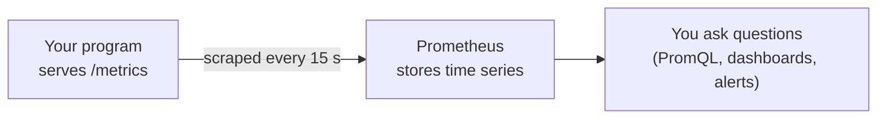
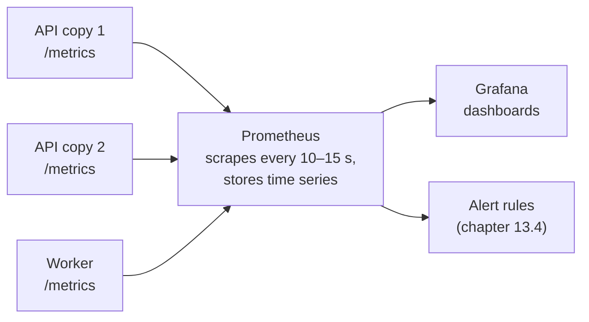

# 13.2 Metrics with Prometheus & Grafana

Every app on your phone shows you a number that moves: battery percentage, storage used, steps today. You glance at it, and you know whether something's wrong without reading a single log line. Services need the same thing. **Metrics** are **numbers over time**: how many requests per second, what fraction failed, how long the slowest 1% took, how many jobs are waiting in a queue. A metric costs the same whether a service handles ten requests or ten million, because it's only a counter going up, sampled every few seconds. That makes metrics the signal for **dashboards** ("how are we doing right now?") and **alerts** ("wake someone up if this crosses a line", [chapter 13.4](./slos-alerting-on-call.mdx)). This chapter covers the metric types, how **Prometheus** collects and stores them, how to ask questions in **PromQL**, which questions to ask, and how **Grafana** draws the answers. You'll query a live Prometheus within minutes, on your own laptop.

## What you'll learn

- The three metric types: a **counter** only goes up, a **gauge** goes up and down, a **histogram** sorts measurements into buckets.
- How **Prometheus** works: it **scrapes** a `/metrics` page, stores **time series**, and slices them by **labels**, and why too many label values (**cardinality**) can break it.
- **PromQL**: `rate`, `sum by`, ratios, and percentiles from histograms, plus the two subtleties that trip everyone up.
- What to measure: the **RED** method for services and the **USE** method for resources.
- **Grafana** dashboards, provisioned as code, and a real service's metrics end to end.

---

## Three kinds of number

:::note[Everyday anchor]
A car's dashboard. The **odometer** only ever goes up: that's a **counter** (you learn your speed from how fast it rises). The **fuel gauge** goes up and down: a **gauge**. And if you recorded, for every journey, how long it took in buckets ("under 10 minutes, under 20, under 40…"), you'd have a **histogram**, from which you could say "90% of my commutes take under 25 minutes".
:::

| Type | Behaves like | Typical examples | Ask with |
|---|---|---|---|
| **Counter** | Only goes up (resets to 0 when the program restarts) | `http_requests_total`, `jobs_processed_total`, `errors_total` | `rate()`: how fast it rises, per second |
| **Gauge** | Goes up and down | `queue_length`, `memory_in_use_bytes`, `temperature_celsius` | Its value directly |
| **Histogram** | Counts measurements into buckets | `http_request_duration_seconds` | `histogram_quantile()` for percentiles |

Why a counter for requests, and not a gauge saying "requests in the last minute"? Because a counter never loses information. If Prometheus misses a reading, the next one still contains every request so far, and the rise between any two readings is exact. A "last minute" gauge that's missed is gone.

A **histogram** doesn't store every duration. It keeps a running count of how many measurements were at or under each **bucket** boundary:

```text
requests that took ≤ 0.01 s:   812
requests that took ≤ 0.05 s:   990
requests that took ≤ 0.1 s:    998
requests that took ≤ +Inf:    1000      (all of them)
```

From those counts you can *estimate* percentiles ([chapter 8.5](../distributed/performance-and-load-testing.mdx)): 99% of 1,000 is 990, so the p99 (the time 99% of requests beat) is about 0.05 s. The estimate is only as fine as the buckets, so you choose boundaries around the latencies you care about. And unlike averages or ready-made percentiles, bucket counts from several copies of a service can be **added together** before estimating, which is what makes histograms work for a service running on ten machines.

---

## How Prometheus works

**Prometheus** is the standard open-source metrics system. Each program you want to watch publishes a plain-text page, conventionally at `GET /metrics`, listing every metric's current value. Prometheus **pulls**: every few seconds it **scrapes** that page from each **target** and stores what it read.

Three boxes are the whole idea:



Prometheus publishes its own metrics too, so it can watch itself. Here is part of its real `/metrics` page:

```text
# HELP prometheus_http_requests_total Counter of HTTP requests.
# TYPE prometheus_http_requests_total counter
prometheus_http_requests_total{code="200",handler="/-/healthy"} 200
prometheus_http_requests_total{code="200",handler="/api/v1/query"} 20
prometheus_http_requests_total{code="400",handler="/api/v1/query"} 20
# TYPE go_goroutines gauge
go_goroutines 36
```

Each line is a **metric name**, some **labels** in braces, and the current value. `# TYPE` says which of the three kinds it is. Every scrape adds one timestamped **sample** to a **time series**, and there's one time series per unique combination of name and labels: the three `prometheus_http_requests_total` lines above are three separate series.

Here is the fuller picture for a real service with two copies of an API and a background worker:



Prometheus **discovers** targets instead of reading a fixed list: it can ask DNS for every address behind a name, or ask Kubernetes for every Pod with a given label. Copies that come and go are found automatically. Every target also gets a free metric, `up`, which is `1` if the last scrape worked and `0` if it didn't: the simplest "is it alive?" check there is.

:::info[If you've written code]
You rarely write the `/metrics` page by hand. A **client library** (Prometheus has official ones for Go, Java, Python and Ruby, and there are many more) gives you `Counter`, `Gauge` and `Histogram` objects. You call `.Inc()` or `.Observe(0.042)` in your code, and the library renders the page. For software you can't change, such as databases and operating systems, an **exporter** (a small sidecar program like `postgres_exporter` or `node_exporter`) reads its stats and publishes them in this format.
:::

### Labels, and the cardinality trap

**Labels** let you slice a metric: errors by route, requests by status code. But **every distinct combination of label values is a separate time series**, stored and queried separately. The number of combinations is the metric's **cardinality**.

Imagine a web shop's request counter. Labelled by **route** (`GET /products/{id}`), it has a handful of values. Labelled by **path** (`/products/1`, `/products/2`, … `/products/981532`), it has one value per product ever viewed, and a new time series for each. Millions of series slow Prometheus to a crawl and make hosted-metrics bills explode. The rule: **labels must have a small, bounded set of values.** User IDs, emails, request IDs, full URLs and error messages belong in logs and traces ([chapter 13.1](./logs.mdx), [chapter 13.3](./tracing.mdx)), never in metric labels.

---

## PromQL: asking questions

Prometheus's query language, **PromQL**, turns raw series into answers. The examples below are real queries against a Prometheus watching itself, after a burst of traffic: 200 health checks, plus a few dozen queries to its API, half of them deliberately malformed. You'll run the same ones in the lab.

**Is it up?** The simplest query is a metric's name:

```text
up

{instance="localhost:9090", job="prometheus"}   1
```

**Requests per second, by handler.** A counter only goes up, so you ask how fast it rises, with `rate()` over a time window (`[2m]`: the last two minutes). Then `sum by` adds up the series, keeping only the labels you name, which also adds all copies of a service together:

```text
sum by (handler) (rate(prometheus_http_requests_total[2m]))

{handler="/-/healthy"}      2.006
{handler="/api/v1/query"}   0.221
{handler="/metrics"}        0.030
```

The `/metrics` line is Prometheus scraping itself.

**Error ratio**: failed requests as a fraction of all. `=~` matches a regular expression, so `code=~"4.."` means any 4xx code:

```text
  sum(rate(prometheus_http_requests_total{handler="/api/v1/query", code=~"4.."}[2m]))
/ sum(rate(prometheus_http_requests_total{handler="/api/v1/query"}[2m]))

0.43
```

Not 0.5, even though half the deliberate queries were malformed: the queries used to *check* the numbers were good ones, and they count too. Metrics measure everything, including you.

**Latency percentile** from a histogram. Histograms are stored as one series per bucket, named `…_bucket`, with the boundary in a label called `le` ("less than or equal"). You `rate` the buckets, `sum by (le)` across copies, then estimate:

```text
histogram_quantile(0.99, sum by (le) (rate(prometheus_http_request_duration_seconds_bucket{handler="/api/v1/query"}[2m])))

0.099
```

Read that answer with suspicion. Prometheus's own smallest bucket is 0.1 s, and every query finished well under it, so the most Prometheus can say is "somewhere below 0.1 s"; 0.099 is an interpolation inside that bucket, not a measurement. **A percentile is never more precise than the buckets around it.** For a service whose requests take milliseconds, buckets must start at a millisecond.

:::info[Two subtleties that trip everyone up]
**`rate()` and `increase()` estimate.** They extrapolate from the samples they have to the edges of the window. In the run above, `sum(increase(prometheus_http_requests_total{handler="/-/healthy"}[2m]))` returned **241.7** for exactly 200 health checks. Use them for trends and alerts, not for billing-grade counts.

**Counter resets.** When a program restarts, its counters go back to zero. `rate()` notices the drop and handles it. So never do arithmetic on raw counter values: always `rate()` first, then `sum`.
:::

---

## What to measure: RED and USE

Two checklists cover most needs:

- **RED**, for every **service** (anything that handles requests): **R**ate (requests per second), **E**rrors (failed requests per second, or the error ratio), **D**uration (latency percentiles). These are what users feel, so they're the first row of every service dashboard.
- **USE**, for every **resource** (CPU, memory, disks, connection pools, queues): **U**tilisation (how busy), **S**aturation (how much work is waiting), **E**rrors ([chapter 8.5](../distributed/performance-and-load-testing.mdx)). A queue's backlog is a saturation metric: if it keeps growing, the consumers can't keep up.

Add a few **business metrics** (sign-ups, orders, links created), because "the system is healthy" and "the product is working" aren't the same question.

---

## Dashboards in Grafana

**Grafana** queries Prometheus (and many other sources) and draws the answers as panels: line charts, single numbers, heatmaps. Each panel is one PromQL query plus display settings.

Grafana can store dashboards in its own database, edited by clicking. Mature teams **provision** them instead: the data sources and dashboards are files (YAML and JSON) in Git, loaded when Grafana starts. They're reviewed in pull requests and identical in every environment, the same reasoning as infrastructure as code ([chapter 12.5](../cloud/terraform-from-zero.mdx)).

Good dashboards follow a few habits: **RED at the top** (is it broken for users?), then resources and dependencies (why?); one dashboard per service with the same layout everywhere; units on every axis; and no panel nobody would act on. A dashboard with sixty panels is a place where signals hide.

:::warning[What can go wrong]
- **Averages instead of percentiles**: the mean latency hides the slow tail ([chapter 8.5](../distributed/performance-and-load-testing.mdx)).
- **High-cardinality labels**: user IDs or URLs as labels, and Prometheus runs out of memory.
- **Graphing raw counters**: a line that only goes up tells you nothing. Use `rate()`.
- **Buckets in the wrong place**: a p99 that's always exactly a bucket boundary (or just under it) means the buckets are too coarse to answer the question.
- **No metrics from the components that fail**: a background worker with no `/metrics` endpoint is invisible. Every process needs one, or an exporter that reads its data.
- **Dashboards as the alerting system**: nobody watches dashboards at 3 a.m. Alerts ([chapter 13.4](./slos-alerting-on-call.mdx)) do.
:::

---

## Apply it to snip: a real service's metrics

snip, the URL shortener this handbook builds ([chapter 0.3](../start/meet-snip.mdx)), uses everything above. Its metrics are defined in `snip/internal/metrics/metrics.go` with the Prometheus Go client:

```go
Requests: prometheus.NewCounterVec(prometheus.CounterOpts{
	Name: "snip_http_requests_total", Help: "HTTP requests handled.",
}, []string{"route", "method", "code"}),
RequestDuration: prometheus.NewHistogramVec(prometheus.HistogramOpts{
	Name:    "snip_http_request_duration_seconds",
	Help:    "Time to handle HTTP requests.",
	Buckets: []float64{.001, .0025, .005, .01, .025, .05, .1, .25, .5, 1, 2.5},
}, []string{"route"}),
Redirects: prometheus.NewCounterVec(prometheus.CounterOpts{
	Name: "snip_redirects_total", Help: "Redirects served, by cache result.",
}, []string{"cache"}),
```

| Type | snip's metrics |
|---|---|
| **Counter** | `snip_http_requests_total`, `snip_redirects_total` (label `cache`: hit or miss), `snip_worker_clicks_processed_total` |
| **Gauge** | `snip_worker_lag_events` (click events waiting in the queue), `go_memstats_heap_inuse_bytes` |
| **Histogram** | `snip_http_request_duration_seconds` |

Notice the choices. The labels are `route` (`GET /{slug}`: a handful of values), never the path (`/mlink`, `/go`…: one per link). The buckets start at 1 ms, because a redirect served from cache takes about half a millisecond; Prometheus's own 0.1 s buckets would say nothing useful about snip. The logging middleware ([chapter 13.1](./logs.mdx)) updates the counter and the histogram for every request, which costs nanoseconds.

Here is real output from one API copy after 600 redirects to one link: one cache miss (the first), then 599 hits from Redis.

```text
snip_http_requests_total{code="302",method="GET",route="GET /{slug}"} 600
snip_redirects_total{cache="hit"} 599
snip_redirects_total{cache="miss"} 1
```

**Scraping.** In snip's Compose stack, `snip/deploy/prometheus/prometheus.yml` scrapes every 10 s and discovers targets through Docker's DNS ([chapter 9.3](../containers/docker-compose.mdx)): every copy of `api` on port 8080 and every copy of `worker` on port 9091. The worker has that small HTTP server only for metrics. Until it did, the worker counted processed clicks and nobody could see the number, a gap found while writing this chapter.

**PromQL for snip.** The same query shapes, with snip's names. In a local run, p50 and p99 latency came out at about 0.5 ms and 2.3 ms:

```text
sum by (route) (rate(snip_http_requests_total[1m]))                                          # RED: rate
sum(rate(snip_http_requests_total{code=~"5.."}[5m])) / sum(rate(snip_http_requests_total[5m]))  # RED: errors
histogram_quantile(0.99, sum by (le) (rate(snip_http_request_duration_seconds_bucket[5m])))  # RED: duration
sum(rate(snip_redirects_total{cache="hit"}[5m])) / sum(rate(snip_redirects_total[5m]))       # cache hit ratio
snip_worker_lag_events                                                                       # USE: saturation
```

**Dashboards as code.** Grafana is provisioned from files:

```text
snip/deploy/grafana/
├── provisioning/datasources/prometheus.yml   # "Prometheus is at http://prometheus:9090"
├── provisioning/dashboards/snip.yml          # "load dashboards from this folder"
└── dashboards/snip.json                      # the snip overview dashboard
```

The **snip overview** dashboard has six panels: requests per second by route, error ratio, p50/p99 latency (RED, at the top), then redirect cache hit ratio, worker throughput and backlog, and memory in use. Each panel is one of the queries above, with a description saying why it's there.

:::info[In the real world]
Prometheus's data model and PromQL are a de facto standard: Kubernetes components, databases (via exporters), load balancers and most infrastructure expose Prometheus metrics. At scale, teams add long-term storage and global querying (Thanos, Mimir, VictoriaMetrics), or use managed services (Amazon Managed Service for Prometheus, Grafana Cloud, Google Cloud Managed Service for Prometheus). **OpenTelemetry** metrics can be exported in the same model, so instrumenting once works with any backend.
:::

---

## Lab

Free, on your computer with Docker. Step 1 needs nothing but Prometheus; steps 2–6 use snip's Compose stack, and every snip query below runs in snip's CI on every push.

1. **Watch Prometheus watch itself.** The official image's default configuration scrapes its own `/metrics` every 15 s.
   ```bash
   docker run -d --rm --name prom -p 9090:9090 prom/prometheus:v3.15.1
   curl -s localhost:9090/metrics | grep -A3 'TYPE prometheus_http_requests_total'   # the raw page
   for i in $(seq 1 200); do curl -s -o /dev/null localhost:9090/-/healthy; done    # make some traffic
   ```
   Wait 30 seconds (two scrapes), open [localhost:9090](http://localhost:9090), and run the queries from the PromQL section in the **Query** tab: `up`, then `sum by (handler) (rate(prometheus_http_requests_total[2m]))`, then `sum(increase(prometheus_http_requests_total{handler="/-/healthy"}[2m]))`. Compare that last answer with the 200 requests you sent. Why isn't it exactly 200? (Extrapolation to the window's edges.) Switch the view to **Graph** and watch a rate rise and fall as you rerun the loop. Stop it with `docker stop prom`.

2. **Start snip's stack with monitoring.**
   ```bash
   cd ~/code/zero-to-prod/snip
   docker compose --profile observability up -d --build --wait
   KEY=$(docker compose exec -T api snip keys create metrics-lab | grep -o 'snip_[A-Za-z0-9]*')
   curl -s -X POST localhost:8080/api/links -H "Authorization: Bearer $KEY" -d '{"url":"https://go.dev","slug":"mlink"}'
   for i in $(seq 1 300); do curl -s -o /dev/null localhost:8080/mlink; done
   for i in $(seq 1 30);  do curl -s -o /dev/null localhost:8080/nope;  done      # some 404s
   ```

3. **Read raw metrics** from one API copy, from inside the network (nginx blocks `/metrics` at the edge, [chapter 8.3](../distributed/reverse-proxies-and-nginx.mdx)):
   ```bash
   docker run --rm --network snip_default alpine:3.22 wget -qO- api:8080/metrics | grep '^snip_'
   docker run --rm --network snip_default alpine:3.22 wget -qO- worker:9091/metrics | grep '^snip_worker'
   ```
   snip's own image has no `wget` ([chapter 9.2](../containers/writing-dockerfiles.mdx)), so this uses a throwaway Alpine container on the stack's network. You'll notice the API also exposes the worker's two metrics, as zeros: both processes register the same set, and plain counters and gauges are exported even when unused (labelled ones appear only once something is recorded). It's harmless, and a good reason for dashboard queries to filter by `job` when it matters.

4. **Query snip's Prometheus.** Open [localhost:9090](http://localhost:9090), or use the API:
   ```bash
   q() { curl -s --data-urlencode "query=$1" localhost:9090/api/v1/query | jq -c '.data.result'; }
   q 'sum by (route) (rate(snip_http_requests_total[1m]))'
   q 'sum by (code) (increase(snip_http_requests_total[5m]))'
   q 'histogram_quantile(0.99, sum by (le) (rate(snip_http_request_duration_seconds_bucket[5m])))'
   q 'sum(rate(snip_redirects_total{cache="hit"}[5m])) / sum(rate(snip_redirects_total[5m]))'
   q 'sum(snip_worker_clicks_processed_total)'
   ```
   Compare this p99 with the one from step 1's Prometheus. Why can snip's be read to a fraction of a millisecond? (Its buckets start at 1 ms.)

5. **Open the dashboard.** Browse to [localhost:3000](http://localhost:3000) → Dashboards → snip → **snip overview**. Run the redirect loop again and watch the panels move. Then stop Redis (`docker compose stop redis`), send some redirects, and watch the cache hit ratio: what happens, and why do redirects still work? (Hits drop to zero; snip falls back to Postgres, because a broken cache makes snip slower, not broken, [chapter 6.7](../data/redis-and-caching.mdx).) Start Redis again.

6. **Spot a cardinality bomb.** Which of these would be a safe label for `snip_http_requests_total`: `route`, `path`, `owner_id`, `code`? (`route` and `code`: small, fixed sets. `path` and `owner_id` grow without limit.)

## Self-check

<Quiz
  id="observability-metrics"
  questions={[
    {
      q: 'Which metric type should count HTTP requests?',
      options: ['A gauge, set to the number of requests in the last minute', 'A counter, read with rate() for requests per second', 'A histogram, which counts requests into buckets by route', 'A summary, which calculates the rate inside the app'],
      answer: 1,
      explain: 'Counters only increase, so no information is lost if a scrape is missed; rate() turns them into per-second throughput and handles restarts. A gauge of “requests in the last minute” loses whatever happened in a missed scrape, and a histogram measures sizes or durations, not how many.',
    },
    {
      q: 'Why does snip label requests by route ("GET /{slug}") and not by path ("/mlink")?',
      options: [
        'Paths contain users’ link codes, which must stay private',
        'Each label value makes a new series; paths are unbounded, routes are few',
        'Prometheus can’t store slashes in label values without escaping',
        'Routes are shorter, so each sample takes less disk space',
      ],
      answer: 1,
      explain: 'Every distinct label value creates a new time series; paths are unbounded (one per link), routes are a small fixed set. Cardinality is the main way to break a metrics system. Unbounded values belong in logs and traces.',
    },
    {
      q: 'How do you get p99 latency from snip’s metrics?',
      options: [
        'quantile(0.99, rate(snip_http_request_duration_seconds_sum[5m]) / rate(snip_http_request_duration_seconds_count[5m]))',
        'histogram_quantile(0.99, sum by (le) (rate(snip_http_request_duration_seconds_bucket[5m])))',
        'max_over_time(snip_http_request_duration_seconds_count[5m]) * 0.99',
        'Sort the duration of each request in the logs and take the 99th',
      ],
      answer: 1,
      explain: 'Histograms store bucket counts; rate them, sum by le across copies, then estimate with histogram_quantile. The first option computes the average (sum ÷ count), which hides the slow tail, and logs are the wrong tool for a number you want every few seconds.',
    },
    {
      q: 'What does the RED method measure for a service?',
      options: [
        'Requests, Endpoints, Dependencies: what the service talks to',
        'Rate, Errors, Duration',
        'Resources, Exhaustion, Disk: what the machine is running out of',
        'Retries, Errors, Deploys: what changed and how it went',
      ],
      answer: 1,
      explain: 'Rate, Errors, Duration: what users experience. USE (Utilisation, Saturation, Errors) is its partner for resources like CPUs, pools and queues.',
    },
    {
      q: 'increase(counter[5m]) returned 691.7 for exactly 600 requests. Why?',
      options: [
        'A bug in snip that counts some requests twice',
        'increase extrapolates to the window edges: good for trends, not exact counts',
        'Some requests were counted by two Pods, one for each replica',
        'Prometheus lost some samples and filled the gap with guesses',
      ],
      answer: 1,
      explain: 'rate and increase extrapolate to the window boundaries, giving estimates; fine for trends and alerts, not exact counts. Prometheus samples every few seconds and estimates what happened between the first and last sample and the window edges.',
    },
    {
      q: 'Why is Grafana’s snip dashboard stored as JSON files in the repository?',
      options: [
        'Grafana can’t save dashboards on its own without an external database',
        'Dashboards as code: versioned, reviewed, and identical everywhere',
        'JSON dashboards load faster than ones saved in Grafana’s database',
        'Prometheus reads the JSON to know which metrics to scrape',
      ],
      answer: 1,
      explain: 'Dashboards as code: versioned, reviewed, and recreated identically in every environment, instead of hand-made and lost. The same reasoning as infrastructure as code (chapter 12.5).',
    },
  ]}
/>

<details>
<summary>Design metrics for a new "link preview" feature that fetches pages from the web. What would you add?</summary>

- A **counter** `snip_preview_fetches_total{result="ok|timeout|error|blocked"}`: rate and error ratio (RED). `result` is a small, fixed set, never the URL or domain.
- A **histogram** `snip_preview_fetch_duration_seconds` with buckets from ~50 ms to ~10 s (web pages are much slower than snip's own requests).
- A **gauge** `snip_preview_queue_lag_events` if fetches go through a queue (saturation, USE).
- A **counter** for SSRF refusals (`result="blocked"` above) as a security signal ([chapter 7.5](../security/web-attacks.mdx)).
- Dashboard: fetch rate, error ratio by result, p99 duration, queue lag. Alert candidates: error ratio sustained high, lag growing for 15 minutes ([chapter 13.4](./slos-alerting-on-call.mdx)).
- Not metrics: the URL and domain of each failure. Those go in logs and traces.

</details>

<details>
<summary>Prometheus's memory use doubled after a deploy. What's the likely cause and how do you confirm it?</summary>

Almost always a **cardinality explosion**: a new label with unbounded values (a user ID, a URL, an error message, a request ID) on a busy metric. To confirm: Prometheus's own status page (**Status → TSDB status**) lists the metric names and label names with the most series, and a query like `topk(10, count by (__name__) ({__name__=~".+"}))` shows which metrics have the most series. Compare with before the deploy. Fix the code to remove or bound the label (e.g. map URLs to a route pattern), and add a review habit: every new label must have a known, small set of values.

</details>
