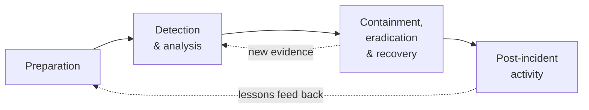
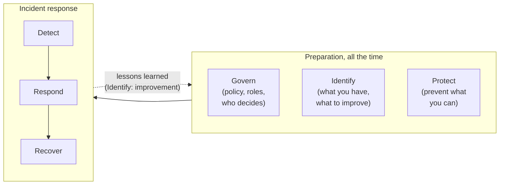

# 13.7 Security incident response

You've seen an outage handled well ([chapter 13.5](./incidents-and-postmortems.mdx)): someone declares an incident, a commander coordinates, the team mitigates first and investigates later, and a blameless postmortem makes the system better. A security incident starts the same way, with an alert, a channel and a commander. Then it changes. On the other side there's a **person**, who may be watching you respond and changing tactics. The broken thing is also a **crime scene**, so cleaning up too early destroys the evidence you need. And the law may give you **a deadline measured in hours** to tell regulators and the people affected. This chapter is the playbook for that situation, built on two real incidents with public reports. It ends with a drill you run on a real service, where you find, contain and write up a leaked API key, and a tabletop exercise you can run with a friend and a kitchen timer.

## What you'll learn

- How a **security incident** differs from an outage: an adversary, evidence, unknown scope, and **legal clocks** such as GDPR's **72 hours**.
- The **NIST SP 800-61 Rev. 3** lifecycle (2025), and the older four phases you'll still hear everywhere.
- Where **detection** comes from: your tools, your logs, and very often someone else.
- **Containment first** (revoke, rotate, isolate), then **eradication** and **recovery**.
- **Preserving evidence**: log retention, snapshots, hashes, a timeline and **chain of custody**.
- **Communicating** under pressure, and the **blameless postmortem** when there was an attacker.

---

## A security incident has an opponent

:::note[Everyday anchor]
A burst pipe and a burglary both leave a mess in your kitchen. For the pipe, you turn off the water, mop up, call a plumber, done. For the burglary, you don't mop before the police see the footprints. You change *every* lock, because you don't know which keys were copied. You check the burglar isn't still upstairs. And your insurer wants to hear from you within a set number of days, or won't pay.
:::

A **security incident** is an event that threatens the **confidentiality** (secrets kept secret), **integrity** (data not tampered with) or **availability** of your systems or data, usually because someone is acting deliberately. A leaked API key, a compromised laptop, a malicious package in your build, an employee exporting customer data on their last day: all security incidents, even if every service is up and every dashboard is green.

Most of what [chapter 13.5](./incidents-and-postmortems.mdx) taught still applies: declare early, one **incident commander** who coordinates rather than debugs, a scribe keeping a timeline, mitigation before root cause. What changes:

| | Outage | Security incident |
|---|---|---|
| **Cause** | A bug, a dependency, a bad deploy | A person, who adapts when you respond |
| **First goal** | Restore service | Stop the attacker's access, *without* destroying evidence |
| **Scope** | Usually visible: this service is down | Unknown: what else did they touch, and are they still in? |
| **Evidence** | Nice to have for the postmortem | Essential: for scope, for regulators, sometimes for court |
| **Communication** | Broad and fast: status page, everyone | Need-to-know at first; the attacker may be reading your chat |
| **Deadlines** | Your own SLOs | The law's and your contracts' |
| **Who's involved** | Engineers | Engineers, security, legal, leadership, sometimes police and insurers |

### The clocks start when you become aware

Many laws and contracts require you to report certain incidents within a fixed time. Engineers don't decide whether a report is needed (that's legal's call), but they must know the clocks exist, because the investigation feeds the report and the clock starts early:

- **GDPR** (EU and UK data protection law), when **personal data** is breached: the organisation responsible tells its data protection authority "without undue delay and, where feasible, not later than **72 hours** after having become aware of it" ([Article 33](https://gdpr-info.eu/art-33-gdpr/)), and tells the affected people directly if the breach is likely to put them at **high risk** ([Article 34](https://gdpr-info.eu/art-34-gdpr/)). A company processing data on behalf of another (a SaaS vendor, for instance) must tell its customer without undue delay, so the customer can meet *their* 72 hours.
- **NIS2** (the EU's directive for essential and important services, from energy to cloud providers): an **early warning within 24 hours** of becoming aware of a significant incident, a fuller notification within 72 hours, and a final report within a month ([Article 23](https://eur-lex.europa.eu/eli/dir/2022/2555/oj)).
- **US public companies**: an SEC filing (Form 8-K, Item 1.05) within **four business days** of deciding an incident is material to investors.
- **Contracts**: enterprise customers often require notice within 24–72 hours, written into their agreements.

"Aware" means reasonably certain that a breach happened, not "finished investigating". **Seventy-two hours includes weekends.** That's why the drill at the end of this chapter has you write the timeline *as you go*: the regulator's first question is what happened, when, to whose data, and what you've done about it. (This is general information, not legal advice. Which rules apply depends on where you operate and whose data you hold.)

---

## The lifecycle, from NIST

The best-known framework for incident response comes from **NIST** (the US National Institute of Standards and Technology), in **Special Publication 800-61**. For over a decade its Revision 2 (2012) described a four-phase cycle that most training, tools and job descriptions still use:



In April 2025 NIST replaced it with **Revision 3**, *Incident Response Recommendations and Considerations for Cybersecurity Risk Management: A CSF 2.0 Community Profile* ([NIST](https://csrc.nist.gov/pubs/sp/800/61/r3/final)). The change in the title is the point: incident response is no longer a separate procedure but part of an organisation's whole cybersecurity programme, organised by the six functions of NIST's **Cybersecurity Framework 2.0** (CSF):



How to read it:

- **Govern, Identify, Protect** are preparation, and they happen continuously, not only before an incident: deciding who's in charge and who may call legal at 3 a.m., knowing what systems and data you have, and putting preventive controls in place ([chapter 12.8](../cloud/cloud-security.mdx)'s guardrails are Protect).
- **Detect, Respond, Recover** are the incident itself. Respond covers analysis, containment, eradication, reporting and communication; Recover is getting back to normal operations with confidence.
- **Lessons learned** aren't a final phase any more. They feed improvement into every function, at any time, including in the middle of an incident.

The ideas haven't changed much; the framing has. You'll meet both vocabularies at work, so this chapter uses plain words that fit both: detect, contain, eradicate, recover, learn.

---

## Detection: often, someone else tells you

You'd like every incident to begin with your own alarm. In practice, detection comes from several places:

- **Your security tools**: GuardDuty-style threat detection, unusual-login alerts, a web application firewall, endpoint protection on laptops ([chapter 12.8](../cloud/cloud-security.mdx)).
- **Your own telemetry**: a spike in `401` responses (someone trying keys), a burst of `AccessDenied` in the cloud audit log (someone probing what a stolen credential can do), a server talking to an address it never talked to before.
- **Secret scanning**: GitHub scans public pushes for known key formats and notifies the issuer ([chapter 7.6](../security/secrets-management.mdx)). That's why keys with a recognisable prefix are worth having.
- **Customers and strangers.** Two of the incidents in this chapter were found by customers: CircleCI's by a customer who noticed suspicious GitHub activity, Codecov's by a customer who checked a downloaded script's checksum. Capital One's was reported by an outside researcher through its responsible disclosure programme. Make it easy for outsiders to reach you: a `security@` address and a `/.well-known/security.txt` file (a small standard file, RFC 9116, saying how to report a vulnerability).

The first job after any signal is **triage**: is it real, what might be affected, and how bad could it be? If there's a plausible chance that someone unauthorised has access, **declare a security incident** and open a **private** channel. A false alarm costs an hour. A late declaration can cost the 72 hours.

---

## Contain first: shrink what the attacker can do

:::note[Everyday anchor]
When a fire starts in one room, the first move is to close the fire doors, not to find the cause. The fire still burns, but now it burns in one room.
:::

**Containment** limits what the attacker can do *right now*, before you understand everything. Typical moves:

- **Revoke or rotate credentials** the attacker has or might have: API keys, passwords, cloud access keys, OAuth tokens, session cookies (signing everyone out).
- **Disable accounts** that were taken over.
- **Isolate a machine** rather than turn it off: move it into a security group or network that allows nothing in or out. Powering it off destroys what's in memory, often the best evidence.
- **Block** an attacker's IP addresses (useful, but weak: addresses are cheap) or take a feature offline.

The rule for credentials: **anything the compromised thing could read is compromised.** If a CI system was breached, every secret its jobs could see is exposed, not only the one you know was used.

### Two real responses

**CircleCI, January 2023.** Malware on one engineer's laptop, undetected by antivirus, stole a **session cookie** for the company's single sign-on, one that had already passed two-factor authentication. With it, the attacker impersonated the engineer, reached production systems, and on 22 December 2022 copied customer data: environment variables, tokens and keys that customers had stored for their builds. The data was encrypted at rest, but the attacker extracted the encryption keys from a running process. A customer reported suspicious GitHub OAuth activity on 29 December. CircleCI began rotating every customer's GitHub OAuth tokens on their behalf from 31 December, and on 4 January told every customer to **rotate all secrets** stored in CircleCI, with a list of what that meant and the attacker's IP addresses so customers could search their own logs ([CircleCI's incident report](https://circleci.com/blog/jan-4-2023-incident-report/)).

Notice three things. The containment was **broad**: rotate everything, because the attacker could read everything. CircleCI couldn't rotate customers' secrets for them (they were customers' keys to customers' systems), so it **told customers exactly what to do** and gave them **indicators of compromise** (IoCs: IP addresses and other traces that show an attacker was there). And the report includes a section titled "A note on employee responsibility vs. systems safeguards", saying the engineer did nothing wrong and the systems should have caught it: a blameless postmortem, in public.

**Codecov, April 2021.** Codecov's Bash Uploader, a script thousands of CI pipelines downloaded and ran on every build, had been modified by an attacker from 31 January 2021. The changed script sent the environment variables of every CI job that ran it (often full of credentials) to a server outside Codecov. The attacker had obtained the credential needed to change the script through an error in Codecov's Docker image creation process. A customer noticed on 1 April because they compared the script's checksum with the one Codecov published, and they didn't match ([Codecov's security update](https://about.codecov.io/security-update/)). Codecov secured the script, rotated its own credentials, and advised every customer who had used the uploader without checking its checksum to **"re-roll all of your credentials, tokens, or keys"** in their CI environment.

That's a **supply-chain** incident: the attacker never touched the victims' systems directly; they changed something the victims trusted and ran. The lesson for your side: pin and verify what your build downloads (by checksum or digest, [chapter 9.4](../containers/images-in-production.mdx)), and keep CI secrets few and short-lived (OIDC instead of stored keys, [chapter 12.4](../cloud/iam.mdx)).

:::warning[What can go wrong]
- **Tipping off the attacker early.** If you rotate one credential and they notice, they may switch to another they hold, or start destroying things. With an active intruder, plan containment as one coordinated event: everything rotated, every backdoor closed, within minutes.
- **Containing the wrong scope.** Rotating the key you know about while three others sit in the same leaked file.
- **Talking in a compromised channel.** If the attacker has an employee's identity, they may be able to read the company chat. CircleCI's attacker held exactly that kind of session. Move the response to an out-of-band channel (phone, a separate account) when identity is in question.
:::

---

## Preserve evidence before you clean up

Every action you take changes the system. Restarting a server clears its memory; recreating a container deletes its logs; "tidying up" a compromised account removes the record of what the attacker created. **Evidence** is what lets you answer the questions that matter: how did they get in, what did they see, are they gone? It's also what regulators, customers, insurers and sometimes courts will ask for.

The practices that make evidence trustworthy:

- **Collect the most volatile first.** RFC 3227, *Guidelines for Evidence Collection and Archiving* ([RFC Editor](https://www.rfc-editor.org/rfc/rfc3227)), lists the **order of volatility**: memory and network connections vanish first, then running processes, then disks, then logs and backups. Capture memory before rebooting; snapshot a cloud disk before rebuilding the server.
- **Copy, don't analyse in place.** Work on copies; keep the originals untouched.
- **Hash what you collect.** A SHA-256 checksum of each file, recorded when you collect it, later proves the file hasn't changed ([chapter 7.1](../security/security-literacy.mdx)).
- **Write-once storage.** Put evidence and audit logs where nobody can alter or delete them, including you (S3 Object Lock, a separate log-archive account, [chapter 12.8](../cloud/cloud-security.mdx)).
- **Chain of custody.** A simple log of who collected each item, when, how, where it's stored and who has accessed it since. Without it, evidence is easy to challenge.
- **Retention, decided in advance.** You can only investigate as far back as your logs go. CircleCI's report dates the laptop's compromise to 16 December and the theft to 22 December, two weeks before its public notice; answering questions like those needs logs that reach back that far. Plan retention for attackers who go unnoticed for weeks, not for yesterday's debugging.

Throughout, keep **the timeline**: one document, every entry in **UTC**, each with its source ("02:37:58 DELETE /api/links/pricing, snip API log"). It's the backbone of the investigation, the regulator's report and the postmortem.

---

## Eradicate, then recover

**Eradication** removes everything the attacker left behind and closes the way they came in:

- **Persistence**: attackers create ways back before you notice them: new users, extra access keys, SSH keys, OAuth apps, scheduled jobs, modified images. Search the audit log for everything the compromised identity *created* or *changed*, not only what it read.
- **The entry point**: fix the misconfiguration, patch the vulnerability, change the process that leaked the credential.

**Recovery** returns to normal operation, with confidence that the attacker isn't still there:

- **Rebuild, don't clean.** Replace compromised machines with fresh ones built from known-good code and images. Infrastructure as code ([chapter 12.5](../cloud/terraform-from-zero.mdx)) makes this one command. CircleCI "rotated all potentially exposed production hosts" rather than trying to clean them.
- **Restore data** from backups taken *before* the compromise, after checking the backups themselves weren't touched.
- **Watch closely** for a while: extra alerts on the indicators you found, in case they come back.

---

## Communicating during a security incident

[Chapter 13.5](./incidents-and-postmortems.mdx)'s rule still holds: say what you know, on a promised schedule. Security incidents add constraints:

- **Need-to-know at first.** A small group, in a private channel, until containment is done. Public detail too early helps the attacker.
- **Legal and leadership early**, because of the clocks. Legal review of external statements matters, but it can't become a reason to say nothing for a week.
- **Tell customers what to do**, not only what happened: which secrets to rotate, which dates to search their logs for, which IoCs to look for. CircleCI's and Codecov's notices are good models.
- **Facts, not speculation.** "We are investigating unauthorised use of one API key" is true and useful. "No data was accessed" before you know that is a statement you may have to retract.

---

## The postmortem, when there was an attacker

The postmortem is still **blameless** ([chapter 13.5](./incidents-and-postmortems.mdx)): a person who clicked a phishing link or pasted a key in the wrong place was doing their job in a system that let one mistake become a breach. It answers four questions, each with contributing factors and action items:

1. **How did they get in?** (The leaked key, the stolen session, the modified script.)
2. **Why didn't a control stop it?** (No MFA, a credential that never expired, a role that could read everything.)
3. **Why didn't we notice sooner?** (No alert on that signal, logs missing a field, nobody watching the findings.)
4. **What slowed the response?** (Couldn't tell which customer a key belonged to, logs gone after a restart, no runbook.)

---

## Apply it to snip: a leaked API key

snip, the URL shortener this handbook builds, authenticates API callers with keys such as `snip_9fQ…` ([chapter 7.2](../security/authentication.mdx)). It stores only each key's SHA-256 hash, against an **owner** id, and every link belongs to an owner. A leaked key lets whoever holds it list, create and delete its owner's links, which for a link shortener means turning trusted short links into phishing links. Imagine a customer pastes their key into a public code snippet by mistake. What can you find out, and how fast can you stop it?

Running this drill while writing the chapter exposed two gaps in snip, both now fixed, and pointed at a third, fixed later.

**Gap 1: the logs couldn't say whose key made a request.** snip writes one JSON line per request ([chapter 13.1](./logs.mdx)), but the line had no owner, so there was no way to list everything a key did. Now the authentication middleware notes the owner's id, never the key, for the request's log line (`snip/internal/httpapi/middleware.go`):

```go
// authLog is filled in by requireKey and read by observe's log line, so every
// authenticated request's line says whose key made it (chapter 13.7: during a
// leak, that is how you find what the key did). Only the owner's id is
// logged, never the key.
type authLog struct{ ownerID int64 }
```

`observe`, the middleware that writes the log line, puts an empty `authLog` into each request's context; `requireKey` fills it in after a key checks out:

```go
		if who, ok := r.Context().Value(authLogKey).(*authLog); ok {
			who.ownerID = owner.ID // for the request's log line
		}
```

and `observe` adds it to the line when the request finishes:

```go
			if who.ownerID != 0 {
				attrs = append(attrs, "owner_id", who.ownerID)
			}
```

A test (`TestRequestLogNamesTheKeysOwner` in `snip/internal/httpapi/server_test.go`) checks that an authenticated request's line carries `owner_id`, a rejected one doesn't, and no line contains the key.

**Gap 2: revoking a key locked its owner out of their own links.** `snip keys revoke` marks the key revoked, and a new `snip keys create` makes a *new owner*, who can't see the old owner's links. So containment punished the victim. snip now has `snip keys rotate`, which replaces the key's hash in place (`snip/internal/auth/keys.go`):

```go
func RotateKey(ctx context.Context, ks KeyStore, id int64) (string, error) {
	key := GenerateKey()
	if err := ks.ReplaceKey(ctx, id, HashKey(key)); err != nil {
		return "", err
	}
	return key, nil
}
```

In Postgres the swap is one statement (`snip/internal/store/postgres/postgres.go`), so there's no moment when both keys work, or neither:

```sql
UPDATE api_keys SET key_hash = $2 WHERE id = $1 AND revoked_at IS NULL
```

Because snip looks keys up in the database on every request instead of trusting a self-contained token, the old key fails from the very next request.

**Gap 3, closed later: the only record was the log.** The drill's evidence of what the key did came from container logs, and step 8 of the lab shows how easily those vanish. snip now also keeps an **audit trail** in Postgres: one row in `audit_events` for every link created or deleted and every key created, rotated or revoked, with the owner, the request ID of the request that did it, and the link's URL. Each row is written in the same transaction as its change, and a trigger refuses any `UPDATE` or `DELETE` on the table, so nobody can quietly edit the history ([chapter 7.4](../security/authorization-multi-tenancy.mdx) explains both). `snip audit OWNER_ID` prints one owner's trail as JSON lines.

The steps are now a runbook section, `leaked-api-key` in `snip/docs/runbook.md`, and the lab walks through them.

---

## Lab

Free, on your computer with Docker, `curl` and `jq`, using snip's Compose stack ([chapter 9.3](../containers/docker-compose.mdx)). You'll play both sides: the attacker using a leaked key, then the responder. Keep a text file open as your **timeline** and add a line, in UTC, at each step.

:::tip[If port 8080 is taken]
If another program holds port 8080 on your machine, `curl localhost:8080` reaches that program instead. Find nginx's own address with `docker inspect -f '{{range .NetworkSettings.Networks}}{{.IPAddress}}{{end}}' snip-nginx-1` and use `http://<that address>` (port 80) on Linux, or change the published port in `docker-compose.yml`.
:::

1. **Start snip and give it a customer.**
   ```bash
   cd ~/code/zero-to-prod/snip
   docker compose up -d --build --wait
   ALICE=$(docker compose exec -T api snip keys create alice | grep -o 'snip_[A-Za-z0-9]*')   # owner id 1: our victim
   docker compose exec -T api snip keys create bob > /dev/null                                # owner id 2: unaffected
   curl -s -X POST localhost:8080/api/links -H "Authorization: Bearer $ALICE" -d '{"url":"https://go.dev","slug":"docs"}'
   curl -s -X POST localhost:8080/api/links -H "Authorization: Bearer $ALICE" -d '{"url":"https://example.com/pricing","slug":"pricing"}'
   ```
   Alice now has two links. Pretend she then pastes `$ALICE` into a public snippet.

2. **Be the attacker.** Run requests from a separate container on snip's network, so they come from a different address than yours:
   ```bash
   attacker() { docker run --rm --network snip_default curlimages/curl:8.17.0 -s "$@"; }
   attacker -H "Authorization: Bearer $ALICE" http://nginx/api/links                       # what does this key own?
   attacker -X POST -H "Authorization: Bearer $ALICE" \
     -d '{"url":"https://login.example.net/verify","slug":"login"}' http://nginx/api/links   # a phishing link under a trusted name
   attacker -X DELETE -H "Authorization: Bearer $ALICE" -o /dev/null -w '%{http_code}\n' \
     http://nginx/api/links/pricing                                                           # 204: a real link destroyed
   ```

3. **Detect and identify.** Alice emails: "I think I leaked my key, here it is." snip never stores keys, only their hashes, so hash it the same way and look it up:
   ```bash
   LEAKED=$ALICE                                                     # the key from the report
   HASH=$(printf %s "$LEAKED" | sha256sum | cut -d' ' -f1)           # macOS: shasum -a 256
   docker compose exec -T postgres psql -U snip -c \
     "SELECT id, name, created_at, revoked_at FROM api_keys WHERE key_hash = '$HASH'"
   ```
   ```text
    id | name  |          created_at           | revoked_at
   ----+-------+-------------------------------+------------
     1 | alice | 2026-10-30 04:36:31.372103+00 |
   ```
   Owner 1, still active. Declare a security incident and start the timeline.

4. **Contain: rotate the key.**
   ```bash
   NEW=$(docker compose exec -T api snip keys rotate 1 | tee /dev/stderr | grep -o 'snip_[A-Za-z0-9]*')
   attacker -H "Authorization: Bearer $ALICE" http://nginx/api/links; echo                   # the attacker's next try
   curl -s localhost:8080/api/links -H "Authorization: Bearer $NEW" | jq -c '.links[] | {slug, url}'
   ```
   The attacker now gets `{"error":{"code":"unauthorized",…}}`; Alice's new key sees her links, including the attacker's `login` link. Containment took one command and seconds, and it didn't restart anything, so no evidence was lost. (In real life, you'd send `$NEW` to Alice through a channel the attacker can't read.)

5. **Preserve the evidence.** Container logs live only as long as their containers, so copy them out *before* anything restarts:
   ```bash
   EVID=~/incident-drill && mkdir -p "$EVID"
   docker compose logs api --no-log-prefix > "$EVID/api.jsonl"        # snip's JSON request log
   docker compose logs nginx --no-log-prefix > "$EVID/nginx.log"      # client addresses
   docker compose exec -T postgres pg_dump -U snip --data-only -t api_keys -t links -t audit_events snip > "$EVID/db.sql"
   (cd "$EVID" && sha256sum api.jsonl nginx.log db.sql > SHA256SUMS && cat SHA256SUMS)   # macOS: shasum -a 256
   ```
   Note in your timeline who collected these, when, and where they are: that's your chain of custody. The dump includes the audit trail too: it can't be edited inside the database, but a copy outside it, with a hash, is evidence you control.

6. **Scope: what did the key do, and from where?**
   Start with the audit trail, snip's record of every change:
   ```bash
   docker compose exec -T api snip audit 1 | jq -r '[.at, .action, .slug, .request_id] | @tsv'
   ```
   ```text
   2026-10-30T04:36:34.43304Z   key.rotated
   2026-10-30T04:36:33.916414Z  link.deleted  pricing  6abe424491209851
   2026-10-30T04:36:33.357912Z  link.created  login    477ef128ccf17942
   2026-10-30T04:36:31.513689Z  link.created  pricing  ecdd44d7960e80c4
   2026-10-30T04:36:31.501053Z  link.created  docs     39b51611d17c0464
   2026-10-30T04:36:31.372103Z  key.created
   ```
   Newest first: everything that changed Alice's key or links, with the request that did it. It lists changes only. The attacker's first move, a `GET` that showed them all of Alice's links, changed nothing, so it's only in the request log:
   ```bash
   jq -r 'select(.msg == "request" and .owner_id == 1) | [.time, .request_id, .method, .path, .status] | @tsv' "$EVID/api.jsonl"
   grep ' /api/' "$EVID/nginx.log"
   jq -r 'select(.msg == "request" and .status == 401) | [.time, .method, .path] | @tsv' "$EVID/api.jsonl"
   ```
   ```text
   2026-10-30T04:36:31.505591035Z  39b51611d17c0464  POST    /api/links          201
   2026-10-30T04:36:31.516207659Z  ecdd44d7960e80c4  POST    /api/links          201
   2026-10-30T04:36:32.821047101Z  05b10556f7c0ee83  GET     /api/links          200
   2026-10-30T04:36:33.361454876Z  477ef128ccf17942  POST    /api/links          201
   2026-10-30T04:36:33.920209998Z  6abe424491209851  DELETE  /api/links/pricing  204
   2026-10-30T04:36:35.014780284Z  0afc0bf36edec624  GET     /api/links          200
   ```
   The `owner_id` lines are everything the key did, reads included, and each change's request ID matches its audit row exactly. Which were Alice and which the attacker? Neither record holds client addresses, so match by time, method and path against nginx's log:
   ```text
   172.21.0.1 - - [30/Oct/2026:04:36:31 +0000] "POST /api/links HTTP/1.1" 201 134 "-" "curl/8.18.0" "-"
   172.21.0.8 - - [30/Oct/2026:04:36:32 +0000] "GET /api/links HTTP/1.1" 200 299 "-" "curl/8.17.0" "-"
   172.21.0.8 - - [30/Oct/2026:04:36:33 +0000] "POST /api/links HTTP/1.1" 201 154 "-" "curl/8.17.0" "-"
   172.21.0.8 - - [30/Oct/2026:04:36:33 +0000] "DELETE /api/links/pricing HTTP/1.1" 204 0 "-" "curl/8.17.0" "-"
   172.21.0.8 - - [30/Oct/2026:04:36:34 +0000] "GET /api/links HTTP/1.1" 401 73 "-" "curl/8.17.0" "-"
   ```
   (An excerpt; your addresses and versions will differ.) A second address and a different client did a GET, a POST and a DELETE, then got a `401` after the rotation. Notice the weak spot: nginx's log has one-second precision and no request ID, so the match is by time. A request ID shared by both logs would make it exact; that's an action item.

7. **Eradicate and recover.** Remove what the attacker created; restore what they destroyed:
   ```bash
   curl -s -o /dev/null -w '%{http_code}\n' -X DELETE localhost:8080/api/links/login -H "Authorization: Bearer $NEW"   # 204
   curl -s -X POST localhost:8080/api/links -H "Authorization: Bearer $NEW" \
     -d '{"url":"https://example.com/pricing","slug":"pricing"}'                                                    # back again
   ```
   Where did the deleted link's URL come from? Not from snip's logs: they don't record request bodies. From the audit trail, whose `link.deleted` row keeps the URL the link pointed to:
   ```bash
   docker compose exec -T api snip audit 1 | jq -r 'select(.action == "link.deleted") | .detail.url'   # https://example.com/pricing
   ```
   Without that row, you'd have to ask Alice, or restore a database backup taken before the incident.

8. **Rotate what leaked alongside it.** Suppose the snippet Alice leaked was her whole `.env` file, with the database URL in it. Change the database password, then give the new one to snip:
   ```bash
   NEWPW=$(openssl rand -hex 24)
   docker compose exec -T postgres psql -U snip -c "ALTER ROLE snip PASSWORD '$NEWPW'"
   printf 'services:\n  api:\n    environment:\n      SNIP_DATABASE_URL: postgres://snip:%s@postgres:5432/snip?sslmode=disable\n  worker:\n    environment:\n      SNIP_DATABASE_URL: postgres://snip:%s@postgres:5432/snip?sslmode=disable\n' \
     "$NEWPW" "$NEWPW" > docker-compose.override.yml      # Compose reads this file automatically
   docker compose up -d --wait                             # recreates api and worker with the new URL
   curl -s localhost:8080/api/links -H "Authorization: Bearer $NEW" | jq '.links | length'           # 2: snip works
   docker run --rm --network snip_default -e PGPASSWORD=snip postgres:18-alpine \
     psql -h postgres -U snip -c 'SELECT 1'                                                          # old password: refused
   docker compose logs api --no-log-prefix | jq -c 'select(.owner_id == 1)' | wc -l
   docker compose exec -T api snip audit 1 | wc -l
   ```
   The log count is `1`, the request you made a moment ago. Every earlier line is gone: the API containers were recreated, and **their logs went with them**. If you'd skipped step 5, the evidence of the attacker's reads would now be gone. The audit trail still has all `8` events, because it lives in the database, not in a container. (If requests start failing with `502`, run `docker compose restart nginx`: it looked up the API containers' addresses when it started.)

9. **Write it up.** Turn your timeline into a postmortem with [chapter 13.5](./incidents-and-postmortems.mdx)'s template and the four questions above. Include, at least: impact (one customer; one link deleted, one phishing link live for about two minutes), how long the key was exposed, the contributing factors, and action items, such as a request ID in nginx's log, shipping logs and audit events off the machines that produce them ([chapter 13.1](./logs.mdx)), an alert on unusual key activity, and backups you've tested restoring.

10. **Clean up.** The database volume now has the new password, so remove both together:
    ```bash
    rm docker-compose.override.yml
    docker compose down -v                                  # -v deletes the database volume too
    rm -r ~/incident-drill
    ```

### A tabletop exercise to run with a friend

A **tabletop exercise** is a rehearsal on paper: one person (the **facilitator**) reads out a scenario in stages, and the others say what they would do, without touching any system. It finds the gaps in your plan cheaply. You need 45 minutes, a timer and this script. One person facilitates; the other plays the on-call engineer (with more people, add an incident commander and a communications lead).

**Rules:** the facilitator reveals one inject at a time, answers questions only with what the scenario says, and writes down every decision and every "I don't know". Nobody is graded.

1. **Monday 09:10 (inject 1).** An email from GitHub: "We found a snip API key in a public gist." It includes the key. *Ask:* Is this an incident? Who do you tell first? What do you do in the next ten minutes, and in what order?
2. **09:25 (inject 2).** The key belongs to a large customer. The logs show `DELETE` requests from it at 03:00 and 03:12 last night, from an address the customer doesn't recognise. *Ask:* Rotate or revoke? How do you get the new key to the customer safely? What evidence do you save, and where?
3. **09:40 (inject 3).** A user posts publicly that a short link from that customer now leads to a page asking for their bank password. *Ask:* What do you do about the link right now? What do you say publicly, and who approves it? Who else might have clicked it?
4. **10:15 (inject 4).** The gist also contained `SNIP_DATABASE_URL` with the production password. *Ask:* What changes about the scope? What's the order of operations for rotating the database password without an outage? Could the attacker have read other customers' data?
5. **11:00 (inject 5).** The customer is in the EU, and the phishing page collected some of its users' passwords. Their legal team asks when you became aware and what personal data was involved. *Ask:* When did the clock start? What do you need from engineering to answer them? Who decides whether a regulator must be notified?
6. **Debrief (15 minutes).** What did you not know how to do? Which command or permission were you unsure you had? Which log didn't exist? Turn each into an action item with an owner, exactly as in a real postmortem.

Run it again in three months with the action items done, and swap roles.

## Self-check

<Quiz
  id="observability-security-incident-response"
  questions={[
    {
      q: 'A server you suspect is compromised is still running. What do you do first?',
      options: [
        'Power it off at once, so the attacker loses their foothold immediately',
        'Isolate it on the network and capture memory and a disk snapshot',
        'Reinstall it from a clean image, then look at the old logs for clues',
        'Leave it alone and block the attacker’s IP address at the firewall',
      ],
      answer: 1,
      explain: 'Isolation (a security group or network that allows nothing in or out) stops the attacker using it, while keeping what’s in memory, the most volatile and often the best evidence (RFC 3227’s order of volatility). Powering off destroys memory; reinstalling destroys the disk too. Blocking one IP is weak containment: addresses are cheap, and the attacker keeps the machine.',
    },
    {
      q: 'Under GDPR, when does the 72-hour clock for notifying the data protection authority start?',
      options: [
        'When the investigation is complete and the full impact is known',
        'When the organisation becomes aware of a personal data breach',
        'When the attacker first gained access to the systems involved',
        'When the first affected customer complains about the breach',
      ],
      answer: 1,
      explain: 'Article 33 counts from becoming aware, meaning reasonably certain a breach of personal data happened, not from finishing the investigation (you can send details in stages) and not from when the attacker got in, which you may only learn later. Weekends count. That’s why legal must hear early and the timeline is written as you go.',
    },
    {
      q: 'CircleCI found that an attacker had copied customers’ stored secrets. Why did it tell every customer to rotate all of them, rather than only the ones it knew were used?',
      options: [
        'Rotating every secret was required by the SOC 2 audit CircleCI had passed',
        'Anything the attacker could read must be treated as compromised',
        'CircleCI could not tell which customers used environment variables',
        'Rotating everything was faster for CircleCI than investigating usage',
      ],
      answer: 1,
      explain: 'The attacker held copies of the secrets and the keys to decrypt them. A copied secret can be used at any time, from anywhere, often in systems CircleCI can’t see. The only safe assumption is that every exposed secret is compromised, so every one is replaced. The rule: scope containment by what the attacker could reach, not by what you’ve seen them use.',
    },
    {
      q: 'In the drill, why do you copy the container logs before rotating the database password?',
      options: [
        'Rotating the password makes Postgres delete its own log files',
        'Applying the new password recreates the API containers, and their logs go with them',
        'The logs are encrypted with the old password and can’t be read afterwards',
        'jq can only read logs from containers that are still running',
      ],
      answer: 1,
      explain: 'Container logs live with the container. Giving snip the new password means recreating the api and worker containers, which deletes the old ones and their logs; step 8’s count proves it. Preserve evidence before any action that restarts or rebuilds things, and in production ship logs to central, retained storage so a restart can’t erase them.',
    },
    {
      q: 'A leaked snip key belongs to a customer who still needs API access. Why use snip keys rotate rather than snip keys revoke?',
      options: [
        'Revoke takes effect only after the API’s cache expires; rotate is immediate',
        'Rotate stops the old key and gives the same owner a new one, so their links stay theirs',
        'Revoke deletes the owner’s links along with the key, which destroys the evidence',
        'Rotate also logs the attacker out of every other service that used the key',
      ],
      answer: 1,
      explain: 'Both stop the old key from the next request, since snip checks keys in the database on every request. Revoke leaves the owner with no working key, and a new key from keys create is a new owner who can’t see the old links. Rotate swaps the hash in place, so the same owner id, and its links, carry on with the new key. Revoked rows are kept, not deleted, and neither command reaches other services.',
    },
  ]}
/>

<details>
<summary>Your on-call engineer sees a burst of AccessDenied errors in the cloud audit log, all from one CI role, at 02:00 on a Sunday. Walk through the first hour.</summary>

1. **Triage (minutes 0–10).** Is it real? Check the source IP and user agent: is it your CI provider's range, and did a pipeline run then? A misconfigured new job also produces denials. If the calls come from outside your CI provider, or are trying things CI never does (`iam:ListUsers`, `s3:ListAllMyBuckets`), treat it as a stolen credential: **declare a security incident**, open a private channel, name an incident commander.
2. **Contain (10–25).** The denials are good news: least privilege is working. But find what the role *was* allowed to do and whether any of those calls succeeded (filter the same identity for events without an `errorCode`). Cut its access: if CI uses OIDC ([chapter 12.4](../cloud/iam.mdx)), tighten or detach the trust policy; if it's a stored access key, deactivate it. Find where the credential could have leaked from (a CI log, a fork's workflow, a compromised dependency) and assume everything else stored there is exposed too.
3. **Preserve (25–40).** Export the relevant CloudTrail events to the evidence store and hash them; snapshot anything the role changed; note the CI runs from that time and keep their logs.
4. **Communicate (throughout).** Timeline in UTC from the first signal. Tell the security lead and legal early, before you know whether data was touched, so they can judge whether any clock has started.
5. **Then** eradicate (look for anything created: users, keys, roles, functions) and recover, and schedule the postmortem.

The order is the lesson: triage fast, contain by what the credential *could* do, save the evidence before changing more, and bring legal in early.

</details>

<details>
<summary>Why are blameless postmortems still the right approach when an employee clicked a phishing link that led to a breach?</summary>

Because blaming the person fixes nothing and makes the next incident worse. Phishing works on careful people: CircleCI's attacker stole a session that had *already passed* two-factor authentication, from a laptop where antivirus saw nothing, and CircleCI's own report says the systems, not the engineer, should have caught it. If people are punished for reporting, the next person who clicks a strange link stays quiet, and you lose the hours that matter most.

The useful questions are about the system. Why could one laptop's session reach production? Why didn't production access require a fresh, phishing-resistant login (a passkey or hardware key, [chapter 7.7](../security/mfa-and-passkeys.mdx))? Why did the session last so long? Why did nothing alert on a login from a new location? Each answer becomes an action item that protects against the *next* phishing email, which someone will click.

</details>
