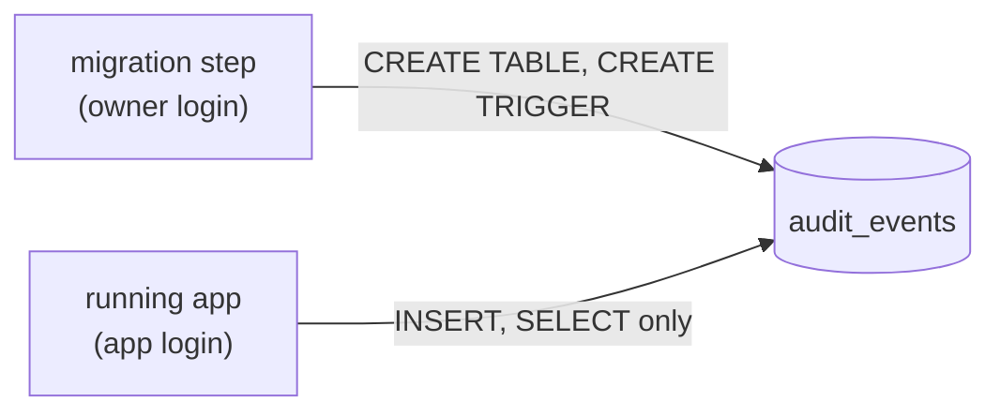

export const rlsSetup = `
CREATE TABLE links (
  slug text PRIMARY KEY,
  url text NOT NULL,
  tenant_id int NOT NULL
);
INSERT INTO links VALUES
  ('godoc',  'https://go.dev/doc/', 1),
  ('pgdocs', 'https://www.postgresql.org/docs/', 1),
  ('launch', 'https://blog.example/launch', 2),
  ('sale',   'https://shop.example/sale', 3);
CREATE ROLE app_user;
GRANT SELECT, INSERT, UPDATE, DELETE ON links TO app_user;
ALTER TABLE links ENABLE ROW LEVEL SECURITY;
CREATE POLICY tenant_isolation ON links
  USING (tenant_id = current_setting('app.tenant_id')::int)
  WITH CHECK (tenant_id = current_setting('app.tenant_id')::int);
`;

export const auditSetup = `
CREATE TABLE audit_events (
  id bigserial PRIMARY KEY,
  at timestamptz NOT NULL DEFAULT now(),
  owner_id bigint NOT NULL,
  action text NOT NULL
);
INSERT INTO audit_events (owner_id, action) VALUES (1, 'key.created'), (1, 'link.created');
CREATE FUNCTION audit_events_append_only() RETURNS trigger LANGUAGE plpgsql AS $$
BEGIN
  RAISE EXCEPTION 'audit_events is append-only: % is not allowed', TG_OP;
END;
$$;
CREATE TRIGGER audit_events_append_only
  BEFORE UPDATE OR DELETE OR TRUNCATE ON audit_events
  FOR EACH STATEMENT EXECUTE FUNCTION audit_events_append_only();
CREATE ROLE snip_app;
GRANT SELECT, INSERT ON audit_events TO snip_app;
GRANT USAGE ON SEQUENCE audit_events_id_seq TO snip_app;
`;

# 7.4 Authorization & multi-tenancy

[Chapter 7.2](./authentication.mdx) answered *who is this?* Now the harder question: *what may they do?* Authentication is usually one well-tested piece of code at the front door. **Authorization** is scattered through every endpoint and every query: may this user see this link, delete that one, change these settings, read that invoice? Miss the check in just one place and one customer can read — or delete — another customer's data. That's not a hypothetical: **broken object-level authorization** has topped the OWASP list of API security risks since the list began. This chapter shows how to get authorization right, how systems that serve many customers from one database — **multi-tenant** systems — keep each customer's data walled off.

## What you'll learn

- The core rule: **check authorization on the server, for every request, on every object — deny by default.**
- **Ownership checks**, **roles** (RBAC), and **attributes and policies** (ABAC) — when to use each.
- **Broken object-level authorization (BOLA / IDOR)**: how it happens, and how to prevent it by construction.
- **Multi-tenancy**: shared tables, separate schemas or separate databases — the trade-offs.
- **Postgres row-level security**: making the *database* refuse to show one tenant another's rows — live in your browser.
- How a real service (snip, the URL shortener this handbook builds) scopes every query by owner — and how to attack it yourself.
- **Least privilege in the database**: the login that serves traffic owns nothing, so it can't drop the trigger that keeps snip's audit trail append-only.

---

## Deny by default, check every time

Three rules cover most of authorization:

1. **Enforce on the server.** Hiding a "Delete" button in the app is decoration, not security — anyone can call the API directly ([chapter 5.3](../apis/validation-errors-status-codes.mdx)).
2. **Deny by default.** Access is refused unless a rule explicitly allows it. Forgetting a rule then fails *closed* (a bug report) rather than *open* (a breach).
3. **Check every request, on every object.** Not "the user logged in, so they can do things" — "this user may perform *this action* on *this specific object*, right now."

:::note[Everyday anchor]
A hotel key card is authorization done well. It opens **your** room, the gym and the lift to **your** floor, until **your** checkout date — and nothing else. Being a hotel guest (authenticated) doesn't open every door. And the check happens at every door, every time, not once at reception.
:::

---

## Models of authorization

### Ownership: "is this yours?"

The simplest and most common rule: users may act on the things they own. Every invoice, document or link has an `owner_id`, and management operations only work on your own.

### Roles: RBAC

**Role-based access control** groups permissions into **roles**, and gives users roles:

| Role | Can |
|---|---|
| `viewer` | read links and stats |
| `editor` | + create and delete links |
| `admin` | + manage members and API keys |

Checking a role is simple (`if user.Role == "admin"`), and roles map well onto organisations and teams. The classic trap is **role explosion** — dozens of near-identical roles for every special case.

### Attributes and policies: ABAC

**Attribute-based access control** decides from attributes of the user, the object, the action and the context: *"editors may delete links in their own team's workspace, created in the last 30 days, during business hours."* Powerful, and harder to reason about. Large systems often move such rules into a dedicated **policy engine** (for example Open Policy Agent, Cedar, or relationship-based systems modelled on Google's Zanzibar) so they're written once and tested. [Chapter 7.10](./authorization-at-scale.mdx) builds both for snip: an OPA policy with tests, and a small relationship checker.

### Scopes

OAuth **scopes** ([chapter 7.3](./oauth-and-oidc.mdx)) limit what a *token* may do, independently of what the *user* may do: a dashboard token with `links:read` can't delete links even if its user could. Effective access is the **intersection** of both.

---

## The #1 API vulnerability: broken object-level authorization

Picture an API with this endpoint:

```http
GET /api/invoices/10432
Authorization: Bearer <alice's valid token>
```

The server authenticates Alice, then runs `SELECT * FROM invoices WHERE id = 10432` and returns it. Alice changes the number to `10433` — and gets **Bob's** invoice. Then `10434`… Authentication was perfect; the **authorization check on the object** was missing.

This is **BOLA** (Broken Object Level Authorization), also called **IDOR** (Insecure Direct Object Reference). It's number one on the OWASP API Security Top 10 because it's so easy to write: the code *works* in every test where users only ask for their own things. Sequential IDs make it trivial to exploit, but random IDs don't fix it — they only make it harder to find.

### The fix: scope the query, not the result

Don't fetch an object and *then* remember to check its owner in scattered handler code. Make the ownership condition **part of the query**, with the owner taken from authentication:

```sql
-- vulnerable: any authenticated caller can read any invoice
SELECT * FROM invoices WHERE id = $1;

-- fixed: as far as this query knows, the row only exists if it's yours
SELECT * FROM invoices WHERE id = $1 AND owner_id = $2;   -- $2 = the authenticated user's ID
```

Two details matter:

- **Same answer for "not yours" and "doesn't exist"**: `404 not_found`. A `403` would confirm the object exists, letting attackers map other customers' data ([chapter 5.2](../apis/designing-rest-apis.mdx)).
- **The owner comes from authentication, not input.** An API that accepts `{"owner_id": 7}` in the request and trusts it has handed authorization to the attacker.

The test that catches BOLA is short and worth writing for every endpoint: *user B tries user A's object, and must fail.* You'll run that attack against a real service in the lab.

---

## Multi-tenancy: many customers, one system

A **tenant** is a customer whose data must stay separate from everyone else's: a company on a team plan, a workspace, an organisation. A **multi-tenant** system serves many tenants from shared infrastructure. There are three main ways to separate tenants in the database:

| Model | How | Pros | Cons |
|---|---|---|---|
| **Shared tables** | Every table has a `tenant_id` column | Cheapest; simplest to run; easy cross-tenant analytics | One forgotten `WHERE tenant_id = …` leaks data; noisy neighbours share resources |
| **Schema per tenant** | Each tenant gets its own set of tables | Stronger separation; per-tenant restore | Thousands of schemas to migrate; harder analytics |
| **Database per tenant** | Each tenant gets its own database (or cluster) | Strongest isolation; per-tenant scaling and data location | Most expensive; operationally heavy |

Most SaaS products start with **shared tables** — and then must make sure the `tenant_id` filter can never be forgotten. Some offer separate databases to their largest customers, for isolation or data-residency requirements.

---

## Row-level security: let the database enforce it

In the shared-tables model, the danger is one query somewhere without `WHERE tenant_id = …`. Postgres can make that mistake **harmless** with **row-level security** (RLS): a **policy** on the table that the database applies to *every* query from the application's role, automatically.

```sql
ALTER TABLE links ENABLE ROW LEVEL SECURITY;

CREATE POLICY tenant_isolation ON links
  USING      (tenant_id = current_setting('app.tenant_id')::int)   -- which rows you can see/change
  WITH CHECK (tenant_id = current_setting('app.tenant_id')::int);  -- which rows you can write
```

At the start of each request (or transaction), the application tells Postgres which tenant it's acting for — `SET app.tenant_id = '1'` — and from then on Postgres silently adds the tenant filter to everything.

The playground below has links for three tenants and the policy above. It switches to an ordinary application role (`app_user` — RLS doesn't restrict superusers), acts as tenant 1, and runs a query with **no `WHERE` clause at all**:

<SqlPlayground setup={rlsSetup} sql={`SET ROLE app_user;
SET app.tenant_id = '1';

SELECT slug, tenant_id FROM links;   -- no WHERE clause, yet only tenant 1's rows`} />

Now as tenant 2, try to reach tenant 1's `godoc` link by name — and to change it:

<SqlPlayground setup={rlsSetup} sql={`SET ROLE app_user;
SET app.tenant_id = '2';

SELECT count(*) AS can_see_godoc FROM links WHERE slug = 'godoc';        -- 0: invisible
UPDATE links SET url = 'https://evil.example' WHERE slug = 'godoc'
RETURNING slug;                                                           -- 0 rows changed`} />

And if tenant 2 tries to *insert* a row labelled as tenant 1 (paste this into either box):

```sql
SET ROLE app_user;
SET app.tenant_id = '2';
INSERT INTO links VALUES ('sneaky', 'https://evil.example', 1);
-- ERROR: new row violates row-level security policy for table "links"
```

The `WITH CHECK` clause refuses it. Even a buggy query in application code can't cross the wall.

:::info[In the real world]
RLS is **defence in depth**, not a replacement for application checks: keep scoping queries in code (clear, testable), and let RLS catch the one you forget. It has costs — policies must be written carefully, connection pools must reset `app.tenant_id` between requests, and complex policies can slow queries. Platforms such as Supabase build their whole security model on Postgres RLS.
:::

---

## Admins, support staff and audit logs

Real systems need people who can see across tenants: support engineers, administrators, automated jobs. Handle that power carefully:

- **Separate, explicit admin paths** — not a hidden `?admin=true` flag.
- **Least privilege**: support gets read-only access to what they need, not everything.
- **"Act as user" with consent and an expiry**, rather than shared admin passwords.
- **Audit logs**: record who accessed what, when and why — append-only, stored separately, and reviewed. When a customer asks "who looked at my data?", you must be able to answer.

:::warning[What can go wrong]
- **BOLA / IDOR.** Fetching objects by ID without checking ownership. Scope every query by the authenticated owner or tenant.
- **Trusting IDs from the request.** `owner_id` or `tenant_id` in the body or URL, taken at face value. Derive them from authentication.
- **Checks only in the frontend.** Hidden buttons don't stop API calls.
- **Inconsistent checks.** Five endpoints check ownership, the sixth (added in a hurry) doesn't. Centralise checks in shared code, and test "user B tries user A's object" for every endpoint.
- **403 that reveals existence.** Prefer 404 for objects the caller shouldn't know about.
- **Mass assignment.** Binding a JSON body straight onto a database row lets a caller set fields like `role` or `owner_id`. Accept only the fields you intend (snip's strict decoding, [chapter 5.3](../apis/validation-errors-status-codes.mdx)).
:::

---

## Apply it to snip: ownership in every query

snip, the URL shortener this handbook builds, is multi-tenant in a small way: each API key's links are its own. It doesn't fetch a link and *then* check its owner in scattered handler code. The ownership condition is **part of the query**, or checked in the one shared service method every endpoint uses. Deleting (`snip/internal/store/postgres/postgres.go`):

```go
err := tx.QueryRow(ctx,
	`DELETE FROM links WHERE slug = $1 AND owner_id = $2 RETURNING url`, slug, ownerID,
).Scan(&url)
```

Reading (`snip/internal/links/service.go`):

```go
// Get returns a link's details, but only to its owner.
func (s *Service) Get(ctx context.Context, ownerID int64, slug string) (Link, error) {
	l, err := s.store.Get(ctx, slug)
	if err != nil {
		return Link{}, err
	}
	if l.OwnerID != ownerID {
		return Link{}, ErrNotFound // don't reveal that someone else's link exists
	}
	return l, nil
}
```

Listing: `SELECT … WHERE owner_id = $1`. And `ownerID` always comes from the **authenticated key** placed in the request context by `requireKey` ([chapter 7.2](./authentication.mdx)) — **never** from the request body or URL, which the caller controls.

Both rules from the fix above are visible: someone else's link gets the same `ErrNotFound` (a `404`) as a missing one, and the owner comes from the key. snip's HTTP tests check the "user B tries user A's link" path ([chapter 4.4](../go/testing.mdx)); step 3 of the lab lets you try it by hand.

A team version of snip, with workspaces shared by several people, would be a natural fit for the row-level security above: a `workspace_id` on every row, and a policy that makes the database enforce it.

### An audit trail nobody can edit

Authorization decides who *may* change a link; an **audit trail** records who *did*. snip writes one row to an `audit_events` table for every link created or deleted and every API key created, rotated or revoked: the owner, the action, the slug, the request ID from the request's log line, and details such as the URL a deleted link pointed to. Never the key. Each row is written in the same transaction as the change it records, so there's no change without its row ([chapter 6.5](../data/transactions.mdx)).

A record you can quietly edit isn't evidence, so the table is **append-only**: rows can be added, never changed or removed. The migration that creates it (`snip/internal/store/postgres/migrations/0002_audit_events.sql`) adds a **trigger**, a function the database runs automatically before certain statements, and this one refuses them all:

```sql
CREATE TRIGGER audit_events_append_only
    BEFORE UPDATE OR DELETE OR TRUNCATE ON audit_events
    FOR EACH STATEMENT EXECUTE FUNCTION audit_events_append_only();
```

Any `UPDATE`, `DELETE` or `TRUNCATE` on the table now fails with `audit_events is append-only`, whoever sends it: a bug, an injected query, an engineer in a hurry. `snip audit OWNER_ID` prints one owner's trail; [chapter 13.7](../observability/security-incident-response.mdx) uses it to investigate a leaked key.

A trigger has one weakness: whoever **owns** the table can run `DROP TRIGGER` first. Who owns it is the next question.

### Least privilege in the database: the app's login owns nothing

A shop's cashier can open the till and ring up sales, but can't change the prices in the system or tear pages out of yesterday's sales book. The manager's key does those things, and it stays in the office. Both people work in the same shop; they hold different keys.

Postgres works the same way. Every table has an **owner**: the role (a named identity in the database; a *login* is a role allowed to sign in) that created it. The owner may do anything to the table, including drop its trigger, and can grant itself back any permission it lacks. Every other role may do only what it has been **granted**: `SELECT`, `INSERT`, `UPDATE` or `DELETE`, table by table. So a service that creates its tables with the same login it serves traffic with can undo every protection on them, and so can anyone who steals that login's password or injects SQL through it.

The fix is **least privilege** ([chapter 2.2](../linux/users-permissions-processes.mdx)) applied to the database: two logins with two jobs.



The **owner** runs migrations and is used for nothing else. The **app login** is granted the row operations it needs and owns nothing. Try it in the playground: an owner has created the table and its trigger, and granted `snip_app` only `SELECT` and `INSERT`. The query switches to `snip_app`, adds an event and reads the trail:

<SqlPlayground setup={auditSetup} sql={`SET ROLE snip_app;

INSERT INTO audit_events (owner_id, action) VALUES (1, 'link.deleted');   -- allowed: granted
SELECT id, owner_id, action FROM audit_events;                           -- allowed: granted

SELECT privilege_type FROM information_schema.table_privileges
 WHERE grantee = 'snip_app' AND table_name = 'audit_events';             -- INSERT and SELECT, nothing else`} />

Now paste these, one at a time, into the box, starting each with `SET ROLE snip_app;`:

```sql
DELETE FROM audit_events;                                -- ERROR: permission denied for table audit_events
DROP TRIGGER audit_events_append_only ON audit_events;   -- ERROR: must be owner of relation audit_events
```

The first is refused before the trigger is even asked: `snip_app` was never granted `DELETE`. The second is refused because only the owner may change the table. Then try the same `DELETE` after `RESET ROLE;` (back to the owner): this time the *trigger* refuses it. Two locks, for two kinds of mistake.

**Apply it to snip.** A third migration, `snip/internal/store/postgres/migrations/0003_least_privilege.sql`, creates two roles and grants them exactly their jobs:

```sql
-- snip_app: what the API and the worker do, and nothing more.
GRANT SELECT, INSERT, UPDATE, DELETE ON api_keys, links TO snip_app;
GRANT SELECT, INSERT ON audit_events TO snip_app;     -- append and read; never UPDATE, DELETE or TRUNCATE
GRANT USAGE ON SEQUENCE api_keys_id_seq, audit_events_id_seq TO snip_app;  -- BIGSERIAL ids: nextval()
GRANT SELECT ON schema_migrations TO snip_app;        -- so it can see there is nothing left to migrate

-- Tables and sequences that later migrations create (as this same owner) get
-- the same grants automatically. A later append-only table must REVOKE
-- UPDATE and DELETE from snip_app in its own migration.
ALTER DEFAULT PRIVILEGES GRANT SELECT, INSERT, UPDATE, DELETE ON TABLES TO snip_app;
ALTER DEFAULT PRIVILEGES GRANT USAGE ON SEQUENCES TO snip_app;
```

The same file creates `snip_readonly` for analytics ([chapter 17.2](../data-engineering/batch-pipelines.mdx)): it can read links and the audit trail, and every column of `api_keys` except `key_hash`.

snip takes the two logins from two settings. `SNIP_MIGRATE_DATABASE_URL` is the owner's; `snip migrate` signs in with it, applies the migrations, and then makes sure the login in `SNIP_DATABASE_URL` exists, holds `snip_app`, and has the password written in that URL (`EnsureLogin` in `snip/internal/store/postgres/logins.go`). The running API and worker get only `SNIP_DATABASE_URL`. Leave `SNIP_MIGRATE_DATABASE_URL` unset and one login does both jobs, as in [chapter 6.6](../data/postgres-from-go.mdx)'s lab: fine on a laptop, not where it matters.

Roles belong to the whole Postgres server, not to one database, so they can't ship inside the schema the way tables do: something with the right to create roles has to make the login and give it a password. snip lets its migration step do that in every environment, because that step already holds the owner's login and runs before the app:

| Where snip runs | The migration step | Where the app login's password comes from |
|---|---|---|
| Docker Compose ([chapter 9.3](../containers/docker-compose.mdx)) | a one-shot `migrate` service; `api` and `worker` wait for it to finish | the `SNIP_DATABASE_URL` in `docker-compose.yml` (development only) |
| Kubernetes ([chapter 10.4](../kubernetes/config-secrets-storage.mdx)) | an **init container** in each API Pod: it runs to completion before the API container starts, and only it gets the owner's Secret | the `snip-db` Secret |
| Terraform on Docker ([chapter 12.5](../cloud/terraform-from-zero.mdx)) | a `migrate` container Terraform waits for, failing the apply unless it exits cleanly | `random_password.db_app`, in Terraform's state |
| AWS ([chapter 12.6](../cloud/terraform-in-real-life.mdx)) | a non-essential `migrate` container in the API's ECS task; the API container starts only if it succeeded | generated by Terraform straight into Secrets Manager. Terraform can't create the login itself: the database is in private subnets it can't reach |

Two details keep the password out of places it shouldn't be. snip never logs it. And it never sends it to Postgres as text: it sends a **SCRAM-SHA-256** verifier, a salted hash Postgres can check logins against, as `psql`'s `\password` does, so a server that logs schema changes records only the hash.

:::warning[What can go wrong]
- **The app login is a superuser.** Superusers skip every privilege check (and row-level security, as the playground above showed). Docker's `POSTGRES_USER` is one, which is why snip uses it only as the owner. `EnsureLogin` refuses to hand a superuser to the app.
- **The owner's URL in the app's environment.** Then nothing changed: a stolen environment still holds the owner's password. Give it to the migration step only, and check (snip's CI inspects every `api` and `worker` container for `SNIP_MIGRATE_DATABASE_URL`).
- **A new table the app can't use.** Default privileges apply only to tables created by the role that ran `ALTER DEFAULT PRIVILEGES`. A table created by hand as someone else gets `permission denied` in production. Create tables through migrations.
- **A new table the app *shouldn't* change.** The defaults grant `UPDATE` and `DELETE` on every new table. A second append-only table needs its own `REVOKE`.
:::

:::info[In the real world]
Least privilege doesn't stop everyone. A database **superuser** (or, on a managed database, the master user that created everything) can still drop the trigger, so people use those logins only to **break glass** in an emergency, and Postgres can log every schema change (`log_statement = 'ddl'`). Systems that must stand up to their own administrators also copy every event off the database to **write-once storage**, which nobody can alter or delete for a set period (S3 Object Lock, a separate log-archive account, [chapter 12.8](../cloud/cloud-security.mdx)). Larger teams often go further than a fixed password for the app: cloud IAM database authentication, or short-lived credentials issued per Pod by a secrets manager such as HashiCorp Vault.
:::

---

## Lab

Free. Steps 1–2 use the playgrounds above; steps 3–4 use snip.

1. **Explore RLS.** In a playground, switch between tenants 1, 2 and 3 with `SET app.tenant_id = '…';` and run `SELECT * FROM links;` each time. Then run `RESET ROLE;` (back to the superuser) and select again: you see everything, because superusers bypass RLS — which is exactly why applications must connect as an ordinary role.

2. **Write a policy.** Press **Reset** and, before switching role, add a second policy that lets a special tenant `0` (support staff) *read* everything but change nothing:
   ```sql
   CREATE POLICY support_read ON links FOR SELECT
     USING (current_setting('app.tenant_id')::int = 0);
   SET ROLE app_user;
   SET app.tenant_id = '0';
   SELECT slug, tenant_id FROM links;          -- every tenant's rows
   UPDATE links SET url = 'x' RETURNING slug;  -- 0 rows: support can read, not write
   ```
   Policies for the same command are combined with **OR**, so support gets visibility without write access.

3. **Apply it to snip: attack its authorization.** With snip running (Postgres mode, [chapter 6.6](../data/postgres-from-go.mdx)), create **two** keys and a link with the first:
   ```bash
   go run ./cmd/snip keys create alice     # KEY_A
   go run ./cmd/snip keys create bob       # KEY_B
   curl -s -X POST localhost:8080/api/links -H "Authorization: Bearer $KEY_A" -d '{"url":"https://go.dev","slug":"alices"}'
   ```
   Now, as Bob, try to read, delete and list Alice's link:
   ```bash
   curl -si localhost:8080/api/links/alices -H "Authorization: Bearer $KEY_B" | head -1          # 404
   curl -si -X DELETE localhost:8080/api/links/alices -H "Authorization: Bearer $KEY_B" | head -1 # 404
   curl -s localhost:8080/api/links -H "Authorization: Bearer $KEY_B" | jq '.links | length'     # 0
   curl -si localhost:8080/api/links/alices -H "Authorization: Bearer $KEY_A" | head -1          # 200 for Alice
   ```
   Notice Bob can't even tell whether `alices` exists. (Following the short link `localhost:8080/alices` works for anyone — redirects are public by design.) Then read Alice's audit trail:
   ```bash
   ALICE_ID=1                                                        # the "owner id" that keys create printed for alice
   go run ./cmd/snip audit $ALICE_ID | jq -c '{at, action, slug}'    # link.created, key.created (newest first)
   ```
   Bob's refused delete changed nothing, so it left no row.

4. **Apply it to snip: try to rewrite history as snip's own login.** Stop the snip from step 3 (compose's nginx needs port 8080), start the full stack ([chapter 9.3](../containers/docker-compose.mdx)), which signs the API in as `snip_app`, and use that login from inside the Postgres container:
   ```bash
   cd snip && docker compose up -d --build --wait
   docker compose logs migrate                         # "migrations applied" [1,2,3], "database logins ready" [snip_app, snip_readonly]
   as_app() { docker compose exec -T -e PGPASSWORD=snip-app-dev-only postgres psql -h localhost -U snip_app -d snip -c "$1"; }
   as_app "SELECT count(*) FROM audit_events"                              # allowed
   as_app "DELETE FROM audit_events"                                       # ERROR: permission denied for table audit_events
   as_app "DROP TRIGGER audit_events_append_only ON audit_events"          # ERROR: must be owner of relation audit_events
   as_app "ALTER TABLE links ADD COLUMN note text"                         # ERROR: must be owner of table links
   docker compose exec -T postgres psql -U snip -c "DELETE FROM audit_events"   # the owner: stopped by the trigger instead
   ```
   Notice which error each attempt gets: `permission denied` and `must be owner` come from Postgres's privilege checks, `append-only` from the trigger. Clean up with `docker compose down -v`.

## Self-check

<Quiz
  id="security-authorization-multi-tenancy"
  questions={[
    {
      q: 'A logged-in user changes /api/invoices/100 to /api/invoices/101 in the URL and sees another customer’s invoice. What is this vulnerability?',
      options: [
        'SQL injection through the invoice number',
        'Broken object-level authorization (BOLA)',
        'Cross-site request forgery (CSRF)',
        'A session fixation bug in the login flow',
      ],
      answer: 1,
      explain: 'The user was authenticated, but the server never checked that this specific object belonged to them. Scope every lookup by the authenticated owner or tenant.',
    },
    {
      q: 'Where should snip get the owner_id used in its queries?',
      options: [
        'From an owner_id field in the JSON request body, checked for format',
        'From a query-string parameter the frontend adds to each request',
        'From the authenticated API key, put in the context by middleware',
        'From a signed cookie the client sends with every request',
      ],
      answer: 2,
      explain: 'Anything in the request is controlled by the caller. Identity must come from authentication, never from user-supplied input.',
    },
    {
      q: 'What does Postgres row-level security add in a shared-tables multi-tenant system?',
      options: [
        'Faster queries, since each tenant’s rows are stored separately',
        'The database limits every query to the tenant’s rows, so a missed WHERE can’t leak',
        'Encryption of each row with a key belonging to its tenant, so other tenants can’t decrypt it',
        'A separate schema per tenant, created automatically',
      ],
      answer: 1,
      explain: 'The database automatically restricts every query to the current tenant’s rows, so a forgotten WHERE clause cannot leak data. RLS policies are applied by the database to every query from the application role — a safety net under the application’s own checks.',
    },
    {
      q: 'An attacker finds an SQL injection in a service and sends DROP TRIGGER audit_events_append_only ON audit_events. When does it fail?',
      options: [
        'Always: a trigger protects itself from being dropped',
        'When the service signs in as a login that doesn’t own the table',
        'When the trigger runs FOR EACH STATEMENT rather than FOR EACH ROW',
        'Only when the table is empty',
      ],
      answer: 1,
      explain: 'Only the table’s owner (or a superuser) may drop its triggers. A trigger guards the rows, not itself, so if the service’s login created the table, the injection succeeds and the next DELETE goes through. Migrations run as an owner login; the service signs in as one that is only granted the row operations it needs.',
    },
    {
      q: 'Why does snip answer 404, not 403, when someone requests a link they don’t own?',
      options: [
        '403 is meant for a missing API key, not for someone else’s link',
        'A 403 confirms the link exists, helping attackers map others’ data',
        '404 responses can be cached by the CDN in front of snip, while 403 responses must reach the server',
        'Clients retry a 403 automatically, which would double the load',
      ],
      answer: 1,
      explain: 'Returning the same response for "not yours" and "does not exist" reveals nothing about other tenants.',
    },
  ]}
/>

<details>
<summary>Why is "scope the query" safer than "fetch, then check the owner" — even though both can be correct?</summary>

Because **"fetch, then check"** relies on remembering the check in every handler, forever. The day someone adds a new endpoint and forgets the `if l.OwnerID != ownerID`, data leaks — and every test using the object's own owner still passes. **Scoping the query** (`WHERE slug = $1 AND owner_id = $2`) makes the safe behaviour the *default shape* of the code: the wrong rows are never loaded, so there's nothing to forget to filter. Row-level security goes one step further, making the database itself enforce it for every query.

</details>

<details>
<summary>You're designing tenancy for a new SaaS product. When would you choose database-per-tenant over shared tables?</summary>

Start with **shared tables** (with a `tenant_id` everywhere, scoped queries, and ideally RLS) — it's the cheapest and simplest to operate. Move a tenant to a **separate database** when a concrete need appears: a very large customer whose load would affect others (a noisy neighbour); contractual or regulatory **isolation** or **data-residency** requirements (their data must live in a specific country); a need to **back up and restore** one tenant independently; or per-tenant performance guarantees. Many products mix both: shared tables for most customers, dedicated databases for enterprise tiers.

</details>

<details>
<summary>Why does snip's migration step, rather than Terraform or a Postgres init script, create the app's login?</summary>

Because it is the one place that exists in **every** environment, already holds the owner's login, and runs before the app. A Postgres image **init script** runs only when the data volume is first created, so an existing database never gets the login and a changed password is never applied. **Terraform** can create Postgres roles with a provider, but only if it can reach the database; on AWS the database sits in private subnets, deliberately out of reach of your laptop and CI. A migration step that sets the password from the app's own connection string on every run also makes rotation one procedure everywhere: change the password in the secret, let the migration step run, restart the app. The cost is that the migration step must hold a login allowed to create roles, so it is the most sensitive thing you deploy: give it to nothing else.

</details>
