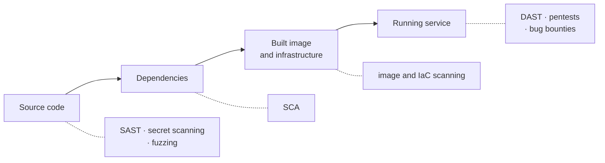

# 7.13 Security testing: scanners, fuzzing and pentests

Ordinary tests check that your code does what you meant ([chapter 4.4](../go/testing.mdx)). Security testing checks something harder: that it does *nothing else*, even when someone sends input you never imagined, depends on a library with a hole in it, or commits a password by mistake. No single tool can check all of that. Each kind of security test looks at one layer (the source code, the dependencies, the Git history, the running service) and is blind to the others. This chapter runs each one for real, shows you the actual output (including the false alarms), and ends with the story of a fuzzer finding a real bug in a real service in nine seconds.

## What you'll learn

- **Static analysis (SAST)** with gosec, Semgrep and CodeQL: reading code for dangerous patterns, and why half its findings need a human.
- **Dependency scanning (SCA)**: why `npm audit` cries wolf and Go's `govulncheck` mostly doesn't (**reachability**).
- **Secret scanning** with gitleaks, including in history you thought was gone.
- **DAST** with OWASP ZAP: attacking the running service from outside.
- **Fuzzing** with Go's built-in `go test -fuzz`: letting the computer invent the inputs.
- **Penetration tests** and **bug bounties**, **triage**, and how to put all of it in CI without the team learning to ignore it.

---

## Each test looks at one layer

Think of a building inspection. One inspector reads the blueprints, one checks that the steel came from a certified supplier, one walks through the finished building trying the doors, and one hires a professional to break in. Each finds things the others can't. Security testing is the same team:



Four stages, and the tools that look at each. The thing to notice: the further right a test runs, the more realistic it is (it sees the real system) and the later and costlier its findings are to fix.

| Kind | Looks at | Good at finding | Blind to | Example tools |
|---|---|---|---|---|
| **SAST** (static application security testing) | Your source code, without running it | Dangerous patterns: injection, weak crypto, missing timeouts | Business logic, design flaws, anything that depends on configuration | gosec, Semgrep, CodeQL |
| **SCA** (software composition analysis) | Your dependencies and their versions | Known, published vulnerabilities in libraries and the runtime | Bugs nobody has reported yet; your own code | govulncheck, npm audit, Dependabot, Trivy |
| **Secret scanning** | Files and Git history | Keys, tokens and passwords committed by mistake | Secrets in formats it doesn't recognise | gitleaks, trufflehog, GitHub secret scanning |
| **Image and IaC scanning** | Container images, Terraform, Kubernetes YAML | Vulnerable OS packages, risky configuration | Your application's logic | Trivy, Checkov |
| **DAST** (dynamic application security testing) | The running service, from outside | Missing headers, injectable parameters, misconfigured servers | Code paths it can't reach (behind logins, unusual flows) | OWASP ZAP, Burp Suite |
| **Fuzzing** | One function, with millions of generated inputs | Crashes, hangs, broken invariants on inputs nobody imagined | Anything you didn't write a property for | `go test -fuzz`, OSS-Fuzz |
| **Pentests, bug bounties** | Everything, through human eyes | Logic flaws, chained bugs, abuse of features | Whatever the testers didn't have time for | People |

Image and infrastructure scanning have their own chapters: [chapter 9.4](../containers/images-in-production.mdx) scans a container image with Trivy, and [chapter 12.6](../cloud/terraform-in-real-life.mdx) scans Terraform and Kubernetes files and makes the scan blocking. This chapter covers the rest.

---

## SAST: reading code for dangerous patterns

A **static analysis** tool reads source code without running it, the way a spell-checker reads a document. It parses the code into a tree of statements, then matches patterns: "a call to `math/rand` in a security context", "an HTTP server with no timeouts", "user input reaching `fmt.Fprintf` on a web response". The better tools follow data through the program (**taint analysis**): they mark where untrusted data enters (a **source**, like a query parameter) and where it would be dangerous (a **sink**, like an HTML response or a SQL string), and report any path from one to the other.

Three tools cover most teams:

- **gosec** is Go-specific, with numbered rules (`G104` unhandled errors, `G404` weak random numbers, `G705` cross-site scripting).
- **Semgrep** works across 30+ languages, with rules written in a syntax that looks like the code they match, so teams write their own ("never call our `LegacyAuth` function").
- **CodeQL** is GitHub's engine: it turns code into a database you query. It's the deepest of the three, and free for public repositories on GitHub.

Here's gosec run on a deliberately vulnerable page from [chapter 7.5](./web-attacks.mdx), a 40-line Go program that greets you by name by pasting the `name` parameter straight into HTML:

```text
$ gosec ./examples/xss/...
[/src/examples/xss/main.go:25] - G705 (CWE-79): XSS via taint analysis: fmt.Fprintf (Confidence: HIGH, Severity: MEDIUM)
[/src/examples/xss/main.go:38] - G114 (CWE-676): Use of net/http serve function that has no support for setting timeouts (Confidence: HIGH, Severity: MEDIUM)
```

Both are real. Line 25 is the XSS bug the page exists to demonstrate: taint analysis followed the query parameter to the response writer. Line 38 starts the server with `http.ListenAndServe`, which has no timeouts, the slow-client problem from [chapter 7.5](./web-attacks.mdx). Each finding names a **CWE** (Common Weakness Enumeration), a standard catalogue number for the kind of mistake, which is handy for searching and for reports.

### Half of what it finds needs a human

Run the same tool over all of this handbook's small example programs and it reports 38 findings. Some are true. Many look like this:

```text
[/src/examples/totp/totp.go:9] - G505 (CWE-327): Blocklisted import crypto/sha1: weak cryptographic primitive
[/src/examples/accountsec/breached.go:6] - G505 (CWE-327): Blocklisted import crypto/sha1: weak cryptographic primitive
```

SHA-1 is broken for collision resistance ([chapter 7.1](./security-literacy.mdx)), so gosec flags every import of it. But the first file implements one-time passcodes, where the standard's default (RFC 6238), and what every authenticator app expects, is HMAC-SHA1: a construction that's still sound because it doesn't depend on collision resistance. The second file checks passwords against a breach database whose protocol *requires* SHA-1 prefixes. Both uses are correct. The tool can't know that; it only sees the import.

That's the permanent trade-off of SAST. A rule precise enough to never be wrong misses most bugs; a rule broad enough to catch most bugs is often wrong. A finding that's wrong is called a **false positive**; a bug the tool misses is a **false negative**. SAST is also blind to a whole class of bugs: a handler that forgets to check *who owns* a record ([chapter 7.4](./authorization-multi-tenancy.mdx)) looks exactly like a handler that's correct, because the missing line is missing.

---

## SCA: known holes in what you depend on

Most of the code in a modern service is someone else's: libraries, frameworks, the language runtime. When a vulnerability is found in one of them, it gets a public ID (a **CVE**, or a **GO-** ID in Go's database) and every program that includes the affected version is potentially exposed. The most famous case is **Log4Shell** in December 2021: a flaw in Log4j, a logging library inside a huge share of Java software, let attackers run code by getting a server to log a crafted string. Organisations spent weeks just finding out *where* they used it ([CISA's guidance](https://www.cisa.gov/news-events/news/apache-log4j-vulnerability-guidance)). **SCA** tools answer "which of our dependencies have known vulnerabilities?" in seconds.

Most SCA tools work from versions alone: `npm audit`, Dependabot alerts, and image scanners compare the versions in your lock file against vulnerability databases. That's fast and broad, and it's noisy, because a vulnerability in a function you never call is reported exactly like one in your login path. Teams that get hundreds of such alerts learn to ignore all of them.

### Reachability: does your code actually call it?

Go's **`govulncheck`** adds a step: it builds a **call graph** of your program (which functions can call which) and reports a vulnerability as affecting you only if your code can reach the vulnerable function. You met it in [chapter 9.4](../containers/images-in-production.mdx); here is what reachability looks like in practice. These are two real runs over the same service, one built with Go 1.26.0 and one with the current patch release, Go 1.26.10:

```text
$ govulncheck ./...          # with Go 1.26.0
Vulnerability #2: GO-2026-6617
    HTTP/2 server crash due to HPACK encoder race in net/http
  Found in: net/http@go1.26
  Fixed in: net/http@go1.26.9
…
Your code is affected by 36 vulnerabilities from the Go standard library.
This scan also found 8 vulnerabilities in packages you import and 3
vulnerabilities in modules you require, but your code doesn't appear to call
these vulnerabilities.

$ govulncheck ./...          # with Go 1.26.10
No vulnerabilities found.
```

Read the summary of the first run. 36 vulnerabilities are in code the service actually calls, all in Go's own standard library, all fixed by updating Go. Eleven more are in dependencies but not reachable, so govulncheck mentions them and doesn't fail. A version-only scanner would have reported 47 alarms with equal urgency. The fix for all 36 was one line: the Go version.

Reachability analysis isn't perfect. A static call graph has to assume that any function that *could* be called through an interface *might* be, so some traces look odd ("`NewSlug` calls `rand.Int`, which eventually calls `x509.Certificate.Verify`"). It errs on the side of reporting, which is the right side. Other ecosystems are catching up: some commercial SCA tools offer reachability for Java and JavaScript, but `npm audit` still doesn't.

:::tip[Keep dependencies boring and current]
The cheapest SCA is staying close to current versions, so a fix is a routine bump instead of a migration. Automated update pull requests (Dependabot or Renovate) plus a test suite you trust make that nearly free.
:::

---

## Secret scanning: catching keys before bots do

[Chapter 7.6](./secrets-management.mdx) explained why a committed key is a leaked key: Git keeps it in history forever, and bots scan public repositories within minutes. **Secret scanners** look for anything shaped like a credential, using two techniques: **patterns** for known formats (AWS keys start `AKIA`, GitHub tokens `ghp_`, and so on) and **entropy**, a measure of how random a string looks, for unknown ones.

**gitleaks** is the common open-source choice. It scans a folder (`gitleaks dir`) or every commit in a repository's history (`gitleaks git`). Here's a real run over this handbook's whole repository history:

```text
$ gitleaks git /repo -v --redact
Finding:     Sec-WebSocket-Key: REDACTED  ← random, so the...
RuleID:      generic-api-key
File:        docs/distributed/real-time.mdx
…
Finding:     ...suer=snip&period=30&secret=REDACTED"
RuleID:      generic-api-key
File:        snip/examples/totp/totp_test.go
…
Finding:     TOKEN='REDACTED'
RuleID:      jwt
File:        docs/security/authentication.mdx
…
WRN leaks found: 5
```

Five findings, and all five are false positives: a sample WebSocket handshake key from the protocol's own specification, the published test secret from the one-time-password standard, and a demonstration token in a lab. Each looks exactly like a real secret, which is the point: the scanner has no way to know.

Triage has two tools, for two situations:

- **For the current file**, mark the line: a `gitleaks:allow` comment on it tells gitleaks this one was reviewed.
- **For history**, which you can't edit, list the finding's **fingerprint** (commit, file, rule and line, printed with each finding) in a `.gitleaksignore` file.

A true positive gets the treatment from [chapter 7.6](./secrets-management.mdx): **revoke the key first**, then clean up. Deleting it from the latest commit doesn't help; it's still in history and in every clone. Run gitleaks as a pre-commit hook so most leaks never reach a commit, and in CI as the second net. GitHub's own secret scanning with **push protection** blocks pushes containing known key formats for free on public repositories.

---

## DAST: attacking the running service from outside

**DAST** tools know nothing about your code. They treat the service as a black box: crawl it to find URLs, then send requests and look at what comes back. They find things only visible at runtime: a missing security header, a server that reveals its version, an error page with a stack trace, a parameter that reflects input into HTML.

**OWASP ZAP** (Zed Attack Proxy) is the widely used free one, and its Docker image includes ready-made scripts:

- **`zap-baseline.py`** crawls for a minute and only *looks* at responses (a **passive** scan). It's safe to point at production.
- **`zap-api-scan.py`** reads an OpenAPI description ([chapter 5.5](../apis/api-contracts.mdx)) to learn every endpoint, then sends attack payloads (an **active** scan). Only point that at systems you own and are allowed to test, and never at production without agreement.

Real runs against a small JSON API, first with the baseline, then with the API scan fed its OpenAPI file:

```text
$ zap-baseline.py -t http://snip:8080/
Total of 4 URLs
WARN-NEW: Storable and Cacheable Content [10049] x 2
WARN-NEW: Cross-Origin-Resource-Policy Header Missing or Invalid [90004] x 1
FAIL-NEW: 0  FAIL-INPROG: 0  WARN-NEW: 2  WARN-INPROG: 0  INFO: 0  IGNORE: 0  PASS: 66

$ zap-api-scan.py -t openapi.yaml -f openapi -O http://snip:8080
Number of Imported URLs: 8
Total of 38 URLs
WARN-NEW: Cross-Origin-Resource-Policy Header Missing or Invalid [90004] x 2
FAIL-NEW: 0  FAIL-INPROG: 0  WARN-NEW: 1  WARN-INPROG: 0  INFO: 0  IGNORE: 0  PASS: 119
```

Two lessons. First, the crawler found only **4 URLs**, because a JSON API has no links to follow. The OpenAPI file raised that to 38 and the passing checks from 66 to 119. A DAST scan is only as good as its map of the application. Second, the API scan ran **without an API key**, so every protected endpoint answered `401` and the scanner never tested what's behind them. Real setups give the scanner a test account's credentials, and that's where most of the interesting findings live. The warnings themselves are low-risk for a JSON API (a header that matters mostly for pages loaded into other sites), which is a triage decision, covered below.

---

## Fuzzing: let the computer invent the inputs

Watch a toddler with a new toy: they press every button, in every order, twice as hard as intended, and find within minutes the thing the manual never mentioned. **Fuzzing** is that, automated: a program generates huge numbers of inputs, runs your function on each, and watches for a crash or a broken rule.

Modern fuzzers are **coverage-guided**. They start from a few example inputs (the **seed corpus**), mutate them (flip bits, insert bytes, splice two inputs together), and keep any mutation that makes the code take a path it hadn't taken before. Over millions of runs, they work their way into the corners of your code. Google's OSS-Fuzz, which fuzzes open-source projects around the clock, reports having helped fix over 13,000 vulnerabilities and 50,000 bugs across 1,000 projects ([OSS-Fuzz](https://github.com/google/oss-fuzz)).

Go has fuzzing built into `go test` since Go 1.18. A fuzz test looks like a unit test, with one twist: because the inputs are random, you can't write down the expected output. Instead you check **properties** that must hold for *every* input: "doesn't crash", "the result is never longer than n", "encoding then decoding gives back the original", "valid text in, valid text out".

Here's a complete example you can run in an empty folder. `Truncate` shortens a string for display, and looks obviously correct:

```go
// truncate.go
package fuzzdemo

// Truncate shortens s to at most n bytes, for showing in a list.
func Truncate(s string, n int) string {
	if len(s) <= n {
		return s
	}
	return s[:n]
}
```

```go
// truncate_test.go
package fuzzdemo

import (
	"testing"
	"unicode/utf8"
)

func FuzzTruncate(f *testing.F) {
	f.Add("hello, world", 5) // seed inputs: ordinary cases you'd test anyway
	f.Add("", 0)
	f.Fuzz(func(t *testing.T, s string, n int) {
		if n < 0 || !utf8.ValidString(s) {
			t.Skip() // only valid text and sensible lengths are in scope
		}
		got := Truncate(s, n)
		if len(got) > n {
			t.Errorf("Truncate(%q, %d) = %q: longer than %d bytes", s, n, got, n)
		}
		if !utf8.ValidString(got) {
			t.Errorf("Truncate(%q, %d) = %q: cut a character in half", s, n, got)
		}
	})
}
```

```bash
go mod init fuzzdemo                          # once, in the empty folder
go test .                                     # runs the seeds only: passes
go test -fuzz=FuzzTruncate -fuzztime=30s .    # lets Go invent inputs
```

```text
--- FAIL: FuzzTruncate (0.15s)
        truncate_test.go:20: Truncate("抙", 2) = "\xe6\x8a": cut a character in half
    Failing input written to testdata/fuzz/FuzzTruncate/93307bcb61055a3b
```

In 0.15 seconds the fuzzer found what the seed tests didn't: a Chinese character takes 3 bytes in UTF-8 ([chapter 1.3](../foundations/bits-bytes-text-formats.mdx)), and cutting at byte 2 leaves garbage that breaks the page displaying it. (Your run will find a different character; the bug is the same.) Notice three mechanics:

- **`go test` without `-fuzz` runs only the seeds**, as ordinary tests. Fuzz tests cost nothing in your normal test run.
- **Failing inputs are saved** under `testdata/fuzz/`, and from then on `go test` runs them as seeds too. Commit that file: it's a regression test the fuzzer wrote for you.
- **`-fuzz` takes one target in one package at a time.** Fuzzing is a separate, longer job: run it for minutes locally, or nightly in CI.

:::info[If you've written code]
Fuzzing is close to **property-based testing** (Hypothesis in Python, fast-check in JavaScript), which also checks properties over generated inputs. The difference is the guidance: property-based tools generate structured values from types you describe, while coverage-guided fuzzers mutate raw inputs and use code coverage to steer toward unexplored paths. They're good at different bugs, and both beat a hand-picked list of examples.
:::

---

## Pentests and bug bounties: humans who think like attackers

Tools find known kinds of mistakes. **People** find the rest: the password-reset flow that can be replayed, the discount code that stacks with itself, three medium bugs that chain into account takeover. Two ways to pay people to look:

- A **penetration test** (pentest) is a time-boxed engagement, often one to three weeks, by a specialist firm. You agree on the **scope** (which systems, which accounts, what's off-limits) and **rules of engagement** in writing, they attack, and you get a report with findings ranked by severity and steps to reproduce. Worth it before a major launch, after a big architectural change, and when customers or regulations require it. A pentest is a snapshot: it says what a skilled team found in that window.
- A **bug bounty** pays outside researchers for each valid vulnerability they report, through platforms such as HackerOne or Bugcrowd. It's continuous and pays for results, but it attracts a flood of low-quality reports, so it suits organisations that can triage them quickly.

Before either, every public service should have a **vulnerability disclosure policy**: a page saying how to report a security problem and promising not to take legal action against good-faith researchers, plus a `/.well-known/security.txt` file ([RFC 9116](https://www.rfc-editor.org/rfc/rfc9116)) pointing to it. It costs nothing, and it turns "someone found a bug and posted it on social media" into "someone emailed us".

A threat model ([chapter 7.12](./threat-modeling.mdx)) makes a pentest far more valuable: hand the testers your trust boundaries and the risks you're worried about, and they'll spend their limited time where it counts.

---

## Triage: every finding gets a decision

Every scanner produces a list. A list nobody acts on is worse than no list, because it teaches the team that the scanner doesn't matter. **Triage** turns each finding into one of four decisions, the same ones a threat model uses:

- **Fix it.** Most true positives, especially reachable, fixable ones.
- **Suppress it, with the reason in the code.** A false positive, marked where the next reader will see it: `// #nosec G404 -- jitter, not a secret` for gosec, `// nosemgrep: <rule>` for Semgrep, `gitleaks:allow` for gitleaks. A bare suppression with no reason is a future mystery.
- **Accept it, in writing.** A true finding you choose to live with (for now), with who decided and when it'll be reviewed.
- **Track it.** Real, not urgent: a ticket with an owner and a deadline set by severity.

When deciding how urgent a true finding is, three questions matter more than the tool's severity label: **Is it reachable?** (govulncheck answers this for you; for others, look.) **Is it exposed?** (Internet-facing code beats an internal batch job.) **Is it fixable now?** (An update exists, or it doesn't.) A "critical" in a test helper is less urgent than a "medium" in your login handler.

---

## In CI, without drowning the team

The goal is that every change gets checked automatically, and that the checks stay trusted. The pattern most teams settle on puts fast, precise checks early and slow, noisy ones on a schedule:

| When | What | Blocks the merge? |
|---|---|---|
| Before commit (on the laptop) | gitleaks as a pre-commit hook | Yes, locally |
| Every pull request | SAST on changed code, SCA with reachability, secret scanning, fuzz seeds (`go test ./...`), IaC scan | Only **new**, high-confidence, fixable findings |
| Every merge to main | Image scan, SBOM ([chapter 9.4](../containers/images-in-production.mdx)) | Usually report only |
| Nightly or weekly | Longer fuzzing runs, DAST against a test environment, full rescans of what's deployed | No: they open tickets |
| Before big launches, yearly | Pentest | No: they produce a report |

The rules that keep it sane:

- **Fail only on new findings.** Record today's accepted findings as a **baseline** and block only what a change adds. Otherwise the first scan fails every build and someone turns it off.
- **Start in report-only mode**, triage what's there, then switch to blocking. [Chapter 12.6](../cloud/terraform-in-real-life.mdx) shows exactly that move for an infrastructure scan.
- **Put findings where developers look.** Most tools emit **SARIF** (a standard JSON format for findings) that GitHub shows as annotations on the pull request, next to the line.
- **Pin tool versions**, as for any dependency ([chapter 11.2](../shipping/ci-with-github-actions.mdx)): a scanner update that adds 40 rules shouldn't break every build on a Tuesday.

---

## Apply it to snip: three scanners and a fuzzer

snip, the URL shortener this handbook builds, runs four of these on every change (the `security` job in `.github/workflows/ci.yml`): `govulncheck` blocks any change that reaches a known vulnerability; `gosec` blocks new findings in snip's own code (the deliberately unsafe teaching examples are left out); `gitleaks` blocks secrets in the repository's files, with a CI-only config (`.github/gitleaks.toml`) that allows just the handbook's published example values; and Trivy reports on the image. Writing this chapter is how the middle two got there, and each tool found something first.

**gosec** found two issues in snip's own code (outside the teaching examples), both in the click worker (`snip/cmd/snip-worker/main.go`):

```text
[/src/cmd/snip-worker/main.go:92] - G404 (CWE-338): Use of weak random number generator (math/rand or math/rand/v2 instead of crypto/rand) (Confidence: MEDIUM, Severity: HIGH)
  > 92: 			wait := backoff/2 + rand.N(backoff/2+1)
[/src/cmd/snip-worker/main.go:78] - G104 (CWE-703): Errors unhandled (Confidence: HIGH, Severity: LOW)
  > 78: 		srv.Shutdown(shutdownCtx)
```

The first is a false positive with a "HIGH" label: `math/rand` picks a random delay before retrying (**jitter**, [chapter 8.1](../distributed/distributed-survival-kit.mdx)), and nobody gains anything by predicting a delay. Semgrep flagged the same import. Both now carry a suppression with the reason, and Semgrep's goes on the import line it flagged:

```go
// #nosec G404 -- a predictable delay is harmless; secrets use crypto/rand (chapter 7.13)
// Jitter (chapter 8.1): wait a random time between half and all of the
// backoff, so workers that failed together don't retry in lockstep.
wait := backoff/2 + rand.N(backoff/2+1)
```

The second, labelled "LOW", was a true positive: a failed shutdown of the worker's metrics server vanished silently. It's now logged:

```go
if err := srv.Shutdown(shutdownCtx); err != nil {
	log.Warn("metrics server did not shut down cleanly", "err", err)
}
```

Severity labels and real importance point in opposite directions here, which is why triage needs a person.

**gitleaks** found one "secret" in snip's folder: the published test secret from the one-time-password standard, in `snip/examples/totp/totp_test.go`. The line now ends with `// gitleaks:allow` and a note saying what it is. In history the finding remains, which is the honest outcome: you can't edit history, only fingerprint it in `.gitleaksignore`.

**govulncheck**: clean with Go 1.26.10, 36 reachable standard-library vulnerabilities with 1.26.0. snip's `go.mod` names the patched toolchain, and its Dockerfile builds on `golang:1.26-alpine`, which tracks the latest patch.

### The fuzzer found a real bug

snip's `NormalizeURL` (`snip/internal/links/link.go`) is its front-door check on every URL a user wants shortened ([chapter 7.5](./web-attacks.mdx)): only `http` and `https`, a host, no username or password, and at most 2,048 characters, the limit the database enforces (`CHECK (length(url) <= 2048)` in `snip/internal/store/postgres/migrations/0001_init.sql`). Its unit tests passed. The new fuzz test, `snip/internal/links/fuzz_test.go`, checks three properties of anything it accepts:

```go
f.Fuzz(func(t *testing.T, raw string) {
	got, err := links.NormalizeURL(raw)
	if err != nil {
		return // refusing is always allowed
	}
	// Property 1: what we accept is an absolute http(s) URL with a host
	// and no username or password, the promises NormalizeURL makes.
	u, perr := url.Parse(got)
	// … (checks scheme, host and user; see the file)
	// Property 2: the result fits the database column
	// (CHECK (length(url) <= 2048) in migrations/0001_init.sql).
	if len(got) > 2048 {
		t.Fatalf("NormalizeURL(%d-byte input) returned %d bytes, more than the 2048 the database accepts", len(raw), len(got))
	}
	// Property 3: normalising twice changes nothing.
	again, err := links.NormalizeURL(got)
	if err != nil || again != got {
		t.Fatalf("not idempotent: NormalizeURL(%q) = %q, then %q, %v", raw, got, again, err)
	}
})
```

The first 30-second run:

```text
$ go test ./internal/links -run='^$' -fuzz=FuzzNormalizeURL -fuzztime=30s
fuzz: elapsed: 9s, execs: 2447706 (320606/sec), new interesting: 264 (total: 273)
fuzz: minimizing 6020-byte failing input file
--- FAIL: FuzzNormalizeURL (26.39s)
        fuzz_test.go:51: NormalizeURL(697-byte input) returned 2049 bytes, more than the 2048 the database accepts
```

After 2.4 million inputs, the fuzzer found a 697-byte URL that came back as 2,049 bytes. The cause: `NormalizeURL` checked the length of the input, then returned `u.String()`, Go's re-encoded form of the parsed URL. Re-encoding **percent-encodes** characters that aren't allowed raw in a URL: each such byte becomes three characters (`%F3`), and a two-byte "é" becomes six (`%C3%A9`). The input passed the length check; the output didn't fit. With Postgres, the insert then failed the `CHECK` constraint, the error wasn't one snip's handler recognised, and the user got a `500 internal` instead of a `400 invalid_url` (the 2025 OWASP Top 10 has a category for this: A10, mishandling of exceptional conditions). With the in-memory store, the over-long URL was saved, breaking the promise the error message makes.

It's not a break-in. It is a crash path reachable by any user with a key, an error message that lied, and exactly the kind of input nobody writes by hand. The fix checks the length of what's actually returned:

```go
	// Check the length again after normalising: u.String() percent-encodes
	// bytes such as "é" (2 bytes) into "%C3%A9" (6), so a URL that passed the
	// first check can come out longer than the database column allows. A fuzz
	// test found this (chapter 7.13).
	out := u.String()
	if len(out) > maxURLLength {
		return "", ErrInvalidURL
	}
	return out, nil
```

Two regression tests lock it in: the fuzzer's own minimised input, committed as `snip/internal/links/testdata/fuzz/FuzzNormalizeURL/af84cb1d62b1c767`, and a readable case in `TestNormalizeURL` (`snip/internal/links/service_test.go`): 1,000 "é" characters after `https://example.com/`, 2,020 bytes in and 6,020 out. Both failed before the fix and pass after. A second 30-second run with the fix, about 4 million inputs, found nothing; a 30-second run of `FuzzValidateSlug` (8 million inputs) found nothing either. "Found nothing in 30 seconds" is weak evidence, which is why fuzzing belongs in a nightly job too.

---

## Lab

Free, on your laptop, with Docker. Nothing to install: every tool runs in a container, with versions pinned. Run the commands from the `snip` folder of your clone (`cd ~/code/zero-to-prod/snip`).

1. **Static analysis, and triage.**
   ```bash
   docker run --rm -v "$PWD:/src" -w /src golang:1.26 \
     go run github.com/securego/gosec/v2/cmd/gosec@v2.30.0 ./...             # all of snip, examples included
   ```
   It takes a minute the first time (it downloads gosec and snip's dependencies). Find the `G705` finding in `examples/xss` and confirm it's the bug [chapter 7.5](./web-attacks.mdx) demonstrates. Then pick one `G505` (SHA-1) finding, open the file, and decide: true or false positive? Finally, see what snip's own code suppresses: add `-nosec` to the command and look for the `G404` that reappears in `cmd/snip-worker/main.go`. Read the reason above it. Do you agree with it?

2. **Reachability, two ways.**
   ```bash
   docker run --rm -v "$PWD:/src" -w /src golang:1.26 \
     go run golang.org/x/vuln/cmd/govulncheck@v1.9.0 ./...                    # the current Go patch release
   docker run --rm -v "$PWD:/src" -w /src -e GOTOOLCHAIN=local golang:1.26.0 \
     go run golang.org/x/vuln/cmd/govulncheck@v1.9.0 ./...                    # the same code on Go 1.26.0
   ```
   Same code, two results. In the second, read the last paragraph: how many vulnerabilities affect the code, and how many are present but never called? (Your numbers may be higher than the ones in this chapter: new advisories are published every week.) `GOTOOLCHAIN=local` stops Go from switching to the newer toolchain `go.mod` asks for, so you really test 1.26.0.

3. **Secrets in files and in history.**
   ```bash
   docker run --rm -v "$PWD:/src:ro" zricethezav/gitleaks:v8.30.1 dir /src      # the files as they are now
   docker run --rm -v "$PWD/..:/repo:ro" zricethezav/gitleaks:v8.30.1 git /repo -v --redact   # every commit
   ```
   The first should report no leaks: the one known example is marked `gitleaks:allow`. The second scans history and finds it again, along with other example values. Pick one finding and decide what it is. Then create a file containing a fake AWS-style key (`AKIA` followed by 16 capital letters and digits), scan the folder again, and delete the file.

4. **Fuzz, then break it on purpose.**
   ```bash
   docker run --rm -v "$PWD:/src" -w /src golang:1.26 \
     go test ./internal/links -run='^$' -fuzz=FuzzNormalizeURL -fuzztime=30s   # should PASS
   ```
   Now reintroduce the bug: in `internal/links/link.go`, change `if len(out) > maxURLLength {` to `if false {`, and run the same command. Watch it fail, usually within seconds, and look at the new file under `internal/links/testdata/fuzz/`. Undo both with `git checkout internal/links/link.go` and `git clean -n internal/links/testdata` (check the list, then `-f` to delete the new file; on Linux, files a container creates belong to root, so you may need `sudo rm` instead). For a challenge, write `FuzzValidRequestID` for `validRequestID` in `internal/httpapi/middleware.go`: anything it accepts must be at most 64 characters of letters, digits, `-`, `_` and `.`.

5. **Optional: a DAST scan of the running stack.** Start snip's stack ([chapter 9.3](../containers/docker-compose.mdx)) with `docker compose up -d --build`, then:
   ```bash
   docker run --rm --network snip_default zaproxy/zap-stable:2.17.0 \
     zap-baseline.py -t http://nginx:80/ -I                                     # passive scan through nginx
   docker compose down
   ```
   Compare its warnings with the ones above. The image is large (several gigabytes unpacked); skip this step on a slow connection.

## Self-check

<Quiz
  id="security-security-testing"
  questions={[
    {
      q: 'A handler lets any logged-in user delete any record, because it never checks who owns the record. Which test is most likely to catch it?',
      options: [
        'A dependency scan of the project\'s lock file',
        'A secret scan of the full Git history',
        'A penetration test with two test accounts',
        'A static scan with the default rule set',
      ],
      answer: 2,
      explain: 'Missing authorization is a logic flaw: the code that would be wrong isn\'t there, so static rules see an ordinary query. Dependency and secret scans look at other layers entirely. A tester (or an automated test) who logs in as user A and tries to delete user B\'s record finds it immediately.',
    },
    {
      q: 'govulncheck reports a vulnerability in a module you require, but says your code doesn\'t appear to call it. What does that mean?',
      options: [
        'The vulnerable function is in your build but no call path from your code reaches it',
        'The module is listed in go.mod but has not been downloaded into the module cache',
        'The vulnerability was published after your last build, so it can\'t affect it',
        'The advisory is disputed, so govulncheck has chosen to show it as a warning',
      ],
      answer: 0,
      explain: 'govulncheck builds a call graph and checks whether your code can reach the vulnerable function. Present but unreachable means low urgency: update when convenient. Version-only scanners like npm audit can\'t make this distinction, which is why they report so many alarms of equal weight.',
    },
    {
      q: 'You run `go test ./...` in a package that has a fuzz test. What happens?',
      options: [
        'Go fuzzes every target for the default ten seconds',
        'Go skips fuzz tests unless the -fuzz flag is given',
        'Go fuzzes until it finds a failure or you stop it',
        'Go runs the seed inputs and saved failures as tests',
      ],
      answer: 3,
      explain: 'Without -fuzz, a fuzz test runs only its seed corpus (f.Add and the files in testdata/fuzz) as ordinary test cases, which is fast and makes saved failures permanent regression tests. Fuzzing itself needs -fuzz, for one target in one package at a time, and runs until -fuzztime or a failure.',
    },
    {
      q: 'gosec flags `crypto/sha1` in code that computes one-time passcodes as RFC 6238 specifies. What is the right triage?',
      options: [
        'Replace SHA-1 with SHA-256, since the scanner rated it as a weak primitive',
        'Suppress it on that line with a comment saying the standard requires HMAC-SHA1',
        'Turn off rule G505 for the whole repository, since it misfires on standards',
        'Leave it unmarked so the finding stays visible in every future scan report',
      ],
      answer: 1,
      explain: 'It\'s a false positive in context: HMAC-SHA1 doesn\'t rely on SHA-1\'s collision resistance, and authenticator apps expect it, so changing it breaks the feature. Suppress it where it is, with the reason, so the next reader understands. Disabling the rule everywhere would hide a real misuse elsewhere; leaving it unmarked trains everyone to ignore the report.',
    },
    {
      q: 'Your first SAST scan of a large codebase reports 900 findings. What should you do before making the scan block merges?',
      options: [
        'Fix all 900 first, so the scan can block on any finding',
        'Block on HIGH severity only, whatever the history of each finding',
        'Record a baseline, triage it over time, and block only new findings',
        'Run the scan nightly only, since pull requests are too slow for it',
      ],
      answer: 2,
      explain: 'A baseline lets you start blocking new problems today while the old ones are triaged on a schedule. Fixing 900 first delays protection for months; blocking on existing HIGH findings fails every build, and someone turns the scanner off. Pull-request scans of changed code are usually fast enough.',
    },
  ]}
/>

<details>
<summary>A fuzz test runs for 30 seconds and finds nothing. What does that tell you, and what would make the result stronger?</summary>

Very little on its own. It says the properties held for the few million inputs the fuzzer happened to explore in that window, starting from your seeds. Bugs that need a long, specific input (the `NormalizeURL` bug needed a URL several hundred bytes long, made of unusual bytes) can take much longer to reach. Stronger evidence comes from: **longer runs** (nightly jobs, or a service like OSS-Fuzz that runs continuously); **better seeds** that already resemble interesting inputs (a URL near the length limit, one with non-ASCII characters); **stronger properties**, since the fuzzer only reports what you check (it found the bug because someone wrote "the output fits the database"); and **checking coverage**, so you know the fuzzer reaches the code you care about. The rule: a fuzzer finding a bug is proof; a fuzzer finding nothing is a lower bound on how hard the bug is to find.

</details>

<details>
<summary>Your team has budget for either a yearly pentest or a scanner suite in CI. Make the case for each, and say which you'd choose for a small team shipping weekly.</summary>

**Scanners in CI** run on every change, forever, and catch the common, known kinds of mistakes (vulnerable dependencies, leaked keys, injectable queries) at the moment they're cheapest to fix. Most of them are free. They can't see design or logic flaws, and their findings need triage.

**A pentest** brings skilled people who find what tools can't: broken authorization, abusable workflows, chained bugs. But it's a snapshot, and a team shipping weekly will have changed a lot of code by the time the report arrives.

For a small team shipping weekly, start with the scanners: they're cheap, continuous, and cover the most common real-world causes of breaches. Add a threat model per feature ([chapter 7.12](./threat-modeling.mdx)) for design flaws, and a vulnerability disclosure policy so outsiders can report what you missed. Buy a pentest when the stakes justify it: before a big launch, when handling payments or health data, or when customers require one. Then give the testers your threat model so they spend their time where it matters.

</details>
