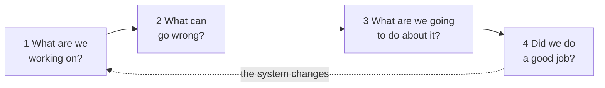
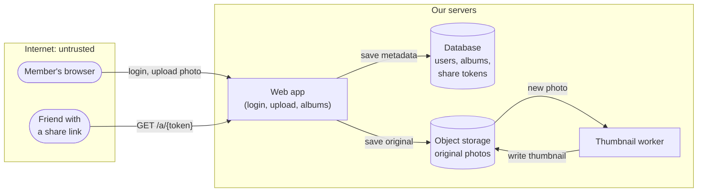
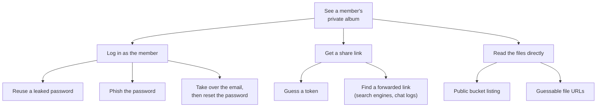

# 7.12 Threat modeling: thinking like an attacker, on paper

Before you leave for a two-week holiday, you probably walk around your home and think: the back door is locked, the spare key under the flowerpot is a bad idea, the post piling up will tell everyone the house is empty. Nobody taught you a method for that. You picture the place, imagine how someone could get in, and fix the worst things first. **Threat modeling** is the same walk-around for software, done with a diagram on a whiteboard before the code exists, when fixing a hole costs a sentence instead of a rewrite. The earlier chapters of this part taught you individual attacks and defences ([chapter 7.5](./web-attacks.mdx) alone has a dozen). This chapter teaches you how to find *which* of them matter for the system in front of you, including the ones nobody has written a chapter about yet.

## What you'll learn

- The **four questions** every threat model answers: what are we working on, what can go wrong, what are we going to do about it, did we do a good job.
- How to draw a **data-flow diagram** and mark its **trust boundaries**, the lines where data stops being trustworthy.
- **STRIDE**: six kinds of threat, and which ones to ask about for each part of the diagram.
- **Attack trees** for a single goal, and how to **rate risk** honestly (and why the DREAD scoring system fell out of favour).
- **Abuse cases** written next to user stories, and how to keep a threat model **alive** in pull requests instead of a forgotten document.
- How a real service (snip, the URL shortener this handbook builds) records its threats, defences and open risks in one file.

---

## Four questions, not a ritual

A threat model sounds like a heavyweight document produced by a security team. In practice it's a conversation that answers four questions, a framing written down by Adam Shostack, who led threat modeling work at Microsoft for years ([Shostack's Four Question Framework](https://github.com/adamshostack/4QuestionFrame)):

1. **What are we working on?** A picture of the system: its parts, and how data moves between them.
2. **What can go wrong?** The threats: ways someone could misuse each part.
3. **What are we going to do about it?** A decision for each threat.
4. **Did we do a good job?** A check that the picture was right and the decisions happened.



Four boxes and a loop. The thing to notice is the dotted arrow: systems change, so the model is never finished. The rest of this chapter is techniques for answering each question well. None of them is mandatory. A team that answers the four questions with a whiteboard and twenty minutes has done threat modeling; a team that fills in a 40-page template and never acts on it hasn't.

:::note[Everyday anchor]
The holiday walk-around answers the same four questions. *What am I protecting?* The house and what's in it. *What can go wrong?* Someone uses the spare key; the post shows nobody's home. *What will I do?* Take the key, ask a neighbour to collect the post. *Did I do a good job?* Check the windows on the way out.
:::

---

## Question 1: draw the system as data moving between boxes

To find threats you need a picture of the system that shows **where data goes**, because almost every attack is someone sending data somewhere it shouldn't go, or reading data where they shouldn't. The standard picture is a **data-flow diagram** (**DFD**), and it has only four kinds of element:

| Element | What it is | Drawn as |
|---|---|---|
| **External entity** | Someone or something outside your control: a user, a browser, another company's API | A rounded box |
| **Process** | Code you run: a web server, a background worker | A box |
| **Data store** | Where data rests: a database, a file bucket, a cache | A cylinder |
| **Data flow** | Data moving between two of the above | An arrow, labelled with what moves |

Then you add the fifth thing, the one that makes it a *threat* model: **trust boundaries**. A **trust boundary** is a line where data passes from something less trusted to something more trusted, or between parties that don't fully trust each other. The internet → your server is the obvious one. Your server → a database run by another team is another. Every arrow that crosses a boundary is a place to ask "what if this data is hostile?"

### The example: a small photo-sharing site

Imagine a small photo-sharing site. People sign up, upload photos, and share an album with friends through a link. A background worker makes thumbnails. Here is its DFD:



Two boxes are boundaries: the internet, and our servers. The arrows that cross between them, the member's uploads and the friend's link, are where most of the threats will be. Notice also a less obvious one: the worker **reads files that users uploaded**. Those files came from the internet, so to the worker they're untrusted data even though they're now on "our" side, sitting in our storage. Image parsers have a long history of bugs that let a crafted file run code, which is why careful systems treat image processing as its own, locked-down boundary.

:::tip[Draw it with the people who built it]
The first DFD is almost always wrong, and that's the point of drawing it. "Wait, the worker writes to the same bucket the web app serves from?" is a design discussion that would otherwise happen during an incident. Draw it together, in 15 minutes, at the level of detail you'd sketch for a new teammate.
:::

---

## Question 2: STRIDE turns "what could go wrong?" into six questions

"What can go wrong?" is too open a question to answer well while staring at a diagram. **STRIDE**, created at Microsoft in 1999 by Loren Kohnfelder and Praerit Garg, splits it into six kinds of threat, each the opposite of a security property you want:

| Letter | Threat | Violates | In plain words | Photo-site example |
|---|---|---|---|---|
| **S** | **Spoofing** | Authentication | Pretending to be someone else | Logging in as a member with a guessed password |
| **T** | **Tampering** | Integrity | Changing data you shouldn't | Editing the album ID in an upload request to add photos to someone else's album |
| **R** | **Repudiation** | Non-repudiation | Doing something and denying it, with no record to prove otherwise | "I never deleted those photos", and there's no log saying who did |
| **I** | **Information disclosure** | Confidentiality | Reading data you shouldn't | Guessing share tokens to view private albums |
| **D** | **Denial of service** | Availability | Making the system unusable | Uploading thousands of 100 MB files until storage fills |
| **E** | **Elevation of privilege** | Authorization | Gaining powers you weren't given | A crafted image file that makes the thumbnail worker run attacker code |

Most of these you've met in earlier chapters: spoofing in [chapter 7.2](./authentication.mdx) (authentication), elevation and disclosure in [chapter 7.4](./authorization-multi-tenancy.mdx) (one customer reaching another's data), tampering and injection in [chapter 7.5](./web-attacks.mdx). STRIDE's value is that it makes you ask *all six* questions, including the ones nobody in the room is an expert in.

### STRIDE per element

Asking six questions about every element gets long, and some combinations make no sense (you can't "spoof" a database table). The common shortcut, **STRIDE per element**, says which letters to ask about for each kind of DFD element:

| Element | S | T | R | I | D | E |
|---|:-:|:-:|:-:|:-:|:-:|:-:|
| External entity | ✓ | | ✓ | | | |
| Process | ✓ | ✓ | ✓ | ✓ | ✓ | ✓ |
| Data store | | ✓ | ✓\* | ✓ | ✓ | |
| Data flow | | ✓ | | ✓ | ✓ | |

\* Repudiation applies to data stores that hold logs: can someone tamper with the evidence?

Walk the diagram one element at a time and write down every threat you can think of. For the photo site, a first pass might give:

1. **Web app, S:** credential stuffing with passwords leaked from other sites ([chapter 7.8](./account-security.mdx)).
2. **Web app, E:** member A changes `album_id=41` to `42` in a request and edits member B's album ([chapter 7.4](./authorization-multi-tenancy.mdx)).
3. **Share-link flow, I:** share tokens are short or sequential, so they can be guessed.
4. **Share-link flow, I:** a share link sent to one friend gets forwarded to the whole internet. (Not an attack on the code, but a real way private photos leak.)
5. **Object storage, I:** the bucket is publicly listable ([chapter 12.6](../cloud/terraform-in-real-life.mdx) shows scanners that catch this).
6. **Object storage, I:** photos keep their GPS coordinates in the image's metadata (EXIF), revealing where members live.
7. **Thumbnail worker, E:** a malicious image exploits a bug in the image library.
8. **Upload flow, D:** no size or count limit on uploads.
9. **Database, R:** deletions aren't logged with who did them.

Nine threats in ten minutes, several of which nobody would have raised by asking "is it secure?". Item 6 is a good example of why the method matters: it's a privacy leak with no attacker and no bug, found only because someone asked "what can be disclosed from this data store?"

---

## Attack trees: one goal, every route to it

STRIDE is wide: it finds many threats across the whole diagram. An **attack tree** is deep: it takes **one attacker goal** and breaks it down into every way to reach it. The idea was popularised by Bruce Schneier in 1999 ([Attack Trees](https://www.schneier.com/academic/archives/1999/12/attack_trees.html)). The goal sits at the root; each child is a way to achieve its parent; children are alternatives (**OR**) unless marked as steps that all must happen (**AND**).

For the goal "see a member's private album":



Read it from the leaves up. Each leaf is something an attacker can actually try, and each suggests a defence: MFA ([chapter 7.7](./mfa-and-passkeys.mdx)) cuts off two of the three "log in" leaves; long random tokens ([chapter 7.1](./security-literacy.mdx)) cut off "guess a token"; expiring links and a "revoke link" button limit forwarded ones. Attack trees are most useful for the one or two outcomes your business fears most. You won't draw one for every threat.

---

## Question 3: decide, and rate risk honestly

Every threat gets one of four decisions:

- **Mitigate:** add a defence that makes it harder or limits the damage (rate limits, MFA, random tokens).
- **Eliminate:** remove the feature or the data (strip EXIF metadata from uploads; don't store what you don't need).
- **Transfer:** make it someone else's responsibility, on purpose (a payment provider handles card numbers so you never see them).
- **Accept:** decide the risk is tolerable, *in writing*, with who decided and why.

"Accept" is a real answer. Every system has risks it lives with. The failure is accepting them **silently**, so nobody knows they exist.

### Likelihood × impact, kept coarse

You can't fix everything first, so you rank. The honest method is old and simple: for each threat, rate **likelihood** (how easily and how often it could happen) and **impact** (how bad it would be), each on a small scale, and multiply or read them off a grid.

| | **Low impact** | **Medium impact** | **High impact** |
|---|---|---|---|
| **High likelihood** | medium | high | **critical** |
| **Medium likelihood** | low | medium | high |
| **Low likelihood** | low | low | medium |

For the photo site: guessable share tokens are high likelihood (scripts guess for free) × high impact (private photos) = **critical**, fix before launch. A bug in the image library is lower likelihood but high impact: high, and the answer is to isolate the worker so a compromise reaches nothing else. Missing deletion logs are medium × low: worth a ticket, not a delay.

Keep the scale coarse, three or four levels. A score like "6.4" suggests a precision nobody has; "high" invites the useful argument, "why do you think it's high?"

### Why DREAD fell out of favour

Microsoft once rated threats with **DREAD**: Damage, Reproducibility, Exploitability, Affected users and Discoverability, each scored 1 to 10 and averaged. It looked rigorous. In practice, two people rating the same threat gave very different numbers, scores drifted with the mood of the meeting, and "Discoverability" rewarded hiding bugs instead of fixing them. Microsoft moved away from it, toward fixed **bug bars**: a written table that says, for example, "any remote code execution is critical, no debate" ([Shostack on DREAD](https://shostack.org/blog/tmt-the-dread-pirates/)). The lesson generalises: **a rating system is only useful if different people get the same answer.** Few levels, written examples for each, and a bug bar for the cases you never want to argue about.

:::info[In the real world]
For known vulnerabilities in software (not design threats), teams use **CVSS**, the Common Vulnerability Scoring System, a standard 0–10 score attached to published vulnerabilities, often alongside **EPSS**, which estimates how likely a vulnerability is to be exploited in the wild. Both rate *bugs that exist*. A threat model rates *things that could go wrong in a design*, where likelihood × impact with a short written reason is still the most honest tool.
:::

---

## Abuse cases: the user story's evil twin

Teams plan work as **user stories**: "As a member, I can share an album by link, so friends without an account can see it." For each story that touches data or money, write its **abuse case**: the same feature, used by someone who wants to hurt you or another user.

| User story | Abuse case | What it asks of the design |
|---|---|---|
| As a member, I can share an album by link | As a stranger, I guess or collect share links to see private albums | Long random tokens; links that expire; a revoke button |
| As a member, I can upload photos | As an attacker, I upload a crafted file to attack the image processor, or terabytes to run up your bill | Size and type limits; an isolated, low-privilege worker |
| As a member, I can delete my account | As someone who stole a session, I delete the victim's account and every photo | Re-authentication for destructive actions; a grace period |
| As a member, I can invite friends by email | As a spammer, I use your invite form to send thousands of emails from your domain | Rate limits per account; a daily cap |

Abuse cases are cheap (one line each), they use the language the whole team already uses, and they land the threat in the backlog next to the feature, with acceptance criteria, rather than in a separate security document.

---

## Question 4, and when to do all this

"Did we do a good job?" has three practical checks:

- **Is the diagram still true?** Compare it with the code and the deployment. A data flow that exists in production but not in the diagram is a threat nobody looked at.
- **Does every threat have a decision?** Mitigated (with a pointer to where), eliminated, transferred, or accepted by a named person.
- **Are the mitigations tested?** "Only the owner can delete an album" should be a test that tries to delete someone else's album and expects a refusal ([chapter 4.4](../go/testing.mdx)).

### Lightweight, per feature

The most useful threat models are small and frequent. Model the whole system once, then for **each feature that changes the picture**: a new entry point, a new data store, a new kind of user, a new third party, a new secret. Thirty minutes at design time, with the people building it. A large redesign or a new product deserves an hour or two with someone from security in the room.

### Keep it alive: a file in the repository

A threat model in a wiki goes stale within months, because nobody updates it when the code changes. Put it **in the repository**, next to the code (`docs/threat-model.md`), so it's versioned with the system and reviewed like code:

- **Pull requests that change the picture update the file.** A line in the pull-request template (the checklist GitHub pre-fills in every new pull request, [chapter 3.3](../git/pull-requests-and-review.mdx)) helps: "Does this add an entry point, data store, trust boundary or secret? If so, update `docs/threat-model.md`."
- **Each threat points at code**: a file or function where the defence lives, so a reviewer can check it still exists.
- **Open risks are listed and ranked**, so the next person knows what's known and accepted.

Tools exist (OWASP Threat Dragon for diagrams, code-based tools like pytm that generate DFDs and threat lists from a description), and they help larger teams. A Markdown file with a Mermaid diagram and a table does the job for most.

:::warning[What can go wrong]
- **Boiling the ocean.** A month-long model of everything, finished after launch. Model the feature in front of you.
- **A security-team-only exercise.** The people who built the system know where the shortcuts are. Model with them.
- **Only modelling attacks on the code.** Abuse of working features (spam, scraping, phishing through your product) is often the biggest real risk.
- **Precise-looking scores.** Averages of subjective 1–10 ratings hide disagreement instead of resolving it.
- **A document nobody updates.** Keep it in the repository and review it in pull requests, or it will describe a system that no longer exists.
:::

:::info[In the real world]
Threat modeling is part of most secure development processes: Microsoft's Security Development Lifecycle, OWASP's [Threat Modeling project](https://owasp.org/www-project-threat-modeling/), and the [Threat Modeling Manifesto](https://www.threatmodelingmanifesto.org/), written in 2020 by a group of practitioners, which sums up the values: people and collaboration over processes, a journey of understanding over a security snapshot, doing threat modeling over talking about it. Interviewers for security and senior backend roles routinely ask candidates to threat-model a system on a whiteboard. The four questions plus STRIDE is a reliable way to answer.
:::

---

## Apply it to snip: a real threat model, in the repository

snip is the URL shortener this handbook builds: an API where owners create short links with an API key, a public redirect at `GET /{slug}`, Postgres for links and key hashes, Redis for a cache, rate-limit counters and a stream of click events, a worker that turns those events into counts, and nginx (or a Kubernetes Gateway) at the front door. Its threat model lives at [`snip/docs/threat-model.md`](https://github.com/jawwadzafar/zero-to-prod/blob/main/snip/docs/threat-model.md). Here's how it answers the four questions.

**What are we working on?** A DFD with three trust zones: the internet, the front door, and the private network holding the API, worker, Postgres and Redis. Five boundaries are named in the file. Two of them are easy to miss:

- **API → Redis.** When the model was first written, Redis had no password and no TLS in any of snip's setups. The only thing protecting it was that it's reachable only from snip's own pods (a Kubernetes NetworkPolicy, `deploy/k8s/base/networkpolicy.yaml`). The model ranked that, and it has since been fixed (below).
- **Operator → the API's container.** API keys are created with the `snip keys create` command, so whoever can run commands inside the container can mint keys. That's a boundary made of shell access, and it belongs on the diagram.

**What can go wrong, and what are we doing about it?** Twenty STRIDE threats, each with the defence in snip's code and a status. A few rows:

| Threat | STRIDE | Defence in snip | Status |
|---|---|---|---|
| An owner reads or deletes another owner's link | E, I | Every query scoped by owner: `DELETE … WHERE slug = $1 AND owner_id = $2` in `internal/store/postgres/postgres.go`; `Service.Get` answers not-found for others' links | mitigated |
| Short links to `javascript:` URLs, or disguised `https://bank@evil` links | T | `NormalizeURL` in `internal/links/link.go` accepts only `http`/`https` with a host and no user info ([chapter 7.5](./web-attacks.mdx)) | mitigated |
| Anyone who can reach Redis rewrites `snip:url:<slug>` and redirects a popular link elsewhere | T | Network isolation, plus a Redis password in every deployment (`SNIP_REDIS_PASSWORD`) and TLS on AWS (`SNIP_REDIS_TLS`); cache entries expire after `SNIP_CACHE_TTL` | **mitigated:** one shared password, rotated by hand; no TLS inside Compose or the cluster |
| An owner denies deleting a link | R | Request logs name the caller's owner ID; an append-only `audit_events` table records every key and link change with the owner and request ID, in the same transaction as the change, and a trigger refuses `UPDATE`, `DELETE` and `TRUNCATE` on it (`migrations/0002_audit_events.sql`); the API signs in as `snip_app`, which may only `INSERT` and `SELECT` there and owns nothing, so it can't drop the trigger (`migrations/0003_least_privilege.sql`, [chapter 7.4](./authorization-multi-tenancy.mdx)) | **mitigated:** the owner's login (used only by the migration step) or a superuser can still drop the trigger; events aren't copied off the database to write-once storage |
| `/metrics` visible to the internet | I | nginx denies it (`deploy/nginx/nginx.conf`) | **open on Kubernetes:** the Gateway forwards every path ([chapter 10.3](../kubernetes/networking-and-ingress.mdx)) |

The Redis row is a good example of what the method finds. snip's code is careful about input from the internet. But the cache is a second copy of "where each slug points", and anything inside the network can write to it. An attacker who gets a foothold in *any* container that can reach Redis could repoint snip's most-clicked link to a phishing page, without touching Postgres or the API. Nobody would find that by reviewing handlers; you find it by asking STRIDE's T question about a data store. The model ranked it second among the open risks, which is how it got fixed: Redis now requires a password everywhere snip runs, and on AWS it accepts only TLS ([chapter 7.6](./secrets-management.mdx), [chapter 12.8](../cloud/cloud-security.mdx)).

**Open risks, ranked.** The file ends with a likelihood × impact table. The top one isn't a code bug at all: on a public instance, the most likely and most damaging threat is **abuse**: people shortening phishing links to hide where they go ([chapter 7.5](./web-attacks.mdx)). snip limits it (keys, per-key rate limits) but has no threat-list check or takedown flow. That's written down as the next thing to build, not buried.

**Did we do a good job?** The file says which tests cover which threats, and names a gap it found: owner scoping is tested on the service layer but not end to end over HTTP with two real keys. A threat model that admits a gap is worth more than one that claims there are none.

---

## Lab

On paper or in a text editor, free. About an hour.

1. **Model a system you know.** Pick something real: a side project, a tool at work, your family's shared photo drive, a club's sign-up form. Copy this template into a file and fill it in.
   ```text
   # Threat model: <system>
   Scope: <what's in, what's out>      Date: <today>

   ## 1. What are we working on?
   External entities: <people and outside systems>
   Processes:         <code you run>
   Data stores:       <where data rests>
   Data flows:        <A -> B: what moves>
   Trust boundaries:  <where data crosses from less to more trusted>

   ## 2. What can go wrong?  (STRIDE per element)
   | # | Element | STRIDE | Threat |

   ## 3. What are we going to do about it?
   | # | Decision (mitigate/eliminate/transfer/accept) | How, or who accepted | Likelihood | Impact |

   ## Abuse cases
   | User story | Abuse case |

   ## 4. Did we do a good job?
   <Is the diagram true? Does every threat have a decision? Which mitigations have tests?>
   ```
   Draw the DFD first (on paper, or as Mermaid). Aim for at least one threat per STRIDE letter. Notice which letters were hard to fill: they're usually the ones your team has thought least about.

2. **Draw one attack tree.** Pick the outcome you'd least like to explain to your users ("someone reads all our members' emails"), and break it down two levels. Mark which leaves your system already blocks.

3. **Apply it to snip: review its threat model.** Open `snip/docs/threat-model.md` (in your clone, or [on GitHub](https://github.com/jawwadzafar/zero-to-prod/blob/main/snip/docs/threat-model.md)). Check two of its claims against the code:
   ```bash
   cd ~/code/zero-to-prod/snip
   grep -n 'owner_id = \$2' internal/store/postgres/postgres.go   # T3: deletes are scoped by owner
   grep -n 'u.User != nil' internal/links/link.go                  # T5: user-info URLs refused
   grep -n 'owner_id' internal/httpapi/middleware.go                 # T9: the request log records who called (since 13.7)
   grep -n 'BEFORE UPDATE OR DELETE' internal/store/postgres/migrations/*.sql   # T9: the audit table refuses edits
   grep -n 'ON audit_events TO snip_app' internal/store/postgres/migrations/*.sql   # T9: and the API's login may only append and read
   ```
   Then find one threat the file *doesn't* list. Hints: what does `GET /readyz` do on every call, and who can call it? What happens to a custom slug like `login` or `paypal`? Write your threat as a new row with a STRIDE letter, a defence or a status of open, and a likelihood × impact rating.

## Self-check

<Quiz
  id="security-threat-modeling"
  questions={[
    {
      q: 'A team draws a data-flow diagram of their new feature. Where should they look hardest for threats?',
      options: [
        'At the arrows that cross a trust boundary',
        'At the processes with the most lines of code',
        'At the data stores with the most rows',
        'At the external entities with admin accounts',
      ],
      answer: 0,
      explain: 'A trust boundary is where data moves from less trusted to more trusted. Every arrow crossing one is a place where hostile data can enter, so each needs the question "what if this data is hostile?". Code size and row counts say little about exposure, and admins are only one kind of external entity.',
    },
    {
      q: 'Photos uploaded to a site keep their GPS coordinates, so anyone viewing them can see where members live. Which STRIDE category is this?',
      options: [
        'Tampering, because the file holds extra data',
        'Spoofing, because the location identifies people',
        'Information disclosure from a data store',
        'Elevation of privilege by the people viewing it',
      ],
      answer: 2,
      explain: 'Data that should stay private is readable by people who shouldn\'t have it: information disclosure. Nothing was changed (not tampering), nobody pretends to be anyone (not spoofing), and viewers use only the access they were given (not elevation). The best answer here is often to eliminate the data: strip the metadata on upload.',
    },
    {
      q: 'Why did DREAD, which averaged five 1–10 scores, fall out of favour for rating threats?',
      options: [
        'It only worked for desktop software, not for web services',
        'Different people gave the same threat very different scores',
        'It was replaced by CVSS, which rates threats in a design',
        'Its five categories missed denial of service entirely',
      ],
      answer: 1,
      explain: 'The scores were subjective, so two raters disagreed and the numbers drifted between meetings; the precise-looking average hid that. Microsoft moved to fixed bug bars. CVSS rates known vulnerabilities in software, not threats in a design, and DREAD\'s "Damage" and "Affected users" did cover outages.',
    },
    {
      q: 'Your team writes the user story "As a member, I can invite friends by email." Which line is the matching abuse case?',
      options: [
        'As a member, I can see which invites were accepted',
        'As an admin, I can turn off invites for one member',
        'As a developer, I want invite emails to be fast',
        'As a spammer, I send thousands of emails through the form',
      ],
      answer: 3,
      explain: 'An abuse case is the same feature used by someone who wants to cause harm: here, sending spam from your domain. It leads straight to design work (per-account rate limits, daily caps). The other lines are ordinary user stories, including the admin one, which is a defence you might build after writing the abuse case.',
    },
    {
      q: 'A threat model was written carefully a year ago and has not changed since. What is the most likely problem?',
      options: [
        'Its likelihood ratings are too coarse to rank risks',
        'It describes a system that no longer exists',
        'It lists threats that attackers have since learned to read',
        'Its STRIDE categories have been replaced by a newer list',
      ],
      answer: 1,
      explain: 'Systems change every week: new endpoints, new data stores, new third parties. A model nobody updates misses every threat those changes introduced. Keep it in the repository and update it in the pull requests that change the picture. Coarse ratings are a feature, and STRIDE is still the standard list.',
    },
  ]}
/>

<details>
<summary>A teammate says: "We don't need threat modeling, we run security scanners in CI." What does each catch that the other misses?</summary>

Scanners ([chapter 7.13](./security-testing.mdx)) find **known kinds of mistakes in code that exists**: a vulnerable library, an injectable query, a leaked key. They can't see **design** problems, because those aren't mistakes in any one line: share links that never expire, a cache anyone on the network can rewrite, a feature that's perfect for spammers, a missing audit trail. Those are found by asking "what can go wrong?" about the design, ideally before the code is written, when fixing them is cheap. Threat modeling, in turn, won't find the typo that makes one query injectable. You want both: the model to decide what to build, the scanners to check what you built.

</details>

<details>
<summary>In the first version of snip's model, the Redis cache-poisoning threat was rated low likelihood but high impact, and left partial. Argue for and against fixing it right away.</summary>

**For fixing now:** the impact is severe and silent: an attacker repoints snip's busiest links to a phishing page, and every visitor follows them, with nothing in Postgres or the API logs to show it. The fix is known and cheap (Redis ACLs with a password per service, and TLS), and "only reachable from inside the network" relies on *every* container in that network staying uncompromised, which is the assumption zero trust ([chapter 7.11](./machine-identity-zero-trust.mdx)) asks you to drop.

**Against:** reaching Redis requires a foothold inside the private network first, and an attacker with that foothold likely has worse options; the cache entries expire within an hour; and the top-ranked risk, phishing abuse, happens today on any public instance. A reasonable decision is to fix abuse first, schedule Redis authentication next, and write the decision and its owner in the file. The model's job is to make that trade-off visible, not to make it for you. (snip took the "for" side once the fix proved small: a password in every deployment, TLS in the cloud, and two settings in snip's code.)

</details>
