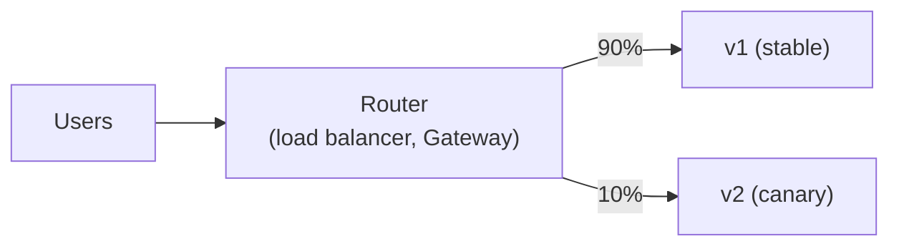

# 11.3 Delivery & deployment strategies

You've built a new version of your service. It passed every test in CI. It's still a risk: tests never cover everything, production traffic does things staging never did, and the most dangerous moment in a system's life is when something changes. **Deployment strategies** are ways of changing production that limit the damage when a new version is bad. They let only a few users meet it first, keep the old version ready to take over instantly, or keep new code switched off until you choose. This chapter covers the main strategies, what each costs, how to change a database under a running application, and how teams automate "roll back if the numbers look bad". Then you'll run a real **canary release**: 10% of traffic to the new version, checked, then promoted to 100%, first with a tiny web server and then with snip.

## What you'll learn

- The difference between **deploying** and **releasing**.
- **Recreate**, **rolling**, **blue-green** and **canary** deployments, and when to use each.
- **Feature flags** and **dark launches**.
- **Progressive delivery**: automatic promotion or rollback based on metrics.
- **Rollback vs roll forward**, and **expand-and-contract** database migrations.

---

## Deploy is not release

Two different events that people often treat as one:

- **Deploying**: putting new code on production machines. A technical act.
- **Releasing**: letting users experience the change. A product decision.

When they're the same event, every deployment is a big moment. When they're separated (new code deployed but not yet used, or used by only a few users), deployments become routine and releases become controllable. Every strategy below is a way of pulling them apart.

:::note[Everyday anchor]
A restaurant changing its menu doesn't swap every dish on the busiest night. It tries the new dish as a **special** for a few tables first (canary), watches the plates that come back, and keeps the old recipe ready. Sometimes the kitchen learns to cook it for a week before it appears on the menu at all (feature flag). Only when it's clearly working does it replace the old dish for everyone.
:::

---

## The strategies

| Strategy | How it works | Rollback | Cost | Risk to users |
|---|---|---|---|---|
| **Recreate** | Stop all old copies, then start new ones | Redeploy the old version | Cheapest | **Downtime**, and every user meets a bad version |
| **Rolling** | Replace copies a few at a time, checking readiness | Roll back the same way | No extra machines (a little surge) | Users meet the new version gradually; old and new run side by side |
| **Blue-green** | Run the new version (green) fully alongside the old (blue), then switch all traffic at once | Switch back: **instant** | Double capacity during the switch | Everyone switches at once, but can switch back instantly |
| **Canary** | Send a small share of traffic (1%, 10%) to the new version, watch, then increase | Set the share to 0 | Small extra capacity | Only a fraction of users meet a bad version, briefly |



The picture is a canary: one router, two versions, and a number that decides who meets which. Blue-green is the same picture with the number jumping from 0 to 100 in one step.

**Rolling** is Kubernetes' default for Deployments ([chapter 10.2](../kubernetes/core-objects.mdx)): with `maxUnavailable: 0`, a new version that never becomes ready can't take down the old one. But readiness only checks "does it respond?", not "is it correct?". A version that responds quickly with wrong answers rolls out to 100% happily.

**Blue-green** gives an instant, complete rollback, because the old version is still running, untouched. It's popular where a mixed state is unacceptable or where you want to test the new stack fully before any user touches it. The cost is running two full copies at the switch, and everyone moves at once.

**Canary** limits the **blast radius**: if the new version is bad, only its small share of users are affected, and only until you notice. It's the most common strategy for services with real traffic, because it tests the new version with *real* users and *real* data, which no test environment can fully reproduce.

Both blue-green and canary need something that can **steer traffic** between versions: a load balancer, a Gateway API route with **weights** ([chapter 10.3](../kubernetes/networking-and-ingress.mdx): the standard Kubernetes objects for routing traffic in from outside), a service mesh, or a DNS switch.

### A canary in Gateway API

Run the two versions as two Deployments, each with its own Service, and one HTTPRoute that splits requests between the Services by weight. Here, two copies of the tiny `http-echo` web server ([chapter 10.2](../kubernetes/core-objects.mdx)) that answer `v1` and `v2`:

```yaml title="versions.yaml"
apiVersion: apps/v1
kind: Deployment
metadata: { name: echo-v1, namespace: demo }
spec:
  replicas: 2
  selector: { matchLabels: { app: echo, track: stable } }
  template:
    metadata: { labels: { app: echo, track: stable } }
    spec:
      containers:
        - name: echo
          image: hashicorp/http-echo:1.0
          env: [{ name: ECHO_TEXT, value: "v1" }]      # the current version
---
apiVersion: apps/v1
kind: Deployment
metadata: { name: echo-v2, namespace: demo }
spec:
  replicas: 1                                         # a canary is small
  selector: { matchLabels: { app: echo, track: canary } }
  template:
    metadata: { labels: { app: echo, track: canary } }
    spec:
      containers:
        - name: echo
          image: hashicorp/http-echo:1.0
          env: [{ name: ECHO_TEXT, value: "v2" }]      # the new version
---
apiVersion: v1
kind: Service
metadata: { name: echo-v1, namespace: demo }
spec:
  selector: { app: echo, track: stable }
  ports: [{ port: 80, targetPort: 5678 }]
---
apiVersion: v1
kind: Service
metadata: { name: echo-v2, namespace: demo }
spec:
  selector: { app: echo, track: canary }
  ports: [{ port: 80, targetPort: 5678 }]
```

```yaml title="route.yaml"
apiVersion: gateway.networking.k8s.io/v1
kind: GatewayClass
metadata: { name: eg }
spec: { controllerName: gateway.envoyproxy.io/gatewayclass-controller }
---
apiVersion: gateway.networking.k8s.io/v1
kind: Gateway
metadata: { name: web, namespace: demo }
spec:
  gatewayClassName: eg
  listeners: [{ name: http, protocol: HTTP, port: 80 }]
---
apiVersion: gateway.networking.k8s.io/v1
kind: HTTPRoute
metadata: { name: echo, namespace: demo }
spec:
  parentRefs: [{ name: web }]
  hostnames: [echo.localhost]
  rules:
    - backendRefs:
        - name: echo-v1        # stable
          port: 80
          weight: 90
        - name: echo-v2        # canary
          port: 80
          weight: 10
```

Promoting the canary is editing two numbers: 90/10 → 50/50 → 0/100. Then the stable Deployment gets the new version, and the canary is removed. Rolling back is setting the canary's weight to 0: one apply, taking effect in seconds, with no Pods restarting.

:::info[If you've written code]
Weighted routing sends a *random* 10% of **requests**, so one user's requests can bounce between versions. That's fine for stateless APIs, but confusing for a user interface where page one comes from v1 and page two from v2. For those, canaries are usually **sticky**: route by a cookie or a header (Gateway API can match on headers), or by user ID in the application, so each user consistently sees one version. The same header matching lets staff test the canary deliberately: send `x-canary: true` and always get the new version.
:::

---

## Feature flags: release without deploying

A **feature flag** is a switch the running code checks:

```go
if flags.Enabled(ctx, "link-previews", user) {
    preview = fetchPreview(url)
}
```

The code for link previews can be deployed weeks before anyone sees it (a **dark launch**), then turned on for staff, then 5% of users, then everyone, all **without a deployment**. And turned off instantly if it misbehaves. Flags make trunk-based development work ([chapter 11.1](./how-software-ships.mdx): everyone merges small changes to `main` daily). They move *release* decisions to whoever controls the flags, often product managers. And they give the fastest possible rollback for a feature: flipping a switch.

Flags need discipline: they're conditional code, so every flag doubles the paths to test. Remove a flag as soon as its feature is fully launched. Managed flag services (LaunchDarkly, Unleash, Flagsmith, and the vendor-neutral **OpenFeature** standard) add targeting, audit logs and gradual rollouts.

---

## Progressive delivery: let the numbers decide

A human watching a canary dashboard for twenty minutes is slow and error-prone. **Progressive delivery** automates it. A controller shifts traffic step by step and, at each step, checks **metrics** against thresholds, often the same ones behind your alerts ([chapter 13.4](../observability/slos-alerting-on-call.mdx)):

```text
10% for 5 min → error rate < 1% and p99 < 300 ms?  → 25% → 50% → 100%
                               ↓ no
                      set canary weight to 0, alert the team
```

Tools like **Argo Rollouts** and **Flagger** do this on Kubernetes, reading Prometheus metrics and adjusting Gateway API routes or a service mesh. Cloud platforms have it built in (AWS CodeDeploy, Google Cloud Deploy). The result: a bad version affects a few users for a few minutes, and rolls itself back, often before a human has noticed.

---

## Rollback, roll forward, and the database

**Rollback** means returning to the previous version: `kubectl rollout undo`, `helm rollback`, a canary weight of 0, a blue-green switch back. **Roll forward** means fixing the problem with a *new* version. Rollback is usually safer and faster in the moment. Roll forward is sometimes the only option, typically because of **the database**.

Code rolls back easily, but data doesn't. If version 2 renamed a column, version 1 can't run against the new schema, so "just roll back" breaks everything. And during any rolling or canary deployment, **old and new versions run at the same time**, against **the same database**. So every schema change must work with both versions at once.

The standard technique is **expand and contract** (also called parallel change). Suppose an app wants to rename the column `links.url` to `links.target_url`:

| Step | Deploy | Schema | Works with |
|---|---|---|---|
| 1. **Expand** | Migration only | Add `target_url` (nullable); backfill from `url` | Old code (ignores it) |
| 2. | Code v2 | Write **both** columns; read `target_url` | Old and new code |
| 3. | (wait until no old code runs) | Make `target_url` required | New code |
| 4. **Contract** | Code v3, then migration | Stop writing `url`; later, drop `url` | New code |

Each step is backwards compatible with the version before it, so every deployment in the sequence can be rolled back safely. It's slower than a single "rename column" migration, and it's how teams change schemas without downtime.

:::warning[What can go wrong]
- **Canaries without metrics**: sending 10% of traffic to a new version and not watching it is a slower rollout, nothing more.
- **Canary traffic too small to tell**: 1% of a quiet service might be three requests in five minutes. Size the share and the duration so the numbers mean something.
- **Breaking schema changes deployed with the code**: during the rollout, the old version breaks. Always expand first.
- **Rollback plans never tested**: the first time you try `helm rollback` should not be during an incident.
- **Flags that never die**: two hundred stale flags make code unreadable and behaviour unpredictable.
:::

:::info[In the real world]
A common shape: code reaches production continuously but switched off behind flags. Each service deploys as an automated canary that promotes itself if error rates and latency hold, and rolls itself back if not. Database changes ship separately and earlier, always expand-then-contract. Big launches are a flag flip, not a deployment, and a bad launch is fixed by flipping it back. The practical effect: deploying on a Friday afternoon stops being scary.
:::

---

## Apply it to snip

snip, the link shortener you build in this handbook, deploys with every strategy above available:

- **Rolling** by default: its API Deployment uses `maxSurge: 1`, `maxUnavailable: 0` with readiness and a `preStop` sleep, and its CI proves a rollout under traffic loses zero requests ([chapter 10.2](../kubernetes/core-objects.mdx)).
- **Canary** through its Gateway: `snip/deploy/k8s/canary/canary.yaml` adds a one-replica `api-canary` Deployment, Service and NetworkPolicy, and `snip/deploy/k8s/canary/route.yaml` replaces the plain route with a weighted one. Each backend also stamps a response header, so you can see which version answered without changing snip:

```yaml
rules:
  - matches:
      - path: { type: PathPrefix, value: /app }   # the web UI is not part of the canary
    backendRefs:
      - name: web
        port: 80
  - matches:
      - path: { type: PathPrefix, value: / }
    backendRefs:
      - name: api
        port: 80
        weight: 90
        filters:
          - type: ResponseHeaderModifier
            responseHeaderModifier:
              set:
                - { name: x-snip-track, value: stable }
      - name: api-canary
        port: 80
        weight: 10
        filters:
          - type: ResponseHeaderModifier
            responseHeaderModifier:
              set:
                - { name: x-snip-track, value: canary }
```

- **The database**: snip's migrations run before each API Pod starts, in its `migrate` init container, under a Postgres advisory lock (`snip/internal/store/postgres/postgres.go`, [chapter 6.6](../data/postgres-from-go.mdx)), so many API Pods starting at once apply each migration exactly once. That makes the migration *mechanics* safe; the *schema changes* themselves still have to follow expand-and-contract once snip has real users, because during a canary the old and new API share one database.

---

## Lab: a canary release

Free, on your kind cluster with Envoy Gateway installed ([chapter 10.3](../kubernetes/networking-and-ingress.mdx)'s lab, step 3). Steps 1–4 use the two `echo` versions; step 5 does the same with snip, and runs in snip's CI.

1. **Deploy both versions and the weighted route.** Save `versions.yaml` and `route.yaml` from "A canary in Gateway API", then:
   ```bash
   kubectl create namespace demo
   kubectl apply -f versions.yaml -f route.yaml
   kubectl -n demo rollout status deploy/echo-v1 && kubectl -n demo rollout status deploy/echo-v2
   kubectl -n demo wait --for=condition=Accepted gateway/web --timeout=120s
   kubectl -n envoy-gateway-system wait --for=condition=Ready pod -l gateway.envoyproxy.io/owning-gateway-name=web --timeout=120s
   ```

2. **Count where 200 requests go.**
   ```bash
   SVC=$(kubectl -n envoy-gateway-system get svc -l gateway.envoyproxy.io/owning-gateway-name=web -o name)
   kubectl -n envoy-gateway-system port-forward "$SVC" 8890:80 &
   for i in $(seq 1 200); do curl -s -H "Host: echo.localhost" localhost:8890/; done | sort | uniq -c
   ```
   You should see roughly 180 `v1` and 20 `v2`. It's random, so exact numbers vary run to run.

3. **Promote it.** Edit `route.yaml` to weights 50/50, apply, and count again. Then 0/100: every response says `v2`. That's a release, with no Pod restarted.

4. **Roll back instantly.** Set the weights back to 100/0, apply, and count once more. Everything is `v1` again within seconds. Clean up with `kubectl delete namespace demo` (the port-forward stops on its own).

5. **Apply it to snip.** On the snip deployment with its Gateway from [chapter 10.3](../kubernetes/networking-and-ingress.mdx) (and the `snip:dev` image loaded, [chapter 10.2](../kubernetes/core-objects.mdx)):
   ```bash
   cd ~/code/zero-to-prod/snip
   kubectl apply -f deploy/k8s/canary/canary.yaml
   kubectl -n snip rollout status deploy/api-canary
   kubectl apply -f deploy/k8s/canary/route.yaml
   SVC=$(kubectl -n envoy-gateway-system get svc -l gateway.envoyproxy.io/owning-gateway-name=snip -o name)
   kubectl -n envoy-gateway-system port-forward "$SVC" 8889:80 &
   for i in $(seq 1 200); do
     curl -s -D - -o /dev/null -H "Host: snip.localhost" localhost:8889/healthz | grep -i '^x-snip-track'
   done | sort | uniq -c
   ```
   Roughly 180 `stable` and 20 `canary`. (The lab's canary runs the same image, since you have only one; in a real release it would run the new one.) Promote and roll back by editing the weights, as before, or re-apply the plain route with `kubectl apply -f deploy/k8s/gateway/gateway.yaml`. Clean up with `kubectl delete -f deploy/k8s/canary/canary.yaml`. Then think it through: which metrics would you watch before moving snip from 10% to 50%? (Suggestions: the rate of 5xx responses and p99 latency for the canary versus stable, the redirect success rate, and whether the canary's Pods are restarting.)

## Self-check

<Quiz
  id="shipping-delivery-and-deployment"
  questions={[
    {
      q: 'What is the difference between deploying and releasing?',
      options: [
        'There is none; the two words describe the same step',
        'Deploying puts code on machines; releasing lets users see the change',
        'Releasing means tagging a version in Git; deploying means running it',
        'Deploying happens after releasing, once the version is approved',
      ],
      answer: 1,
      explain: 'Deploying puts new code on production machines; releasing lets users experience the change. Canaries and feature flags separate the two. Separating them turns deployments into routine events and releases into controlled decisions.',
    },
    {
      q: 'A rolling update finishes, all Pods are ready, and users report wrong results. Why didn’t the rollout stop?',
      options: [
        'Rolling updates never check anything once the new Pods have started',
        'Readiness checks that Pods respond, not that answers are right',
        'The rollout was too fast for the readiness probes to notice anything',
        'Kubernetes ignores readiness during rollouts, to avoid getting stuck',
      ],
      answer: 1,
      explain: 'Readiness only checks that Pods respond, not that they’re correct; catching wrong behaviour needs metrics-based checks, as in canary analysis. Rollouts do wait for readiness at every step. Probes answer "is it up?"; business metrics and error rates answer "is it right?".',
    },
    {
      q: 'What is the main advantage of a canary over blue-green?',
      options: [
        'Canaries need no extra capacity at all, while blue-green doubles it',
        'Only a few real users get the new version at first, limiting the blast radius',
        'Canaries switch everyone at once, so there’s no mixed-version period',
        'Canaries test database migrations on a copy before they run',
      ],
      answer: 1,
      explain: 'Only a small share of real users meet the new version at first, limiting the blast radius while testing with real traffic. Blue-green switches everyone together (with instant switch-back). A canary still needs a little extra capacity, and it does mean a mixed-version period.',
    },
    {
      q: 'Why can’t a release that renamed a database column simply be rolled back?',
      options: [
        'Rollbacks are forbidden after a migration by most deployment tools',
        'The code rolls back, but the renamed column stays, and old code needs the old name',
        'The database refuses to rename a column back once it has data',
        'The old column name is cached by the connection pool until restart',
      ],
      answer: 1,
      explain: 'The old code expects the old column; code rolls back but the schema change remains. Use expand-and-contract so every step works with both versions. During any rollout old and new versions share one database, so schema changes must be backwards compatible.',
    },
    {
      q: 'What does a progressive delivery controller like Argo Rollouts add to a canary?',
      options: [
        'A copy of the database for the canary, so data can’t be damaged',
        'Step-by-step traffic shifting with metric checks, and automatic rollback',
        'Faster builds, by reusing the stable version’s image layers',
        'Feature flags, so the canary can be turned off without a deploy',
      ],
      answer: 1,
      explain: 'Automatic step-by-step traffic shifting with metric checks, promoting on good numbers and rolling back on bad ones. It replaces a human editing weights while watching dashboards (what you did by hand in the lab) with an automated, consistent decision.',
    },
    {
      q: 'A new feature is deployed but hidden behind a flag that is off. What is this called?',
      options: ['A hotfix', 'A dark launch', 'A rollback', 'A blue-green switch'],
      answer: 1,
      explain: 'A dark launch: the code is live but invisible until the flag is turned on, for some users or everyone. Deployed, not yet released.',
    },
  ]}
/>

<details>
<summary>snip wants to add a required "title" column to links. Plan the change so there's no downtime.</summary>

1. **Expand**: a migration adds `title TEXT` as **nullable** (or with a default). Old code ignores it, so it's safe to deploy on its own.
2. **Code v2**: writes `title` for new links (e.g. from the request, or a default), and reads it where available, treating NULL as "no title". Deploy with a canary. v1 and v2 can run side by side.
3. **Backfill**: a one-off Job fills `title` for existing rows, in batches to avoid long locks ([chapter 6.5](../data/transactions.mdx)).
4. **Contract**: once no v1 is running and every row has a title, a migration adds `NOT NULL`. Only now does the database enforce "required".

Each step is independently deployable and reversible. Doing it in one migration (`ADD COLUMN title TEXT NOT NULL`) would fail on existing rows or, with a default, lock the table on a large database. Either way, old code keeps inserting links without a title, which breaks.

</details>

<details>
<summary>When would you choose blue-green over canary?</summary>

- When **mixed versions must never serve at the same time**, e.g. a protocol or data-format change between client and server that can't coexist.
- When you want to **test the complete new stack** (smoke tests, internal users) at full production size before *any* real user sees it.
- When you need a **guaranteed instant rollback** of everything at once, like a switch back to an untouched environment.
- When traffic is **too low** for canary statistics to mean anything: a 10% canary on a quiet internal tool tells you nothing.

The costs: double capacity during the switch, everyone moves at once, and the database still has to be compatible with both environments (expand and contract again).

</details>
