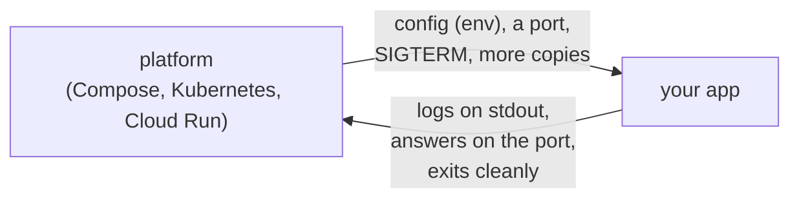

# 11.5 The Twelve-Factor App

Every platform you've met so far, from Docker Compose to Kubernetes to a cloud's container service, makes the same quiet assumptions about the program it runs. It expects to pass settings in as environment variables, to send traffic to a port, to read logs from standard output, to stop the program with a signal, and to start five more copies when traffic grows. A program that honours those assumptions moves between your laptop, CI and any cloud without changes. One that doesn't needs a custom runbook everywhere it goes. In 2011, engineers at Heroku, a platform that ran thousands of customers' apps, wrote those assumptions down as twelve rules: **The Twelve-Factor App**. This chapter explains each rule in plain words with a good and a bad example, connects each to what you've already learned, says honestly where the rules have aged, and ends with an audit you can run on any service.

## What you'll learn

- What the twelve factors are for: a **contract between an application and the platform** that runs it.
- Each factor in one sentence, with a concrete **good and bad** example and the chapter where you met it in practice.
- Where the methodology is **dated or debated in 2026**: secrets in environment variables, logs without metrics and traces, missing factors like identity, and the community rewrite under way.
- How to **audit** a service against the factors with a checklist, first on a stock container, then on snip.

---

## A contract between the app and the platform

:::note[Everyday anchor]
A shipping container works because of an agreement: standard size, standard corner fittings, standard door. Any crane in any port can lift it, any ship or truck can carry it, and nobody needs to know what's inside. The twelve factors are the corner fittings for software. An app that follows them can be picked up by any platform's cranes: deployed, scaled, restarted, moved.
:::

The **platform** is whatever runs your code: a Linux server with systemd, Docker Compose, Kubernetes, AWS ECS, Google Cloud Run, Heroku, Fly.io. The twelve factors split the work between platform and app. The platform provides settings, a port, somewhere for logs to go, signals to stop, and more copies on demand. The app promises to take settings from the environment, listen on the port it's given, write logs to stdout, stop cleanly when told, and keep no state that would stop another copy taking over.



Most of the factors will feel familiar, because earlier chapters taught them as good practice without the label. The value of the list is that it's a **checklist with names**: in a design review, "this breaks factor VI" is faster than three paragraphs. The original text is short and free at [12factor.net](https://12factor.net/).

---

## The factors, one by one

Each factor below has the rule in plain words, a good and bad example, and where you've seen it.

### I. Codebase: one codebase, many deploys

**Rule:** one app lives in one version-controlled repository ([chapter 3.1](../git/git-mental-model.mdx)), and every environment (dev, staging, production) runs a build of that same code at some commit.

- **Good:** staging runs commit `a1b2c3`, production runs `9f8e7d`; both are commits in one repository.
- **Bad:** a "production copy" of the code on a server that someone edits by hand; or two apps that share code by copy-paste instead of by a library.

A **monorepo** (many apps in one repository) is fine by the spirit of the rule as long as each app builds and deploys independently. The rule is really "every running thing traces back to one commit".

### II. Dependencies: declare them all, assume nothing

**Rule:** list every library and version in a manifest with a lock file, and never rely on something that happens to be installed on the machine.

- **Good:** Go's `go.mod` and `go.sum` ([chapter 4.3](../go/packages-modules-interfaces.mdx)), Python's `pyproject.toml` with a lock file, Node's `package-lock.json`. The build fetches exactly those versions.
- **Bad:** a script that calls `convert` (ImageMagick) or `curl` and works only because the old server had it installed. The new container doesn't, and the failure appears in production.

Containers ([chapter 9.1](../containers/what-a-container-is.mdx)) made this factor much easier: the image *is* the declaration of everything the app needs, down to the operating system libraries.

### III. Config: settings come from the environment

**Rule:** anything that differs between deploys (database addresses, API keys, feature switches, log level) is read from **environment variables**, never written into the code. The test: could you make the repository public right now without leaking a credential?

- **Good:** `DATABASE_URL=postgres://…` is set by the platform; the code reads it at startup and **fails loudly** if it's missing or malformed.
- **Bad:** `if hostname == "prod-1" { db = "10.0.0.5" }`, or a `config/production.yml` with passwords, committed to Git.

Config means what varies between deploys. Things that are the same everywhere (routes, the retry policy, which handler serves `/healthz`) stay in code. Environment variables keep the *same built image* usable in every environment ([chapter 5.4](../apis/structuring-a-real-service.mdx)). This factor is the most debated one in 2026; see "Dated and debated" below.

### IV. Backing services: attached by address, swappable

**Rule:** a database, cache, queue, email service or object store is an **attached resource**, reached through a URL or address in config. Your own Postgres and a managed one should be interchangeable by changing that address.

- **Good:** moving from a Postgres container to a managed database ([chapter 12.3](../cloud/compute-storage-databases.mdx)) is a change to `DATABASE_URL` and a restart. No code changes.
- **Bad:** code that assumes the database is on `localhost`, or reads files from a disk shared with another server.

### V. Build, release, run: three separate stages

**Rule:** turning code into a running service happens in three strict steps. **Build** turns a commit into an artifact (a container image). **Release** combines that artifact with one environment's config, and gets an ID. **Run** starts processes from a release. You never change code in a running release; you make a new one.

- **Good:** CI builds image `sha-a1b2c3` once ([chapter 11.2](./ci-with-github-actions.mdx)); staging and production each run *that same image* with their own config; rolling back means running the previous release ([chapter 11.3](./delivery-and-deployment.mdx)).
- **Bad:** running `git pull && npm install` on production servers, so each server may end up with different code and dependencies, and "what's running?" has no single answer.

GitOps ([chapter 11.4](./gitops.mdx)) is this factor taken further: the release, image tag plus config, is a commit in Git.

### VI. Processes: stateless, share nothing

**Rule:** the app runs as one or more processes that keep nothing important in memory or on local disk between requests. Anything that must survive goes to a backing service.

- **Good:** login sessions in Redis, uploads in object storage, so any copy can serve any request.
- **Bad:** sessions in a map in memory, so users are logged out whenever the load balancer picks a different copy; or uploads written to `/tmp` and lost when the container is replaced.

[Chapter 8.6](../distributed/scaling.mdx) calls this the precondition for scaling out, and lists where state likes to hide. **Sticky sessions** (always sending one user to the same copy) are a patch over a broken factor VI, not a fix.

### VII. Port binding: the app serves HTTP itself

**Rule:** the app is self-contained and **listens on a port** it's told about. It doesn't need a web server (Apache, a Java app server) injected around it at runtime.

- **Good:** a Go binary that calls `http.ListenAndServe(":8080", …)` ([chapter 5.1](../apis/first-http-server.mdx)), with the port from config. Put nginx in front if you like ([chapter 8.3](../distributed/reverse-proxies-and-nginx.mdx)), but the app works without it.
- **Bad:** an app that only works when copied into a specific directory of a pre-installed server.

### VIII. Concurrency: scale by adding processes

**Rule:** handle more work by running **more copies** of each kind of process (**process types**, such as `web` and `worker`), not by making one process bigger forever.

- **Good:** two process types from one codebase: the API scales with request rate, the background worker with queue depth ([chapter 8.2](../distributed/queues-and-background-work.mdx)). Kubernetes' autoscaler adds copies of either ([chapter 10.5](../kubernetes/operating-and-debugging.mdx)).
- **Bad:** one giant process that serves requests *and* runs nightly jobs, so scaling the web side also multiplies the nightly job (it now runs five times).

### IX. Disposability: start fast, stop gracefully

**Rule:** processes can be started or stopped at any moment. They start in seconds, and on **SIGTERM** they stop taking new work, finish what they're doing, and exit. If they're killed without warning, nothing is lost or corrupted.

- **Good:** graceful shutdown that drains in-flight requests within a deadline ([chapter 5.4](../apis/structuring-a-real-service.mdx)); a worker that only acknowledges a job after finishing it, so a crash means a retry, not a lost job ([chapter 8.2](../distributed/queues-and-background-work.mdx)).
- **Bad:** a process that ignores SIGTERM, so every deploy waits out the platform's grace period and then kills it mid-request; or one that needs two minutes to warm up, so autoscaling reacts too late.

A classic way to break this factor without noticing: the program isn't **PID 1** in its container, or is PID 1 and doesn't handle signals, so SIGTERM never arrives ([chapter 9.2](../containers/writing-dockerfiles.mdx)). The lab shows it.

### X. Dev/prod parity: keep the gaps small

**Rule:** development, staging and production should be as alike as possible in three ways: **time** (code reaches production hours after it's written, not months), **people** (the people who write code also deploy and watch it), and **tools** (the same kinds and versions of backing services everywhere).

- **Good:** Docker Compose runs the same `postgres:16` and `redis:7` locally that production runs ([chapter 9.3](../containers/docker-compose.mdx)); deploys happen daily.
- **Bad:** SQLite on laptops and Postgres in production. Queries that work locally fail in production on the first type mismatch or locking difference ([chapter 6.5](../data/transactions.mdx)).

The **time** and **people** gaps are what DevOps and the DORA metrics measure ([chapter 11.1](./how-software-ships.mdx)). Containers closed most of the **tools** gap; what remains is managed cloud services (a managed queue or database with no exact local twin), where teams use local emulators or a shared test environment.

### XI. Logs: write events to stdout, let the platform route them

**Rule:** the app doesn't manage log files. It writes a stream of events, one per line, to **standard output**, and the platform collects, stores and searches them.

- **Good:** one JSON object per line to stdout ([chapter 13.1](../observability/logs.mdx)); the platform ships them to Loki, CloudWatch or Elasticsearch.
- **Bad:** the app writes `/var/log/myapp.log` inside the container, rotates it itself, and the logs vanish with the container.

### XII. Admin processes: one-off tasks, same code, same config

**Rule:** maintenance tasks (database migrations, a data fix, creating the first admin user) run as **one-off processes** from the same release, with the same config, as the app itself.

- **Good:** `snip migrate` or `rails db:migrate` run as a Kubernetes **Job** ([chapter 10.2](../kubernetes/core-objects.mdx)) using the very image being deployed.
- **Bad:** someone SSHes into a production server and pastes SQL from a wiki page, or runs a script from their laptop against production with whatever code version they happen to have checked out.

---

## The checklist

One line per factor, to use in reviews and in the lab:

| # | Factor | Ask |
|---|---|---|
| I | Codebase | Does every running deploy trace back to one commit in one repository? |
| II | Dependencies | Does a clean build on a fresh machine work, with every version pinned? |
| III | Config | Can the same artifact run in every environment, changed only by env vars? Could the repo be made public without leaking a secret? |
| IV | Backing services | Can you swap the database or cache by changing an address? |
| V | Build, release, run | Is the artifact built once and promoted unchanged? Can you name and roll back to the previous release? |
| VI | Processes | Can any copy serve any request? Does a restart lose anything? |
| VII | Port binding | Does the app listen on a configured port by itself? |
| VIII | Concurrency | Can you add copies of each process type independently? |
| IX | Disposability | Does it start in seconds and exit cleanly within the grace period on SIGTERM? |
| X | Dev/prod parity | Do dev and production use the same backing services and versions? How long from commit to production? |
| XI | Logs | Does it write structured events to stdout and nothing else? |
| XII | Admin processes | Do migrations and fixes run as one-off processes from the same release? |

---

## Dated and debated in 2026

The methodology is fifteen years old, and parts of it show it. Knowing where people disagree is part of using it well.

**Secrets in environment variables.** Factor III puts *all* config in the environment, including passwords. Environment variables leak more easily than people expect: a debug page that dumps the environment, a crash reporter that attaches it, a child process that inherits it, `/proc/<pid>/environ` readable on the host. The common 2026 practice keeps non-secret config in env vars, but delivers **secrets** as files mounted from a secret manager, or avoids long-lived secrets entirely with **workload identity**, where the platform vouches for the app and short-lived credentials are fetched on demand ([chapter 7.6](../security/secrets-management.mdx), [chapter 7.11](../security/machine-identity-zero-trust.mdx)). The spirit survives (config is outside the code and the image), only the delivery changed.

**Dynamic config and feature flags.** Env vars are read at startup, so changing one means a restart. Feature flags ([chapter 11.3](./delivery-and-deployment.mdx)) and other runtime switches live in a flag service instead. That's an addition the original never imagined, not a contradiction.

**Logs are not enough.** Factor XI covers logs only. Modern services emit three kinds of telemetry: logs, **metrics** ([chapter 13.2](../observability/metrics.mdx)) and **traces** ([chapter 13.3](../observability/tracing.mdx)), increasingly through OpenTelemetry, and expose **health and readiness** endpoints for the platform to probe. Many teams add "telemetry" as a de facto factor.

**What's missing.** In 2016, Kevin Hoffman's book *Beyond the Twelve-Factor App* (O'Reilly) proposed three more: **API first** (design the contract before the code, [chapter 5.5](../apis/api-contracts.mdx)), **telemetry**, and **authentication and authorization**. Security and identity remain the biggest gaps in the original.

**Processes and admin tasks in a world of containers.** The text speaks of Unix processes and Heroku's "dynos". In Kubernetes, factor VIII's process types are Deployments, and factor XII's one-off processes are Jobs. Whether migrations should run as a separate Job (the factor's answer) or at app startup (convenient, but a bad migration then crash-loops every copy) is a live debate; snip, as you'll see, does both.

**Serverless.** Functions on AWS Lambda or Cloud Run's functions don't bind a port or control their own concurrency; the platform owns more of the contract. Most factors still apply, port binding and concurrency less so.

**The rewrite.** In November 2024 Heroku **open-sourced** the methodology and handed it to a community of maintainers from several companies, with the stated aim to "refine and modernize" it while keeping twelve factors and the original text available. The work happens in public at [github.com/twelve-factor/twelve-factor](https://github.com/twelve-factor/twelve-factor), on its `next` branch: separating each factor's principle from its examples, and discussing topics such as identity, dynamic config and merging the process-related factors. As of October 2026 no revised version has replaced the one on 12factor.net, so the original twelve remain the reference, and this chapter uses them. Check the repository for the current state.

---

## Apply it to snip: an honest audit

Here is snip measured against the checklist, with the evidence for each answer in the code.

| # | Verdict | Evidence |
|---|---|---|
| I | ✅ | One repository; the API and worker are two process types built from the same `snip/` code, both into one image (`snip/Dockerfile`). |
| II | ✅ | `snip/go.mod` and `go.sum` pin every module; the runtime image is distroless, so nothing undeclared can be relied on. |
| III | ⚠️ | Every setting is a `SNIP_*` environment variable, and `config.Load` rejects malformed values at startup (`snip/internal/config/config.go`). But see finding 1. |
| IV | ✅ | Postgres and Redis are attached by `SNIP_DATABASE_URL` and `SNIP_REDIS_ADDR`; the same code ran against containers, kind and the cloud. |
| V | ✅ | CI builds the image once and tags it by commit (`sha-…`) and version (`.github/workflows/image.yml`); kustomize and Helm combine it with config per environment. |
| VI | ⚠️ | Stateless with Postgres and Redis. In-memory mode is not, by design ([chapter 8.6](../distributed/scaling.mdx)'s lab shows the 302/404 flip). See finding 1. |
| VII | ✅ | `net/http` on `SNIP_HTTP_ADDR` (default `:8080`); nginx in front is optional. |
| VIII | ✅ | API and worker scale independently: `replicas: 2` for the API in `docker-compose.yml`, a HorizontalPodAutoscaler in `snip/deploy/k8s/base/hpa.yaml`. |
| IX | ✅ | `signal.NotifyContext` on SIGTERM, then `srv.Shutdown` with a 10-second budget (`snip/cmd/snip/main.go`); the worker acks only after writing, and reclaims a crashed worker's events ([chapter 8.2](../distributed/queues-and-background-work.mdx)). |
| X | ✅ | Compose and the Kubernetes manifests use the same `postgres:16-alpine` and `redis:7-alpine` images. |
| XI | ✅ | `log/slog` JSON to stdout (`Config.Logger`); no log files. Metrics and traces too ([Part 13](../observability/logs.mdx)). |
| XII | ⚠️ | `snip migrate` and `snip keys create` are one-off commands in the same binary. But see finding 2. |

Two findings worth discussing in a review:

1. **A missing database URL is a warning, not an error.** If `SNIP_DATABASE_URL` is empty, snip logs `SNIP_DATABASE_URL not set: using in-memory storage — everything is lost on restart` and starts anyway. That's a deliberate convenience for first-time readers, and it's exactly the kind of default factor III warns about: a typo in a production manifest gives you a service that *looks* healthy and forgets every link at the next deploy. A stricter design requires an explicit `SNIP_STORAGE=memory` to opt in. (The worker already refuses to start without both URLs: `snip-worker needs both SNIP_DATABASE_URL and SNIP_REDIS_ADDR`.)
2. **Migrations also run at startup.** Each API copy runs `pg.Migrate` before serving. A Postgres **advisory lock** (`pg_advisory_lock(7412)` in `snip/internal/store/postgres/postgres.go`) makes concurrent copies take turns, so it's safe. But a failing migration now stops every new copy from starting, and a slow one delays every rollout. Factor XII's answer, a migration Job that runs once before the rollout, is what larger teams do; snip already supports it (`snip migrate`) and could make startup migration optional.

Neither is a bug. Both are trade-offs a reviewer should be able to name, and the factors give you the vocabulary.

---

## Lab

Free, on your laptop, with Docker. First a stock container and a deliberately bad one, then snip.

1. **Audit nginx's official image against factors XI, VII and III.**
   ```bash
   docker run -d --name web -p 8088:80 nginx:1.27-alpine         # nginx on port 8088
   curl -s localhost:8088 >/dev/null                              # make one request
   docker logs web | tail -2                                      # XI: the access log is on stdout
   docker exec web ls -l /var/log/nginx/                          # access.log -> /dev/stdout, error.log -> /dev/stderr
   ```
   nginx predates containers and writes log files, so the image's makers symlinked those files to stdout and stderr: a factor XI retrofit. For factor III, the image also renders `/etc/nginx/templates/*.template` with environment variables at startup, so the same image can be configured per environment.

2. **Measure disposability (IX), good and bad.**
   ```bash
   time docker stop web                                           # well under a second: nginx handles the stop signal
   docker run -d --name sleepy alpine:3.22 sleep 300             # 'sleep' is PID 1 and has no SIGTERM handler
   time docker stop sleepy                                        # about 10 s: Docker waits, then SIGKILLs it
   docker rm web sleepy
   ```
   Those 10 seconds are the default grace period running out. PID 1 in a container ignores signals it doesn't explicitly handle, so `sleep` never hears SIGTERM. Every deploy of a service like that waits out the grace period and then kills it mid-work.

3. **Audit snip.**
   ```bash
   cd ~/code/zero-to-prod/snip
   docker compose up -d --build                                   # the whole stack
   docker compose config | grep SNIP_                             # III: all settings are env vars
   docker compose logs api | tail -3                              # XI: JSON lines on stdout
   docker compose exec api snip keys create audit                 # XII: a one-off admin process, same image and config
   docker compose up -d --scale worker=3                          # VIII: more copies of one process type
   time docker compose stop api                                   # IX: both copies exit in well under a second
   docker compose logs api | grep -E 'shutting down|stopped cleanly' | tail -2
   docker compose down
   ```
   Then fill in the checklist table yourself, with evidence, and compare with the audit above. Try finding 1 directly: `go run ./cmd/snip` with no environment variables, and read the first log line.

4. **Audit something of your own.** Pick a service you work on or an open-source app you use, and score it against the checklist. Most real services fail two or three factors; the useful output is the list of *which*, and whether each failure is a trade-off someone chose or an accident.

## Self-check

<Quiz
  id="shipping-twelve-factor"
  questions={[
    {
      q: 'A deploy takes 30 seconds per pod, and logs show each old pod being killed rather than exiting. Which factor is broken, and what do you check first?',
      options: [
        'Factor II: a dependency is missing from the image',
        'Factor IX: whether the app is PID 1 and handles SIGTERM',
        'Factor XI: whether logs are written to files',
        'Factor IV: whether the database is attached by URL',
      ],
      answer: 1,
      explain: 'Waiting out the full grace period (Kubernetes defaults to 30 s) and then being killed means SIGTERM didn’t lead to a clean exit. Check that the app is PID 1 (exec form in the Dockerfile, no shell wrapper) and that it handles SIGTERM with a graceful shutdown. The other factors don’t affect how a process stops.',
    },
    {
      q: 'Your team builds a new Docker image for staging, tests it, then builds again from the same commit for production. Which factor does this weaken, and why?',
      options: [
        'Factor I, because two builds mean two codebases',
        'Factor V: build once and promote the same artifact, or production runs untested bytes',
        'Factor X, because staging and production use different images on purpose',
        'None: the same commit always gives an identical image',
      ],
      answer: 1,
      explain: 'Build, release and run are separate so that the artifact you tested is the one you run. A second build can pick up a newer base image or dependency, so production runs something staging never saw. Builds from the same commit are not guaranteed identical unless everything is pinned and reproducible.',
    },
    {
      q: 'Which statement about factor III (config in the environment) reflects common practice in 2026?',
      options: [
        'All config, including secrets, belongs in environment variables',
        'Non-secret config in env vars; secrets as mounted files, a secret manager or workload identity',
        'Config belongs in a YAML file committed next to the code',
        'Environment variables are deprecated; use a config service for everything',
      ],
      answer: 1,
      explain: 'The core idea (config lives outside the code and the image, and varies per deploy) holds. What changed is secrets: env vars leak via crash reports, debug pages and child processes, so secrets are mounted as files, fetched from a secret manager, or replaced by short-lived credentials from workload identity. Committed YAML with secrets breaks the factor outright.',
    },
    {
      q: 'Users get logged out at random after you scale an app from one copy to three. Which factor was broken all along?',
      options: [
        'Factor VII, port binding',
        'Factor VI: sessions were kept in one process’s memory',
        'Factor VIII, because three copies is too many',
        'Factor XII, admin processes',
      ],
      answer: 1,
      explain: 'With one copy, in-memory sessions looked fine. With three, the load balancer sends a user to a copy that has never seen their session. Store sessions in a backing service (Redis, the database) or use signed tokens. Sticky sessions would hide the problem until a copy restarts.',
    },
  ]}
/>

<details>
<summary>snip falls back to in-memory storage when SNIP_DATABASE_URL is missing. Argue for and against keeping that behaviour, and say what you would do.</summary>

**For:** a first-time reader can run `go run ./cmd/snip` with nothing installed and see a working service in seconds. That lowers the barrier to learning, and the log line says plainly that data is lost on restart.

**Against:** config errors should fail at startup, not degrade silently. In production, a missing or misspelled variable (`SNIP_DATABSE_URL`) produces a service that passes health checks, serves traffic, and loses every link on the next deploy. Each copy also has its own private data, so behaviour flips between copies. That's the worst kind of failure: quiet, and discovered by users.

A good compromise keeps the convenience and removes the trap: require an explicit opt-in (`SNIP_STORAGE=memory`, or a `--dev` flag), and refuse to start if neither a database URL nor the opt-in is given. The rule behind it: **defaults should be safe in production; convenience should be asked for.**

</details>

<details>
<summary>The Twelve-Factor App is from 2011. Why is it still worth learning, and how would you explain its limits to a teammate who treats it as gospel?</summary>

It's worth learning because it names the contract every modern platform still assumes: settings from the environment, a port, stdout logs, graceful SIGTERM handling, stateless copies, one artifact promoted through environments. Kubernetes, Cloud Run and ECS all reward apps that follow it and punish apps that don't, and the factor numbers give teams a shared, fast vocabulary in reviews.

Its limits: it predates containers, Kubernetes and serverless, so its examples talk about Heroku dynos and Unix processes; it puts secrets in environment variables, which modern practice avoids; it treats logs as the only telemetry, with nothing on metrics, traces or health checks; and it says nothing about security, identity or API design. Its own maintainers are rewriting it for those reasons. Use it as a minimum bar for "deployable anywhere", not as a complete definition of production-ready; the rest of this handbook ([Part 7](../security/security-literacy.mdx) and [Part 13](../observability/logs.mdx), for a start) fills the gaps.

</details>
