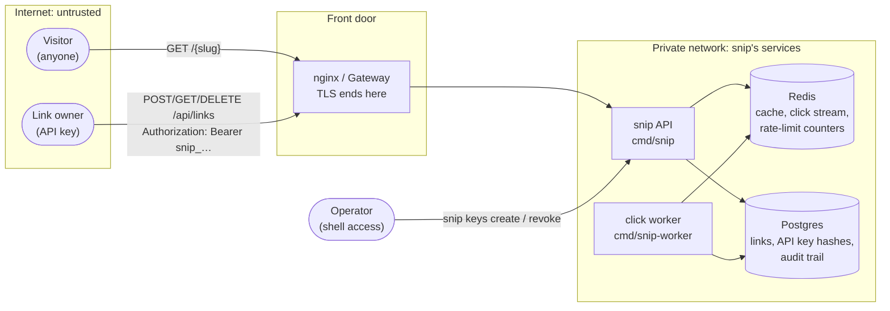

# snip threat model

A living document (handbook chapter 7.12). It answers Shostack's four
questions for snip: what are we working on, what can go wrong, what are we
going to do about it, and did we do a good job. Review it in any pull request
that adds an entry point, a data store, a dependency between components, or a
new kind of secret. The reviewer's question is "does this change a row below?"

- **Scope:** the snip API (`cmd/snip`), the click worker (`cmd/snip-worker`),
  Postgres, Redis, and the front door (nginx in `docker-compose.yml`, or the
  Kubernetes Gateway in `deploy/k8s/gateway/`). The AWS layout in `infra/aws/`
  has the same shape.
- **Out of scope:** the destination websites links point to, the CI pipeline
  (chapter 11.2), and the cloud account itself (chapter 12.4).
- **Last reviewed:** October 2026.

---

## 1. What are we working on?

**Trust boundaries** (where data crosses from less trusted to more trusted):

1. **Internet → front door.** Everything a visitor or owner sends is untrusted:
   paths, headers, bodies, the URLs they want shortened.
2. **Front door → snip API.** The proxy is trusted to forward requests, but the
   API still validates every input itself.
3. **API and worker → Redis.** Redis requires a password in every setup
   (`SNIP_REDIS_PASSWORD`; `--requirepass` in Compose, Kubernetes, Helm and
   `infra/local`). On AWS, ElastiCache also requires TLS (`SNIP_REDIS_TLS=true`,
   `transit_encryption_enabled` in `infra/aws/main.tf`); inside Compose and the
   cluster the traffic is plain, protected by the private network.
4. **API and worker → Postgres.** Credentials from the environment
   (`SNIP_DATABASE_URL`), for `snip_app`: a login that reads and writes rows
   but owns nothing. Migrations run separately as the schema owner
   (`SNIP_MIGRATE_DATABASE_URL`), and only that step gets the owner's
   credentials. TLS is required on AWS (`sslmode=require` in
   `infra/aws/main.tf`) but off in the local setups.
5. **Operator → the API's container.** API keys are created and revoked with
   the `snip keys` command, so whoever can run commands in the container can
   mint keys. The command records the name its operator gives
   (`--operator`), but nothing at this boundary checks that name.

**Assets:** the link table (where every short link points), API keys, the
audit trail (`audit_events`: who changed which key or link, and when), the
service's availability (redirects are the product), and click counts.

---

## 2. What can go wrong? 3. What are we going to do about it?

STRIDE (Spoofing, Tampering, Repudiation, Information disclosure, Denial of
service, Elevation of privilege) applied to each element above. **Status:**
*mitigated* (a defence exists, named with its file), *partial*, or *open*.

| # | Threat | STRIDE | Defence in snip | Status |
|---|---|---|---|---|
| T1 | Someone calls the management API as another owner | S | Bearer API keys of ~190 random bits (`internal/auth/keys.go`, `GenerateKey`); only SHA-256 hashes stored (`HashKey`, `api_keys.key_hash`); revocation with `snip keys revoke` | mitigated |
| T2 | A stolen database dump yields usable API keys | I, S | Only hashes are stored; the plaintext key is shown once (`auth.CreateKey`) | mitigated |
| T3 | An owner reads or deletes another owner's link | E, I | Every query is scoped by owner: `Service.Get` returns not-found for others' links; `DELETE … WHERE slug = $1 AND owner_id = $2` (`internal/store/postgres/postgres.go`) | mitigated |
| T4 | SQL injection through a slug or URL | T, E | Placeholders in every query (`internal/store/postgres/postgres.go`) | mitigated |
| T5 | Short links to `javascript:`, `data:` or `file:` URLs, or disguised `https://bank@evil` links | T | `NormalizeURL` accepts only `http`/`https` with a host and no user info (`internal/links/link.go`) | mitigated |
| T6 | snip is used to hide phishing and malware links | T (abuse) | Creation needs an API key and is rate limited per key (`internal/ratelimit`, `createLink` in `internal/httpapi/server.go`) | **partial:** no threat-list check, report button or takedown flow |
| T7 | Anyone who can reach Redis rewrites `snip:url:<slug>` and redirects a popular link to a site of their choosing | T | Redis reachable only from snip's pods (`deploy/k8s/base/networkpolicy.yaml`) and the private network; Redis requires a password (`SNIP_REDIS_PASSWORD`, from a Secret or Secrets Manager); on AWS only TLS with an AUTH token (`infra/aws/main.tf`, `SNIP_REDIS_TLS`); cache entries expire (`SNIP_CACHE_TTL`, default 1h) | **mitigated:** one password shared by API and worker with every command allowed (no per-service ACL users); rotation is manual; no TLS inside Compose or the cluster |
| T8 | Forged events on the click stream inflate counts | T | Same network isolation and Redis password as T7 | mitigated (counts are informational) |
| T9 | An owner denies deleting a link; we can't tell which key did what | R | Request logs carry `request_id`, route, status and, for authenticated calls, `owner_id` (never the key) (`observe` in `internal/httpapi/middleware.go`; added during the [13.7](https://jawwadzafar.github.io/zero-to-prod/learn/observability/security-incident-response) drill). An append-only audit table, `audit_events` (`internal/store/postgres/migrations/0002_audit_events.sql`), records every key created, rotated or revoked and every link created or deleted, with `owner_id`, `request_id` and the link's URL (never a key or its hash), written in the same transaction as the change (`record` in `internal/store/postgres/postgres.go`); a trigger refuses `UPDATE`, `DELETE` and `TRUNCATE` on it; `snip audit OWNER_ID` reads it. Key events also name the operator who ran `snip keys`: `--operator NAME` or `SNIP_OPERATOR`, else `"unknown"` and a warning (`keyOperator` in `cmd/snip/main.go`; `detail.operator`, added by `audit.DetailFor`). The API and worker sign in as `snip_app`, which owns nothing and may only `INSERT` and `SELECT` on `audit_events`, so neither a bug nor an injected query can drop the trigger or rewrite a row (`internal/store/postgres/migrations/0003_least_privilege.sql`); the schema owner's login reaches only the migration step (`SNIP_MIGRATE_DATABASE_URL`: the `migrate` service in Compose, an init container on Kubernetes, the `migrate` container on Terraform and ECS); `TestAppLoginIsLeastPrivilege` proves it against real Postgres | **mitigated:** whoever holds the owner's login (the migration step, and anyone who can read its Secret) or a superuser (Compose's and Kubernetes' `POSTGRES_USER`; RDS's master user is close to one) can still drop the trigger first; events aren't copied off the database to write-once storage; the operator's name is self-declared, not authenticated: anyone with a shell in the container can type someone else's, or leave it out. Only the platform's record of who opened that shell (a Kubernetes audit log entry for `kubectl exec`, if the cluster keeps one; CloudTrail for ECS Exec) ties a key event to a real identity; an admin API behind SSO would make snip check it itself |
| T10 | Forged `X-Request-ID` headers inject fake log lines | T, R | `validRequestID` accepts only short, plain IDs (`internal/httpapi/middleware.go`) | mitigated |
| T11 | Error responses leak internals (SQL errors, stack traces) | I | `writeDomainError` sends a generic message for unexpected errors and logs the detail (`internal/httpapi/errors.go`); panics recovered in `observe` | mitigated |
| T12 | `/metrics` reveals routes, traffic and error rates to the internet | I | nginx denies `/metrics` (`deploy/nginx/nginx.conf`) | **open on Kubernetes:** the Gateway's route forwards every path, including `/metrics` (chapter 10.3) |
| T13 | The pprof debug server exposes memory and goroutines | I | Off unless `SNIP_DEBUG_ADDR` is set; logs a warning when on (`cmd/snip/main.go`) | mitigated |
| T14 | Huge bodies, slow clients or floods exhaust the API | D | 16 KiB body limit (`maxBodyBytes`), server timeouts (`cmd/snip/main.go`), `limit` capped at 100 (`Service.List`), rate limit on creation | **partial:** redirects and failed authentications aren't rate limited; the limiter fails open if Redis is down (`internal/ratelimit/ratelimit.go`) |
| T15 | A Redis outage takes redirects down | D | Redis is a soft dependency: cache errors fall through to Postgres (`Service.Resolve`), readiness ignores Redis (ADR 0006) | mitigated |
| T16 | A deleted link keeps redirecting from the cache | T | `Service.Delete` writes a tombstone (`internal/cache/redis.go`) | **partial:** if that Redis call fails, the old entry lives until its TTL |
| T17 | Database credentials leak from config or images | I | Read from the environment (`internal/config/config.go`); on AWS, generated at apply time and kept in Secrets Manager (`infra/aws/main.tf`) | mitigated (local passwords are dev-only by design) |
| T18 | A compromised container gets root on the node | E | Non-root user, read-only root filesystem, all capabilities dropped (`deploy/k8s/base/api.yaml`); distroless image (`Dockerfile`) | mitigated |
| T19 | A vulnerable dependency or Go release | E, D | `govulncheck` in CI fails on reachable vulnerabilities; Dependabot updates weekly (`.github/`, chapter 7.13) | mitigated |
| T20 | A URL that grows past 2,048 bytes when normalised makes link creation fail with a 500 | D | `NormalizeURL` checks the length of its output, not only its input (`internal/links/link.go`); `FuzzNormalizeURL` in `internal/links/fuzz_test.go` found the original bug | mitigated |

---

## Open risks, ranked

Rated by likelihood × impact on a three-point scale (low, medium, high).

| Rank | Risk | Likelihood | Impact | Next step |
|---|---|---|---|---|
| 1 | T6: phishing links on a public instance | high | high | Check new URLs against a threat list (for example Google Safe Browsing), add a report endpoint and a way to disable a link |
| 2 | T12: `/metrics` public through the Kubernetes Gateway | high | low | Serve metrics on a separate port that no Service or route exposes |
| 3 | T14: redirect floods and key guessing aren't rate limited | medium | medium | Per-IP limit at the front door (nginx `limit_req`, Gateway policies) |
| 4 | T7: what remains after the Redis password | low | medium | Rotate the password on a schedule (Secrets Manager rotation and `auth_token_wo_version` on AWS); a Redis ACL user per service (API: cache, limiter, `XADD`; worker: stream reads only) |
| 5 | T9: what remains after the audit table and the app login | low | low | Ship events to write-once storage (for example S3 Object Lock) on a public instance; log DDL (`log_statement = 'ddl'`) and alert on `DROP TRIGGER`; keep the owner's and the master user's credentials for the migration step and break-glass use only; move key management to an admin API behind SSO, so the operator is an authenticated identity rather than a typed name |
| 6 | T16: stale redirect after delete during a Redis blip | low | low | Accept; the TTL bounds it |

Closed: T7 cache poisoning was ranked 2. Redis now requires a password in
every deployment and TLS on AWS; what is left of it is rank 4.

Closed: T9 "no lasting record of which key changed what" was ranked 3. The
append-only `audit_events` table now records every key and link change in
the same transaction as the change; what is left of it is rank 5. Rank 5
shrank too: snip's own login could drop the audit trigger until the API and
worker moved to `snip_app` (migration 0003), so now only the owner's login or
a superuser can. And key events used to say whose key changed but not who
changed it; they now carry the operator's name, which is a claim to check
against the platform's own audit log, not proof.

---

## 4. Did we do a good job?

- Every threat in the table names a file, so a reviewer can check the defence
  exists.
- Tests cover the defences that are code: owner scoping (T3) and URL and slug
  validation (T5) in `internal/links/service_test.go`; missing and revoked keys
  (T1) and the error shape (T11) in `internal/httpapi/server_test.go`;
  request-ID filtering (T10) in the same file. The audit trail (T9): events
  and their request IDs in `internal/store/memory/memory_test.go` and
  `TestLinkChangesAreAuditedWithRequestID`; against real Postgres,
  `TestAuditTrailIsWritten`, `TestDeleteWithoutAuditRowRollsBack` and
  `TestAuditTrailIsAppendOnly` in `internal/store/postgres/postgres_test.go`;
  the operator of key commands, `TestKeyOperator` in `cmd/snip/main_test.go`
  and `TestKeyEventsRecordTheOperator` in both store packages, and CI runs
  the three ways of naming it on the Compose stack; that the app's login can't drop the trigger, change the schema or rewrite
  the trail, while doing all of snip's work, `TestAppLoginIsLeastPrivilege` in
  `internal/store/postgres/logins_test.go`, and CI repeats the check with
  `psql` on the Compose and kind stacks.
- Fuzz tests (`internal/links/fuzz_test.go`) check the properties of URL and
  slug validation on generated inputs (T5, T20); run them with `-fuzz` nightly.
- Gap: owner scoping is tested on the service, not end to end over HTTP with
  two real keys. Add that test before the next change to the handlers.
- Each open risk has a next step above. When one is fixed, change
  its status here in the same pull request.
